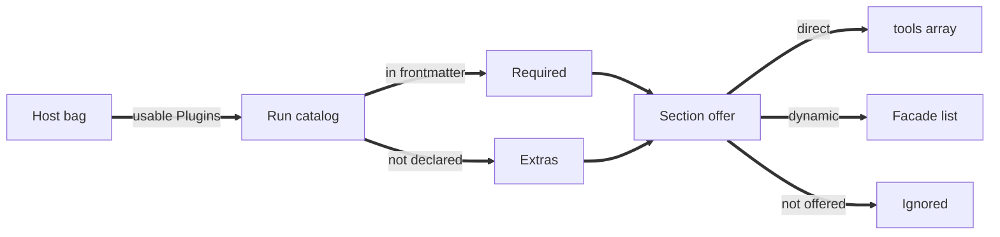

# Tool Offering in runvil: Three States per Plugin, a Built-in Discovery Facade, and a Frozen Tools Array

Report type: analytical and recommendation. It serves the decision on how runvil's prompt-facing Lua API offers tools to a section, and how the engine presents those tools to the model in each chat-completions request. Readers: Vinnie Falco, Greg, Jason, and Andrew Wheeler.

## Executive summary

runvil should give every Plugin offered to a section one of three states: ignored, dynamic, or direct. It should build the tool-discovery facade into the engine instead of shipping it inside the MCP Plugin. And it should freeze the model-facing `tools` array for the life of a message list. The October 14 huddle converged on the first two, and stated the third as a constraint. This report's measurements support all three. Confidence: high on the direction, because Anthropic and OpenAI both document the cache rule and both ship a discovery mechanism; medium on the details, because the Lua spelling is undecided and nobody has measured what discovered tools cost in model accuracy.

Two pressures drive the design. First, any change to the `tools` array invalidates the provider's prompt cache for the whole conversation. Anthropic's documentation says modifying tool definitions "invalidates the entire cache". Second, tool schemas are large. This Cursor session spends about 6,600 tokens on tools: 3,673 on the 9 tools it offers directly, and the rest on a list naming the others. Offering all 115 tools the session can reach would cost about 32,500 tokens, five times as much.

The three states map onto today's code with one new concept. "Ignored" is what happens now to any tool a section does not offer. "Direct" is what `tools.offer` and `plugins.offer` do now. Only "dynamic" is new: a tool the model can find and call through a two-tool facade, without its schema sitting in the `tools` array.

### Key findings

1. Cursor's fresh context offers 9 direct tools and names the rest. It lists 108 more tools across 7 namespaces by name only, and the model fetches a schema when it needs one. Cursor's own built-in tools, including `WebSearch`, `WebFetch`, and `Task`, sit behind the same facade as the user's MCP servers. Confidence: high, because this was measured in a live session.
2. runvil today rebuilds the `tools` array before every model call and orders it by first offer. A section that offers a tool between two `models.loop` calls therefore changes the prompt prefix mid-conversation, and no code guards against it. Confidence: high, because the code says so in a doc comment.
3. The current chat agent offers every extra tool directly. With the four MCP servers configured in this Cursor session, that would put 43 tools and about 11,500 tokens in the `tools` array, 35 percent of the chat agent's declared 32,768-token minimum context. The compactor's overflow estimate does not count tool schemas at all. Confidence: medium, because the Workshop's real MCP configuration may differ.
4. Namespace descriptions are a hidden fixed cost. Cursor withholds per-tool descriptions until fetched, but it always shows each namespace's instructions. The browser namespace's instructions alone cost 1,088 tokens, more than any single browser tool. Confidence: high, because this was measured.
5. Some schemas serve the product, not the model. Cursor's `Task` tool costs 1,946 tokens, and about 526 of them (27 percent) serve the cloud feature or the user interface. A headless pipeline such as paperweight should never pay for that. Confidence: high, because this was measured.
6. The engine already has two precedents for built-in tools. The task built-ins (`task`, `task_cancel`, `task_status`, `await_tasks`) are engine-injected and gated by `tools.allow_tasks`. And the package registry has a "native" Plugin kind whose "behavior will live in the Engine", reserved today for subagents. A September plan deferred discovery as an ordinary Plugin; the huddle moved it toward the engine. Confidence: high on the facts.
7. Discovered tools may cost accuracy, but nobody has measured it. Vinnie's concern is that models are trained on tools in the `tools` array, not on schemas that arrive in a tool result. It is a roughly even chance that this costs measurable accuracy on small local models. Confidence: low, because there is no data either way.

### What to do next

- Vinnie: choose the Lua spelling for the dynamic state, and the default states for the chat agent and for pipelines (section 5.1). Confidence: medium, because the huddle left the spelling open.
- Greg: prototype the engine-built-in facade and the frozen-array rule (sections 5.2 and 5.3). Confidence: high, because both rest on documented provider behavior.
- An owner to be named: benchmark direct calls against facade calls on the local models runvil targets, before making the facade the default for pipelines. Confidence: high, because the accuracy question is the largest unknown.
- Whoever next touches the compactor: count tool schemas in the overflow estimate. Confidence: high, because the measured sizes are a large share of small context windows.

## Contents

- Executive summary
- 1. The decision is how a section exposes tools to the model
- 2. Seven criteria come from the huddle itself
- 3. The measurements confirm the cache rule and the cost of schemas
- 4. Only the three-state design serves both pipelines and chat
- 5. Recommendation: three states, a built-in facade, a frozen array
- 6. Six design questions remain open
- 7. The figures are one session's snapshot, and accuracy is unmeasured
- Appendix A. Everything the huddle said on tools, plugins, and MCP
- Appendix B. Measurement method and per-tool numbers
- References

## 1. The decision is how a section exposes tools to the model

runvil has two API surfaces for tools, and the huddle was about the seam between them. The prompt-facing surface is the frontmatter `plugins:` list plus the Lua `tools.*` and `plugins.*` tables that a section's code calls. The model-facing surface is the chat-completions request, which holds the message history, the `tools` array of tool schemas, and `tool_choice`. The design question is which tools a section can put in front of the model, in what form, and when.

This report uses one term per concept:

- **The `tools` array** is the list of tool schemas sent with each chat-completions request. The huddle called it "the tool catalog".
- **The run's catalog** is runvil's set of every tool a run could offer, held in the engine's `ToolSet`. It is larger than any `tools` array.
- **The Host's Plugin bag** is every Plugin a Host installs at startup. Vinnie's phrase was "a bag of plug-ins".
- **A direct tool** has its full schema in the `tools` array.
- **A dynamic tool** is reachable only through the discovery facade.
- **The discovery facade** is a pair of tools: one that looks up tool schemas, and one that calls a tool by name. Cursor calls them `GetDynamicTools` and `CallDynamicTool`.
- **A message list** is the Lua object a section builds with `messages.new()` and passes to `models.loop`.
- **The prefix cache** is the provider's reuse of saved model state for an unchanged prompt prefix. The huddle called it "the KV cache".

### Today, no tool reaches the model unless a section offers it

The Host builds its Plugin bag once. The Workshop installs `web`, `user-input`, and a native `subagents` Plugin that has no tools yet. It then installs one MCP Plugin per entry in the configured `mcp.json` file, named after the server (`crates/workshop/server/src/agents.rs`, lines 80-191). Every usable installed Plugin's tools enter every run's catalog, declared or not, but none reach the model until the section's Lua offers them.

The frontmatter `plugins:` list declares which Plugins a prompt requires. If a required Plugin is missing or unavailable, the run is refused before it starts, with a notice that begins "the environment cannot satisfy this prompt:" (`crates/runvil-internal/engine/src/execute/requirements.rs`, lines 104-118). Everything installed but not declared is an extra. Lua reads the two groups through `plugins.required()` and `plugins.extras()`, and the matching tool lists through `tools.required()` and `tools.extras()`.

A section scopes tools with four calls. `tools.offer` adds tools by id, `plugins.offer` adds every tool of a Plugin, `tools.offer_local` registers a Lua function as a tool, and `tools.allow_tasks` adds the four engine-injected task built-ins. Before each model call, the engine assembles the `tools` array in a fixed order. The `tools.offer` tools come first in first-offer order, then each offered Plugin's tools in id order, then local tools, then task built-ins. The doc comment on the assembly function states the timing rule:

> "Rebuilt at each model operation so `tools.offer`, `plugins.offer`, and `tools.offer_local` calls between blocks reach the next model turn." (`crates/runvil-internal/lua/src/vm/state.rs`, lines 166-167)

The request sets `tool_choice` to `"auto"` whenever the array is non-empty (`crates/harness-gateway-client/src/wire/request.rs`, lines 19 and 59). Each tool's wire name is its id with `/` and `.` replaced by `_`, so `web/fetch` becomes `web_fetch`.

The MCP Plugin connects in the background, lists every page of the server's tools within two minutes, and turns each one into a tool with the server's full description and input schema. Once a server is ready, its tool list stays fixed (`crates/plugin-mcp/src/lib.rs`, lines 23-38; `crates/plugin-mcp/src/server.rs`, lines 51-86). Vinnie described this at [1:36]: "it contacts the server, and it adds everything that's on the server as a tool."

The shipped chat agent is the clearest example of today's defaults. It offers the `web` Plugin, then offers every extra tool directly, then loops on one message list:

```lua
plugins.offer("web")
tools.offer(tools.extras())
local history = messages.new()
```

(`crates/workshop/agents/agents/chat.md`, lines 28-30.)

### The huddle ran 51 minutes, with Vinnie for the first 37

The huddle ran on October 14, 2026, from 9:24 to 10:15 AM Pacific. Vinnie led the first 37 minutes and left at [37:09]. Greg, Jason, and Andrew Wheeler continued until [50:54], and Greg took the action to review the transcript and check the conclusions with Vinnie. Timestamps in this report, written as [minutes:seconds], are offsets from the huddle's start. Appendix A extracts every design point the huddle made, in order.

## 2. Seven criteria come from the huddle itself

The huddle never listed criteria, but each argument it made appeals to one. Each criterion below names the passage it comes from, so the options in section 4 are judged against the team's own reasoning.

1. **Cache stability.** The `tools` array must not change while a conversation continues, because "once you offer a set of tools, you better not change it. The only opportunity to change it is on a compaction, or on a context clear or in a subagent" (Vinnie, [1:16]).
2. **Context economy.** The model should not pay for schemas it will not use, because many MCP servers mean "your context gets flooded" (Vinnie, [1:53]), and every tool's schema has a typed, described entry for every parameter (Vinnie, [28:24]-[31:12]).
3. **Call accuracy.** The model should call its tools reliably. That favors a small direct set a small model can handle (Vinnie, [6:59]), structured tools over shell commands (Vinnie, [11:09]-[12:03]), and native tool placement over schemas delivered in a tool result (Vinnie, [13:14]-[13:54]).
4. **Per-section control.** A pipeline prompt must decide, section by section, which tools exist and in what form, because "pipelines, they know which tools they want" (Vinnie, [12:21]-[12:52]; [35:38]-[36:33]). Greg's planned prompt debugger, which steps through sections, raises the stakes (Greg, [45:35]).
5. **Reproducibility across Hosts.** A prompt that depends on a tool should fail loudly where the tool is missing, instead of silently running differently (Jason, [23:53] and [49:41]; Andrew, [49:53]).
6. **Interactive reach.** In the Workshop's chat, the model should be able to find tools nobody planned for, because "we don't know what's going to be asked for" (Greg, [18:14]; Vinnie, [24:21]).
7. **Headless fitness.** Model-facing schemas should hold no user-interface or product-specific fields, because subagents must run headless in a pipeline such as paperweight (Greg, [33:25]-[34:01]).

## 3. The measurements confirm the cache rule and the cost of schemas

### 3.1 Any change to the `tools` array discards the cached prefix

Both major providers document Vinnie's cache claim. Anthropic builds its cache prefix in the order `tools`, then `system`, then `messages`, and its invalidation table says: "Modifying tool definitions (names, descriptions, parameters) invalidates the entire cache." The same page says a change to `tool_choice` also invalidates the cache [R1]. OpenAI says "cache reuse requires the entire rendered prefix to match", and lists the `tools` setting as one that changes the prefix through "tool names, descriptions, schemas, ordering, or tool-specific instructions" [R3]. Both are primary vendor documents, read on October 14, 2026. The same logic applies to any local server that reuses a cached prefix, wherever its chat template renders the tools ahead of the history. This report did not check the templates runvil's gateway uses.

OpenAI's guide also prescribes a remedy the huddle did not mention. Under "Manage tools with append-only updates", it says to keep tool definitions and ordering stable, to set `tool_choice` to `"none"` instead of removing tools, and to "use `allowed_tools` to restrict which tools are callable while keeping the supplied `tools` list stable" [R3]. That separates two things runvil currently couples: which tools the model can see, and which it may call this turn.

runvil today guards none of this. The `tools` array is rebuilt before every model call, so a section that offers a tool between two `models.loop` calls changes the prefix under an existing conversation. The array is ordered by first offer, so two sections offering the same tools in different orders produce different prefixes, and OpenAI lists ordering as a prefix change. The exposure is narrower than it sounds, because each section starts with a fresh Lua state and no offers, and a message list persists across sections only when the author passes it along. The risk lives inside one section's loop, and in authors who reuse one message list across sections.

The team already has the matching rule for messages, but not for tools. The October 9 messages refactor recorded Vinnie's words: "Because of prefix cache invalidation, changes to the prefix of the messages should be visible and explicit" (`runvil/vibe/2026-10-09-2-messages-userdata-refactor.md`, line 523). No equivalent rule covers the `tools` array.

Vinnie's specific MCP worry at [1:53], that a server changing its tools would invalidate the cache, cannot happen inside a run today. The MCP Plugin freezes a server's list once it is ready, and the run's catalog is fixed at run start. The live risk is the prompt's own offering, not the server.

One consequence reaches past the direct tools. If a discovery facade lists tool names up front, as Cursor's does, that list is part of the prefix too. Changing which tools are dynamic mid-conversation would then invalidate the cache just as surely as changing a direct schema.

### 3.2 Cursor offers 9 tools directly and names 108 more

Cursor keeps its fresh context small by offering a short fixed set and naming everything else. This report measured every tool schema reachable from this session by fetching each namespace through the facade and counting the result. Table 1 shows the totals. Appendix B gives the method and the per-tool figures.

Table 1. Tool schemas reachable from this Cursor session on October 14, 2026, in o200k_base tokens of compact OpenAI `tools` JSON. "Namespace text" is the namespace's always-visible instructions. MCP tool counts include the `mcp_auth` tool Cursor adds to each server.

| Namespace | Placement | Tools | Schema tokens | Tokens per tool | Namespace text | Largest tool (tokens) |
|---|---|---|---|---|---|---|
| Cursor direct set | direct | 9 | 3,673 | 408 | none | `Grep` (781) |
| `cursor` built-ins | dynamic | 13 | 7,506 | 577 | 139 | `Task` (1,946) |
| `cursor-origin` (Git host) | dynamic | 32 | 7,788 | 243 | 86 | `grep_contents` (555) |
| `user-github` | dynamic | 22 | 6,800 | 309 | 202 | `issue_write` (809) |
| `cursor-ide-browser` | dynamic | 16 | 2,779 | 174 | 1,088 | `browser_click` (263) |
| `user-pinecone-search` | dynamic | 11 | 3,338 | 303 | 811 | `query` (520) |
| `user-wg21-wiki` | dynamic | 10 | 1,005 | 100 | 72 | `get_meeting_sessions` (173) |
| `user-wg21-papers` | dynamic | 4 | 506 | 126 | 55 | `get_paper_download_url` (229) |

The direct set is `Shell`, `Glob`, `Grep`, `Read`, `StrReplace`, `Write`, `AskQuestion`, `GetDynamicTools`, and `CallDynamicTool`. That confirms Vinnie's count of 9 at [6:52], and his count of 7 once the facade pair is set aside at [7:11]. The facade pair itself costs 900 tokens. The up-front list of namespace names, tool names, and namespace text costs about 2,884 tokens, so a fresh context spends about 6,557 tokens on tools.

Offering every one of the 115 tools directly would cost about 32,495 tokens, 5.0 times as much. Cursor's approach saves 80 percent here. Anthropic reports that a typical five-server setup "can consume ~55k tokens in definitions" and that its tool search "typically reduces this by over 85 percent" [R2]. That is a vendor claim about its own product, but it agrees with the measurement.

Tool count matters for accuracy as well as tokens. Anthropic states that "Claude's ability to pick the right tool degrades once you exceed 30-50 available tools" [R2]. Cursor's 9 sit far below that range. The current runvil chat agent, with the four MCP servers of this session installed as extras, would offer 43 MCP tools plus its own, and land inside it.

### 3.3 Per-tool descriptions wait, but namespace text is always paid

Cursor withholds every per-tool description until the model asks, but it always shows each namespace's instructions. Vinnie read this correctly at [8:03]: the up-front list has "no description", so Cursor relies on "tool names that are suggestive of what the tool does". The cost he did not mention is the namespace text. The browser namespace's instructions cost 1,088 tokens, more than its largest tool, and the Pinecone namespace's cost 811. Together they are about two thirds of the 2,884-token name list.

Anthropic recommends the same shape for its own tool search: "Add a system prompt section describing available tool categories" [R2]. A runvil facade will need a one-line summary per Plugin, and a budget for it, or one verbose Plugin will cost every run that lists it.

### 3.4 A few tools hold most of the weight, and some of it serves the product

Schema weight is concentrated. In the `cursor` built-ins, `Task`, `TodoWrite`, and `AwaitShell` together cost 4,091 of 7,506 tokens. Descriptions dominate Cursor's own tools, at 62 percent of the built-ins' tokens. MCP schemas are mostly structure instead: descriptions are 12 percent of `user-github` and of `cursor-ide-browser`.

Vinnie pulled up the `Task` schema at [28:47] to show the cost of one tool. Table 2 breaks it down by what each part does.

Table 2. Cursor's `Task` (subagent) tool, 1,946 tokens in total, split by purpose. The remaining 61 tokens are JSON structure.

| Part | Tokens | What it serves |
|---|---|---|
| Main description | 1,013 | model guidance, including 124 tokens of link-formatting rules for the chat UI |
| `environment` and `cloud_base_branch` | 308 | the cloud agent feature; repeats the 123-token link rules |
| `description` (the tab title) | 94 | the UI's tab title |
| `resume` and `interrupt` | 140 | steering a running subagent |
| `model`, `subagent_type`, `prompt`, `file_attachments`, `run_in_background` | 330 | launching the subagent |

About 526 tokens, 27 percent of the tool, serve the cloud feature or the user interface rather than the model's choice to launch a subagent. Vinnie reacted to exactly these parts. At [32:40] he noted the model spends "thinking budget... just to put the name in the title bar of the tab", and said a local model could do that job. At [35:02] he saw the cloud parameters and said "we're paying for all that for their cloud feature." Greg named the principle at [33:25]: "the tool itself has like UI specific stuff baked right into it, but we want to be able to use subagents headless in something like paperweight... this is the wrong level."

### 3.5 Most of the huddle's account of Cursor holds, with five corrections

This report checked each claim the huddle made about Cursor against this session. Most hold: 9 direct tools, no web search by default, namespace and tool names listed up front without per-tool descriptions, schemas returned as an ordinary tool result, four user MCP servers, and a namespace that drives the browser. Five claims need correcting or qualifying.

- **Read and Grep are direct, not behind the facade.** At [4:26] Vinnie listed "read file" and "grep" among the hidden tools. The hidden built-ins are `AwaitShell`, `CreateGoal`, `Delete`, `EditNotebook`, `FetchMcpResource`, `GenerateImage`, `ReadLints`, `SwitchMode`, `Task`, `TodoWrite`, `UpdateGoal`, `WebFetch`, and `WebSearch`.
- **The lookup takes `namespace`, `toolName`, and `pattern`.** At [8:30] Vinnie named "the server, the name space, and then the tool". All three parameters are optional, as he said, but none is called `server`; that name belongs to `FetchMcpResource`.
- **The pattern matches names, not descriptions.** At [2:48] Vinnie described matching "the word web in its description". The tool's own description says the pattern "searches namespace and tool names... using RE2 syntax", and says nothing about case-insensitivity. Pattern and catalog results also cut long descriptions to 200 characters.
- **The fresh-subagent claim is unmeasured.** At [4:07] Vinnie said a fresh subagent sees only the facade. This session's main agent sees 9 direct tools, as Vinnie himself showed at [6:26]; no subagent's tool set was measured.
- **The duplicate `list_commits` comes from two different hosts.** At [27:10] Vinnie saw `list_commits` twice. `cursor-origin` and `user-github` share seven tool names plus `mcp_auth`, but one is Cursor's Git host and the other is GitHub, and the origin namespace's instructions say GitHub repositories "are not visible here". The namespace is what tells them apart. runvil's wire names already include the Plugin name, so two such Plugins would not collide.

One further detail surfaced in measurement: fetching a namespace reveals an `mcp_auth` tool in five MCP namespaces that the up-front list omits.

### 3.6 The providers ship the same pattern, but with native calls

Anthropic and OpenAI both ship discovery, and both differ from Cursor in one way that bears on Vinnie's accuracy concern. Anthropic's tool search lets the caller mark tools `defer_loading: true`. When the model searches, by regular expression or by BM25 natural-language query, the API returns up to five matches by default and "automatically expands these references into full tool definitions" [R2]. It states that "the prefix is untouched, so prompt caching is preserved." OpenAI offers the same `defer_loading` search, where "discovered tools are appended at the end of context", and an `additional_tools` input item for adding tools mid-thread [R3].

The difference is in how the model calls a discovered tool. In Cursor, the model calls `CallDynamicTool` and nests the real tool's arguments inside an `arguments` object; the real tool never becomes a tool. In the provider versions, a discovered tool becomes a real tool that the model calls natively. Vinnie's worry at [13:37], that models "may not be trained on" tools that arrive as a tool result, bites harder on the proxy form. A related effect is likely: if a server constrains tool-call arguments with a grammar built from the `tools` array, a proxied call's inner arguments go unconstrained. Anthropic notes that its strict-mode grammar "builds from the full toolset", deferred tools included, which suggests it treated the problem as real. Confidence: medium, because no runvil server was tested.

For runvil, the native form needs a gateway that controls how tool definitions render mid-conversation. The proxy form works with any chat-completions server. Anthropic also documents a client-side variant of tool search [R2], so neither form is tied to one vendor.

### 3.7 runvil already has half the pieces

Several things the huddle wants already exist. A section offers tools explicitly, and nothing reaches the model by default. The ask tool reaches the model only when Lua offers it: "Neither installing nor declaring the Plugin advertises anything to the model" (`crates/plugin-user-input/src/lib.rs`, lines 60-64). That matters for Vinnie's complaint at [7:11] about a run that sat for hours on an unanswered question; a pipeline that never offers `user-input/ask` cannot stall that way. Required and extra Plugins are already separate, and the engine already injects built-in tools behind an opt-in, `tools.allow_tasks`.

The registry also has a slot for exactly what Vinnie described at [16:04], built-ins that "appear like an MCP server" but are "linked in directly into the executable". It is the native Plugin kind: "Built into every registry; its behavior will live in the Engine, and today's one native, `runvil/subagents`, has none yet" (`crates/harness-internal/runner/src/packages.rs`, lines 37-38). A native Plugin has a name a prompt can declare and offer, while its behavior lives in the engine.

Four pieces are missing. There is no dynamic state. The `tools` array has no stability rule. The chat agent offers every extra directly. And the compactor's overflow estimate leaves tool schemas out: "tool schemas and the system template are not counted" (`crates/runvil-internal/lua/src/compactors.rs`, lines 193-197).

The discovery idea itself is older than the huddle. The September 13 Plugins plan deferred "the discovery Plugin" and framed it this way: "Progressive discovery is an advertising problem, not a binding problem... dispatch should reject unadvertised aliases (enforced hiding, so injected content cannot talk the model into a Lua-only tool)". It cited "Plugins like bashkit carry 142 commands" as the motivation (`runvil/vibe/2026-09/2026-09-13-1-capabilities-global-naming.md`, line 579). The huddle keeps the idea, and moves its home from an ordinary Plugin into the engine.

## 4. Only the three-state design serves both pipelines and chat

The huddle discussed three designs outright. The provider documents add a fourth, and the September plan holds a fifth. Table 3 scores each against the seven criteria of section 2, and the paragraphs after it give the reasons.

- **Option 0, do nothing.** Keep direct-only offering, with the chat agent offering every extra directly.
- **Option 1, copy Cursor whole.** Every prompt gets a small fixed direct set, everything else sits behind the facade, and a prompt cannot promote a tool to direct.
- **Option 2, three states per section.** Each offered Plugin or tool is ignored, dynamic, or direct, chosen per section, with the facade built into the engine. This is the huddle's design (Vinnie, [35:20]-[36:33]).
- **Option 3, a stable superset.** Send one fixed `tools` array for the whole conversation, and vary which tools are callable each turn with `allowed_tools` or `tool_choice`, as OpenAI recommends.
- **Option 4, discovery as an ordinary Plugin.** The September 13 deferred design: a Host-installed Plugin that contributes a search tool over the run's catalog.

Table 3. The five options against the seven criteria. "Yes" meets the criterion, "partly" meets it with a caveat named in the text, and "no" fails it.

| Option | Cache | Context | Accuracy | Per-section | Reproducible | Interactive reach | Headless |
|---|---|---|---|---|---|---|---|
| 0. Do nothing | partly | no | partly | yes | yes | partly | yes |
| 1. Copy Cursor whole | yes | yes | partly | no | partly | yes | partly |
| 2. Three states per section | partly | yes | partly | yes | yes | yes | yes |
| 3. Stable superset | yes | no | partly | partly | yes | no | yes |
| 4. Discovery as a Plugin | partly | yes | partly | partly | yes | yes | yes |

**Doing nothing fails on context as soon as the Workshop has a few MCP servers.** The four servers in this session would add 11,481 tokens and 43 tools to every chat request, inside the range where Anthropic says selection accuracy degrades. Cache stability is only partial, because nothing stops a section from changing its offers mid-loop.

**Copying Cursor whole fails the pipelines.** It meets the cache and context criteria, but it takes away the one thing Vinnie insisted on: a pipeline section must be able to put web search "front and center" in the `tools` array (Vinnie, [12:52]-[13:14]). It is only partly headless, because Cursor's fixed set includes the blocking `AskQuestion`. Reproducibility suffers too, because a fixed facade invites prompts to depend on whatever the Host happens to expose.

**Three states per section meets every criterion except two caveats.** It controls context, gives each section its own shape, keeps required Plugins in the frontmatter for reproducibility, and lets the chat agent reach unplanned tools. The first caveat is cache stability: per-section changes collide with a shared message list unless the frozen-array rule of section 5.3 comes with it. The second is accuracy: dynamic tools are called through a proxy, while direct tools stay native.

**A stable superset is a discipline, not a design.** It meets the cache criterion by construction, but every request still pays for every schema, and the model cannot reach anything outside the superset. It works well as a rule inside option 2: within one message list, restrict instead of remove. This report did not verify `allowed_tools` support in the local servers runvil targets.

**Discovery as an ordinary Plugin puts the facade on the wrong side of the contract.** A Plugin's contract gives it its own tool list and its own calls, and a call's context offers only the tool id, file access, the call's origin, and service lookup (`crates/runvil-plugin/src/context.rs`, lines 59-80). It does not offer the section's scope. The facade needs both the section's states and the run's catalog, so the engine would have to expose them to a Plugin anyway. Vinnie reached the same conclusion at [31:30]-[32:03]: "they should not be part of an MCP tool... it should be like the tasks tool. It should be an integral part of the engine."

## 5. Recommendation: three states, a built-in facade, a frozen array

Adopt option 2, and apply option 3's discipline inside each message list. Confidence: high on the direction, because the cache rule and the measured costs both point to it and the huddle reached it independently; medium on the specifics below, because none has been prototyped. Figure 1 shows the path a tool takes from the Host to the model under this design.



Figure 1. Under the recommended design, the Host decides what exists, the frontmatter decides what must exist, and each section decides how the model sees each tool: in the `tools` array, through the facade, or not at all.

### 5.1 The Lua surface needs one new state and one new argument

"Ignored" needs no API, because it is what already happens to any tool a section does not offer. "Direct" is today's `tools.offer` and `plugins.offer`. Only "dynamic" is new. The huddle produced three spellings for it.

The first is a mode argument on the existing calls, which Greg believes Vinnie would prefer: "having an argument to the single offer... you can pass like the plugin name and then the tool name optionally" (Greg, [39:22]-[40:41]). Today both calls reject a second argument, with the message "plugins.offer takes one Plugin or a list of them, got extra ..." (`crates/runvil-internal/lua/src/plugins.rs`, lines 174-179). Adding one therefore breaks no existing prompt.

The second is separate functions, one per state, which Andrew suggested: "offer direct... dynamic... and restrict" (Andrew, [39:04]-[39:15]). It doubles the surface, because both `tools` and `plugins` would need each function.

The third is path addressing, which Jason suggested and Greg illustrated: a Plugin name, a slash, and either one tool or a star for all of them (Jason and Greg, [40:46]-[41:14]). In runvil's ids that reads `web/search` for one tool and `web/*` for a whole Plugin. Most of it exists already, since `tools.offer` takes tool ids and `plugins.offer` takes Plugin names. Only the wildcard is new, and it repeats what `plugins.offer` does.

Recommend the mode argument, with direct as the default so every existing prompt keeps its meaning. Confidence: medium, because it is the smallest backward-compatible change, but Vinnie has not confirmed it. A section in the chat agent would then read:

```lua
plugins.offer("web")
plugins.offer(plugins.extras(), "dynamic")
tools.offer("github/list_commits")
```

The first line puts the web tools in the `tools` array as today. The second makes every extra Plugin findable without putting any of its schemas in the array. The third promotes one tool from an otherwise dynamic Plugin to direct, the case Andrew raised at [36:40].

Defaults should follow the huddle's split between chat and pipelines. The chat agent should offer its core tools directly and every extra dynamically, instead of today's `tools.offer(tools.extras())`. Vinnie flagged the current behavior at [24:56]: "this plugins.offer, this looks wrong... does that mean that plugins.offer would offer all of this?" Confidence: high, because the measured cost of the current default is 11,481 tokens with four servers. A pipeline section should offer exactly what it names and nothing dynamic unless it asks, because "pipelines don't need dynamic tools" (Vinnie, [12:21]). Andrew stated the general rule at [48:05]: load into the direct tools only what "we absolutely know... we want to use", and leave the rest dynamic.

### 5.2 The facade belongs in the engine, under a native Plugin name

Build the facade into the engine, and give it a name through the native Plugin kind, as `subagents` already has. Confidence: medium, because the native kind fits the need but has never held working tools. The engine owns the behavior, because only the engine sees each section's states, the run's catalog, and which tools the model has looked up. The native name lets a prompt require the facade, leave it out, or offer it, like any other Plugin. The September plan called it `discovery`. Vinnie floated an "MCP" name at [15:46], but the facade also covers built-in Plugins such as `web` (Vinnie, [16:04]), so a name tied to MCP would mislead.

The facade should keep Cursor's two-tool shape and fix what the measurements exposed.

- **Lookup** returns the full schema of one tool, or of every tool in one Plugin, and supports a pattern search. The search should cover descriptions as well as names, as Anthropic's does over "tool names, descriptions, argument names, and argument descriptions" [R2], since Jason's concern at [9:25] was many similar-sounding names.
- **Call** dispatches by tool id with an arguments object, and refuses any tool the section did not make dynamic. That is the September plan's "enforced hiding", which stops injected content from steering the model to a tool the author never exposed.
- **The up-front list** names each dynamic Plugin and its tool ids, with a one-line Plugin summary under a hard length cap. That keeps a verbose Plugin from costing what Cursor's browser namespace costs (section 3.3).
- **Direct tools stay out of the lookup.** Vinnie specified this at [16:32]: if a section offers web search directly, "if they call get dynamic tools, then it won't show these two."
- **Model-facing schemas hold no product fields.** The Host should derive tab titles and similar metadata itself, which applies first to the subagent tools the `subagents` native will gain (section 3.4).

Start with the proxy form, because it works with any chat-completions server, and revisit native calls if the benchmark in section 5.4 shows a gap. Confidence: medium, because the accuracy cost is unmeasured.

### 5.3 Freeze the `tools` array for the life of a message list

The first model call on a message list should fix that list's `tools` array and facade name list. A later call with a different set should be refused, unless the author starts a new message list or compacts the existing one. Those are the moments Vinnie named as legitimate at [1:16]: "compaction... context clear... or in a subagent." This applies to tools the rule the team already adopted for messages, that prefix changes should be "visible and explicit". Confidence: medium, because it reverses the documented behavior that offers between `models.loop` calls reach the next turn, and some prompts may rely on it.

The engine should also order the direct tools deterministically, for example by tool id, instead of by first offer. OpenAI lists ordering as a prefix change, and a stable order lets two sections that offer the same tools share a prefix. Confidence: medium, because no code was found that relies on first-offer order, but nobody has confirmed that.

Where the gateway supports restricting callable tools without changing the array, a section that wants fewer tools mid-conversation should restrict them instead of removing them. Confidence: low, because local server support is unverified.

### 5.4 Count schemas, measure accuracy, and support pinning

Count tool schemas in the compactor's overflow estimate. Confidence: high, because the four measured servers alone would fill 35 percent of the chat agent's 32,768-token minimum context, and the estimate currently ignores them.

Benchmark direct calls against facade calls on the local models runvil targets, measuring call success and argument validity, before choosing the facade as the default for any pipeline. Confidence: high, because this is the largest unknown in the design.

Support the development workflow Jason and Andrew worked out at [49:02]-[50:12]. An author develops with extras dynamic, then asks which dynamic tools the model actually used, then promotes those Plugins to the frontmatter and offers them. Promoting them makes the prompt fail at start on a machine that lacks them, which Jason accepted at [50:12] ("OK, that makes sense"). A report of which dynamic tools a run called would make the workflow cheap. Confidence: medium, because the value depends on how often authors develop this way.

## 6. Six design questions remain open

**Is the standard file tool set a Plugin, and what is its name?** Vinnie wondered at [15:46], "Is that a plug-in? I don't know. Maybe that's a plug-in", and floated a "core" or "std" name. The answer decides whether the chat agent's direct core is declared like any Plugin or wired into the engine.

**Does the facade list built-in Plugins alongside MCP servers?** Vinnie implied yes at [16:04], and Cursor does so. Section 5.2 assumes yes.

**How do the states relate to the frontmatter and to extras?** Greg was unsure at [44:12]: "I don't know how it fits in with... this dynamic tool thing, like, this is a kind of a separate thing." This report reads the three as independent questions. The frontmatter says what must exist. Extras are what may exist. The state says how a section shows each tool to the model.

**Should a blocking question tool ever be direct in an unattended run?** Vinnie's complaint at [7:11] was a run that stopped at step one for three hours on a question, and Jason added that models sometimes ask ten questions in a row when one list would do. runvil already keeps the ask tool hidden unless offered. Whether pipelines need a non-blocking variant is open.

**Should a local model generate UI metadata such as tab titles?** Vinnie suggested it at [33:01]. It follows from section 5.2's rule that model-facing schemas hold no product fields, but nothing in the huddle decided it.

**How do section-by-section debugging runs interact with frozen arrays?** Greg described the planned prompt debugger at [45:35], with breakpoints and stepping through sections. If each section starts its own message list, per-section states are cache-safe. If a debugger replays one list across sections, the rule in section 5.3 will refuse changes, and the debugger will need to start fresh lists.

## 7. The figures are one session's snapshot, and accuracy is unmeasured

The transcript is auto-generated, and several terms are garbled. The product name appears as "Runville", which does not occur in the runvil codebase, so this report uses runvil throughout. "Grip" is grep, "load lints" is `ReadLints`, "ad Jason config" is the `mcp.json` file, and "Queen 99 billion" is a small Qwen model whose size the transcript lost. Quotations keep the transcript's words, with stutters removed.

The token counts use OpenAI's o200k_base tokenizer, not Claude's or Qwen's, and leave out the per-tool overhead each chat template adds. The 9 direct Cursor schemas were reconstructed from this session's tool definitions; the 108 dynamic schemas were fetched live. All figures are one snapshot of one Cursor session and version, and Cursor's direct set may differ by mode.

Nothing in this report measures accuracy. Every statement about how well models call proxied tools is inference from vendor documents.

The runvil code was read at commit `ba9ee1f6c` (October 14, 2026). A code-search subagent traced the request assembly path; the citations used here were then checked directly in the source. The Workshop scenario with four MCP servers is hypothetical, and runvil's MCP client supports only remote Streamable HTTP servers, so a local server would install as unavailable. Paperweight's code is not in the runvil repository, so statements about it come from the huddle.

## Appendix A. Everything the huddle said on tools, plugins, and MCP

This appendix extracts every design point, measurement, and piece of analysis the huddle made on these topics, grouped by topic and in time order within each group. Each entry gives the timestamp and the speaker. Entries that section 3.5 corrects say so.

### A.1 The `tools` array and the prefix cache

- [0:31, Vinnie] A request to an OpenAI-style endpoint holds an array of messages, which is the history, plus the new request.
- [0:51, Vinnie] The request must also hold the tool catalog.
- [1:01, Vinnie] The tool catalog is a single JSON blob holding every tool, and changing it invalidates "most of the KV cache".
- [1:16, Vinnie] Once a set of tools is offered, it must not change. The only chances to change it are compaction, a context clear, or a subagent.
- [1:29-1:32, Jason and Vinnie] Jason confirmed the cost is lost caching; Vinnie said the cause is that "the prefix of the context has changed."

### A.2 The MCP Plugin as built today

- [1:36, Vinnie] The current MCP Plugin contacts the server and adds every tool on it as a tool.
- [1:53, Vinnie] First problem: if a server's tools change, the cache is invalidated. Section 3.1 notes this cannot happen inside a run today.
- [1:53, Vinnie] Second problem: with many MCP servers configured, "your context gets flooded with all these tools in the catalog."
- [2:13, Vinnie] The method for solving it: take the approach another program already uses, and do it their way.

### A.3 How Cursor's facade works, as presented

- [2:30, Vinnie] Cursor exposes MCP through two tools, get dynamic tools and call dynamic tool.
- [2:48, Vinnie] The lookup searches all MCP tools by match, such as every tool with "web" in its description, so the model discovers tools incrementally. Section 3.5 corrects this: the pattern matches names, not descriptions.
- [3:04, Vinnie] The model can ask whether a tool exists for a job, instead of seeing the whole catalog at once.
- [3:20, Vinnie] Adding a server to the MCP configuration makes its tools discoverable.
- [3:37, Vinnie] A paperweight built this way would see only the two facade tools. To fetch papers it would look up "paper", read the tool definition, and then call it.
- [4:07, Vinnie] Cursor puts its own built-in tools behind the facade, so "a fresh sub-agent" sees only the facade. Section 3.5 notes this is unmeasured.
- [4:26, Vinnie] The facade's description tells the model to use it for web search, read file, fetch, grep, and read lints. Section 3.5 corrects this: read file and grep are direct.
- [4:55-5:11, Vinnie] runvil needs the same, because adding file tools and GitHub tools will flood the context.
- [5:38, Vinnie] The file tools are the basic set: read file, write file, string replace, and grep.
- [6:01-6:26, Vinnie] Vinnie shared a dump of Cursor's fresh context. It has 9 tools, and web search is not among them.
- [6:46-6:52, Andrew and Vinnie] Andrew asked whether the top tools are outside the facade; Vinnie confirmed they are, 9 in all.
- [6:59, Vinnie] Nine is a small number that a small Qwen model could use well.
- [7:11, Vinnie] Without the facade pair, the set is 7.
- [7:11-7:38, Vinnie and Jason] Vinnie is "beginning to hate" the ask-question tool, because an unattended run stopped at step one for three hours on a question. Jason added that models sometimes ask ten questions in a row when one list would do.
- [7:42-8:03, Vinnie] The lookup tool's description lists each MCP namespace and its tool names, with no per-tool description.
- [8:03, Vinnie] Cursor therefore relies on tool names that suggest what each tool does.
- [8:30, Vinnie] The lookup has three optional parameters: server, namespace, and tool. Section 3.5 corrects this to namespace, tool name, and pattern.
- [8:46, Vinnie] The model can fetch the schema of one tool, such as just web fetch and web search, without pulling in anything else.
- [9:10, Vinnie] Or it can fetch a whole namespace, which for Cursor's Git host would be a lot.
- [9:25, Jason] Concern: a search for "search" returns many tools with similar names that all differ slightly.
- [9:43, Vinnie] The lookup accepts a regular expression, which Vinnie described as case-insensitive.
- [10:00, Vinnie] Cursor gives the model all the tool names up front.
- [10:12, Vinnie] The namespaces that start with "user", such as the GitHub and WG21 wiki servers, are Vinnie's own four MCP servers.
- [10:34-10:39, Vinnie] The plan: replace "Cursor" with runvil's own name, so runvil gets its own Git host namespace and its own IDE namespace.
- [10:45-10:53, Vinnie] The last namespace is how Cursor drives the browser, and Vinnie wants the same.

### A.4 Why structured tools beat shell commands

- [10:57, Jason] Why have separate tools for things a shell can do, such as glob and grep?
- [11:09, Vinnie] Those tools are so common that they are optimized.
- [11:27, Vinnie] With a read-file tool instead of `cat`, the model does not have to think about shell syntax. Filling out a JSON template is easier than producing a command line.
- [11:38, Jason] Agreed: with a command line you have to know the flags.
- [11:49, Vinnie] A command line also allows pipes, background processes, multiple commands on one line, and a choice of shell. Structured tools sidestep all of that.

### A.5 Pipelines versus chat

- [12:09, Vinnie] Vinnie and Greg had concluded that runvil should copy Cursor.
- [12:21, Vinnie] But runvil cannot copy Cursor completely, because pipelines don't need dynamic tools. They know which tools they want.
- [12:39, Vinnie] Each section should decide its own tools.
- [12:52, Vinnie] In the Workshop's agent window, web fetch and web search could sit behind the facade instead of in the default set.
- [12:52-13:14, Vinnie] In a pipeline prompt, web fetch and web search should be "front and center", in the tools section of the request.
- [13:14-13:37, Vinnie] The catch: the facade returns tool schemas as a tool result at the end of the conversation, not in the place where tools normally go.
- [13:37-13:54, Vinnie] Models are trained on direct tools and may not be trained on schemas delivered as a tool result, so runvil "might lose a few points on the benchmarks."
- [14:13, Vinnie] For built-in tools like web search and web fetch, a prompt should be able to offer them directly, for example with `plugins.offer` on web. If it does not, they move to the facade.
- [14:32, Vinnie] The dynamic tool system should be tightly integrated with the engine.
- [15:01-15:46, Vinnie] The standard tools, such as the files Plugin, would form a core group, maybe named "core" or "std". Whether that is a Plugin is undecided.
- [15:46, Vinnie] The facade might be called runvil's MCP.
- [16:04-16:14, Vinnie] Cursor's built-ins appear to the lookup like an MCP server, but they are linked into the executable.
- [16:14-16:32, Vinnie] A prompt should be able to offer web fetch and web search so they appear as direct tools, and then the lookup will not show them.
- [16:51-17:10, Greg] Greg's restatement: the team is deciding where the line falls between tools in the direct schema and tools kept in the dynamic list, invoked through call dynamic tool.
- [17:17, Jason] Why have both facade tools, when a tool can just be called once found?
- [17:27-18:04, Greg] The lookup is for discovery. A pipeline that already knows its tools does not need it; a model that sees "web search" in the list and needs it calls it through the call tool.
- [18:07-18:53, Greg] The facade makes sense in a working chat, where nobody knows what will be asked and many tools are unlikely to be used. Paperweight always knows its tools, and one of them is web search.
- [18:53-19:18, Greg] The question for paperweight: leave web search dynamic and call it without a lookup, or make it part of the direct set.
- [19:21-19:33, Vinnie] More specific still: a research agent should be able to offer the web Plugin, then loop.
- [19:53-20:15, Jason] Since prompts are static for a run, maybe offer the model no tools except those the prompt declares, not even default file tools.

### A.6 The Plugin model: Host bag, required, extras

- [20:20, Vinnie] At startup the Host creates a Host context, a bag of every Plugin it could ever use.
- [20:44, Vinnie] When a prompt runs, every Plugin in the bag is offered to it.
- [21:03, Vinnie] A Plugin listed in the frontmatter, such as web, is required, and the prompt will not run without it.
- [21:13-21:32, Vinnie] Plugins the Host offers but the prompt does not require go into an extras list, which the prompt can offer to the model.
- [21:32-21:53, Vinnie] Offering extras lets the model take the initiative with any additional tools the Host provides.
- [21:53-22:10, Vinnie] Example: require web and leave MCP optional. One section does web-only research; another also offers whatever extras the Host provides, which can include MCP servers.
- [22:27-22:53, Andrew and Vinnie] Optional Plugins are not defined in the prompt file; the Host decides what it knows about.
- [22:53-23:11, Vinnie] Paperweight will list its allowed Plugins explicitly, and will probably require MCP.
- [23:11-23:30, Vinnie] Paperweight's MCP configuration will hold only the paper store: not the Pinecone search, not the wiki, not GitHub.
- [23:30, Vinnie] The Host creates the sandbox of allowed Plugins, the prompt decides which are required, and it can optionally offer the rest.
- [23:53, Jason] A prompt may then run differently on two machines with different MCP servers.
- [24:11, Vinnie] "How could it be any other way?"
- [24:16, Jason] An author who does not want that can just not offer the extras.
- [24:21, Vinnie] The Host controls the Plugins, and the Workshop wants that behavior, because users install Plugins there.
- [24:29-24:50, Jason and Vinnie] Paperweight does not use the Workshop as its Host in production. It has its own command-line Host, which loads no DLLs.
- [24:56-25:12, Vinnie] `plugins.offer` on the extras "looks wrong", because with all these MCP servers it would offer all of them.
- [25:57-26:08, Vinnie] Mapping Cursor onto Plugins: its direct file tools would be the standard Plugin, the basic set for touching the environment, without which "you're in a bubble."
- [26:19, Vinnie] The ask-question tool would belong to the user-input Plugin.
- [26:29-26:34, Vinnie] The facade would belong to MCP, or be built in and always present, or be a named Plugin.
- [26:47, Vinnie] Each Cursor namespace is like a Plugin: the built-ins are one, the Git host is another.
- [27:10, Vinnie] The GitHub namespace and the Git host both have `list_commits`, which "doesn't look healthy." Section 3.5 explains it.
- [27:30-28:05, Vinnie and Greg] If runvil ran in this environment and a prompt offered its extras, would it get all of these? Greg: yes, if the Host has them in its bag.
- [28:07-28:15, Jason and Vinnie] Cursor has all of that too, but it does not give it to the model at once; the model has to explore.

### A.7 The cost of a schema: Cursor's Task tool

- [28:24, Vinnie] Offering a tool means more than giving its name.
- [28:47-29:42, Vinnie] Vinnie showed the full schema of Cursor's subagent tool, "probably one of the most complicated tools", as the model receives it.
- [29:46-30:49, Vinnie] The description strings are very long, so this cannot go into the context every time.
- [30:49-31:12, Vinnie] Every tool has a schema like this, with a type and a description for every parameter, and the description must guide the model. "We cannot offer all of these."
- [31:19-31:27, Greg] That is presumably why Cursor keeps them dynamic.
- [32:40, Vinnie] One parameter exists to put a name in the tab's title bar, spending the model's thinking budget on it.
- [33:01, Vinnie] A local model could do that job.
- [33:01-33:15, Vinnie] Paperweight should not have that parameter.
- [33:25-34:01, Greg] The tool has user-interface details baked in, but subagents must run headless in paperweight. This is the wrong level for presentation details.
- [34:10-34:27, Vinnie] The model slug parameter makes sense.
- [34:27-34:44, Vinnie] The resume parameter is notable: Vinnie said OpenAI's tooling lacks it and uses a different tool with different semantics.
- [34:44, Vinnie] The subagent type and the long file-attachments description drew comment.
- [34:44-35:02, Vinnie] The execution environment parameter, local or cloud, serves Cursor's cloud feature: "cloud, we don't need that... we're paying for all that for their cloud feature." The cloud base branch parameter is the same.
- [35:02, Vinnie] The interrupt parameter lets the caller steer a running agent.

### A.8 Where the facade lives

- [31:30, Vinnie] Perhaps the design is wrong in imagining the facade as part of an MCP Plugin.
- [31:46, Vinnie] It should be built into the engine, and be part of the language.
- [32:03, Vinnie] It should be like the tasks tool, an integral part of the engine.
- [35:20, Vinnie] The dynamic tool capability should be built in.

### A.9 The three states

- [35:38, Vinnie] A Plugin offered to a prompt has three possible states.
- [35:38-35:56, Vinnie] Ignored: its tools appear neither among the direct tools nor in the dynamic namespaces.
- [35:56, Vinnie] Dynamic: its tools appear only in the dynamic namespaces.
- [35:56, Vinnie] Direct: its tools appear only among the direct tools.
- [35:56-36:33, Vinnie] The prompt must control this per section: unavailable in one section, dynamic in the next, direct in the one after.
- [35:56-36:33, Vinnie] The prompt must also be able to make individual tools direct, without the rest of their Plugin.
- [36:40, Andrew] Example: offer direct tools, offer no dynamic tools, but offer one tool that would otherwise be dynamic.
- [36:49, Vinnie] "Something like that."

### A.10 After Vinnie left: spelling, frontmatter versus offer, and workflow

- [37:33-37:53, Greg] Greg was not fully clear on the design; Vinnie wants the design right before moving things around.
- [37:53, Greg] The Workshop does not have most of these tools yet.
- [38:12-38:29, Jason] The three levels make sense: ignore a tool, make it direct, or make it findable by the model.
- [38:33-38:52, Greg] Partial loading of a dynamic Plugin's tools was new to Greg.
- [38:52, Jason] It makes sense: an MCP server might offer 20 tools when a prompt needs one.
- [39:04-39:15, Andrew] Instead of a single offer function, have separate ones: offer direct, offer dynamic, and restrict.
- [39:22-39:43, Greg] Vinnie would probably prefer one offer function with an argument.
- [39:43-40:00, Greg] It is unclear whether the offer needs to know whether a tool is dynamic or direct.
- [40:00-40:41, Greg] No separate function is needed for part of a Plugin; pass the Plugin name and, optionally, a tool name, and get just that tool.
- [40:46-40:56, Jason] Namespacing may give this for free, as Plugin slash tool.
- [41:03-41:22, Andrew, Greg, and Jason] Examples: web slash web search for one tool, slash star for all of a Plugin's tools.
- [41:24, Jason] What is the difference between the frontmatter and calling the tool offer function?
- [41:34-42:13, Greg and Andrew] The frontmatter says which Plugins are required; an offer says which tools are available in that section of code.
- [42:13-43:07, Greg] The Host can offer more than the frontmatter names, and a prompt can use them, but it must recover if they are missing. A Plugin it cannot do without goes in the frontmatter, so a missing one is an error.
- [43:08-43:38, Greg] A section offers only what it needs. With two required Plugins, the first section may offer one and the second section the other.
- [43:38-44:12, Greg] For optional tools, a prompt checks the extras to see whether something like file editing exists, and acts on it if so, without making it a hard requirement.
- [44:12, Greg] It is unclear how this fits with the dynamic tool design; it seems a separate thing.
- [44:33-45:05, Jason] A static Markdown prompt is a different kind of thing from a dynamic chat, because the prompt states its requirements up front.
- [45:05-45:33, Jason and Andrew] When a chat runs a prompt, the prompt runs to completion; there is no way to run one section of it.
- [45:35, Greg] A prompt debugger is a planned feature, with breakpoints, stepping, and the inputs and outputs of each section.
- [46:02, Jason] That explains the attention to per-section control: in the Workshop, an author pulls a prompt apart and runs it section by section.
- [46:25, Jason] Offering the extras is not a problem in itself, because an author who does not want everything can name tools one by one.
- [46:49-47:08, Greg] A prompt author must be mindful of what is loaded, and Vinnie may want a lazy option.
- [47:13-47:32, Andrew] A prompt may run on machines whose tools nobody knows in advance.
- [47:32-47:57, Andrew] Perhaps everything goes behind the facade, so offering the extras just puts them there, and they would already be there.
- [48:03, Jason] "It's either dynamic or direct, and otherwise it's ignored."
- [48:05-48:29, Andrew] Do not load everything into the direct tools, because it is already available through the facade; load into the direct tools only what the prompt knows it will use.
- [48:36, Greg] The facade's whole purpose is that tools do not enter the context until the model asks for them.
- [49:02-49:19, Jason] A possible workflow: develop with every extra available, then ask the model which tools it used, and add exactly those.
- [49:28, Andrew] The author could ask which dynamic tools it used and write calls for those.
- [49:41, Jason] But how does that prompt run the same on another machine with different MCP servers?
- [49:53, Andrew] Put that MCP server in the frontmatter as a requirement, and offer its tool.
- [50:12, Jason] Then the prompt fails at start on a machine without it, which "makes sense."
- [50:29, Greg] Greg will run the transcript and check the conclusions with Vinnie.

## Appendix B. Measurement method and per-tool numbers

The measurements answer one question: how many tokens of tool material would a request hold under each arrangement. The method has four steps, and anyone with this Cursor session's tools can repeat it.

1. For each of the 7 dynamic namespaces, call `GetDynamicTools` with the namespace name. It returns every tool's full description and input schema.
2. For the 9 direct tools, copy the definitions from the session's tool list.
3. Serialize each tool as an OpenAI chat-completions tool object, `{"type":"function","function":{"name","description","parameters"}}`, in compact JSON, and count tokens with `tiktoken` 0.14.0 using the o200k_base encoding.
4. Count each namespace's instructions on their own as "namespace text". Count the up-front name list as one line per namespace, holding the namespace name, its tool names without `mcp_auth`, and its instructions.

The fresh-context figure of 6,557 tokens is the 9 direct tools plus the name list. The all-direct figure of 32,495 tokens is the 7 direct tools other than the facade pair, plus all 108 dynamic tools. Tables B1 and B2 give the per-tool figures behind Table 1 for Cursor's own tools.

Table B1. Cursor's 9 direct tools, in o200k_base tokens, largest first.

| Tool | Tokens | Description tokens |
|---|---|---|
| `Grep` | 781 | 274 |
| `Shell` | 600 | 172 |
| `GetDynamicTools` | 486 | 361 |
| `CallDynamicTool` | 414 | 115 |
| `AskQuestion` | 375 | 147 |
| `Read` | 347 | 195 |
| `StrReplace` | 281 | 159 |
| `Glob` | 250 | 78 |
| `Write` | 139 | 70 |

Table B2. Cursor's 13 built-in tools behind the facade, in o200k_base tokens, largest first.

| Tool | Tokens | Description tokens |
|---|---|---|
| `Task` | 1,946 | 1,013 |
| `TodoWrite` | 1,170 | 890 |
| `AwaitShell` | 975 | 699 |
| `SwitchMode` | 743 | 617 |
| `EditNotebook` | 742 | 443 |
| `GenerateImage` | 535 | 309 |
| `WebFetch` | 336 | 182 |
| `WebSearch` | 321 | 200 |
| `FetchMcpResource` | 244 | 51 |
| `ReadLints` | 226 | 126 |
| `UpdateGoal` | 117 | 74 |
| `Delete` | 86 | 39 |
| `CreateGoal` | 65 | 25 |

For comparison, runvil's own web tools are smaller than Cursor's. A code-search pass found about 670 characters of description and schema for `web/fetch` and about 956 for `web/search`, against 1,615 and 1,481 characters for Cursor's `WebFetch` and `WebSearch`. Those runvil figures are approximate.

## References

Primary sources:

- Huddle transcript, October 14, 2026, 9:24 to 10:15 AM Pacific; participants Vinnie Falco, Greg, Jason, and Andrew Wheeler. Auto-generated, with the garbles noted in section 7.
- Tool measurements taken in this Cursor session on October 14, 2026, by the method in Appendix B.

Vendor documentation, all read on October 14, 2026:

- [R1] Anthropic, ["Prompt caching"](https://docs.claude.com/en/docs/build-with-claude/prompt-caching), Claude documentation. Source of the cache hierarchy and the invalidation table.
- [R2] Anthropic, ["Tool search tool"](https://docs.claude.com/en/docs/agents-and-tools/tool-use/tool-search-tool), Claude documentation. Source of `defer_loading`, the 30-50 tool accuracy threshold, and the 55k-token example.
- [R3] OpenAI, ["Prompt caching"](https://platform.openai.com/docs/guides/prompt-caching), OpenAI platform guide. Source of the prefix-matching rule and "Manage tools with append-only updates".

runvil code, at commit `ba9ee1f6c` (October 14, 2026):

- `crates/runvil-internal/lua/src/vm/state.rs`, lines 160-167: the order and timing of the `tools` array.
- `crates/runvil-internal/lua/src/tools.rs` and `crates/runvil-internal/lua/src/plugins.rs`: the Lua `tools` and `plugins` tables, including the one-argument check at `plugins.rs` lines 174-179.
- `crates/runvil-internal/lua/src/compactors.rs`, lines 193-197: tool schemas left out of the overflow estimate.
- `crates/runvil-internal/engine/src/execute/requirements.rs`, lines 104-118: refusal of a run whose required Plugin is missing.
- `crates/runvil-internal/engine/src/execute/scheduler/builtins.rs`, lines 1-48: the four task built-ins.
- `crates/harness-gateway-client/src/wire/request.rs`, lines 19 and 59: `tool_choice` set to `"auto"`.
- `crates/harness-internal/runner/src/packages.rs`, lines 37-38 and 118-119: the native Plugin kind and the `subagents` native.
- `crates/runvil-plugin/src/context.rs`, lines 59-80: what a tool call's context offers a Plugin.
- `crates/plugin-mcp/src/lib.rs`, lines 23-38, and `crates/plugin-mcp/src/server.rs`, lines 51-86: how the MCP Plugin lists and keeps a server's tools.
- `crates/plugin-user-input/src/lib.rs`, lines 60-64: the ask tool reaches the model only when offered.
- `crates/workshop/server/src/agents.rs`, lines 80-191: the Workshop's Plugin installs.
- `crates/workshop/agents/agents/chat.md`, lines 28-30: the chat agent's offers.

Prior runvil plans:

- `runvil/vibe/2026-09/2026-09-13-1-capabilities-global-naming.md`, line 579: the deferred discovery Plugin and enforced hiding.
- `runvil/vibe/2026-10-09-2-messages-userdata-refactor.md`, line 523: the rule that prefix changes are visible and explicit.

---

*2026-10-14 11:59 - Claude Opus 5.5 (Cursor agent)*
