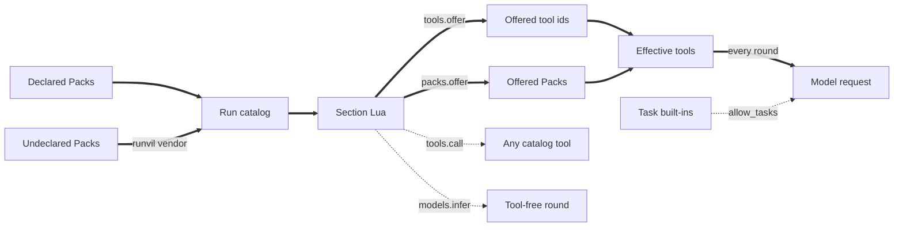
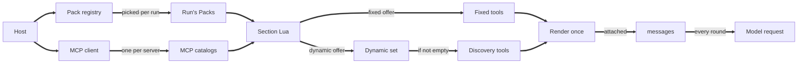
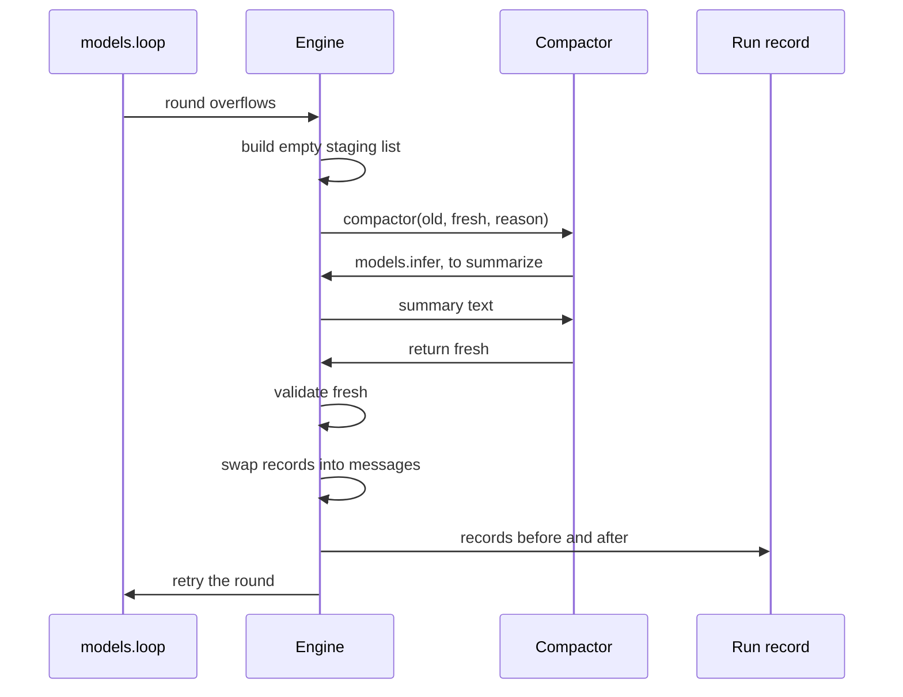
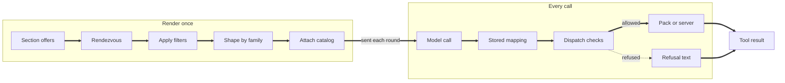
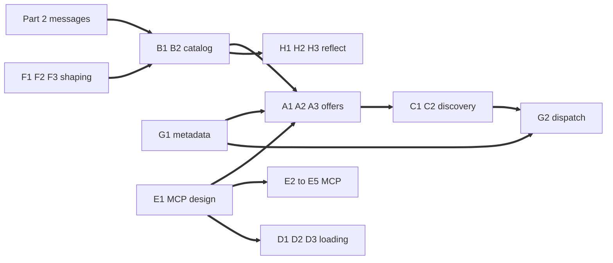

# Tooling and MCP in Runvil: Lua Places Packs Fixed or Dynamic, the Engine Renders One Catalog per Section Conversation, and MCP Becomes a Catalog-Providing Pack

- Type: analytical / recommendation.
- Audience: a new Runvil maintainer, and Vinnie Falco as the decider.
- Decision served: how Runvil offers tools to models, how models discover tools held back from them, and how Runvil integrates MCP.
- Inputs: `runvil` at `b1bbe33eb`, `runvil-docs` at `62ae759`, and `wg21-paperflow` at `693ef8ab`; the Runvil Slack thread, the huddle with Jason, and the design discussion with Vinnie Falco, all on 2026-10-20; Runvil plan notes and design reports from 2026-08-08 to 2026-10-20; and ten research collections gathered on 2026-10-20.
- Status: 29 settled decisions reported as decided, 23 open questions with recommendations, and nothing implemented.

Runvil should treat every source of tools as a Pack and let each section's Lua place whole Packs, or filtered views of them, fixed or dynamic. The Engine then renders the tool catalog once and attaches it to the section's single conversation, where any later change is a hard error. Vinnie Falco settled that design on 2026-10-20, and this report presents it as decided. The two discovery tools are Engine built-ins that appear only when the dynamic set is not empty. The MCP client builds one MCP catalog per configured server, connecting in the background and making the first use wait at a rendezvous. Of the 23 questions that remain, the largest is where MCP lives. This report recommends a Pack that provides catalogs at run time through a capability any Pack may use, rather than an Engine feature with its own front-matter key, which was Vinnie's first instinct. Confidence in that recommendation is medium, because it departs from that instinct and the general capability is untested beyond MCP.

**Before the terms: people, products, and Runvil basics.**

- **People.** Vinnie Falco owns Runvil and makes every design decision. Jason writes the Paperweight and Agora prompts and is the suggested drafter for MCP work. Greg was assigned the 2026-10-14 prototypes of the discovery tools and of a frozen tool list, and is planning a prompt debugger. Andrew Wheeler took part in the 2026-10-14 huddle.
- **Products.** Workshop is Runvil's desktop app, and its built-in chat agent is the main interactive prompt. Paperweight is a prompt, with its own command-line Host, that reports on the evidence a WG21 paper gives for standardization. Agora is a web-research prompt Jason works on, described here from the huddle. The paper store is an MCP server that serves WG21 papers. Vinnie's Briefer analysis tool is the example of a prompt that gets better when optional data sources exist.
- **Sections.** Each section, a heading and its body, runs in a fresh Lua VM, so no Lua value survives into the next section, and `jump` moves control to another section. The H1 block runs first, as section 0. At its end, the H1 freeze, only `var` and `argv` survive, as JSON; `var` is the JSON state that sections pass along.
- **Extras and task built-ins.** Extras are the Packs a run has without the prompt declaring them, listed by `packs.extras()`, with their tools listed by `tools.extras()`. The task built-ins are four model-facing tools for starting and managing subagent tasks; today they are offered while `tools.allow_tasks` is set, and they are planned to become the `subagents` Pack.
- **Split and reduced.** A split offer places one Pack partly fixed and partly dynamic. A split shaped tool is a trained tool cut by a filter, rendered reduced to its allowed parts. Table 2 defines these and the other terms.

**Reading guide.** The lead, the primer above, the short version, and Table 1 give every answer in about three pages. A new maintainer should then read Table 2 and the settled design in Part 1 (Table 4 and Figure 2), because the rest of the report uses those words and assumes those decisions. Implementers of the section conversation can go straight to Part 2, which is written as a specification. Part 4 is for deciding: each question stands alone, so read the ones you own.

**The short version**

- **Offering is whole Packs, placed fixed or dynamic.** A fixed offer puts schemas in the rendered catalog; a dynamic offer puts tools behind `GetDynamicTools` and `CallDynamicTool`, which appear only when something is dynamic. Filtered views select subsets by metadata or name (Part 1; questions A1 to A3).
- **The rendered catalog is built once per section and sticks.** It attaches to `messages`, survives compaction and model changes, and an offer that would change it is a hard error (questions B1 and B2). Claude Code, the one harness that documents why it keeps its tool list fixed, says changing tools would break the prompt cache (Table 5).
- **Each section has exactly one conversation.** `messages` is created with the section's VM, has no constructor, and is compacted by filling a staging list that the Engine validates and swaps in. Part 2 specifies it, and its pre-flight found no blocker in the code.
- **MCP becomes a Pack that provides catalogs at run time.** Each server's MCP catalog is a filtered view of the `mcp` Pack, with ids of the form `mcp/<server>/<tool>`, and a prompt requires a server with a check in its H1 block (Part 3; questions D2 and E1). The MCP client should also adopt MCP's newer `server/discover` handshake, with a fallback, because today it speaks only the older `initialize` handshake (question E5).
- **Shaped Packs stay fixed, and evidence gates any reduced rendering.** Every surveyed harness keeps file tools loaded, and no source measures a reduced trained tool against its full form (questions F1 to F3).
- **Two things need attention first.** Paperweight will not compile against current `runvil` until it imports the renamed Host types (Part 5), and the MCP design choice shapes four other groups of questions (Figure 6).

Table 1 lists every open question with the recommended answer and the confidence in it. Part 4 gives the options and reasons, and Table 11 in Part 5 groups the answers into twelve pieces of work with owners and next steps.

**Table 1.** The 23 open questions, the recommended answer to each, and the confidence in it.

| Id | Question | Recommended answer | Confidence |
|-|-|-|-|
| A1 | Names of the two offer verbs | `packs.offer` and `packs.offer_dynamic` | Low |
| A2 | Values the offer verbs accept | Packs and filtered views only; MCP catalogs are views of the `mcp` Pack | Medium |
| A3 | Filter syntax | A declarative table: metadata keys, `names`, and `except`, combined by AND, with no negation operator | Medium |
| B1 | When the hard error fires, and when it may loosen | At an offer call that would change the attached catalog; loosen only with a vendor append mechanism and an evaluation | Medium |
| B2 | What the attached catalog holds | Schemas, shape mapping, dynamic-set snapshot, and the discovery flag, recorded at first render | Medium |
| C1 | What the model sees of the dynamic set | Names, one-line summaries, tool names, and server instructions inside `GetDynamicTools`'s description, under a cap | Medium |
| C2 | The discovery tools' contract | Cursor's arguments, search over names and descriptions, refusals naming an alternative; wire names `get_dynamic_tools` and `call_dynamic_tool` | Low |
| D1 | Loading only named Packs | A front-matter opt-out, such as `extras: false` | Low |
| D2 | Requiring one MCP server | A Lua check in the H1 block, at a cost to criterion 4 | Medium |
| D3 | A required Pack or server missing | Refuse at start; a required server triggers the rendezvous at run start | Medium |
| E1 | Which MCP design | A linked Pack providing catalogs through a capability any Pack may use (P-general) | Medium |
| E2 | MCP ids and naming rules | `mcp/<server>/<tool>`, lowercase, collisions refused loudly, every wire name capped at 64 with a hash | Medium |
| E3 | Rendezvous wait | Host-wide connections; a per-server cap, default 30 seconds | Medium |
| E4 | What an MCP call returns | Data for declared output schemas, otherwise a string; one size cap | Medium |
| E5 | MCP features beyond tools | Tools; then `server/discover` with fallback, resources, and elicitation; no sampling or roots | Medium |
| F1 | Shaped Packs offered dynamic | Never; a hard error | Medium |
| F2 | Where shapes live | In each shaped Pack, keyed by family resolved from provider and model-id prefix | Medium |
| F3 | Evidence for reduced rendering | An offline per-family A/B first; Anthropic's native editor starts from full rendering | Medium |
| G1 | Tool metadata and trust | MCP's five annotations plus an open bag; MCP's defaults; trusted only on the Host's word | Medium |
| G2 | Dispatch checks and refusals | A fixed order; every refusal a tool result that names an alternative | Medium |
| H1 | What Lua can read | Read-only userdata extending today's objects | High |
| H2 | Whether reflection waits | Status at once; catalogs wait | Medium |
| H3 | What a section can read about its own tools | A read-only catalog view with placements, plus a log of dynamic tools used | Medium |

## Contents

- Part 1. Background: today's code rebuilds a section's tool list every round, and the settled design renders it once
- Part 2. The section conversation: one messages list per section, compacted by a swap
- Part 3. MCP designed two ways: as a Pack that contributes catalogs, or as an Engine feature
- Part 4. Twenty-three open questions turn on one pivot, the MCP design, and each gets a recommendation
  - Group A: offer whole Packs with two verbs and a declarative filter
  - Group B: the attached catalog fails at the offer and stores enough to dispatch and replay
  - Group C: the discovery tools list the dynamic set compactly and follow Cursor's shape
  - Group D: loading and requirements stay generic, and missing requirements stop the run at start
  - Group E: MCP as a catalog-providing Pack, with capped names, a bounded rendezvous, and data only when declared
  - Group F: shaped Packs stay fixed, shapes live with their Packs, and evidence gates any reduced form
  - Group G: metadata counts only on the Host's word, and every refusal names an alternative
  - Group H: reflection is read-only userdata, and the run record keeps what replay needs
- Part 5. How the answers fit, what changes, and what to do first
- Appendices
  - Appendix A. The Slack sketches, mapped to the design
  - Appendix B. Worked offering examples
  - Appendix C. One MCP catalog, from configuration to call, in each design
  - Appendix D. Reflection examples
  - Appendix E. Per-harness details behind Table 5
  - Appendix F. Invariants and the tests that pin them
  - Appendix G. The decision log: Vinnie Falco's statements, verbatim
- References

## Part 1. Background: today's code rebuilds a section's tool list every round, and the settled design renders it once

Part 1 gives a new maintainer what the rest of the report assumes. It defines the terms, shows how offering works in the code today, traces how the design reached its current shape, lists what Vinnie Falco has settled, and states the ten criteria that Part 4 uses to judge each open question.

Runvil runs prompt pipelines written as one Markdown file. Its README puts it in a line: "The Markdown is the program, and the model is the CPU" (`runvil/README.md` line 6). A prompt has YAML front matter, then sections, each a heading and its body of prose and fenced `lua` blocks. Each section runs in its own fresh Lua VM. The Engine is a pure, deterministic state machine that steps the prompt and never performs I/O. The Harness performs every effect the Engine asks for, such as model calls and tool calls, and records the run so it can be replayed without the Plugins present (`runvil/vibe/2026-10-20-1-library-plugin-loading.md` lines 886-888). The Gateway is a separate process that holds every vendor credential and routes model calls by model name.

### One term names each concept, and three different things are called a catalog

This report uses one term for each concept. Table 2 defines each term once, lists the older or informal names a reader will meet in earlier documents, and says where the concept lives in the code at `runvil` commit `b1bbe33eb`. Entries marked "not built" are parts of the settled design that have no code yet.

**Table 2.** Terms used in this report, their older names, and where each lives in the code.

| Term | Meaning in this report | Older or informal names | Where it lives |
|-|-|-|-|
| Host | The application that builds the Pack registry and hands services to Packs, such as Workshop or Paperweight's command-line program | "the host" | `workshop/server/src/agents.rs` |
| Plugin | A loaded crate or library that inserts zero or more Packs | Before 2026-10-19, what is now a Pack | `crates/plugin-*` |
| Pack | A set of tools with a one-segment id, such as `web` (`runvil/web`) | "Plugin", `plugins.offer` | `runvil-plugin/src/pack.rs` |
| Pack registry | The Host's set of Packs | "bag of plug-ins", "tool bag" | `runvil-plugin/src/registry.rs` |
| Run pick | The Harness choosing a run's Packs: the declared ones plus every undeclared `runvil` Pack | | `runner/src/host.rs` |
| Extras | The Packs in a run that its front matter did not declare, listed by `packs.extras()` (their tools by `tools.extras()`) | "offered" (2026-10-07) | `lua/src/packs.rs` |
| Section | A heading and its body, run in its own Lua VM | | `scheduler/walk.rs` |
| Tool id | Canonical name: lowercase segments, Pack id first, such as `web/fetch` | "canonical id" | `types/src/tools/ids.rs` |
| Wire name | The name the model sees, such as `web_fetch` | "alias" | `context-bound.rs` |
| Run catalog | Every tool the run's Packs can serve, read at run start | `ToolCatalog` | `runner/src/host-run.rs` |
| Offer, offer verbs | A section's Lua choosing tools for its model, with `packs.offer` and its dynamic counterpart | "advertise", "expose" | `tools.offer`, `packs.offer` |
| Fixed offer | Tools whose schemas go into the rendered catalog | "direct" | Not built |
| Dynamic offer | Tools that go into the dynamic set | "dynamic", "progressive" | Not built |
| Split offer | One Pack offered partly fixed and partly dynamic | | Not built |
| Dynamic set | Tools reachable only through the discovery tools; `DynamicTools` in code | "withheld set", "held back tools" | Not built |
| Discovery tools | `GetDynamicTools` and `CallDynamicTool`, Engine built-ins present only when the dynamic set is not empty; proposed wire names `get_dynamic_tools` and `call_dynamic_tool` (question C2) | "the facade"; today's two MCP tools | Today in `plugin-mcp/src/dynamic.rs` |
| Progressive discovery | The whole feature: a dynamic set plus the discovery tools | "progressive tool disclosure" | Not built |
| Rendered catalog | The tool list sent with a section's requests, rendered once and attached to `messages` | "tools array", "tool catalog", "offer catalog" | Today rebuilt per round, `scheduler/chat.rs` |
| MCP client, `plugin-mcp`, `mcp` Pack | The component that talks to MCP servers; the crate that holds it; and the Pack it provides, `runvil/mcp` | "the MCP Plugin" | `crates/plugin-mcp` |
| MCP catalog | One MCP server's tool list | "namespace" | `plugin-mcp/src/server.rs` |
| Filtered view | A subset of a Pack's tools, by metadata or name | "toolset" | Not built |
| Shaped Pack | A Pack whose tools render in a vendor-trained form | "model-shaped pack", "dialect" | Not built |
| Canonical tool, shaped tool | A tool as its Pack defines it, and its vendor form | | Not built |
| Combined trained tool | One trained tool that both reads and writes, such as an editor with view and edit commands | | Vendor-defined |
| Split shaped tool, reduced rendering | A shaped tool cut by a filter, and the form that shows only its allowed parts | | Not built |
| Shape mapping | The record, stored with the rendered catalog, that turns a shaped call back into its canonical tool | | Not built |
| Section conversation | `messages`, the one message list a section has | "message list" | `lua/src/messages.rs` |
| Staging list | The empty list the compactor fills | "fresh" | Not built |
| Swap | Exchanging record contents between the staging list and `messages` | | Not built |
| Compactor | The Lua function `models.loop` calls on overflow | "compaction policy" | `lua/src/compactors.rs` |
| Rendezvous | The first need for MCP catalogs waits until every server lists or fails | | Not built |
| Session | One section's conversation within one run; for MCP connections, the Host's lifetime | | |
| HostService | A typed object the Host hands to Packs | "Host services" | `runvil-plugin/src/service.rs` |
| Ask mode | A read-only mode of the Workshop chat agent, provided as a HostService | "read-only mode" | Not built |
| Dispatch gate | A check before a tool call that can refuse it with text the model reads | "enforced hiding" | Today the scope gate, `scheduler/chat.rs` |
| Trusted and untrusted text | Text the Engine writes itself, and text from a tool or server, which is marked so the model treats it as data | | `ToolOutput::untrusted` |
| Error kind | The `kind` field of a Runvil error, such as `lua` for an author's mistake or `context_exhausted` for overflow | | `lua/src/error-value.rs` |
| Reflection | Lua reading, never writing, descriptions of Packs, tools, and servers | "introspection" | `lua/src/tools/userdata.rs`, `lua/src/packs.rs` |
| Run record | What the Harness records so a replay needs no Plugins | "run log" | `harness::record` |

Paths in Table 2 are shortened. Each sits under `crates/` in the `runvil` repository, and Engine paths also sit under `runvil-internal/`, so `scheduler/chat.rs` is `crates/runvil-internal/engine/src/execute/scheduler/chat.rs`.

**Three different things are called a catalog.** The run catalog is every tool the run's Packs can serve, and it is fixed when the run starts (`crates/harness-internal/runner/src/host-run.rs` lines 5-11). The rendered catalog is what one section's model sees, and under the settled design it is fixed the first time the section's model is called. An MCP catalog is one server's tool list. A tool can be in the run catalog without ever reaching a rendered catalog, which is how a prompt calls a tool from Lua that its model never sees.

### Today a section's tool list is rebuilt before every model round

Each section picks its tools in Lua today, and the Engine re-reads those picks at every model round, so an offer made between two `models.loop` calls changes what the next round sends. Lua can also call tools its model never sees. Figure 1 shows both paths, and this section walks through them at `runvil` commit `b1bbe33eb`. Every Engine path below is under `crates/runvil-internal/`.

**Which tools a run has.** A run's Packs are the Packs its front matter declares under `uses:`, plus every `runvil` Pack whose id no declaration takes; a `vendor/name` entry can select another vendor's Pack in place of Runvil's (`crates/harness-internal/runner/src/host.rs` lines 12-14). A `uses:` entry marks a Pack as required and runs its prelude in every section, but it offers nothing (`crates/runvil-internal/parser/src/frontmatter.rs` lines 69-71). A missing or unavailable required Pack refuses the run. The Harness reads each Pack's tool list once when the run starts and builds the run catalog, which stays fixed for the run (`crates/harness-internal/runner/src/host-run.rs` lines 5-11). The Engine then binds every catalog tool under its wire name, in tool-id order. It drops a tool, with a log line, when a task built-in already uses its wire name, when its name or schema is invalid, or when an earlier tool took the same wire name (`engine/src/execute/context-bound.rs` lines 40-79).

**How a section offers.** Section Lua has three offering calls. `tools.offer` takes tool ids or tool objects and records each tool once, in first-offer order, and an id the run cannot offer is a hard error (`lua/src/tools.rs` lines 150-170 and 199-225). `packs.offer` takes a Pack id or a Pack object and records the Pack's name, not its tools (`lua/src/packs.rs` lines 1-13 and 142-167). `tools.offer_local` registers a Lua function as a tool for this section (`lua/src/tools.rs` lines 227-265). Workshop's built-in chat agent uses the first two, then keeps one message list across the operator's turns (`crates/workshop/agents/agents/chat.md` lines 28-35):

```lua
packs.offer("web")
tools.offer(tools.extras())
local history = messages.new()
while true do
    local text = input.ask()
    history:user(text)
    pcall(function() return models.loop(history) end)
end
```

**How a round uses the offers.** Each `models.loop` round reads the section's effective tools at call time: the `tools.offer` tools in first-offer order, then each offered Pack's tools in id order. The function's own documentation says the list is "Rebuilt at each model operation so `tools.offer`, `packs.offer`, and `tools.offer_local` calls between blocks reach the next model turn" (`lua/src/vm/state.rs` lines 128-135). The round then appends the four task built-ins while `tools.allow_tasks` is set, records what it advertised, and sends the schemas with the request (`engine/src/execute/scheduler/chat.rs` lines 141-155, 167-168, and 186-195). When the model calls a tool, the Engine checks the name against what that round advertised. A name outside it ends the `models.loop` call with an `out_of_scope_tool` error (`chat.rs` lines 349-391). `models.infer`, the single-round call, always sends an empty tool list (`engine/src/execute/scheduler/dispatch.rs` lines 242-250).

Figure 1 summarizes the two paths. Solid arrows are the offer path the model sees; dotted arrows are paths that bypass it.

**Figure 1.** Offering today: the section's offers are re-read at every `models.loop` round, while `tools.call` and `models.infer` bypass the offer.



**Lua can call more than the model sees.** A script's `tools.call` by canonical id reaches any catalog tool, including one left out of every offer, through bindings that are "never advertised" (`engine/src/execute/context-bound.rs` lines 81-84; `engine/src/execute/scheduler/tool_call.rs` lines 13-16). That is the route a prompt such as Paperweight needs when it wants data from code and not from the model. The two kinds of call fail differently. A model's call always resumes with content, and a tool's own failure becomes untrusted failure text that the model reads. A script's call raises at the call site (`tool_call.rs` lines 19-24).

**What Lua can read about tools.** A tool object exposes only `id`, `description`, and `pack` (`lua/src/tools/userdata.rs` lines 43-49), and a Pack object exposes `name` and `tools` (`lua/src/packs.rs` lines 1-13). `packs.get` returns nil for a Pack the run does not know (`packs.rs` lines 66-79). Behind them, `ToolInfo` has five fields: `id`, `description`, `parameters_schema`, `structured_output`, and `survives_stop`, with no annotations such as `readOnlyHint` (`types/src/tools/info.rs` lines 24-43). `structured_output` matters for MCP. When it is true, a script receives the tool's output as data, and otherwise as a string.

**MCP today.** The MCP client is one Pack, `runvil/mcp`, over every configured server, offering two static tools modeled on Cursor's, `mcp/get_dynamic_tools` and `mcp/call_dynamic_tool` (`crates/plugin-mcp/src/lib.rs` lines 1-24). It connects in the background, reports itself ready at once, lists each server's tools once, and keeps only their names, descriptions, and input schemas, dropping annotations and output schemas (`lib.rs` lines 49-60; `crates/plugin-mcp/src/server.rs` lines 48-68). In Workshop the `mcp` Pack joins every run, so the chat agent's `tools.offer(tools.extras())` very likely offers exactly those two tools, the only path by which a model reaches MCP today. Confidence: medium, because this is read from the code and was not observed in a run. Part 3 covers the client in detail.

**Names.** A wire name must be non-empty and use only `[A-Za-z0-9_.-]`, and nothing caps its length (`crates/runvil-internal/model-client/src/detail.rs` lines 53-95). Tool id segments allow only lowercase ASCII letters, digits, `-`, `_`, and `.` (`types/src/tools/ids.rs` lines 26-32). OpenAI's Chat Completions API caps function names at 64 characters (OpenAI OpenAPI specification, as cited in "What to steal: how popular harnesses handle MCP servers and dynamic tools, and how models are trained for them", 2026-10-14), so a long MCP tool name under a server prefix could exceed it.

**What the settled design changes.** The catalog renders once per section, offering becomes Packs and filtered views placed fixed or dynamic, and tools gain metadata. The run catalog, the wire-name rule, `tools.call`, `tools.offer_local`, and the `tools.calls` counters stay (`runvil/vibe/2026-10-20-1-library-plugin-loading.md` lines 984-987).

### The design moved from offering single tools to placing whole Packs fixed or dynamic

Over ten weeks the design moved in one direction. It started from tools offered one at a time into a list rebuilt every round. It has arrived at whole Packs placed fixed or dynamic, a catalog rendered once, and discovery built into the Engine. Table 3 lists the steps a maintainer will meet in older documents, with what each decided and where it stands now. The plan notes are in `runvil/vibe/`, and the reports are in `runvil-design/research/`.

**Table 3.** How the tool offering design developed, from the first dialect plan to the 2026-10-20 design discussion.

| Date | Record | What it decided or proposed | Where it stands |
|-|-|-|-|
| 2026-08-08 | Tool-dialect plan | "Dialect" is each model's wire protocol, resolved by the Gateway; "do more with less" | Dialects stay in the Gateway |
| 2026-09-13 | Capabilities plan | A discovery Pack whose results stay advertised; dispatch refuses unadvertised names | Growth rule overturned; refusal lives on in G2 |
| 2026-10-07 | Plugin API plan | Every usable Pack reaches every run; the Host decides availability, not exposure | Holds |
| 2026-10-08 | MCP client plan | One Pack per server; runs wait up to two minutes; no default `mcp.json` | Per-server Packs rejected |
| 2026-10-09 | Messages plan | `messages.new()` lists; prefix changes "visible and explicit" | One list per section |
| 2026-10-13 | Offering plan | Whole-Pack offers, resolved each round; "There is no withholding" | Render once replaces per-round |
| 2026-10-14 | "Tool Offering in runvil..." huddle and report | Ignored, dynamic, or direct; Engine discovery; frozen tools array; Cursor token counts | "Direct" became "fixed" |
| 2026-10-14 | "What to steal..." report | Three-tool bridge; 64-character cap with hash; measure before renaming | Bridge rejected; cap in E2, measuring in F3 |
| 2026-10-18 | Plugin naming review | Lua cannot name late-rendered tools; select by traits such as `readOnlyHint` | Became filtered views |
| 2026-10-19 | Pack and Plugin rename plan | Plugin became Pack; MCP one Pack with two static tools | Static tools to be replaced |
| 2026-10-20 | Library Plugin loading plan | "Only Packs can be offered"; `subagents` built in; `tools.allow_tasks` removed | Holds |
| 2026-10-20 | Slack thread and huddle with Jason | Engine discovery; wrapper sections; `promote_server` rejected; reflection | Folded into Table 4 |
| 2026-10-20 | Design discussion with Vinnie Falco | The settled design | This report |

**Older documents use older words.** A reader of anything dated before 2026-10-19 should read "Plugin" as Pack and `plugins.offer` as `packs.offer`. The 2026-10-14 documents say "direct" for a fixed offer, "the facade" for the discovery tools, and "the tools array" for the rendered catalog. Earlier drafts of this design said "withheld" for the dynamic set, a word Vinnie set aside at 6:20 PM in favor of "dynamic tool set / dynamic set / DynamicTools" (design discussion with Vinnie Falco, 2026-10-20).

**Two parts of the design changed course more than once.** Discovery started as an ordinary optional Pack on 2026-09-13, became an Engine built-in in the 2026-10-14 huddle, moved inside the MCP Pack on 2026-10-19, and returned to the Engine on 2026-10-20. It returned because discovery is independent of MCP (Table 4, row 5). MCP's shape also changed twice. It began as one installed Pack per server, then became one Pack over every server with two static tools, and is now one client that builds one MCP catalog per server, each acting like a Pack. The middle step happened because a per-server Pack needed one install per server, an API the rename removed (`runvil/vibe/2026-10-19-2-pack-plugin-rename.md` line 624).

### Vinnie Falco has settled 29 decisions on offering, the attached catalog, the section conversation, shaping, and MCP

Vinnie Falco owns Runvil and makes every design decision. On 2026-10-20 he settled 29 decisions, most of them in the design discussion between 5:27 and 6:57 PM and the rest in his huddle with Jason earlier that afternoon. This report presents them as decided and does not reopen them. Table 4 lists each with its source, Figure 2 shows how the pieces connect, and the paragraphs after the table give the reasons. Three of his stated preferences are not settled, and one large question, whether MCP is a Pack or a language feature, is open; both are covered at the end of this section.

**Table 4.** The 29 settled decisions. Times are from the design discussion with Vinnie Falco, 2026-10-20; "huddle" offsets are from the huddle with Jason the same day.

| # | Decision | Source |
|-|-|-|
| 1 | Only Packs are offered; filtered views select subsets by metadata or name | Library Plugin loading plan, lines 903-904; 6:15 PM |
| 2 | Every offer is fixed or dynamic | 6:02 PM; 6:15 PM |
| 3 | A tool offered fixed is never also discoverable, so one Pack can be partly fixed and partly dynamic (a split offer) | 6:15 PM |
| 4 | Only offers decide what the model can discover; a Lua call never changes it | 5:54 PM |
| 5 | Discovery tools are Engine built-ins, present only for a non-empty dynamic set | 5:54 PM; 6:02 PM; huddle 11:39-12:16 |
| 6 | Any Pack can be offered either way | 6:02 PM |
| 7 | Front matter declares requirements only and offers nothing | 5:54 PM |
| 8 | "Dynamic set" and "progressive discovery", never "withheld" | 6:20 PM |
| 9 | The catalog renders late and once, before tools first reach the endpoint | 5:27 PM |
| 10 | It attaches to `messages` and sticks, even across a model change | 6:36 PM |
| 11 | Any change to an attached catalog is a hard error | 6:15 PM |
| 12 | Compaction keeps the rendered catalog | 6:36 PM; 6:55 PM |
| 13 | Sections clear history; no conversation moves between sections | 6:49 PM; 6:55 PM |
| 14 | `messages` is the section's one list, created with the VM; no constructor | 6:50 PM; 6:53 PM; 6:57 PM |
| 15 | The compactor fills and returns a staging list; the Engine validates and swaps | 6:53 PM; 6:55 PM |
| 16 | Shaped Packs are few: the core file tools and `subagents` | 5:54 PM; 6:02 PM |
| 17 | Shaped tools are anonymous to Lua | 5:28 PM; 6:15 PM |
| 18 | Shaped Packs accept metadata filters | 6:02 PM |
| 19 | MCP tools are never shaped | 5:54 PM |
| 20 | A shaped tool cut by a filter (a split shaped tool) renders reduced, with disallowed calls refused at dispatch; if that performs poorly, it renders in full with the same refusals | 6:15 PM |
| 21 | No servers, no MCP | 6:25 PM |
| 22 | MCP configuration comes only from the Host | 6:33 PM |
| 23 | The MCP client connects in the background and builds one MCP catalog per server, each offered fixed or dynamic | 6:02 PM; 6:20 PM |
| 24 | The first need for MCP catalogs waits at the rendezvous | 6:20 PM |
| 25 | MCP outputs are not guaranteed to be JSON | huddle 26:14-27:08 |
| 26 | Every tool can hold MCP-style metadata | 5:54 PM |
| 27 | Ask mode is a HostService for the chat agent and does not apply to Lua calls | 5:54 PM |
| 28 | Reflection is read-only and never exposes configuration or credentials | 6:25 PM; 6:33 PM |
| 29 | Building blocks, not solutions; Lua at 20 percent of a prompt or less | huddle 38:43, 47:32, 48:17-48:44 |

Figure 2 puts the decisions together as one flow, from the Host's Packs to a model request. The MCP client appears beside the Pack registry because whether it is a Pack or an Engine feature is still open.

**Figure 2.** The settled design: Lua offers Packs and MCP catalogs fixed or dynamic, and the Engine builds the rendered catalog once and attaches it to the section's conversation.



The reasons behind the decisions are short, and Appendix G holds Vinnie's words in full.

**Offering whole Packs fits how Packs are used.** "Usually, when you have a pack, You either want all the tools, or you want none of the tools" (huddle with Jason, 2026-10-20, 29:43), and filters cover the exceptions, such as read-only tools in ask mode, without a second mechanism. A fixed tool is never also discoverable, because discovery "consumes an extra model turn and there are 2 more tools competing for attention" (6:15 PM). The discovery tools moved into the Engine because "progressive tool discovery is independent of MCP" (6:02 PM): any Pack should be offerable for discovery.

**Rendering once protects the prompt cache.** The catalog renders late so that shaped Packs can take the form that suits the model in use (5:27 PM), and then it sticks: "if the model changes, so be it but we can't redo the tools" (6:36 PM). Vendors say a changed tool list discards the cache. Anthropic: "Modifying tool definitions (names, descriptions, parameters) invalidates the entire cache"; OpenAI: cache reuse "requires the entire rendered prefix to match" (both as cited in "Tool Offering in runvil: Three States per Plugin, a Built-in Discovery Facade, and a Frozen Tools Array", 2026-10-14). One consequence is derived, not stated by Vinnie: because a later model may come from another vendor, dispatch must use a mapping stored with the rendered catalog to turn a shaped call back into its canonical tool.

**One conversation per section follows from Runvil's model of sections.** "the whole point of Runvil is that sections clear the history!" (6:55 PM). Part 2 specifies the list, the swap, and the pre-flight that Vinnie asked for as "the starting point for implementation" (6:57 PM).

**Shaping is limited to tools vendors trained on.** The shaped set "is tied to how the closed-weight frontier model vendors decide to train their models" (5:54 PM). Vendors say so for their own tools: Anthropic's built-in tools have "exact tool signatures" that Claude "has been optimized on", and OpenAI's models were "trained to excel" at `apply_patch` (research on model-shaped tools, 2026-10-20, citing Anthropic's and OpenAI's docs). A shaped Pack exposes no named tools, so Lua cannot pick one by name and no rule is needed to forbid it (6:15 PM). Filters still apply, as in Vinnie's example "allow ReadFile, disallow WriteFile, disallow StrReplace" (6:02 PM).

**MCP has an outline, and its placement is open.** Dynamic MCP configuration was cut because "I forgot about credentials. and security" (6:33 PM). The client "creates tool catalogs and puts them in the dynamic set which is something a regular tool cannot do" (6:20 PM). MCP outputs stay untyped because "the inputs to the MCP call are required to be Jason [JSON], the outputs are not" (huddle, 26:14). Workshop already starts its MCP connections in the background when it builds its agent launcher (`crates/workshop/server/src/agents.rs` lines 234-243).

Figure 3 shows the rendezvous. Three readings of it are derived, and Vinnie did not contradict them when they were stated back to him (6:20 PM). "First need" means the first render that includes MCP tools, a Lua call to an MCP tool, or Lua reflection over the catalogs. A server that fails stays out for the session. With Host-wide connections, only the first run after Host startup pays the wait. Paperweight's command-line Host starts fresh in every process, so every Paperweight run is a first run.

**Figure 3.** The rendezvous: servers connect in the background from Host startup, and the first need for the catalogs waits until every server has listed or failed.

```mermaid
sequenceDiagram
    participant H as Host
    participant M as MCP client
    participant A as Server A
    participant B as Server B
    participant S as Section
    H->>M: start at Host startup
    M->>A: connect and list tools
    M->>B: connect and list tools
    S->>M: first need for the catalogs
    Note over S,M: the caller waits here
    A->>M: tools listed
    B->>M: failed
    M->>S: A's catalog; B out for the session
    S->>M: later needs
    M->>S: answered at once
```

**Ask mode needs a dispatch gate, by derivation.** Ask mode is a HostService for one kind of prompt, and "it would not need to apply to Lua calls" (5:54 PM). Because the chat agent's catalog cannot change mid-conversation, ask mode must refuse calls at a dispatch gate rather than filter the rendered catalog. This is derived, and established practice agrees: Claude Code keeps its tool list fixed across mode switches and enforces plan mode at call time (research on modes, 2026-10-20). Over the whole design sits the huddle's principle: "Runville [Runvil] should offer building blocks not solutions" (38:43).

**Eight alternatives were rejected, and the report does not reopen them.**

- Dynamic MCP configuration, edited by Lua or the model or found on the internet, for credentials and security (6:33 PM).
- Moving a conversation into another section: "no one is 'ferrying history to a new section'" (6:55 PM).
- One Pack per MCP server ("broken" and "a mistake", `runvil/vibe/2026-10-19-2-pack-plugin-rename.md` lines 45 and 623-625).
- `mcp.promote_server`, as too narrow (huddle, 38:43 and 47:32).
- `tools.add`, already gone (huddle, 42:05).
- Offering from front matter (5:54 PM).
- The word "withheld" (6:20 PM).
- The three-tool search, describe, and call bridge, in favor of two tools (`runvil/vibe/2026-10-19-2-pack-plugin-rename.md` lines 626-628).

**Four preferences are not settled.** Vinnie proposed the verbs `packs.offer` and `packs.dynamic_offer` with "Maybe?" (6:15 PM), which is question A1. His "instinct is that shaped packs are never progressive" (6:15 PM) is question F1. His dislike of MCP-specific syntax inside `uses:` (6:30 PM) shapes questions D2 and E1. His idea of a flag to "only load named packs" (6:15 PM) is question D1.

**One question is open at the top level:** whether MCP is a Pack or an Engine feature (6:25 PM and 6:33 PM). Part 3 lays out both, and question E1 recommends one.

### Other harnesses keep a loaded core, hide MCP first, freeze the tools list, and refuse at call time

Established practice supports most of the settled design, and it settles several open questions on evidence rather than taste. Table 5 summarizes what the agent harnesses surveyed on 2026-10-20 do in six areas, with the exceptions that matter. Appendix E gives the per-harness detail and the sources. Most figures are vendor-reported; the research found no independent replication of any vendor accuracy or token claim.

**Table 5.** What other harnesses do, as surveyed on 2026-10-20.

| Area | What most do | Exceptions |
|-|-|-|
| Always-loaded tools | Keep read, write, edit, search, and shell loaded; hide MCP first | Claude Code deferred its file tools in v2.1.69 and restored them in v2.1.72; Gemini CLI and Cline load everything |
| Discovery | A lookup tool, with names, one-line summaries, or namespace text up front | Anthropic's API shows nothing up front; Cursor and Qwen Code defer their subagent tools |
| Mode restriction | Change the list per mode, with a call-time backstop | Claude Code and Codex keep the list fixed and refuse at call time; Claude Code says changing tools would break the prompt cache |
| MCP naming and startup | A server prefix; caps of 63, 64, or 128; background connection | Only Codex has `required`; no harness pins definitions |
| Per-model tools | Aider, Codex, OpenCode, and Cline switch tools by model-id match | No harness reduces a combined trained tool |
| Compaction | Rewrite in place, keep originals, cut at turn boundaries, bound retries, keep tools fixed | Cline validates custom compactors strictly |

Three findings bear directly on Runvil's open questions. First, file tools stay loaded everywhere, and the one product that deferred them reverted within three releases, which supports Vinnie's instinct that shaped Packs are never dynamic (question F1). Second, the harness that keeps its tool list fixed and refuses at call time is also the one that explains why: changed tools break the cache. That is the pattern the attached catalog and the ask-mode dispatch gate already follow (question G2). Third, no surveyed filter syntax has a negation operator; exclusion always comes from a deny list, a priority, or an order rule, which shapes question A3.

Two findings cut the other way and are named so they are not lost. Hiding a tool costs a turn: Hermes measured `clarify` use falling from 18 of 18 to 7 of 18 when it was deferred, and moved it back (as cited in "What to steal...", 2026-10-14). And small catalogs can cost more deferred than loaded: at 24 tools, a bare bridge cost $0.62 in input per task against $0.40 with every tool loaded (same source). Both argue for placing a small Pack fixed and keeping dynamic offers for large or optional sources, which is a choice the settled design leaves to each prompt's Lua.

### Ten criteria judge every open question

Every open question in Part 4 is judged against the same ten criteria, and each question names the two or three that bite hardest. Each criterion comes from something Vinnie said or from a decision already recorded, so the criteria reflect his priorities rather than the report's. Table 6 lists them with what each asks of a candidate answer and where it comes from.

**Table 6.** The ten criteria, what each asks of an answer, and its source.

| # | Criterion | What it asks | Source |
|-|-|-|-|
| 1 | Building blocks, small Lua | A general piece, and Lua near 20 percent or less? | Huddle, 38:43, 47:32, 48:26; tool-dialect plan, line 46 |
| 2 | No exceptions to explain | One rule for every source, Pack, and section? | Library Plugin loading plan, line 900 |
| 3 | Same behavior under every Host | Identical in Workshop, Paperweight, and any Host? | Same plan, line 939 |
| 4 | Offering in Lua, requirements in front matter | Lua decides exposure; front matter declares needs? | 5:54 PM |
| 5 | Cache stability | Tools prefix byte-identical for a conversation? | "Tool Offering in runvil...", 2026-10-14, section 3.1 |
| 6 | Context and attention economy | Tokens and turns spent only where they pay? | 6:15 PM; 2026-10-14 measurements |
| 7 | Fit with vendor training | Trained forms where they matter? | 5:27 PM; 5:54 PM; vendor statements |
| 8 | Safe failure | Hard errors at the mistake; refusals name an alternative? | Huddle, 30:18-30:53 |
| 9 | The Host controls which Packs exist | The Host stays "the master of tools"? | Huddle, 46:11-46:35 |
| 10 | Runs replay without Plugins | Replay needs no Plugin and no server? | Library Plugin loading plan, lines 886-888 |

The criteria are not weighted, because the sources give no weights. Two pairs pull against each other often enough to name. Cache stability (5) and attention economy (6) both favor a catalog rendered once, but they split on whether to list the dynamic set up front: a listing costs tokens on every request, and no listing costs an extra turn. Building blocks (1) and no exceptions (2) can also diverge, because the most general building block sometimes needs a special capability, as the MCP client does when it contributes catalogs at run time. Where criteria conflict, the question's recommendation says which one it favors and why.

## Part 2. The section conversation: one messages list per section, compacted by a swap

Part 2 specifies the section conversation so that implementation can start from it, as Vinnie asked at 6:57 PM. Each statement has one of three marks. **Settled** means Vinnie decided it. **Proposed** means this report's design for a detail he has not decided, with a confidence level. **Open** means a choice with options laid out. Code locations are at `runvil` commit `b1bbe33eb`, and Engine and Lua paths are under `crates/runvil-internal/`.

### The rule: the Engine creates one messages list per section, and no list leaves it

**Settled.** `messages` is the section's single conversation. The Engine creates it when it creates the section's Lua VM, so it exists, empty, before the section's first block runs. There is no constructor: Lua cannot make a second list, and no list crosses a section boundary. The rendered catalog attaches to `messages` the first time a `models.loop` round renders it, and stays attached for the life of the section. When the conversation overflows the model's context, the Engine hands the compactor an empty staging list. The compactor fills it and returns it, and the Engine validates it and swaps its records into `messages`. `messages` keeps its identity through the swap, so every Lua reference to it stays valid and the attached catalog never has to move (design discussion with Vinnie Falco, 2026-10-20, 6:36 PM to 6:55 PM).

### Three reasons make the rule sound, and the code already leans this way

**The rule makes wrong states impossible to write.** Today a section can hold any number of lists, and the docs show it. One example builds two lists to prove they are independent (`runvil-docs/src/language/11-conversations.md` lines 64-66), and one copies records into a second list (lines 882-886). Another runs two loops over two lists with an offer between them (`12-tools.md` lines 944-951), and one builds a fresh list just to receive a task notice (`15-tasks.md` lines 2493-2501). Once a rendered catalog attaches to a list, each of these examples raises a question with no good answer: which catalog does the second list get, and is an offer between the two loops a change? With one list per section the question cannot arise.

**Sections are already the unit of context.** Vinnie put it plainly: "the whole point of Runvil is that sections clear the history! if someone wants history preserved, they stay in the section" (6:55 PM). The code already enforces most of this. Every section entry builds a new VM (`engine/src/execute/scheduler/walk.rs` lines 158-173). A list cannot be stored in `var`, because `var` refuses userdata (`lua/src/sys.rs` lines 87-91). A section can return only a scalar (`lua/src/vm/run.rs` lines 242-251). The H1 freeze reads `var` and `argv` back as JSON and drops the VM (`engine/src/execute/scheduler/h1.rs` lines 78-82). So no list escapes its section today; the rule turns that accident of the implementation into the stated contract.

**Compaction becomes the one explicit point where history is replaced.** On 2026-10-09 Vinnie set the rule that "changes to the prefix of the messages should be visible and explicit" because of prompt caching (`runvil/vibe/2026-10/2026-10-09-2-messages-userdata-refactor.md` line 523). A compactor that returns a filled staging list, validated and swapped by the Engine, is exactly such a change: one call, one record in the run, one point in the code.

The code also shows the rule costs little. Only `models.loop` sends tools; `models.infer` sends an empty tool list over a single user message and never touches a list (`engine/src/execute/scheduler/dispatch.rs` lines 242-250). Tasks and fan-out arms each run in a section of their own, with a VM of their own (`walk.rs` lines 158-173). Only two live prompts create a list, once each: the Workshop chat agent (`crates/workshop/agents/agents/chat.md` line 30) and `prompts/research-person.md` (line 40). Workshop's own tests already assert that the chat agent's requests accumulate one history, byte for byte, across rounds (`crates/workshop/server/tests/it/chat_gate/canonical_sequence.rs` lines 65-110).

**What the rule gives up.** A section can no longer hold a second multi-turn conversation beside its main one. Three existing tools cover that need. `models.infer` covers a single side question, such as a summary. A task or a fan-out arm covers parallel work, each with a fresh history. A `call` to another section covers a sequential side conversation: the called section starts with nothing offered (`runvil-docs/src/language/12-tools.md` line 963) and, like every section entry, runs in a VM of its own, so it gets a `messages` of its own.

### The Lua surface keeps the record methods and loses the constructor

Authors see one change: `messages` stops being a namespace with a constructor and becomes the list itself. Everything a list does today, its builders, its record views, `replace`, and iteration, stays. Table 7 compares the surface before and after, row by row, with the status of each row.

**Table 7.** The section conversation's Lua surface today and under the settled design.

| Concern | Today, at `b1bbe33eb` | After | Status |
|-|-|-|-|
| Getting a list | `messages.new()` returns a fresh list (`messages.rs` lines 37-49) | `messages` is the section's list, installed with the VM | Settled |
| Lists per section | Any number | Exactly one | Settled |
| The constructor | `messages.new()` | Reading `messages.new` raises a guiding error | Settled; wording Proposed |
| Builders | `system`, `user`, `assistant`, `tool`, `append` | Same, on `messages` | Proposed, high |
| `replace` | Edits a range in place | Same | Proposed, medium (Table 9, row 14) |
| Record views | Read-only, holding the record itself (`messages-view.rs` lines 18-28) | Same | Proposed, high (Table 9, row 1) |
| Iteration, length, JSON | `#`, `pairs`, `ipairs`; views serialize as records | Same | Proposed |
| Scratch record data | A second list as a container | Plain Lua tables in record shape | Settled |
| Rebinding the global | Allowed (`globals.rs` lines 3-12) | Raises; the `_G` guard owns `messages` | Proposed, high |
| `models.loop` | `models.loop(list, compactor?)` (`models_loop.rs` lines 114-131) | Always runs over `messages` | Settled; signature Open |
| Compactor | `compactor(reason_tag)`, must raise (`machine.rs` lines 33-36, 195-200) | `function(old, fresh, reason) ... return fresh end` | Settled shape; arguments Proposed |
| `compactors.fail` | Default; raises `context_exhausted` | Default, new signature | Proposed |
| Task notices | Pushed onto the list the next round names | Pushed onto `messages` | Settled consequence |

The constructor row needs one implementation detail. Once `messages` is a list, reading `messages.new` would go to the list's `__index`, which today returns nil for any key that is not an integer (`messages.rs` lines 409-415). An author's `messages.new()` would then fail with a bare "attempt to call a nil value". **Proposed:** `__index` recognizes the string key `new` and raises the guiding error, so the migration message reaches the author at the line that needs changing. Confidence: high, because it is one branch in an existing metamethod.

**Open: the new `models.loop` signature.** Under the rule `models.loop` always runs over `messages`, so its first argument no longer chooses anything. Four signatures are possible, and the handle form `handle:loop(...)` follows whichever is chosen.

- **Keep `models.loop(messages, compactor?)`, refusing anything but `messages`.** Every existing call keeps its shape with one rename, and the call still says in words what it runs over. The cost is an argument with exactly one legal value, which a new maintainer has to have explained.
- **`models.loop(compactor?)`.** The shortest form, with nothing redundant. It changes every call site, and `models.loop(msgs)` in old code would be read as a compactor and refused with a type error rather than a guiding one unless the check special-cases a list.
- **`models.loop{ compactor = f }`.** A table of options, with room for later options such as a round cap. It reads well with options and awkwardly without them (`models.loop{}` or `models.loop()`).
- **`models.loop()` with the compactor set separately,** for example as a property of the section. This removes the argument entirely, but it moves a per-call choice into hidden state, which cuts against building blocks.

**Proposed:** keep `models.loop(messages, compactor?)` and refuse any other first argument with a message naming `messages`. Confidence: medium, because it gives the smallest migration and the clearest reading, but it keeps a redundant argument, and Vinnie may prefer the shorter form. Revisit if a second loop option appears, at which point the table form wins.

### The Engine installs the list, attaches the rendered catalog once, and records both

The Engine's side of the rule is seven behaviors. Each names where the code does the nearest thing today, so an implementer knows which function changes.

**The Engine creates `messages` with the VM.** **Proposed.** Today `install_messages` installs a table holding `new` (`lua/src/messages.rs` lines 37-49), and injection calls it for every section VM, after `tools`, `packs`, and `models` and before `compactors` (`lua/src/vm/inject.rs` lines 135-151). The change creates one `MessageList` per section VM, keeps a Rust-side handle to it on the VM, and installs that list as the `messages` global. The Engine always reaches the list through its own handle, never by reading the global, because author code could otherwise rebind it (`lua/src/globals.rs` lines 3-12). Confidence: high, because the install point already runs once per VM, including H1 and every task and fan-out arm.

**The first `models.loop` round builds the rendered catalog and attaches it.** **Settled** that it renders once and attaches; **Proposed** where it lives. Today `prepare_chat` reads the section's effective tools at every round, builds schemas, appends the task built-ins, records what it advertised, and sends the schemas (`engine/src/execute/scheduler/chat.rs` lines 141-155, 167-168, and 186-195). The change runs that work once, on the section's first chat round, and stores the result on the list's state beside the per-list send state that `commit` already keeps (`messages.rs` lines 174-188). Every later round sends the stored schemas byte for byte, and the scope gate checks the model's calls against the stored advertised set (`chat.rs` lines 349-391). Confidence: medium, because what exactly the attached catalog holds is question B2. At render time the model binding is already resolved (`chat.rs` lines 133-140), so its provider is available to shaped Packs; nothing in the Engine records a model family beyond `provider` today (`types/src/models.rs` lines 163-169), which is question F2.

**An offer after first render is a hard error.** **Settled** that any change is a hard error; **Open** exactly when it fires (question B1). The offer installers in `lua/src/tools.rs` (lines 199-225) and `lua/src/packs.rs` (lines 142-167) would check whether the section's catalog is attached and raise if the offer would change it. **Proposed:** a first round with nothing offered attaches an empty catalog, so a later offer raises like any other change. The alternative, attaching only once something is offered, would let the tool list change after the model has already run without tools. A `tools.offer_local` call after first render also counts as a change and raises, and so would turning on the task built-ins, which leave with `tools.allow_tasks`. Confidence: medium, because the empty case is rare but must be defined.

**Overflow triggers compaction instead of ending the loop.** **Settled** that compaction fills and swaps; the rest is in the compaction contract below. Overflow already reaches the loop in two ways, both at a round boundary: the precheck before dispatch (`chat.rs` lines 169-181) and a provider's context-overflow reply (`chat.rs` lines 294-302). Either one moves the loop's state machine to `Compacting` and calls the compactor (`lua/src/models_loop/machine.rs` lines 249-257). Today that phase can only raise; the change gives it a path back to the round.

**The run record gets an entry at first render and at each compaction.** **Proposed.** At first render, the entry holds the attached catalog, so a replay can check the bytes it sends. At each compaction, it holds the reason, the records before compaction, and the records after. Because compaction is Lua plus recorded `models.infer` results, a replay reproduces it without the Plugins. Confidence: high on what to record; the record's type is an implementation choice.

**Each task and fan-out arm gets its own `messages`.** **Settled**, as a consequence. A spawned task chain, whether started by Lua or by the model's `task` built-in, enters its section through `enter_section`, which builds a new VM (`engine/src/execute/scheduler/walk.rs` lines 158-173), and `tasks.fanout` runs each arm as such a task. A model task's notice lands on its owner section's `messages` at the owner's next round (`chat.rs` lines 119-124).

**`models.infer` never touches `messages`.** **Settled**, as a consequence. It issues one round over one user message with an empty tool list, no precheck, and no list (`engine/src/execute/scheduler/dispatch.rs` lines 242-250; `lua/src/__impl_coro.lua` lines 112-116). It stays the tool-free side call, and it is what a compactor uses to summarize.

### Compaction fills a staging list, and the Engine validates it and swaps it in

Compaction under the settled design is new behavior, not a change to an existing one. Today the only shipped compactor is `compactors.fail`, it takes only the overflow reason, and a compactor that returns at all raises "replacement compactors are deferred" (`lua/src/compactors.rs` lines 117-126; `lua/src/models_loop/machine.rs` lines 33-36 and 195-200). The contract below is what replaces that. Figure 4 shows it as a sequence.

**The contract, in order.** **Settled** in outline (6:53 PM and 6:55 PM); the details are **Proposed** unless marked.

1. The loop detects overflow, either from the precheck before dispatch or from the provider's reply. Both arrive at a round boundary, after every tool result of the last batch has been pushed (`machine.rs` lines 320-341), so the list never holds a half-answered batch at this point.
2. The Engine constructs an empty staging list. No global names it, so only the compactor can reach it.
3. The Engine calls `compactor(old, fresh, reason)`. `old` is a read-only view of `messages`: its records and length read normally, and every builder, `append`, and `replace` raises. `fresh` is the staging list. `reason` is today's overflow tag, `"precheck"` or `"provider"` (`compactors.rs` lines 30-68). While the compactor runs, the `messages` global is locked too, so a write through it raises.
4. The compactor builds the compacted history in `fresh`. It may call `models.infer`, for example to summarize old turns. It may not call `models.loop`.
5. The compactor returns `fresh`, or returns nil to decline.
6. The Engine validates the returned list against the rules in Table 8, before anything changes.
7. The Engine swaps record contents: `messages` now holds the compacted records, and the staging list holds the records from before compaction. `messages` is the same object, so every Lua reference to it and the attached catalog stay as they were (**Settled**). After the swap, `old` and `fresh` become dead handles: any access raises, so no second writable list survives the compaction (**Proposed**).
8. The Engine writes the run-record entry, with the pre-compaction records from the staging list and the compacted records.
9. The loop retries the round that overflowed, sending the attached catalog unchanged.

**Figure 4.** The compaction sequence: the Engine hands the compactor a read-only `old` and an empty `fresh`, validates what comes back, and swaps it into `messages`.



The swap fits the existing list well. `replace` already builds a new record vector and stores it in the same list (`lua/src/messages.rs` lines 163-171), so a swap of two lists' vectors keeps both lists' identities. The per-list send state stays correct, because `commit` compares the new request with the last one by content (`messages.rs` lines 174-188). The precheck's token anchor falls back to a full estimate after a swap, by design: its documentation says a "rewritten, compacted, or merged history can never anchor on a count that was measured for another conversation" (`compactors.rs` lines 171-219).

**Validation rules.** Table 8 lists the checks the Engine runs on the returned list before the swap, with the reason for each and what a failure does. Rules 1 to 3 follow from the provider's message shape, rules 4 to 6 have options in Table 9, and rule 7 is proposed from established practice.

**Table 8.** Checks the Engine runs on the compactor's returned list before swapping it into `messages`.

| # | Rule | Why | On failure |
|-|-|-|-|
| 1 | The value returned is the exact staging list | Returning `old` or another value is an author bug | Hard error, kind `lua` |
| 2 | Every assistant tool call has its result right after it | Providers reject an unanswered call (`projection.rs` lines 4-16) | Hard error, kind `lua` |
| 3 | System records only in the leading block | Provider message shape (`messages.rs` lines 61-73) | Hard error, kind `lua` |
| 4 | The leading system records are preserved, during compaction | The system prompt is the model's contract | Open: Table 9, row 5 |
| 5 | The list is not empty | The next round fails otherwise (`chat.rs` lines 125-128) | Open: Table 9, row 5 |
| 6 | The list passes the precheck | Otherwise the retry overflows | Open: Table 9, row 6 |
| 7 | The list is smaller than `old` | A larger history can only overflow again (Cline's rule) | Proposed: `context_exhausted` |

**Two limits of the validation.** Rule 4 protects the system records only during compaction; outside it, `replace` can still edit them, because an author's explicit edit is allowed (Table 9, row 26). Rule 6 relies on the precheck, which leaves out tool schemas (`compactors.rs` lines 221-237), so a list that passes can still overflow at the provider. The provider's overflow reply then meets the at-most-once rule and raises `context_exhausted`. Counting the attached catalog's schemas, which are constant for the section, would close the gap and is deferred (Part 5, Scope).

**Hard and recoverable failures.** **Proposed.** Rules 1 to 3 catch author bugs, so they raise kind `lua` at the `models.loop` call, which `pcall` can catch, and `messages` keeps its pre-compaction records. A compactor that declines, and a compacted list that is still over budget, are not bugs: they mean the conversation cannot fit. Both raise the existing `context_exhausted` kind, with a message naming the window, the count, and the reserve, and again `messages` is left as it was. That matches today's documented rule that a round refused for overflow "adds no records to the list" (`runvil-docs/src/language/11-conversations.md` line 1425). The Workshop chat agent already wraps `models.loop` in `pcall` and returns to waiting (`crates/workshop/agents/agents/chat.md` line 34), so either failure ends the turn and keeps the session. Confidence: high, because both kinds and both behaviors exist today.

### The pre-flight finds no blocker in the code: twenty-three problems resolve, and four need a choice

Vinnie asked for this part to "pre-flight any problems" before implementation (6:57 PM). Table 9 lists twenty-seven problems the rule raises, each with its impact, a resolution, and a confidence. Twenty-three resolve from the code, from established practice, or from a proposed detail. Four (rows 3, 5, 6, and 11) need a choice, and their options follow the table.

**Table 9.** Pre-flight register for the section conversation. "Resolved" means the code already behaves as the rule needs.

| # | Problem | Impact | Resolution | Confidence |
|-|-|-|-|-|
| 1 | Views held across a swap | A view reads the wrong record | Resolved: views hold the record, not an index (`messages-view.rs` lines 18-28); add a test | High |
| 2 | A compactor editing the live list | History changes before validation | Proposed: `old` is read-only | High |
| 3 | What a compactor may call | Side effects during overflow | Proposed: `models.infer` yes, `models.loop` no; `tools.call` Open | Medium |
| 4 | Tool calls pending at overflow | A call split from its result | Resolved: overflow arrives only at round boundaries (`machine.rs` lines 320-341) | High |
| 5 | Empty list, or lost system record | The model loses its instructions | Open (below) | Medium |
| 6 | Still over budget | The retry overflows again | Open (below) | Medium |
| 7 | A compactor that cannot compact | No way to give up | Proposed: return nil; raise `context_exhausted` | High |
| 8 | The retry and the round cap | The retry spends `max_tool_iterations` (`machine.rs` lines 233-243) | Proposed: not counted; one compaction per round | Medium |
| 9 | `messages` stops being a namespace | Code reading `messages.new` | Resolved: it holds only `new`; three refusal texts change | High |
| 10 | Author code rebinding `messages` | Engine and author disagree | Proposed: the `_G` guard owns it (`globals.rs` lines 3-12) | High |
| 11 | The H1 preamble VM | H1 runs `models.loop` today | Open (below) | Medium |
| 12 | Existing compactors | Author compactors break | Resolved: only `compactors.fail` ships (`compactors.rs` lines 117-126) | High |
| 13 | No side conversations | Four docs examples break | Settled consequence: `models.infer`, tasks, or `call` | High |
| 14 | Author edits with `replace` | Compaction is not the only rewrite | Proposed: keep `replace` | Medium: Vinnie has not ruled |
| 15 | Replay determinism | A compacted run must replay | Resolved: Lua plus recorded `models.infer`; record before and after | High |
| 16 | The prompt cache | Compaction rewrites the message prefix | Resolved: the tools prefix stays; the anchor re-estimates (`compactors.rs` lines 171-219) | High |
| 17 | Workshop | The chat list and transcript | Resolved: `history` becomes `messages`; the transcript comes from events (`transcript.rs` lines 1-9) | High |
| 18 | Greg's planned prompt debugger | What it shows as the conversation | Resolved in principle: one per section | Medium: not designed |
| 19 | Prose-body sections | An implicit list | Resolved: none exists (`04-how-a-prompt-runs.md` line 1550) | High |
| 20 | Task and fan-out arms | Shared lists | Resolved: each arm gets its own VM (`walk.rs` lines 158-173) | High |
| 21 | Practice in other harnesses | Matching the field | Resolved: rewrite in place, keep originals, cut at turn boundaries, bound retries, keep tools fixed | High |
| 22 | `messages` while the compactor runs | A write through the global mid-compaction | Proposed: locked; any write raises | High |
| 23 | `old` and `fresh` after the compactor returns | A second writable list survives | Proposed: dead handles; any access raises | High |
| 24 | An empty catalog at first render | Whether a later offer is a change | Proposed: it attaches as empty, and later offers raise (Engine behavior section) | Medium |
| 25 | `tools.offer_local` and task built-ins after first render | Hidden catalog changes | Proposed: both count as changes and raise | Medium |
| 26 | `replace` on system records outside compaction | Rule 4 guards only compaction | Proposed: allowed, as the author's explicit edit | Medium |
| 27 | The precheck leaves out tool schemas | A passing list can still overflow | Proposed: the provider's overflow reply then raises `context_exhausted`; counting schemas is deferred | Medium |

The practice in row 21 comes from Claude Code's prompt-caching and context docs, Codex's `compact.rs`, OpenCode's compaction docs, Cline commit `cdcaa744`, and Anthropic's on-demand compaction docs, all read 2026-10-20 and cited in Appendix E. Cline's rule is the source of Table 8's rule 7. A filter splitting Anthropic's native editor is a question about shaped Packs, not the conversation, so question F3 treats it.

Row 3 rests on a tested behavior. A compactor already may suspend: the Engine test `the_compactor_gets_only_the_reason_and_may_suspend_before_raising` calls `models.infer` inside a compactor, suspends, resumes, and raises, with one gateway call (`crates/runvil-internal/engine/src/execute/tests/models_loop_contract.rs` lines 276-299). Only returning `fresh` is new.

**Row 3, open: may a compactor call `tools.call`?** A compactor might want a tool, for example to fetch a stored summary. The criteria that bite are no exceptions to explain (2) and safe failure (8).

- **Allow it.** `tools.call` works from any Lua today, so allowing it here adds no rule. Tool calls are recorded effects, so replay still holds. The risk is a slow or side-effecting call in the middle of an overflow.
- **Refuse it.** Compaction becomes Lua plus summarization, which is the easiest to reason about. It is also one more place where a normal call is refused, which a maintainer has to explain.
- **Allow only tools whose metadata says read-only.** This keeps side effects out, but it depends on question G1's metadata and trust model.

**Proposed:** allow it. Confidence: medium, because no compactor in the sources needs a tool, so the cost of either answer is unmeasured.

**Row 5, open: an empty staging list, or one that drops the system record.** A compactor that returns nothing, or forgets the system prompt, leaves the model without its instructions or without any message. The criterion that bites is safe failure (8).

- **Reject both.** Validation requires a non-empty list whose leading system records equal those of `old`. A forgotten system prompt then fails loudly at the compactor's return.
- **Have the Engine re-insert the system records.** Compactors only fill the rest. This is easier for authors, but the Engine edits what the compactor returned, which hides the bug it repairs.
- **Allow an empty list.** The next round then fails with "messages must not be empty" (`chat.rs` lines 125-128) unless a task notice arrives first. This defers the error to a less helpful place.
- **Require the system records, allow an otherwise empty list.** A compactor that keeps only the system prompt is a valid reset, and the next user message refills it.

**Proposed:** require the leading system records unchanged and reject an otherwise empty list unless the section has a notice waiting. Confidence: medium, because it is the strictest rule that still allows a reset, and Cline likewise rejects an empty custom result, but no Runvil prompt has exercised it.

**Row 6, open: the compacted list is still over budget.** The precheck runs on the compacted list before the swap. The criteria that bite are safe failure (8) and cache stability (5).

- **Raise `context_exhausted`, naming the count, the reserve, and the window.** `messages` keeps its old records, and the chat agent's `pcall` ends the turn.
- **Call the compactor a second time,** with the compacted list as `old`. A stronger second pass may fit, at the risk of a loop that only a cap stops.
- **Return a model-facing error.** Listed to set aside: overflow is not a tool call, so the model has no turn in which to read the error and act on it.

**Proposed:** raise `context_exhausted` and compact at most once per round. Confidence: medium, because it matches today's kind and behavior, practice bounds retries the same way (OpenCode and Cline retry once and then raise; Claude Code stops after three failures), and a compactor that needs two passes can loop inside itself.

**Row 11, open: the H1 preamble VM.** H1 is section 0 and goes through the same install path as any section (`engine/src/execute/scheduler/h1.rs` lines 1-10). The docs show H1 running `models.loop` with a local decision tool and keeping the verdict in `var` (`runvil-docs/src/language/12-tools.md` lines 1496 and 1533). Paperweight's H1 holds only the model binding, and its comment says that "prose here would make it a section with a prompt body, needing a model binding" (`wg21-paperflow/crates/paperweight/paperweight.md` lines 21-25). The criteria that bite are no exceptions to explain (2) and building blocks (1).

- **No `messages` in H1.** H1 becomes a setup block only, which breaks the documented decision-tool idiom.
- **`messages` present, `models.loop` refused there.** H1 stays cheap and predictable, but H1 becomes the one section that behaves differently.
- **`messages` present and usable, like any section.** The list dies at the H1 freeze (`h1.rs` lines 78-82), as every H1 value does today.

**Proposed:** present and usable, like any section. Confidence: medium, because it keeps the documented idiom and adds no exception, and no source says H1 should differ.

### Migration touches two prompts, the conversation docs, the compactor, and 58 test files

The change is small in live prompts and large in docs and tests. Only two live prompts create a list, and the rest of the footprint is examples and tests written against `messages.new()`.

**Prompts.** In the Workshop chat agent, line 30 (`local history = messages.new()`) goes away, and lines 33-34 use `messages` in place of `history` (`crates/workshop/agents/agents/chat.md` lines 30-34). In `prompts/research-person.md`, line 40 goes away and lines 41-43 use `messages` in place of `msgs`. The vendored copies in `wg21-paperflow/vendor/runvil` follow with the next submodule bump, which already has to fix Paperweight's `harness::plugin` import (`wg21-paperflow/crates/paperweight/src/app.rs` line 22). Paperweight itself creates no list and needs no change for this part.

**Docs.** Chapter 11 of the language guide is the conversation chapter, with about 70 lines naming `messages.new()`, and needs a rewrite around "`messages` is the section's conversation" (`runvil-docs/src/language/11-conversations.md`, starting with "The `messages` global" at lines 44-52). Chapter 12 has 23 such lines, including the two-list example at lines 944-951, and chapter 15 has 15, including the notice example at lines 2493-2501. Chapters 02, 05, 07, 13, and 16 have a few lines each, and chapters 14 and 17 name the constructor without parentheses (`14-fanout.md` line 682; `17-quick-reference.md` line 115). The four examples that build two lists in one section are rewritten to use one list, `models.infer`, or a task.

**Compactor code.** `lua/src/compactors.rs` (the `Compactor` enum and its documentation), `lua/src/models_loop/machine.rs` (the `Compacting` phase), `lua/src/__impl_coro.lua` (the compactor branch of the trampoline, lines 236-238), and `lua/src/models_loop.rs` (the argument checks, lines 114-131).

**Tests.** Of the 64 Rust files under `runvil/crates` that contain `messages.new(`, 58 are tests, test helpers, or benches, across the Lua crate, the Engine, the Harness, and Workshop (a search with `rg` at `b1bbe33eb`); the other six are the source files whose text names the constructor. The Lua crate's test helper installs a list as a global named `msgs` (`lua/src/test_vm.rs` lines 254-259 and 289-300) and changes to install the section's `messages`. Rust unit tests that build a `MessageList` directly keep working, because the type stays.

**Error text.** Three refusals name the constructor and change wording: the list's assignment refusal (`lua/src/messages.rs` lines 431-432), the view's read-only refusal (`lua/src/messages-view.rs` lines 98-99), and `NOT_A_LIST` (`lua/src/protocol/parse/chat.rs` lines 16-19).

### Eight implementation steps build the conversation before the offering change

Steps 1 to 3 and 5 to 8 do not depend on the offering redesign in Part 4. Step 4 can first attach today's effective tool list, rendered once, and later switch to fixed and dynamic offers when those land, which lets the conversation change ship ahead of the offering change. **Proposed**, confidence medium, because it splits the work cleanly but means two passes over `prepare_chat`.

1. **Install `messages` per VM.** Blocked by: Table 9, row 11 (whether H1 gets `messages`). `lua/src/messages.rs` (`install_messages` installs a list, not a table), the section VM type in `lua/src/vm.rs` (holds the list's handle), `lua/src/vm/inject.rs` line 150, and `lua/src/globals.rs` (the guard owns `messages`).
2. **Remove the constructor and add the guiding error.** Blocked by: nothing. `messages.rs` (`__index` answers the key `new` with the error) and the three refusal texts above.
3. **Change the `models.loop` signature.** Blocked by: the open signature choice in the Lua surface section. `lua/src/models_loop.rs` lines 114-131, `lua/src/__impl_coro.lua` lines 247-258, and `NOT_A_LIST`.
4. **Attach the rendered catalog, render once, and raise on change.** Blocked by: questions B1 and B2. `engine/src/execute/scheduler/chat.rs` lines 141-168 (render on the first round, reuse after), `lua/src/vm/state.rs` lines 128-168 (read only at first render), the offer installers in `lua/src/tools.rs` and `lua/src/packs.rs`, and the list's state in `messages.rs`. The details wait on questions B1 and B2.
5. **Build the compaction contract.** Blocked by: Table 9, rows 3, 5, and 6. `lua/src/models_loop/machine.rs` (a path from `Compacting` back to the round, and the retry rule), the trampoline in `__impl_coro.lua` (pass `old`, `fresh`, and `reason`), `lua/src/compactors.rs` (the new `fail`), `messages.rs` (the read-only view and the swap), and the run-record entry.
6. **Apply the views policy.** Blocked by: nothing. No code change, because views already hold records by identity; add the test.
7. **Migrate prompts, docs, and tests,** blocked for the offering half by questions A1 and A3, as listed above.
8. **Add the acceptance tests** below. Blocked by: the steps they test.

### Fourteen acceptance tests pin the rule

Each test states one behavior the implementation must keep. Appendix F repeats them with the offering invariants.

1. `messages.new` raises the guiding error, at the author's line.
2. Two reads of `messages` in one section give the same object, and there is no way to obtain a second list.
3. After a `jump`, the next section's `messages` is a different, empty list.
4. Assigning to the `messages` global raises.
5. The rendered catalog sent on the round after a compaction is byte-identical to the one sent before it.
6. Swap identity: a reference to `messages` taken before compaction is the same object afterward and reads the compacted records.
7. A view held from before compaction still reads its original record.
8. Each validation rule in Table 8 raises its failure when broken, and `messages` is unchanged afterward.
9. A compactor that returns nil raises `context_exhausted`, and `messages` is unchanged.
10. A compactor that calls `models.infer` and returns `fresh` lets the retried round succeed.
11. An offer that would change the rendered catalog after first render raises.
12. `models.infer` sends an empty tool list, before and after the rendered catalog is attached.
13. A model task's notice lands on the owner section's `messages`.
14. A replay of a run that compacted reproduces the same records before and after compaction, with no Plugin loaded.

## Part 3. MCP designed two ways: as a Pack that contributes catalogs, or as an Engine feature

Vinnie asked whether MCP "should even be a pack or should be an engine feature" (6:25 PM), and asked the report to "explore what the MCP feature would look like for either choice" (6:33 PM). Part 3 describes each design completely, on the same seven points, then writes the same three prompts in both and compares them in Table 10. It does not pick a winner; question E1 in Part 4 does. Both designs share everything Table 4 settled, from "no servers, no MCP" to the rendezvous and Lua's choice of fixed or dynamic for each catalog.

Two facts from the code narrow both designs. First, one Pack per MCP server is not available. The Pack registry is keyed by compile-time names and a Pack's `construct` is a plain function pointer (`crates/runvil-plugin/src/registry.rs` lines 32-34; `crates/runvil-plugin/src/pack.rs` lines 128-132 and 150-154). So a Plugin cannot insert a Pack named after a server in `mcp.json`, and Vinnie rejected per-server Packs on 2026-10-19 with "Revisit: none" (`runvil/vibe/2026-10-19-2-pack-plugin-rename.md` lines 623-625). Second, a tool id may have three segments, and a tool belongs to the Pack its first segment names (`crates/runvil-internal/types/src/tools/ids.rs` lines 10-13; `types/src/packs.rs` lines 67-76). So `mcp/paperstore/get_paper` is a valid tool id of one `mcp` Pack today.

Both designs also face the same timing problem. Today the Harness reads each Pack's tool list once, when a run starts, after awaiting the Pack's `ready`, and the run catalog then stays fixed (`pack.rs` lines 29-45; `crates/harness-internal/runner/src/host-run.rs` lines 5-11). The settled rendezvous waits at first need instead, which may come later in the run or never. So in either design, MCP tools join the run catalog at the rendezvous rather than at run start, and stay fixed from then on. The Engine stays pure: the first need yields an effect, and the Harness answers it when every server has listed or failed.

### Design P makes the MCP client a Pack whose one special power is contributing catalogs

In Design P the MCP client stays a Pack, `runvil/mcp` with id `mcp`, and each server's catalog is a filtered view of that Pack. Its one capability that no ordinary Pack has is contributing tools at run time, at the rendezvous. Design P comes in three variants. **P-linked** keeps today's arrangement: the `plugin-mcp` crate is a Plugin the Host links and inserts, as Workshop does (`crates/workshop/server/src/agents.rs` lines 159-162). **P-built-in** makes the registry hold `mcp` from the start, the way it holds `runvil/subagents` today. That conflicts with the registry's own rule that a built-in "must never offer tools, carry a prelude, or need services" (`registry.rs` lines 195-198), so the rule would have to change. **P-general** turns the special power into a general one: any Pack may be a catalog provider that contributes named catalogs at run time, and MCP is simply the first. These are two independent choices: linkage, linked or built-in, and capability, an MCP-only power or a general one. Table 10 compares the combinations that matter.

**Availability.** With no servers configured, the `mcp` Pack contributes no catalogs. In P-linked a Host with no MCP need not insert the Pack at all, and `packs.get("mcp")` returns nil, as for any unknown Pack (`crates/runvil-internal/lua/src/packs.rs` lines 66-79). In P-built-in the Pack always exists and is empty.

**Requiring a server.** Design P adds no MCP syntax to `uses:`. Two routes remain. A Lua check in the H1 block can look for the server's MCP catalog and raise, and an H1 failure is already the run's failed hard gate, `Error::RequirementsUnmet` (`crates/runvil-internal/engine/src/execute/scheduler/h1.rs` lines 1-5), so the run stops at start with the author's message. Or `uses:` entries can take generic options that any Pack may read, such as `- mcp: { servers: [paperstore] }`, which needs the parser change described under the hybrids.

**The Lua surface.** Offering and reflection go through the `packs` table. `packs.get("mcp")` returns the Pack object, which gains a way to list and select its catalogs, such as `mcp:servers()`, which lists server objects with their status, and `mcp:catalog("paperstore")`, which returns that server's catalog as a filtered view the offer verbs accept. Today a Pack object groups tools by the first id segment only (`packs.rs` lines 243-248), so `packs.offer("mcp")` would offer every server's tools at once; per-server selection is exactly a filtered view by the second segment. Catalogs as pseudo-Packs, with ids such as `mcp.paperstore`, are set aside here, because the registry cannot hold runtime-named Packs and the idea sits close to the rejected per-server Pack.

**Ids and wire names.** A tool's id is `mcp/<server>/<tool>`, and its wire name follows the existing rule, `mcp_<server>_<tool>` (`crates/runvil-internal/engine/src/execute/context-bound.rs` lines 40-56). MCP names may contain uppercase, which tool ids refuse (`ids.rs` lines 26-32), so the client maps each server and tool name into the lowercase charset and keeps the original name for the call, as the per-server code at commit `808028b3f` did; that code dropped a colliding tool with a warning naming only that tool, and question E2 asks for a louder rule. Length caps and collisions are question E2.

**The rendezvous and the dispatch path.** At first need, the Engine yields an effect, and the Harness asks the `mcp` Pack for its catalogs, which waits until every server has listed or failed. The deferred two-level Plugin model already allows this: a per-run Pack instance "lists its tools when it's made" and "may wait a bounded time" (`runvil/vibe/2026-10-20-1-library-plugin-loading.md` lines 967-968). Design P moves that listing from run start to first need. A model's call then arrives under its wire name, the Engine maps it through the attached catalog to `mcp/paperstore/get_paper`, the Harness routes it to the Pack its first segment names (`host-run.rs` lines 10-11), and the Pack maps the id back to the server and the server's own tool name.

**The Engine and Harness split.** The Engine knows nothing about MCP. It sees tool data and catalogs, and its discovery tools work over the dynamic set whatever the source. The Harness, through the Pack, owns every connection.

**The code that changes.** In `plugin-mcp`, the two static tools go (`crates/plugin-mcp/src/dynamic.rs` lines 294-315, with `tools()` at 295-297), per-server tool ids arrive, and the client stops dropping annotations and output schemas (`crates/plugin-mcp/src/server.rs` lines 48-68). The Pack contract gains the run-time catalog capability, in the Pack trait for P-general (`pack.rs`) or as an MCP-specific path otherwise. The Engine gains the discovery built-ins, which can follow the pattern of the task built-ins, answered by the scheduler before alias lookup (`engine/src/execute/scheduler/builtins.rs` lines 5-15). The Lua `packs` table gains catalog views. The front-matter parser changes only if `uses:` options are chosen.

### Design L makes MCP an Engine concept, with the Harness doing the I/O

In Design L the Engine owns MCP's concepts: server catalogs as their own kind of tool source, a front-matter `mcp:` key, and a Lua `mcp` table. The Engine still performs no I/O, because it "never depends on `tokio`, `reqwest`, or the other banned crates" (`runvil/vibe/2026-10-20-1-library-plugin-loading.md` line 1016), so the Harness holds the MCP client, takes the configuration from the Host, and performs connections and calls as effects. MCP tools are no longer Pack tools, which means ids, offering, and reflection each need an MCP path.

**Availability.** With no servers, `mcp.servers()` returns an empty list and no MCP tool reaches any catalog. Whether the `mcp` global exists at all when the Host has no servers is a sub-choice. Always present is simpler to explain, and absent mirrors Codex, which adds its MCP helper tools only when servers exist ([Codex `spec_plan.rs`, lines 1272-1281](https://github.com/openai/codex/blob/d571eaf/codex-rs/core/src/tools/spec_plan.rs#L1272-L1281), accessed 2026-10-20).

**Requiring a server.** A new front-matter key, such as `mcp: [paperstore]` or `mcp: { require: [paperstore] }`. Front matter rejects unknown keys today (`crates/runvil-internal/parser/src/frontmatter.rs` lines 38-45), so the key needs a field, a serde type, and an accessor. The map-shaped `models:` and `args:` keys already share a deserializer that validates keys and refuses duplicates (`crates/runvil-internal/parser/src/contract.rs` lines 54-120), which is a ready precedent. Satisfying the requirement happens when the Harness prepares the run, as declared Packs are checked today (`crates/harness-internal/runner/src/host.rs` lines 116-154), and a required server makes the rendezvous happen at run start.

**The Lua surface.** `mcp.servers()` lists server objects, and `mcp.server("paperstore")` returns one or nil. Each server object holds its name, status, failure reason, instructions, and catalog. Offering has two shapes: the offer verbs accept a server's catalog as a Pack-like value, or `mcp` gets parallel verbs such as `mcp.offer` and `mcp.offer_dynamic`. Question A2 weighs them.

**Ids and wire names.** Three choices. A reserved `mcp` prefix, `mcp/paperstore/get_paper`, keeps today's id type but makes `mcp` look like a Pack id that no Pack owns. A server-qualified first segment, `mcp.paperstore/get_paper`, is valid in today's charset (`types/src/packs.rs` lines 25-31 and 219-222) and gives the same wire name, `mcp_paperstore_get_paper`, because `.` becomes `_`. A separate id type for MCP tools could keep the server's original names and case, at the price of a second identity scheme beside `ToolId`.

**The rendezvous and the dispatch path.** The first need yields an Engine effect that asks the Harness for the catalogs. A model's call maps through the attached catalog to a server and a tool name, and the Engine issues an MCP call effect, which the Harness's client performs.

**The Engine and Harness split.** The Engine knows MCP's shape: the front-matter key, the Lua table, the MCP catalog kind, and the effects. The Harness knows MCP's protocol: connections, the handshake, listing, and calls.

**The code that changes.** The client code in `plugin-mcp` moves into the Harness, and the Pack goes away. The Engine gains new effect kinds, the front-matter field, the `mcp` global (listed in the reserved names that setup tests check, `crates/runvil-internal/lua/src/globals.rs` lines 163-191), and the discovery built-ins. The Host API gains a way to hand MCP configuration to the Harness instead of to a Plugin, and Workshop's `with_plugins` changes accordingly (`agents.rs` lines 145-163).

### Two hybrids mix the parts

**Hybrid 1: an `mcp:` front-matter key over a built-in Pack.** The runtime is P-built-in, and the requirement is Design L's key. Authors get a static, readable requirement with no MCP syntax inside `uses:`, and the Engine stays free of MCP concepts except for one front-matter field, which the Harness checks. Its cost is P-built-in's registry exception plus the parser change.

**Hybrid 2: a Pack configured through generic `uses:` options.** The runtime is Design P, and `uses:` entries may be maps, such as `- mcp: { servers: [paperstore] }`, whose options the named Pack interprets. Today a `uses:` entry deserializes from a string only, and a map fails with an error naming both entry forms (`types/src/packs.rs` lines 183-206), so the parser and the Pack contract both change. The syntax is generic, but in practice MCP would be its first user, close to what Vinnie disliked: "you adding mcp-specific syntax to the uses which feels wrong in general" (6:30 PM). Continue's configuration blocks show the shape elsewhere, with `uses:` plus `with:` for inputs ([Continue docs](https://docs.continue.dev/guides/configuring-models-rules-tools), accessed 2026-10-20).

### The same three prompts read almost alike in both designs, and differ in where the requirement lives

The three prompts below cover the three ways a prompt uses MCP. Paperweight calls one server from Lua and shows its model nothing. A web-research prompt offers whatever servers exist for the model to discover. The Workshop chat agent mixes shaped, fixed, and dynamic tools. All the Lua in this section is illustrative: the offer verb for dynamic placement is written `packs.offer_dynamic`, the spelling question A1 recommends in place of Vinnie's proposed `packs.dynamic_offer`, and the names of catalog methods and of a core file-tools Pack (`files`) are placeholders. Front matter is shown as fragments.

**Paperweight calls the paper store from Lua, and its model never sees an MCP tool.** Paperweight's front matter has no `uses:` today, every model call it makes is `models.infer`, and its command-line Host builds a Pack registry holding only the native built-ins (`wg21-paperflow/vendor/runvil/crates/harness-internal/runner/src/packages.rs` lines 59-63) (`wg21-paperflow/crates/paperweight/paperweight.md` lines 2-15; `wg21-paperflow/crates/paperweight/src/app.rs` lines 173-182). Paperweight needs the paper store, and should fail at start without it. In both designs, its Host must first be given an MCP configuration naming `paperstore`. Because it offers nothing and uses only `models.infer`, no discovery tools ever appear, and its model sees no MCP tool. That follows from settled decision 5 and from `models.infer` sending no tools.

In Design P, the requirement is a check in the H1 block, which already holds only the model binding. Asking for the MCP catalog is reflection, so it triggers the rendezvous at run start, and a missing server fails the run as an unmet requirement.

```lua
models.default("writer")
local mcp = packs.get("mcp")
if not (mcp and mcp:catalog("paperstore")) then
  error("paperweight needs the paperstore MCP server in the Host's MCP configuration")
end
```

A library section wraps the server's tool, the pattern Vinnie kept from the Slack sketches ("we can see like PS.get paper, that looks a lot nicer", huddle with Jason, 2026-10-20, 47:46). Any section then loads it with `require`.

````markdown
## paperstore

```lua
local ps = {}
function ps.get_paper(id)
  return tools.call("mcp/paperstore/get_paper", { paper_id = id })
end
return ps
```
````

```lua
local ps = require("## paperstore")
local md = ps.get_paper("p4003")
```

In Design L, the requirement moves into front matter, and the H1 check goes away, because the Harness refuses the run before it starts when `paperstore` is missing.

```yaml
name: paperweight
runvil: 0
mcp: [paperstore]
```

The wrapper calls through the server object instead of a tool id.

```lua
local ps = {}
function ps.get_paper(id)
  return mcp.server("paperstore"):call("get_paper", { paper_id = id })
end
return ps
```

In both designs `ps.get_paper` returns a string. MCP results are not guaranteed to be JSON, and the paper arrives as Markdown text anyway; what a call returns when a tool declares an output schema is question E4.

**A web-research prompt offers the web Pack fixed and every MCP catalog dynamic.** In the huddle, Vinnie described Agora this way: "in agora, you have a section that offers the web pack" and "you might wanna also offer the MCP pack" (32:14-32:24). Jason's Agora prompt is not in the workspace, so the example stands for the pattern, not for that file. The model can use the paper store, the wiki, or the reflector archive when the person running it has them, and the prompt still works when there are none, which is Vinnie's case for progressive discovery: "When you don't know ahead of time what the data sources are" (25:08).

In Design P, the dynamic offer names the `mcp` Pack and waits for nothing. The catalogs resolve at the section's first render, which is the rendezvous. With no servers there is no catalog, so the dynamic set is empty and the discovery tools stay out of the rendered catalog.

```lua
packs.offer("web")
local mcp = packs.get("mcp")
if mcp then
  packs.offer_dynamic(mcp)
end
messages:user(prose)
models.loop(messages)
return messages[#messages].content
```

In Design L, MCP is not a Pack, so the prompt offers each server's catalog. Listing the servers is reflection, so this prompt waits at the `for` line rather than at the first render.

```lua
packs.offer("web")
for _, server in ipairs(mcp.servers()) do
  packs.offer_dynamic(server.catalog)
end
messages:user(prose)
models.loop(messages)
return messages[#messages].content
```

**The Workshop chat agent offers shaped file tools and web fixed, and everything else dynamic.** Its front matter would declare the Packs it requires, as an illustrative fragment:

```yaml
uses: [files, web, user-input, subagents]
```

In Design P, the extras loop picks up `mcp` with every other undeclared Pack, so one loop covers every source the Host added.

```lua
packs.offer({ "files", "web", "subagents" })
for _, pack in ipairs(packs.extras()) do
  packs.offer_dynamic(pack)
end
while true do
  messages:user(input.ask())
  pcall(function() return models.loop(messages) end)
end
```

In Design L, the same agent needs a second loop for the second kind of source.

```lua
packs.offer({ "files", "web", "subagents" })
for _, pack in ipairs(packs.extras()) do
  packs.offer_dynamic(pack)
end
for _, server in ipairs(mcp.servers()) do
  packs.offer_dynamic(server.catalog)
end
while true do
  messages:user(input.ask())
  pcall(function() return models.loop(messages) end)
end
```

Ask mode needs no Lua in either design. The Workshop Host provides it as a HostService to this prompt, and while it is on, the Engine's dispatch gate refuses calls to tools that are not marked read-only and tells the model what it can do instead. The catalog the model sees does not change, which is why the gate sits at dispatch and not in a filter. Which metadata the gate reads, and in what order the checks run, are questions G1 and G2.

### The designs tie on cache, attention, training, and replay, and differ on exceptions, Host control, and parser work

Table 10 judges the six candidates against the ten criteria in Table 6, plus how each requires a server and what code it changes. Four criteria do not separate them, because the settled decisions already fix those properties for every design: the rendered catalog is built once, placement is Lua's choice, MCP tools are never shaped, and MCP calls are effects the run record holds. The real differences sit in four rows: no exceptions to explain, Host control, offering and requirements, and code impact. The cell judgments are this report's, made on the evidence in this part. The two MCP-only columns are the P-linked and P-built-in variants of the text; a built-in general variant is not shown, because it only adds the built-in's Host-control cost to P-general.

**Table 10.** The MCP designs compared against the ten criteria, with how each requires a server and what code it changes.

| Criterion | P: linked, MCP-only | P: built-in, MCP-only | P-general, linked (recommended) | L | Hybrid 1: `mcp:` key over a built-in Pack | Hybrid 2: options on `uses:` |
|-|-|-|-|-|-|-|
| 1. Building blocks, small Lua | Meets | Meets | Meets best: one capability for any Pack | Partly: a second kind of source | Meets | Meets |
| 2. No exceptions to explain | Partly: one Pack with a special power | Partly: special power, and breaks the built-in rule | Meets: the power is general | Partly: MCP needs its own ids, offers, reflection | Partly: built-in rule plus one key | Meets, if options stay generic |
| 3. Same behavior under every Host | Meets, with a requirement check | Meets | Meets, with a requirement check | Meets | Meets | Meets |
| 4. Offering in Lua, requirements in front matter | Partly: requirement in Lua | Partly: requirement in Lua | Partly: requirement in Lua | Meets | Meets | Partly: MCP options inside `uses:` |
| 5. Cache stability | Same in all | Same | Same | Same | Same | Same |
| 6. Attention economy | Same in all | Same | Same | Same | Same | Same |
| 7. Fit with vendor training | Same in all | Same | Same | Same | Same | Same |
| 8. Safe failure | Meets: H1 check stops the run | Meets | Meets | Meets: the Harness refuses the run | Meets | Meets |
| 9. The Host controls which Packs exist | Meets: the Host links it | Partly: the Host cannot omit it | Meets: the Host links it | Partly: MCP is in every Harness | Partly: built in | Meets: the Host links it |
| 10. Runs replay without Plugins | Meets | Meets | Meets | Meets, with new effect kinds | Meets | Meets |
| Requiring a server | Lua check in H1 | Lua check in H1 | Lua check in H1 | `mcp: [paperstore]` | `mcp: [paperstore]` | `- mcp: { servers: [paperstore] }` |
| Code that changes | `plugin-mcp` rework, catalog views, run-time catalogs, discovery built-ins | As linked, plus the built-in rule | As linked, plus a catalog-provider capability in the Pack contract | Client into the Harness, new effects, front-matter field, `mcp` global, MCP ids | As built-in, plus a front-matter field | As linked, plus map entries in `uses:` |

**The trade is generality against a declared requirement.** Design P keeps MCP out of the Engine's vocabulary: every tool source looks the same to Lua, so the chat agent's single extras loop covers MCP, and most of the work lands in `plugin-mcp`, which changes in every design anyway. P-general removes the special case by making catalog providing a capability any Pack may use, and is the only candidate that meets criterion 2 outright without a parser change. Design L gives a requirement that a Host or a reader can see without running anything, at the cost of a second kind of tool source, a second loop in prompts that offer everything, and the largest code change. Hybrid 1 buys L's readable requirement over a Pack runtime with one source-specific key; Hybrid 2 stays inside the Pack model but puts MCP options inside `uses:`, where Vinnie said MCP syntax "feels wrong in general" (6:30 PM). Question E1 makes the recommendation.

## Part 4. Twenty-three open questions turn on one pivot, the MCP design, and each gets a recommendation

Part 4 takes the questions the settled design leaves open, in eight groups. Each question says why it matters, names the criteria from Table 6 that bite hardest, lays out the options with do-nothing where it makes sense, gives the evidence, and recommends one answer with a confidence, an owner, and a next step. Vinnie decides every question. Suggested drafters follow earlier assignments. Greg drafts the discovery tools and the attached catalog, which the 2026-10-14 report assigned him to prototype ("Tool Offering in runvil...", 2026-10-14, line 26). Jason drafts MCP, because Vinnie asked him to become the team's MCP specialist (huddle with Jason, 2026-10-20, 45:48). A maintainer drafts the rest. Table 1 indexes every answer, and Table 11 in Part 5 groups them into work.

**How the groups depend on each other.** The groups follow the order a reader meets the concepts, not the order of decision. Three dependencies matter. The MCP design (E1) decides which values the offer verbs accept (A2) and how a prompt requires a server (D2), so read E1 first if those two seem underdetermined. The metadata vocabulary (G1) feeds the filter syntax (A3) and the dispatch checks (G2). Where shapes live (F2) decides what the attached catalog stores (B2). Figure 6 in Part 5 draws these dependencies and turns them into an order of work.

### Group A: offer whole Packs with two verbs and a declarative filter

**A1. What are the two offer verbs called?**

Every prompt author writes these calls, so they have to read clearly and combine with filters. `tools.offer` by id is slated for removal (`runvil/vibe/2026-10-20-1-library-plugin-loading.md` lines 984-987), so the Pack verbs become the whole offering surface. The criteria that bite are building blocks (1) and no exceptions (2).

- **`packs.offer` plus `packs.dynamic_offer`.** Vinnie's proposal, offered with "Maybe?" (6:15 PM). Two explicit verbs, though the second puts the adjective first.
- **`packs.offer` plus `packs.offer_dynamic`.** The same pair, verb first, matching the existing `tools.offer_local`. The two verbs sort together in documentation and completion.
- **A placement argument, `packs.offer(p, "dynamic")`.** One verb. `packs.offer` refuses a second argument today (`crates/runvil-internal/lua/src/packs.rs` lines 175-179), so nothing breaks, and the 2026-10-14 report recommended this form. A string argument is easy to misspell and reads less plainly.
- **A view method, `packs.offer(p:dynamic())`.** Placement rides on the value, so filters and placement form one object. It hides the placement inside an argument that looks like a filter.
- **The dynamic set as a value,** `DynamicTools:add(p)`. The most literal form of "offer the dynamic set", at the cost of a new object authors must learn.
- **Do nothing.** Fixed-only offering, which fails the settled design.

No research bears on verb names; established harnesses expose placement through configuration, not Lua. **Recommendation:** two verbs, `packs.offer` and `packs.offer_dynamic`, because verb-first matches `tools.offer_local` and the pair is greppable. The argument and value forms are set aside because they add a second way to say the same thing. Confidence: low, because this is a matter of taste with no evidence either way. Owner: Vinnie decides. Next step: choose the spelling before docs chapter 12 is rewritten.

**A2. Which values can the offer verbs accept?**

Under Pack-only offering, MCP catalogs and local Lua tools still need a defined way in, and the answer depends on Part 3's design choice. For example, a chat agent that wants every MCP server dynamic should be able to say so with the same verb it uses for `web`. The criteria that bite are no exceptions (2) and building blocks (1).

- **Packs and filtered views only.** Under Design P, an MCP catalog is a filtered view of the `mcp` Pack, so nothing else is needed.
- **MCP catalogs as Pack-like values** accepted by the same verbs. Needed under Design L.
- **Parallel `mcp.offer` and `mcp.offer_dynamic`.** Design L's alternative, which doubles the surface.
- **Generic global `offer()` and `offer_dynamic()`** taking any tool source. Short, but two new globals.
- **Placement for local tools:** `tools.offer_local` stays fixed-only, or gains a dynamic form.
- **Do nothing:** keep `tools.offer` by id beside `packs.offer`. Two offering mechanisms remain, which the 2026-10-20 plan note already decided to remove.

**Recommendation:** Packs and filtered views only, with MCP catalogs as views of the `mcp` Pack, following question E1. `tools.offer_local` stays fixed-only, because a local tool exists to be called by the model in this section and gains nothing from discovery. Confidence: medium, because it depends on E1. Owner: Vinnie decides; a maintainer drafts. Next step: settle with E1.

**A3. What are the filter syntax and semantics?**

Filters select by metadata and by name, down to one tool: read-only core tools, or one GitHub tool fixed out of a dynamic Pack. The syntax must be general without becoming a query language, and filters on shaped Packs can use metadata only, because those Packs expose no names. The criteria that bite are building blocks (1) and safe failure (8).

- **A declarative table:** `p:where{ readOnlyHint = true }`, `p:where{ names = { "list_commits" } }`, or `p:where{ except = { "delete_repo" } }`. Inspectable, and evaluated at render.
- **A method chain:** `p:only(...)`, `p:except(...)`, `p:where(...)`. Reads naturally but multiplies methods.
- **A predicate function:** `p:filter(function(t) ... end)`. The most flexible, but opaque, and it runs author Lua at render time.
- **Glob strings,** as permission rules use. Compact, but strings must be parsed, and globs cannot select by metadata.
- **Do nothing:** whole Packs only, which fails Vinnie's read-only example.

The research found that no surveyed filter syntax has a negation operator: exclusion comes from separate deny lists, deny-beats-allow, priorities, or last-match-wins (research on modes, 2026-10-20). Gemini CLI's annotation rule matches when "all key-value pairs provided here are present", and OpenAI's Responses API filters with `{"read_only": true, "tool_names": [...]}`. **Recommendation:** the declarative table, with all keys combined by AND, a `names` allow list, an `except` deny list that wins, and no negation operator inside values. The predicate is set aside because it runs Lua at render and cannot be shown in the run record; globs are set aside because names in a Pack are short and enumerable. Confidence: medium, because the shape follows established practice but no Runvil prompt has used it. Owner: Vinnie decides; a maintainer drafts. Next step: write the filter's table grammar beside the metadata vocabulary of G1.

### Group B: the attached catalog fails at the offer and stores enough to dispatch and replay

**B1. When exactly does the hard error fire?**

Vinnie settled that any change to an attached catalog is a hard error (6:15 PM); this question is only about where the error surfaces. Failing at the offer call points at the line with the bug, while failing at the next round allows harmless repeats, such as a library section that offers `web` and is loaded with `require` by several sections. The criteria that bite are safe failure (8) and cache stability (5).

- **Raise at any offer call after first render,** including identical repeats. The strictest rule, and it breaks the common pattern of re-offering a Pack from a shared library section.
- **Raise at the next `models.loop` round,** only if the rendered catalog would differ. Repeats are harmless, but the error points at the loop, not at the offer that caused it.
- **Raise at the offer call when the offer would change the rendered catalog; treat an identical re-offer as a no-op.** Points at the bug and tolerates repeats.
- **Do nothing.** Today the list is rebuilt for every model operation (`crates/runvil-internal/lua/src/vm/state.rs` lines 134-135), which fails the settled rule.

Established practice gives no direct precedent, because harnesses manage their tool lists themselves; Claude Code, the closest analog, keeps "the tool list from the conversation's first request for the whole conversation" (research on discovery, 2026-10-20). **Recommendation:** raise at the offer call when the offer would change the attached catalog, and treat an identical re-offer as a no-op. The error names the section, the Pack or filter offered, and that the rendered catalog attached at the first `models.loop` round. Confidence: medium, because "identical" must be defined over Packs and filters, and filter equality needs care. Owner: Vinnie decides; Greg drafts. Next step: define offer identity as the same Pack, filter table, and placement.

**Loosening the rule later.** Vinnie said the hard error can loosen "with evidence" (6:15 PM). **Proposed:** the evidence is a vendor mechanism that appends tools without rewriting the cached prefix, as Anthropic's tool search and OpenAI's end-of-context injection do, plus an evaluation showing no loss of accuracy when tools arrive late. Until both exist, the error stays. Confidence: medium, because both vendors document the mechanism but no Runvil evaluation exists. Owner: Vinnie decides; Greg drafts. Next step: none until a section needs a late tool.

**B2. What does the attached catalog contain?**

Dispatch needs a shaped call's mapping back to its canonical tool, replay needs the exact bytes sent, and a model change keeps the rendered catalog, so it must be complete without re-rendering. For example, a section that starts on a Claude model and switches to a GPT model still sends Claude-shaped tools, and the GPT model's calls must still reach the right canonical tool. The criteria that bite are replay (10), cache stability (5), and fit with training (7).

- **The rendered schemas only.** Smallest, but dispatch then cannot map a shaped call back once the model changes.
- **Schemas plus extras:** the shape mapping, a snapshot of the dynamic set, and whether the discovery tools are present. Complete on its own.
- **A reference:** tool ids, the vendor key, and filters, re-rendered when needed. Small, but re-rendering must be byte-identical forever, which a later code change can break.
- **Do nothing:** not stored, as today.

**Recommendation:** schemas plus the shape mapping, the dynamic-set snapshot, and the discovery-tools flag, written to the run record at first render as one entry. A later model from another vendor then reads a rendered catalog shaped for the first vendor; this mismatch is accepted by the settled rule ("if the model changes, so be it", 6:36 PM), and dispatch still maps calls correctly through the stored mapping. The reference form is set aside because it makes replay depend on rendering code staying unchanged. Confidence: medium, because the shape mapping's format waits on question F2. Owner: Vinnie decides; Greg drafts. Next step: define the rendered-catalog record beside the run record's existing entries.

### Group C: the discovery tools list the dynamic set compactly and follow Cursor's shape

**C1. What does the rendered catalog show of the dynamic set, and where do Pack and server instructions go?**

A listing tells the model what exists but costs tokens on every request; no listing forces an extra lookup turn, and models then sometimes act as if the tool does not exist. In Cursor's measured session the up-front name list cost about 2,884 tokens, and one namespace's instructions cost more than its largest tool ("Tool Offering in runvil...", 2026-10-14, lines 132 and 140). The criteria that bite are attention economy (6) and cache stability (5).

- **Pack and catalog names, a one-line summary each, and their tool names,** as Cursor does. Enough for the model to know where to look.
- **Pack and catalog names only.** Cheaper, but the model must search to learn what a Pack holds.
- **Nothing, the do-nothing option,** so the model must call `GetDynamicTools` first. Cheapest up front, and the documented failure mode: Hermes added its listing because models were "declaring a capability nonexistent instead of calling `tool_search`".
- **Names plus summaries under a hard per-Pack cap,** truncating the rest with a marker.
- **Full descriptions,** listed to show why they are wrong: they cost what fixed offers cost and keep none of the savings.

Where the text goes is a sub-choice: in `GetDynamicTools`'s own description, in the system message, or only in lookup results. Hermes and Qwen Code show summaries of 60 to 160 characters per tool, and Claude Code cuts server instructions at 4,096 characters. Codex places a server's `instructions` in its namespace description, and Gemini CLI appends them to the system instructions (research on discovery and on MCP beyond tools, 2026-10-20). **Recommendation:** list each dynamic Pack and MCP catalog by name with a one-line summary and its tool names, plus each server's instructions, all inside `GetDynamicTools`'s description and under a hard total cap with a truncation marker. Placing it in the tool description keeps it in the attached catalog, rendered once, so the cache is untouched and the system prompt stays the author's. Confidence: medium, because the cap value needs measurement on Runvil's own Packs. Owner: Vinnie decides; Greg drafts. Next step: measure the listing for Workshop's Packs plus four MCP servers, the case the 2026-10-14 report priced at 11,481 tokens and 43 tools when every tool was fixed.

**C2. What do the two discovery tools accept and return?**

They are the heart of progressive discovery, and their wording decides whether models use them well. The 2026-10-14 report recommended lookup by Pack or tool, search over names and descriptions, refusing calls to tools outside the dynamic set, and capping the listing (lines 268-271). The criteria that bite are fit with training (7) and safe failure (8).

- **Cursor-compatible:** `GetDynamicTools(namespace?, toolName?, pattern?)` returning names and schemas, and `CallDynamicTool(namespace, toolName, arguments)`. Today's `mcp` Pack already follows it, except that its `get_dynamic_tools` takes no `pattern` (`crates/plugin-mcp/src/lib.rs` lines 17-24).
- **Search-first:** one query over names and descriptions returning the top matches with schemas, in the style of Anthropic's tool search, which searches "tool names, descriptions, argument names, and argument descriptions".
- **A namespaced listing with no search.** Simple, but a large dynamic set becomes a long listing.
- **The three-tool bridge,** set aside because Vinnie settled on two tools (`runvil/vibe/2026-10-19-2-pack-plugin-rename.md` lines 626-628).
- **Do nothing:** keep today's two static tools inside the MCP Pack. Discovery then stays limited to MCP, which contradicts settled decision 5.
- **Wire names:** Cursor's `GetDynamicTools` and `CallDynamicTool`, or snake case, `get_dynamic_tools` and `call_dynamic_tool`, as Runvil's other built-ins (`task`, `task_status`) and today's MCP tools are spelled.

Cursor's `pattern` matches names only, as RE2 up to 256 characters, and its lookup returns `tool`, `description`, and `inputSchema` (research on discovery, 2026-10-20, first-hand). OpenClaw "refuses direct-only tools with guidance to call them directly". **Recommendation:** Cursor's argument shape, with `pattern` matching names and descriptions. The `namespace` parameter keeps Cursor's name only for compatibility; its values are Pack ids and MCP catalog names. Results return canonical, unshaped schemas under a size cap. A call to anything outside the dynamic set is refused with an alternative, such as "web_fetch is offered directly; call it by name". The concept names stay `GetDynamicTools` and `CallDynamicTool`, and their wire names would be `get_dynamic_tools` and `call_dynamic_tool`, because snake case matches every other Engine built-in and no source shows that Cursor's casing helps a model. Confidence: low, because no measurement compares these shapes. Owner: Vinnie decides; Greg drafts. Next step: write both tool descriptions, saying what each tool does, when to use it, when not to, and what each parameter means, and test them on one Anthropic and one OpenAI model.

### Group D: loading and requirements stay generic, and missing requirements stop the run at start

**D1. Can a prompt load only the Packs it names?**

In the huddle Vinnie described the case: Paperweight would point its Host at the Plugin directory the Runvil installer fills, and "if the installer installs any plug-ins that have packs that you don't need, your bag, your bag of pack your pack registry is gonna get them anyway" (huddle with Jason, 2026-10-20, 18:58). Every `runvil` Pack the Host builds joins every run whose prompt does not take its id, while an undeclared third-party Pack joins none (`crates/harness-internal/runner/src/host.rs` lines 12-14). So the exposure is Runvil's own Packs: they appear in `packs.extras()`, and a prompt that offers its extras dynamic, as the chat agent would, exposes them through the discovery tools. Third-party Packs, such as those of the planned WASM marketplace (19:38), are not exposed unless declared. This is a loading rule, not an offering rule, so it does not conflict with "offering stays in Lua". The criteria that bite are Host control (9) and same behavior under every Host (3).

- **Do nothing.** A prompt that never offers extras is unaffected by them, but every extra Pack still loads and appears in `packs.extras()`.
- **A front-matter opt-out,** such as `extras: false`, Vinnie's idea in the huddle and at 6:15 PM ("only load named packs").
- **Flip the default:** only named Packs load unless the prompt says `extras: true`. Safer for pipelines, but the Workshop chat agent depends on extras today (`crates/workshop/agents/agents/chat.md` line 29).
- **A per-prompt registry or Plugin directory on the Host side.** Keeps front matter unchanged, but moves a prompt's need into each Host's configuration, which breaks criterion 3.

Goose recipes show the pattern: "If extensions are specified in the recipe file, the session will only load these extensions" (research on author surfaces, 2026-10-20). Claude Code's `strict-mcp-config` flag does the same for servers. **Recommendation:** a front-matter opt-out, `extras: false` or a better name, with today's default kept so existing prompts keep their meaning. Built-in Packs such as `subagents` are unaffected by the flag, because the Engine provides them and a prompt still opts in by offering. The Host-side option is set aside because a prompt should behave the same under every Host. Confidence: low, because only Runvil's own Packs are exposed, and a prompt that never offers its extras is already unaffected. Owner: Vinnie decides; a maintainer drafts. Next step: add the key to the front-matter schema (`crates/runvil-internal/parser/src/frontmatter.rs` lines 38-81) and apply it in the Harness's run pick.

**D2. How does a prompt require one MCP server?**

Paperweight needs `paperstore` and should fail at start without it; the 2026-10-14 report records, from Jason and Andrew Wheeler in that day's huddle, that "A prompt that depends on a tool should fail loudly where the tool is missing" ("Tool Offering in runvil...", 2026-10-14, line 95). Vinnie dislikes MCP syntax inside `uses:` (6:30 PM), and today a `uses:` entry accepts only a string and unknown front-matter keys are rejected (`crates/runvil-internal/types/src/packs.rs` lines 183-206; `frontmatter.rs` lines 38-45). The criteria that bite are offering in Lua with requirements in front matter (4), building blocks (1), and safe failure (8).

- **A Lua check in the H1 block** that asks for the server's MCP catalog and raises. An H1 failure is already the run's failed hard gate, `Error::RequirementsUnmet` (`crates/runvil-internal/engine/src/execute/scheduler/h1.rs` lines 1-5), so the run stops at start with the author's message. No parser change.
- **A dedicated `mcp:` key,** such as `mcp: [paperstore]`. Readable without running, but one more source-specific key.
- **Generic options on `uses:` entries,** such as `- mcp: { servers: [paperstore] }`. Generic in form, MCP-specific in practice, and inside `uses:`.
- **Catalogs as Packs named in `uses:`,** such as `uses: [mcp.paperstore]`. Listed for completeness; Vinnie disliked it (6:30 PM), and runtime-named Packs are blocked by the registry.
- **Requiring by capability:** "any server with a `get_paper` tool". Flexible, but hard to explain in an error.
- **Do nothing.** Paperweight then fails at its first call, deep in the run.

Codex's per-server `required = true` is the only "this run must have this server" flag in twelve harnesses (research on MCP naming, 2026-10-20). **Recommendation:** under Design P-general (question E1), the H1 Lua check, shown in Part 3, because it is a general building block that also covers other requirements and needs no parser change. It does move a requirement out of front matter and into Lua, against criterion 4, in exchange for criteria 1 and 2. Revisit an `mcp:` key if a Host must read a prompt's requirements without running it, for example to list prompts that cannot run. This is a new lean that follows from E1. Confidence: medium, because it leaves criterion 4 partly met. Owner: Vinnie decides; Jason drafts. Next step: write Paperweight's H1 check once its Host can configure `paperstore`.

**D3. What happens when a required Pack or server is unavailable?**

A pipeline should fail fast with a readable reason, while a chat agent should degrade. Paperweight without its paper store cannot produce a report, but the chat agent without an optional server should simply not list it. The criteria that bite are safe failure (8) and same behavior under every Host (3).

- **Refuse the run at start with a readable reason,** as required Packs work today.
- **Degrade with a notice,** letting the run continue without it.
- **Wait at run start up to a deadline,** which for a required server is the rendezvous.
- **Leave it to Lua,** checking and deciding.
- **Do nothing:** the run starts and fails at the first call to the missing tool, deep in the run and with a less helpful message.

**Recommendation:** refuse at start, and let a required server trigger the rendezvous at run start, so a required server that is slow but alive is waited for and a failed one stops the run. With the H1 check of D2, both happen naturally, because reflection over the catalogs is a first need. Optional servers stay optional: a prompt that only offers them dynamic loses nothing when they are absent. Confidence: medium, because the wait bound is question E3. Owner: Vinnie decides; Jason drafts. Next step: test Paperweight with `paperstore` missing and with it slow.

### Group E: MCP as a catalog-providing Pack, with capped names, a bounded rendezvous, and data only when declared

**E1. Which MCP design?**

This is the question Vinnie left open at the top level (6:25 PM and 6:33 PM). Part 3 describes the candidates, and Table 10 compares them. The criteria that bite are no exceptions (2), Host control (9), building blocks (1), and offering in Lua with requirements in front matter (4).

- **P as a linked Pack.** Today's arrangement, reworked. The Host links `plugin-mcp` and keeps full control, at the cost of one Pack with a power no other Pack has.
- **P as a built-in Pack.** Every Host has MCP, but the registry's rule that built-ins have no tools or services must change (`crates/runvil-plugin/src/registry.rs` lines 195-198), and the Host can no longer omit it.
- **P with a Host-side feeder** that turns catalogs into Packs before the run. Blocked: the registry takes only compile-time names, and per-server Packs were rejected on 2026-10-19.
- **P-general, with catalog providers.** Any Pack may contribute named catalogs at run time; MCP is the first. The special power becomes a general one.
- **L, an Engine feature.** A declared requirement and a first-class `mcp` table, at the cost of a second kind of tool source and the largest code change.
- **A hybrid,** such as an `mcp:` key over a built-in Pack. A declared requirement over a Pack runtime, with the built-in cost and one source-specific key.
- **Do nothing.** Keep two static MCP tools inside a Pack, which contradicts the settled Engine discovery tools.

Table 10 shows the designs tie on cache, attention, training, and replay. P-general is the only candidate that meets "no exceptions" outright without a parser change, and Design P keeps the chat agent's single extras loop. **Recommendation:** P-general, linked. The Host links `plugin-mcp`, the crate of the `mcp` Pack, and that Pack becomes the first to provide catalogs at run time through a capability any Pack may use. Requirements use the H1 check of question D2. This goes against Vinnie's first instinct: at 6:30 PM he asked whether MCP should instead be "a feature of the language" with an `mcp` front-matter key, and at 6:33 PM he said he was "not certain" and asked for both designs. Design L and the hybrids are set aside because their main gain, a declared requirement, can be added later as a front-matter key, while L's costs, a second kind of tool source and the largest code change, are hard to undo. Confidence: medium, because it departs from Vinnie's first instinct and the general capability is untested beyond MCP. Owner: Vinnie decides; Jason drafts. Next step: write the catalog-provider capability into the Pack contract alongside the deferred per-run Pack instance (`runvil/vibe/2026-10-20-1-library-plugin-loading.md` lines 966-968).

**E2. What ids and wire names do MCP tools get, and what naming rules apply to every tool?**

Tool ids are lowercase only, while MCP names may use uppercase and dots. Wire names have no length cap today (`crates/runvil-internal/model-client/src/detail.rs` lines 53-95), but OpenAI's Chat Completions caps names at 64 characters, and colliding wire names are dropped with only a log line (`crates/runvil-internal/engine/src/execute/context-bound.rs` lines 52 and 75-77). The criteria that bite are safe failure (8) and fit with training (7).

- **A reserved `mcp` segment:** `mcp/paperstore/get_paper`, wire `mcp_paperstore_get_paper`. Fits today's types.
- **A prefix:** `mcp.paperstore/get_paper`, the same wire name. Needs runtime-named Pack ids.
- **A separate id type** that keeps the server's case. A second identity scheme.
- **Bare server names:** `paperstore/get_paper`. Collides with Pack ids.
- **Do nothing:** no MCP ids at all, as today. MCP tools then cannot be offered fixed, which contradicts settled decision 23.

For names the canonical ids refuse, the sub-options are lowercasing with a collision check that keeps the original name for the call, relaxing the charset, escaping, or refusing the tool. Appendix C works a sample `mcp.json` through each. Across twelve harnesses, caps are 63, 64, or 128 characters; Codex, Cline, and Qwen Code add a deterministic hash on overflow, and Claude Code drops a tool over 128 characters because "The Claude API rejects a request that includes such a tool" (research on MCP naming, 2026-10-20). **Recommendation:** the reserved segment, with lowercase mapping and the original name kept for the call, as the per-server code at `808028b3f` did. New in this recommendation: a collision refuses the later tool loudly and names both tools, where that code dropped the later tool with a warning naming only it (`crates/plugin-mcp/src/server.rs` lines 50-73 at `808028b3f`). A rule for every tool, MCP or not, caps wire names at 64 characters with an 8-character hash suffix. Confidence: medium, because 64 is the strictest common cap and the hash scheme is proven elsewhere. Owner: Vinnie decides; Jason drafts. Next step: add the cap and the loud collision to `offered_bindings`.

**E3. How long may the rendezvous wait, and are connections Host-wide?**

The rendezvous waits for every server to list or fail, so one slow server delays the first response of every prompt that needs MCP. Today each server has two minutes to list its tools (`crates/plugin-mcp/src/connect.rs` lines 18-19). The criteria that bite are safe failure (8), because a slow server must not hang a first response indefinitely, and Host control (9), because the Host owns the server list.

- **Today's two-minute listing window** per server.
- **A shorter rendezvous cap** that marks slower servers unavailable for the session.
- **A per-server timeout in Host config.**
- **A Host-wide cap** over all servers.

Defaults elsewhere: Claude Code `MCP_TIMEOUT` 30 seconds per server; Codex `startup_timeout_sec` 10, with a 1-second grace for optional servers; Qwen Code 5 seconds for remote discovery (research on MCP naming, 2026-10-20). **Recommendation:** Host-wide connections, so only the first run after Host startup pays, plus a per-server cap in Host config with a 30-second default; a server that misses the cap counts as failed for the session. Confidence: medium, because 30 seconds is borrowed from Claude Code, not measured on Runvil's servers. Owner: Vinnie decides; Jason drafts. Next step: make the cap a field of the Host's MCP configuration.

**E4. What do Lua and the model get back from an MCP call?**

MCP outputs are not guaranteed to be JSON, yet `ToolInfo.structured_output` already decides between data and string for Lua (`crates/runvil-internal/types/src/tools/info.rs` lines 31-34), Today the client joins text blocks and uses `structuredContent` only when there are no content blocks at all (`crates/plugin-mcp/src/result.rs` lines 75-82), so an image-only result gives a placeholder, and a script calling a search tool gets one string even when the server sent typed results. The criteria that bite are safe failure (8) and building blocks (1).

- **A string, as today,** for both Lua and the model.
- **Data when the tool declares an `outputSchema`:** set `structured_output` and prefer `structuredContent`.
- **A result object** with text, data, and content blocks.
- **Size caps and truncation** apply to any of these.

In revision 2026-07-28, "Servers MUST provide structured results that conform to this schema", `structuredContent` "can be any JSON value", and a text copy is only a SHOULD. Clients disagree: Codex sends only `structuredContent`, Gemini CLI uses content blocks, and ChatGPT surfaces both. Claude Code caps MCP output at 25,000 tokens by default (research on MCP beyond tools, 2026-10-20). **Recommendation:** Lua gets `structuredContent` as data when the tool declares an `outputSchema`, and a string otherwise. The model gets the text blocks, or the serialized `structuredContent` when there are no text blocks; today it gets `structuredContent` only when there are no content blocks of any kind. One result-size cap applies to both, with a truncation notice, and results stay labeled untrusted. The result object is set aside as a second shape Lua must learn. Confidence: medium, because the MUST covers only declared schemas, and servers vary. Owner: Vinnie decides; Jason drafts. Next step: keep `outputSchema` when the client lists tools (`crates/plugin-mcp/src/server.rs` lines 48-68).

**E5. Which MCP features beyond tools?**

Runvil's client declares no capabilities and uses only tools (`crates/plugin-mcp/src/lib.rs` lines 72-75). It connects with `rmcp`'s legacy `initialize` lifecycle, so it never calls `server/discover` and never sees a modern server's `instructions` (research on MCP beyond tools, 2026-10-20; `rmcp-3.5.1/src/service/client.rs` line 639). The criteria that bite are building blocks (1) and Host control (9).

- **Tools only, as today.**
- **Plus resources,** read-only data identified by URI.
- **Plus prompts,** server-defined templates.
- **Plus sampling** through the Gateway.
- **Plus elicitation** through the user-input Pack.
- **Roots.**

In revision 2026-07-28, sampling, roots, and logging are deprecated, tasks moved to an extension, and elicitation is the only core client feature. The protocol is now stateless: no `initialize`, protocol version and capabilities on every request, and `server/discover` for `instructions`. **Recommendation:** tools now, and move the client to `rmcp`'s `Auto` lifecycle, which tries the 2026-07-28 `server/discover` call first and falls back to `initialize`, so `instructions` reach question C1's listing; then resources; then elicitation through the user-input Pack. Sampling and roots are not planned, rather than deferred, because they are deprecated. Confidence: medium, because how existing servers answer a discover-first client is untested. Owner: Vinnie decides; Jason drafts. Next step: switch `connect.rs` to `rmcp`'s `ClientLifecycleMode::Auto` and test against the GitHub and paper store servers.

### Group F: shaped Packs stay fixed, shapes live with their Packs, and evidence gates any reduced form

**F1. Can a shaped Pack be offered dynamic?**

Shaped tools exist because models were trained to call them as top-level tools; through `CallDynamicTool` that trained call form disappears. Vinnie's instinct is never (6:15 PM). Subagent tools are the hard case, because Cursor's `Task` tool costs 1,946 tokens and Cursor keeps it behind discovery ("Tool Offering in runvil...", 2026-10-14). The criteria that bite are fit with training (7) and attention economy (6).

- **Never, as a hard error.** Simple, and matches the instinct.
- **Allowed, with canonical descriptors in discovery.** The model sees a plain form when it looks the tool up.
- **Allowed, with shaped descriptors** in discovery results. Keeps the trained text, but the call still goes through `CallDynamicTool`.
- **Per Pack:** file tools never, subagents allowed.
- **Do nothing:** allow it silently.

Every harness that defers keeps its file tools loaded. Claude Code deferred Read, Write, and Agent in v2.1.69. It restored them in v2.1.72 after a user wrote "I could no longer effectively use the read/write tools" and another that Sonnet 4.6 "doesn't always connect traditional subagent launch verbiage with the need to `ToolSearch` and find `Agent`". Subagent tools split: Cursor and Qwen Code defer theirs; Claude Code, Hermes, and Codex keep theirs loaded (research on discovery, 2026-10-20). **Recommendation:** never; offering a shaped Pack dynamic raises a hard error that says to offer it fixed or not at all. The per-Pack option is set aside because the only evidence on deferring a subagent tool is a failure report, and Runvil's subagents Pack can be kept small instead. This matches Vinnie's instinct. Confidence: medium, high for the file tools and medium for subagents. Owner: Vinnie decides; a maintainer drafts. Next step: add the check to the dynamic offer verb.

**F2. Where do shapes live, and how is the model family known?**

Rendering a shaped Pack needs the model's family at first render, and the Engine knows only an optional `provider` string today (`crates/runvil-internal/types/src/models.rs` lines 163-169); `tool_dialect` lives only in the Gateway. After a model change the rendered catalog keeps the first vendor's shapes, so dispatch relies on the stored mapping (question B2). The criteria that bite are no exceptions (2) and fit with training (7).

- **In each shaped Pack, keyed by family.** Shapes sit with the tools they shape.
- **A central Engine table** of shapes. One place to read, but the Engine then knows every Pack's tools.
- **Reuse the Gateway's tool dialect or the model info** to pick the family. The dialect is a wire-protocol concept, not a family, and is not exposed today.
- **Do nothing:** canonical tools only, which drops the shaped Packs of settled decision 16.

Harnesses keep shapes in a central table (Aider's `model-settings.yml`, Cline's routing rules), a server-delivered model catalog (Codex), per-tool variants (legacy Cline), or plugin hooks (OpenCode), and detect family almost always by substring or prefix match on the model id, sometimes with a provider id. Codex picks the model-catalog entry with the longest matching slug prefix and gives an unknown model a shell and no `apply_patch` (research on model-shaped tools, 2026-10-20). Anthropic versions its native tools by model generation: `text_editor_20250728` "for Claude 4 and later models". **Recommendation:** shapes as data inside each shaped Pack, keyed by family, and one Engine step at first render that resolves the family from `provider` plus the longest matching model-id prefix, falling back to the canonical form for an unknown model. Where a vendor offers a native tool type, the shape names it. Confidence: medium, because prefix matching is common practice but brittle as vendors rename models. Owner: Vinnie decides; a maintainer drafts. Next step: pass the resolved model id and provider into the render step in `prepare_chat`.

**F3. What evidence decides between reduced and full rendering of a split shaped tool?**

The settled rule renders a split shaped tool reduced, refusing the cut-off parts at dispatch, and falls back to full rendering with the same refusals if the reduced form performs poorly (6:15 PM). It does not say how "performs poorly" is measured, or when the decision is made. A read-only review section shows the stakes: a trained editor tool cut down to viewing might confuse a model trained on the whole tool. The criteria that bite are fit with training (7) and cache stability (5).

- **Do nothing:** decide case by case when someone reports a problem.
- **An offline A/B evaluation per model family** before a reduced form ships, comparing it with the full form.
- **Runtime refusal telemetry** that feeds a per-model setting for later runs, never changing a running section.
- **A hand-maintained per-model table,** as Aider keeps for its edit formats.
- **Vendor guidance only,** following what each vendor says about its trained tools.

No source measures a reduced trained tool against its full form. Format choice moved one model from 20 to 61 percent on Aider's benchmark, and a third-party test of native shapes found large token differences with similar pass rates (research on model-shaped tools, 2026-10-20). Anthropic's native editor, `str_replace_based_edit_tool`, is schema-less and "can't be modified", so a reduced form of it exists only as an imitation, an ordinary function tool with its own schema. No harness renders a command-reduced trained tool, and Goose's maintainers dropped command-level filtering as "pretty messy to implement" ([goose issue 6193](https://github.com/aaif-goose/goose/issues/6193), accessed 2026-10-20). **Recommendation:** an offline A/B per family before any reduced form ships, measuring pass rate, malformed calls, and tokens, with at least 30 runs per arm, as the 2026-10-14 harness report proposed. For Anthropic's native editor, start from the fallback, full rendering plus refusal, because a reduced form would give up the native tool; that fallback is likely to be the practical path for that tool. Telemetry and the hand table are set aside as slower to correct than a one-time evaluation. Confidence: medium, because the method is standard but no run exists yet. Owner: Vinnie decides; a maintainer drafts. Next step: build the A/B harness on the file-tools Pack first.

### Group G: metadata counts only on the Host's word, and every refusal names an alternative

**G1. What metadata does `ToolInfo` gain, what does a missing field mean, and does Runvil trust it?**

Filters (A3) and the ask-mode gate (G2) both read metadata, and `ToolInfo` has none today (`crates/runvil-internal/types/src/tools/info.rs` lines 24-43). The MCP client also drops the annotations servers send (`crates/plugin-mcp/src/server.rs` lines 48-68), so even a server that marks its tools read-only cannot be filtered today. The criteria that bite are safe failure (8) and Host control (9).

- **None.** Filters work by name only, and ask mode cannot tell read from write.
- **MCP's annotation names verbatim:** `readOnlyHint`, `destructiveHint`, `idempotentHint`, `openWorldHint`, and `title`.
- **Runvil's own names,** mapped from MCP. Cleaner names, and a mapping to maintain.
- **An open key-value bag.** Flexible, but untyped.
- **MCP's set as typed fields plus an open bag.** Typed where filters and the gate need it, open for the rest.

The follow-on choices are defaults, trust, local tools, and pinning. MCP's defaults are cautious: `readOnlyHint` false, `destructiveHint` true, `openWorldHint` true, and "clients MUST consider tool annotations to be untrusted unless they come from trusted servers". Codex, Gemini CLI, VS Code, and OpenAI's Responses API all use `readOnlyHint` for approval or filtering anyway; Zed's Ask profile disables MCP tools because "We don't know which of the context server tools are safe" (research on modes and on MCP naming, 2026-10-20). No harness pins tool definitions against later change. **Recommendation:** MCP's five annotations as typed fields plus an open bag, with MCP's defaults when a field is missing. Annotations from an MCP server count only when the Host marks that server trusted; otherwise every tool reads as the defaults, and the Host may override per server or per tool. `tools.offer_local` takes metadata as an optional argument. Pinning is deferred to the run record of H3, which can show a change between runs. Confidence: medium, because the trust rule follows the spec but makes untrusted read-only tools unusable in ask mode until a Host vouches for them. Owner: Vinnie decides; a maintainer drafts. Next step: add the fields to `ToolInfo` with serde defaults, so recorded runs still read.

**G2. What does the Engine check before any tool call, and what does a refusal tell the model?**

Several settled rules end in a refusal at dispatch: the ask-mode gate, a disallowed part of a reduced shaped tool, a fixed tool called through `CallDynamicTool`, and a name outside the rendered catalog. Today a model's call outside the advertised set ends the `models.loop` call with `out_of_scope_tool` (`crates/runvil-internal/engine/src/execute/scheduler/chat.rs` lines 374-385), which "Runvil: Naming the Subagents Plugin's Model Tools So Models Call Them Without Coaching" (2026-10-10) already recommended changing to "a failed tool result that tells the model the tool is not available". The criteria that bite are safe failure (8) and cache stability (5).

- **The order of the checks.** A fixed order makes refusals predictable; an order by cost is faster but harder to explain.
- **Argument validation:** the Engine validates arguments against the schema, or leaves it to the Pack and the server. MCP 2026-07-28 asks servers to return input errors as tool errors so "the model can see them and self-correct".
- **The refusal format:** plain text naming an alternative, or structured error JSON.
- **The outcome:** a tool result the model reads, or an error that ends the loop.
- **Counting:** whether `CallDynamicTool` calls count in `tools.calls` under the underlying tool's id.
- **Do nothing:** keep only today's scope gate, whose out-of-scope error ends the loop. The ask-mode gate and the shaped-tool refusals then have nowhere to live.

Claude Code enforces modes at call time and says rules are "enforced by Claude Code, not by the model". Cline's plan-mode refusal tells the model what to do instead, while Zed's "No tool named {} exists" cannot tell disabled from absent; Roo Code returns an `is_error: true` tool result (research on modes, 2026-10-20). **Recommendation:** checks in a fixed order: the name is in the attached catalog; a `CallDynamicTool` target is in the dynamic set; the call uses an allowed part of a shaped tool; the ask-mode gate allows it. Arguments are left to the Pack and the server. Every refusal becomes a tool result in the Engine's trusted text that names an alternative, modeled on Cline's, instead of ending the loop; `CallDynamicTool` calls count under the underlying id. Confidence: medium, because changing the out-of-scope outcome alters a behavior tests pin. Owner: Vinnie decides; Greg drafts. Next step: write the four refusal texts and test them on one Anthropic and one OpenAI model.

### Group H: reflection is read-only userdata, and the run record keeps what replay needs

**H1. What can Lua read about Packs, tools, and MCP servers, and in what form?**

Vinnie wants Lua to inspect "The pack. The pack's list of tools. The tool's data. Metadata. The mcp client's list of servers" (6:25 PM), so that a prompt can, for example, check whether a newer paper store adds a function before calling it (huddle with Jason, 2026-10-20, 41:49). Today tool objects expose only `id`, `description`, and `pack`, and Pack objects `name` and `tools` (`crates/runvil-internal/lua/src/tools/userdata.rs` lines 43-49; `lua/src/packs.rs` lines 1-13). The criteria that bite are building blocks (1) and safe failure (8).

- **Read-only userdata, as today,** extended with new fields. Keeps identity: two reads give the same object.
- **Table snapshots.** Serialize and work with `pairs`, but a table can be written to, and changes would mislead.
- **JSON strings.** Easy to store, awkward to read.
- **Do nothing:** keep today's three tool fields. Lua then cannot read metadata, placement, or server status, which rules out Vinnie's version check.

The fields to expose are, for Packs: id, kind, status and reason, shaped, declared, and tools. For tools: id, name, description, parameters, metadata, structured, a size estimate, wire name, and placement in this section. For MCP servers: name, status, failure reason, server info, instructions, and catalog. Never the configuration or credentials, and shaped Packs show no named tools. In Lua 5.4 and 5.5, `__index` and `__newindex` fire only for absent keys and `rawset` bypasses `__newindex`, while a userdata exposing only `__index`, `__len`, `__pairs`, and `__metatable` gives Lua code no documented write path; mlua's table freeze exists only for Luau (research on author surfaces, 2026-10-20). Runvil's sandbox already removes `rawset` and the debug library (`lua/src/globals.rs` lines 22-24). **Recommendation:** read-only userdata with `__index`, `__len`, and `__pairs`, extending today's tool and Pack objects, and a list call that returns a fresh array each time, as `packs.extras()` does. Confidence: high, because it extends the shape the code already uses. Owner: Vinnie decides; a maintainer drafts. Next step: add `metadata`, `placement`, and `status` to the objects.

**H2. Does reflecting on MCP catalogs wait for the rendezvous?**

Reflection over catalogs is a first need, so it waits. A prompt that only wants to show server status, or skip MCP when nothing is configured, should not have to wait. The criteria that bite are attention economy (6) and safe failure (8).

- **Wait** for any MCP reflection.
- **A status snapshot without waiting,** and wait only for catalogs.
- **An explicit `mcp.wait()`** that the author calls.
- **Never wait:** catalogs read as empty until the rendezvous ends. Nothing blocks, but a required-server check would pass or fail by timing.

Neovim separates running clients from declared configs, and MCP SDKs expose handshake facts as snapshots while fetching tool lists on demand (research on author surfaces, 2026-10-20). **Recommendation:** server names and status are readable at once and say `loading` before the rendezvous; reading an MCP catalog or its tools waits. The explicit wait is set aside as a call authors would forget. Confidence: medium, because a status read before the rendezvous can change a moment later, which the field's name must make plain. Owner: Vinnie decides; Jason drafts. Next step: define `status` values to match today's `ready`, `loading`, and `error`.

**H3. What can a section read about its own tools?**

Authors need to see what the model actually had and used. The 2026-10-14 huddle worked out a development workflow that depends on it: develop with extras offered dynamic, see which dynamic tools the model actually called, then declare those Packs and offer them fixed ("Tool Offering in runvil...", 2026-10-14, line 290). Today a section can read only its call counters, so that workflow has no data. The criteria that bite are building blocks (1) and replay (10).

- **Only `tools.calls`, as today,** the do-nothing option.
- **A read-only view of the attached catalog,** with each tool's placement, fixed or dynamic.
- **That view plus a log of the dynamic tools the model called,** which serves the workflow directly.
- **Nothing more in Lua,** with everything in the run record for reading after the run.

**Recommendation:** the rendered-catalog view plus the dynamic-usage log, read-only. Whatever Lua can read, the run record stores the attached catalog (B2), each compaction (Part 2), and dynamic usage, because replay needs them (criterion 10). The run-record-only option is set aside because a section cannot adapt to what it cannot read. Confidence: medium, because the record grows with the rendered catalog, which question C1's cap bounds. Owner: Vinnie decides; a maintainer drafts. Next step: add the dynamic-usage entry beside today's tool-call records.

## Part 5. How the answers fit, what changes, and what to do first

### The answers form one render path and one call path

Taken together, the recommendations give every tool one route to the model and one route back. Figure 5 shows both. On the render path, the section's offers name Packs and filtered views. If any offer reaches MCP, the rendezvous runs first. Then filters apply, shaped Packs take their family's form, and the discovery tools join if the dynamic set is not empty. The result attaches to `messages` once. On the call path, the stored mapping turns the model's call back into a canonical tool, and the dispatch checks run in their fixed order. Then either the Pack or server answers, or a refusal comes back as a tool result that names an alternative.

**Figure 5.** The render path, run once per section, and the call path, run for every model call.



Three properties follow. The tools prefix is byte-identical for the life of a section, because nothing on the call path writes to the catalog. Lua and the model see the same tools through different routes only where the design intends it: Lua's `tools.call` still reaches any catalog tool by canonical id, while the model reaches only what the catalog holds. And a model change after first render costs nothing on the call path, because the stored mapping, not the current model, decides which canonical tool a call means.

### The decisions depend on each other in five steps

Some answers constrain others. The MCP design (E1) decides what the offer verbs accept (A2), how a server is required (D2), and how MCP ids look (E2). The metadata vocabulary (G1) is the input to filters (A3) and to the ask-mode gate (G2). Where shapes live (F2) decides what the attached catalog must store (B2), which the run record then stores (H3). Figure 6 orders the work so that each step has its inputs.

**Figure 6.** Decision dependencies and a suggested order of work. An arrow means "should be decided before".



The suggested order has five steps. First come the section conversation and render-once (Part 2 and B1), which can attach today's effective tools before the offering change lands. Next come metadata and the offering API (G1, A1 to A3), then the discovery tools and dispatch checks (C1, C2, G2), then MCP (E1 to E5, with D1 to D3). Shaping comes last (F1 to F3), because it is the only step that needs a measured evaluation before it ships. F2 still points at B2 in Figure 6: the catalog record should reserve a place for the shape mapping from the start, even though the mapping stays empty until the first shaped Pack exists.

### The migration breaks little that ships, and two problems exist before any of it starts

The inventory below lists what each part of the design changes, what it breaks, and what is already broken. It covers the whole workspace at the pinned commits. Part 2's migration section gives the conversation change's own file list.

**Live prompts.** Only two prompts use the offering APIs, and neither offers between model calls. The Workshop chat agent uses `packs.offer("web")`, `tools.offer(tools.extras())`, and `messages.new()` (`crates/workshop/agents/agents/chat.md` lines 28-35); `prompts/research-person.md` uses `tools.offer({"web/search", "web/fetch"})` and `messages.new()` (lines 21 and 40-43). Both change under Pack-only offering and one list per section: the chat agent offers its core Packs fixed and its extras dynamic, as in Part 3, and research-person offers the `web` Pack, or a filtered view of its two tools. No other live prompt uses `tools.required`, `packs.get`, `tools.call`, or the MCP tools. The Briefer, Diligence, and Staker files in `tools-public/analysis/` are Cursor agent instruction documents, not Runvil prompts, so nothing there migrates; their case for discovery stands as a future prompt pattern.

**Paperweight is already broken against `runvil` HEAD, independent of this design.** It imports `harness::plugin::{HostContext, HostServices, PackageRegistry}` (`wg21-paperflow/crates/paperweight/src/app.rs` line 22). At `runvil` `b1bbe33eb` those names live in `harness::pack`, as `HostContext`, `HostServices`, and `PackRegistry`, and `harness::plugin` now holds the library-Plugin loader (`crates/harness/src/lib.rs` lines 28-52). The next bump of Paperweight's `vendor/runvil` submodule, pinned at `07e7e01b1`, will fail to compile until the import changes. Separately, `paperweight.md` line 534 calls a bare global `fanout`, which neither the current nor the vendored Engine installs; only `tasks.fanout` exists (`crates/runvil-internal/lua/src/coro.rs` line 259). That reading is from the code and was not run. To use MCP at all, Paperweight's Host must also insert the MCP Plugin with a `paperstore` entry, because today its registry holds only the native built-ins (`app.rs` lines 173-182; vendored `packages.rs` lines 59-63).

**Runvil's MCP client speaks the pre-2026-07-28 handshake.** `plugin-mcp` depends on `rmcp` pinned at `=3.5.1` (`runvil/Cargo.toml` line 116) and connects with `client_config().serve(transport)` (`crates/plugin-mcp/src/connect.rs` lines 84-85). That `rmcp` release documents that "Existing `ServiceExt::serve` behavior remains legacy initialization" (`rmcp-3.5.1/src/service/client.rs` line 639); `server/discover` runs only under its `Discover` or `Auto` lifecycle modes (lines 642-655). So Runvil never calls `server/discover` and never receives the `instructions` a 2026-07-28 server publishes there. MCP 2026-07-28 says a modern-only client fails against a legacy server, and a legacy-only client against a modern-only server is not covered in the research. The version Runvil offers in that `initialize` is likely `2025-11-25`, because `rmcp` names it `LATEST_WITH_INITIALIZE` and says an `initialize` reply "can never name" the newer `LATEST` (`rmcp-3.5.1/src/model.rs` lines 156-201); this was not traced end to end. Question E5 recommends moving to the `Auto` lifecycle.

**The MCP client.** Part 3 lists its changes, which are the same in every design. The chat agent's route to MCP through `tools.extras()` goes with the static tools, so the chat agent must be migrated in the same change.

**The Engine and Lua API.** `tools.offer` by id, `tools.required()`, and `tools.extras()` go (`runvil/vibe/2026-10-20-1-library-plugin-loading.md` lines 984-987), and `tools.allow_tasks` goes with the subagents rule (same plan, lines 978-983). The offer verbs, filters, metadata fields, discovery built-ins, render-once, dispatch checks, and the section conversation are new. Test files that use `tools.offer(` number 39, `packs.offer(` 4, and `tools.extras(` or `tools.required(` 5; with the 58 test files that call `messages.new()`, the test migration is the largest single job.

**Docs.** Chapters 11 (conversations), 12 (tools), and 15 (tasks) of the language guide hold most of the change; `tools.offer(` appears in seven chapters (01, 05, 11, 12, 13, 15, and 16), and ten mention `tools.offer`.

**Order of change.** Fix Paperweight's import first, because it blocks the submodule bump regardless. Then follow Figure 6: the section conversation and render-once; metadata and the offer verbs; the discovery tools and dispatch checks; MCP, with the chat agent migrated in the same change; and shaped Packs last.

### Scope: eight alternatives stay rejected, and seven topics are deferred

**Rejected, and not reopened.** Part 1 lists eight rejected alternatives. Two of them bound this report's scope most. Dynamic MCP configuration, edited by Lua or the model or discovered on the internet, was cut for credentials and security (design discussion with Vinnie Falco, 2026-10-20, 6:33 PM). Moving a conversation into another section was rejected because sections clear history by design (6:55 PM).

**Deferred, each with its reason.**

- **Local stdio MCP servers.** The client refuses `command` entries today (`crates/plugin-mcp/src/entry.rs` lines 11-13), and they raise process and sandbox questions outside this report.
- **How OAuth is implemented.** MCP 2026-07-28 adds client obligations on issuers and stored credentials that deserve their own design.
- **WASM marketplace sandboxing.** Vinnie said the marketplace will take only WASM Plugins (huddle with Jason, 2026-10-20, 19:38); that design is separate from offering.
- **Counting tool schemas in the compactor's estimate.** The precheck leaves them out today (`crates/runvil-internal/lua/src/compactors.rs` lines 221-237); the attached catalog makes the count constant per section, so it can be added without changing the design.
- **Running the accuracy benchmarks.** Question F3 says what to measure; running it is work, not design.
- **Provider-native tool search as a rendering backend.** Anthropic's tool search and OpenAI's `tool_search` keep the prefix stable by injecting discovered tools later, which could one day replace the discovery tools for some models; Runvil's own pair works for every model now.
- **How Workshop shows discovery calls in its UI.**

### Limits: the evidence is mostly vendor-reported, nothing is measured on Runvil, and five items are unverified

**The external evidence is mostly vendors describing their own products.** Of 36 quantified claims on savings and accuracy that the 2026-10-14 harness report collected, 31 were vendor-reported or self-published, and no vendor figure had an independent replication ("What to steal...", 2026-10-14, line 36). The 2026-10-20 research found no replication either. Figures taken from the 2026-10-14 reports, such as Cursor's token counts and the cache multipliers, were not re-fetched on 2026-10-20.

**Nothing in this report was measured on Runvil.** Every recommendation that names a number, such as the 64-character cap, the 30-second rendezvous default, or the listing cap, borrows it from another harness or a provider limit. Every question in group F waits on an evaluation that does not exist yet.

**The code was read, not run.** Every code claim cites a file and lines at `runvil` `b1bbe33eb`, `runvil-docs` `62ae759`, or `wg21-paperflow` `693ef8ab`. No prompt was executed for this report.

**The transcripts are auto-generated.** Quotes from the 2026-10-20 huddle correct known garbles in square brackets, "Jason" for JSON, "Runville" for Runvil, "lure" or "luau" for Lua, and "Wazm" for WASM; others may remain. The huddle's header gives a window of 4:32 to 5:10 PM, 38 minutes, yet its timestamps run to about 49 minutes, so this report treats them as offsets from the start of the recording, not as clock times. Two of Vinnie's statements, at 6:36 PM and 6:50 PM, were answers to questions put to him during the design discussion and were confirmed verbatim separately.

**Assumptions the recommendations rest on.** Vinnie's settled decisions in Table 4 stand. Agora is described from the huddle, because Jason's prompt is not in the workspace. The derived readings of the rendezvous in Part 1 were stated back to Vinnie and not contradicted. Hosts keep MCP connections Host-wide, as Workshop does.

**Unverified items.**

- The protocol version `plugin-mcp` sends in its `initialize` request. It is likely `2025-11-25`, the newest version `rmcp` 3.5.1 pairs with that handshake, but the path was not traced end to end.
- That the Workshop chat agent's `tools.offer(tools.extras())` offers exactly the two MCP tools; inferred from the run pick and the extras filter.
- That Paperweight fails at `paperweight.md` line 534 on a paper triaged as a proposal; code reading only.
- That a held record view keeps reading its record after a `replace`; code reading, no test.
- Several harness behaviors the research marked unverified: the current list of Claude Code's deferred built-ins, why Claude Code restored `Agent` in v2.1.72, how Codex answers `apply_patch` under a read-only sandbox, and Gemini's `allowedFunctionNames` as a documented API field.

### Recommendations: twelve pieces of work, in the order of Figure 6

Table 11 groups the 23 answers and the Part 2 specification into twelve pieces of work, in the suggested order. Vinnie decides every row, and the owner column names the suggested drafter, as in Part 4. Confidence is about the recommendation, with the reason in a phrase.

**Table 11.** Recommendations with their questions, suggested owner, next step, and confidence.

| # | Recommendation | Questions | Owner | Next step | Confidence |
|-|-|-|-|-|-|
| 1 | Fix Paperweight's pre-rename import | Migration | Jason | Import from `harness::pack` before the submodule bump | High: the bump cannot compile otherwise |
| 2 | Build the section conversation | Part 2 | Maintainer | Part 2 steps 1 to 3 and tests 1 to 4 | High on the rule, medium on details |
| 3 | Render once, attach, raise on change | B1, B2 | Greg | Attach today's effective tools first | Medium: offer identity needs defining |
| 4 | Add MCP's annotations to every tool, trusted on the Host's word | G1 | Maintainer | Add `ToolInfo` fields with serde defaults | Medium: limits untrusted servers |
| 5 | Two offer verbs and a filter table | A1 to A3 | Maintainer | Choose the spelling; write the grammar | Low to medium: naming is taste |
| 6 | List the dynamic set in `GetDynamicTools`'s description | C1, C2 | Greg | Measure the listing; write descriptions | Low to medium: unmeasured |
| 7 | Fixed dispatch order; refusals as tool results | G2 | Greg | Write and test the refusal texts | Medium: changes a tested behavior |
| 8 | MCP as a catalog-providing Pack; H1 requirement check | E1, D2, D3 | Jason | Add the capability to the Pack contract | Medium: Vinnie gave no lean |
| 9 | MCP names, rendezvous cap, results, lifecycle | E2 to E5 | Jason | Move `connect.rs` to `rmcp`'s `Auto` lifecycle | Medium: borrowed defaults |
| 10 | An extras opt-out | D1 | Maintainer | Add the front-matter key | Medium: one precedent |
| 11 | Shaped Packs fixed-only, shapes in Packs, A/B first | F1 to F3 | Maintainer | Build the A/B harness on file tools | Medium: no evidence on reduction |
| 12 | Read-only reflection and run-record additions | H1 to H3 | Maintainer; Jason for H2 | Add `metadata`, `placement`, `status` | Medium to high: extends today's objects |

Two rows need Vinnie's attention most. Row 8 is the one structural choice he left open, and it shapes rows 5, 9, and 10. Row 7 changes a behavior authors rely on today, because a model's out-of-scope call would stop ending the loop and start returning text the model can act on.

## Appendices

### Appendix A. The Slack sketches, mapped to the design

On 2026-10-20, between 4:30 and 5:20 PM, Vinnie posted seventeen Lua sketches to Jason in the Runvil Slack thread while they talked in a huddle. Table A1 shows what each sketch reached for and where it stands under the settled design and the recommendations. Two sketches end with a Lua comment in the original, given here in words.

**Table A1.** The Slack sketches and their status.

| # | Time | Sketch | Reached for | Status now |
|-|-|-|-|-|
| S1 | 4:30 PM | "GetDynamicTools CallDynamicTool" | Discovery tools | Still the way: Engine built-ins |
| S2 | 4:55 PM | `mcp.promote_server('paperstore')` | Promote one server | Rejected as too narrow |
| S3 | 4:57 PM | `paperstore.get_paper = function( pid ) ... end` | A wrapper over one tool | Still the way |
| S4 | 4:58 PM | A `## paperstore` section returning the wrapper | A library section | Still the way, without S2 |
| S5 | 4:58 PM | `require('## paperstore')` | Calling the wrapper | Still the way |
| S6 | 5:00 PM | `mcp.make_tools('paperstore')`, `tools.offer(ts)` | Tools as a value | Superseded by filtered views |
| S7 | 5:01 PM | `tools.add(ts)` | A second verb | Rejected: `tools.add` is gone |
| S8 | 5:02 PM | `mcp.servers()` ("returns a list of servers") | Reflection | Still the aim (Appendix D) |
| S9 | 5:04 PM | `ts.call('get_paper', ...)` | Calling through the value | Superseded by `tools.call` |
| S10 | 5:04 PM | `tools.offer(ts.tool('get_paper'))` | One named tool | Superseded by a name filter |
| S11 | 5:05 PM | `tools.offer(mcp.get_tool('paperstore/get_paper'))` | One tool by server name | Superseded by a filter and E2 ids |
| S12 | 5:17 PM | `mcp.servers()` ("return the list of servers") | Reflection | As S8 |
| S13 | 5:17 PM | `mcp.server('paperstore')` | One server | Design L spelling |
| S14 | 5:17 PM | `mcp.make_tools('paperstore')`, `tools.offer(ts)` | S6 again | As S6 |
| S15 | 5:18 PM | "paperstore, wg21_wiki, wg21_reflector" | Servers in mind | Context |
| S16 | 5:19 PM | `tools.offer(mcp.get_tools('paperstore'))` | A getter | Superseded by Pack verbs |
| S17 | 5:20 PM | `mcp.get_tools(...)`, `if( ps == nil )`, `panic(...)` | A server check | Still the way as D2's H1 check, using `error` |

The sketches moved in the direction the huddle describes. Vinnie began with one purpose-built call, `promote_server`, judged it "crap" because "This this violates the principle of do more with less" (38:43), and moved toward general pieces: a value representing a server's tools, reflection over servers, and a plain wrapper section. The recommendations keep the general pieces and fold the value into the existing Pack objects.

### Appendix B. Worked offering examples

All Lua here is illustrative. It uses the recommended verbs `packs.offer` and `packs.offer_dynamic` (question A1) and the filter table of question A3, and it assumes Design P-general (question E1). A `github` Pack with many tools is hypothetical, from Vinnie's example at 6:02 PM.

**Paperweight, the Agora pattern, and the Workshop chat agent.** Part 3 writes all three in both designs.

**Briefer as a future Runvil prompt.** The Briefer in `tools-public/analysis/` is a Cursor agent instruction document, not a Runvil prompt, and the `runvil: 1` port in `runvil/local/` uses removed APIs. A Runvil Briefer would follow the Agora pattern, because Vinnie's case for it is that it "can take advantage of extra data sources if they're available" (huddle with Jason, 2026-10-20, 23:31): offer its research Pack fixed, every extra and the `mcp` Pack dynamic, and let the model decide.

**A split offer: read-only tools fixed, the rest dynamic.** Because a tool offered fixed is never discoverable, the second offer can name the whole Pack; the read-only tools stay fixed, and only the rest enter the dynamic set.

```lua
local gh = packs.get("github")
packs.offer(gh:where{ readOnlyHint = true })
packs.offer_dynamic(gh)
```

**One named tool fixed out of a dynamic Pack.** The same rule makes this the same shape, with a name filter in place of the metadata filter.

```lua
local gh = packs.get("github")
packs.offer(gh:where{ names = { "list_commits" } })
packs.offer_dynamic(gh)
```

**Read-only core file tools for a review section.** A shaped Pack exposes no names, so only a metadata filter applies; a filter that splits a combined tool renders it reduced or, failing that, in full with the write parts refused at dispatch (Table 4, row 20).

```lua
packs.offer(packs.get("files"):where{ readOnlyHint = true })
```

### Appendix C. One MCP catalog, from configuration to call, in each design

The example Host configuration below names two remote servers. The URLs and the `examples` server are illustrative; `getUser` and `admin.tools.list` are the tool names MCP 2026-07-28 itself gives as examples of valid names (research on MCP naming, 2026-10-20).

```json
{
  "mcpServers": {
    "paperstore": { "url": "https://paperstore.example/mcp" },
    "github": {
      "url": "https://github.example/mcp",
      "headers": { "Authorization": "Bearer ${env:GITHUB_TOKEN}" }
    },
    "examples": { "url": "https://examples.example/mcp" }
  }
}
```

**From configuration to catalog.** The Host hands the `mcpServers` object to the MCP client, as Workshop does today (`crates/workshop/server/src/agents.rs` lines 145-163). The client starts one background connection per server at Host startup. At the first need, the rendezvous waits until every server has listed its tools or failed, up to the per-server cap of question E3, and the client turns each listing into one catalog, keeping each tool's annotations and output schema.

**From catalog to ids and wire names.** Table C1 shows the recommended mapping (question E2) for Design P, with Design L's prefix form for comparison. Ids are lowercased, and the server's own name is kept for the call. `getUser` and a hypothetical `getuser` on the same server would collide after lowercasing, so the second is refused, and the refusal names both tools (question E2).

**Table C1.** Sample MCP tools as ids, wire names, and Lua lookups.

| Server | Tool as listed | Design P id | Wire name | Design L id, prefix form | Lua lookup, Design P |
|-|-|-|-|-|-|
| `paperstore` | `get_paper` | `mcp/paperstore/get_paper` | `mcp_paperstore_get_paper` | `mcp.paperstore/get_paper` | `packs.get("mcp"):catalog("paperstore")` |
| `github` | `list_commits` | `mcp/github/list_commits` | `mcp_github_list_commits` | `mcp.github/list_commits` | `packs.get("mcp"):catalog("github")` |
| `examples` | `getUser` | `mcp/examples/getuser` | `mcp_examples_getuser` | `mcp.examples/getuser` | `packs.get("mcp"):catalog("examples")` |
| `examples` | `admin.tools.list` | `mcp/examples/admin.tools.list` | `mcp_examples_admin_tools_list` | `mcp.examples/admin.tools.list` | as above |

A wire name longer than 64 characters keeps its first 55 characters and takes an underscore and an 8-character hash, so it stays valid on OpenAI's Chat Completions limit; Cline uses the same scheme (research on MCP naming, 2026-10-20).

**From call to server.** A model's call to `mcp_paperstore_get_paper` maps through the attached catalog to `mcp/paperstore/get_paper`, passes the dispatch checks of question G2, and reaches the `mcp` Pack, which the Harness picks by the id's first segment (`crates/harness-internal/runner/src/host-run.rs` lines 10-11). The Pack sends `tools/call` to `paperstore` with the server's own name, `get_paper`. A Lua `tools.call("mcp/paperstore/get_paper", { paper_id = "p4003" })` takes the same route without the model.

### Appendix D. Reflection examples

These sketches use the read-only objects of question H1 under Design P-general. They are illustrative.

Listing server status at once, without waiting for the rendezvous (question H2):

```lua
for _, server in ipairs(packs.get("mcp"):servers()) do
  log(server.name .. ": " .. server.status)
end
```

Checking for a newer paper store function, here a hypothetical `search_papers`, before using it, Vinnie's backward-compatibility case (huddle with Jason, 2026-10-20, 41:49). Reading the catalog's tools waits for the rendezvous.

```lua
local ps = packs.get("mcp"):catalog("paperstore")
local has_search = false
for _, tool in ipairs(ps.tools) do
  if tool.name == "search_papers" then has_search = true end
end
```

Reading metadata and placement, for a section that wants to know what its model can change:

```lua
for _, tool in ipairs(packs.get("github").tools) do
  if not tool.metadata.readOnlyHint and tool.placement == "fixed" then
    log("writes, offered fixed: " .. tool.id)
  end
end
```

A shaped Pack answers the same calls with `shaped = true` and an empty `tools` list, because it exposes no named tools.

### Appendix E. Per-harness details behind Table 5

Table E1 gives the per-harness facts that Table 5 summarizes, as surveyed on 2026-10-20. "Not documented" means the sources read do not say, and "not surveyed" means the research did not cover that harness in that area. The sources follow the table.

**Table E1.** Per-harness practice in the areas of Table 5, with always-loaded tools and discovery in one column.

| Harness | Loaded core and deferral | Mode restriction | MCP names, cap, startup | Per-model tools | Compaction |
|-|-|-|-|-|-|
| Claude Code | File tools, Bash, Agent loaded since v2.1.72; MCP deferred by default; names and server instructions up front | Tool list fixed across modes; plan mode enforced at call time; bare-name deny removes a tool | `mcp__<server>__<tool>`, 128; background start, `MCP_TIMEOUT` 30 s | Not documented beyond one read-before-edit rule | Rewrites context in session; transcript keeps history; stops after 3 failures |
| Codex CLI | Shell and `apply_patch` direct; MCP deferred when search is on | Approval and OS sandbox at execution; Plan mode by developer text | `mcp__<server>__<tool>`, 128 with hash; per-server `required` | Tool types from a model catalog, longest slug prefix | Replaces history; keeps user messages and a summary |
| Cursor | Read, search, edit, shell loaded; `Task` and MCP behind discovery | Ask mode is read-only; mechanism not documented; mode switch starts a fresh context | Not documented; reached through `CallDynamicTool` | Not documented | Summarizes in the same chat; history file searchable |
| Gemini CLI | Everything loaded | Policy engine excludes and refuses; `denyMessage` returned | `mcp_<server>_<tool>`, 63; interactive start not awaited | Not documented | Not surveyed |
| OpenCode | Native tools loaded; MCP through Code Mode | Tool list per agent, recomputed per request | `<server>_<tool>`, no cap | `patch` for GPT ids, `edit` and `write` otherwise | Summary plus about 15,000 recent tokens; history stored |
| Cline | Everything loaded | Plan preset removes editors; shell command guard names the alternative | `<server>__<tool>`, 64 with hash | Routing table by provider and model id | SDK projection over append-only history; strict check on custom compactors |
| Qwen Code | MCP and low-use built-ins deferred, including `agent` | Not surveyed | `mcp__<server>__<tool>`, 63 with hash; 5 s remote discovery | Not surveyed | Not surveyed |
| VS Code | About 30 core tools cover about 88 percent of calls; rest deferred | Agent `tools` list per mode | `mcp_<prefix>_<tool>`, 64 | Not surveyed | Not surveyed |
| Goose | Loaded by default | Swap to a read-only extension | `<extension>__<tool>`, no cap; waits before the first message | Not surveyed | Visibility flags in session; min of 80 percent and 225,000 tokens |

Sources, all accessed 2026-10-20. Claude Code: [MCP](https://code.claude.com/docs/en/mcp), [prompt caching](https://code.claude.com/docs/en/prompt-caching), [permissions](https://code.claude.com/docs/en/permissions), [env-vars](https://code.claude.com/docs/en/env-vars), [changelog](https://code.claude.com/docs/en/changelog), and [issue 31002](https://github.com/anthropics/claude-code/issues/31002). Codex: `openai/codex` at `d571eaf` (`codex-rs/codex-mcp/src/tools.rs`, `codex-rs/core/src/mcp_tool_call.rs`, `codex-rs/models-manager/src/manager.rs`, `codex-rs/core/src/compact.rs`) and [Codex MCP docs](https://developers.openai.com/codex/mcp). Cursor: [improved token efficiency](https://cursor.com/blog/improved-token-efficiency), [Ask mode](https://cursor.com/help/ai-features/ask-mode), [agent prompting](https://cursor.com/docs/agent/prompting), and first-hand observation of Cursor's own tool list. Gemini CLI: `google-gemini/gemini-cli` at `d00859d` and its [MCP docs](https://geminicli.com/docs/tools/mcp-server/). OpenCode: `anomalyco/opencode` at `aadd4d8` and its [compaction docs](https://opencode.ai/v2/docs/compaction/). Cline: `cline/cline` at `627e51e` and commit `cdcaa744`. Qwen Code: `QwenLM/qwen-code` at `6e6598e`. VS Code: [release 1.118](https://code.visualstudio.com/updates/v1_118). Goose: `aaif-goose/goose` at `7143ddd` and [smart context management](https://goose-docs.ai/docs/guides/sessions/smart-context-management). The research files listed under References hold each line-level citation.

### Appendix F. Invariants and the tests that pin them

Each invariant below restates a settled rule or a recommendation as something a test can check. The section conversation's fourteen acceptance tests are in Part 2 and are not repeated; they pin invariants 1 to 4.

**Section conversation (Part 2).**

1. Each section has exactly one `messages`, created with its VM, and no constructor exists.
2. No list crosses a section boundary; a `jump` or a task arm starts with an empty `messages`.
3. Compaction swaps records into the same `messages` object, after validation, and records the records before and after.
4. `models.infer` sends an empty tool list and never touches `messages`.

**Rendered catalog.**

5. The rendered catalog is built at the section's first `models.loop` round and sent byte-identical on every later round of that section. Test: capture the `tools` of every request in a multi-round, compacting conversation and compare them.
6. An offer that would change an attached catalog raises at the offer call; an identical re-offer does not. Test: both cases, with the error text checked.
7. A model change after first render keeps the catalog, and a shaped call still dispatches to its canonical tool. Test: switch models between rounds and call a shaped tool.

**Offering and discovery.**

8. A tool offered fixed never appears in the dynamic set. Test: offer a filtered view fixed and the whole Pack dynamic, then list `GetDynamicTools`.
9. The discovery tools appear exactly when the dynamic set is not empty. Test: one section with a dynamic offer, one without.
10. A Lua `tools.call` never changes what the model can discover. Test: call a dynamic tool from Lua and list the dynamic set before and after.
11. A `CallDynamicTool` call to a tool outside the dynamic set returns a refusal that names an alternative, as a tool result. Test: call a fixed tool through `CallDynamicTool`.
12. Offering a shaped Pack dynamic raises (question F1). Test: `packs.offer_dynamic` on the file-tools Pack.

**MCP.**

13. With no servers configured, no MCP tool and no MCP catalog exist. Test: a Host with an empty `mcpServers`.
14. The first need waits until every server has listed or failed, and later needs answer at once. Test: one fast and one slow fake server, timing the first and second reflection.
15. A server that fails stays out for the session. Test: a failing fake server that recovers after the rendezvous.
16. Lua never reads the MCP configuration or credentials. Test: reflect over every object and search the values for the header token.

**Dispatch and metadata.**

17. Dispatch checks run in the fixed order of question G2, and each refusal is the Engine's trusted text. Test: one call that fails each check.
18. Ask mode refuses a write call at dispatch without changing the catalog. Test: catalog bytes before and after a refused call.
19. Annotations from a server the Host does not trust read as MCP's defaults. Test: a server marking a write tool `readOnlyHint: true`.

**Replay.**

20. A recorded run replays with no Plugin and no server loaded, including the attached catalog, MCP results, and compactions. Test: record, unload, replay, compare.

### Appendix G. The decision log: Vinnie Falco's statements, verbatim

These are Vinnie Falco's statements in the design discussion of 2026-10-20, Pacific time, which Table 4 rests on. Spelling is preserved as written. The 6:36 PM and 6:50 PM statements were answers to question dialogs in that discussion. Passages about how this report was to be prepared are summarized or marked with an ellipsis, and a closing remark about its preparation is omitted.

- **5:27 PM:** "tools.offer adds the tool to a running "offer catalog" which is rendered once for the agent session, just before the tools are first offered to the OpenAI-compatible endpoint (or equivalent). They are rendered late for the case where a Plugin Pack's tools are model-shaped (tools whose name, description, parameters, or semantics are modified to adapt to a specific vendor's model, due to training)"
- **5:28 PM:** "shaped tools will be anonymous, they wont be callable in the Lua"
- **5:47 PM:** two statements.
  - He answered "yes" to "front matter offers packs only, and Lua can offer filtered sets after inspecting mcp.servers()". That was later refined: front matter offers nothing, and offering is Lua's job.
  - On format: "for questions the design still has to answer, when I ask you for a report I want you, for each question, to propose a handful of possible answers."
- **5:54 PM:** "1. no front matter solutions allowed. prefer solutions which are general and flexible. "withhold" is kind of specific. give me a few options 2. my gut tells me, not to tie the discovery to the actual usage of tools in Lua. Only tools.offer should affect discovery, in the sense that if a tool or pack is explicitly offered then it should not be also discoverable. and if there is no discoverable tool set then the discovery tools (GetDynamicTools, CallDynamicTool) should be squelched from the late-rendered tool catalog 3. MCP Tools are never model-shaped. Only specific packs are model-shaped: core tools like ReadFile, WriteFile, Grep, Rg, the subagents pack (those are not even individually offerable). and actually that's all I can think of. The number of model-shaped packs is small and enumerable. It is tied to how the closed-weight frontier model vendors decide to train their models. 4. I was thinking MCP annotations should be applicable to pack tools as well, not just MCP tools (i.e. allow each pack tool to have metadata). I'm not sure about the rest of the question 5. Ask-mode is a specific feature for a specific prompt (i.e. the general Agent window prompt used in Workshop). it is a HostService probably only offered to that one prompt. Maybe new prompts which are slight variations but its a "chat agent" type prompt. It would not be used in things like paperweight. So it would not need to apply to Lua calls. And we just need to trust."
- **6:02 PM:** "shaped packs have to be filterable. or else how could we apply readOnlyHint=true as a filter to the core tools (allow ReadFile, disallow WriteFile, disallow StrReplace for example) progressive tool discovery is independent of MCP. The 2 discovery tools are built-in to the engine and they appear only when a model is offered the withheld tool set. The idea here is to make the mcp client treat its catalog as just another source of tools, the server acts like a "pack", and the Lua controls whether these tools are progressive or fixed. And I want to shape Runvil so that tools that do not come from mcp can become discoverable. For example a "github" pack that has 18 tools for interacting with github. the Lua should be able to offer the entire pack as a rendered catalog, or it should be able to offer the pack as progressive discovery."
- **6:06 PM:** "I want a beautiful report using @tools-public/rulebooks/reports-rulebook.md and I dont mind if there are 6 questions or even 7 for an open issue. Every question should have a couple of sentences of explanation at least, and every offered answer should have some explanation as well. The report should be written for someone who is just starting on maintaining Runvil."
- **6:15 PM:** "for now, any attempt to change the tool catalog after it is rendered the first time should result in a hard error. we can always loosen this later, with evidence. what this means when a filter splits a shaped tool, is that we should render it reduced, and refuse disallowed calls at dispatch. however, if this results in poor performance (because the model was trained on the full description) then we have to fall back to full rendering, and refusing the disallowed operation at dispatch. For 2 I agree, filters already allow matching a tool subset so why not a subset of 1 named tool. the shaped-tool packs will just not offer any named tools to the Lua, so it will not be able to select one in the first place. for 3. how about packs.offer and packs.dynamic_offer ? Maybe? I am thinking maybe the frontmatter needs to have a flag that tells the harness "only load named packs. ignore available packs that are not in 'uses'. 4. if a tool is offered fixed, it never can be discovered. this prevents wasteful overlap and waste in general, because discovery consumes an extra model turn and there are 2 more tools competing for attention (the discovery tools) 5. my instinct is that shaped packs are never progressive. core tools like ReadFile, StrReplace - do these feel progressive to you? subagents also, they have to be explicit offerings I think. ... 6. I am not sure. give me options and show examples of what mcp packs look like."
- **6:20 PM:** "The mcp client is going to be either a builtin pack or a linked pack or whatever, because it is special, it creates tool catalogs and puts them in the dynamic set which is something a regular tool cannot do. The mcp client on startup will connect to the servers in the background, but if it gets called then it has to wait until all the servers are finished. so it doesnt have to block on startup but it does have to block on the first toolcall. Not block, but you know, introduce latency in the first response. This helps startup go faster because the mcp client is connecting servers asynchronously while the prompt is getting started. and then the prompt and the mcp client rendezvous the first time the mcp client's tool catalog is needed. ... I like dynamic tool set / dynamic set / DynamicTools much better than "withheld {anything}" naming ..."
  - The rendezvous was then stated back to him with two assumed consequences, which he did not contradict:
    - A server that fails stays out for the session.
    - With Host-wide connections, only the first run after Host startup pays the wait.
- **6:25 PM:** "there is an open question: should mcp even be a pack or should be an engine feature? and the availability of the feature depends on if there are servers. no servers = no mcp. I also want reflection designed. I want the report to show choices for Lua APIs that allow introspection into all the objects. The pack. The pack's list of tools. The tool's data. Metadata. The mcp client's list of servers." The same message proposed config editing and internet discovery, which 6:33 PM cut.
- **6:30 PM:** ""uses: [mcp.paperstore]" I dont know if I like that. Shouldn't we instead make mcp a feature of the language, and then make "mcp" a front-matter key? because you adding mcp-specific syntax to the uses which feels wrong in general ... this report needs to be thorough, because it will be the foundation of tooling / mcp in Runvil. So, more questions is fine. group them smartly. expand the scope if needed. chase down some leads (But bound the scope-growth of the report reasonably)."
- **6:33 PM:** "Now that I think about it.. the dynamic MCP config is a bad idea., cut it. I forgot about credentials. and security. its a headache we don't need. I am not certain MCP should be a built-in language feature. I am saying, that the report should explore what the MCP feature would look like for either choice."
- **6:36 PM**, answering a review question:
  - "The rendered tool catalog is attached to the messages array the first time the catalog is rendered and then it sticks. if the model changes, so be it but we can't redo the tools. If the messages are compacted, the rendered catalog has to be transfered to the new messages array."
  - In the same answer he approved additions to this report's scope, among them the questions on the discovery tools' contract and on dispatch refusals, the replay criterion, the migration inventory, the invariant-tests appendix, this log, and options such as catalog providers and naming rules for every tool. He asked that the Slack-sketches appendix stay.
- **6:49 PM:** "a message list can't cross a section boundary"
- **6:50 PM:** "I might even say, that you cannot create more than one message list in a section?" Then: "Consider it as an option. The Engine would create `messages` when it creates the VM. compaction would receive a 2nd empty messages array to insert into or something like that"
- **6:53 PM:** "if messages becomes the section's list itself, then there is no constructor. the Lua cannot create a new one. the compaction function will be given a 2nd constructed empty messages object that it can fill, which it is then required to return. what do you think?"
- **6:55 PM:** "no one is "ferrying history to a new section" - the whole point of Runvil is that sections clear the history! if someone wants history preserved, they stay in the section"
- **6:55 PM:** "I like your swap idea for compaction".
  - The swap, as proposed to him and accepted:
    - The compactor fills the empty list the Engine handed it, and returns it.
    - The Engine validates it, then swaps record contents between that list and the section's `messages`.
    - `messages` keeps its identity and now holds the compacted history. The staging list holds the old records, which can go to the run record.
  - Because `messages` keeps its identity, the attached catalog never has to move.
- **6:57 PM:** "we can settle it yes but I need a section which explores it, so you can pre-flight any problems. and it will serve as a description which I can use as the starting point for implementation"

## References

**Code, at the commits read on 2026-10-20.**

- `runvil` at `b1bbe33eb` (2026-10-20, "Close plan: library-plugin-loading"). Each file is cited by path and lines where the text uses it.
- `runvil-docs` at `62ae759` (2026-10-19): `src/language/11-conversations.md`, `12-tools.md`, `15-tasks.md`, `04-how-a-prompt-runs.md`.
- `wg21-paperflow` at `693ef8ab` (2026-10-19): `crates/paperweight/paperweight.md` and `crates/paperweight/src/app.rs`; submodule `vendor/runvil` at `07e7e01b1`.
- `rmcp` 3.5.1, as fetched by Cargo: `src/service/client.rs` and `src/model.rs`.

**Runvil plan notes, in `runvil/vibe/`.**

- "Library Plugin loading", 2026-10-20 (`2026-10-20-1-library-plugin-loading.md`).
- "Pack and Plugin rename", 2026-10-19 (`2026-10-19-2-pack-plugin-rename.md`).
- Offering plan, 2026-10-13; messages plan, 2026-10-09; MCP client plan, 2026-10-08; Plugin API plan, 2026-10-07 (all in `2026-10/`); capabilities plan, 2026-09-13 (`2026-09/`); tool-dialect plan, 2026-08-08 (`2026-08/`).

**Prior reports, in `runvil-design/research/`.**

- "Tool Offering in runvil: Three States per Plugin, a Built-in Discovery Facade, and a Frozen Tools Array", 2026-10-14.
- "What to steal: how popular harnesses handle MCP servers and dynamic tools, and how models are trained for them", 2026-10-14.
- "Runvil: Naming the Subagents Plugin's Model Tools So Models Call Them Without Coaching", 2026-10-10, and its companion subagent catalog and task-tools reports, 2026-10-10.
- "Runvil's Plugin and Tool Names: The Rename Plan Fixes Seven Problems, and Seven Remain Open", 2026-10-18.
- The mlua C wrapper report, 2026-10-18.

**Research gathered for this report, 2026-10-20.** Ten research collections: prior Runvil decisions; code facts for tools and catalogs; code facts for the section conversation; MCP naming across twelve harnesses; author-facing tool surfaces and reflection APIs; tool discovery and always-loaded tools; modes and filter syntax; model-shaped tools; MCP beyond tools; and compaction practice. They hold the line-level citations behind Table 5 and Appendix E and can be kept with this report on request.

**Transcripts.**

- Runvil Slack thread, Vinnie Falco to Jason, 2026-10-20, 4:30 to 5:20 PM Pacific.
- Huddle with Jason, 2026-10-20, 4:32 to 5:10 PM Pacific, auto-generated transcript.
- Design discussion with Vinnie Falco, 2026-10-20, about 5:26 to 6:59 PM Pacific.

**External sources, all accessed 2026-10-20.**

- MCP specification 2026-07-28: [versioning](https://modelcontextprotocol.io/specification/versioning), [changelog](https://modelcontextprotocol.io/specification/2026-07-28/changelog), [tools](https://modelcontextprotocol.io/specification/2026-07-28/server/tools), [discover](https://modelcontextprotocol.io/specification/2026-07-28/server/discover), [schema](https://modelcontextprotocol.io/specification/latest/schema), [local server security](https://modelcontextprotocol.io/docs/2026-07-28/tutorials/security/local-server-security).
- Anthropic: [tool search](https://platform.claude.com/docs/en/agents-and-tools/tool-use/tool-search-tool), [text editor tool](https://platform.claude.com/docs/en/agents-and-tools/tool-use/text-editor-tool), [tool reference](https://platform.claude.com/docs/en/agents-and-tools/tool-use/tool-reference), [how tool use works](https://platform.claude.com/docs/en/agents-and-tools/tool-use/how-tool-use-works), [prompt caching](https://platform.claude.com/docs/en/build-with-claude/prompt-caching), [Lessons from building Claude Code](https://claude.com/blog/lessons-from-building-claude-code-prompt-caching-is-everything).
- Claude Code: [MCP](https://code.claude.com/docs/en/mcp), [prompt caching](https://code.claude.com/docs/en/prompt-caching), [permissions](https://code.claude.com/docs/en/permissions), [issue 31002](https://github.com/anthropics/claude-code/issues/31002).
- OpenAI: [tool search](https://developers.openai.com/api/docs/guides/tools-tool-search), [prompt caching](https://platform.openai.com/docs/guides/prompt-caching), [Codex prompting guide](https://developers.openai.com/cookbook/examples/gpt-5/codex_prompting_guide), [Codex MCP](https://developers.openai.com/codex/mcp), and `openai/codex` at `d571eaf`.
- Cursor: [improved token efficiency](https://cursor.com/blog/improved-token-efficiency).
- Other harness sources: `cline/cline` at `627e51e` and commit `cdcaa744`; `google-gemini/gemini-cli` at `d00859d`; `anomalyco/opencode` at `aadd4d8`; `QwenLM/qwen-code` at `6e6598e`; [Hermes tool search](https://hermes-agent.nousresearch.com/docs/user-guide/features/tool-search); [goose issue 6193](https://github.com/aaif-goose/goose/issues/6193) and [goose issue 6678](https://github.com/block/goose/issues/6678); [Aider unified diffs](https://aider.chat/docs/unified-diffs.html); [Continue configuration](https://docs.continue.dev/guides/configuring-models-rules-tools).
- Secondary: Bas Nijholt, [native harness tools in MindRoom](https://www.nijho.lt/post/native-harness-tools/), 2026-10-11; JetBrains Research, [The Complexity Trap](https://arxiv.org/abs/2508.21433).

*2026-10-20 20:49 - Claude Opus 5.5 (Cursor agent)*
