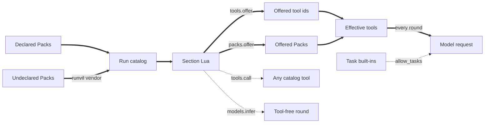
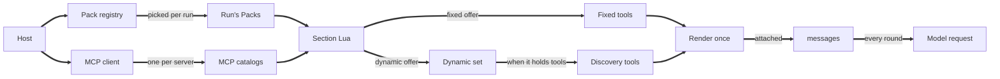
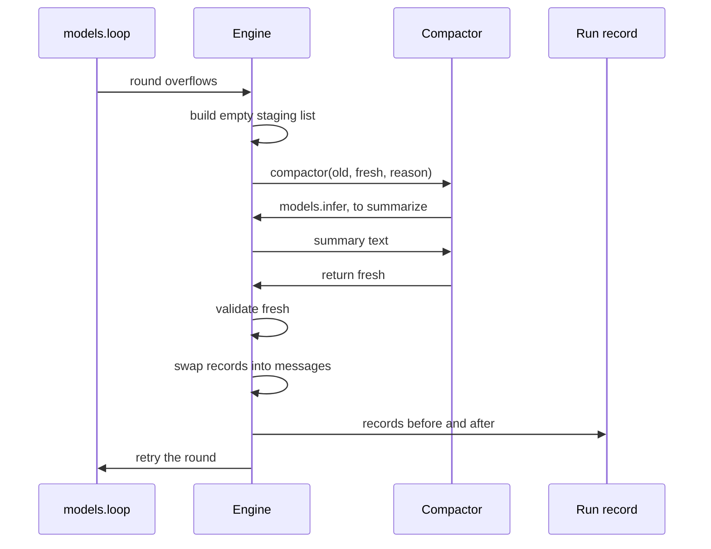
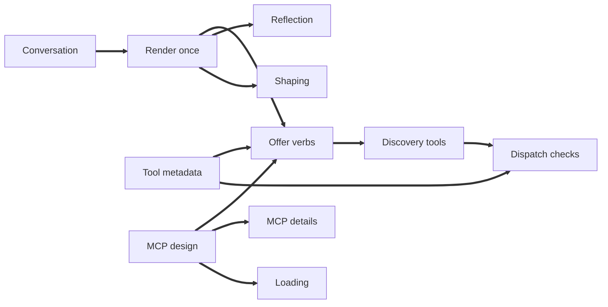

# Tool Offering and MCP in Runvil

- Sources: code at `runvil` `b1bbe33eb`, `runvil-docs` `62ae759`, and `wg21-paperflow` `693ef8ab`; three conversations on 2026-10-20; plan notes and reports since 2026-08-08; and ten research collections (References).

Runvil should handle every source of tools the same way. Each section's Lua offers whole Packs, which are named sets of tools, or filtered subsets of them. An offer is either fixed, so the model sees the tools' schemas, or dynamic, so the model finds the tools through two discovery tools, `GetDynamicTools` and `CallDynamicTool`. The Engine adds those two only when something is dynamic. At the section's first model call, the Engine renders the offers into one tool list and attaches it to `messages`, the section's only conversation. The list then stays fixed, because changing it invalidates the prompt cache, and an offer that would change it is a hard error. To compact, a Lua function fills an empty staging list, which the Engine checks and swaps in. Vinnie Falco, who owns Runvil, settled this design on 2026-10-20. Fitting it into today's code leaves four choices open (Part 2).

Twenty-three questions remain open (Table 1). The largest is whether MCP should be a Pack or part of the Engine. Make the MCP client a Pack that adds one tool catalog per MCP server at run time, through a capability any Pack may use. Each server's tools then form a filtered view of the `mcp` Pack, with ids like `mcp/<server>/<tool>`, and a prompt that needs a server checks for it in its H1 section, which runs before every other section. Confidence: medium, because the general capability is untested beyond MCP. Shaped Packs, whose tools render in the form a vendor trained its models on, should stay fixed, and any cut-down form of those tools should wait for an evaluation.

One fix comes before any of this: Paperweight, the prompt Jason writes to judge the evidence a WG21 paper gives for standardization, fails to compile against current `runvil` until it imports the renamed Host types (Part 5). Among the open questions, the MCP decision reaches furthest: the offer verbs, loading and requirements, and the remaining MCP questions all depend on it (Figure 6).

**Table 1.** Open questions and recommended answers.

| Id | Question | Recommended answer | Confidence |
|-|-|-|-|
| A1 | Names of the offer verbs | `packs.offer` and `packs.offer_dynamic` | Low |
| A2 | What the offer verbs accept | Packs and filtered views only; MCP catalogs are views of the `mcp` Pack | Medium |
| A3 | Filter syntax | A table of metadata keys, `names`, and `except`, combined by AND; exclusion only through `except` | Medium |
| B1 | When the hard error fires | At an offer that would change the rendered catalog; loosen only when a vendor API can append tools and an evaluation supports it | Medium |
| B2 | What the rendered catalog stores | Schemas, shape mapping, dynamic-set snapshot, and whether discovery tools are present | Medium |
| C1 | What the model sees of the dynamic set | Names, one-line summaries, tool names, and server instructions, capped, in `GetDynamicTools`'s description | Medium |
| C2 | What the discovery tools accept | Cursor's arguments; search over names and descriptions; refusals name an alternative; wire names `get_dynamic_tools` and `call_dynamic_tool` | Low |
| D1 | Loading only named Packs | A front-matter opt-out, such as `extras: false` | Low |
| D2 | Requiring one MCP server | A Lua check in the H1 section, so the requirement lives in Lua rather than front matter | Medium |
| D3 | A required Pack or server is missing | Refuse at start; a required server triggers the rendezvous at run start | Medium |
| E1 | Whether MCP is a Pack or part of the Engine | MCP as a Pack the Host links, and any Pack can provide catalogs | Medium |
| E2 | MCP ids and names | `mcp/<server>/<tool>`, lowercased, collisions refused loudly; all wire names capped at 64 characters with a hash | Medium |
| E3 | How long the rendezvous waits | Host-wide connections; a per-server cap, 30 seconds by default | Medium |
| E4 | What an MCP call returns | Data if an output schema is declared, else a string; one size cap | Medium |
| E5 | MCP features beyond tools | Tools; then `server/discover` with fallback, resources, and elicitation; sampling and roots dropped as deprecated | Medium |
| F1 | Offering a shaped Pack dynamic | A hard error | Medium |
| F2 | Where shapes live | In each shaped Pack, keyed by model family from provider and model-id prefix | Medium |
| F3 | Evidence for reduced rendering | An offline A/B per family first; Anthropic's native editor starts at full rendering | Medium |
| G1 | Tool metadata and trust | MCP's five annotations plus an open bag, with MCP's defaults; trusted only on the Host's word | Medium |
| G2 | Checks before a tool call | A fixed order; every refusal is a tool result naming an alternative | Medium |
| H1 | What Lua can read | Read-only userdata extending today's objects | High |
| H2 | Whether reflection waits | Status at once; catalogs wait for the rendezvous | Medium |
| H3 | What a section can read about its tools | A read-only view of its catalog and placements, plus a log of dynamic tools used | Medium |

## Contents

- Part 1. Background and settled design
  - How Runvil runs a prompt
  - Key terms
  - Tool offering today
  - The settled design
  - Practice in other harnesses
  - Runvil's design principles
- Part 2. The section conversation
  - One conversation per section
  - Why one list per section
  - The Lua surface
  - Engine behavior
  - Compaction
  - Problems in today's code
  - Migration
  - Implementation steps
  - Acceptance tests
- Part 3. Where MCP lives
  - MCP as a Pack
  - MCP built into the Engine
  - Two hybrids
  - Example prompts
  - Trade-offs
- Part 4. Open questions
  - Group A: Offer verbs and filters
  - Group B: The rendered catalog
  - Group C: The discovery tools
  - Group D: Loading and requirements
  - Group E: The MCP client
  - Group F: Shaped Packs
  - Group G: Metadata, dispatch, and trust
  - Group H: Reflection and the run record
- Part 5. Fit, migration, and next steps
  - The render path and the call path
  - Order of decisions
  - Migration and impact
  - Deferred topics
  - Limits and assumptions
  - Recommendations
- Appendices
  - Appendix A. The Slack sketches
  - Appendix B. Offering examples
  - Appendix C. One MCP catalog from configuration to call
  - Appendix D. Reflection examples
  - Appendix E. Per-harness details
  - Appendix F. Invariants and tests
  - Appendix G. Decision log
  - Appendix H. Glossary
  - Appendix I. How the design developed
- References

## Part 1. Background and settled design

### How Runvil runs a prompt

Runvil runs prompt pipelines written as one Markdown file: "The Markdown is the program, and the model is the CPU" [C1]. After the YAML front matter come sections, each a heading with prose and fenced `lua` blocks. Each section runs in a fresh Lua VM, so every Lua value dies with its section, and `jump` moves between sections. The H1 section runs first, as section 0. When it ends, at the H1 freeze, only `argv` and `var` survive, as JSON; `var` is the state that sections share.

The Engine is a pure, deterministic state machine that steps through the prompt and leaves all I/O to the Harness. The Harness performs the model calls, tool calls, and other effects the Engine asks for, and records the run so it can replay without the Plugins [P1]. The Gateway, a separate process, holds vendor credentials and routes model calls by model name. All of this runs inside a Host, such as Workshop, Runvil's desktop app, and the Host decides which Packs exist.

### Key terms

**Table 2.** Key terms (full glossary in Appendix H).

| Term | Meaning |
|-|-|
| Pack | A set of tools with a one-segment id, such as `web` |
| Plugin | A loaded crate or library that adds zero or more Packs |
| Extras | A run's Packs beyond those its front matter declares |
| Tool id | A tool's canonical name, lowercase segments with the Pack id first, such as `web/fetch` |
| Wire name | The name the model sees, such as `web_fetch` |
| Run catalog | Every tool the run's Packs can serve, fixed at run start |
| Rendered catalog | The tool list sent with a section's model requests, fixed at the first one and attached to `messages` |
| MCP catalog | One MCP server's tool list |
| Fixed offer | Tools whose schemas go into the rendered catalog |
| Dynamic offer | Tools that go into the dynamic set |
| Dynamic set | Tools the model reaches only through the discovery tools |
| Discovery tools | `GetDynamicTools` and `CallDynamicTool`, built into the Engine and present only while the dynamic set holds tools |
| Filtered view | A subset of a Pack's tools, chosen by metadata or name |
| Shaped Pack | A Pack whose tools render in the form a vendor trained its models on |
| Shape mapping | The record, kept with the rendered catalog, that turns a shaped call back into the tool its Pack defines |
| Section conversation | `messages`, a section's one message list |
| Compactor | The Lua function `models.loop` calls on overflow; it fills an empty staging list that the Engine swaps into `messages` |
| Rendezvous | The point where the first use of MCP catalogs waits for every server to list its tools or fail |
| Ask mode | A read-only mode of the Workshop chat agent, provided as a HostService, a typed object the Host hands to Packs |
| Dispatch gate | A check before a tool call that can refuse it with text the model reads |
| Reflection | Lua reading descriptions of Packs, tools, and servers, read-only |
| Run record | What the Harness records so a run replays without Plugins |

### Tool offering today

Today the Engine re-reads a section's offers before every model round, so an offer made between two `models.loop` calls changes the next request (Figure 1, at commit `b1bbe33eb`).

A run's tools are fixed when it starts. It gets the Packs its front matter declares under `uses:`, plus every `runvil` Pack that no declaration takes, and a `vendor/name` entry can swap in another vendor's Pack [C2]. Declaring a Pack makes it required and runs its prelude in every section; offering is a separate step [C3]. The Harness refuses a run when a required Pack is missing. It reads each Pack's tools once into the run catalog [C4], and the Engine binds each tool under a wire name, which uses only `[A-Za-z0-9_.-]` and may be any length [C5; C6].

Section Lua then offers. `tools.offer` records tools by id or object, and an id the run cannot offer is a hard error [C7]. `packs.offer` records a Pack's name, not its tools [C8], and `tools.offer_local` turns a Lua function into a tool for the section [C7]. Workshop's chat agent offers this way, then keeps one message list across the operator's turns [C9]:

```lua
packs.offer("web")
tools.offer(tools.extras())
local history = messages.new()
while true do
    local text = input.ask()
    history:user(text)
    pcall(function() return models.loop(history) end)
end
```

Each `models.loop` round rebuilds the list: offered tools in first-offer order, then the offered Packs' tools in id order. The code calls it "Rebuilt at each model operation so `tools.offer`, `packs.offer`, and `tools.offer_local` calls between blocks reach the next model turn" [C10]. While `tools.allow_tasks` is set, the round adds the four task built-ins, the model's tools for subagent tasks, which are planned to become the `subagents` Pack. A model call to a name outside what the round advertised ends `models.loop` with an `out_of_scope_tool` error [C11]. `models.infer`, the single-round call, always sends an empty tool list [C12].

**Figure 1.** Offering today. Dotted arrows bypass the offer path.



Lua can call more than the model sees. A script's `tools.call` reaches any tool in the run catalog by canonical id, offered or not, through bindings that are "never advertised" [C5; C13]. A prompt such as Paperweight can use this route to get data from code rather than from the model. When a tool fails, a model's call still gets content back, as untrusted text, while a script's call raises an error where it was made [C13].

Lua sees only a little of each tool. A tool object has `id`, `description`, and `pack` [C14], and a Pack object has `name` and `tools`; `packs.get` returns nil for a Pack unknown to the run [C8]. `ToolInfo` holds five fields, `id`, `description`, `parameters_schema`, `structured_output`, and `survives_stop`, so annotations such as `readOnlyHint` would be new [C15].

MCP reaches the model through two generic tools. The MCP client is one Pack, `runvil/mcp`, over every configured server, with two static tools modeled on Cursor's, `mcp/get_dynamic_tools` and `mcp/call_dynamic_tool` [C16]. It connects in the background, reports ready at once, lists each server's tools once, and keeps only names, descriptions, and input schemas [C16; C17]. In Workshop the `mcp` Pack joins every run, so the chat agent's `tools.offer(tools.extras())` very likely offers exactly those two tools, the only route from a model to MCP today. Confidence: medium, because this comes from reading the code rather than running it.

Under the settled design, the run catalog, the wire-name rule, `tools.call`, `tools.offer_local`, and the `tools.calls` counters all stay [P1], though the wire-name rule may gain a length cap. Three things change: the catalog renders once per section, offers place whole Packs and filtered views fixed or dynamic, and tools gain metadata.

### The settled design

The design reached this shape over ten weeks, moving from single tools offered into a list rebuilt every round to whole Packs placed fixed or dynamic and rendered once per section (Figure 2; Appendix I). Vinnie settled its 29 decisions on 2026-10-20 (Table 3), most in the design discussion between 5:27 and 6:57 PM and the rest in his huddle with Jason that afternoon.

**Table 3.** The settled decisions.

| # | Decision | Source |
|-|-|-|
| 1 | Only Packs are offered; filtered views select subsets by metadata or name | [P1; D 6:15] |
| 2 | Every offer is fixed or dynamic | [D 6:02, 6:15] |
| 3 | A tool offered fixed stays out of the dynamic set, so one Pack can be partly fixed and partly dynamic (a split offer) | [D 6:15] |
| 4 | Offers alone decide what the model can discover; Lua calls leave it unchanged | [D 5:54] |
| 5 | Discovery tools are Engine built-ins, present only while the dynamic set holds tools | [D 5:54, 6:02; H 11:39-12:16] |
| 6 | Any Pack can be offered either way | [D 6:02] |
| 7 | Front matter declares requirements, and Lua does all offering | [D 5:54] |
| 8 | "Dynamic set" and "progressive discovery" replace "withheld" | [D 6:20] |
| 9 | The catalog renders late and once, before tools first reach the endpoint | [D 5:27] |
| 10 | It attaches to `messages` and stays, even across a model change | [D 6:36] |
| 11 | Any change to the rendered catalog after it is attached is a hard error | [D 6:15] |
| 12 | Compaction keeps the rendered catalog | [D 6:36, 6:55] |
| 13 | Sections clear history, and each conversation stays in its section | [D 6:49, 6:55] |
| 14 | `messages` is the section's one list, created only by the Engine, along with the VM | [D 6:50, 6:53, 6:57] |
| 15 | The compactor fills and returns a staging list; the Engine validates and swaps | [D 6:53, 6:55] |
| 16 | Shaped Packs are few: the core file tools and `subagents` | [D 5:54, 6:02] |
| 17 | Shaped tools are anonymous to Lua | [D 5:28, 6:15] |
| 18 | Shaped Packs accept metadata filters | [D 6:02] |
| 19 | MCP tools always render in canonical form | [D 5:54] |
| 20 | A shaped tool cut by a filter (a split shaped tool) renders reduced, with disallowed calls refused at dispatch; if that performs poorly, it renders in full with the same refusals | [D 6:15] |
| 21 | MCP exists in a run only when servers are configured | [D 6:25] |
| 22 | MCP configuration comes only from the Host | [D 6:33] |
| 23 | The MCP client connects in the background and builds one MCP catalog per server, each offered fixed or dynamic | [D 6:02, 6:20] |
| 24 | The first use of MCP catalogs waits at the rendezvous | [D 6:20] |
| 25 | MCP inputs are JSON, and outputs may take any form | [H 26:14-27:08] |
| 26 | Every tool can hold metadata like MCP's annotations | [D 5:54] |
| 27 | Ask mode is a HostService for the chat agent and applies only to the model's calls | [D 5:54] |
| 28 | Reflection is read-only and keeps configuration and credentials hidden | [D 6:25, 6:33] |
| 29 | Building blocks rather than solutions; Lua at 20 percent of a prompt or less | [H 38:43, 47:32, 48:17-48:44] |

**Figure 2.** The settled design, with the MCP client's place still open.



All the decisions follow one principle: "Runville [Runvil] should offer building blocks not solutions" [H 38:43].

Rendering once keeps the prompt cache valid. Anthropic says "Modifying tool definitions (names, descriptions, parameters) invalidates the entire cache", and OpenAI says cache reuse "requires the entire rendered prefix to match" [R1]. The catalog renders late, so shaped Packs can fit the model in use [D 5:27], and then it stays: "if the model changes, so be it but we can't redo the tools" [D 6:36]. A later model may come from another vendor, so dispatch needs a mapping stored with the catalog to turn a shaped call back into the tool its Pack defines. This follows from the rule that the catalog stays fixed.

Whole Packs match how Packs get used: "Usually, when you have a pack, You either want all the tools, or you want none of the tools" [H 29:43]. Filters handle the exceptions, such as ask mode's read-only tools. A tool offered fixed stays out of the dynamic set, because discovery "consumes an extra model turn and there are 2 more tools competing for attention" [D 6:15].

Shaping is limited to what vendors train, because the shaped set "is tied to how the closed-weight frontier model vendors decide to train their models" [D 5:54]. Anthropic's built-in tools have "exact tool signatures" that Claude "has been optimized on", and OpenAI's models were "trained to excel" at `apply_patch` [E1; E2]. Shaped Packs hide their tool names from Lua, so Lua selects their tools only through filters, as in "allow ReadFile, disallow WriteFile, disallow StrReplace" [D 6:02, 6:15].

Each remaining choice comes from a single remark. The Engine owns discovery because "progressive tool discovery is independent of MCP" [D 6:02]. One conversation per section follows from "the whole point of Runvil is that sections clear the history!" [D 6:55]. Dynamic MCP configuration was cut: "I forgot about credentials. and security" [D 6:33]. The MCP client is special because it "creates tool catalogs and puts them in the dynamic set which is something a regular tool cannot do" [D 6:20]. MCP outputs stay untyped because "the inputs to the MCP call are required to be Jason [JSON], the outputs are not" [H 26:14].

The first render, Lua call, or reflection that needs the MCP catalogs waits until every server has listed its tools or failed. That meeting point is the rendezvous (Figure 3). Workshop already connects to its servers in the background when it builds its agent launcher [C18]. Two details are derived rather than stated: a failed server stays out until the Host restarts, and when the Host keeps connections for its lifetime, only the first run after Host startup waits [D 6:20]. Paperweight's command-line Host starts fresh in every process, so every Paperweight run waits.

**Figure 3.** The rendezvous.

```mermaid
sequenceDiagram
    participant H as Host
    participant M as MCP client
    participant A as Server A
    participant B as Server B
    participant S as Section
    H->>M: start at Host startup
    M->>A: connect and list tools
    M->>B: connect and list tools
    S->>M: first need for the catalogs
    Note over S,M: caller waits
    A->>M: tools listed
    B->>M: failed
    M->>S: A's catalog; B out for the session
    S->>M: later needs
    M->>S: answered at once
```

Ask mode needs a dispatch gate. It is a HostService for the chat agent, and "it would not need to apply to Lua calls" [D 5:54]. Because the chat agent's catalog stays fixed for the whole conversation, ask mode must refuse calls at a dispatch gate rather than filter the catalog. This follows from the rule that the catalog stays fixed, and Claude Code works the same way: its tool list stays fixed across mode switches, and it enforces plan mode at call time [E3].

Eight alternatives were rejected:

- Dynamic MCP configuration, edited by Lua or the model or found on the internet, because of credentials and security [D 6:33].
- Moving a conversation into another section, because "no one is 'ferrying history to a new section'" [D 6:55].
- One Pack per MCP server, which Vinnie called "broken" and "a mistake" [P2].
- `mcp.promote_server`, as too narrow [H 38:43, 47:32].
- `tools.add`, which is already gone [H 42:05].
- Offering from front matter [D 5:54].
- The word "withheld" [D 6:20].
- The three-tool bridge (search, describe, and call), in favor of two tools [P2].

Four of Vinnie's preferences are still open questions. He proposed the offer verbs `packs.offer` and `packs.dynamic_offer` with "Maybe?" [D 6:15]. His "instinct is that shaped packs are never progressive" [D 6:15]. He floated a flag to "only load named packs" [D 6:15]. And he dislikes MCP-specific syntax inside `uses:`, which bears on how a prompt requires a server [D 6:30]. Whether MCP is a Pack or part of the Engine is the largest open question, and Vinnie asked to see MCP worked out both ways [D 6:25, 6:33].

### Practice in other harnesses

Most agent harnesses surveyed on 2026-10-20 do what the settled design does (Table 4; per-harness detail in Appendix E). Most of the figures come from the vendors themselves, and every vendor claim about accuracy or tokens is still unreplicated.

**Table 4.** Practice in other harnesses, 2026-10-20.

| Area | What most do | Exceptions |
|-|-|-|
| Always-loaded tools | Keep read, write, edit, search, and shell loaded; hide MCP first | Claude Code deferred its file tools in v2.1.69 and restored them in v2.1.72; Gemini CLI and Cline load everything |
| Discovery | A lookup tool, with names, one-line summaries, or namespace text up front | Anthropic's API reveals deferred tools only through search; Cursor and Qwen Code defer their subagent tools |
| Mode restriction | Change the list per mode, with a call-time backstop | Claude Code and Codex keep the list fixed and refuse at call time; Claude Code says changing tools would break the prompt cache |
| MCP naming and startup | A server prefix; caps of 63, 64, or 128; background connection | Only Codex has `required`; every harness accepts tool definitions as served |
| Per-model tools | Aider, Codex, OpenCode, and Cline switch tools by model-id match | Every surveyed harness renders a trained tool that both reads and writes, such as an editor, whole |
| Compaction | Rewrite in place, keep originals, cut at turn boundaries, bound retries, keep tools fixed | Cline validates custom compactors strictly |

Three findings inform the recommendations. File tools stay loaded everywhere, and the one product that deferred them reverted within three releases, which supports keeping shaped Packs fixed. Claude Code keeps its tool list fixed, refuses at call time, and is the one harness that says why: changed tools break the cache. The rendered catalog and the ask-mode gate follow the same pattern. Every surveyed filter syntax excludes tools through deny lists, priorities, or order rules.

Two findings favor fixed offers for small Packs. Hiding a tool costs a turn: Hermes saw `clarify` use fall from 18 of 18 to 7 of 18 when it was deferred, and moved it back. And a small catalog can cost more deferred than loaded: at 24 tools, a bare bridge cost $0.62 in input per task against $0.40 with every tool loaded [R2]. Large or optional sources suit dynamic offers, and each prompt's Lua decides.

### Runvil's design principles

**Table 5.** Runvil's design principles.

| Principle | Rule | Source |
|-|-|-|
| Building blocks | Runvil provides general pieces, and Lua stays at about 20 percent of a prompt or less | [H 38:43, 47:32, 48:26; P3] |
| One rule for every case | Every tool source, Pack, and section follows the same rules | [P1] |
| Same behavior under every Host | A prompt behaves the same in Workshop, Paperweight, or any other Host | [P1] |
| Requirements in front matter | Lua decides what the model sees, and front matter declares what a prompt needs | [D 5:54] |
| Cache stability | The tools prefix stays byte-identical for a whole conversation | [R1] |
| Lean context | Tokens and model turns go only where they improve the result | [D 6:15; R1] |
| Fit with vendor training | Tools take their trained form where it matters | [D 5:27, 5:54; E1; E2] |
| Safe failure | Errors fire at the mistake, and every refusal names an alternative | [H 30:18-30:53] |
| Host control over Packs | The Host stays "the master of tools" | [H 46:11-46:35] |
| Replay from the record | A run replays from its record alone, without Plugins or servers | [P1] |

The sources leave the principles in Table 5 unranked, and two pairs often conflict. Cache stability and lean context both favor rendering the catalog once, but they split on listing the dynamic set up front: a listing costs tokens on every request, and leaving it out costs a turn. Building blocks and one rule for every case diverge when the most general building block needs a special capability, as the MCP client does to add catalogs at run time.

## Part 2. The section conversation

### One conversation per section

`messages` is the section's only conversation, as Vinnie settled [D 6:36, 6:49, 6:50, 6:53, 6:55, 6:57]. The Engine creates it, empty, when it creates the section's Lua VM, so it exists before the first block runs. Only the Engine creates lists, so each section holds exactly one, and each list stays in its section. The first `models.loop` round renders the catalog and attaches it to `messages`, where it stays for the rest of the section. When the conversation overflows the model's context, the Engine hands the compactor an empty staging list. The compactor fills and returns it, and the Engine validates it and swaps its records into `messages`. `messages` stays the same object through the swap, so every Lua reference to it stays valid and the rendered catalog stays attached.

### Why one list per section

Several lists in one section make the rendered catalog ambiguous. The docs show four such sections: two lists built to prove they are independent, records copied into a second list, two loops with an offer between them, and a fresh list built to receive a task notice [C19; C20; C21]. With a catalog attached, each raises two awkward questions: which catalog does the second list get, and is the offer between the loops a change?

The code already keeps every list inside its section, consistent with sections that clear history by design [D 6:55]. Every section entry builds a new VM, `var` refuses userdata, a section can return only a scalar, and the H1 freeze reads back only `var` and `argv`, as JSON, before dropping the VM [C22; C23; C24; C25]. The rule turns that accident of the implementation into the stated contract. It also makes compaction the one explicit point where history is replaced, as Vinnie's rule of 2026-10-09, made for prompt caching, asks: "changes to the prefix of the messages should be visible and explicit" [P4].

The rule costs little. Only `models.loop` uses a list, because `models.infer` sends a single user message [C12]. Tasks and fan-out arms already run in VMs of their own [C22]. Two live prompts create a list, once each: the Workshop chat agent and the research-person prompt [C9; C26]. Workshop's tests already assert that the chat agent's requests accumulate one history, byte for byte [C27].

A section gives up a second multi-turn conversation beside its main one, and three existing tools cover that need. `models.infer` handles a side question, such as a summary. A task or a fan-out arm handles parallel work, each with a fresh history. A `call` to another section handles a sequential side conversation, because the called section runs in a VM of its own, starts with an empty offer list, and gets its own `messages` [C20; C22].

### The Lua surface

For authors, `messages` stops being a namespace with a constructor and becomes the list itself. Everything else a list does stays (Table 6).

**Table 6.** The conversation's Lua surface, today and after.

| Concern | Today | After | Status |
|-|-|-|-|
| Getting a list | `messages.new()` returns a fresh list, any number per section [C28] | `messages` is the section's one list, installed with the VM | Settled |
| The constructor | `messages.new()` | Reading `messages.new` raises a guiding error | Settled; wording Proposed |
| Builders | `system`, `user`, `assistant`, `tool`, `append` | Same, on `messages` | Proposed, high |
| `replace` | Edits a range in place | Same | Proposed, medium (Table 8) |
| Record views | Read-only, holding the record itself [C29] | Same | Proposed, high (Table 8) |
| Iteration, length, JSON | `#`, `pairs`, `ipairs`; views serialize as records | Same | Proposed |
| Scratch record data | A second list as a container | Plain Lua tables in record shape | Settled |
| Rebinding the global | Allowed [C30] | Raises; the `_G` guard owns `messages` | Proposed, high |
| `models.loop` | `models.loop(list, compactor?)` [C31] | Always runs over `messages` | Settled; signature Open |
| Compactor | `compactor(reason_tag)`, which must raise [C32] | `function(old, fresh, reason) ... return fresh end` | Settled shape; arguments Proposed |
| `compactors.fail` | Default; raises `context_exhausted` | Default, new signature | Proposed |
| Task notices | Pushed onto the list the next round names | Pushed onto `messages` | Settled consequence |

Once `messages` is a list, `messages.new` reads through the list's `__index`, which today returns nil for any key that is not an integer, so an author's `messages.new()` would fail with a bare "attempt to call a nil value" [C28]. Have `__index` answer the key `new` with the guiding error instead, pointing at the line that needs changing. Confidence: high, because it is one branch in an existing metamethod.

The new `models.loop` signature is still open. `models.loop` always runs over `messages`, so its first argument always names the same list. Four forms are possible, and `handle:loop(...)` follows whichever is chosen:

- `models.loop(messages, compactor?)`, refusing any other first argument. Existing calls keep their shape after one rename and still name what they run over, at the cost of an argument with one legal value.
- `models.loop(compactor?)`, the shortest form. It changes every call site, and an old `models.loop(msgs)` would fail with a type error instead of a guiding one, unless the check recognizes a list.
- `models.loop{ compactor = f }`, a table of options with room for later ones, such as a round cap, but awkward when empty, as `models.loop{}`.
- `models.loop()`, with the compactor set elsewhere, such as on the section, which hides a per-call choice where a reader of the call cannot see it.

Keep `models.loop(messages, compactor?)`, and refuse any other first argument with a message naming `messages`. Confidence: medium, because this form gives the smallest migration and the clearest reading but keeps a redundant argument, and Vinnie may prefer the shorter form. If a second loop option appears, switch to the table form.

### Engine behavior

The Engine creates `messages` with each VM. Today `install_messages` installs a table holding `new`, and injection calls it for every section VM, between `models` and `compactors` [C28; C33]. The proposal is to create one `MessageList` per section VM, keep a Rust-side handle to it on the VM, and install the list as the `messages` global. The Engine reaches the list only through its handle, because author code could rebind the global [C30]. Confidence: high, because the install point already runs once per VM, including the H1 section and every task and fan-out arm.

The first `models.loop` round renders the catalog and attaches it. Today `prepare_chat` rebuilds the tool list at every round, building schemas from the section's effective tools, appending the task built-ins, and recording what it advertised [C11]. Instead, do that work once, on the section's first chat round, and store the result in the list's state, beside the send state that `commit` keeps [C28]. Later rounds send the stored schemas byte for byte, and the dispatch gate checks each model call against the stored set of advertised names [C11]. Confidence: medium, because what the rendered catalog stores is still open (Part 4). The model binding is resolved by render time, so shaped Packs can read its provider [C11]. Today a binding identifies its family only by `provider` [C34], so how shaped Packs tell model families apart is also open.

An offer after first render that would change the rendered catalog is a hard error; Vinnie settled that, and where it fires is open (Part 4). The offer functions would check whether the section's catalog is attached and raise if an offer would change it [C7; C8]. A first round with nothing offered should attach an empty catalog, so that a later offer raises like any other change. Attaching only once something is offered would let the tool list change after the model had already run without tools. A `tools.offer_local` call after first render also raises, as does setting `tools.allow_tasks`, which adds the task built-ins, for as long as that flag exists. Confidence: medium, because the empty case is rare but must be defined.

Overflow starts compaction instead of ending the loop. Today an overflow moves the loop's state machine to `Compacting`, which can only raise [C32]. The change adds a path back to the round, as set out under Compaction.

The run record should gain an entry at first render and one at each compaction. The first holds the rendered catalog, so a replay can check the bytes it sends. Each compaction entry holds the reason and the records before and after. Compaction is Lua plus recorded `models.infer` results, so a replay reproduces it without the Plugins. Confidence: high on what to record; the entry's type is an implementation choice.

Two consequences follow from the settled rule. First, each task and fan-out arm gets its own `messages`. A task chain, whether Lua or the model's `task` built-in starts it, enters its section through `enter_section`, which builds a new VM, and `tasks.fanout` runs each arm as such a task [C22]. A model task's notice is pushed onto the owner section's `messages` at the owner's next round [C11]. Second, `models.infer` leaves `messages` alone. It sends one user message with an empty tool list and skips the precheck [C12; C35], and it stays the tool-free side call that a compactor uses to summarize.

### Compaction

Compaction is new behavior. Today the only shipped compactor is `compactors.fail`, which receives only the overflow reason, and a compactor that returns at all raises "replacement compactors are deferred" [C36; C32]. The replacement runs in nine steps (Figure 4). Vinnie settled the outline [D 6:53, 6:55]; the details are proposals unless a step says otherwise.

1. The loop detects overflow, from the precheck before dispatch or from a provider's context-overflow reply [C11]. Both arrive at a round boundary, after the last batch's tool results are pushed, so every batch in the list is fully answered [C32].
2. The Engine creates an empty staging list, reachable only as the compactor's argument.
3. The Engine calls `compactor(old, fresh, reason)`. `old` is a read-only view of `messages`: its records and length read normally, and every builder, `append`, and `replace` raises. `fresh` is the staging list. `reason` is today's overflow tag, `"precheck"` or `"provider"` [C36]. While the compactor runs, the `messages` global is locked too, so a write through it raises.
4. The compactor builds the compacted history in `fresh`. It may call `models.infer`, for example to summarize old turns, but not `models.loop`.
5. The compactor returns `fresh`, or returns nil to decline.
6. The Engine checks the returned list against Table 7 before anything changes.
7. The Engine swaps record contents, so `messages` holds the compacted records and the staging list holds the old ones. As settled, `messages` stays the same object, so Lua references to it and the rendered catalog are unaffected. `old` and `fresh` then become dead handles that raise on any access, so `messages` is the only writable list left.
8. The Engine writes the run-record entry, with the records before and after.
9. The loop retries the round that overflowed, sending the rendered catalog unchanged.

**Figure 4.** The compaction sequence.



The swap fits the existing list. `replace` already builds a new record vector and stores it in the same list, so exchanging two lists' vectors keeps both identities, and `commit` compares each request with the last by content, so the send state stays correct [C28]. The precheck normally counts tokens from a measured count for the history it last sent, its anchor; after a swap it falls back to a full estimate, by design, because a "rewritten, compacted, or merged history can never anchor on a count that was measured for another conversation" [C36].

The first three checks in Table 7 follow from the provider's message shape, the next three are open problems in Table 8, and the size check follows Cline's practice.

**Table 7.** Checks on the compactor's returned list.

| Check | Why | On failure |
|-|-|-|
| The value returned is the staging list itself | Returning `old` or another value is an author bug | Hard error, kind `lua` |
| Every assistant tool call has its result right after it | Providers reject an unanswered call [C37] | Hard error, kind `lua` |
| System records only in the leading block | Provider message shape [C28] | Hard error, kind `lua` |
| The leading system records are kept during compaction | The system prompt is the model's contract | Open (Table 8) |
| The list holds at least one record | The next round fails otherwise [C11] | Open (Table 8) |
| The list passes the precheck | Otherwise the retry overflows | Open (Table 8) |
| The list is smaller than `old` | A larger history can only overflow again (Cline's rule) [E4] | Proposed: `context_exhausted` |

The first three checks catch author bugs, so they should raise kind `lua` at the `models.loop` call, where `pcall` can catch them. A compactor that declines, or a compacted list still over budget, means the conversation cannot fit, so both should raise the existing `context_exhausted` kind, with a message naming the window, the count, and the reserve. Every failure leaves `messages` as it was, matching today's documented rule that a round refused for overflow "adds no records to the list" [C19]. The Workshop chat agent already wraps `models.loop` in `pcall` and returns to waiting, so a failure ends the turn and the conversation goes on [C9]. Confidence: high, because both kinds and both behaviors exist today.

### Problems in today's code

The rule raises 27 problems in today's code (Table 8). The code already handles 11 of them, one only in principle; one more follows from a settled decision, 12 have a proposed fix, and 3 are open.

**Table 8.** Problems in today's code. "Resolved" means the code already behaves as the rule needs.

| # | Problem | Impact | Resolution | Confidence |
|-|-|-|-|-|
| 1 | Views held across a swap | A view reads the wrong record | Resolved: views hold the record, not an index [C29]; add a test | High |
| 2 | A compactor editing the live list | History changes before validation | Proposed: `old` is read-only | High |
| 3 | What a compactor may call | Side effects during overflow | Proposed: `models.infer` yes, `models.loop` no; `tools.call` Open | Medium |
| 4 | Tool calls pending at overflow | A call split from its result | Resolved: overflow arrives only at round boundaries [C32] | High |
| 5 | Empty list, or lost system record | The model loses its instructions | Open | Medium |
| 6 | Still over budget | The retry overflows again | Open | Medium |
| 7 | A compactor that cannot compact | It must be able to give up | Proposed: return nil; raise `context_exhausted` | High |
| 8 | The retry and the round cap | The retry counts against `max_tool_iterations` [C32] | Proposed: not counted; one compaction per round | Medium |
| 9 | `messages` stops being a namespace | Code reading `messages.new` | Resolved: it holds only `new`; three refusal texts change | High |
| 10 | Author code rebinding `messages` | Engine and author disagree | Proposed: the `_G` guard owns it [C30] | High |
| 11 | The H1 section's VM | The H1 section runs `models.loop` today | Open | Medium |
| 12 | Existing compactors | Author compactors break | Resolved: only `compactors.fail` ships [C36] | High |
| 13 | Side conversations | Four docs examples break | Settled consequence: `models.infer`, tasks, or `call` | High |
| 14 | Author edits with `replace` | Authors also rewrite history | Proposed: keep `replace` | Medium, undecided |
| 15 | Replay determinism | A compacted run must replay | Resolved: Lua plus recorded `models.infer`; record before and after | High |
| 16 | The prompt cache | Compaction rewrites the message prefix | Resolved: the tools prefix stays; the anchor re-estimates [C36] | High |
| 17 | Workshop | The chat list and transcript | Resolved: `history` becomes `messages`; the transcript comes from events [C38] | High |
| 18 | The planned prompt debugger | What it shows as the conversation | Resolved in principle: one per section | Medium, not designed |
| 19 | Prose-body sections | An implicit list | Resolved: a prose-only section runs without a model call or a list [C39] | High |
| 20 | Task and fan-out arms | Shared lists | Resolved: each arm gets its own VM [C22] | High |
| 21 | Practice in other harnesses | Matching the field | Resolved: the swap follows the compaction practice in Table 4 | High |
| 22 | `messages` while the compactor runs | Writes mid-compaction | Proposed: locked; any write raises | High |
| 23 | `old` and `fresh` after the compactor returns | A second writable list survives | Proposed: dead handles; any access raises | High |
| 24 | An empty catalog at first render | Whether a later offer is a change | Proposed: it attaches as empty, and later offers raise | Medium |
| 25 | `tools.offer_local` and task built-ins after first render | Hidden catalog changes | Proposed: both count as changes and raise | Medium |
| 26 | `replace` on system records outside compaction | The check on system records guards only compaction | Proposed: allowed, as the author's explicit edit | Medium |
| 27 | The precheck leaves out tool schemas [C36] | A passing list can still overflow at the provider | Proposed: the provider's reply then raises `context_exhausted`; counting the schemas, constant per section, is deferred | Medium |

Four choices remain. The first is whether a compactor may call `tools.call`, for example to fetch a stored summary. A compactor can already call `models.infer` and suspend, as an Engine test shows [C40], so only returning `fresh` is new.

- Allow it. `tools.call` works from any Lua, and tool calls are recorded, so existing rules cover it and replay still works. The risk is a slow or side-effecting call during an overflow.
- Refuse it. Compaction stays Lua plus summarization, the easiest form to reason about, at the cost of one more refused call to explain.
- Allow only tools whose metadata says read-only, which keeps side effects out but depends on the open question of tool metadata and trust.

Allow it. Confidence: medium, because every compactor in the sources is Lua plus summarization, so the cost of either answer is unmeasured.

The second is a staging list that is empty or drops the system records.

- Reject both: validation requires a non-empty list whose leading system records equal those of `old`, so a forgotten system prompt fails loudly when the compactor returns.
- Have the Engine re-insert the system records. That is easier for authors, but the Engine then edits what the compactor returned, hiding the bug it repairs.
- Allow an empty list. Unless a task notice arrives first, the next round fails with "messages must not be empty", a less helpful place for the error [C11].
- Require the system records but allow an otherwise empty list, so a compactor that keeps only the system prompt makes a valid reset.

Require the leading system records unchanged, and reject an otherwise empty list unless the section has a notice waiting. Confidence: medium, because this is the strictest rule that still allows a reset, and Cline likewise rejects an empty custom result [E4], but Runvil prompts have yet to exercise it.

The third is a compacted list that is still over budget.

- Raise `context_exhausted`, naming the count, the reserve, and the window. `messages` keeps its old records, and the chat agent's `pcall` ends the turn.
- Call the compactor again, with the compacted list as `old`. A stronger pass may fit, at the risk of a loop that only a cap stops.
- Return an error the model reads. Overflow happens outside any tool call, so the model would get no turn in which to act on the error.

Raise `context_exhausted`, and compact at most once per round. Confidence: medium, because this matches today's error kind and behavior, other harnesses bound retries the same way (OpenCode and Cline retry once and then raise, and Claude Code stops after three failures; Appendix E), and a compactor that needs two passes can loop inside itself.

The fourth is the H1 section's VM. The H1 section is section 0 and goes through the same install path as any section [C25]. The docs show it running `models.loop` with a local decision tool and keeping the verdict in `var` [C20]. Paperweight's H1 section holds only the model binding, and its comment says that "prose here would make it a section with a prompt body, needing a model binding" [C41].

- Leave `messages` out of the H1 section, making it a setup block only, which breaks the documented decision-tool idiom.
- Install `messages` there but refuse `models.loop`. The H1 section stays cheap and predictable but becomes the one section that behaves differently.
- Install a usable `messages`, as in any section. The list dies at the H1 freeze, like every H1 value today [C25].

Give the H1 section a usable `messages`, like any section. Confidence: medium, because this keeps the documented idiom and treats the H1 section like every other.

### Migration

The change is small in live prompts and large in docs and tests.

In the Workshop chat agent, line 30 (`local history = messages.new()`) goes, and lines 33 and 34 use `messages` in place of `history` [C9]. In the research-person prompt, line 40 goes, and lines 41 to 43 use `messages` in place of `msgs` [C26]. The vendored copies in `wg21-paperflow` follow with the next submodule bump. Paperweight itself calls only `models.infer` and is unaffected.

In the language guide, chapter 11, on conversations, has 70 lines naming `messages.new()` and needs a rewrite built on `messages` being the section's conversation, starting with its section on the `messages` global [C19]. Chapter 12 has 23 such lines and chapter 15 has 15 [C20; C21]. Chapters 02, 05, 07, 13, and 16 have a few lines each, and chapters 14 and 17 name the constructor without parentheses [C42]. The four two-list examples are rewritten to use one list, `models.infer`, or a task.

In the code, 64 Rust files under `runvil/crates` contain `messages.new(`, counted with `git grep` at `b1bbe33eb` [C54]: 58 tests, test helpers, or benches, across the Lua crate, the Engine, the Harness, and Workshop, and six source files whose text names the constructor. The Lua crate's test helper installs a list as a global named `msgs` and changes to install the section's `messages` [C43]. Rust unit tests that build a `MessageList` directly keep working, because the type stays.

### Implementation steps

The conversation change is independent of the offering redesign in Part 4, except for step 4 and the offering half of step 7. Step 4 should first attach today's effective tool list, rendered once, and switch to fixed and dynamic offers once they exist, so the conversation change can ship first. Confidence: medium, because this splits the work cleanly but means two passes over `prepare_chat`. Paths are under `crates/runvil-internal/`.

1. Install `messages` per VM. Blocked by the open choice about the H1 section's VM. Code: `lua/src/messages.rs` (`install_messages` installs a list), the section VM type in `lua/src/vm.rs` (holds the list's handle), `lua/src/vm/inject.rs` line 150, and `lua/src/globals.rs` (the guard owns `messages`).
2. Remove the constructor and add the guiding error. Ready now. Code: `__index` in `lua/src/messages.rs`, and the three refusals that name the constructor, in `lua/src/messages.rs` lines 431-432, `lua/src/messages-view.rs` lines 98-99, and `lua/src/protocol/parse/chat.rs` lines 16-19 (`NOT_A_LIST`).
3. Change the `models.loop` signature. Blocked by the open signature choice. Code: `lua/src/models_loop.rs` lines 114-131, `lua/src/__impl_coro.lua` lines 247-258, and `NOT_A_LIST`.
4. Render the catalog once, attach it, and raise on change. Blocked by two Part 4 questions: when the hard error fires, and what the rendered catalog stores. Code: `engine/src/execute/scheduler/chat.rs` lines 141-168 (render on the first round, reuse after), `lua/src/vm/state.rs` lines 128-168 (read only at first render), the offer functions in `lua/src/tools.rs` and `lua/src/packs.rs`, and the list's state in `lua/src/messages.rs`.
5. Build the compaction contract. Blocked by three open problems in Table 8: what a compactor may call, an empty or system-less list, and a list still over budget. Code: `lua/src/models_loop/machine.rs` (a path from `Compacting` back to the round, and the retry rule), the compactor branch in `lua/src/__impl_coro.lua` lines 236-238 (pass `old`, `fresh`, and `reason`), `lua/src/compactors.rs` (the `Compactor` enum, its documentation, and the new `fail`), `lua/src/messages.rs` (the read-only view and the swap), and the run-record entry.
6. Apply the views policy. Ready now. Views already hold records by identity, so the work is one test.
7. Migrate prompts, docs, and tests, as listed under Migration. The offering half waits on the names of the offer verbs and the filter syntax (Part 4).
8. Add the acceptance tests, each after the steps it tests.

### Acceptance tests

These fourteen tests check invariants 1 to 4 in Appendix F, the section-conversation invariants; tests 5 and 11 also check invariants 5 and 6.

1. Reading `messages.new` raises the guiding error, at the author's line.
2. Two reads of `messages` in one section give the same object, and every list Lua can reach is that object.
3. After a `jump`, the next section's `messages` is a different, empty list.
4. Assigning to the `messages` global raises.
5. The rendered catalog sent on the round after a compaction is byte-identical to the one sent before it.
6. A reference to `messages` taken before compaction is the same object afterward and reads the compacted records.
7. A view held from before compaction still reads its original record.
8. Failing each check in Table 7 raises that check's failure and leaves `messages` unchanged.
9. A compactor that returns nil raises `context_exhausted`, and `messages` is unchanged.
10. A compactor that calls `models.infer` and returns `fresh` lets the retried round succeed.
11. After first render, an offer that would change the rendered catalog raises.
12. `models.infer` sends an empty tool list, before and after the rendered catalog is attached.
13. A model task's notice is pushed onto the owner section's `messages`.
14. Replaying a run that compacted reproduces the same records before and after compaction, with the Plugins unloaded.

## Part 3. Where MCP lives

Vinnie asked, "should mcp even be a pack or should be an engine feature?", and wanted both choices worked out [D 6:25, 6:33]. MCP can stay a Pack that adds each server's tool list, its MCP catalog, at run time, or it can be built into the Engine. Both designs keep every decision in Table 3.

Two facts in the code apply to both. A Pack's name is fixed at compile time and its `construct` is a plain function pointer, so per-server Packs, which Vinnie rejected [P2], are also impossible today [C44]. A tool id, though, may have three segments and belongs to the Pack its first segment names, so `mcp/paperstore/get_paper` is already a valid id in a single `mcp` Pack [C45].

MCP tools also join the run catalog late. The Harness reads each Pack's tools once at run start, after awaiting its `ready` [C44; C4], but the rendezvous comes at first need, which may be later or never. In both designs that need yields an Engine effect, keeping the Engine pure, and the MCP tools stay fixed once every server has listed its tools or failed.

### MCP as a Pack

If MCP is a Pack, the MCP client stays the Pack `runvil/mcp`, and each server's MCP catalog is a filtered view of it. Unlike other Packs, it adds tools at run time. Two separate choices follow. The first is how the Host gets the Pack: linked, as Workshop links it today [C18], or held by every registry as a built-in, like `runvil/subagents`, which means changing the rule that a built-in "must never offer tools, carry a prelude, or need services" [C44]. The second is who may add catalogs at run time: MCP alone, or any Pack, with MCP the first.

Without servers, the Pack is empty. A Host can leave a linked Pack out, and then `packs.get("mcp")` returns nil, as for any unknown Pack [C8]. A prompt requires a server with a Lua check in its H1 section that raises an error when the server's catalog is missing, as Paperweight's check shows under Example prompts. A Lua error in the H1 section already stops the run at start as `Error::RequirementsUnmet`, with the author's message [C25].

Lua reaches the catalogs through methods on the object `packs.get("mcp")` returns, such as `mcp:servers()`, which lists servers with their status, and `mcp:catalog("paperstore")`, which returns a filtered view the offer verbs accept. Pack objects group tools by the first id segment [C8], so `packs.offer("mcp")` offers every server at once, and one server is a filter on the second segment.

Ids take the form `mcp/<server>/<tool>`, with wire names such as `mcp_paperstore_get_paper` [C5]. Tool ids refuse uppercase [C45], so the client lowercases MCP names and keeps the originals for the call. A model's call maps through the rendered catalog to the tool id, the Harness routes it by the first segment [C4], and the Pack maps it back to the server's own tool name. The planned per-run Pack instance "lists its tools when it's made" and "may wait a bounded time" [P1], so it fits this design once its listing moves from run start to first need.

The Engine sees only tools and catalogs, and the Harness, through the Pack, owns every connection. Most code changes are in `plugin-mcp`, which drops its two static tools [C46], adds the server segment to ids, and keeps the annotations and output schemas it discards today [C17]. The Pack contract gains the run-time catalog capability, in the Pack trait if any Pack can provide catalogs. The Engine gains the discovery tools, which can follow the task built-ins that the scheduler answers before alias lookup [C47], and the `packs` table gains catalog views.

### MCP built into the Engine

If MCP is built into the Engine, the Engine owns MCP's concepts: server catalogs as their own kind of tool source, an `mcp:` front-matter key, and a Lua `mcp` table. It still leaves I/O to the Harness, because it "never depends on `tokio`, `reqwest`, or the other banned crates" [P1]. So the Harness takes over the client from `plugin-mcp`, gets its configuration from the Host, and performs connections and calls as effects. MCP tools stop being Pack tools, so ids, offering, and reflection each need an MCP path.

Without servers, `mcp.servers()` returns an empty list. The `mcp` global could always exist, which is simpler to explain, or exist only with servers, as Codex adds its MCP resource helper tools only then [E5].

A prompt requires a server with a front-matter key such as `mcp: [paperstore]`. Front matter rejects unknown keys [C3], so the key needs a field, a serde type, and an accessor, with the map deserializer that `models:` and `args:` share as a precedent [C48]. The Harness checks the requirement while preparing the run, as it checks declared Packs [C2], and a required server moves the rendezvous to run start.

`mcp.servers()` lists server objects, each with its name, status, failure reason, instructions, and catalog, and `mcp.server("paperstore")` returns one or nil. Either the offer verbs accept a server's catalog as a Pack-like value, or `mcp` gets its own verbs, such as `mcp.offer_dynamic`. Ids can take a reserved prefix, as in `mcp/paperstore/get_paper`, which looks like the id of a missing Pack. A server-qualified first segment, as in `mcp.paperstore/get_paper`, is valid today and gives the same wire name [C45; C5]. A separate id type could keep the server's case, at the cost of a second identity scheme beside `ToolId`.

The Engine maps a model's call through the rendered catalog to a server and a tool name, and issues an MCP call effect. The `mcp` Pack goes away, and the Engine gains effect kinds, the front-matter field, the discovery tools, and an `mcp` global among the reserved names that setup tests check [C30]. The Host API gains a way to hand MCP configuration to the Harness, and Workshop's `with_plugins` changes to match [C18].

### Two hybrids

In the first hybrid, an `mcp:` key over a built-in Pack, MCP runs as a built-in Pack and prompts require servers with the Engine design's front-matter key. Authors get a readable requirement outside `uses:`, and the Engine's only MCP concept is one front-matter field. The cost is the built-in's registry exception and a parser change.

In the second, options on `uses:`, MCP stays a Pack and a `uses:` entry can be a map, such as `- mcp: { servers: [paperstore] }`, which the named Pack reads. A `uses:` entry deserializes only from a string today [C45], so the parser and the Pack contract both change. Continue uses the same form, `uses:` plus `with:` [E6]. The syntax is generic, but MCP would be its first user, close to what Vinnie disliked: "you adding mcp-specific syntax to the uses which feels wrong in general" [D 6:30].

### Example prompts

Three prompts show the ways a prompt uses MCP. Paperweight calls one server from Lua, a web-research prompt lets its model discover servers, and the Workshop chat agent mixes shaped, fixed, and dynamic tools. The Lua in these examples is illustrative. `packs.offer_dynamic` stands for the dynamic offer verb, whose name is still open, and the catalog methods and the file-tools Pack `files` are placeholders.

Only Paperweight's Lua calls MCP. Its front matter omits `uses:`, it calls models only through `models.infer`, which sends an empty tool list, and its command-line Host builds a registry holding only the native built-ins [C41; C12]. In both designs that Host first needs an MCP configuration naming `paperstore`, and the run should fail at start without it. With MCP as a Pack, the check in the H1 section asks for the catalog, which is reflection, so the rendezvous happens at run start.

```lua
models.default("writer")
local mcp = packs.get("mcp")
if not (mcp and mcp:catalog("paperstore")) then
  error("paperweight needs the paperstore MCP server in the Host's MCP configuration")
end
```

A library section wraps the server's tool, the pattern Vinnie kept from the Slack sketches: "we can see like PS.get paper, that looks a lot nicer" [H 47:46]. Any section then loads it with `require`.

````markdown
## paperstore

```lua
local ps = {}
function ps.get_paper(id)
  return tools.call("mcp/paperstore/get_paper", { paper_id = id })
end
return ps
```
````

```lua
local ps = require("## paperstore")
local md = ps.get_paper("p4003")
```

With MCP built into the Engine, the requirement moves into front matter, where the Harness checks it before the run starts, and the wrapper calls through the server object.

```yaml
name: paperweight
runvil: 0
mcp: [paperstore]
```

```lua
local ps = {}
function ps.get_paper(id)
  return mcp.server("paperstore"):call("get_paper", { paper_id = id })
end
return ps
```

In both designs `ps.get_paper` returns a string, because MCP outputs may take any form and the paper arrives as Markdown text anyway. A tool that declares an output schema would return data to Lua instead.

The web-research prompt offers the web Pack fixed and every MCP catalog dynamic, as Vinnie described Agora: "in agora, you have a section that offers the web pack" and "you might wanna also offer the MCP pack" [H 32:14-32:24]. Its model uses the paper store, the wiki, or the reflector archive when they exist, and the prompt still works without any of them. That is Vinnie's case for progressive discovery: "When you don't know ahead of time what the data sources are" [H 25:08]. With MCP as a Pack, the catalogs resolve at the section's first render, which is the rendezvous.

```lua
packs.offer("web")
local mcp = packs.get("mcp")
if mcp then
  packs.offer_dynamic(mcp)
end
messages:user(prose)
models.loop(messages)
return messages[#messages].content
```

With MCP built into the Engine, the prompt offers each server's catalog. Listing the servers is reflection, so the prompt waits at the `for` line.

```lua
packs.offer("web")
for _, server in ipairs(mcp.servers()) do
  packs.offer_dynamic(server.catalog)
end
messages:user(prose)
models.loop(messages)
return messages[#messages].content
```

The Workshop chat agent offers the shaped file tools and web fixed, and everything else dynamic. Its front matter would declare `uses: [files, web, user-input, subagents]`. With MCP as a Pack, one extras loop picks up `mcp` with every other undeclared Pack.

```lua
packs.offer({ "files", "web", "subagents" })
for _, pack in ipairs(packs.extras()) do
  packs.offer_dynamic(pack)
end
while true do
  messages:user(input.ask())
  pcall(function() return models.loop(messages) end)
end
```

With MCP built into the Engine, the agent needs a second loop for the second kind of source.

```lua
packs.offer({ "files", "web", "subagents" })
for _, pack in ipairs(packs.extras()) do
  packs.offer_dynamic(pack)
end
for _, server in ipairs(mcp.servers()) do
  packs.offer_dynamic(server.catalog)
end
while true do
  messages:user(input.ask())
  pcall(function() return models.loop(messages) end)
end
```

In both designs, the Engine enforces the chat agent's ask mode by itself, at the dispatch gate.

### Trade-offs

Some properties are the same in every design, because Table 3 already fixes them: the catalog renders once, Lua chooses each placement, MCP tools render in canonical form, and MCP calls are effects the run record holds. Cache stability, lean context, fit with vendor training, and replay therefore do not separate the designs. In every design, a missing required server also stops the run at start, either at the H1 section's check or in the Harness. The designs differ in how a prompt requires a server, in the special cases each adds, and in whether a Host can leave MCP out (Table 9).

**Table 9.** MCP designs compared.

| | Linked Pack, MCP only | Built-in Pack, MCP only | Any Pack can provide catalogs | Built into the Engine | `mcp:` key over built-in Pack | Options on `uses:` |
|-|-|-|-|-|-|-|
| Requiring a server | Check in the H1 section | Check in the H1 section | Check in the H1 section | `mcp: [paperstore]` | `mcp: [paperstore]` | `- mcp: { servers: [paperstore] }` |
| Requirement visible without running | No | No | No | Yes | Yes | Yes |
| Special cases | The power to add catalogs, for MCP only | That power, plus a built-in that offers tools | One general Pack capability | MCP ids, offers, and reflection | A built-in that offers tools, plus an MCP key | Map entries in `uses:`, with MCP the first user |
| Host can leave MCP out | Yes | No | Yes | No | No | Yes |
| Kinds of tool source | Packs | Packs | Packs | Packs and MCP servers | Packs | Packs |
| Code that changes | `plugin-mcp`, catalog views, run-time catalogs, discovery tools | As linked, plus the built-in rule | As linked, plus the capability in the Pack contract | Client into the Harness, effect kinds, front-matter field, `mcp` global, MCP ids | Built-in, plus a front-matter field | As linked, plus map entries in `uses:` |

The choice is between generality and a declared requirement. As a Pack, MCP stays out of the Engine, one extras loop covers every tool source, and most of the work is in `plugin-mcp`, which changes in every design anyway. Letting any Pack provide catalogs is the only design whose one new capability serves every Pack, with the parser left alone. A Host can leave a linked Pack out, so a prompt that needs MCP behaves the same under every Host only if it checks for its server. With a built-in Pack or an Engine feature, MCP is in every Harness, and the Host loses the choice to omit it.

Building MCP into the Engine gives a requirement that a Host or a reader can see without running anything. Its costs are a second kind of tool source, a second loop in prompts that offer everything, and the largest code change. An `mcp:` key over a built-in Pack gets that readable requirement with one MCP-specific key, at the cost of a built-in that offers tools.

## Part 4. Open questions

### Group A: Offer verbs and filters

#### A1. What should the offer verbs be called?

Every prompt author will type these two calls, and once `tools.offer` by id goes, they are the only way to offer tools [P1]. The names have to read well next to filters.

- `packs.offer` and `packs.dynamic_offer`, which Vinnie proposed with "Maybe?" [D 6:15]. The second name puts the adjective first.
- `packs.offer` and `packs.offer_dynamic`, verb first like `tools.offer_local`, so the two sort together.
- A placement argument, `packs.offer(p, "dynamic")`, as the 2026-10-14 report recommended [R1]. `packs.offer` refuses a second argument today, so adding one breaks nothing [C8], but a string is one more thing to misspell.
- A view method, `packs.offer(p:dynamic())`, which hides placement in what looks like a filter.
- The dynamic set as an object, `DynamicTools:add(p)`, literal but one more thing to learn.

Other harnesses set placement in configuration files, which leaves the naming of a Lua verb open. Use `packs.offer` and `packs.offer_dynamic`: verb first matches `tools.offer_local`, and the pair is easy to search for. A placement argument or a dynamic-set object would give authors a second way to say the same thing. Confidence: low, because the choice is a matter of taste. Next step: choose the spelling before the tools chapter of the language guide is rewritten.

#### A2. What can the offer verbs accept?

Once only Packs and their filtered views can be offered, MCP catalogs and local Lua tools each need a defined way in. A chat agent that wants every MCP server dynamic should say so with the same verb it uses for `web`.

- Packs and filtered views only, with each MCP catalog a filtered view of the `mcp` Pack. This works if MCP is a Pack.
- MCP catalogs as Pack-like values that the same verbs accept, if MCP is built into the Engine.
- Separate `mcp.offer` and `mcp.offer_dynamic`, the other route if MCP is built into the Engine, which doubles the verbs.
- Global `offer()` and `offer_dynamic()` that take any tool source, at the cost of two new globals.

A tool id such as `mcp/paperstore/get_paper` already belongs to one `mcp` Pack (Part 3). Accept Packs and filtered views only, with each MCP catalog a view of the `mcp` Pack, since MCP should be a Pack that can provide catalogs. Keep `tools.offer_local` fixed only, because a local tool exists for the model to call in its own section. Confidence: medium, because the answer depends on where MCP lives. Next step: settle it together with that decision.

#### A3. What syntax should filters use?

Filters select tools by metadata or by name, down to a single tool, such as the read-only core tools or one GitHub tool offered fixed out of a dynamic Pack. The syntax has to stay general without turning into a query language, and on shaped Packs it can match only metadata (Part 1).

- A declarative table, such as `p:where{ readOnlyHint = true }`, `p:where{ names = { "list_commits" } }`, or `p:where{ except = { "delete_repo" } }`. The Engine can inspect it, record it, and evaluate it at render.
- A method chain, `p:only(...)`, `p:except(...)`, `p:where(...)`, natural to read but with more methods to learn.
- A predicate, `p:filter(function(t) ... end)`, the most flexible, but it runs the author's Lua at render.
- Glob strings, as permission rules use, compact but unable to match metadata.

Every surveyed syntax excludes tools with a separate deny rule rather than a negation operator (Part 1). Gemini CLI's annotation rule matches when "all key-value pairs provided here are present", and OpenAI's Responses API filters MCP tools with `{"read_only": true, "tool_names": [...]}` [E7; E8]. Use the declarative table: keys combine by AND, `names` is an allow list, and `except` is a deny list that wins and is the only way to exclude. A predicate would be opaque in the run record, and globs add little when a Pack's tool names are short and few. Confidence: medium, because the shape follows practice elsewhere but is untried in Runvil. Next step: write the table's grammar beside the tool metadata vocabulary.

### Group B: The rendered catalog

#### B1. Where does the hard error fire?

Vinnie settled that any change to the rendered catalog after it is attached is a hard error [D 6:15]; what remains is where it fires. Failing at the offer points straight at the bug. Failing at the next round tolerates harmless repeats, such as a library section, loaded with `require` by several sections, that offers `web` each time.

- At any offer after the first render, which breaks shared library sections.
- At the next `models.loop` round, if the catalog would differ, which points at the loop instead of the offer.
- At the offer, but only when it would change the catalog, so an identical re-offer does nothing.

Claude Code, the closest precedent, keeps "the tool list from the conversation's first request for the whole conversation" [E3]. Vinnie allowed loosening the rule "with evidence" [D 6:15], and Anthropic and OpenAI both append tools found by search after the cached prefix [E9]. Raise at the offer when it would change the rendered catalog, and treat an identical re-offer as a no-op. The error names the section and the Pack or filter, and says the catalog was attached at the first `models.loop` round. Loosen the rule only when a vendor API can append tools without rewriting the cached prefix, as tool search does, and an evaluation shows accuracy holds when tools arrive late. Confidence: medium, because "identical" still needs a definition over Packs and filters, and late tools are untested in Runvil. Next step: define offer identity as the same Pack, filter table, and placement.

#### B2. What does the rendered catalog store?

Dispatch has to map a shaped call back to the tool its Pack defines, and replay needs the exact bytes sent. The catalog also outlives a model change, so a section that switches from Claude to GPT keeps sending tools shaped for Claude, and the GPT model's calls must still reach the right tools.

- The rendered schemas alone, the smallest record, though after a model change dispatch would lose the map from shaped calls to tools.
- The schemas plus the shape mapping, a snapshot of the dynamic set, and whether the discovery tools are present.
- A reference made of tool ids, a vendor key, and filters, re-rendered when needed.

Store the schemas, the shape mapping, the dynamic-set snapshot, and the discovery-tools flag as one run-record entry at first render. Dispatch then routes a later model's calls through the stored mapping, as the settled rule on model changes requires (Part 1). A reference would have to re-render byte for byte forever, which is fragile. Confidence: medium, because the mapping's format depends on where shapes live. Next step: define the rendered-catalog entry beside the run record's existing entries.

### Group C: The discovery tools

#### C1. What does the model see of the dynamic set, and where do instructions go?

A listing costs tokens on every request. Without one, the model spends a turn looking tools up and sometimes acts as if a tool does not exist. In a Cursor session measured on 2026-10-14, the name list cost about 2,884 tokens, and one namespace's instructions cost more than its largest tool [R1].

- Names, one-line summaries, and tool names for each Pack and MCP catalog, as Cursor does.
- Names only, so the model must search to learn what a Pack holds.
- Nothing up front, the cheapest choice and the documented failure: Hermes added its listing because models were "declaring a capability nonexistent instead of calling `tool_search`" [E10].
- Names and summaries under a hard cap per Pack.
- Full descriptions, which cost as much as fixed offers.

The text can go in `GetDynamicTools`'s description, in the system message, or only in lookup results. Hermes and Qwen Code show summaries of 60 to 160 characters per tool, and Claude Code cuts server instructions at 4,096 characters. Codex puts a server's `instructions` in its namespace description, and Gemini CLI appends them to the system instructions [E7; E10].

List each dynamic Pack and MCP catalog by name, with its one-line summary, tool names, and server instructions, inside `GetDynamicTools`'s description under a hard total cap with a truncation marker. That description is part of the rendered catalog, which renders once, so the cache stays valid and the system prompt stays the author's. Confidence: medium, because the cap needs measuring on Runvil's own Packs. Next step: measure the listing for Workshop's Packs plus four MCP servers, which would add 11,481 tokens and 43 tools to every request if every tool were fixed [R1].

#### C2. What do the two discovery tools accept and return?

How well models use progressive discovery depends on these two tools' wording, and whether a model recovers from a wrong call depends on their refusals.

- Cursor's shape: `GetDynamicTools(namespace?, toolName?, pattern?)` returns names and schemas, and `CallDynamicTool(namespace, toolName, arguments)` makes the call. Today's `mcp` Pack follows it, minus `pattern` [C16].
- Search first: one query returns the top matches with schemas, like Anthropic's tool search over "tool names, descriptions, argument names, and argument descriptions" [E9].
- A listing by namespace without search, simple but long for a large dynamic set.

Vinnie already chose two tools over a three-tool bridge of search, describe, and call [P2]. Cursor's `pattern` is RE2 of up to 256 characters over namespace and tool names, and a lookup returns `tool`, `description`, and `inputSchema` [E7]. When asked for a tool that must be called directly, OpenClaw's call tool "returns guidance to call that tool directly by its declared name and parameters" [E11].

Use Cursor's argument shape, with `pattern` matching descriptions as well as names, as the 2026-10-14 report recommended [R1]. `namespace` keeps Cursor's name and takes Pack ids and MCP catalog names. Results are canonical, unshaped schemas under a size cap, and a call outside the dynamic set gets a refusal that names an alternative, such as "web_fetch is offered directly; call it by name". The concept names stay `GetDynamicTools` and `CallDynamicTool`, while the wire names become `get_dynamic_tools` and `call_dynamic_tool`, like today's MCP tools and the other Engine built-ins such as `task_status`; any benefit of Cursor's casing is unmeasured. Confidence: low, because these shapes are unmeasured against each other. Next step: write both descriptions, covering what each tool does, when to use it, and what each parameter means, then test them on one Anthropic and one OpenAI model.

### Group D: Loading and requirements

#### D1. Can a prompt load only the Packs it names?

Vinnie raised the case for a Paperweight Host pointed at the installer's Plugin directory: "if the installer installs any plug-ins that have packs that you don't need, your bag, your bag of pack your pack registry is gonna get them anyway" [H 18:08, 18:58]. Today only Runvil's own Packs join a run undeclared; a third-party Pack, such as one from the planned WASM marketplace [H 19:38], joins only when declared [C2]. The undeclared Packs are the run's extras, and a prompt that offers them dynamic, as the chat agent would, shows them to the model through the discovery tools.

- Keep today's behavior, so every extra Pack loads and appears in `packs.extras()`.
- A front-matter opt-out such as `extras: false`, after Vinnie's idea of a flag to "only load named packs" [D 6:15].
- Flip the default, so only named Packs load unless the prompt says `extras: true`. That is safer for pipelines, but the Workshop chat agent depends on extras today [C9].
- A per-prompt registry or Plugin directory on the Host side, which moves each prompt's needs into every Host's configuration, so the same prompt could behave differently from Host to Host.

Goose recipes work this way, "If extensions are specified in the recipe file, the session will only load these extensions" [E12], and Claude Code's `strict-mcp-config` flag does the same for servers [E7]. Add a front-matter opt-out, `extras: false` or a better name, and keep today's default so existing prompts keep their meaning. The flag governs loading only, so offering stays in Lua, and built-in Packs such as `subagents` stay available, because the Engine provides them and a prompt opts in by offering. Confidence: low, because only Runvil's own Packs join undeclared today, and a prompt that leaves its extras unoffered already ignores them. Next step: add the key to the front-matter schema [C3] and apply it in the run pick, where the Harness chooses a run's Packs.

#### D2. How does a prompt require one MCP server?

Paperweight needs `paperstore`, an MCP server for WG21 papers, and should stop at start without it, by the rule Jason and Andrew Wheeler gave on 2026-10-14: "A prompt that depends on a tool should fail loudly where the tool is missing" [R1]. The obvious places are awkward. Vinnie dislikes MCP syntax inside `uses:` [D 6:30], a `uses:` entry accepts only a string today, and the parser rejects unknown front-matter keys [C45; C3].

- A Lua check in the prompt's H1 section that looks for the server's MCP catalog and raises an error. A Lua error in the H1 section already stops the run before any other section starts, as `Error::RequirementsUnmet`, with the author's message [C25].
- A dedicated `mcp:` key, such as `mcp: [paperstore]`, readable without running the prompt, but a key for one kind of source.
- Generic options on `uses:` entries, such as `- mcp: { servers: [paperstore] }`, generic in form but MCP syntax in practice.
- MCP catalogs as Packs in `uses:`, such as `uses: [mcp.paperstore]`, which Vinnie disliked [D 6:30] and which the registry, built from compile-time names, cannot hold.
- Requiring by capability, as in "any server with a `get_paper` tool", flexible but hard to explain in an error.
- Keep today's behavior, so Paperweight fails at its first call, deep in the run.

Codex's per-server `required = true` is the only "this run must have this server" flag in twelve harnesses [E7]. With MCP as a Pack, use a check in the H1 section, like Paperweight's in Part 3. The same check covers other requirements and leaves the parser unchanged; the cost is that the requirement lives in Lua, where a Host can read it only by running the prompt. Revisit an `mcp:` key if a Host needs that, for example to list the prompts it cannot run. Confidence: medium, because a requirement in Lua is harder to see than one in front matter. Next step: write Paperweight's check once its Host can configure `paperstore`.

#### D3. What happens when a required Pack or server is missing?

A pipeline should fail fast with a readable reason, while a chat agent should keep working. Paperweight cannot produce a report without its paper store, but the chat agent should simply work without an optional server.

- Refuse the run at start with a readable reason, as Runvil already does for required Packs.
- Degrade with a notice and let the run continue.
- Wait at run start up to a deadline, which for a required server is the rendezvous.
- Leave Lua to check and decide.
- Keep today's behavior, so the run fails at its first call to the missing tool, with a less helpful message.

Codex's `required = true` exists to "make startup fail if this enabled server can't initialize" [E7]. Refuse at start, and let a required server trigger the rendezvous at run start, so the run waits for a slow but live server and stops for a failed one. A check in the H1 section does both, because reading the MCP catalogs there is their first use. Optional servers stay optional: a prompt that offers them only dynamic simply runs without them. Confidence: medium, because how long the rendezvous may wait is a separate question. Next step: test Paperweight with `paperstore` missing, and with it slow.

### Group E: The MCP client

#### E1. Should the MCP client be a Pack or part of the Engine?

The answer decides whether MCP tools are ordinary Pack tools or a second kind of tool source with its own ids, offers, and reflection. It also decides where a prompt states that it needs a server.

- MCP as a Pack the Host links, as today, with the power to add catalogs at run time given to it alone.
- MCP as a built-in Pack, which needs a change to the registry's rule for built-ins and stops a Host from leaving MCP out [C44].
- MCP as a Pack, with the power to provide catalogs at run time open to any Pack and MCP as its first user.
- MCP built into the Engine, with an `mcp:` front-matter key and a Lua `mcp` table, at the cost of a second kind of tool source and the largest code change.
- A hybrid: an `mcp:` key over a built-in Pack, or MCP options on `uses:` entries.

Turning each catalog into its own Pack is out, because the registry holds only compile-time names and Vinnie rejected per-server Packs (Part 3) [C44; P2]. Make MCP a Pack the Host links, and let any Pack provide catalogs. It is the only design that treats MCP like every other Pack and leaves the parser alone (Table 9). A prompt then requires a server with a Lua check in its H1 section. Vinnie's first instinct was different: he asked whether MCP should be "a feature of the language" with an `mcp` front-matter key, then said he was "not certain" and asked for both designs [D 6:30, 6:33]. The Engine design's main gain, a requirement in front matter, can be added later as a key, while a second kind of tool source would be hard to remove. Confidence: medium, because the design departs from Vinnie's first instinct and the catalog capability has only MCP as a user so far. Next step: write the catalog capability into the Pack contract alongside the deferred per-run Pack instance [P1].

#### E2. What ids and wire names do MCP tools get, and what naming rule covers every tool?

MCP names may use uppercase and dots, which tool ids refuse. OpenAI's Chat Completions API caps function names at 64 characters, while Runvil's wire names may be any length today [R2; C6], and when two wire names collide, the later tool is dropped with only a log line [C5].

- A reserved segment, `mcp/paperstore/get_paper`, with wire name `mcp_paperstore_get_paper`, which fits today's types.
- A prefix, `mcp.paperstore/get_paper`, which needs Pack ids named at run time.
- A separate id type that keeps the server's case, a second identity scheme to maintain.
- Bare server names, `paperstore/get_paper`, which collide with Pack ids.

For a name the ids refuse, the client can lowercase it with a collision check, relax the charset, escape it, or refuse the tool. Harnesses cap names at 63, 64, or 128 characters. Codex, Cline, and Qwen Code add a deterministic hash when a name exceeds the cap, and Claude Code drops a tool over 128 characters because "The Claude API rejects a request that includes such a tool" [E7]. Runvil's own per-server MCP code at `808028b3f` lowercased names and kept the original for the call, but dropped a colliding tool with a warning naming only that tool [C49].

Use the reserved segment with lowercased names, keep the original name for the call, and refuse a colliding tool loudly, naming both (Appendix C). Keep the wire-name rule and add a cap for every tool: 64 characters, with an 8-character hash suffix on longer names, as the 2026-10-14 harness report proposed [R2]. Confidence: medium, because 64 is the strictest common cap and the hash scheme works elsewhere. Next step: add the cap and the loud collision refusal to `offered_bindings`.

#### E3. How long may the rendezvous wait, and are MCP connections Host-wide?

The rendezvous waits for every server, so one slow server delays the first response of every prompt that uses MCP. Today each server gets two minutes to list its tools [C50].

- Keep the two-minute window.
- A shorter cap, after which a slow server stays out until the Host restarts.
- A per-server timeout in the Host's configuration.
- One cap over all servers together.

Claude Code's `MCP_TIMEOUT` defaults to 30 seconds per server, Codex's `startup_timeout_sec` to 10 seconds with a 1-second grace for optional servers, and Qwen Code's remote discovery to 5 seconds [E7]. Keep connections for the Host's lifetime, as Workshop's do and as the rendezvous details in Part 1 assume, so only the first run after Host startup waits. Cap each server in the Host's configuration at 30 seconds by default; a server that misses the cap stays out until the Host restarts. Two minutes holds every first response too long. Confidence: medium, because the 30 seconds comes from Claude Code and is unmeasured on Runvil's servers. Next step: make the cap a field of the Host's MCP configuration.

#### E4. What do Lua and the model get back from an MCP call?

Lua already gets data or a string, depending on `ToolInfo.structured_output` [C15]. But the client joins text blocks and uses `structuredContent` only when the content list is empty, so an image-only result becomes a placeholder, and a script gets one string even when the server sent typed results [C51].

- Keep a string for both Lua and the model.
- Data for Lua when the tool declares an `outputSchema`, by setting `structured_output` and preferring `structuredContent`.
- A result object with text, data, and content blocks.
- A size cap with truncation, on top of any of these.

Revision 2026-07-28 says "Servers MUST provide structured results that conform to this schema" when a tool declares one, that `structuredContent` "can be any JSON value", and that a text copy is only a SHOULD [E13]. Clients differ: Codex sends the model only `structuredContent`, Gemini CLI only content blocks, and ChatGPT both [E7; E14]. Claude Code caps MCP output at 25,000 tokens by default [E7].

Give Lua `structuredContent` as data when the tool declares an `outputSchema`, and a string otherwise. Give the model the text blocks, or the serialized `structuredContent` when a result lacks text blocks. Apply one result-size cap to both, with a truncation notice, and keep results labeled untrusted. A result object would be a second shape for Lua to learn. Confidence: medium, because the MUST covers only declared schemas, and servers vary. Next step: keep `outputSchema` when the client lists tools [C17].

#### E5. Which MCP features beyond tools should the client support?

The client uses tools alone and declares an empty capability set [C16]. It connects through `rmcp`'s older `initialize` lifecycle, so it skips `server/discover` and misses the `instructions` a modern server publishes, which the dynamic-set listing could show [C52].

- Tools only, as today.
- Resources, read-only data identified by URI.
- Prompts, templates the server defines.
- Sampling, routed through the Gateway.
- Elicitation, routed through the user-input Pack.
- Roots, which tell servers which directories or files matter.

Revision 2026-07-28 deprecates sampling, roots, and logging, moves tasks to an extension, and leaves elicitation as the only core client feature. It also makes the protocol stateless: the `initialize` handshake is gone, every request includes the protocol version and capabilities, and `server/discover` returns `instructions` [E13]. Support tools now, and move the client to `rmcp`'s `Auto` lifecycle, which tries `server/discover` first and falls back to `initialize`, so `instructions` reach the dynamic-set listing [C52]. Add resources next, then elicitation through the user-input Pack. Drop sampling and roots for good, because both are deprecated. Confidence: medium, because how existing servers answer a discover-first client is untested. Next step: switch the client to `ClientLifecycleMode::Auto` and test it against the GitHub and paper store servers.

### Group F: Shaped Packs

#### F1. Can a shaped Pack be offered dynamic?

A call through `CallDynamicTool` loses the top-level form the model was trained on. Subagent tools are the hard case: Cursor's `Task` tool costs 1,946 tokens, and Cursor keeps it behind discovery [R1].

- Never: offering a shaped Pack dynamic is a hard error, which keeps the trained form.
- Allowed, with canonical descriptions in discovery results, so the model looks up a plain form.
- Allowed, with shaped descriptions in discovery results, though calls still go through `CallDynamicTool`.
- Per Pack: file tools never, subagent tools allowed.

When Claude Code deferred Read, Write, and Agent in v2.1.69, one user wrote "I could no longer effectively use the read/write tools" and another that Sonnet 4.6 "doesn't always connect traditional subagent launch verbiage with the need to `ToolSearch` and find `Agent`"; v2.1.72 restored them [E7]. Other harnesses keep file tools loaded too, and split on subagent tools (Table 4). Make offering a shaped Pack dynamic a hard error that says to offer it fixed or not at all, as Vinnie's instinct suggested [D 6:15]. A per-Pack rule rests on thin evidence: the only report on deferring a subagent tool describes a failure, and Runvil's `subagents` Pack can stay small. Confidence: medium, because the evidence is strong for file tools and thin for subagent tools. Next step: add the check to the dynamic offer verb.

#### F2. Where are shapes kept, and how does the Engine learn the model family?

To render a shaped Pack, the Engine needs the model's family at first render, yet it knows only an optional `provider` string, and only the Gateway knows `tool_dialect` [C34]. After a model change, dispatch uses the stored shape mapping.

- In each shaped Pack, keyed by family, beside the tools they shape.
- A central Engine table, one place to read, though the Engine then knows every shaped Pack's tools.
- The Gateway's tool dialect or the model information, though a dialect names a wire protocol rather than a family, and the Gateway keeps it private.

Harnesses keep shapes in a central table (Aider's `model-settings.yml`, Cline's routing rules), a server-delivered model catalog (Codex), per-tool variants (legacy Cline), or plugin hooks (OpenCode), and nearly all match a substring or prefix of the model id (Appendix E). Codex takes the longest matching slug prefix and gives an unknown model a shell without `apply_patch` [E7], and Anthropic versions its native tools by model generation, as in `text_editor_20250728` "for Claude 4 and later models" [E15]. Store shapes as data in each shaped Pack, keyed by family, so a Pack's shapes change together with its tools. At first render, one Engine step resolves the family from `provider` plus the longest matching model-id prefix, falls back to the canonical form for an unknown model, and uses the vendor's native tool type where one exists. Confidence: medium, because prefix matching is common practice but breaks when vendors rename models. Next step: pass the resolved model id and provider into the render step in `prepare_chat`.

#### F3. What evidence decides between reduced and full rendering?

When a filter cuts a shaped tool, the settled rule renders it reduced, showing only the allowed parts, and falls back to full rendering with refusals at dispatch if the reduced form brings "poor performance" (Table 3) [D 6:15]. How to measure that, and when, is open. In a read-only review section, for example, an editor cut down to viewing might confuse a model trained on the whole tool.

- Decide case by case when someone reports a problem, as today.
- An offline A/B evaluation per model family before a reduced form ships.
- Runtime refusal telemetry that sets a per-model choice for later runs, leaving running sections unchanged.
- A hand-maintained per-model table, as Aider keeps for edit formats.
- Vendor guidance only.

The only measurements compare formats; nobody has tested a cut-down trained tool. Format choice moved one model from 20 to 61 percent on Aider's benchmark, and a third-party test of native shapes found large token differences at similar pass rates [E16; E17]. Goose's maintainers dropped filtering an editor tool's individual commands as "pretty messy to implement" [E18]. Anthropic's native editor, `str_replace_based_edit_tool`, is schema-less and "can't be modified", so a reduced form could only imitate it as an ordinary function tool [E15].

Run an offline A/B per family before any reduced form ships, measuring pass rate, malformed calls, and tokens over at least 30 runs per arm, the size the 2026-10-14 harness report proposed [R2]. For Anthropic's native editor, apply the settled fallback from the start, full rendering plus refusals, because reducing that editor would mean imitating it and giving up the native tool. Telemetry and a hand-kept table correct mistakes more slowly than one evaluation. Confidence: medium, because the method is standard but has yet to run. Next step: build the A/B harness on the file-tools Pack first.

### Group G: Metadata, dispatch, and trust

#### G1. What metadata does `ToolInfo` gain, and does Runvil trust it?

Filters and the ask-mode gate need metadata that `ToolInfo` lacks [C15]. The MCP client also drops the annotations servers send, so even a tool its server marks read-only fails a read-only filter [C17].

- MCP's annotation names verbatim: `readOnlyHint`, `destructiveHint`, `idempotentHint`, `openWorldHint`, and `title`.
- Runvil's own names mapped from MCP, cleaner but with a mapping to maintain.
- An open key-value bag, flexible but untyped.
- MCP's set as typed fields plus an open bag.

MCP's defaults are cautious, with `readOnlyHint` false, `destructiveHint` true, and `openWorldHint` true, and "clients MUST consider tool annotations to be untrusted unless they come from trusted servers" [E13]. Codex, Gemini CLI, VS Code, and OpenAI's Responses API use `readOnlyHint` for approval or filtering anyway [E7; E19; E8], while Zed's Ask profile disables MCP tools because "We don't know which of the context server tools are safe" [E20]. Every surveyed harness accepts tool definitions as served, without pinning them.

Add MCP's five annotations as typed fields plus an open bag, with MCP's defaults for a missing field. Annotations from an MCP server count only when the Host marks the server trusted; otherwise its tools read as the defaults, and the Host may override per server or per tool. `tools.offer_local` takes optional metadata. Pinning tool definitions waits for the run record, which can show a change between runs. Confidence: medium, because the trust rule follows the spec but keeps an untrusted server's read-only tools out of ask mode until a Host vouches for the server. Next step: add the fields to `ToolInfo` with serde defaults, so recorded runs still read.

#### G2. What does the Engine check before a tool call, and what does a refusal say?

Several settled rules refuse a call at dispatch: the ask-mode gate, a disallowed part of a reduced shaped tool, a fixed tool called through `CallDynamicTool`, and a name outside the rendered catalog. Today a model's call to a name outside the advertised set ends `models.loop` with `out_of_scope_tool` [C11], though a 2026-10-10 report recommended "a failed tool result that tells the model the tool is not available" [R3].

The answer has five parts, each a choice between two settings:

- Order: fixed, which is predictable, or by cost, which is faster but harder to explain.
- Arguments: validated by the Engine against the schema, or left to the Pack and the server.
- Format: plain text naming an alternative, or structured error JSON.
- Outcome: a tool result the model reads, or an error that ends the loop.
- Counting: `CallDynamicTool` calls counted in `tools.calls` under the underlying tool's id, or under the discovery tool's.

Claude Code says permission rules are "enforced by Claude Code, not by the model" [E3]. Cline's plan-mode refusal tells the model what to do instead [E7], Zed's "No tool named {} exists" cannot tell a disabled tool from an absent one [E20], and Roo Code returns an `is_error: true` tool result [E21]. MCP 2026-07-28 asks servers to return input errors as tool errors so "the model can see them and self-correct" [E13].

Check in a fixed order: the name is in the rendered catalog, a `CallDynamicTool` target is in the dynamic set, the call uses an allowed part of a shaped tool, and the ask-mode gate allows it. Leave arguments to the Pack and the server. Make every refusal a tool result that names an alternative, modeled on Cline's, in text the Engine writes itself rather than passes through from a tool, so the model can trust it. Count `CallDynamicTool` calls under the underlying tool's id. A cost-based order would be harder to explain. Confidence: medium, because changing the out-of-scope outcome changes a behavior that tests pin today. Next step: write the four refusal texts and test them on one Anthropic and one OpenAI model.

### Group H: Reflection and the run record

#### H1. What can Lua read about Packs, tools, and MCP servers?

Vinnie wants Lua to inspect "The pack. The pack's list of tools. The tool's data. Metadata. The mcp client's list of servers" [D 6:25], so that a prompt can, for example, check whether a newer paper store adds a function before calling it [H 41:49]. Today a tool object shows three fields and a Pack object two [C14; C8].

- Read-only userdata extended with new fields, which keeps identity: two reads give the same object.
- Table snapshots, which serialize and work with `pairs`, but Lua can write to them, and the changes would mislead.
- JSON strings, easy to store and awkward to read.

The fields to expose, with configuration, credentials, and the tool names of shaped Packs kept hidden:

- Packs: id, kind, status and reason, shaped, declared, and tools.
- Tools: id, name, description, parameters, metadata, structured, a size estimate, wire name, and placement in this section.
- MCP servers: name, status, failure reason, server info, instructions, and catalog.

In Lua 5.4 and 5.5, `__index` and `__newindex` fire only for absent keys and `rawset` bypasses `__newindex`, but a userdata exposing only `__index`, `__len`, `__pairs`, and `__metatable` leaves Lua code without a documented way to write to it; mlua's table freeze exists only for Luau [E22]. Runvil's sandbox already removes `rawset` and the debug library [C30]. Use read-only userdata with `__index`, `__len`, and `__pairs`, extending today's objects, plus list calls that return a fresh array each time, as `packs.extras()` does [C8]. Snapshots invite writes that change nothing, and JSON strings make every read a parse. Confidence: high, because this extends the shape the code already uses. Next step: add `metadata`, `placement`, and `status` to the objects.

#### H2. Does reflecting on MCP catalogs wait for the rendezvous?

Reading a catalog is a first use, so it waits. A prompt that only shows server status, or skips MCP when the Host configures zero servers, should get its answer at once.

- Every MCP read waits, so even a status read waits for every server.
- Status at once, with a wait only for catalogs.
- An explicit `mcp.wait()` that the author calls.
- Skip the wait: catalogs read as empty until the rendezvous ends, so a required-server check passes or fails by timing.

Neovim separates running clients from declared configurations, and MCP SDKs expose handshake facts as snapshots while fetching tool lists on demand [E23]. Make server names and status readable at once, with status `loading` before the rendezvous, and make reading an MCP catalog or its tools wait. Authors would forget an explicit wait, and skipping the wait would make checks depend on timing. Confidence: medium, because a status read before the rendezvous can change a moment later, which the field's name must make plain. Next step: define the `status` values to match today's `ready`, `loading`, and `error`.

#### H3. What can a section read about its own tools?

Authors need to see what the model had and what it used. In the 2026-10-14 huddle, the team worked out a development workflow that depends on it: develop with extras offered dynamic, see which dynamic tools the model called, then declare those Packs and offer them fixed [R1]. Today a section can read only its call counters.

- Keep only `tools.calls`.
- A read-only view of the rendered catalog, with each tool's placement, fixed or dynamic.
- That view plus a log of the dynamic tools the model called, which serves the workflow directly.
- The run record only, read after the run.

Give each section a read-only view of its rendered catalog plus the dynamic-usage log. Whatever Lua can read, the run record stores the rendered catalog, each compaction, and dynamic usage, because replay needs them. A section can adapt only to what it can read while it runs, so the run record alone falls short. Confidence: medium, because the record grows with the rendered catalog, which the cap on the dynamic-set listing bounds. Next step: add the dynamic-usage entry beside today's tool-call records.

## Part 5. Fit, migration, and next steps

### The render path and the call path

On the render path, the rendezvous runs only when an offer reaches MCP, and the discovery tools join the rendered catalog while the dynamic set holds tools (Figure 5). Everything on that path runs once per section.

**Figure 5.** Render path and call path.


Nothing on the call path writes to the catalog, so the tools prefix stays byte-identical for the whole section. Dispatch also stays correct after a model change, because the stored mapping decides which canonical tool a call means.

### Order of decisions

The MCP design affects the most other answers: it decides what the offer verbs accept, how loading and requirements work, and the remaining MCP questions (Figure 6).

**Figure 6.** Decision dependencies. Each arrow points to a later decision.



The work starts with one fix that predates the design, and then runs in six steps, in the order of Table 10. First come the section conversation and rendering once; Part 2's eight implementation steps make up this step, except the offering half of its step 7, which waits for the offer verbs. Metadata and the offer verbs come next, then the discovery tools and dispatch checks, then MCP with loading and requirements, then reflection and the run record. Shaping comes last, because only shaping needs a measured evaluation before it ships. Even so, the rendered catalog's record should reserve an empty place for the shape mapping from the start.

### Migration and impact

Two live prompts change, and most of the work is in the Engine, its tests, and the docs; the conversation change's own files are under Migration in Part 2.

- Live prompts. Only the Workshop chat agent and research-person use the offering APIs, and neither offers between model calls [C9; C26]. The chat agent will offer its core Packs fixed and its extras dynamic (Part 3), and research-person will offer the `web` Pack or a filtered view of its two tools. Briefer, Diligence, and Staker are Cursor agent instruction documents, so they stay as they are [C53].
- The MCP client. Its changes are the same in either design (Part 3). The chat agent reaches MCP through `tools.extras()` and the two static tools, so it migrates in the same change.
- The Engine and Lua API. `tools.offer` by id, `tools.required()`, `tools.extras()`, and `tools.allow_tasks` go [P1]. The offer verbs, filters, metadata, discovery built-ins, rendering once, dispatch gates, and the section conversation are new.
- Tests, the largest job. Of the Rust test files, 39 use `tools.offer(`, 4 `packs.offer(`, and 5 `tools.extras(` or `tools.required(` [C54], on top of the conversation tests counted in Part 2.
- Docs. The language guide's chapters on conversations, tools, and tasks hold most of the change; seven chapters contain `tools.offer(`, and ten mention `tools.offer` [C54].

Paperweight is already broken against `runvil` at `b1bbe33eb`. It imports its Host types from `harness::plugin`, which now holds the library-Plugin loader; the types now live in `harness::pack`, with `PackageRegistry` renamed `PackRegistry` [C55; C41]. The next bump of its `vendor/runvil` submodule, pinned at `07e7e01b1`, fails to compile until the import changes, so that fix comes first. The prompt also calls a bare global `fanout`, which neither the current nor the vendored Engine installs; only `tasks.fanout` exists [C41; C56]. And to use MCP, its Host must insert the MCP Plugin with a `paperstore` entry, because its registry holds only the native built-ins [C41].

Runvil's MCP client speaks only the handshake that predates MCP 2026-07-28. It connects through `rmcp` 3.5.1 with `client_config().serve(transport)` [C50], and that release says "Existing `ServiceExt::serve` behavior remains legacy initialization" [C52]. `rmcp` calls `server/discover` only in its `Discover` or `Auto` lifecycle, so Runvil misses the `instructions` a 2026-07-28 server publishes there. Runvil probably offers version `2025-11-25`, because `rmcp` names that version `LATEST_WITH_INITIALIZE` and says an `initialize` reply "can never name" the newer `LATEST` [C52]. MCP 2026-07-28 covers only the reverse mismatch, saying a modern-only client fails against a legacy server [E13]. `rmcp`'s `Auto` lifecycle tries `server/discover` first and falls back to `initialize`, so switching to it covers both kinds of server.

### Deferred topics

Seven topics wait for later work:

- Local stdio MCP servers, which the client refuses today [C57] and which raise process and sandbox questions of their own.
- How OAuth is implemented, because MCP 2026-07-28 adds client obligations on issuers and stored credentials [E13].
- Sandboxing for the WASM marketplace, which will take only WASM Plugins [H 19:38], a design separate from offering.
- Counting tool schemas in the compactor's estimate (Table 8).
- Running the accuracy benchmarks for reduced rendering, which is implementation work.
- Provider-native tool search as a rendering backend. Anthropic's and OpenAI's tool search keep the prefix stable by adding discovered tools after it [E9], and could one day replace the discovery tools for some models; Runvil's own pair works for every model now.
- How Workshop shows discovery calls in its UI.

### Limits and assumptions

Most external evidence is vendor-reported. Of 36 quantified claims on savings and accuracy in the 2026-10-14 harness report, 31 were vendor-reported or self-published, and the 2026-10-20 research still found every vendor figure unreplicated [R2]. Figures from the 2026-10-14 reports, such as Cursor's token counts and the cache multipliers, were taken as published, without re-fetching [R1; R2].

The 64-character cap and the 30-second rendezvous default come from other harnesses and provider limits, and the listing cap still needs a value. The shaping questions wait on an evaluation that has yet to be built. Code claims come from reading the code at the pinned commits, not from running prompts.

The huddle transcript is auto-generated. Quotes correct known garbles in square brackets, "Jason" for JSON, "Runville" for Runvil, "lure" or "luau" for Lua, and "Wazm" for WASM, and others may remain. Its timestamps run to about 49 minutes against a 38-minute header window, 4:32 to 5:10 PM, so they are offsets into the recording.

The settled decisions in Table 3 are taken as fixed. The two rendezvous details in Part 1 are derived; they were put to Vinnie, and he did not object. Agora is known only from the huddle, because Jason's prompt is outside the workspace.

These items remain unverified:

- The protocol version `plugin-mcp` sends in `initialize`, probably `2025-11-25`; the path is untraced end to end.
- How a legacy-only client like Runvil's fares against a modern-only MCP server.
- That the Workshop chat agent's `tools.offer(tools.extras())` offers only the two MCP tools, inferred from the run pick and the extras filter.
- That Paperweight fails at its bare `fanout` call on a paper triaged as a proposal, from code reading only [C41; C56].
- That a held record view keeps reading its record after a `replace`, from code reading only, and untested.
- Four harness behaviors: the current list of Claude Code's deferred built-ins, why Claude Code restored `Agent` in v2.1.72, how Codex answers `apply_patch` under a read-only sandbox, and whether Gemini's `allowedFunctionNames` is a documented API field.

### Recommendations

**Table 10.** Recommendations, in order of work.

| # | Recommendation | Covers | Next step | Confidence |
|-|-|-|-|-|
| 1 | Fix Paperweight's pre-rename import | Migration | Import from `harness::pack` before the submodule bump | High |
| 2 | Build the section conversation | Part 2 | Steps 1 to 3 and tests 1 to 4 | High for the rule, medium for details |
| 3 | Render once, attach, raise on change | Group B | Attach today's effective tools first | Medium |
| 4 | MCP's annotations on every tool, trusted on the Host's word | Group G | Add `ToolInfo` fields with serde defaults | Medium |
| 5 | Two offer verbs and a filter table | Group A | Choose the spelling; write the grammar | Low for the names, medium for the rest |
| 6 | List the dynamic set in `GetDynamicTools`'s description | Group C | Measure the listing; write the descriptions | Medium for the listing, low for the tool shapes |
| 7 | Fixed dispatch order; refusals as tool results | Group G | Write and test the refusal texts | Medium |
| 8 | MCP as a Pack that provides catalogs; requirements checked in the H1 section | Groups E and D | Add the capability to the Pack contract | Medium |
| 9 | MCP names, rendezvous cap, results, and lifecycle | Group E | Switch the client to `rmcp`'s `Auto` lifecycle | Medium |
| 10 | An extras opt-out | Group D | Add the front-matter key | Low |
| 11 | Read-only reflection and run-record additions | Group H | Add `metadata`, `placement`, and `status` | High for what Lua can read, medium for the rest |
| 12 | Shaped Packs fixed only, shapes in their Packs, A/B first | Group F | Build the A/B harness on the file tools | Medium |

## Appendices

### Appendix A. The Slack sketches

During their huddle on 2026-10-20, Vinnie posted seventeen sketches to Jason in the Runvil Slack thread [S 4:30-5:20]. Two end with a Lua comment, given here in words.

**Table A1.** The Slack sketches and their status.

| # | Time | Sketch | Reached for | Status |
|-|-|-|-|-|
| S1 | 4:30 PM | "GetDynamicTools CallDynamicTool" | Discovery tools | Kept, as Engine built-ins |
| S2 | 4:55 PM | `mcp.promote_server('paperstore')` | Promote one server | Rejected as too narrow |
| S3 | 4:57 PM | `paperstore.get_paper = function( pid ) ... end` | A wrapper over one tool | Kept |
| S4 | 4:58 PM | A `## paperstore` section returning the wrapper | A library section | Kept, without S2 |
| S5 | 4:58 PM | `require('## paperstore')` | Calling the wrapper | Kept |
| S6 | 5:00 PM | `mcp.make_tools('paperstore')`, `tools.offer(ts)` | Tools as a value | Replaced by filtered views |
| S7 | 5:01 PM | `tools.add(ts)` | A second verb | Rejected: `tools.add` is gone |
| S8 | 5:02 PM | `mcp.servers()` ("returns a list of servers") | Reflection | Kept as reflection (Appendix D) |
| S9 | 5:04 PM | `ts.call('get_paper', ...)` | Calling through the value | Replaced by `tools.call` |
| S10 | 5:04 PM | `tools.offer(ts.tool('get_paper'))` | One named tool | Replaced by a name filter |
| S11 | 5:05 PM | `tools.offer(mcp.get_tool('paperstore/get_paper'))` | One tool by server name | Replaced by a filter and `mcp/<server>/<tool>` ids |
| S12 | 5:17 PM | `mcp.servers()` ("return the list of servers") | Reflection | As S8 |
| S13 | 5:17 PM | `mcp.server('paperstore')` | One server | The spelling if MCP is in the Engine |
| S14 | 5:17 PM | `mcp.make_tools('paperstore')`, `tools.offer(ts)` | S6 again | As S6 |
| S15 | 5:18 PM | "paperstore, wg21_wiki, wg21_reflector" | Servers in mind | Context |
| S16 | 5:19 PM | `tools.offer(mcp.get_tools('paperstore'))` | A getter | Replaced by the Pack verbs |
| S17 | 5:20 PM | `mcp.get_tools(...)`, `if( ps == nil )`, `panic(...)` | A server check | Kept as the check in the H1 section, with `error` |

Vinnie began with one purpose-built call, `promote_server`, and called it "crap" because "This this violates the principle of do more with less" [H 38:43]. He moved to general pieces: a value holding a server's tools, reflection over servers, and a wrapper section. The design keeps the general pieces, and the server-tools value became a filtered view.

### Appendix B. Offering examples

This illustrative Lua uses the recommended offer verbs and filter table, with MCP as a Pack that provides catalogs. The `github` Pack is hypothetical, after Vinnie's 18-tool example [D 6:02]. Paperweight, the Agora pattern, and the Workshop chat agent appear in both MCP designs in Part 3.

Briefer, today a Cursor agent instruction document [C53], would follow the Agora pattern as a Runvil prompt, because, as Vinnie put it, it "can take advantage of extra data sources if they're available" [H 23:31]. It would offer its research Pack fixed, offer every extra and the `mcp` Pack dynamic, and let the model decide.

A split offer places a Pack's read-only tools fixed and the rest dynamic. A tool offered fixed stays out of the dynamic set, so the second offer can name the whole Pack.

```lua
local gh = packs.get("github")
packs.offer(gh:where{ readOnlyHint = true })
packs.offer_dynamic(gh)
```

A name filter places one tool fixed out of a dynamic Pack the same way.

```lua
local gh = packs.get("github")
packs.offer(gh:where{ names = { "list_commits" } })
packs.offer_dynamic(gh)
```

A review section can offer the core file tools read-only. Only metadata filters apply to a shaped Pack, and a filter that splits an editor renders it reduced, or in full with refusals if the reduced form performs poorly, as settled.

```lua
packs.offer(packs.get("files"):where{ readOnlyHint = true })
```

### Appendix C. One MCP catalog from configuration to call

In this example Host configuration, the URLs and the `examples` server are illustrative, and `getUser` and `admin.tools.list` are names MCP 2026-07-28 itself gives as valid examples [E13].

```json
{
  "mcpServers": {
    "paperstore": { "url": "https://paperstore.example/mcp" },
    "github": {
      "url": "https://github.example/mcp",
      "headers": { "Authorization": "Bearer ${env:GITHUB_TOKEN}" }
    },
    "examples": { "url": "https://examples.example/mcp" }
  }
}
```

The Host hands `mcpServers` to the MCP client, as Workshop does today [C18]. At the rendezvous, each server's listing becomes an MCP catalog that keeps each tool's annotations and output schema, and Lua reads it as `packs.get("mcp"):catalog("paperstore")`.

Each tool gets a lowercased id and a wire name, and the server's own name is kept for the call (Table C1, with the prefix form MCP would use as an Engine feature). A hypothetical `getuser` beside `getUser` on one server would collide after lowercasing, so the client refuses the second and names both.

**Table C1.** Sample MCP tools as ids and wire names.

| Server | Tool as listed | Id | Wire name | Id if MCP is in the Engine |
|-|-|-|-|-|
| `paperstore` | `get_paper` | `mcp/paperstore/get_paper` | `mcp_paperstore_get_paper` | `mcp.paperstore/get_paper` |
| `github` | `list_commits` | `mcp/github/list_commits` | `mcp_github_list_commits` | `mcp.github/list_commits` |
| `examples` | `getUser` | `mcp/examples/getuser` | `mcp_examples_getuser` | `mcp.examples/getuser` |
| `examples` | `admin.tools.list` | `mcp/examples/admin.tools.list` | `mcp_examples_admin_tools_list` | `mcp.examples/admin.tools.list` |

A wire name longer than 64 characters keeps its first 55 characters and adds an underscore and an 8-character hash, so it stays within OpenAI's Chat Completions limit; Cline does the same [E7].

A model's call to `mcp_paperstore_get_paper` maps through the rendered catalog to `mcp/paperstore/get_paper` and passes the dispatch gates. The Harness routes it to the `mcp` Pack by the id's first segment [C4], and the Pack sends `tools/call` to `paperstore` as `get_paper`. A Lua `tools.call` of the same id takes the same route without the model.

### Appendix D. Reflection examples

These illustrative sketches use the recommended read-only objects, with MCP as a Pack. Server status reads at once, before the rendezvous:

```lua
for _, server in ipairs(packs.get("mcp"):servers()) do
  log(server.name .. ": " .. server.status)
end
```

Vinnie's backward-compatibility case checks for a newer paper store function, here a hypothetical `search_papers`, before using it [H 41:49]. Reading a catalog's tools waits for the rendezvous.

```lua
local ps = packs.get("mcp"):catalog("paperstore")
local has_search = false
for _, tool in ipairs(ps.tools) do
  if tool.name == "search_papers" then has_search = true end
end
```

Metadata and placement show which of the model's fixed tools can make changes:

```lua
for _, tool in ipairs(packs.get("github").tools) do
  if not tool.metadata.readOnlyHint and tool.placement == "fixed" then
    log("writes, offered fixed: " .. tool.id)
  end
end
```

A shaped Pack answers the same calls with `shaped = true` and an empty `tools` list.

### Appendix E. Per-harness details

The harnesses were surveyed on 2026-10-20 [E7]. "Undocumented" means the sources read are silent, and "not surveyed" means the research skipped that harness in that area.

**Table E1.** Per-harness practice, 2026-10-20.

| Harness | Loaded and deferred | Modes | MCP names, cap, startup | Per-model tools | Compaction |
|-|-|-|-|-|-|
| Claude Code | File tools, Bash, and Agent loaded since v2.1.72; MCP deferred; names and server instructions up front | List fixed; plan mode enforced at call time; a bare-name deny removes a tool | `mcp__<server>__<tool>`, 128; background, `MCP_TIMEOUT` 30 s | Only a read-before-edit rule documented | Rewrites in session; transcript keeps history; stops after 3 failures |
| Codex CLI | Shell and `apply_patch` loaded; MCP deferred when search is on | Approval and OS sandbox at execution; Plan mode by developer text | `mcp__<server>__<tool>`, 128 with hash; per-server `required` | Tool types from a model catalog, longest slug prefix | Replaces history; keeps user messages and a summary |
| Cursor | Read, search, edit, and shell loaded; `Task` and MCP behind discovery | Ask mode read-only, mechanism undocumented; a mode switch starts a fresh context | Undocumented; reached through `CallDynamicTool` | Undocumented | Summarizes in the same chat; history file searchable |
| Gemini CLI | Everything loaded | Policy engine excludes and refuses, returning `denyMessage` | `mcp_<server>_<tool>`, 63; interactive start not awaited | Undocumented | Not surveyed |
| OpenCode | Native tools loaded; MCP through Code Mode | List per agent, recomputed per request | `<server>_<tool>`, uncapped | `patch` for GPT ids, `edit` and `write` otherwise | Summary plus about 15,000 recent tokens; history stored |
| Cline | Everything loaded | Plan preset removes editors; shell guard names the alternative | `<server>__<tool>`, 64 with hash | Routing table by provider and model id | Projection over append-only history; strict check on custom compactors |
| Qwen Code | MCP and low-use built-ins deferred, including `agent` | Not surveyed | `mcp__<server>__<tool>`, 63 with hash; 5 s remote discovery | Not surveyed | Not surveyed |
| VS Code | About 30 core tools, covering about 88 percent of calls; the rest deferred | Agent `tools` list per mode | `mcp_<prefix>_<tool>`, 64 | Not surveyed | Not surveyed |
| Goose | Loaded by default | Swap to a read-only extension | `<extension>__<tool>`, uncapped; waits before the first message | Not surveyed | Visibility flags in session; triggers at the lesser of 80 percent and 225,000 tokens |

### Appendix F. Invariants and tests

Each invariant restates a settled rule or a recommendation as something a test can check. Part 2's acceptance tests cover invariants 1 to 4.

#### Section conversation

1. Each section has one `messages`, created only by the Engine, along with its VM.
2. Every list stays in its section; a `jump` or a task arm starts with an empty `messages`.
3. Compaction swaps validated records into the same `messages`, and the run record keeps the records from before and after.
4. `models.infer` sends an empty tool list and leaves `messages` untouched.

#### Rendered catalog

5. The rendered catalog is built at the section's first `models.loop` round and sent byte-identical on every later round. Test: compare every request's `tools` across a multi-round, compacting conversation.
6. An offer that would change the rendered catalog once it is attached raises at the offer call, and an identical re-offer is a no-op. Test: both cases, with the error text.
7. After a model change, the catalog stays, and a shaped call still reaches its canonical tool. Test: switch models between rounds, then call a shaped tool.

#### Offering and discovery

8. A tool offered fixed stays out of the dynamic set. Test: offer a filtered view fixed and its Pack dynamic, then list with `GetDynamicTools`.
9. The discovery tools appear if and only if the dynamic set holds tools. Test: sections with and without a dynamic offer.
10. A Lua `tools.call` leaves the dynamic set unchanged. Test: list the dynamic set before and after a Lua call to a dynamic tool.
11. `CallDynamicTool` refuses a tool outside the dynamic set with a tool result naming an alternative. Test: call a fixed tool through it.
12. Offering a shaped Pack dynamic raises. Test: `packs.offer_dynamic` on the file-tools Pack.

#### MCP

13. MCP tools and catalogs exist in a run only when servers are configured. Test: a Host with an empty `mcpServers`.
14. The first need waits until every server has listed or failed, and later needs answer at once. Test: time two reflections against one fast and one slow fake server.
15. A failed server stays out until the Host restarts. Test: a fake server that fails, then recovers after the rendezvous.
16. MCP configuration and credentials stay hidden from Lua. Test: search every reflected value for the header token.

#### Dispatch and metadata

17. The dispatch gates run in their fixed order, and each refusal is text the Engine writes itself. Test: one call failing each gate.
18. Ask mode refuses a write call at dispatch and leaves the catalog unchanged. Test: compare catalog bytes around a refused call.
19. Annotations from an untrusted server read as MCP's defaults. Test: a server marking a write tool `readOnlyHint: true`.

#### Replay

20. A recorded run, including its rendered catalog, MCP results, and compactions, replays from its record alone, without Plugins or servers. Test: record, unload, replay, compare.

### Appendix G. Decision log

Vinnie Falco made these statements in the design discussion of 2026-10-20, Pacific time, and Table 3 rests on them. Spelling is as written. The 6:36 PM and 6:50 PM statements answered question dialogs, which the transcript file lacks, and were confirmed verbatim separately. Ellipses mark cut passages, and drafting instructions are left out.

- 5:27 PM: "tools.offer adds the tool to a running "offer catalog" which is rendered once for the agent session, just before the tools are first offered to the OpenAI-compatible endpoint (or equivalent). They are rendered late for the case where a Plugin Pack's tools are model-shaped (tools whose name, description, parameters, or semantics are modified to adapt to a specific vendor's model, due to training)"
- 5:28 PM: "shaped tools will be anonymous, they wont be callable in the Lua"
- 5:47 PM: He answered "yes" to "front matter offers packs only, and Lua can offer filtered sets after inspecting mcp.servers()". Later refined: front matter offers nothing, and Lua does all offering.
- 5:54 PM: "1. no front matter solutions allowed. prefer solutions which are general and flexible. "withhold" is kind of specific. give me a few options 2. my gut tells me, not to tie the discovery to the actual usage of tools in Lua. Only tools.offer should affect discovery, in the sense that if a tool or pack is explicitly offered then it should not be also discoverable. and if there is no discoverable tool set then the discovery tools (GetDynamicTools, CallDynamicTool) should be squelched from the late-rendered tool catalog 3. MCP Tools are never model-shaped. Only specific packs are model-shaped: core tools like ReadFile, WriteFile, Grep, Rg, the subagents pack (those are not even individually offerable). and actually that's all I can think of. The number of model-shaped packs is small and enumerable. It is tied to how the closed-weight frontier model vendors decide to train their models. 4. I was thinking MCP annotations should be applicable to pack tools as well, not just MCP tools (i.e. allow each pack tool to have metadata). I'm not sure about the rest of the question 5. Ask-mode is a specific feature for a specific prompt (i.e. the general Agent window prompt used in Workshop). it is a HostService probably only offered to that one prompt. Maybe new prompts which are slight variations but its a "chat agent" type prompt. It would not be used in things like paperweight. So it would not need to apply to Lua calls. And we just need to trust."
- 6:02 PM: "shaped packs have to be filterable. or else how could we apply readOnlyHint=true as a filter to the core tools (allow ReadFile, disallow WriteFile, disallow StrReplace for example) progressive tool discovery is independent of MCP. The 2 discovery tools are built-in to the engine and they appear only when a model is offered the withheld tool set. The idea here is to make the mcp client treat its catalog as just another source of tools, the server acts like a "pack", and the Lua controls whether these tools are progressive or fixed. And I want to shape Runvil so that tools that do not come from mcp can become discoverable. For example a "github" pack that has 18 tools for interacting with github. the Lua should be able to offer the entire pack as a rendered catalog, or it should be able to offer the pack as progressive discovery."
- 6:15 PM: "for now, any attempt to change the tool catalog after it is rendered the first time should result in a hard error. we can always loosen this later, with evidence. what this means when a filter splits a shaped tool, is that we should render it reduced, and refuse disallowed calls at dispatch. however, if this results in poor performance (because the model was trained on the full description) then we have to fall back to full rendering, and refusing the disallowed operation at dispatch. For 2 I agree, filters already allow matching a tool subset so why not a subset of 1 named tool. the shaped-tool packs will just not offer any named tools to the Lua, so it will not be able to select one in the first place. for 3. how about packs.offer and packs.dynamic_offer ? Maybe? I am thinking maybe the frontmatter needs to have a flag that tells the harness "only load named packs. ignore available packs that are not in 'uses'. 4. if a tool is offered fixed, it never can be discovered. this prevents wasteful overlap and waste in general, because discovery consumes an extra model turn and there are 2 more tools competing for attention (the discovery tools) 5. my instinct is that shaped packs are never progressive. core tools like ReadFile, StrReplace - do these feel progressive to you? subagents also, they have to be explicit offerings I think. ... 6. I am not sure. give me options and show examples of what mcp packs look like."
- 6:20 PM: "The mcp client is going to be either a builtin pack or a linked pack or whatever, because it is special, it creates tool catalogs and puts them in the dynamic set which is something a regular tool cannot do. The mcp client on startup will connect to the servers in the background, but if it gets called then it has to wait until all the servers are finished. so it doesnt have to block on startup but it does have to block on the first toolcall. Not block, but you know, introduce latency in the first response. This helps startup go faster because the mcp client is connecting servers asynchronously while the prompt is getting started. and then the prompt and the mcp client rendezvous the first time the mcp client's tool catalog is needed. ... I like dynamic tool set / dynamic set / DynamicTools much better than "withheld {anything}" naming ..."
  - Two consequences of the rendezvous were stated back to him, and he did not object:
    - A server that fails stays out until the Host restarts.
    - With Host-wide connections, only the first run after Host startup waits.
- 6:25 PM: "there is an open question: should mcp even be a pack or should be an engine feature? and the availability of the feature depends on if there are servers. no servers = no mcp. I also want reflection designed. I want the report to show choices for Lua APIs that allow introspection into all the objects. The pack. The pack's list of tools. The tool's data. Metadata. The mcp client's list of servers." The same message proposed configuration editing and internet discovery, both cut at 6:33 PM.
- 6:30 PM: ""uses: [mcp.paperstore]" I dont know if I like that. Shouldn't we instead make mcp a feature of the language, and then make "mcp" a front-matter key? because you adding mcp-specific syntax to the uses which feels wrong in general"
- 6:33 PM: "Now that I think about it.. the dynamic MCP config is a bad idea., cut it. I forgot about credentials. and security. its a headache we don't need. I am not certain MCP should be a built-in language feature. I am saying, that the report should explore what the MCP feature would look like for either choice."
- 6:36 PM, answering a review question:
  - "The rendered tool catalog is attached to the messages array the first time the catalog is rendered and then it sticks. if the model changes, so be it but we can't redo the tools. If the messages are compacted, the rendered catalog has to be transfered to the new messages array."
- 6:49 PM: "a message list can't cross a section boundary"
- 6:50 PM: "I might even say, that you cannot create more than one message list in a section?" Then: "Consider it as an option. The Engine would create `messages` when it creates the VM. compaction would receive a 2nd empty messages array to insert into or something like that"
- 6:53 PM: "if messages becomes the section's list itself, then there is no constructor. the Lua cannot create a new one. the compaction function will be given a 2nd constructed empty messages object that it can fill, which it is then required to return. what do you think?"
- 6:55 PM: "no one is "ferrying history to a new section" - the whole point of Runvil is that sections clear the history! if someone wants history preserved, they stay in the section"
- 6:55 PM: "I like your swap idea for compaction".
  - The swap, as proposed to him and accepted:
    - The compactor fills the empty list the Engine handed it, and returns it.
    - The Engine validates it, then swaps record contents between that list and the section's `messages`.
    - `messages` keeps its identity and now holds the compacted history. The staging list holds the old records, which can go to the run record.
  - Because `messages` keeps its identity, the rendered catalog stays attached.
- 6:57 PM: "we can settle it yes but I need a section which explores it, so you can pre-flight any problems. and it will serve as a description which I can use as the starting point for implementation"

### Appendix H. Glossary

Older documents use other names for the terms in Table 2, and most of those terms already have a home in today's code (Table H1). The people, products, and smaller terms that recur in later parts are defined in Table H2.

**Table H1.** Older names and code locations for the terms in Table 2, at `runvil` `b1bbe33eb`. "New" marks parts still to build. Paths are under `crates/`, and Engine paths also under `runvil-internal/`.

| Term | Older names | Code |
|-|-|-|
| Pack | "Plugin" | `runvil-plugin/src/pack.rs` |
| Plugin | Before 2026-10-19, a Pack | `plugin-*` |
| Extras | "offered" | `lua/src/packs.rs` |
| Tool id | "canonical id" | `types/src/tools/ids.rs` |
| Wire name | "alias" | `context-bound.rs` |
| Run catalog | `ToolCatalog` | `runner/src/host-run.rs` |
| Rendered catalog | "tools array" | Rebuilt each round today, `scheduler/chat.rs` |
| MCP catalog | "namespace" | `plugin-mcp/src/server.rs` |
| Fixed offer | "direct" | New |
| Dynamic offer | "progressive" | New |
| Dynamic set | "withheld set" | New; `DynamicTools` in code |
| Discovery tools | "the facade" | Today `plugin-mcp/src/dynamic.rs` |
| Filtered view | "toolset" | New |
| Shaped Pack | "model-shaped pack", "dialect" | New |
| Shape mapping | | New |
| Section conversation | "message list" | `lua/src/messages.rs` |
| Compactor | "compaction policy" | `lua/src/compactors.rs` |
| Rendezvous | | New |
| Ask mode | "read-only mode" | New |
| Dispatch gate | "enforced hiding" | Today the scope gate, which checks a model's call against the names the round advertised, in `scheduler/chat.rs` |
| Reflection | "introspection" | `lua/src/tools/userdata.rs` |
| Run record | "run log" | `harness::record` |

**Table H2.** Other terms.

| Term | Meaning | Older names | Code |
|-|-|-|-|
| Host | The application that builds the Pack registry and hands services to Packs | | `workshop/server/src/agents.rs` |
| Pack registry | The Host's set of Packs | "bag of plug-ins", "tool bag" | `runvil-plugin/src/registry.rs` |
| Run pick | The Harness choosing a run's Packs: those declared, plus every undeclared `runvil` Pack | | `runner/src/host.rs` |
| Offer verbs | `packs.offer` and its dynamic counterpart | "advertise", "expose" | `lua/src/packs.rs` |
| Split offer | One Pack offered partly fixed and partly dynamic | | New |
| Progressive discovery | The dynamic set and the discovery tools together | "progressive tool disclosure" | New |
| MCP client | The part of the `plugin-mcp` crate that talks to MCP servers; it provides the `mcp` Pack | "the MCP Plugin" | `plugin-mcp` |
| Canonical tool | A tool as its Pack defines it, as opposed to its shaped form | | |
| Split shaped tool | A shaped tool cut by a filter, rendered reduced to its allowed parts | | New |
| Staging list | The empty list the compactor fills | "fresh" | New |
| Swap | Exchanging record contents between the staging list and `messages` | | New |
| HostService | A typed object the Host hands to Packs | "Host services" | `runvil-plugin/src/service.rs` |
| Untrusted text | Tool or server output, marked so the model treats it as data rather than instructions | | `ToolOutput::untrusted` |
| Error kind | A Runvil error's `kind`, such as `lua` for an author's mistake | | `lua/src/error-value.rs` |
| Workshop | Runvil's desktop app, whose built-in chat agent is the main interactive prompt | | `workshop` |
| Paperweight | A prompt with its own command-line Host that judges the evidence a WG21 paper gives for standardization | | In `wg21-paperflow` |
| Agora | A web-research prompt, known here from the huddle with Jason | | |
| Paper store | An MCP server for WG21 papers | | |
| Briefer | Vinnie's analysis tool, the example of a prompt that improves when optional data sources exist | | |

Vinnie Falco owns Runvil and settles its design. Jason writes the Paperweight and Agora prompts.

### Appendix I. How the design developed

Discovery and MCP each changed course more than once (Table I1). Discovery went from an optional Pack to the Engine, then into the MCP Pack, then back to the Engine, because it is independent of MCP. MCP went from one Pack per server to one Pack with two static tools, and then to one client that builds an MCP catalog per server. Per-server Packs went partly because each needed its own install, through an API the rename removed [P2].

**Table I1.** Plan notes and reports, 2026-08-08 to 2026-10-20. Plan notes are in `runvil/vibe/`, and reports in `runvil-design/research/`.

| Date | Record | What it decided or proposed | Where it stands |
|-|-|-|-|
| 2026-08-08 | Tool-dialect plan | "Dialect" is a model's wire protocol, resolved by the Gateway; "do more with less" | Dialects stay in the Gateway |
| 2026-09-13 | Capabilities plan | A discovery Pack whose results stay advertised; unadvertised names refused | Growth rule dropped; refusal kept for dispatch checks |
| 2026-10-07 | Plugin API plan | Every usable Pack reaches every run; the Host decides availability, the prompt decides exposure | Holds |
| 2026-10-08 | MCP client plan | One Pack per server; runs wait up to two minutes; `mcp.json` read only when a setting names it | Per-server Packs rejected |
| 2026-10-09 | Messages plan | `messages.new()` lists; prefix changes "visible and explicit" | One list per section |
| 2026-10-13 | Offering plan | Whole-Pack offers, resolved each round; "There is no withholding" | Replaced by render once |
| 2026-10-14 | "Tool Offering in runvil..." huddle and report | Ignored, dynamic, or direct; Engine discovery; frozen tools array; Cursor token counts | "Direct" became "fixed" |
| 2026-10-14 | "What to steal..." report | Three-tool bridge; 64-character cap with hash; measure before renaming | Bridge rejected; the cap and the measuring remain open questions |
| 2026-10-18 | Plugin naming review | Lua cannot name late-rendered tools; select by traits like `readOnlyHint` | Became filtered views |
| 2026-10-19 | Pack and Plugin rename plan | Plugin became Pack; MCP one Pack with two static tools | Static tools to be replaced |
| 2026-10-20 | Library Plugin loading plan | "Only Packs can be offered"; `subagents` built in; `tools.allow_tasks` removed | Holds |
| 2026-10-20 | Slack thread and huddle with Jason | Engine discovery; wrapper sections; `promote_server` rejected; reflection | In Table 3 |
| 2026-10-20 | Design discussion with Vinnie Falco | The settled design | Settled |

## References

**Citation keys.** A bracketed key points to a source listed here, and each prefix is numbered in order of first use. [D 6:15] is the design discussion with Vinnie Falco on 2026-10-20 at that Pacific time (all PM); Appendix G quotes each statement by its time. [H 29:43] is an offset into the huddle with Jason, and [S 5:17] is a message time in the Runvil Slack thread. One key can hold several locators, as in [D 5:54, 6:02], and a semicolon separates sources, as in [P1; D 6:15].

**Code. Paths are in the `runvil` repository at `b1bbe33eb` unless an entry names another repository or commit.**

- C1: `README.md` line 6, the one-line description of Runvil.
- C2: `crates/harness-internal/runner/src/host.rs` lines 12-14 (the run pick) and 116-154 (the Harness checks declared Packs while preparing a run).
- C3: `crates/runvil-internal/parser/src/frontmatter.rs` lines 38-81 (the `Frontmatter` struct, whose `deny_unknown_fields` at line 43 rejects unknown keys) and 69-71 (a `uses:` entry makes a Pack required and offers nothing).
- C4: `crates/harness-internal/runner/src/host-run.rs` lines 5-11, the run catalog, read once at run start.
- C5: `crates/runvil-internal/engine/src/execute/context-bound.rs` lines 40-79 (binding by wire name, and the tools dropped) and 81-84 (bindings that are "never advertised").
- C6: `crates/runvil-internal/model-client/src/detail.rs` lines 53-95, the wire-name rule.
- C7: `crates/runvil-internal/lua/src/tools.rs` lines 150-170 and 199-225 (`tools.offer`) and 227-265 (`tools.offer_local`).
- C8: `crates/runvil-internal/lua/src/packs.rs` lines 1-13 (the Pack object), 66-79 (`packs.get`), 142-167 (`packs.offer`), 175-179 (`packs.offer` refuses a second argument), and 243-248 (Pack objects group tools by the first id segment).
- C9: `crates/workshop/agents/agents/chat.md` lines 28-35, the chat agent's offers and loop.
- C10: `crates/runvil-internal/lua/src/vm/state.rs` lines 128-135, the effective tools, rebuilt at each model operation.
- C11: `crates/runvil-internal/engine/src/execute/scheduler/chat.rs` lines 119-124 (task notices pushed onto the list), 125-128 ("messages must not be empty"), 133-140 (the model binding resolved), 141-155, 167-168, and 186-195 (building, recording, and sending a round's tools), 169-181 (the precheck), 294-302 (a provider's context overflow), and 349-391 (the scope gate and `out_of_scope_tool`).
- C12: `crates/runvil-internal/engine/src/execute/scheduler/dispatch.rs` lines 242-250, where `models.infer` sends an empty tool list.
- C13: `crates/runvil-internal/engine/src/execute/scheduler/tool_call.rs` lines 13-16 (script calls by canonical id) and 19-24 (how model calls and script calls fail).
- C14: `crates/runvil-internal/lua/src/tools/userdata.rs` lines 43-49, the tool object's fields.
- C15: `crates/runvil-internal/types/src/tools/info.rs` lines 24-43, `ToolInfo`.
- C16: `crates/plugin-mcp/src/lib.rs` lines 1-24 (one Pack with two static tools), 49-60 (background connection, ready at once), and 72-75 (the empty capability set the client declares).
- C17: `crates/plugin-mcp/src/server.rs` lines 48-68, what the client keeps from each listed tool.
- C18: `crates/workshop/server/src/agents.rs` lines 145-163 (`with_plugins`, which links the web, user-input, and MCP Plugins and hands Workshop's `mcpServers` configuration to the MCP Plugin) and 234-243 (MCP connections started in the background).
- C19: `runvil-docs` at `62ae759`, `src/language/11-conversations.md` lines 44-52 (the `messages` global), 64-66 (two lists in one section), 882-886 (records copied into a second list), and 1425 (a round refused for overflow "adds no records to the list").
- C20: `runvil-docs` at `62ae759`, `src/language/12-tools.md` lines 944-951 (two lists in one block, with an offer between the loops), 963 (a section entered with `call` starts with no tools offered), and 1496 and 1533 (the H1 decision-tool idiom).
- C21: `runvil-docs` at `62ae759`, `src/language/15-tasks.md` lines 2493-2501, a second list built to receive a task notice.
- C22: `crates/runvil-internal/engine/src/execute/scheduler/walk.rs` lines 158-173, where every section entry, a task chain's included, builds a new section context and so a new VM.
- C23: `crates/runvil-internal/lua/src/sys.rs` lines 87-91, where `var` refuses userdata.
- C24: `crates/runvil-internal/lua/src/vm/run.rs` lines 242-251, where a section may return only a scalar.
- C25: `crates/runvil-internal/engine/src/execute/scheduler/h1.rs` lines 1-10 (H1 runs as section 0 on the same install path, and a Lua failure there stops the run at start as `Error::RequirementsUnmet`) and 78-82 (the H1 freeze reads `var` and `argv` as JSON and drops the VM).
- C26: `prompts/research-person.md` lines 21 (its `tools.offer` call) and 40-43 (one list, one loop).
- C27: `crates/workshop/server/tests/it/chat_gate/canonical_sequence.rs` lines 65-110, which assert that the chat agent's requests accumulate one history byte for byte.
- C28: `crates/runvil-internal/lua/src/messages.rs` lines 37-49 (`install_messages`, which installs a table holding `new`), 61-73 (system records only in the leading block), 163-171 (`replace` builds a new record vector in the same list), 174-188 (`commit` and the per-list send state), 409-415 (`__index` reads nil for any key that is not an integer), and 431-432 (the assignment refusal, which names the constructor).
- C29: `crates/runvil-internal/lua/src/messages-view.rs` lines 18-28 (a view holds the record itself) and 98-99 (the view's read-only refusal, which names the constructor).
- C30: `crates/runvil-internal/lua/src/globals.rs` lines 3-12 (the `_G` guard owns only `argv` and `prose`), 22-24 (the sandbox removes `rawset` and the debug library), and 163-191 (`RESERVED_NAMES`, which the setup tests compare with a set-up VM's globals).
- C31: `crates/runvil-internal/lua/src/models_loop.rs` lines 114-131, the `models.loop` argument checks.
- C32: `crates/runvil-internal/lua/src/models_loop/machine.rs` lines 33-36 and 195-200 (a returning compactor raises "replacement compactors are deferred"), 233-243 (rounds counted against the cap), 249-257 (overflow enters `Compacting`), and 320-341 (records pushed only after the whole batch has results).
- C33: `crates/runvil-internal/lua/src/vm/inject.rs` lines 135-151, the injection order, with `messages` at line 150.
- C34: `crates/runvil-internal/types/src/models.rs` lines 163-169, where a model binding names an optional `provider` and no finer model family or tool dialect.
- C35: `crates/runvil-internal/lua/src/__impl_coro.lua` lines 112-116 (`models.infer` yields a prompt and no list), 236-238 (the compactor called with the reason alone), and 247-258 (the `models.loop` and `handle:loop` shims).
- C36: `crates/runvil-internal/lua/src/compactors.rs` lines 30-68 (the overflow reasons), 117-126 (`Fail`, the only shipped policy), 171-219 (the precheck's anchor count), and 221-237 (the precheck estimate, which leaves out tool schemas).
- C37: `crates/runvil-internal/lua/src/projection.rs` lines 4-16, the cross-record rules checked before every dispatch.
- C38: `crates/workshop/agents/src/transcript.rs` lines 1-9, where the transcript is built from run events.
- C39: `runvil-docs` at `62ae759`, `src/language/04-how-a-prompt-runs.md` line 1550, where a prose-only section runs without a model call.
- C40: `crates/runvil-internal/engine/src/execute/tests/models_loop_contract.rs` lines 276-299, the test `the_compactor_gets_only_the_reason_and_may_suspend_before_raising`.
- C41: `wg21-paperflow` at `693ef8ab`: `crates/paperweight/paperweight.md` lines 2-15 (front matter without `uses:`), 21-25 (the comment on its H1 section), and 534 (the bare `fanout` call); `crates/paperweight/src/app.rs` line 22 (the `harness::plugin::{HostContext, HostServices, PackageRegistry}` import) and lines 173-182 (the command-line Host's registry, holding only the native built-ins); and the vendored `runvil` at `07e7e01b1`, `crates/harness-internal/runner/src/packages.rs` lines 59-63 (a new registry holds only the native built-ins).
- C42: `runvil-docs` at `62ae759`, `src/language/14-fanout.md` line 682 and `src/language/17-quick-reference.md` line 115, which name the constructor without parentheses.
- C43: `crates/runvil-internal/lua/src/test_vm.rs` lines 254-259 and 289-300, the test helper that installs a list as the global `msgs`.
- C44: `crates/runvil-plugin/src/registry.rs` lines 32-34 (the Pack registry, keyed by compile-time names) and 195-198 (a built-in "must never offer tools, carry a prelude, or need services"); `crates/runvil-plugin/src/pack.rs` lines 29-45 (the Harness reads a Pack's tools once per run, after awaiting `ready`) and 128-132 and 150-154 (a Pack's compile-time name, and `construct` as a plain function pointer).
- C45: `crates/runvil-internal/types/src/tools/ids.rs` lines 10-13 (a tool id has two or more segments, the Pack id first) and 26-32 (the lowercase segment charset); `crates/runvil-internal/types/src/packs.rs` lines 25-31 and 219-222 (the Pack id and its charset), 67-76 (a tool belongs to the Pack its first segment names), and 183-206 (a `uses:` entry deserializes only from a string, so a map such as `- mcp: { servers: [...] }` fails).
- C46: `crates/plugin-mcp/src/dynamic.rs` lines 294-315, the `mcp` Pack's two static tools (`tools()` at 295-297).
- C47: `crates/runvil-internal/engine/src/execute/scheduler/builtins.rs` lines 5-15, the task built-ins answered by the scheduler before alias lookup.
- C48: `crates/runvil-internal/parser/src/contract.rs` lines 54-120, the map deserializer that `models:` and `args:` share, which validates keys and refuses duplicates.
- C49: `crates/plugin-mcp/src/server.rs` lines 50-73 at commit `808028b3f`, before `176c78340` replaced the per-server MCP Pack: each MCP tool name lowercased into a tool id, the original kept for the call, and a tool whose lowercased name repeats an earlier one dropped with a warning naming only that tool (read with `git show 808028b3f:crates/plugin-mcp/src/server.rs`).
- C50: `Cargo.toml` line 116 (`rmcp` pinned at `=3.5.1`) and `crates/plugin-mcp/src/connect.rs` lines 18-19 (the two-minute `STARTUP_DEADLINE` for a server to finish the handshake and list its tools) and 84-85 (`client_config().serve(transport)`).
- C51: `crates/plugin-mcp/src/result.rs` lines 72-82, where a call result's text is its joined blocks, and `structuredContent` is used only when the content list is empty.
- C52: `rmcp` 3.5.1, as fetched by Cargo: `src/service/client.rs` line 639 (legacy initialization) and lines 642-655 (`server/discover` only under the `Discover` or `Auto` lifecycle), and `src/model.rs` lines 156-201 (`LATEST` and `LATEST_WITH_INITIALIZE`).
- C53: The workspace's `tools-public/analysis/briefer.md`, `diligence.md`, and `staker.md`, which are Cursor agent instruction documents; and the gitignored `runvil: 1` Briefer port in `runvil/local/`, whose removed APIs the Engine refuses (`crates/runvil-internal/engine/src/execute/run.rs` lines 297-299).
- C54: `git grep` counts at the pinned commits. In `runvil` `crates/`, Rust test files containing `tools.offer(` (39), `packs.offer(` (4), `tools.extras(` or `tools.required(` (5), and `messages.new(` (58). In `runvil-docs` `src/language/`, chapters containing `tools.offer(` (seven: 01, 05, 11, 12, 13, 15, 16) and `tools.offer` other than `tools.offer_local` (ten).
- C55: `crates/harness/src/lib.rs` lines 28-52, where `harness::pack` holds `HostContext`, `HostServices`, and `PackRegistry`, and `harness::plugin` holds the library-Plugin loader.
- C56: `crates/runvil-internal/lua/src/coro.rs` line 259, where the Engine installs `tasks.fanout`, its only fan-out function.
- C57: `crates/plugin-mcp/src/entry.rs` lines 11-13, the refusal of local `command` entries.

**Plan notes.**

- P1: "Library Plugin loading", 2026-10-20 (`runvil/vibe/2026-10-20-1-library-plugin-loading.md`): lines 886-888 (a pure Engine; replay without Plugins), 900 (the objection to special cases), 903-904 (only Packs are offered), 939 (the same behavior under every Host), 966-968 (the deferred per-run Pack instance), 978-983 (the subagents rule), 984-987 (what goes and what stays), and 1016 (the Engine's banned crates).
- P2: "Pack and Plugin rename", 2026-10-19 (`runvil/vibe/2026-10-19-2-pack-plugin-rename.md`): lines 45 and 623-625 (per-server Packs called "broken" and "a mistake", and needing one install each) and 626-628 (two tools instead of the three-tool bridge).
- P3: Tool-dialect plan, 2026-08-08 (`runvil/vibe/2026-08/2026-08-08-8-tool-dialect-plugins.md`), line 46, "do more with less".
- P4: Messages plan, 2026-10-09 (`runvil/vibe/2026-10/2026-10-09-2-messages-userdata-refactor.md`), line 523, on prefix changes being "visible and explicit".

**Prior reports, in `runvil-design/research/`.**

- R1: "Tool Offering in runvil: Three States per Plugin, a Built-in Discovery Facade, and a Frozen Tools Array", 2026-10-14: the Anthropic and OpenAI prompt-caching statements (not re-fetched on 2026-10-20), section 3.1 (cache stability), the Cursor token measurements, and lines 95 (the fail-loudly rule from Jason and Andrew Wheeler), 212 (the four-server token count), 250 (the placement argument), 268-271 (the discovery tools' rules), and 290 (the extras-dynamic workflow).
- R2: "What to steal: how popular harnesses handle MCP servers and dynamic tools, and how models are trained for them", 2026-10-14: the Hermes `clarify` result, the 24-tool bridge cost, and lines 36 (the share of vendor-reported claims), 886 (OpenAI's 64-character function-name limit), 1370-1374 (the name cap with a hash and a loud clash failure), and 1421 (30 runs per arm).
- R3: "Runvil: Naming the Subagents Plugin's Model Tools So Models Call Them Without Coaching", 2026-10-10 (`runvil-design/research/2026-10-10-subagent-tool-naming.md`), line 50, recommendation 11 (a failed tool result for an unoffered tool).

**External sources, all accessed 2026-10-20.**

- E1: Anthropic, [How tool use works](https://platform.claude.com/docs/en/agents-and-tools/tool-use/how-tool-use-works), on trained tool signatures.
- E2: OpenAI, [Codex prompting guide](https://developers.openai.com/cookbook/examples/gpt-5/codex_prompting_guide), on `apply_patch`.
- E3: Claude Code, [prompt caching](https://code.claude.com/docs/en/prompt-caching) and [permissions](https://code.claude.com/docs/en/permissions), on a fixed tool list across mode switches and call-time enforcement.
- E4: Cline, [commit `cdcaa744`](https://github.com/cline/cline/commit/cdcaa744223465a9bf5beb4d5b5a5316d4a4ea65), the strict check on a custom compactor's result.
- E5: OpenAI Codex, [`spec_plan.rs` lines 1272-1281](https://github.com/openai/codex/blob/d571eaf/codex-rs/core/src/tools/spec_plan.rs#L1272-L1281) at `d571eaf`, which adds the MCP resource helper tools only when servers exist.
- E6: Continue, [Configuring models, rules, and tools](https://docs.continue.dev/guides/configuring-models-rules-tools), on `uses:` blocks with `with:` for inputs.
- E7: Per-harness sources behind Table E1 and the wire-name hash scheme; the research collections hold each line-level citation. Claude Code: [MCP](https://code.claude.com/docs/en/mcp) (the 128-character name limit, the output cap, the cut on server instructions, `strict-mcp-config`), [env-vars](https://code.claude.com/docs/en/env-vars) (`MCP_TIMEOUT`), [changelog](https://code.claude.com/docs/en/changelog), and [issue 31002](https://github.com/anthropics/claude-code/issues/31002) (the v2.1.69 deferral and v2.1.72 restoration). Codex: [MCP docs](https://developers.openai.com/codex/mcp) (`required`, `startup_timeout_sec`, `mcp_optional_startup_grace_ms`); `openai/codex` at `d571eaf`: `codex-rs/codex-mcp/src/tools.rs`, `codex-rs/codex-mcp/src/rmcp_client.rs` lines 915-930 (instructions as the namespace description), `codex-rs/core/src/mcp_tool_call.rs` lines 2535-2552 (approval by annotation), `codex-rs/models-manager/src/manager.rs` lines 875-944 with `model_info.rs` lines 106-145 (model-catalog matching), and `codex-rs/core/src/compact.rs`; and at `c7234c11`, `codex-rs/protocol/src/models.rs` lines 2467-2502 (`structuredContent` sent alone). Cursor: [improved token efficiency](https://cursor.com/blog/improved-token-efficiency), [Ask mode](https://cursor.com/help/ai-features/ask-mode), [agent prompting](https://cursor.com/docs/agent/prompting), and first-hand observation on 2026-10-20 of its tool list and of `GetDynamicTools`. Gemini CLI: `google-gemini/gemini-cli` at `d00859d` (`docs/reference/policy-engine.md`; `packages/core/src/policy/policies/plan.toml` lines 86-93), at `e9171fd7` (`packages/core/src/tools/mcp-tool.ts`), and its [MCP docs](https://geminicli.com/docs/tools/mcp-server/). OpenCode: `anomalyco/opencode` at `aadd4d8` and its [compaction docs](https://opencode.ai/v2/docs/compaction/). Cline: `cline/cline` at `627e51e` (`sdk/packages/core/src/extensions/mcp/name-transform.ts` lines 4-36, a 55-character prefix plus a hash; `sdk/packages/core/src/extensions/tools/command-guard.ts` lines 514-520, the plan-mode refusal). Qwen Code: `QwenLM/qwen-code` at `6e6598e` (`packages/core/src/core/environmentContext.ts`; `packages/core/src/config/config.ts` lines 4655-4683) and its [MCP docs](https://qwenlm.github.io/qwen-code-docs/en/users/features/mcp/). VS Code: [release 1.118](https://code.visualstudio.com/updates/v1_118). Goose: `aaif-goose/goose` at `7143ddd` and [smart context management](https://goose-docs.ai/docs/guides/sessions/smart-context-management).
- E8: OpenAI, [connectors and MCP guide](https://platform.openai.com/docs/guides/tools-connectors-mcp) and `openai/openai-python` at `de6d70d`, `src/openai/types/responses/tool_param.py` lines 49-97: the Responses API's `allowed_tools` filter, `{"read_only": true, "tool_names": [...]}`, which matches tools annotated `readOnlyHint`.
- E9: Anthropic, [tool search](https://platform.claude.com/docs/en/agents-and-tools/tool-use/tool-search-tool), and OpenAI, [tool search](https://developers.openai.com/api/docs/guides/tools-tool-search), on what each searches and on appending discovered tools after the cached prefix.
- E10: Hermes, [tool search](https://hermes-agent.nousresearch.com/docs/user-guide/features/tool-search), on its up-front listing and 60-character summaries.
- E11: OpenClaw, [tool search](https://raw.githubusercontent.com/openclaw/openclaw/main/docs/tools/tool-search.md), on refusing direct-only tools with guidance.
- E12: Goose, [issue 6678](https://github.com/block/goose/issues/6678), maintainer comment of 2026-01-27, on recipes that load only the extensions they name.
- E13: MCP specification, revision 2026-07-28: [tools](https://modelcontextprotocol.io/specification/2026-07-28/server/tools) (example names, structured results, annotation defaults and trust, tool errors as results), [schema](https://modelcontextprotocol.io/specification/latest/schema) (`structuredContent`), and [changelog](https://modelcontextprotocol.io/specification/2026-07-28/changelog) and [discover](https://modelcontextprotocol.io/specification/2026-07-28/server/discover) (the stateless protocol, `server/discover` and `instructions`, deprecated features, and the credential obligations of SEP-2468 and SEP-2352).
- E14: OpenAI, [plugins reference](https://developers.openai.com/plugins/reference), tool results table, on what ChatGPT passes to the model.
- E15: Anthropic, [text editor tool](https://platform.claude.com/docs/en/agents-and-tools/tool-use/text-editor-tool) and [tool reference](https://platform.claude.com/docs/en/agents-and-tools/tool-use/tool-reference), on `str_replace_based_edit_tool` and its versions.
- E16: Aider, [unified diffs](https://aider.chat/docs/unified-diffs.html): edit format moved `gpt-4-1106-preview` from 20 to 61 percent on one benchmark.
- E17: Bas Nijholt, [native harness tools in MindRoom](https://www.nijho.lt/post/native-harness-tools/), 2026-10-11 (secondary), on native tool shapes, token use, and pass rates.
- E18: Goose, [issue 6193](https://github.com/aaif-goose/goose/issues/6193), on command-level filtering of `text_editor`.
- E19: VS Code, [MCP developer guide](https://code.visualstudio.com/api/extension-guides/ai/mcp), on confirming read-only tools.
- E20: Zed, `zed-industries/zed` at `fae8a354`: `assets/settings/default.json` lines 1328-1348 (the Ask profile's MCP setting) and `crates/agent/src/thread.rs` line 3781 (the refusal text for disabled and unknown tools).
- E21: Roo Code, `RooCodeInc/Roo-Code` at `b867ec9`, `src/core/assistant-message/presentAssistantMessage.ts` lines 593-607: a refused call returns a `tool_result` with `is_error: true`.
- E22: [Lua 5.5 reference manual](https://www.lua.org/manual/5.5/manual.html) (`__index` and `__newindex` apply only to absent keys; `rawset` bypasses `__newindex`; `__pairs`; `__metatable`) and mlua, [`Table`](https://docs.rs/mlua/latest/mlua/struct.Table.html) (`set_readonly` exists only for Luau).
- E23: Neovim at `1944cb32`, `runtime/doc/lsp.txt` lines 1288-1305 (`vim.lsp.get_clients()` for running clients, separate from `vim.lsp.get_configs()`), and the MCP TypeScript SDK at `c05225a6`, `packages/client/src/client/client.ts` lines 1344-1408 and 2529-2584 (handshake getters return snapshots; `listTools()` fetches on demand).

**Repositories, read on 2026-10-20.**

- `runvil` at `b1bbe33eb` (2026-10-20, "Close plan: library-plugin-loading").
- `runvil-docs` at `62ae759` (2026-10-19): `src/language/04-how-a-prompt-runs.md`, `11-conversations.md`, `12-tools.md`, `14-fanout.md`, `15-tasks.md`, and `17-quick-reference.md`.
- `wg21-paperflow` at `693ef8ab` (2026-10-19): `crates/paperweight/paperweight.md` and `crates/paperweight/src/app.rs`; submodule `vendor/runvil` at `07e7e01b1`.
- `rmcp` 3.5.1, as fetched by Cargo: `src/service/client.rs` and `src/model.rs`.

**Other records named in Appendix I.** The offering plan, 2026-10-13; MCP client plan, 2026-10-08; and Plugin API plan, 2026-10-07 (all in `runvil/vibe/2026-10/`); the capabilities plan, 2026-09-13 (`runvil/vibe/2026-09/`); and "Runvil's Plugin and Tool Names: The Rename Plan Fixes Seven Problems, and Seven Remain Open", 2026-10-18 (`runvil-design/research/`).

**Research collections, 2026-10-20.** Ten collections: prior Runvil decisions; code facts for tools and catalogs; code facts for the section conversation; MCP naming across twelve harnesses; author-facing tool APIs and reflection; tool discovery and always-loaded tools; modes and filter syntax; tools shaped for particular models; MCP beyond tools; and compaction practice. They hold the line-level citations behind Table 4 and Appendix E and are available on request.

**Transcripts.**

- Runvil Slack thread, Vinnie Falco to Jason, 2026-10-20, 4:30 to 5:20 PM Pacific.
- Huddle with Jason, 2026-10-20, 4:32 to 5:10 PM Pacific, auto-generated transcript.
- Design discussion with Vinnie Falco, 2026-10-20, about 5:26 to 6:59 PM Pacific.

*2026-10-21 06:05 - Claude Opus 5.5 (Cursor agent)*
