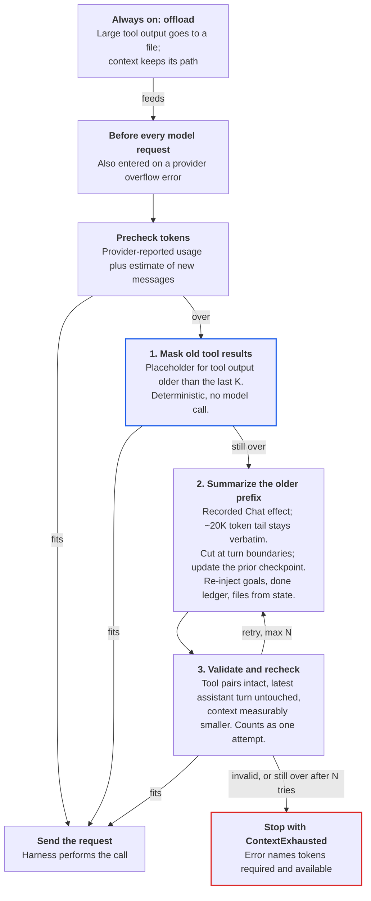

# Context Compaction in Agent Harnesses: What Works

**Report type:** Analytical / recommendation. Produced 2026-10-21 from source-level and literature surveys of 13 harnesses and recent compaction research.

## Bottom line

Build compaction as a layered pipeline in which the cheap, deterministic layers do most of the work and a model summary is the rare last resort.

- **Offload.** Keep large tool output out of the context, as a file or reference the agent can re-read.
- **Mask.** Replace old tool results with a placeholder, keeping the calls and the reasoning. On SWE-bench this matched LLM summarization at half the cost of raw context, without the 13-15% longer runs that summaries cause.
- **Summarize, rarely.** Only when masking cannot get under the limit, and into a sectioned checkpoint that updates the previous one.

Around all three layers, four rules prevent nearly every bug reported against Claude Code, Codex, Gemini CLI, opencode, Cline, and Zed:

1. **Keep task state out of the prose summary.** Goals, constraints, completed steps, and the file list belong in structured places that are rebuilt from source after compaction.
2. **Cut only at turn boundaries and validate the result.** Never separate a tool call from its result, and never alter the latest assistant turn's reasoning.
3. **Require measured progress.** A compaction that does not free space is a failure. Retries are bounded, and the harness then stops with an error instead of looping.
4. **Keep the full history addressable.** The summary then works as an index into the history, not a replacement for it.

For Runvil, most of the mechanism already exists: `messages.replace`, the `compactor` hook, overflow reasons, and the usage anchor. The missing pieces are a compactor that receives the list and may return, and treating the summary request as an ordinary recorded Chat effect so replay stays exact.

## Recommended design

Run one loop before every model request, and also when the provider reports an overflow. Each step is more expensive than the one before it, and every exit is checked.

The offload step works all the time, so fewer requests ever reach the loop. Masking handles most of the rest without a model call. A summary runs only when masking cannot fit the context, and its output must pass validation before it replaces history.

Starting values drawn from the harnesses and studies below:

| Parameter | Starting value | Why |
| --- | --- | --- |
| Trigger | 80-90% of the window, as a fraction and not a fixed reserve, plus one recovery on overflow | Codex, Goose, Cline, and Zed all land here. A fixed reserve scales badly across window sizes (pi). |
| Mask window K | About 10 recent tool results, tuned per prompt | The JetBrains optimum was 10 on SWE-agent but 58 on OpenHands |
| Verbatim tail | 15-20K tokens of recent whole exchanges | opencode 15K, pi 20K, Cline 20K, Codex 20K of user messages |
| Summary sections | Goal, constraints, done/in progress/blocked, decisions, files, errors quoted verbatim, next step | Every mature prompt converges here. Marking facts apart from assumptions reduces unsourced entries. |
| Summary input | Unchanged prefix plus the instruction at the end | Hits the provider cache (opencode, Cline). Shrink in steps when it overflows. |
| Summary output budget | Separate from the trigger, at least 8K tokens for reasoning models | Cline and pi both hit empty or truncated summaries with smaller budgets |
| Attempts N | 2-3 per request | Every harness without a cap shipped a loop bug |
| Step size | Free a large chunk, at least half the excess | Fewer prefix changes keep the cache warm and the records small |

## What has caused problems

Most reported compaction bugs have one of two causes. A free-form summary is expected to carry task state it was never built to hold, or the harness rewrites history without checking that the result fits and is a valid request. The table runs from most user-visible to least.

| Failure | What users see | Root cause | Fix that maintainers shipped or proposed | Examples |
| --- | --- | --- | --- | --- |
| Lost goals and rules | The agent forgets the task, denies edits it made, stops early, or ignores CLAUDE.md rules | The summarizer treats instructions as narrative to compress. Recency bias favors the latest subtask over the overall goal. | Re-read rule files from disk after compaction. Pre- and post-compact hooks. Codex moved the goal into a user-role message marked "do not compress". | [codex#5957](https://github.com/openai/codex/issues/5957), [codex#19910](https://github.com/openai/codex/issues/19910), [codex PR 22045](https://github.com/openai/codex/pull/22045), [claude-code#19471](https://github.com/anthropics/claude-code/issues/19471), [OpenHands#10508](https://github.com/OpenHands/OpenHands/issues/10508) |
| Redoing finished work | Reads files again, reruns commands, brings back completed or obsolete tasks | The summary does not say clearly what is done. Old instructions survive with nothing marking them closed. | Keep the last N operational steps verbatim. Keep a ledger of completed steps outside the summary. | [codex#35935](https://github.com/openai/codex/issues/35935), [codex#42695](https://github.com/openai/codex/issues/42695), [codex#29356](https://github.com/openai/codex/issues/29356), [claude-code#65796](https://github.com/anthropics/claude-code/issues/65796) |
| Summary-of-summary drift | After 2 or 3 compactions earlier decisions are gone. Exact data becomes "user provided markup". | Each pass summarizes the previous summary, and the summary does not point back to the full transcript. | A cumulative "historical context" section that is never discarded. Summaries that cite where to find the original. Compression regression evals. | [codex#14347](https://github.com/openai/codex/issues/14347), [claude-code#26771](https://github.com/anthropics/claude-code/issues/26771), [gemini-cli#23912](https://github.com/google-gemini/gemini-cli/issues/23912) |
| Compaction loops | Compaction fires again right after it runs: 211 compactions in one Claude Code session, 95% of them back to back | The trigger checks a threshold but never checks that compaction freed space. Content that cannot be compacted (system prompt, rule files, images) already fills the window. | Require a measured reduction. Back off after a failed attempt. Stop with an error after N attempts that make no progress. | [claude-code#24179](https://github.com/anthropics/claude-code/issues/24179), [gemini-cli#16213](https://github.com/google-gemini/gemini-cli/issues/16213), [opencode#27924](https://github.com/anomalyco/opencode/issues/27924), [codex#33493](https://github.com/openai/codex/issues/33493) |
| Compaction itself fails | "Conversation too long" during /compact, overload errors, thread left unusable | The summarization request is sent with the same full window, so it overflows when it is needed most | Compact earlier than the hard limit. Truncate or chunk the input to the summarizer. Keep the old history if summarization fails. | [claude-code#7530](https://github.com/anthropics/claude-code/issues/7530), [claude-code#5623](https://github.com/anthropics/claude-code/issues/5623), [gemini-cli#7784](https://github.com/google-gemini/gemini-cli/issues/7784), [codex#14860](https://github.com/openai/codex/issues/14860) |
| Malformed history | A 400 error on every later request | The cut lands between a tool call and its result, leaves empty content, or produces an invalid role order | Cut only at turn boundaries, keep call/result pairs together, and validate the request before sending it | [claude-code#8484](https://github.com/anthropics/claude-code/issues/8484), [gemini-cli#2347](https://github.com/google-gemini/gemini-cli/issues/2347), [opencode#6446](https://github.com/anomalyco/opencode/issues/6446) |
| Reasoning blocks | 400 errors after the first compaction (Anthropic thinking, DeepSeek reasoning_content) | Providers require some reasoning artifacts back verbatim, and the rules differ by provider | Never edit the latest assistant turn. Use provider-native clearing where it exists. | [claude-code#63448](https://github.com/anthropics/claude-code/issues/63448), [Roo-Code#10175](https://github.com/RooCodeInc/Roo-Code/issues/10175), [codex#53309](https://github.com/openai/codex/issues/53309) |
| Cache and cost spikes | Prefixes written to the cache instead of read from it (about 20x cost), /compact resending everything | Compaction changes the cached prefix, a cache breakpoint sits on a volatile message, or images are stored again on every compaction | Place breakpoints only on stable content. Compact rarely and in large steps. Store large blobs once, by reference. | [claude-code#70459](https://github.com/anthropics/claude-code/issues/70459), [claude-code#94177](https://github.com/anthropics/claude-code/issues/94177), [codex#35458](https://github.com/openai/codex/issues/35458) |
| Wrong trigger | Compaction at 6% of a 1M window, or never firing at all, or firing while the session sits idle | Wrong window metadata, double-counted tokens, triggers based on the wall clock | Use the token counts the provider reports. Keep a window table per model. Never trigger on a timer. | [claude-code#42375](https://github.com/anthropics/claude-code/issues/42375), [cline#9748](https://github.com/cline/cline/issues/9748), [claude-code#98747](https://github.com/anthropics/claude-code/issues/98747) |
| Broken lineage | Resume shows messages from days ago, the session name disappears | The compaction record points at a parent that was never written | Write the compaction record and its links atomically | [claude-code#46603](https://github.com/anthropics/claude-code/issues/46603), [claude-code#97665](https://github.com/anthropics/claude-code/issues/97665) |

The lessons for a recorded, replayable harness follow from these rows:

- A summary is nondeterministic model output, so record the compaction call like any other model call and replay its answer.
- The trigger must depend only on recorded token counts.
- Task state needs a structured place outside the summary.
- The pre-compaction transcript stays available, and the summary refers to it.

## How existing harnesses do it

The harnesses that have gone through the most bug reports ended up with the same design:

- Fire at 80-90% of the window, and also on a provider overflow error.
- Clear old tool output before summarizing.
- Keep a recent tail of real user exchanges verbatim, typically 15-20K tokens.
- Write a sectioned summary that updates the previous one.
- Rebuild instructions and environment from source instead of trusting the summary to carry them.

Some of these mechanisms are distinctive: Cursor's trained summarizer and searchable history file, pi's file ledger, Goose's hide-don't-delete, Codex's encrypted server-side compaction.

| Harness | Trigger | Kept verbatim | Summary shape | Repeat compaction | Distinctive |
| --- | --- | --- | --- | --- | --- |
| [Claude Code](https://code.claude.com/docs/en/context-window) | Near the window limit (configurable), idle sessions, overflow errors | System prompt, CLAUDE.md and rules re-read from disk, 5 recent files (5K tokens each), plan | Analysis scratchpad, then 9 sections including "All user messages" and "Optional next step" with direct quotes | Summarizes the old summary with everything after it | Clears tool output before summarizing. PreCompact and PostCompact hooks. Stops with "Autocompact is thrashing" instead of looping. |
| [Codex CLI](https://github.com/openai/codex) (Rust) | min(configured limit, 90% of window), before, during, and after a turn | Newest real user messages up to 20K tokens. Assistant turns and tool calls are dropped. | "Context checkpoint" handoff note, stored as a user message | Local prompt, or the Responses API compact endpoint returning one encrypted item | Rebuilds the initial context before the last user message. Background compaction. Pre and post hooks. |
| [Gemini CLI](https://github.com/google-gemini/gemini-cli) | 50% of window | Last 30% of history, split only at a user turn with no tool response | XML `<state_snapshot>`: goal, constraints, knowledge, artifact trail, task state | Must merge the previous snapshot. A second "probe" call critiques and improves the snapshot. | Truncates old tool output to temp files first. Rejects a summary that grows the token count. |
| [opencode](https://github.com/anomalyco/opencode) | 15% or 16K tokens left, or one recovery on an overflow error | About 15K tokens of the newest whole exchanges | Markdown checkpoint: objective, decisions, work state, next move, at most 15 files | Update prompt where newer history wins. Shrinks input in steps of 0.7, 0.5, and 0.35 when the summary call itself is too long. | Sends the unchanged prefix plus the summary instruction so the summary call hits the cache |
| [pi](https://github.com/earendil-works/pi/blob/main/packages/coding-agent/docs/compaction.md) | Window minus a 16K reserve, between turns, or on overflow or a `length` stop | 20K tokens of recent messages. Never cuts at a tool result. | Goal, constraints, progress (done, in progress, blocked), decisions, next steps | Iterative update with PRESERVE, ADD, and move-to-Done rules | Read and modified file lists come from tool calls. Append-only session tree keeps raw entries. A separate summary when switching branches. |
| [Cursor](https://cursor.com/blog/self-summarization) (closed source) | Near the top of the active window, often 200-300K | Attached skills and tool schemas, rebuilt each turn | Composer writes its own summary, trained with reinforcement learning | Carries a count of earlier summaries | See the callout below |
| [Aider](https://github.com/Aider-AI/aider/blob/main/aider/history.py) | Done messages over 1/16 of the window (1K-8K tokens) | Repo map, files in the chat, read-only files, rebuilt each turn | Written as the user ("I asked you..."), must keep filenames | Recursive, up to depth 3 | Summarizes in a background thread and keeps the result only if history did not change meanwhile |
| [Goose](https://github.com/block/goose) (Rust) | 80% of window, capped at 225K, or an overflow error | Latest user message | JSON: intent, files, errors (quoted verbatim), user messages, pending tasks, next step | Not documented | Nothing is deleted. Originals become visible to the user only. Can summarize old tool pairs in batches. Defers to providers that manage their own context. |
| [Cline](https://github.com/cline/cline) | 90% of usable input, targeting 70% afterward | 20K tokens of recent messages, typed user prompts | Factual note under 800 words that separates facts from assumptions | Incremental. Folds in only new messages. | A "basic" mode with no model call. Keeps earlier output frozen to avoid stacked summaries. |
| [Roo Code](https://github.com/RooCodeInc/Roo-Code) | User-set percent per profile | Commands from the first message, outlines of files it read | Modeled on Claude Code's sections | Fresh start from the summary | Originals tagged for rewind. Inserts synthetic tool results for orphaned calls. Falls back to a 50% sliding window. |
| [OpenHands](https://github.com/OpenHands/OpenHands/tree/0.59.0/openhands/memory/condenser/impl) | Over 100 events, halved to 50 | First event and recent tail | Sections including task tracking with IDs, or a forced structured tool call | Recursive. Each summary folds in the previous one. | A pluggable pipeline of condensers (masking, truncation, LLM ranking, summary). Halving keeps the cache warm between condensations. |
| [Zed](https://github.com/zed-industries/zed) (Rust) | 90% by default (percent, tokens used, or tokens remaining) | Newest user messages up to 80 KB (about 20K tokens). Assistant turns, tool calls, and tool results are dropped. | Goal, state, context, next, pitfalls ("anything tried that didn't work") | Stored as a typed marker in the same thread. Later requests start from the latest marker, and the originals stay for display and export. | Disabled for windows under 80K, which get a banner instead. A separate compaction model setting. Leaves compaction to external ACP agents. Known bugs: auto-compacts only once per long turn, an oversized tool result breaks the thread for good, and the no-tools summary request misses the cache (about $4.50 per compaction). |

**Cursor callout.** In Cursor both the harness and the model do compaction. The harness picks the moment and rebuilds context. Cursor's own Composer models write the summary, and they were trained to do it ([post](https://cursor.com/blog/self-summarization), Mar 2026).

- **Training.** At a fixed token trigger during reinforcement-learning training, the model gets "Please summarize the conversation" and continues from what it wrote. The final task reward is applied to the summary tokens too. Summaries that lost something critical get downweighted, with no hand-written template.
- **Reported result.** Half the compaction error of a tuned prompt baseline, with summaries of about 1K tokens against more than 5K for the baseline.
- **Harness side** ([dynamic context discovery](https://cursor.com/blog/dynamic-context-discovery)):
    - Long shell and MCP output goes to files, which means fewer summarizations.
    - After a summary the agent gets the full chat history as a searchable file, so the summary indexes the history instead of replacing it.
    - MCP tool specs live in a folder, which cut tokens 46.9% in MCP runs.
- **Complaints on the forum.** Summarizing at 10-20% of the window, endless "Summarizing chat" spinners, and skills read mid-session lost after a summary ([forum](https://forum.cursor.com/t/after-context-summarization-the-agent-loses-active-skills-and-tool-usage-knowledge-causes-disruptive-tool-permission-failures/164549)).

## Technique catalog

The cheap, deterministic technique, masking old tool output, is the best measured. Summarization is the expensive last resort, and its failures are documented. The table runs from cheapest and safest to most expensive and riskiest.

| Technique | What it does | Model call? | Evidence | Main risk |
| --- | --- | --- | --- | --- |
| Observation masking | Replaces tool outputs older than the last K with a short placeholder. Keeps actions and reasoning. | No | Matched or beat summarization on SWE-bench Verified at about half the cost of raw context ([JetBrains](https://arxiv.org/abs/2508.21433)). Anthropic calls it the "lightest touch" form ([post](https://www.anthropic.com/engineering/effective-context-engineering-for-ai-agents)). | K depends on the scaffold: 10 for SWE-agent, 58 for OpenHands. Every edit to the prefix invalidates the cache. |
| Restorable offloading | Writes large outputs to a file or store and leaves a path or URL in context | No | Asserted by [Manus](https://manus.im/blog/Context-Engineering-for-AI-Agents-Lessons-from-Building-Manus) and Claude Code's "Referenced file" note. Not benchmarked. | The model must remember to re-read the file. Re-retrieval can rise up to 3x ([Liu](https://arxiv.org/abs/2608.16370)). |
| Head and tail truncation | Keeps the system prompt, first message, and last N events, and drops the middle | No | OpenHands `RecentEventsCondenser`. FIFO scored 45.8% vs 56% on AppWorld ([ACON](https://arxiv.org/html/2510.00615)). | Silently loses decisions made in the middle |
| Structured summary | An LLM rewrites the dropped span into fixed sections: intent, files, errors, pending tasks, next step | Yes | Claude Code, Codex, Gemini CLI, and OpenHands all ship it. It roughly ties masking on solve rate. | Runs grow 13-15% longer. Unsourced entries caused 83% of failures in one study ([Min and Chen](https://arxiv.org/abs/2610.20927)). |
| Hybrid | Masks continuously and summarizes only when masking is not enough | Only rarely | +2.6 points over raw context at 7-11% lower cost than either alone (JetBrains, 50-instance slice) | Two thresholds to tune |
| Last-K plus summary | Keeps the last K tool calls verbatim and puts a summary before them | Yes | 91.6% vs 71.0% task completion with full context, at 63% fewer tokens (Microsoft, [Lodha et al.](https://arxiv.org/html/2606.10209v1), one workflow class) | Same risks as summarization |
| Structured notes and memory | The agent writes its plan, todos, and progress to files or a memory tool that outlive compaction | The agent calls it | MemGPT deep retrieval rose from 32.1% to 92.5% ([paper](https://arxiv.org/html/2310.08560)). Anthropic's long-running harness uses a feature-list JSON and a progress file ([post](https://www.anthropic.com/engineering/effective-harnesses-for-long-running-agents)). | Stale notes. The agent has to be prompted to keep them current. |
| Sub-agent isolation | Runs a subtask in a fresh context and returns a 1-2K token result | Yes | Anthropic's multi-agent research system | Implicit decisions are lost across the boundary ([Cognition](https://cognition.com/blog/dont-build-multi-agents)) |
| Learned compressor | The compression prompt is optimized on pairs where full context succeeded and compressed context failed, then distilled into a small model | Yes | 26% lower peak tokens with no accuracy loss on AppWorld. Students keep over 95% of the teacher's performance ([ACON](https://arxiv.org/html/2510.00615)). | Needs an evaluation corpus. Accuracy fell 4 points on OfficeBench. |
| Provider-side compaction | The API summarizes server-side and returns a signed or encrypted block | Yes, server-side | Anthropic `compact_20260112` and on-demand compaction ([docs](https://platform.claude.com/docs/en/build-with-claude/compaction)). The OpenAI Responses compact endpoint. | Opaque and tied to one provider. Must be recorded byte for byte. |

The JetBrains study is the cleanest head-to-head comparison: n=500 per cell on SWE-bench Verified, solve rate and cost per instance.

| Model | Raw context | Masking | LLM summary |
| --- | --- | --- | --- |
| Qwen3-Coder 480B | 53.4%, $1.29 | 54.8%, $0.61 | 53.8%, $0.64 |
| Gemini 2.5 Flash | 32.8%, $0.41 | 35.6%, $0.18 | 36.0%, $0.24 |
| Gemini 2.5 Flash (thinking) | 40.4%, $0.56 | 36.4%, $0.24 | 31.4%, $0.25 |
| Qwen3-32B | 17.0%, $1.12 | 15.0%, $0.55 | 16.0%, $0.50 |

The authors' reading is that summaries hide failure signals and act as encouragement to keep going, which makes runs longer. Lost-in-the-middle and Chroma's [context rot](https://www.trychroma.com/research/context-rot) results point the same way. Shorter context helps even before the window is full, and goals belong at the edges of context, not in the middle.

## Implications for Runvil

The split Runvil already has matches the most robust designs. Lua holds the policy, the Engine holds the mechanism, and the Harness performs the model call. The plan in `vibe/2026-10/2026-10-09-2-messages-userdata-refactor.md` names this split: "Lua keeps control of compaction policy; `replace` is the mechanism."

Today's state comes from a read of the source and is listed here so the gaps are concrete:

- The message history lives in the Engine as a `MessageList` (`crates/runvil-internal/lua/src/messages.rs`), and `replace(first, last, records...)` already exists.
- `compactors.fail` is the only compactor, and it always raises. The loop machine passes the compactor only the overflow reason tag, not the list. A compactor that returns gets the error "replacement compactors are deferred" (`models_loop/machine.rs`).
- The precheck combines the provider-reported `UsageAnchor` with an estimate of 4 characters per token plus 4 tokens per message. Images are not counted (`compactors.rs`).
- `projection.rs` already checks that tool-call batches are answered atomically, with unique ids, before every dispatch.
- The Chat record logs only messages after `keep`, so a compaction that rewrites the front of the list logs the kept tail once more.
- Pack preludes cannot see `messages`, `models`, or `compactors`.

What the evidence suggests, in order of value:

1. **Let a compactor receive the list and return.** Passing the list as an argument is the smallest change. It avoids widening the prelude sandbox, and it lets a Pack ship compactors.
2. **Ship a native masking compactor first.** For example, `compactors.mask{keep = K, exclude = {...}}`, written in Rust with no model call and fully deterministic. Make K configurable, because it varies by scaffold (10 for SWE-agent, 58 for OpenHands). Summarization can come later as a compactor written in Lua or shipped by a Pack, which needs no new Engine machinery.
3. **Make the summary call an ordinary `Effect::Chat`.** The Harness then performs it and the recorder captures it, and replay feeds back the recorded summary instead of generating a new one. Every harness that treats the summary as a side channel has lost determinism or ordering. Server-side compaction blocks from Anthropic and OpenAI are opaque, so they must be recorded and returned byte for byte.
4. **After every compaction, run the post-compaction checks as yes/no gates.**
    - Pass the result through the existing projection checks.
    - Never edit the latest assistant turn, because some providers reject altered reasoning blocks.
    - Run the precheck again. If the context is still over the limit, raise `ContextExhausted` with a message stating the tokens required and the tokens available.
    - Cap compactions per loop so a compaction that makes no progress cannot loop.
5. **Change the prefix rarely and in large steps.** OpenHands halves the history, SWE-agent uses polling, and Anthropic uses `clear_at_least`. Large steps keep the provider cache warm, and with `after`/`keep` they also keep record size down.
6. **Fix the estimate before relying on it.** Count images and opaque reasoning payloads, because pi's reasoning models stalled when encrypted thinking counted as about 0 tokens. Set the trigger as a fraction of the window, not as a fixed reserve: pi's 16K reserve means 94% of a 272K window but 98% of a 900K one. Keep the trigger separate from the summary's output budget.
7. **Keep task state out of the summary.** A Pack can keep goals, a ledger of completed steps, and the list of read and modified files in `store`. The file list can be built from tool calls, as pi does. Re-inject this state after compaction instead of trusting the summary to carry it.

**The sidecar summarizer is feasible and has precedents.** Codex has async compaction, Aider summarizes in a background thread, and Anthropic documents background compaction. Aider's rule makes it safe:

- Summarize a frozen prefix ahead of time, for example at 70%.
- At the threshold, apply the summary with `replace` only if that prefix is unchanged.
- Otherwise discard it.

Open question: can the Engine's scheduler have a Chat effect in flight beside the main loop's? If so, the sidecar is an ordering problem for the recorder. If not, it needs scheduler work.

**Lua and Rust pitfalls to design around:**

- In Lua, `#s` counts bytes, and slicing a string can split a UTF-8 sequence. Truncate tool output in Rust, or on character boundaries.
- Iterating a Lua table with `pairs` gives no fixed order. A compactor that builds a summary or a placeholder by iterating a table can produce different bytes for the same input, which breaks replay comparison and the prompt cache. Sort keys, or use arrays.
- Codex's Rust code shows what to copy and what to avoid:
    - Copy: token math with saturating arithmetic in wide integers, and a biased `select!` that charges usage even when cancellation arrives at the same moment.
    - Avoid: a retry loop that clones the whole history on every attempt.
    - Avoid: trimming the front on overflow without checking pairs, which can leave a tool result whose call was removed.

## Sources

Subagents opened these on 2026-10-21. Issue links appear in the tables above.

**Research and measurements**

- [The Complexity Trap: observation masking vs LLM summarization](https://arxiv.org/abs/2508.21433), JetBrains Research
- [ACON: Agent Context Optimization](https://arxiv.org/html/2510.00615)
- [Prune the Summary, Not the History](https://arxiv.org/abs/2610.20927)
- [What Does Context Compression Cost an Agent?](https://arxiv.org/abs/2608.16370)
- [Less Context, Better Agents](https://arxiv.org/html/2606.10209v1), Microsoft
- [Execution instability under compression](https://arxiv.org/abs/2608.06503) and [PAIR](https://arxiv.org/abs/2609.36526)
- [MemGPT](https://arxiv.org/html/2310.08560)
- [Lost in the Middle](https://arxiv.org/html/2307.03172v3)
- [Context Rot](https://www.trychroma.com/research/context-rot), Chroma
- [OpenHands context condensation](https://openhands.dev/blog/openhands-context-condensensation-for-more-efficient-ai-agents)

**Vendor docs and engineering posts**

- Anthropic: [Effective context engineering](https://www.anthropic.com/engineering/effective-context-engineering-for-ai-agents), [Harnesses for long-running agents](https://www.anthropic.com/engineering/effective-harnesses-for-long-running-agents), [Multi-agent research system](https://www.anthropic.com/engineering/multi-agent-research-system)
- Anthropic API: [Compaction](https://platform.claude.com/docs/en/build-with-claude/compaction), [Threshold compaction](https://platform.claude.com/docs/en/build-with-claude/compaction-threshold), [On-demand compaction](https://platform.claude.com/docs/en/build-with-claude/compaction-on-demand), [Context editing](https://platform.claude.com/docs/en/build-with-claude/context-editing), [Memory tool](https://platform.claude.com/docs/en/agents-and-tools/tool-use/memory-tool)
- Claude Code: [Context window](https://code.claude.com/docs/en/context-window), [Hooks](https://code.claude.com/docs/en/hooks), [How Claude Code works](https://code.claude.com/docs/en/how-claude-code-works), [extracted system prompts](https://github.com/Piebald-AI/claude-code-system-prompts) (third party)
- OpenAI: [Compaction guide](https://developers.openai.com/api/docs/guides/compaction.md)
- Cursor: [Self-summarization](https://cursor.com/blog/self-summarization), [Dynamic context discovery](https://cursor.com/blog/dynamic-context-discovery), [Composer 2](https://cursor.com/blog/composer-2)
- [Manus: Context engineering lessons](https://manus.im/blog/Context-Engineering-for-AI-Agents-Lessons-from-Building-Manus)
- [Cognition: Don't build multi-agents](https://cognition.com/blog/dont-build-multi-agents)
- [LangChain: Context engineering for agents](https://www.langchain.com/blog/context-engineering-for-agents)
- [Mario Zechner on pi](https://mariozechner.at/posts/2025-11-30-pi-coding-agent/)

**Source code read**

- [openai/codex](https://github.com/openai/codex) `codex-rs/core/src/compact.rs`, `compact_remote_v2.rs`, `session/context_window.rs`
- [google-gemini/gemini-cli](https://github.com/google-gemini/gemini-cli) `packages/core/src/context/chatCompressionService.ts`
- [anomalyco/opencode](https://github.com/anomalyco/opencode) `packages/core/src/session/compaction.ts`
- [earendil-works/pi](https://github.com/earendil-works/pi) `packages/coding-agent/src/core/compaction/`
- [zed-industries/zed](https://github.com/zed-industries/zed) `crates/agent/src/thread.rs`, `crates/agent_settings/src/prompts/compaction_prompt.txt`
- [Aider](https://github.com/Aider-AI/aider) `aider/history.py`
- [block/goose](https://github.com/block/goose) `crates/goose/src/context_mgmt/mod.rs`
- [cline/cline](https://github.com/cline/cline) `sdk/packages/core/src/extensions/context/`
- [RooCodeInc/Roo-Code](https://github.com/RooCodeInc/Roo-Code) `src/core/condense/index.ts`
- [OpenHands condensers at tag 0.59.0](https://github.com/OpenHands/OpenHands/tree/0.59.0/openhands/memory/condenser/impl)
- [SWE-agent history processors](https://swe-agent.com/latest/reference/history_processor_config/)
