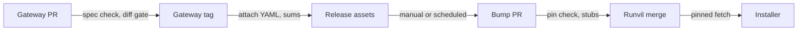
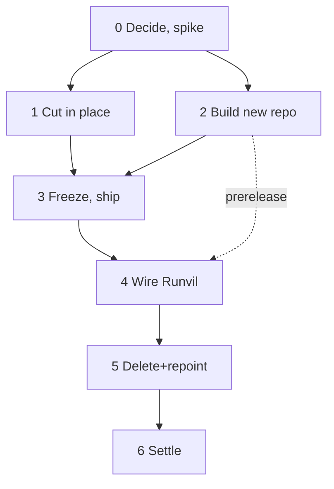

<!-- source: repository C:\Users\Vinnie\cursor\runvil at commit 08801150f (2026-10-27, clean tree), plus two later runvil commits (c73db8f7f, 38e13409e) read on 2026-10-30; sibling repositories wg21-paperflow, wg21-website, runvil-docs, runvil-cloud-providers read-only; GitHub state read with gh on 2026-10-28; vendor documentation cited by URL in Appendix L -->

# Moving the Gateway to its own repository

A feasibility study with a recommendation, prepared for Vinnie Falco, owner of the Runvil repository. The evidence is commit `08801150f` of `runvil` (2026-10-27), and every line citation is read at that commit, so a citation may not match the tree today. Three changes came after it: `c73db8f7f` (2026-10-28, the compatibility rule README, pushed), `38e13409e` (2026-10-30, the ranges deletion, local and not pushed), and uncommitted work on top of `4206be908` (2026-10-30) that takes Workshop off the Gateway's test fixtures, so the six relative fixture paths in section 7 are gone. Uncommitted work on top of `8680a404d` (2026-10-30) adds the pin, the fetch and bump scripts, the stub path in pull request CI, the `--gateway-binary` flag, and the version check at attach; blocker 3 and major 4 below describe that work as done.

## Executive summary

**Recommendation.** Go, in stages. Keep the Gateway where it is while every reference between Workshop and the Gateway is cut and checked by a machine, build the new repository alongside, publish a first Gateway release, switch Workshop to that release, and only then delete the old code. Doing nothing is the fallback, and moving everything in one day is the riskiest option. Confidence: high that the split is feasible and that this order is safest. Reason: every step stays reversible until the final deletion. Confidence in the effort estimate: medium. Reason: the spec generator and the Windows and macOS release builds are unproven.

**Why the split is feasible, and what the real work is.** The code is easy to separate and the plumbing is not. The Gateway is 16 crates and 748 of 2,645 tracked files, and no Engine, Harness, or Plugin crate depends on it. Only three Workshop crates name Gateway code, through two public crates: `gateway-api-discovery` (22 Workshop files) and `gateway-api-types` (one two-field type, `Progress`). The real work is elsewhere: Workshop's build compiles the Gateway from source, CI runs both products in the same jobs, no Gateway release has ever been published, and no OpenAPI or AsyncAPI file exists (section 3 lists what breaks).

**What happens first.** Vinnie runs three short spikes in scratch copies, with his agents: spec generation, a five-target release dry run, and a stub sidecar check. Then he cuts every Workshop-to-Gateway reference inside the current repository, under a machine check. In parallel he builds the new repository, extracts the Gateway with its history, and publishes a first release for all five installer targets. Only then does Workshop switch to that release and the Gateway code get deleted.

**What is already decided.** Vinnie settled these, and the plan assumes them:

1. The Gateway moves to its own repository because other people now work on it.
2. Workshop and the Harness depend only on a written API (OpenAPI plus AsyncAPI), never on Gateway source. That includes speech-to-text.
3. The spec is generated from Gateway source, committed, and checked in CI. A human reviews the spec diff, not the Rust.
4. No Gateway source exists anywhere in Vinnie's local setup. An AI agent in the Workshop or Harness repository never sees Gateway source.
5. Working on speech-to-text across two local checkouts is allowed for one feature only. The temporary Gateway checkout sits outside `C:\Users\Vinnie\cursor` and is deleted afterwards.
6. Only the Gateway leaves. Engine, Harness, Plugins, Workshop, and the shared build tooling stay in the Runvil repository.
7. The Gateway repository is public.
8. The repository is `cppalliance/runvil-gateway`. The fork `vinniefalco/runvil-gateway` is the assumed working fork.
9. The realtime ranges extension is deleted before the first publication of the spec. It is already done locally in `38e13409e`, not pushed.
10. After the first Gateway release, the Workshop UI decoder becomes tolerant: it ignores unknown extra fields and unknown event types, and still rejects a missing or wrongly typed field on a known event.
11. The Gateway guide chapters stay in `runvil-docs`. The agent writes them from the spec, and Vinnie is the owner of record.

The compatibility rule also applies: Gateway's API matches OpenAI's and adds only the smallest extension a feature needs. It is written in `crates/gateway/README.md`, which says the spec and the capability endpoint it mentions are intended and do not exist yet.

**What is still open.** Six decisions are open, each with a safe default, and all six are Vinnie's. None needs an answer from him before the first Gateway release (section 10 lists them).

**Vinnie's four questions.**

- **How does the installer get the Gateway?** Workshop's release job downloads a pinned, checksummed Gateway release binary for each of the five target triples and stages it as today. The Gateway repository must first add Windows and macOS targets to its release configuration, which builds Linux only today.
- **Should Workshop use a git submodule?** No. A pin file with checksums gives the same one-line pin. A submodule puts Gateway source in the working tree and keeps Workshop CI building the Gateway.
- **How are shared crates obtained?** They are not shared. Six shared components are copied, moved, or inlined, and the seventh, `gateway-api-discovery`, has its client half forked behind a written contract. Zero shared crates is reachable.
- **How does Workshop get the API YAML and its updates?** The Gateway release attaches `openapi.yaml` and `asyncapi.yaml`. Both describe OpenAI's shape, and every Gateway addition is listed in one place as an extension. The Runvil repository keeps a committed copy and a pin file. A manual bump comes first, then a scheduled workflow opens an update pull request, a human reviews the YAML diff, and conformance tests run before merge.

**The top five risks, most serious first.**

1. No Gateway release exists. The cargo-dist workflow has only ever run in plan mode on pull requests, and it targets two Linux triples. Likelihood that the first Windows or macOS build needs a fix: roughly even chance. Confidence in that evidence: medium.
2. Replacing `gateway-api-discovery` is the largest cut. It is a 2,445-line process-lifecycle protocol that OpenAPI cannot describe, used by 22 Workshop files and 12 test files.
3. The spec generator is unproven. Today the Workshop UI's realtime decoder rejects unknown fields and hard-codes three Gateway names, so any additive realtime change breaks every installed Workshop and no other server works with it. The tolerant decoder decision removes the first problem after the first Gateway release, and relaxing the three names is separate work.
4. Thirty speech-to-text fixture files and two baseline files were read or written by tests in both products, so the split broke tests on one side unless the data was divided first. Workshop now owns its copies, on 2026-10-30 and uncommitted on top of `4206be908`, so neither side reads a file the other writes.
5. Outside consumers break on the first Monday after the move. `runvil-cloud-providers` builds Gateway source from `master` every week, so its first run after the move very likely fails. Confidence in that evidence: high. Rewriting `runvil` history would also break the pins that other repositories hold, so the plan never does that.

**Three first actions.**

1. Push `38e13409e` when Vinnie chooses. Owner: Vinnie. Next step: push the commit from `runvil`. Nothing waits on it. The ranges deletion is done locally and nothing is published yet, so the way back before the first publication is `git revert 38e13409e`.
2. Run the spikes in scratch copies. Owner: Vinnie, with his agents, for spec generation (three days, eight things to prove), the five-target release dry run (one day), and the 15-minute check that a stub sidecar satisfies `tauri-build`. Next step: start the spec generation spike on four routes (Appendix J).
3. Start cutting references inside the current repository. Owner: Vinnie. Next step: add a check to `crates/build-xtask/src/product.rs` so any Workshop-to-Gateway edge fails, then clear the seven edges that exist today.

Confidence in this order of actions: high. Reason: it is the only path in which a machine check verifies each step before anything is deleted, and it matches how the repository already enforces its family rules.

## Contents

- [1. What is decided, how to read the evidence, and how options are compared](#1-what-is-decided-how-to-read-the-evidence-and-how-options-are-compared)
  - [1.1 What is already decided](#11-what-is-already-decided)
  - [1.2 The compatibility rule](#12-the-compatibility-rule)
  - [1.3 How to read the evidence](#13-how-to-read-the-evidence)
  - [1.4 How the options are compared](#14-how-the-options-are-compared)
- [2. A staged split beats doing nothing and a big-bang move](#2-a-staged-split-beats-doing-nothing-and-a-big-bang-move)
  - [2.1 Four options compete](#21-four-options-compete)
  - [2.2 Option A is best, and B is the fallback](#22-option-a-is-best-and-b-is-the-fallback)
  - [2.3 The first Gateway release comes before any deletion](#23-the-first-gateway-release-comes-before-any-deletion)
- [3. What breaks in a naive split](#3-what-breaks-in-a-naive-split)
  - [3.1 The Gateway set is 748 files in 16 crates, and the cut line is narrow](#31-the-gateway-set-is-748-files-in-16-crates-and-the-cut-line-is-narrow)
  - [3.2 Blockers: what stops either repository from building](#32-blockers-what-stops-either-repository-from-building)
  - [3.3 Majors: what loses a check, a test, or a promise](#33-majors-what-loses-a-check-a-test-or-a-promise)
  - [3.4 Minor problems are many, and each fix is mechanical](#34-minor-problems-are-many-and-each-fix-is-mechanical)
- [4. What to do with each shared component](#4-what-to-do-with-each-shared-component)
  - [4.1 How Cargo can share code between repositories](#41-how-cargo-can-share-code-between-repositories)
  - [4.2 `shared-error-source`: copy a trimmed crate into each repository](#42-shared-error-source-copy-a-trimmed-crate-into-each-repository)
  - [4.3 `shared-loopback`: Gateway keeps it, Workshop inlines one function](#43-shared-loopback-gateway-keeps-it-workshop-inlines-one-function)
  - [4.4 `build-ceiling`: copy it now, consider retiring it later](#44-build-ceiling-copy-it-now-consider-retiring-it-later)
  - [4.5 `build-ui`: copy and trim per repository, consider a Node script later](#45-build-ui-copy-and-trim-per-repository-consider-a-node-script-later)
  - [4.6 `shared-ui`: move it wholly to the Gateway repository](#46-shared-ui-move-it-wholly-to-the-gateway-repository)
  - [4.7 `gateway-api-types`: Workshop defines its own two-field `Progress`](#47-gateway-api-types-workshop-defines-its-own-two-field-progress)
  - [4.8 `gateway-api-discovery`: fork the client half behind a written contract](#48-gateway-api-discovery-fork-the-client-half-behind-a-written-contract)
  - [4.9 Workspace configuration and `build-xtask`: copy, trim, and list what must stay identical](#49-workspace-configuration-and-build-xtask-copy-trim-and-list-what-must-stay-identical)
  - [4.10 Resolver pins: keep each one where it is used](#410-resolver-pins-keep-each-one-where-it-is-used)
  - [4.11 How far shared crates can be eliminated](#411-how-far-shared-crates-can-be-eliminated)
- [5. Workshop should download a pinned Gateway release, not build the Gateway or use a submodule](#5-workshop-should-download-a-pinned-gateway-release-not-build-the-gateway-or-use-a-submodule)
  - [5.1 Today Workshop builds the Gateway from source in the same workspace](#51-today-workshop-builds-the-gateway-from-source-in-the-same-workspace)
  - [5.2 Ways to get the Gateway into the installer, ranked](#52-ways-to-get-the-gateway-into-the-installer-ranked)
  - [5.3 Why not a git submodule](#53-why-not-a-git-submodule)
  - [5.4 Workshop needs one pin file and one committed spec at build time](#54-workshop-needs-one-pin-file-and-one-committed-spec-at-build-time)
  - [5.5 Developer loop with a temporary Gateway checkout](#55-developer-loop-with-a-temporary-gateway-checkout)
  - [5.6 Pull request CI uses a stub, and release CI uses the pinned binary](#56-pull-request-ci-uses-a-stub-and-release-ci-uses-the-pinned-binary)
  - [5.7 Checking the Gateway version at run time](#57-checking-the-gateway-version-at-run-time)
  - [5.8 Packaging, signing, and native assets change little](#58-packaging-signing-and-native-assets-change-little)
  - [5.9 The recommended build and release flow](#59-the-recommended-build-and-release-flow)
- [6. How consumers get the API spec](#6-how-consumers-get-the-api-spec)
  - [6.1 Consumers call nine HTTP operations and one WebSocket](#61-consumers-call-nine-http-operations-and-one-websocket)
  - [6.2 Generate with `utoipa` if a spike passes, otherwise from a route table](#62-generate-with-utoipa-if-a-spike-passes-otherwise-from-a-route-table)
  - [6.3 A route missing from the spec fails CI](#63-a-route-missing-from-the-spec-fails-ci)
  - [6.4 Gateway releases publish the spec and each consumer commits a copy](#64-gateway-releases-publish-the-spec-and-each-consumer-commits-a-copy)
  - [6.5 The spec follows OpenAI's API and lists every extension](#65-the-spec-follows-openais-api-and-lists-every-extension)
  - [6.6 Breaking changes are caught against the last release](#66-breaking-changes-are-caught-against-the-last-release)
  - [6.7 Consumers keep hand-written types, checked by tests](#67-consumers-keep-hand-written-types-checked-by-tests)
  - [6.8 Agents read the raw YAML, and Pages hosts the rendered copy](#68-agents-read-the-raw-yaml-and-pages-hosts-the-rendered-copy)
- [7. Speech-to-text shares test data with the Gateway, not code](#7-speech-to-text-shares-test-data-with-the-gateway-not-code)
  - [7.1 Six files read Gateway fixtures, and nothing else crosses](#71-six-files-read-gateway-fixtures-and-nothing-else-crosses)
  - [7.2 Who owns the fixtures after the split](#72-who-owns-the-fixtures-after-the-split)
  - [7.3 What the realtime contract must say](#73-what-the-realtime-contract-must-say)
  - [7.4 Daily workflow for Workshop developers](#74-daily-workflow-for-workshop-developers)
  - [7.5 The ranges extension is deleted before first publication](#75-the-ranges-extension-is-deleted-before-first-publication)
  - [7.6 Gateway adds one token, and Workshop must work without it](#76-gateway-adds-one-token-and-workshop-must-work-without-it)
- [8. CI, release, history, and the cutover plan](#8-ci-release-history-and-the-cutover-plan)
  - [8.1 What happens to the eleven workflow files](#81-what-happens-to-the-eleven-workflow-files)
  - [8.2 How Runvil learns about a new Gateway release](#82-how-runvil-learns-about-a-new-gateway-release)
  - [8.3 Extracting the history with `git filter-repo`](#83-extracting-the-history-with-git-filter-repo)
  - [8.4 Repository name and release assets](#84-repository-name-and-release-assets)
  - [8.5 Three of five outside repositories break](#85-three-of-five-outside-repositories-break)
  - [8.6 The cutover plan: stages 0 to 6](#86-the-cutover-plan-stages-0-to-6)
- [9. Docs, assets, and names need owners](#9-docs-assets-and-names-need-owners)
  - [9.1 Gateway guide chapters stay in `runvil-docs`, with Vinnie Falco as owner of record](#91-gateway-guide-chapters-stay-in-runvil-docs-with-vinnie-falco-as-owner-of-record)
  - [9.2 Prose and plan records still name Gateway internals](#92-prose-and-plan-records-still-name-gateway-internals)
  - [9.3 Assets and licenses move with the code, and `local/` leaves the workspace](#93-assets-and-licenses-move-with-the-code-and-local-leaves-the-workspace)
  - [9.4 Keep the names `runvil-gateway` and `.runvil`, because other things read them](#94-keep-the-names-runvil-gateway-and-runvil-because-other-things-read-them)
  - [9.5 Cleanup list: what still names the Gateway after the code moves](#95-cleanup-list-what-still-names-the-gateway-after-the-code-moves)
- [10. Decisions: what is settled and what is open](#10-decisions-what-is-settled-and-what-is-open)
- [11. Unknowns, assumptions, and limits](#11-unknowns-assumptions-and-limits)
  - [11.1 Unknowns](#111-unknowns)
  - [11.2 Assumptions and limits](#112-assumptions-and-limits)
  - [11.3 Where the evidence disagreed](#113-where-the-evidence-disagreed)
- [Appendix A. Size of the Gateway set](#appendix-a-size-of-the-gateway-set)
- [Appendix B. References the split cuts](#appendix-b-references-the-split-cuts)
- [Appendix C. Edits a Runvil-only checkout needs](#appendix-c-edits-a-runvil-only-checkout-needs)
- [Appendix D. Every Gateway route](#appendix-d-every-gateway-route)
- [Appendix E. What counts as a breaking change](#appendix-e-what-counts-as-a-breaking-change)
- [Appendix F. What the realtime AsyncAPI file must contain](#appendix-f-what-the-realtime-asyncapi-file-must-contain)
- [Appendix G. Where each speech-to-text test and fixture goes](#appendix-g-where-each-speech-to-text-test-and-fixture-goes)
- [Appendix H. What happens to each CI workflow](#appendix-h-what-happens-to-each-ci-workflow)
- [Appendix I. `build-xtask` checks and resolver pins](#appendix-i-build-xtask-checks-and-resolver-pins)
- [Appendix J. Spikes and trial runs](#appendix-j-spikes-and-trial-runs)
- [Appendix K. Commands and evidence](#appendix-k-commands-and-evidence)
- [Appendix L. Sources](#appendix-l-sources)

## 1. What is decided, how to read the evidence, and how options are compared

### 1.1 What is already decided

The options below assume these decisions.

1. The Gateway moves to its own repository because other people now work on it.
2. Workshop and the Harness depend only on a written API (OpenAPI plus AsyncAPI), never on Gateway source. That includes speech-to-text.
3. The spec is generated from Gateway source, committed, and checked in CI, the way `crates/runvil/public-api.txt` is checked by `cargo xtask api`. A human reviews the spec diff, not the Rust.
4. No Gateway source exists anywhere in Vinnie's local setup. On 2026-10-28 Vinnie chose the strict reading: an AI agent in the Workshop or Harness repository never sees Gateway source.
5. Working on speech-to-text across two local checkouts is allowed for one feature only. The temporary Gateway checkout sits outside `C:\Users\Vinnie\cursor` and is deleted afterwards.
6. Only the Gateway leaves. Vinnie confirmed this on 2026-10-28. Engine, Harness, Plugins, Workshop, and the shared build tooling stay in the Runvil repository. Vinnie's words were "of course everything else stays".

Vinnie also decided these on 2026-10-28:

7. The Gateway repository is public.
8. The repository is `cppalliance/runvil-gateway`. The fork `vinniefalco/runvil-gateway` is the assumed working fork.
9. The realtime ranges extension is deleted before the first publication of the spec. It is already done locally in `38e13409e`, not pushed.
10. After the first Gateway release, the Workshop UI decoder becomes tolerant: it ignores unknown extra fields and unknown event types, and still rejects a missing or wrongly typed field on a known event.
11. The Gateway guide chapters stay in `runvil-docs`. The agent writes them from the spec, and Vinnie is the owner of record.

Terms. The **Runvil repository** is the repository that keeps Engine, Harness, Plugins, Workshop, and build tooling after the split. The **Gateway repository** is the new one. The **Gateway set** is the 16 Gateway crates and their files. The **spec** is the OpenAPI and AsyncAPI files together. The **pin file** is one file in the Runvil repository that records the Gateway release, the binary checksums, the spec checksums, and the minimum Gateway version. **Vinnie** is Vinnie Falco, the owner.

### 1.2 The compatibility rule

Vinnie gave this rule on 2026-10-28. Gateway's API matches the industry standard, which means OpenAI's API including its realtime transcription protocol, and adds only the smallest extension a feature needs. Every extension is named as an extension. Workshop keeps working against a server that lacks the extension and loses only the enhancement. In practice:

- Someone should be able to point Workshop at another server, such as vLLM or SGLang, and have it work.
- A few Gateway features are worth keeping, and the live transcription hypothesis is one. OpenAI's API already has a shape for speech-to-text but has no hypothesis, so Gateway uses OpenAI's shape plus the minimum Workshop needs to receive the hypothesis.
- How Gateway produces its transcript (it revises words as it goes and runs three models) stays internal. A client sees OpenAI's shape plus one small addition.
- If Workshop is pointed at an ordinary proxy, it still transcribes. It gets speech-to-text without a hypothesis and shows less. The revision display is an enhancement, never a requirement.

Judged: the minimum addition for revision is a replacement snapshot, not a delta. OpenAI's streaming transcription sends append-only `delta` events, and a delta cannot retract a word. A correction needs an event that replaces the whole transcript. The Gateway hypothesis event already works that way: each one is "a snapshot of the best transcript so far, split into three parts: finalized, agreed, and tentative text", and the include token "switches the live stream from append-only `delta` events to replacement `hypothesis` snapshots" (section 7). Confidence: high. Reason: both the delta shape and the snapshot shape are observed in the wire format and the fixtures, and only the snapshot can express a correction.

The rule is written in `crates/gateway/README.md`. It was committed in `runvil` on 2026-10-28 as `c73db8f7f`, and that commit is already on `origin/master` and `upstream/master`. The file grew from a 4-line stub to 75 lines. It covers: standards first; extensions as the smallest opt-in addition; asking a server what it offers (a dedicated capability endpoint is the intended probe, and its absence means the standard path); the live hypothesis as the worked example; nothing clever reaching the wire; the fallback as a requirement; what is ruled out; and four questions to check a change. The README says the spec and the capability endpoint are intended and do not exist yet. Nothing here treats either as built.

### 1.3 How to read the evidence

Seven analysts read the repositories in parallel, and a lead analyst checked the disputed facts. A statement with a path, line, commit, command, or URL is observed. A statement that begins "Inferred" follows from observations without a direct check. A statement that begins "Judged" or "I recommend" is opinion. No analyst ran `cargo build`, `cargo test`, or `npm`, so every claim that something "would fail" is inferred from reading, not from running.

Line citations are read at commit `08801150f` of `runvil`, the evidence snapshot, unless a sentence says otherwise. Two commits came after it: `c73db8f7f` (2026-10-28, the compatibility rule README, already on `origin/master` and `upstream/master`) and `38e13409e` (2026-10-30, the ranges deletion, which was built and tested, with the runs listed in Appendix K; local, not pushed).

Likelihood uses one ladder: very unlikely, unlikely, roughly even chance, likely, very likely. Confidence in the evidence is high, medium, or low and always sits in a separate sentence. Every recommendation ends with an owner, a next step, and a confidence level with a one-phrase reason.

Effort uses three sizes, judged from file counts and not measured. S is under about two days of focused work, M is about a week, and L is more than a week.

### 1.4 How the options are compared

Every ranked option is scored against the same seven criteria.

- **Effort.** The work to reach a green state in both repositories.
- **Risk of breakage.** The chance that a build, a release, or a shipped installer fails because of the change.
- **Ongoing cost of two repositories.** The recurring work after the move: duplicated code, coordination, and review.
- **Build and release reproducibility.** Whether the same inputs give the same bits, and whether the pin is explicit and checkable.
- **Gateway source kept from agents.** How well the option keeps Gateway source out of the Workshop and Harness working trees and tools.
- **Ease of undo.** How cheaply Vinnie can reverse the step.
- **Compatibility with the industry standard, and substitutability of the server.** Whether a client written against OpenAI's API works against Gateway, and whether Workshop pointed at another server still works (the compatibility rule).

The compatibility criterion does not change any ranking in sections 2 to 5, because where the code lives does not change the API. It matters in sections 6 and 7, where the choices are about the contract itself.

## 2. A staged split beats doing nothing and a big-bang move

Vinnie asked for ranked options wherever there is a real choice. Four options compete at the top level, and they are scored against the criteria in section 1. Everything in the staged plan waits on the first Gateway release.

### 2.1 Four options compete

**Option A: stage the split (recommended).** Stage 0 runs the spikes. Stage 1 removes every Workshop-to-Gateway reference inside the current repository and adds a check that fails if one returns. Stage 2 builds the Gateway repository and does a trial run of the history extraction on a scratch repository. Stage 3 stops changes to the Gateway paths, extracts for real, and cuts the first Gateway release for five targets. Stage 4 wires the Runvil repository to that release. Stage 5 deletes the Gateway code and repoints outside consumers. Stage 6 settles rulesets, runner, and tokens. Each stage is verified before the next starts. Section 8 gives the full ordered plan and marks what runs in parallel.

**Option B: keep one repository and finish the contract work in place.** This is the do-nothing option with the contract work done. Vinnie would generate and commit the spec, add the CI check, tighten the product matrix so Workshop cannot name Gateway crates, and replace Workshop's two Gateway crate dependencies. The Gateway would stay in `runvil`.

**Option C: big bang.** Move the Gateway out in one change, then repair both repositories. It looks fastest on paper.

**Option D: split first and bridge back.** Move the Gateway out, then let Workshop reach back into it through a git submodule, a Cargo git dependency, or a path into a sibling checkout until the real fixes are in.

### 2.2 Option A is best, and B is the fallback

The table compares the options on the six criteria that separate them. The compatibility criterion is the same for all four options, so it is left out. Option A is best or tied for best on four of the six: risk, ongoing cost, reproducibility, and Gateway source kept from agents once stage 5 is done. Its weakness is total effort, which is the sum of all the cuts and cannot be avoided by any option that meets the decisions above.

| Option | Effort | Risk of breakage | Ongoing cost of two repositories | Reproducibility | Gateway source kept from agents | Ease of undo |
|---|---|---|---|---|---|---|
| A. Staged split | L, spread over six stages | Low: each stage is checked before the next | Lowest after stage 5: own CI, own lockfile, own version | High: pin file with checksums | Good after stage 5, and fully met after the stage 6 cleanup; unchanged before it | Easy until stage 5, then a revert pull request |
| B. One repo, contract in place | M | Low | Highest: shared CI, lockfile, version lockstep | Unchanged from today | Poor: Gateway source stays in the Runvil repository | Trivial |
| C. Big bang | M to L, with a red period | High: seven blockers at once, no release to download | Same as A once green | Low until the first release exists | Good at once | Hard: re-extract and re-point everything |
| D. Split, then bridge | M | Medium | High while the bridge exists | Medium: bridge pins a commit | Poor until the bridge is removed | Medium |

Option B ranks second, not last, for two reasons. It is where the project stands after stage 1, so choosing A never gives it up. And Vinnie can stop there if the spike or the first release shows the split costs more than expected. It ranks below A because it does not give the Gateway its own repository and does not keep Gateway source away from the Workshop agent.

Option C ranks third. The Gateway set has 7 inbound edges from Workshop, 22 outbound edges to shared crates, 5 UI tests that read Gateway fixtures, and a sidecar build chain that assumes one workspace. All of those fail together under a naive move (section 3). Workshop CI cannot pass until a Gateway release exists, and no Gateway release has ever existed.

Option D ranks last. During the transition it breaks two rules: Workshop depends only on the written API, and agents never see Gateway source. `deny.toml` sets `unknown-git = "deny"`, so any git dependency would need an `allow-git` entry. And transitions have a habit of lasting. A bridge is acceptable only as a short trial tool, never as a shipped state.

**Recommendation.** Take option A. Owner: Vinnie. Next step: approve stage 0 and start it. No open decision needs Vinnie before the first Gateway release (section 10). Confidence: high. Reason: it is the only option in which a machine check proves each cut before anything is deleted.

### 2.3 The first Gateway release comes before any deletion

The Runvil repository cannot build an installer without a Gateway binary, and no Gateway binary exists as a release. That fact sets the order. Stages 1 and 2 can run in parallel, and neither touches `cppalliance/runvil` history. Stage 3 produces the artifact that stage 4 uses. Stage 5 deletes only after stage 4 has produced five bootable installers from the pinned release.

Cutting in place first has three advantages beyond safety. First, a single `cargo metadata` query shows zero edges from Workshop to the Gateway set when stage 1 is done. Today it shows 7 (`workshop`, `workshop-server`, `workshop-gateway` into `gateway-api-discovery`, plus `workshop-gateway` into `gateway-api-types`). Second, while both copies of the discovery code still sit in one workspace, a conformance test can run the Workshop's forked reader against the real Gateway writer, which is a stronger check than any test available after the move. Third, the repository already enforces family rules with `crates/build-xtask/src/product.rs` (module docs at lines 10-11, the `PUBLIC_GATEWAY` exception at line 146, matrix at lines 207-223), so tightening that check follows the repository's own habit.

History rule: leave `cppalliance/runvil` append-only. Three other repositories pin it by commit, so the Gateway repository is built from a filtered clone and the Gateway code leaves `runvil` through an ordinary deletion commit.

## 3. What breaks in a naive split

"Naive" means: delete the Gateway set from the Runvil repository, create a repository containing only that set, and change nothing else. All "would fail" statements are inferred from reading, because no build was run. Problems are ranked as blocker (a repository does not build or a release path cannot run), major (a check, test, or promise is lost or wrong, but the code builds), and minor (stale text or a rule that quietly stops guarding).

### 3.1 The Gateway set is 748 files in 16 crates, and the cut line is narrow

The Gateway set is 16 Rust crates: 14 under `crates/gateway/**` (`gateway` app, `gateway-config`, `gateway-config-ui`, `gateway-local`, `gateway-logging`, `gateway-progress`, `gateway-protocol`, `gateway-routing`, `gateway-web-search`, `gateway-stt`, `gateway-stt-engine`, `gateway-stt-backend-whisper`, `gateway-whisper-ffi`, `gateway-cloud-providers`) plus the two public crates `crates/gateway-api-types` and `crates/gateway-api-discovery`. Measured with `git ls-files`, the set is 748 tracked files, 160,723 lines, and 5,879,465 bytes. That is 28 percent of the 2,645 tracked files and 13.9 percent of the bytes. By type it is 576 Rust files (129,458 lines), 35 TypeScript files, 28 `.mjs` files, and 48 JSON files. Nothing is large: the biggest tracked file is an 85,002-byte fixture, and seven binary icon files total about 159 KB (Appendix A).

A `cargo metadata` query (`cargo metadata --format-version 1 --no-deps --offline`, parsed with `node`) shows exactly 7 edges from outside the set into it and 22 edges out of it.

- **Inbound (7).** `workshop`, `workshop-server`, and `workshop-gateway` each depend on `gateway-api-discovery` (normal, plus a dev dependency with feature `test-fixtures`), and `workshop-gateway` also depends on `gateway-api-types`. The Harness, Engine, and Plugin crates have no edge into the set, and `crates/build-xtask/src/product.rs:207-223` forbids one.
- **Outbound (22).** `build-ceiling` is a build dependency of all 16 Gateway crates. `shared-error-source` is used by three (`gateway-api-discovery`, `gateway-local`, `gateway-cloud-providers`), `shared-loopback` by two (`gateway`, `gateway-config-ui`), and `build-ui` by one (`gateway-config-ui`). Nothing goes to Engine, Harness, Plugin, or Workshop.

Four things stay in the Runvil repository despite their names. `harness-gateway-client` has no Gateway dependency and tests against mock servers, so it needs no change. The Workshop crate `workshop-gateway` is Workshop's client, not Gateway code. `tools/stage-gateway-sidecar.mjs` implements Tauri's sidecar naming rule, which is a Workshop packaging concern. The README promise "Every installer includes the gateway" (`README.md:18`) stays true under the recommended design.

No Rust test in Workshop, Harness, Engine, or Plugins spawns the real Gateway binary (`rg 'CARGO_BIN_EXE|assert_cmd|escargot|cargo_bin' crates --glob '!crates/gateway/**'` finds only `build-workshop`'s own binary). So the split removes no end-to-end check that exists today. It removes the compile-time sharing of two crates, and nothing replaces that sharing except the spec Vinnie decided to generate.

### 3.2 Blockers: what stops either repository from building

The "Repo" column says where the break is. The fix column names the stage of the plan that clears it.

| # | Repo | What breaks | Evidence | Fix and stage |
|---|---|---|---|---|
| 1 | Runvil | Every cargo command, because the root manifest names missing paths | `Cargo.toml:3` lists 14 explicit Gateway members, `:14` excludes two Gateway containers, `:19` sets `default-members = ["crates/gateway/app"]`, and 14 `[workspace.dependencies]` entries point at deleted directories | Delete the entries and choose a new `default-members` (stage 5) |
| 2 | Runvil | Workshop code links Gateway crates | 22 Workshop files import `gateway_api_discovery` (12 in `workshop`, 9 in `workshop-gateway`, 1 in `workshop-server`); 5 import `gateway_api_types`; 12 test files use the `ValidatedGateway` fixture built on the real discovery crate (`crates/workshop/gateway/src/test_gateway.rs`) | Workshop-owned `Progress` type and a forked discovery reader behind a written contract (stage 1) |
| 3 | Runvil | The sidecar build chain and every CI and release path compile `-p gateway` | At `08801150f`: `crates/workshop/desktop/build.rs:30-61`, `tauri.conf.json:13`, `crates/build-workshop/src/main/pipeline.rs:106`, `ci.yml:153,232`, `release-workshop.yml:159,163`, `nightly.yml:196,200`, `workshop-installer-smoke.yml:35`. Cut 2026-10-30 on top of `8680a404d`: `gateway-pin/pin.json` and `tools/fetch-gateway-sidecar.mjs` replace every path but the `clippy` job's Gateway build and the Gateway's own nightly builds | Done for the Workshop paths; the pin must name a published release before a Workshop release or nightly can run (stage 3 supplies that release) |
| 4 | Gateway | No Gateway release exists to download | `dist-workspace.toml:17` targets two Linux triples; no `gateway-v*` tag exists locally, on `upstream`, or on `origin`; the cargo-dist workflow has only plan-mode `pull_request` runs | Add three targets, extend the release-test gate, cut the first release (stage 3) |
| 5 | Runvil | Tests cannot find 30 Gateway fixture files, and one test writes into them | `crates/workshop/server/tests/it/realtime_relay.rs:53` used compile-time `include_bytes!`, so the whole `workshop-server` integration-test binary stopped compiling; five UI tests read the folder; `crates/workshop/ui/test/stt-replay.mjs:14` also rewrote the `ui` section of two JSON files. Cut on 2026-10-30: Workshop reads only its own copies, and `rg "crates/gateway" crates/workshop` finds nothing | Vendor protocol examples, snapshot the replay streams, split the `ui` data (stage 1) |
| 6 | Gateway | The 16 manifests cannot parse and the shared crates are missing | Every crate inherits `[workspace.package]` and `[workspace.lints]` and uses `workspace = true`; the Gateway repository has no root manifest, lockfile, or toolchain file; `build-ceiling` (16 crates), `shared-error-source` (3), `shared-loopback` (2), `build-ui` (1), and npm `shared-ui` are all outside the set | Scaffold commit plus the component decisions (stage 2) |
| 7 | Gateway | `cargo test -p gateway-config` does not compile | `crates/gateway/config/src/config/tests/schema.rs:79-82` uses `include_str!` on `../../../gateway.local.example.toml`, a file at the Runvil repository root | Move the file and fix the path (stage 2) |

Four blockers are in the Runvil repository: the root manifest, Workshop's Gateway imports, the sidecar build chain, and the Gateway fixture files. Three are in the Gateway repository: no release, the manifests, and the config test. The missing release is different from the rest. It is a missing artifact, not a defect, and it must exist before the Runvil repository can pass CI at all.

### 3.3 Majors: what loses a check, a test, or a promise

In each case the code builds, but something that guards or ships the product quietly stops working.

| # | Repo | What is lost | Evidence | Fix and stage |
|---|---|---|---|---|
| 1 | Both | The compiler no longer checks the discovery protocol (file format, two lock files, image name, `Host` rule) | `crates/gateway-api-discovery/src/lib.rs:1-37`; `ci.yml:169-180` runs discovery and Gateway tests inside the Workshop job; `crates/gateway/app/tests/it/boot/ownership.rs:141-164` takes a Workshop-style launch lock | Written contract, golden fixtures in both repositories, a conformance test against a real Gateway binary (stages 1 and 3) |
| 2 | Both | There is no spec to depend on, and the Workshop UI decoder rejects any unknown field | No OpenAPI or AsyncAPI file and no `utoipa`, `aide`, or `schemars` crate for generation in the workspace; `crates/workshop/ui/src/services/realtime-event-decoder.ts:123-137` (`exactRecord`) rejects extra keys and unknown event types return null (`realtime-event-decoder.ts:394-395`) | Generate and commit the spec; set a realtime evolution rule (stages 0 and 1); make the Workshop decoder tolerant after the first Gateway release |
| 3 | Both | Two test suites write the same two JSON files | `crates/gateway/stt/api/tests/it/replay.rs:36` (`FOREIGN_SECTIONS`) and `stt-replay.mjs:32-38,201-217`; 10 of 12 snapshot-changing commits since 2026-10-06 also edited the `ui` section | Workshop-owned `ui` baseline files (stage 1) |
| 4 | Runvil | The release gate assumes lockstep versions, and the installer shares strings with the Gateway that no compiler checks | `release-workshop.yml:54` hard-codes `0.3.0` and `:172` expects `runvil-gateway $version`; `installer.nsi` names `runvil-gateway.exe`, `--login` (line 891), `--browser` (493), registry value `RunvilGateway` (1032), and `InstallSTT` (869-877). Cut 2026-10-30: the Workshop legs read the Gateway version from the pin, not from the workspace version, and a status-bar warning compares the running Gateway with the pin's `min_gateway` | Gate on the pin, and add a Gateway test that asserts the flags and registry names (stages 3 and 4); the version gate is done, the installer-string test is not |
| 5 | Both | The structural checks and hooks that bind the Gateway today | `build-xtask` treats a missing crate as a violation (`crates/build-xtask/src/tidy.rs:113-128`, `doc_hidden.rs:52`, `engine_guards.rs:8`), so copying it unchanged fails its own tests; `.githooks/pre-push:8-9` runs `cargo check -p gateway --no-default-features` and would block every Runvil push | Trimmed copy for the Gateway repository, pruned copy and edited hook for the Runvil repository (stages 2 and 5) |
| 6 | Gateway | Five Gateway tests lose their only Windows job | `ci.yml:173-182` runs one `gateway-api-discovery` test and four `gateway` tests in the Workshop Windows run | A `windows-latest` job in the Gateway CI (stage 2) |
| 7 | Outside | Three outside repositories break or go stale | `runvil-cloud-providers` `models.yml` clones `cppalliance/runvil` `master` and builds `-p gateway-cloud-providers` every Monday 12:00 UTC; `wg21-website` `gateway-compat` (`.github/workflows/actions.yml:72-108`) compares runvil pins; `promptforge-gateway-deploy` moves its `vendor/promptforge` pin to upstream `master` on the 1st and 15th | Repoint all three in one window (stage 5) |
| 8 | Gateway | Release assets and the GPU runner stay tied to the Runvil repository | 8 URL literals (`crates/gateway/local/src/artifacts/assets.rs:241`; `assets/whisper_rows.rs:18,40,56,72,88,108,124`) name `cppalliance/runvil` releases with sha256 pins; `whisper-lib.yml:391-392` says a rebuilt archive differs byte for byte; runner `CUDA-Blackwell` is registered at repository level and three Gateway jobs use it | Copy the three releases byte for byte, keep the old ones forever, re-register the runner (stage 2) |
| 9 | Both | Runtime version skew becomes a normal case with no check | `crates/gateway/app/src/health.rs:21-23` answers `{"status":"serving"}` with no version; `gateway.json` holds `version`; `ValidatedConnection::version()` (`crates/gateway-api-discovery/src/validated.rs:170-172`) is never called under `crates/workshop` | Version check at attach |
| 10 | Runvil | Keeping Gateway details out of agents' view fails on prose | 25 default-visible sites name Gateway-private crates, paths, or wire shapes (for example `AGENTS.md:25,48,56`, `crates/README.md:3`); 2,158 lines in 167 `vibe/` plan records do too; `vibe/.cursorignore` holds `**/vibe/*/`, which matches nothing in that nested position, and Cursor's documentation says terminal and MCP tools ignore `.cursorignore` | Rewrite, move, or delete (stage 5; the cleanup list in section 9) |

The first three majors (the discovery protocol, the missing spec with the strict decoder, and the shared JSON files) are design work, not edits. They decide whether the split gives Workshop a contract or only a boundary. Sections 4, 6, and 7 cover them in depth.

### 3.4 Minor problems are many, and each fix is mechanical

Each item has a one-line fix in the cleanup list (Appendix C).

- Five byte-identical icon pairs sit in both products. The only sync rule is one sentence (`crates/workshop/desktop/icons/AGENTS.md:3`), and no test compares them.
- Four `.config/nextest.toml` overrides (lines 23, 28, 36, 40) and three `clippy.toml` entries (lines 15-17) are Gateway policy in root files. Whether clippy or nextest tolerates entries that match nothing is unknown (section 11).
- `.gitignore` (lines 6, 12, 17, 19) and `.gitattributes` (lines 11, 16) hold Gateway lines.
- `crates/build-ui/src/lib.rs:30-34` holds a Gateway fact (`CONFIG_UI_STATIC_FILES`) in a crate Workshop also uses, and its watcher still names `crates/shared-ui`.
- `crates/runvil-internal/types/src/models.rs:157-160` is an Engine rustdoc sentence naming `gateway_api_types::ModelInfo` and `gateway_local::gguf::ModelInfo`.
- `ci-green` is a static list, and `cppalliance/runvil` `master` has no branch protection and no rulesets (`gh api .../branches/master/protection` returns HTTP 404 and `.../rulesets` returns 0), so nothing blocks a merge on a red check today.
- One rolling `nightly` release holds both Gateway tarballs and Workshop installers, and `README.md:16` sends users to it.
- `dist-workspace.toml:38` names `gateway-v-release.yml`, but the real file is `runvil-gateway-v-release.yml`. A future `dist generate` would likely write a second file.
- Release Workshop builds the Gateway with `--release`, while cargo-dist builds with `--profile=dist` (`inherits = "release"`, `lto = "thin"` at `Cargo.toml:314-316`). The first release from the Gateway repository ships a differently optimized binary.
- `site.yml` guards on `github.repository == 'cppalliance/runvil'` (lines 26 and 65), so a copy in a new repository would silently skip.
- The Gateway guide chapters had no recorded owner: `runvil-docs` has no `CODEOWNERS`, no CI, and a `CONTRIBUTING.md` that says "There is no freshness gate". The guide chapters decision names Vinnie Falco as owner of record, and one `CODEOWNERS` line will record it.
- The Gateway guide tells users to run `cargo install gateway` (`runvil-docs` `src/gateway/01-install-and-run.md:7-11`), but the package has `publish = false`.
- The secret `HF_TOKEN` is read by no workflow, and the repository default workflow permission is `write`.

Four problems exist today that the split does not cause. Fixing them is outside this plan, but the first Gateway and Workshop releases will hit them. The `workshop-latest` tag exists on `upstream` (ref `e6fa867a`) but `gh release view workshop-latest` returns "release not found", so the updater URL at `crates/workshop/desktop/tauri.conf.json:39` does not resolve today. No tagged Workshop release has ever succeeded (one tag-push run, 2026-09-02, failed). The `ring` check in `ci.yml:316-333` covers `-p gateway` only, so nothing checks the Workshop binary. The last `whisper-lib.yml` push run (2026-10-27) failed at the macOS Intel upload step, and the Gateway repository inherits that workflow.

## 4. What to do with each shared component

Vinnie asked what to do with each shared component, what problem the split creates for it, and what the choices are. Six small components reach zero shared code by copying, moving, or inlining. Workspace configuration is copied. Only `gateway-api-discovery` needs a real design choice. The table gives the recommendation for all ten items.

| Component | Problem the split creates | Recommended choice | Reaches zero shared code | Effort | Confidence |
|---|---|---|---|---|---|
| `shared-error-source` | 3 Gateway and 3 Workshop crates use it; its public API names `serde_json`, `reqwest`, and `turso` types | Trimmed copy in each repository | Yes | S | High - mechanical, no behavior change |
| `shared-loopback` | Workshop calls 1 of 5 exported items; the middleware signatures expose axum types | Gateway keeps it; Workshop inlines one 77-line function | Yes | S | High - one call site, tests exist |
| `build-ceiling` | Build dependency of 43 crates and a `#[path]` include in 10 more | Copy into the Gateway repository; consider an xtask replacement later | Yes | S | High for the copy, medium for the later change |
| `build-ui` | `gateway-config-ui` and `workshop-server` both build UIs through it; it holds a Gateway constant | Trimmed copy per repository; consider a Node-script replacement later | Yes | S to M | High that it works, medium on the replacement |
| `shared-ui` (npm) | One consumer, the Gateway config UI; Workshop already forked it | Move wholly to the Gateway repository | Already zero | S | High - one consumer |
| `gateway-api-types` | Workshop uses one two-field type, `Progress` | Workshop defines its own `Progress`, plus a contract test against the spec | Yes | S | High - one type, one crate |
| `gateway-api-discovery` | A 2,445-line process-lifecycle protocol; Workshop uses 18 of 34 public items | Fork the client half into the Runvil repository behind a written contract and a conformance test | Yes, at the cost of about 2,250 duplicated lines | M | Medium - needs a written, stable protocol contract; Vinnie's strict reading of the decision that no Gateway source sits in his local setup settles the choice |
| Workspace configuration files | Cargo cannot inherit tables or a lockfile across repositories | Trimmed copy per repository; a short list of files kept identical | Yes | S to M | High - Cargo gives no alternative |
| `build-xtask` checks | A straight copy fails its own tests; the Runvil repository keeps dead rules | Trimmed copy for the Gateway repository, pruned copy for the Runvil repository | Yes | M | Medium - the cut inside two files needs a human read |
| Resolver pins | The two trees no longer share one lockfile | Keep each pin in the repository that uses the crate; rewrite three comments | Not applicable | S | High - no pin protects a type that crosses the cut |

### 4.1 How Cargo can share code between repositories

Vinnie asked "how do we get shared crates." Cargo offers five mechanisms. The facts come from the Cargo Book (https://doc.rust-lang.org/cargo/reference/specifying-dependencies.html, https://doc.rust-lang.org/cargo/reference/workspaces.html, https://doc.rust-lang.org/cargo/reference/publishing.html). What each one does and how well it fits this split:

| Mechanism | What Cargo does | Fit for this split |
|---|---|---|
| Copy the code | Nothing is shared; each repository has its own lockfile and `[workspace.*]` tables | No link and no release coordination, but drift is possible. The agent in one repository never sees the other |
| Publish to crates.io | Every dependency must already be on crates.io; a publish "is generally permanent"; names are first come, first served | Works only for crates whose dependencies are public or can be inlined. Every internal crate here is `publish = false` today |
| Git dependency by tag or rev | Cargo "fetches the `git` repository at that location and traverses the file tree"; the commit is locked in `Cargo.lock` | The whole source repository is cloned onto the developer machine. For a crate that lives in the Gateway repository, that breaks the decision that no Gateway source sits in Vinnie's local setup. `deny.toml` also needs an `allow-git` entry |
| Git submodule | Cargo fetches submodules recursively; a path dependency may point into a checked-out submodule | Puts the shared source inside the working tree, so the agent sees it. Acceptable for a small neutral crate, wrong for Gateway code |
| A third repository holding only shared crates | As above, by tag or crates.io | Neutral to both repositories, but a permanent coordination point with its own release process |

A sixth path avoids sharing: inline the code, redesign, or replace it with spec-generated types. For every small component, that or a plain copy beats every sharing mechanism. Only `gateway-api-discovery` is big enough to need a real choice.

One hard constraint applies throughout: `[workspace.package]`, `[workspace.dependencies]`, `[workspace.lints]`, and `Cargo.lock` exist only inside one workspace, so each repository needs its own root manifest and lockfile.

### 4.2 `shared-error-source`: copy a trimmed crate into each repository

The crate holds three newtype wrappers behind three features: `JsonSource(serde_json::Error)`, `HttpSource(reqwest::Error)`, and `DatabaseSource(turso::Error)` (`crates/shared-error-source/src/lib.rs:14-102`). It exists so a public error names no third-party type. It is 210 lines in 3 files, of which 75 are tests.

The two sides use different features. Gateway crates use `JsonSource` and `HttpSource` (8 field sites in `gateway-api-discovery`, `gateway-local`, `gateway-cloud-providers`). Workshop crates use `JsonSource` and `DatabaseSource` (5 field sites in `workshop-run-log`, `workshop-user-state`, `workshop-workspace`). Only `JsonSource` is used on both sides. `turso` is Workshop-only and `reqwest` is Gateway-heavy, so a shared copy would tie both repositories to one major version of each.

`std` and `thiserror` cannot replace it. A bare `#[from] serde_json::Error` field names the third-party type, which the crate exists to prevent. The only std-only substitute is `Box<dyn std::error::Error + Send + Sync>` with `downcast_ref`, which gives up the compile-time type and changes 13 field sites and 7 tests.

Ranked choices:

1. **Trimmed copy in each repository (pick).** The Gateway repository keeps `json` and `http`; the Runvil repository keeps `json` and `database`. Same crate name and API, so no consumer line changes beyond manifests. Each copy is about 60 lines of code plus tests. Pros: no behavior change, and neither repository pulls the other's dependency. Cons: `JsonSource` exists twice (30 lines), and two unrelated crates share one name, which is confusing in search results. Effort S. Risk low.
2. **Replace with a boxed error and `downcast_ref`.** Zero shared and zero wrapper code. Cons: loses the compile-time type and touches 13 sites and 7 tests. Effort M. Risk medium.
3. **Inline one wrapper per consuming crate.** About 264 lines against about 120 for option 1, and it breaks the crate's stated aim of one name for the cause. Effort M. Risk low.
4. **Publish as a crate.** Its API names `reqwest::Error`, `serde_json::Error`, and `turso::Error`, so every major bump of any of them forces a major here. Effort M. Risk medium. Not recommended.

**Recommendation.** Take option 1. Owner: Vinnie, in the Runvil repository for the Runvil copy and in the Gateway repository for the Gateway copy. Next step: copy `crates/shared-error-source` into the scaffold commit (the first commit of the Gateway repository) and drop the `database` feature there. Confidence: high. Reason: mechanical, no behavior change, every consumer unchanged.

### 4.3 `shared-loopback`: Gateway keeps it, Workshop inlines one function

The crate depends only on `axum` and exports five items (`require_loopback`, `is_loopback_peer`, `require_loopback_host`, `gateway_loopback_origin_allowed`, `workshop_same_origin_authority_allowed`). The Gateway uses four of them in `gateway` and `gateway-config-ui`. Workshop uses one, at one call site: `crates/workshop/server/src/routes/realtime.rs:61`. The crate's own `AGENTS.md` already says the two origin predicates must never share policy semantics.

What Workshop needs is `origin.rs:28-104`: the function plus four helpers, 77 lines with doc comments, and its tests. `workshop-server` already depends on `url` and uses `url::Url::parse` in `crates/workshop/server/src/cross_site.rs:99-113`.

1. **Move the crate to the Gateway repository; Workshop inlines its one function (pick).** Delete `workshop_same_origin_authority_allowed` from the Gateway copy and move its 4 tests. Pros: Workshop drops a dependency and the axum link across the cut. Cons: 77 lines of near-duplicate parsing exist twice. Effort S. Risk low (a fail-closed predicate with tests that move with it). Agent visibility: good.
2. **Rewrite Workshop's function on the `url` crate.** An estimated 25 to 35 lines (inferred, not written). Pros: smaller. Cons: `url` normalizes differently from the hand parser (default ports, IPv6 forms), and the existing tests are the only specification. Effort S to M. Risk medium.
3. **Copy the whole crate into both repositories.** Leaves four unused public functions in Workshop. Not recommended.
4. **Publish as a crate.** Turns a security-sensitive crate with two product-specific predicates into a permanent public API. Not recommended.

**Recommendation.** Take option 1. Owner: Vinnie. Next step: copy `origin.rs:28-104` and its tests into `workshop-server` during stage 1 and remove `shared-loopback` from `crates/workshop/server/Cargo.toml`. Confidence: high. Reason: one call site and existing tests. Shared code left: none.

### 4.4 `build-ceiling`: copy it now, consider retiring it later

`build-ceiling` is the compile-time file-size rule. Its `check()` function (`crates/build-ceiling/src/lib.rs:49`) counts physical lines of every `.rs` file under `src`, `tests`, `benches`, `examples`, and `build.rs`, and fails the build above 500 lines (`LIMIT`, `lib.rs:14`). It has no dependencies and is 202 lines. Three groups use it:

- 43 crates name it as a build dependency (`cargo metadata`): 16 Gateway, 13 Workshop, 7 Engine, 5 build tools, and 2 shared crates.
- 10 crates include its source with `#[path = ".../build-ceiling/src/lib.rs"]` in `build.rs`: the 5 Harness crates, the 4 Plugin crates, and `runvil-vfs`. The product matrix forbids Harness and Plugin crates from naming a `build-*` crate, so they include the source instead. All 10 stay in the Runvil repository.
- `build-ceiling` includes its own source in its own `build.rs`.

The three groups sum to 54, which is every workspace member. The count of 43 covers the build-dependency edge only; 54 adds the `#[path]` includes and the crate itself. `crates/build-xtask/src/tidy-wiring.rs` (311 lines) enforces the wiring by reading each `build.rs` as tokens.

The rule works: `crates/` holds 1,620 Rust files and none exceeds 500 lines. 31 Gateway files sit at 450 lines or more (the longest is 499, `crates/gateway/app/src/boot/boot_speech_tests.rs`). The rule is recent. Commit `ab74323fb` (2026-10-04, "Enforce the 500-line limit at compile time in every crate") replaced an older xtask ceiling that covered only some crates and "silently skipped files it could not read".

1. **Copy the crate and its wiring check into the Gateway repository (pick).** The 16 Gateway `build.rs` files and manifests stay unchanged. Pros: both repositories keep Vinnie's rule, and no policy debate delays the split. Cons: two copies of a 202-line library. Effort S. Risk low.
2. **Move the rule into an xtask check in each repository and delete the build scripts.** About 40 lines using the existing `rust_files` helper (`crates/build-xtask/src/tidy.rs:369`). It deletes the crate, the 311-line wiring check, the 10 `#[path]` workarounds, and the `check()` call in 54 build scripts (50 of which become empty). It also removes a side effect noted in `ab74323fb`: the check makes the esbuild and Tauri build scripts rerun on every source edit. Cons: it reverses the decision made in `ab74323fb` on 2026-10-04, and feedback moves from compile time to `cargo test -p build-xtask` or the pre-push hook. Effort M. Risk medium, because it is a policy change.
3. **Drop the rule in the Gateway repository.** Zero code. It is Vinnie's call; it loses a rule its code was written under.
4. **Publish it as a crate.** A permanent public name for an internal, opinionated tool. Not recommended.

**Recommendation.** Take option 1 for the split, and treat option 2 as a later, independent cleanup that would remove the component from both repositories. Owner: Vinnie, for the copy and for the policy call in option 2. Next step: copy `crates/build-ceiling` and the wiring check into the scaffold commit. Confidence: high for the copy. Reason: mechanical, keeps behavior. Confidence: medium that option 2 is worth doing. Reason: it is a policy call.

### 4.5 `build-ui`: copy and trim per repository, consider a Node script later

`crates/build-ui/src/lib.rs` (423 lines) is the build-script helper that bundles a UI package with esbuild into `$OUT_DIR/ui-dist`. It has exactly two consumers, both from `build.rs`. `gateway-config-ui` calls `build_ui::build` with `CONFIG_UI_STATIC_FILES`, `define_app_version: true`, and `splitting: false`. `workshop-server` calls `build_ui::build_sibling("../ui", ...)` with `WORKSHOP_STATIC_FILES` and `splitting: true`, which produces content-hashed chunks and a stamped `index.html`.

Each side has parts the other does not need. Only Workshop needs the content-hash path (`finalize_hashing`, `hashed_entry`, about 50 lines) and the splitting branch. Both need the esbuild lookup and the npm-workspace and lockfile search (about 110 lines). One piece is stale: `watched_paths` still adds `crates/shared-ui` "for both UIs" (`lib.rs:158-168`), although Workshop forked off `shared-ui` on 2026-09-27. Each UI also has a Node script doing the same job (`crates/gateway/config-ui/ui/build.mjs`, 66 lines; `crates/workshop/ui/build.mjs`, 147 lines), and a differential test (`crates/build-ui/tests/it/main.rs:8-14`) checks that the Rust and Node paths emit the same files.

One silent hazard needs a fix whichever option wins. `crates/gateway/config-ui/ui/build.mjs:15-24` reads the version from the root manifest four directories up and quietly falls back to `dev` when the file is missing. The Rust path reads `CARGO_PKG_VERSION` and is unaffected. In the Gateway repository, point the script at the new root manifest.

1. **Trimmed copy per repository (pick).** The Gateway copy drops `WORKSHOP_STATIC_FILES`, the hashing path, and the splitting branch, leaving about 360 lines. The Runvil copy drops `CONFIG_UI_STATIC_FILES` and the stale watch, about 20 lines. Pros: no behavior change, both copies stay under 500 lines. Cons: the 110-line workspace-search logic exists twice. Effort S to M. Risk low.
2. **Remove the Rust helper: each `build.rs` runs its UI's Node script.** Removes 870 lines, the differential test, and the duplicate implementation. Cons: the Rust helper's watch list (`lib.rs:142-170`) must be rebuilt in the shim or Cargo reruns the script too often or too rarely, and nobody tested that. Effort M per repository. Risk medium.
3. **Publish as a crate.** Two product constants live in it and it runs Node. Not recommended.

**Recommendation.** Take option 1. Owner: Vinnie, in the Gateway repository for its copy and in the Runvil repository for the Runvil copy. Next step: copy and trim in the scaffold commit, and fix the `build.mjs` version path. Confidence: high that it works. Reason: no behavior change. Confidence: medium that option 2 is the better end state. Reason: Cargo cache invalidation was not tested.

### 4.6 `shared-ui`: move it wholly to the Gateway repository

`crates/shared-ui` is a TypeScript and CSS package of 16 files and 1,693 lines. It is not a Rust crate and the root manifest excludes it (`Cargo.toml:14`). It has one consumer: `crates/gateway/config-ui/ui/package.json:22` declares `"shared-ui": "file:../../../shared-ui"`, and the lockfile repeats the link (`package-lock.json:15,28,1482-1483`). Workshop does not use it. It forked the package on 2026-09-27 into `crates/workshop/look` (31 files, 4,738 lines, `look/AGENTS.md:3`: "no sync obligation"), and `crates/workshop/ui/test/no-shared-ui.mjs` fails if Workshop names the package.

1. **Move it wholly to the Gateway repository (pick).** If the Gateway repository keeps `crates/gateway/config-ui/ui` beside `crates/shared-ui`, the `file:` link still resolves. If the layout flattens, one path and the `build-ui` watch change. In the Runvil repository, delete the stale references: root `Cargo.toml:4-6,14`, `crates/build-ui/src/lib.rs:158-168`, `crates/workshop/look/tokens.css:8`, `look/AGENTS.md:3`, `look/test/boundary.mjs:7,109,114`, `no-shared-ui.mjs`, and the `shared-ui/package.json` description that still says Workshop consumes it. Pros: nothing is lost, and the Workshop agent no longer sees an unrelated UI package. Effort S. Risk none.
2. **Fold it into `config-ui/ui/src/shared/` and drop the package boundary.** Rewrite 13 import specifiers, move `THIRD_PARTY_NOTICES.md` (it holds the murm-ui MIT notice for `dropdown.ts` and `dropdown.css`), and delete the dependency and its lockfile entry. Removes a name that now misleads. Effort M. Risk low.
3. **Publish to npm or keep a third repository.** One consumer; nothing to share. Not recommended.

The notice file must move with the code, and the Gateway repository needs its own `LICENSE` (Boost 1.0). **Recommendation.** Take option 1, and consider option 2 later inside the Gateway repository. Owner: Vinnie. Next step: include `crates/shared-ui` and its notice file in the scaffold commit. Confidence: high. Reason: one consumer and already forked. Shared code left: none, since it is already zero.

### 4.7 `gateway-api-types`: Workshop defines its own two-field `Progress`

`crates/gateway-api-types` is 775 lines in 6 files of serde types: the cloud provider `Sheet` family, the model metadata (`Capabilities`, `ModelInfo`, `ModelKind`, `ThinkingMode`), and `Progress`. Workshop uses only `Progress`, in 5 files of `workshop-gateway`: `progress/presenter.rs:15`, `progress/tests-presenter.rs:9`, `client/progress_stream.rs:16`, `client/tests/progress.rs:11`, and a doc mention at `lib.rs:27`. `Progress` is `{ busy: bool, text: String }` (`crates/gateway-api-types/src/progress.rs:13-26`), streamed on `GET /admin/progress` and embedded in `GET /admin/status`. Workshop only deserializes it. The crate docs say the `Sheet` is "consumed by the Gateway and the Workshop UI", but a search of `crates/workshop` (Rust and TypeScript) for `Sheet`, `ProviderSlice`, `cloud-models`, and `provider sheet` found no consumer. That sentence is stale.

The repository already does this elsewhere. The Engine keeps its own `ModelInfo` (`crates/runvil-internal/types/src/models.rs:151-158`), the Harness gateway client defines its own wire types, and `workshop-gateway` declares its own structs for `/admin/profiles` and `/admin/status` (`refresh.rs:41-48`).

1. **Workshop defines its own `Progress` (pick).** About 12 lines with docs, in `workshop-gateway`, deriving `Debug, Clone, Default, PartialEq, Eq, Deserialize`. The spec describes the same two fields, and one golden JSON fixture in each repository keeps them honest. Pros: matches the existing pattern, and Workshop depends on no Gateway crate for types. Cons: a hand-written copy of two fields; the type has no schema version and grows only by additive `#[serde(default)]` fields, so drift is cheap to catch. Effort S (4 files plus one manifest line). Risk low.
2. **Generate the type from the spec.** Best long-term fit for agent visibility, because generated code derives from the spec. Today it pays off for one type, and the main Rust generator, `progenitor`, reads only OpenAPI 3.0.x (issues https://github.com/oxidecomputer/progenitor/issues/1268 and https://github.com/oxidecomputer/progenitor/issues/762), while the recommended generator writes 3.1 or 3.2. Effort M. Risk medium. Revisit when `workshop-gateway` replaces its hand-written `/admin/*` structs.
3. **Publish `gateway-api-types`.** Brings the whole provider sheet to a consumer of one struct and makes the Gateway's internal vocabulary a public semver surface. Not recommended.
4. **Git dependency.** Fetches the whole Gateway repository, which the decision that no Gateway source sits in Vinnie's local setup rules out. Rejected.

**Recommendation.** Take option 1. Owner: Vinnie. Next step: add the local type and a golden-JSON contract test in stage 1, then delete the `gateway-api-types` line from `crates/workshop/gateway/Cargo.toml`. Confidence: high. Reason: one type, two fields, one consumer crate.

### 4.8 `gateway-api-discovery`: fork the client half behind a written contract

This is the only shared component with a real choice, and the largest cut in the split. The crate is not a wire-types crate. It manages the process lifecycle between Workshop and a local Gateway, and an OpenAPI file cannot describe most of it.

**What the crate is.** It is 4,731 lines in 26 files (2,445 non-test lines), with per-OS code in `src/sys/` (255 lines using `libc` on macOS and `windows-sys` on Windows) and an entry on the unsafe allowlist (`crates/build-xtask/src/unsafe_allowlist.rs:24`). The protocol has five parts (`crates/gateway-api-discovery/src/lib.rs:1-37`):

1. A JSON file `gateway.json` in `<home>/.runvil/run` with six fields: `port`, `api_key`, `pid`, `epoch`, `version`, `started_at` (`file.rs:21-33`). Readers tolerate unknown fields (`file.rs:16-19`), and the file is written atomically with owner-only permissions.
2. Two OS advisory-lock files: `gateway.json.lock` for the launch election and `gateway.instance.lock` for process-lifetime ownership (`lock.rs:28,40`).
3. Stale detection: the pid must be alive, and its process image must be named `runvil-gateway` (`validated.rs:16-19`). One process boot must also stay unchanged across a same-socket `GET /health` proof and a bearer proof on `GET /v1/models`, sent with the bound address as the `Host` header.
4. A shutdown call, `POST /shutdown` with the bearer key (`shutdown.rs:14`).
5. The log path `gateway.log`.

**Who uses what.** Workshop uses 18 of the crate's 34 public items. The launcher in `crates/workshop/desktop/src/gateway/**` uses `CancellationToken`, `GatewayDiscoveryFile`, `HealthError`, `LaunchDecision`, `Resolution`, `ShutdownError`, `SidecarError`, `ValidatedConnection`, `default_run_dir`, `gateway_log_path`, `launch_or_attach_cancellable`, `request_shutdown_before`, `resolve`, `resolve_cancellable`, `wait_for_health`, and `wait_for_health_cancellable`. `workshop-gateway` uses `CancellationToken`, `GatewayDiscoveryFile`, `Resolution`, `ShutdownError`, `SidecarError`, `StaleReason`, `ValidatedConnection`, `default_run_dir`, `request_shutdown`, and `resolve`. `workshop-server` uses `ValidatedConnection` only (`serve.rs:53,78`), but exposes it in its public `serve` API. Workshop tests also reach for the Gateway-only writer: `GatewayDiscoveryFile::write_to` at about 20 sites and `GatewayInstanceLease::try_acquire` at 3 sites. The feature `test-fixtures` exposes `resolve_for_test` so a test binary not named `runvil-gateway` can run the full liveness check, and three Workshop crates enable it.

**Can it split into a client half and a server half?** Yes, but the halves are lopsided. The Gateway-only writer code is about 195 non-test lines, 8 percent of the crate: `atomic.rs` (78), `write_to` and `remove_if_mine` (`file.rs:110-172`, about 62), `GatewayInstanceLease` (`lock.rs:33-77`, about 45), and two path items. Everything else, about 2,250 lines, is read, validate, resolve, launch race, health wait, shutdown, and per-OS process lookup. The Gateway also calls part of the read side itself (`relaunch.rs`, `diagnostics.rs`). A two-crate split would leave a small server crate and a large client crate that both repositories still need, so it does not remove the sharing problem.

**What a spec can cover.** Workshop and the Harness depend only on the written API. An OpenAPI file can describe `GET /health`, `GET /v1/models`, and `POST /shutdown`. It cannot describe the file, the locks, the lease, or the image-name rule. Those need a short written contract with a JSON Schema for `gateway.json` and golden fixtures, and that contract needs a home beside the OpenAPI file.

**How the ranking depends on one decision.** Vinnie decided that no Gateway source sits in his local setup, and that can be read two ways. Under the strict reading, the source must not exist anywhere an agent can reach, including Cargo's registry and git caches. An agent can open such source through go-to-definition, and nobody checked whether Cursor indexes `~/.cargo`. Under the tree-only reading, the source must only stay out of the repository working tree. Vinnie chose the strict reading on 2026-10-28. The table ranks the options under both readings, and the strict column is the one in force.

| Option | Rank, strict reading | Rank, tree-only reading | Effort | Risk | Ongoing cost |
|---|---|---|---|---|---|
| Fork the client half into the Runvil repository, with a written contract and a conformance test | 1 | 2 | M | Medium: drift, mitigated by the test | About 2,250 duplicated lines; platform fixes made twice |
| Publish the crate from the Gateway repository; both depend by version | 2 | 1 | M to L | Medium | A public semver surface; the Gateway must publish before Workshop can adopt a protocol change |
| Third repository for the client half | 3 | 3 | L | Medium | A third repository, CI, and release owner |
| Reimplement a simplified client from the contract | 4 | 4 | M | Medium to high | Weaker stale detection; needs Vinnie's approval |
| Redesign launch so Workshop needs no discovery file for its own sidecar | 5 | 5 | L | High | A product change, out of scope for the split |
| Git dependency or submodule on the Gateway repository | Rejected | Rejected | S | Low for the build, high for the goal | Puts the whole Gateway repository on the developer machine |

**Option 1, fork the client half (pick, because Vinnie chose the strict reading).** Workshop gets a crate of about 2,250 non-test lines plus tests, with a `test-fixtures` feature that keeps a writer and the lease for its test doubles. The Gateway keeps the full crate. Pros: under either reading it keeps Workshop dependent only on the written API and keeps Gateway source out of Vinnie's local setup. It needs no release coordination, and it lets Workshop change its client alone. Cons: the per-OS `unsafe` code and the security-relevant stale logic exist twice, so a platform bug is fixed twice. The rule "this is the only implementation" at `crates/gateway-api-discovery/AGENTS.md:1` must be rewritten, and the Runvil copy must join the unsafe allowlist. Effort M. The code moves as is, and the contract and fixtures are the new work. One naming rule applies: `crates/build-xtask/src/product.rs:65-83` classifies a crate by package-name prefix, so a fork that keeps the name `gateway-api-discovery` would read as a Gateway crate inside the Runvil repository. Give it a `workshop-` name, which brings the `## Invariants` marker rule for `workshop-*` crates (`tidy.rs:262-282`), or make it modules inside `workshop-gateway`.

**Option 2, publish the crate (set aside by the strict reading).** Prerequisites (from the Cargo Book): all its dependencies must be on crates.io. So `shared-error-source` must be inlined into it (one 30-line wrapper), and the `build-ceiling` build dependency must go or be published. The crate also needs `description`, `readme`, and `repository`, and the name must be free. Pros: one implementation, so the "only implementation" rule stays true, and Cargo versioning tells Workshop when the protocol moves. Cons: a publish is permanent, the crate becomes a public semver surface, and two local checkouts need a `[patch]` override while developing. Effort M to L.

**Option 3, a third repository.** Neither repository hosts the other's code, but the Gateway's own startup path would then depend on a third repository that the Gateway repository does not control alone. Effort L.

**Option 4, a simplified reimplementation.** Estimated 500 to 900 lines (inferred from module sizes, not written): file read, key probe over HTTP, launch lock, and shutdown, with no per-OS process lookup and no same-socket proof. It drops `windows-sys`, `libc`, and Workshop-owned `unsafe`. It also weakens the check that closes the pid-reuse case that `validated.rs` and `stale.rs:1-8` exist for, which is a behavior and security change that Vinnie must approve. Treat it as a later simplification of option 1, not the first step.

**Option 5, redesign launch.** Workshop would spawn its own sidecar and pass the key and port by argument or pipe. That loses attach-to-a-running-Gateway and the single Gateway per user, and the Gateway must keep the file for other hosts. It is a large product change and out of scope.

**The contract the fork needs.** It has seven parts. (1) A JSON Schema for `gateway.json`: six fields, nonzero port and pid, no line break in the key, unknown fields tolerated. (2) The run directory `<home>/.runvil/run`, the two lock file names and their semantics, and the atomic owner-only write. (3) The stale rule: pid alive, image named `runvil-gateway` (`runvil-gateway.exe` on Windows), same-socket health proof, bearer probe on `GET /v1/models`, `Host` set to the bound address, and deletion of a stale file. (4) The stale reasons that `StaleReason` enumerates. (5) `POST /shutdown` and the log path. (6) The three HTTP calls in the OpenAPI file. (7) Golden `gateway.json` fixtures, written by a Gateway test and read by a Workshop test.

**The conformance tests.** Keep the Gateway's own process-kill and ownership tests in the Gateway repository (`crates/gateway/app/tests/it/boot/ownership.rs:141-164`). Add one ignored Workshop integration test on Windows that runs the real pinned sidecar through `launch_or_attach`. It replaces the coverage that `ci.yml:169-180` gives today, which moves out of the Workshop job.

**Recommendation.** Take option 1. Vinnie chose the strict reading on 2026-10-28, so option 2 stays set aside. Owner: Vinnie writes the contract in the Gateway repository and forks the client half in the Runvil repository. Next step: write the discovery contract and golden fixtures before stage 1 forks the code. Confidence: medium. Reason: the duplicated security logic is a real cost, and the pick depends on keeping the protocol stable and documented.

### 4.9 Workspace configuration and `build-xtask`: copy, trim, and list what must stay identical

Cargo cannot share `[workspace.package]`, `[workspace.dependencies]`, `[workspace.lints]`, or a lockfile across repositories, so every repository needs its own copy (https://doc.rust-lang.org/cargo/reference/workspaces.html). The root `Cargo.toml` holds 122 `[workspace.dependencies]` entries: 45 path entries to workspace crates and 77 external. Of the external entries, 26 are used only by Gateway crates, 28 are never used by the Gateway, and 23 are used by both sides. The 23 shared names are `anyhow`, `async-trait`, `axum`, `bytes`, `flate2`, `futures-util`, `libloading`, `rand`, `reqwest`, `rust-embed`, `serde`, `serde_json`, `sha2`, `tempfile`, `thiserror`, `time`, `tokio`, `tokio-tungstenite`, `toml`, `tower`, `tracing`, `url`, and `zip`.

Ranked choices for the configuration files:

1. **Each repository gets a trimmed copy, plus a short list of files that stay identical on purpose (pick).** Identical: `rust-toolchain.toml` (channel 1.99), `rustfmt.toml`, `clippy.toml`, the `[workspace.lints]` table, and the license list and sources policy in `deny.toml`. Trimmed: `[workspace.dependencies]`, `.config/nextest.toml`, `.githooks/pre-push`, and the `.cargo/config.toml` aliases. The Gateway repository must keep the Windows `rust-lld` linker and `+crt-static` lines, because the shipped Gateway binary depends on them, and it chooses its own `version` and `rust-version`. The Runvil repository keeps the `preserve_order` ban in `deny.toml` (recorder and replay JSON) and the Gateway repository drops the `cfg_block` clarification that only `turso` needs. Pros: each repository builds alone, and the Gateway repository sets its own policy. Cons: the lint policy can drift. Effort S to M. Risk low.
2. **A sync script that compares the identical files against a canonical copy.** Drift becomes visible, but the check needs the other repository's files and someone must maintain the canonical copy. Add it only if drift becomes a problem. Effort M.
3. **Choose the Gateway repository's policy from scratch.** Inconsistent lints and licenses would follow. That is Vinnie's call, not a default.
4. **A third repository of shared configuration.** Cargo cannot inherit a table from another repository, so such a repository would only hold files to copy. Not worth a repository.

`build-xtask` is 56 files and 12,213 lines. Copying it unchanged into the Gateway repository fails its own tests, because the checks treat a missing crate as a violation, not a skip (`crates/build-xtask/src/tidy.rs:113-128`, `doc_hidden.rs:52`, `engine_guards.rs:8`). The Gateway repository needs lint inheritance, ceiling wiring, the unsafe allowlist with its three Gateway entries (`crates/gateway/app`, `crates/gateway/stt/whisper-ffi`, `crates/gateway-api-discovery`), the doctest ban, `Debug` spelling, the walled-tier tripwire (`tidy.rs:294-351`), and a product matrix for its own family. The Runvil repository must remove `walled_tier_violations`, the three Gateway entries in `OWNED` (`unsafe_allowlist.rs:22-24`), and `PUBLIC_GATEWAY` with its exception (`product.rs:11-13,146,213-215`), and then add the forked discovery crate to `OWNED`. A trimmed Gateway copy is roughly 3,000 lines (inferred from module groups, not measured). Appendix I lists each check and where it goes.

Rule files change too. The sharing statements in `crates/gateway-api-discovery/AGENTS.md:1`, `crates/shared-loopback/AGENTS.md`, and `crates/shared-ui/AGENTS.md` must be rewritten. `crates/workshop/ui/test/docs-claims.mjs` needs a copy for the Gateway repository with its `repoRoot` fixed (line 14 counts four parents up from `crates/workshop/ui/test`).

Ranked choices for `build-xtask`:

1. **Trimmed copy for the Gateway repository, pruned copy for the Runvil repository (pick).** The failure to watch for is a check that silently scans nothing. The existing "scanned nothing" guards (`tidy.rs:213-221`, `tidy-wiring.rs:24-31`, `unsafe_allowlist.rs:37-43`) already fail loudly in that case. Effort M. Risk low to medium.
2. **No xtask in the Gateway repository.** Rely on clippy, `cargo deny`, and a few tests. It loses the walled-tier tripwire, lint inheritance, the doctest ban, `Debug` spelling, and the unsafe allowlist. Effort S. Risk medium.
3. **A shared xtask repository.** One implementation of 1,703 lines of generic checks, but a third repository to maintain. Effort L. Not recommended.

**Recommendation.** Take option 1 for both the files and `build-xtask`. Owner: Vinnie, for the Gateway copies and for pruning the Runvil repository. Next step: build the scaffold commit with the trimmed files in stage 2, and prune the Runvil repository in the stage 5 deletion pull request. Confidence: high for the files. Reason: Cargo gives no alternative. Confidence: medium for `build-xtask`. Reason: the cut inside `tidy.rs` and `product.rs` needs a human to read each rule.

### 4.10 Resolver pins: keep each one where it is used

The root manifest pins several crates so the resolver links one copy across families. After the split the two trees no longer share a lockfile, so each pin needs a fresh look. Once `shared-loopback` and `shared-error-source` stop being shared, no pin protects a type that crosses the cut. Appendix I has the full table. The three that matter:

- **`reqwest = "0.13"` with the `rustls` feature** (`Cargo.toml:86-94`). It keeps one rustls backend, `aws-lc-rs`, "the one Tauri already selects", and 0.13 has no `ring` option. In the Gateway repository the Tauri reason disappears but the "no `ring` option" reason holds, so the pin stays and its comment is rewritten. The CI check that keeps `ring` out of the Gateway (`ci.yml:316-333`) moves with the Gateway. No CI step checks the Workshop binary.
- **`tokio-tungstenite = "0.29"`** (`Cargo.toml:118-120`), chosen to unify with the copy that axum's `ws` feature pulls in. Each repository uses both directly, so each needs its own pin. The two repositories never share a WebSocket type, because the link between them is the wire.
- **`toml = "1"`** (`Cargo.toml:124-128`), chosen to unify with `tauri-utils`. The Runvil repository keeps it. The Gateway repository keeps it at no cost, because `embed-resource` also wants toml 1, and rewrites the comment.

Relax nothing at split time. The only pin that could truly relax is the `axum` link across the cut, and that disappears when `shared-loopback` leaves the shared set. Loosening has one visible effect: the two repositories will each resolve their own `reqwest` and `rustls`, which is harmless because only JSON and text cross the wire.

**Recommendation.** Keep every pin, and rewrite the comments that name Tauri when they move into the Gateway repository (`toml`, `reqwest`, `embed-resource`). Owner: Vinnie. Next step: edit three comments in the scaffold commit. Confidence: high. Reason: every pin protects a type or feature inside one family or one product.

### 4.11 How far shared crates can be eliminated

Vinnie asked how far shared crates can be eliminated. All the way to zero:

| Group | Components | How | Behavior change |
|---|---|---|---|
| Zero shared code now | `shared-error-source`, `shared-loopback`, `build-ceiling`, `build-ui`, `shared-ui`, `gateway-api-types`, workspace configuration | Copy, move, or inline | None |
| Zero shared code with a policy change | `build-ceiling`, `build-ui` | Replace with an xtask check and a Node script, so the component disappears from both repositories | Feedback moves from compile time to test or hook time |
| Cannot reach zero without a behavior or duplication cost | `gateway-api-discovery` | Duplicate about 2,250 lines (fork), publish one crate, or simplify and approve weaker stale detection | Fork: none; simplify: weaker stale detection |

What remains shared depends on the pick for discovery. Vinnie's strict reading settles it as the fork, so no shared crate remains. What stays shared is a document and fixtures: the `gateway.json` schema (six fields), the two lock file names and semantics, the run directory, and the image name `runvil-gateway`. The three HTTP calls and the two-field `Progress` event also live in the spec files. A published crate would have left exactly one crate shared, the client half of `gateway-api-discovery` at about 2,250 non-test lines. No other component needs sharing in either case.

## 5. Workshop should download a pinned Gateway release, not build the Gateway or use a submodule

Vinnie asked how Workshop builds and runs, how its installer gets the Gateway, and whether a pinned git submodule is the right way to do it. The answer is no: Workshop should download a pinned, checksummed Gateway release.

### 5.1 Today Workshop builds the Gateway from source in the same workspace

**Build time.** The Workshop installer needs one Gateway executable per target triple, named `runvil-gateway-<triple>[.exe]`, in `crates/workshop/desktop/binaries/`. Today `cargo build -p gateway` produces it in the same Cargo workspace, and `tools/stage-gateway-sidecar.mjs` copies it into place (`:32-41` destination, `:43-62` stage, `:64-68` remove). Tauri's `bundle.externalBin` (`crates/workshop/desktop/tauri.conf.json:13`, `"binaries/runvil-gateway"`) puts the file beside `runvil-workshop` in each installer. Tauri requires that a binary with the same name and a `-$TARGET_TRIPLE` suffix "must exist" on the declared path (https://v2.tauri.app/develop/sidecar/). A second step also reads that file: `crates/workshop/desktop/build.rs:23-25` runs `tauri-build`, which fails when the sidecar is missing. So every Workshop compile, clippy, and test run needs some file there. `build.rs:30-61` also refreshes `binaries/runvil-gateway-<triple>` from `target/<profile>/runvil-gateway` when that is newer.

Other build-time inputs from the Gateway are small:

- The Gateway config UI's esbuild pipeline (Node 22 plus `npm ci` in `crates/gateway/config-ui/ui`) is needed only because the Workshop job builds the Gateway from source with default features (`release-workshop.yml:123-127`, `crates/gateway/app/Cargo.toml:130,138`).
- The workspace version is shared. `release-workshop.yml:54` hard-codes `0.3.0`, and `:170-173` requires the staged binary to print `runvil-gateway <version>`.
- No native library is linked at build time, because the whisper runtime is opened at run time through `libloading`.
- Icons are byte-identical copies in both families with no cross-reference.

**Developer loop.** `cargo workshop` is the alias `run -p build-workshop --` (`.cargo/config.toml:10`). It builds the Gateway, stages it, builds Workshop, then removes the staged file (`crates/build-workshop/src/main/pipeline.rs:104-135`). Plain `cargo build` builds only the Gateway, because `default-members = ["crates/gateway/app"]` (`Cargo.toml:19`).

**Run time.** The desktop app looks for a sibling executable `runvil-gateway(.exe)` beside itself (`crates/workshop/desktop/src/gateway/boot.rs:16-21,138-141`). It decides in this order (`boot.rs:65-91,117-135`):

1. Attach to a live Gateway named by `<home>/.runvil/run/gateway.json`.
2. Otherwise launch the sibling detached.
3. Otherwise use an explicit `[gateway] base_url` from `workshop.toml` and supervise nothing.
4. Otherwise fail (`boot.rs:144-151`).

A sibling executable wins over explicit config. While attached to a local sidecar, the app re-resolves every 5 seconds and relaunches the sibling if it vanishes (`supervisor.rs:30-31,69-137`). A live discovery file requires a live pid, a process image named `runvil-gateway`, and a same-socket health and bearer proof. It does not require a particular binary path, so a Gateway built anywhere attaches. One Gateway runs per user (`gateway.instance.lock`), so an installed Gateway and a development Gateway block each other. No environment variable names a Gateway binary (a search for `RUNVIL_GATEWAY_(BIN|PATH|EXE|BINARY|SIDECAR)|GATEWAY_BIN|WORKSHOP_GATEWAY` found zero matches). The existing variables are `RUNVIL_GATEWAY_URL` and `RUNVIL_GATEWAY_API_KEY` (Harness client, `crates/harness-gateway-client/src/transport.rs:173-174`) and `RUNVIL_GATEWAY_CONFIG` (the Gateway's own config path).

**Installer.** Bundle targets are `nsis`, `dmg`, `deb`, and `appimage` (`tauri.conf.json:10-35`). The custom NSIS template treats the Gateway as one of three independently checkable components, "Gateway, Workshop, and STT" (`installer.nsi:423-428`). The section `Runvil Gateway` (`:782-811`) stops a running `runvil-gateway.exe` and copies the sidecar. Because the installer overwrites the sidecar, an updater run stops and relaunches the Gateway, so an installed Workshop and its sibling Gateway update together. The README promises "Every installer includes the gateway" (`README.md:18`). The updater endpoint is `https://github.com/cppalliance/runvil/releases/download/workshop-latest/latest.json` (`tauri.conf.json:39`).

**Packaging legs.** `release-workshop.yml:67-92` builds five legs, and each needs a Gateway for its own triple. This table lists them:

| Leg | Runner | Triple the sidecar must have | Bundles |
|---|---|---|---|
| windows | `windows-latest` | `x86_64-pc-windows-msvc` | NSIS `-setup.exe` |
| macos-arm | `macos-latest` | `aarch64-apple-darwin` | `app`, `dmg` |
| macos-intel | `macos-latest` (cross) | `x86_64-apple-darwin` | `app`, `dmg` |
| linux | `ubuntu-22.04` | `x86_64-unknown-linux-gnu` | `deb`, AppImage |
| linux-arm | `ubuntu-22.04-arm` | `aarch64-unknown-linux-gnu` | `deb`, AppImage |

**Cost of building the Gateway in the Workshop job.** One manual release run (`gh run view 38497056732`, 2026-10-14) spent 1,089 runner-seconds building and staging the Gateway across five legs (132 to 312 seconds per leg), against 2,810 seconds for the Tauri builds. So the Gateway source build is about 28 percent of release build time. It is a small part of per-push CI time (32 seconds in `check-workshop` and 67 seconds in `check-workshop-linux` on run 40590078291). Both figures are single samples with cache state unknown.

**After the split.** Run-time logic does not change: the desktop app still attaches to a live Gateway or launches its sibling, and the supervisor still re-resolves every 5 seconds. The build changes in one place. The `cargo build -p gateway` step, the Node and npm setup for the Gateway UI, and the in-workspace refresh in `build.rs` are replaced by one fetch-and-stage step that takes a pinned release binary or a stub. Everything from staging onward (Tauri, NSIS, install tests, the updater) stays as it is.

### 5.2 Ways to get the Gateway into the installer, ranked

A pinned release download ranks first. Five options are real candidates and two are rejected. The "CI-only checkout" row is the keep-as-is variant: it builds from a second checkout inside the release workflow. The table ranks them, best first:

| Rank | Option | Effort | Risk | CI time | Reproducible and offline | Pin expression | Gateway source kept from agents |
|---|---|---|---|---|---|---|---|
| 1 | Download the pinned, checksummed release binary per triple (with a `sidecar.json` manifest) | M | Medium-low | Saves 132 to 312 seconds per release leg; pull request jobs use a stub | Pinned and hash-checked; offline needs a cache | Pin file with tag and sha256 per triple | Best: only a release asset and spec files arrive |
| 2 | A purpose-built sidecar bundle archive per target (a refinement of option 1) | M to L | Low-medium | Same as 1 | Same as 1 | Same as 1 | Best |
| 3 | CI-only second checkout at a pinned ref, built from source | S to M | Low-medium | Keeps about 18 runner-minutes per release run | No: network, crates, npm | A ref in a file | Good locally; none in CI |
| 4 | Git submodule of the Gateway repository, built from source | S to M | Medium | Same as 3 | Source complete after clone; crates and npm still need the network | The gitlink commit | Breaks the no-Gateway-source decision once initialised |
| 5 | Do not bundle; attach to a Gateway the user installs | S for code, L for the product | High for the product | Saves every sidecar leg | The build needs no Gateway input | None for the binary | Perfect for the build |
| Rejected | Cargo git dependency or artifact dependency | M to L | High | Gateway still compiles inside the Workshop build | Only with `cargo vendor`, which puts source in the repository | `rev` in `Cargo.lock` | Poor: the whole repository sits in `~/.cargo/git` |
| Rejected | Publish crates and `cargo install` a pinned version | L | Medium to high | A full Gateway compile per leg | No | `=x.y.z --locked` | Poor: source sits in the registry cache |

**Option 1, download the pinned release binary (pick).** The Gateway repository's release (cargo-dist archives plus a checksum file, widened to five triples) becomes the only place Gateway binaries come from. The Runvil repository holds the pin file with the tag and a sha256 per triple. A new script, `tools/fetch-gateway-sidecar.mjs`, does five things: it downloads the asset for `--target <triple>`, verifies the checksum, extracts `runvil-gateway[.exe]`, runs it with `--version` and compares the output to the pin, and then calls the existing staging function (`tools/stage-gateway-sidecar.mjs:43-62`). Everything after staging (Tauri, NSIS, tests, the updater) stays as it is.

- Pros: the Runvil repository and its CI need no Gateway source, build tools, or UI install. The shipped Gateway is byte for byte the release its own CI tested. The pin is data in a pull request, and rollback is a revert. The Gateway's release pipeline and release-test gate are reused.
- Cons: the Gateway repository must first publish Windows and macOS releases, and its release becomes a hard prerequisite for a Workshop release. A GitHub outage at release time blocks the job, which a cache or a mirror copy on a release that Workshop controls would soften. The first release also ships a `--profile=dist` build instead of today's `--release` build.

**What the Gateway repository must add first.** It must add three targets to its cargo-dist configuration: `x86_64-pc-windows-msvc`, `aarch64-apple-darwin`, and `x86_64-apple-darwin`. They join the two Linux triples that `dist-workspace.toml:17` lists today. The release-test gate must also run on more than `ubuntu-22.04` (`.github/workflows/gateway-release-test.yml:17`). cargo-dist 0.32.0 supports all five triples and defaults Windows archives to `.zip` and others to `.tar.xz`. It always builds with `--profile=dist` and, for `windows-msvc`, appends `-Ctarget-feature=+crt-static` (https://axodotdev.github.io/cargo-dist/book/reference/config.html, https://axodotdev.github.io/cargo-dist/book/artifacts/archives.html). It writes one `.sha256` per archive plus a unified `sha256.sum` (https://axodotdev.github.io/cargo-dist/book/artifacts/checksums.html). The download step must therefore unpack by operating system. The same crate builds for these targets in the Workshop job today, so a build is likely to work, but no cargo-dist run has ever built them. At least one of the three first builds needing a fix has a roughly even chance. Confidence in that evidence: medium, because no dry run exists.

**Option 2, a bundle archive per target.** The Gateway publishes, per triple, an archive holding exactly `runvil-gateway-<triple>[.exe]` plus a `sidecar.json`, built with cargo-dist `[[dist.extra-artifacts]]` or an extra job. The Workshop script then no longer needs to know cargo-dist's archive layout. Take the manifest from this option on day one, because it is cheap and holds the version, commit, per-triple sha256, the CLI flags the installer relies on, and the config version. Delay the separate archive until the cargo-dist layout causes trouble.

**Option 3, CI-only checkout.** The release job checks out the Gateway repository at a ref from a small file, installs Node and the Gateway UI, and runs today's `cargo build --release --locked -p gateway --target <triple>`. It has the least new work, produces the same `--release` binary as today, and needs no Windows or macOS release pipeline in the Gateway repository. But Workshop CI keeps the Gateway's whole toolchain, so a Gateway build change breaks the Workshop release, and a retagged ref goes unnoticed unless a full commit SHA is used. Keep it as an emergency route, and as the bridge if the first cargo-dist builds need more time.

**Option 5, do not bundle.** This is the cleanest split technically. It would remove `externalBin`, the NSIS Gateway section, and all staging. But it breaks the README promise and the three-component installer design, and it would force the Gateway repository to ship real Windows and macOS installers. Version skew would become the normal case, so a compatibility check must come first. Not now. It is possible as a later end state once the spec and the compatibility check are stable.

**Why not cargo dependencies.** Artifact dependencies (`bindeps`) are still nightly-only in October 2026: the tracking issue https://github.com/rust-lang/cargo/issues/9096 is open, Cargo 1.99 lists them as "Nightly only", and this repository pins stable 1.99. A plain git dependency yields library crates, not the Gateway binary. Publishing sixteen crates to run `cargo install` needs Node for the UI build and unpacks the source into `~/.cargo/registry/src`.

**Recommendation.** Take option 1 with the manifest from option 2, and keep option 3 ready until the first five-target build is proven. Owner: Vinnie, in the Gateway repository for the release targets, release-test gate, and `sidecar.json`, and in the Runvil repository for the pin file and the fetch script. Next step: run the five-target dry run on a scratch repository (Appendix J). Confidence: medium-high. Reason: the direction is high-confidence because it meets every settled decision and reuses the cargo-dist pipeline. The specifics are medium-confidence, because the first Windows and macOS builds and the stub-sidecar behavior are unproven.

### 5.3 Why not a git submodule

A pinned submodule gives a one-line pin visible in `git diff`. A pin file with checksums gives the same one-line pin and also verifies the bytes. The submodule costs more than it gives:

- It puts the whole Gateway source in the Runvil working tree wherever it is initialised, and CI must initialise it to build.
- It invites path dependencies into the submodule, which make initialisation mandatory for every build.
- It keeps Workshop CI building the Gateway with Node 22, the Gateway UI install, and native toolchains. That is the coupling the split removes.
- It adds a nested Cargo workspace that needs an `exclude`.
- An agent or IDE that runs `git submodule update --init` sees everything.

The evidence is on this machine. `wg21-paperflow` vendors `runvil` as a submodule at `vendor/runvil` (`.gitmodules`: `https://github.com/cppalliance/runvil.git`). The checkout at `07e7e01b1` contains `crates/gateway/app/Cargo.toml`, so an agent working in `wg21-paperflow` sees Gateway source today. A submodule inside the Runvil repository would give the Workshop agent the same exposure.

**Recommendation.** Do not use a submodule. Owner: Vinnie. Next step: record this in the Runvil repository's contributor notes when the pin file is added. Confidence: high. Reason: the argument follows directly from the no-Gateway-source decision and the measured build steps.

### 5.4 Workshop needs one pin file and one committed spec at build time

Vinnie asked how shared crates and the spec are obtained at build time. With the recommended option, Workshop obtains no shared crates and reads the spec from a committed local copy. The table compares the three delivery options that could realistically ship:

| Delivery option | Gateway binary | Shared Rust crates | Spec (OpenAPI, AsyncAPI) |
|---|---|---|---|
| Pinned release download (pick) | Release asset, pinned by sha256 in the pin file | None. Section 4 copies, moves, or inlines them; the discovery client is a fork inside the Runvil repository | Committed copy under a tracked folder; CI checks it against the hash in the pin file |
| CI-only checkout | Built from a pinned second checkout | Path dependencies into the checkout would need it present for every local build, so shared crates still must come from elsewhere | The checkout holds the spec, but agents read the committed copy |
| Git submodule | Built from the submodule | Path dependencies into the submodule are the natural choice and the worst one for the no-Gateway-source decision | A file inside the submodule, visible beside the source |

The pin file is the one hand-reviewed Gateway version in the Runvil repository. It is a single file because Workshop and the Harness live in the same repository. Its fields are:

- the Gateway release tag and version;
- per triple, the asset name, sha256, and size;
- the executable's name inside the archive;
- the sha256 of `openapi.yaml` and `asyncapi.yaml`;
- `min_gateway`, the lowest Gateway release that has every operation the consumers call.

Two small scripts maintain it:

- `tools/fetch-gateway-sidecar.mjs` downloads, verifies, and stages the binary. Its modes are `--target`, `--cache-dir`, `--stub` for compile-only jobs, and `--verify-attestation`, which calls `gh release verify-asset`.
- `tools/bump-gateway.mjs <tag>` downloads `sidecar.json` and the spec files from a release, runs `gh release verify`, rewrites the pin file and the committed spec copies, and prints the diff.

Keep exactly one pin. Because Workshop uses a fork of the discovery client, no second pin exists. A published crate would have added one, a git or registry version in `Cargo.lock`, and two pins are the kind of drift this design is meant to prevent.

**Recommendation.** Keep one pin file for the binary and the spec, and no shared crate at build time. Owner: Vinnie. Written 2026-10-30, uncommitted on top of `8680a404d`: `gateway-pin/pin.json` and the two placeholder spec copies, `tools/gateway-pin.mjs` (the pin's shape, its placeholder refusal, and its canonical rendering), `tools/gateway-archive.mjs` (reading the executable out of cargo-dist's tar.gz and zip), `tools/fetch-gateway-sidecar.mjs`, and `tools/bump-gateway.mjs`. The pin is a placeholder until a Gateway release exists, and every consumer refuses it by name rather than fetching nothing. Confidence: medium-high. Reason: the scripts are written and tested, but they cannot be run against a real release until the five-target build exists.

### 5.5 Developer loop with a temporary Gateway checkout

Vinnie's local setup holds no Gateway source by default. Day-to-day work therefore uses the pinned release binary (loop 3 below). A feature that changes both repositories needs Gateway source for a while. For that one feature, clone the Gateway repository outside `C:\Users\Vinnie\cursor`, for example to `C:\Users\Vinnie\gateway-temp`, open it in its own Cursor window, and delete it when the feature is done. Only keeping the code out of the workspace works, because `.cursorignore` does not stop terminal or MCP tools (section 9 cites Cursor's documentation, https://cursor.com/docs/context/ignore-files). Opening both repositories in one multi-root workspace is acceptable only for the length of that one feature.

This is fully true only after the cutover (section 8). Until the first Gateway release exists in stage 3, Workshop still needs a Gateway built from source locally. Until stage 5 deletes the Gateway code, the Runvil checkout itself still holds it. After the first release, day-to-day work uses the downloaded release binary.

Three loops work. Loops 1 and 2 need the temporary checkout; they are ranked best first for someone who changes both repositories. Loop 3 needs no Gateway source and is the day-to-day default once the first release exists.

1. **Stage the locally built Gateway (pick inside a temporary checkout).** Run `cargo build` in the temporary Gateway checkout, then stage the result. Today `node tools/stage-gateway-sidecar.mjs stage --target <triple> --source <path>` already accepts any source path as long as the file is named `runvil-gateway[.exe]` (`tools/stage-gateway-sidecar.mjs:43-62`). The new work is a `--gateway-binary <path>` flag on `cargo workshop` (replacing the `cargo build -p gateway` step at `crates/build-workshop/src/main/pipeline.rs:104-109`) and optionally an environment variable `RUNVIL_GATEWAY_SIDECAR` read by `build-workshop` and `desktop/build.rs`. Workshop then launches its sibling exactly as in production. Effort S.
2. **Attach to a long-running development Gateway.** Start the Gateway from the temporary checkout (`cargo run -p gateway`), then start Workshop. Workshop attaches through the discovery file with no override. A Workshop build still needs some file in `binaries/`. One caution from `boot.rs:117-135`: if that file is a zero-byte stub and no Gateway is running, the planner chooses to launch the stub and boot fails, so always start the Gateway first. This loop suits quick UI iteration.
3. **Use the pinned release binary (day-to-day default after the first release).** Run `tools/fetch-gateway-sidecar.mjs` for the host triple. This suits Workshop-only contributors, Vinnie's normal work, and anyone who wants production behavior.

Do not add a runtime environment variable that names the Gateway executable to the desktop app. Attach already is the override, and the repository's own rule is to reuse an existing facility before adding one (`AGENTS.md`, Principles). Before running a development Gateway, quit any installed Gateway, because the per-user instance lock lets only one run. A published discovery crate would have needed an untracked `.cargo/config.toml` with `[patch."<git url>"]` pointing at a sibling checkout (Cargo allows `[patch]` in config files; https://doc.rust-lang.org/cargo/reference/overriding-dependencies.html). Vinnie chose the fork, so that is unnecessary.

Downloaded runtimes and models go to `~/.runvil/{llama.cpp,whisper.cpp,models}`, and the gitignored `local/` folder holds fixtures (in the temporary checkout). So neither depends on which checkout built the Gateway. Speech-to-text models and fixtures are covered in section 7.

**Recommendation.** Take loop 3 as the day-to-day default once the first Gateway release exists. For two-repository work, take loop 1 inside a temporary checkout as the documented default, with loop 2 for UI iteration. Owner: Vinnie. `--gateway-binary` and the `RUNVIL_GATEWAY_SIDECAR` variable are written 2026-10-30, uncommitted on top of `8680a404d`, in `crates/build-workshop/src/main.rs` and `crates/workshop/desktop/build.rs`. The rest of the next step stands: write a short "Gateway in development" note for contributors that states the temporary-checkout rule. Confidence: medium-high, because the staging script and the flag both exist and are tested.

### 5.6 Pull request CI uses a stub, and release CI uses the pinned binary

`tauri-build` needs only a file to exist, and Workshop's desktop tests never run the real Gateway. They re-run the test binary as a named "validated gateway" fixture (`crates/workshop/desktop/src/gateway/tests.rs:158-170`, `crates/workshop/gateway/src/test_gateway.rs:1-60`) and plant an empty file named `runvil-gateway[.exe]` to fake a sibling (`tests.rs:190-198`). This table shows which Workshop jobs need the real sidecar after the split. Written 2026-10-30, uncommitted on top of `8680a404d`: `check-workshop`, `check-workshop-linux`, and the installer smoke job run `node tools/fetch-gateway-sidecar.mjs --stub`, and the release and nightly Workshop legs run the same script with `--target <triple>` against the pin. Three `cargo build -p gateway` calls remain, all Gateway-side: the `clippy` job's build for its UI tooling, and the Gateway's own two nightly legs.

| Job | Needs | Reason |
|---|---|---|
| `ci.yml` `check-workshop` (clippy, tests) and `check-workshop-linux` (build) | Stub | `tauri-build` needs the file only, and tests use in-process fixtures |
| `workshop-installer-smoke.yml` (compiles the NSIS installer) | Stub | It compiles the installer only, so the plan replaces today's featureless Gateway build with a stub; confirm that the stub packages cleanly |
| `release-workshop.yml` build legs | Real, pinned | The binary goes into the shipped installer |
| `release-workshop.yml` test jobs (Windows, macOS, Linux deb, AppImage) | Real, pinned | They check that the sibling ends up beside the app and that boot launches it |
| `nightly.yml` Workshop legs | Real, pinned (or the Gateway's nightly) | The installers must work |
| New: an ignored integration test through `launch_or_attach` with the real binary on Windows | Real, pinned | Replaces the cross-product race coverage that leaves the Workshop job |

It is not known whether a stub is enough. The evidence is third-party only: projects report that a zero-byte placeholder satisfies the `externalBin` existence check (for example https://github.com/qluto/echo/commit/8f33e26abe2c595bfc6a04e160f32ec2f23acb2b and https://github.com/JRufer/VoxCtrl/pull/49), and Tauri's own page says only that the suffixed file "must exist". A 15-minute spike in a throwaway clone settles it (Appendix J). The installer test jobs are the only place where the real sidecar boots from an installed package, so the smoke config files matter. `.github/fixtures/workshop-package-smoke/gateway.toml` and `gateway.state.toml` (two files, 139 bytes) are in the Gateway's private config schema (`config-version = 0`, `[[profile]]`, `models = []`). A Gateway test reads the same folder (`crates/gateway/app/tests/it/boot.rs:273-274`). Give the Gateway repository its own copy, and have the Runvil repository either obtain its copy from the Gateway release or add a CI check that its `config-version` equals the one the pinned Gateway reports.

**Testing a cross-repository feature branch before a release exists.** Ranked best first:

1. **The Gateway publishes a prerelease on demand** (workflow dispatch or a pull request label) with the same five assets, `sidecar.json`, and spec files, tagged like `gateway-v0.4.0-pr123.abc1234`. The Workshop pull request runs `bump-gateway.mjs --allow-prerelease <tag>`, so CI follows exactly the production fetch path. A required check refuses to merge or release while the pin names a prerelease. Pros: one code path, no source access, reviewable. Cons: prerelease clutter in the release list, and the Gateway change must be far enough along to build five targets. Effort S to M.
2. **A manually dispatched emergency workflow** with a `gateway_ref` input, using the CI-only checkout steps. It needs nothing published and works for a half-finished commit, but it is slow (about 18 runner-minutes for five legs) and puts Gateway source on the runner. Keep it manual. Effort S.
3. **A workflow artifact download** (`gh run download`). It avoids release clutter but needs a cross-repository token with Actions read access, and the artifact expires with retention. Effort S to M.
4. **Local only.** Available through a temporary Gateway checkout, but not in CI.

Cross-repository steps need tokens. Events created with `GITHUB_TOKEN` do not start new workflow runs, except `workflow_dispatch` and `repository_dispatch`, and a pull request opened with `GITHUB_TOKEN` leaves its `pull_request` runs in an approval-required state. A GitHub App token or a personal access token avoids that (https://docs.github.com/en/actions/using-workflows/triggering-a-workflow). The Gateway repository is public (the public repository decision), so the Runvil repository needs no token to download release assets.

**Recommendation.** Use the stub in pull request CI, the pinned binary in release and nightly CI, and prerelease pinning for cross-repository branches, with the emergency workflow as a backup. Owner: Vinnie. Next step: run the stub sidecar spike, then edit `ci.yml`, `workshop-installer-smoke.yml`, `release-workshop.yml`, and `nightly.yml` in stage 4. Confidence: medium. Reason: it depends on the stub spike and on how often the repositories must change together, which Vinnie expects mostly for speech-to-text.

### 5.7 Checking the Gateway version at run time

Today Workshop and the Gateway always come from one commit, so nothing checks versions. After the split, three skew cases exist:

- The bundled sidecar.
- A local Gateway found through `gateway.json` that may come from another install, for example a standalone Linux install or a tray Gateway left running across a Workshop update.
- An explicit LAN URL (`crates/workshop/gateway/src/resolve.rs:283-289`).

The Gateway exposes no version over HTTP. `GET /health` answers `{"status":"serving"}` (`crates/gateway/app/src/health.rs:21-23`), and `/admin/status` holds `config_generation` but no version. The version appears in four other places: the `version` field of `gateway.json` (set from `CARGO_PKG_VERSION`), `runvil-gateway --version`, the `diagnostics` report, and a start-up log line. `ValidatedConnection::version()` exposes the discovery-file version (`validated.rs:170-172`), and nothing under `crates/workshop` calls it. Skew shows up only after the fact, for example as `GatewayError::Malformed` when a progress payload has an old shape (`crates/workshop/gateway/src/client/tests/progress.rs:108-131`).

Four options, best first:

1. **Check the existing version at attach (pick, first step).** Workshop's build embeds `min_gateway` from the pin file. On attach or launch it compares `ValidatedConnection::version()` with that value, shows a status-bar warning on mismatch, and logs both versions. It needs no Gateway change. Cons: it covers only the version string, and an explicit LAN configuration has no discovery file. Effort S.
2. **Add `api_version` and check it (second step).** Add an `api_version` field next to `version` in `gateway.json` (readers tolerate unknown fields), the same field on `/admin/status`, and an `X-Runvil-Api-Version` response header on every route, including the SSE and WebSocket upgrade. Keep `/health` minimal to avoid fingerprinting an unauthenticated route. The rule: refuse a different major version, warn or refuse below `min_gateway`, accept newer minors, and name both versions in the message. This works for LAN Gateways and for the Harness. Effort S to M. It depends on the spec existing.
3. **Capability negotiation.** The Gateway already lists endpoint readiness in `/admin/status`, and the realtime protocol negotiates `session.include`. Consumers could check the feature they need. This is better for optional features and weaker as a general safety net, so use it as a complement.
4. **Do nothing.** Skew then shows up as decode errors or failed requests. Ranked last.

Skew after the split is likely. Confidence in that evidence: medium, because it is inferred from the install modes, not measured.

**Recommendation.** Take option 1 now and option 2 when the spec ships. Owner: Vinnie, in the Runvil repository for the first step and in the Gateway repository for the new fields in the second step. First step written 2026-10-30, uncommitted on top of `8680a404d`: `crates/workshop/gateway/src/version.rs` compares the discovery file's version with the pin's `min_gateway` as dotted numbers, logs both, and pushes a status-bar warning when the running Gateway is older or either version cannot be parsed. The comparison runs in the server's composition root, where the status bus exists and the identity is known. An explicitly configured endpoint has no discovery file, so it is not checked. Confidence: medium-high. Reason: the check is small and tested, but it covers only the discovery file's version string until the spec adds `api_version`.

### 5.8 Packaging, signing, and native assets change little

**Heavy native pieces are not in the installer.** Neither the installer nor the Gateway binary holds the whisper runtime or the llama-server builds. The Gateway downloads them at run time and checks a sha256 pinned in its source (`crates/gateway/local/src/artifacts/assets.rs:18-20` pins `LLAMA_RELEASE = "b10082"` and `WHISPER_RELEASE = "b4938"`). Seven whisper rows point at `cppalliance/runvil` release assets (`assets/whisper_rows.rs:18,40,56,72,88,108,124`), and the Blackwell CUDA llama-server zip does too (`assets.rs:241`). The release `whisper-lib-b4938` holds a 523,614,803-byte Windows CUDA zip and a 743,523,150-byte Linux CUDA zip, with CPU and Metal zips of 0.9 to 3.0 MB. The Gateway executable is 14,766,592 bytes and `runvil-workshop.exe` is 56,246,272 bytes. So the split does not change what ships in the installer, except that the one Gateway executable arrives from a release. The asset URLs become a Gateway repository matter (section 8).

**Signing.** Nothing is signed on macOS or Windows today ("Platform code signing is still absent", `release-workshop.yml:13-14`). When macOS signing arrives, Tauri signs the sidecar and the app individually (Tauri pull request 7774, https://www.github.com/tauri-apps/tauri/pull/7774). Tauri's own macOS signing page does not mention sidecars (https://v2.tauri.app/distribute/sign/macos/). Re-signing changes the bytes, so the pin must hold the sha256 of the downloaded release asset, and the job must check it before bundling, never after. The Gateway repository needs no Apple credentials and no `TAURI_SIGNING_*` secrets. Windows Authenticode on `externalBin` sidecars was not verified (section 11).

**Platforms.** The five legs above are the full matrix. No Windows ARM64 Workshop installer and no Windows ARM64 Gateway build exists in CI today (a search of `.github` and the tree for `aarch64-pc-windows` found nothing), and the split does not change that.

**The installer's shared strings need a written contract and a test.** The NSIS template names `runvil-gateway.exe` (`installer.nsi:796-803,881,943-945`), the flags `--login` (line 891) and `--browser` (line 493), and the registry value `HKCU\Software\Microsoft\Windows\CurrentVersion\Run\RunvilGateway` (line 1032). It also names the DWORD `HKCU\Software\Runvil\Runvil\InstallSTT`, which the installer writes (lines 869-877) and the Gateway reads on first run (`crates/gateway/app/src/boot.rs:35-56`, `boot/registry.rs:53-58`). The uninstaller removes `$PROFILE\.runvil` entirely, which deletes Gateway state and downloaded models with it (`installer.nsi:1058-1060`). No compiler checks any of this. After the split, a rename on either side shows up only on a clean Windows install. The Gateway repository should add a test that asserts `--version` prints `runvil-gateway <version>`, `--help` lists `--login` and `--browser`, the image name is `runvil-gateway`, and the registry names match a constant list the installer's owner can read. The Runvil repository's installer smoke runs on every pin bump.

**Recommendation.** Write the installer-facing strings into the Gateway repository's bundling contract and test them there. Owner: Vinnie. Next step: add the test in stage 2. Confidence: high. Reason: the strings are observed and the test is small.

### 5.9 The recommended build and release flow

This flow assumes the pinned release download with the `sidecar.json` manifest, and that the pin file is the only Gateway pin (see section 4).

1. **A Gateway change merges** in the Gateway repository. Its CI builds, tests, and checks the spec, and a tag push also runs the release gate on every operating system.
2. **The Gateway releases.** Vinnie pushes a tag. cargo-dist builds five archives with checksum files. The release gate unpacks each, checks `--version`, and boots the Gateway on each OS. The release also holds `sidecar.json`, `openapi.yaml`, `asyncapi.yaml`, and a minimal smoke config. It is published immutable, or pinned by sha256 if the nightly conflict described below stays open.
3. **A pin bump pull request** opens in the Runvil repository. A person or an app-authenticated bot runs `tools/bump-gateway.mjs <tag>`, which rewrites the pin file and the committed spec copies. Reviewers read the pin and spec diff and never Gateway Rust.
4. **Pull request CI** compiles, lints, and tests with a stub sidecar. That is `node tools/fetch-gateway-sidecar.mjs --stub`, written 2026-10-30, and the installer smoke job uses the same stub. It installs and runs nothing. The real pinned binary first reaches an installer in the release jobs (steps 6 and 7). Spec conformance tests check the stub gateways against the committed spec.
5. **Merge.** The pin now names the Gateway that the next Workshop release ships.
6. **The Workshop releases.** Vinnie pushes `workshop-vA.B.C`. The `prepare` job reads the version from `Cargo.toml` and the Gateway from the pin file, and refuses a prerelease pin. Each of the five legs runs the fetch script, then tauri-action builds, signs the updater bundles with the existing secrets, and uploads.
7. **Install tests** run on the built installers with the real pinned Gateway, using the smoke config from the Gateway release.
8. **Publish.** The existing publish job creates the release, `SHA256SUMS`, `latest.json`, and the rolling `workshop-latest` pointer.
9. **At run time** the installed Workshop launches its sibling Gateway or attaches to a running one, and warns in the status bar if the running Gateway is below the pin's `min_gateway` (written 2026-10-30 in `crates/workshop/gateway/src/version.rs`).
10. **Hotfix.** A Gateway fix is a new Gateway tag, then steps 3 to 8. The Tauri updater replaces both binaries together, and the NSIS update path stops and relaunches the Gateway (`installer.nsi:782-803,884-893`).
11. **Cross-repository feature work.** The Gateway pull request publishes a prerelease, the Workshop pull request pins it, and the merge gate blocks until it is re-pinned to a final tag.
12. **Before the cutover.** Run one full tagged Workshop release dry run on the fork, run the five-target dry run and the stub sidecar spike, and keep the CI-only checkout ready as a fallback.

One open choice remains: whether the Workshop nightly uses the pinned Gateway or the Gateway's rolling nightly. Pin it. A pinned nightly is reproducible, and a scheduled canary job that builds against the Gateway's newest release and opens an issue (not a pull request) on failure finds breakage early without making the nightly floating. Immutable releases conflict with a rolling `nightly` release, because a deleted immutable release frees its tag but the name cannot be reused (https://docs.github.com/en/code-security/concepts/supply-chain-security/immutable-releases). So the Gateway's nightly job must use dated tags if immutability is on, or immutability stays off and the sha256 pin provides the safety.

**Recommendation.** Adopt this flow. Owner: Vinnie, in the Runvil repository for steps 3 to 8 and 11 and in the Gateway repository for steps 1, 2, and 10. Next step: run steps 1 to 8 on a scratch repository during stage 2. Confidence: medium-high. Reason: the direction follows the settled decisions and the existing pipeline, while the first Windows and macOS builds, the stub sidecar, and the nightly choice are unproven.

## 6. How consumers get the API spec

Vinnie asked how Workshop gets the API YAML and how it gets updates. No OpenAPI or AsyncAPI file exists today, and no workspace crate depends on `utoipa`, `aide`, or `schemars` for generation. So Workshop and the Harness have no written API to depend on yet.

### 6.1 Consumers call nine HTTP operations and one WebSocket

**How routes are declared.** Open and walled routes are `RouteInfo` constants (`crates/gateway/app/src/registry.rs:36-64`). `registry::all()` lists 36 entries (`registry.rs:65-77`; a search for `RouteInfo::(open|walled)\(` finds 36 constructor calls in 24 files under `crates/gateway/app/src`). A test sweeps the registry against the live router. Two groups are not in the registry: the two speech-to-text routes merged at `lib.rs:460-470` under a separate auth layer, and the five config UI asset routes nested at `/config/` (`lib.rs:458-459`, `crates/gateway/config-ui/src/routes.rs:17-21`). That makes 43 mounted entries. Inferred: a coverage check built on the registry alone would silently miss seven routes. Feature gates also change the mounted routes: the defaults are `local`, `web-search`, `config-ui`, and `stt`, and a headless build lacks `/v1/cache`, web search, and `/config/`. The spec must describe the full-feature build and mark gated routes.

**What the consumers call.** A search of non-test code in the three repositories finds nine HTTP operations in use: `GET /health`, `GET /v1/models`, `POST /v1/chat/completions`, `POST /v1/tools/web_search`, `GET /admin/status`, `GET /admin/profiles`, `POST /admin/switch-profile`, `GET /admin/progress`, and `POST /shutdown`. There is one WebSocket, `/v1/realtime`. Workshop's config panel also forwards every method on `/admin/` except `GET /admin/progress`, plus `GET /v1/cache` and `DELETE /v1/cache/{64 hex}` (`crates/workshop/server/src/routes/gateway_config.rs:60-72`), and proxies the config SPA assets same-origin. Embeddings, rerank, speech, voices, and batch transcription have no caller in the non-test code of the three repositories. They are product routes for outside hosts whose identity is unknown. Appendix D has the full route inventory.

**Where the types live.** Wire types sit in five places: `gateway-protocol` (chat, embeddings, rerank, speech), `gateway-api-types`, `gateway-web-search`, and private structs inside handler files (status, profiles, queue, cache, the models list, batch transcription). The fifth place is untyped `serde_json::json!` literals in eight handlers: `health.rs:21-23`, `speech.rs:325-340`, `cache.rs:138-142,176-186`, `error.rs:327-331`, and `Value` bodies for `/admin/config` and `/admin/chat-templates`. Chat, embeddings, rerank, and speech are deliberately open: every request keeps `#[serde(flatten)] rest: Map<String, Value>` and the inner payloads are `Vec<Value>`. The Gateway also adds a non-OpenAI field, `gateway_warning`, on emulated tool dialects. A faithful schema is "these named fields plus anything else". One exported type, `ModelsResponse` (`gateway-protocol/src/wire.rs:243-251`), is unused by any other file, so a generator that follows exported types would document a type the handler does not use.

**What the real clients tolerate.** This decides what counts as a breaking change. Every Rust reader ignores unknown JSON fields: the Harness search reader says "unknown fields are ignored so the Gateway can grow its reply" (`harness-gateway-client/src/search.rs:63-72`), and the discovery reader says "Readers must tolerate unknown fields" (`file.rs:16-19`). The Workshop UI realtime decoder is the exception today: it is strict both ways, rejecting any missing key and any extra key, and an unknown event type returns null (`realtime-event-decoder.ts:123-137,254-262`). The tolerant decoder decision removes that exception after the first Gateway release. The extra-key and unknown-type halves of the strictness go, and the missing-key and wrong-type halves stay. The Gateway as a server is strict on some requests: `WebSearchRequest` has `deny_unknown_fields` (`web-search/src/service.rs:82-84`), and realtime client events reject unknown fields.

**What OpenAPI cannot hold.** Four things need their own written documents.
- The discovery file protocol.
- The launch contract: the binary `runvil-gateway` with `--config`, `--profile`, `--no-tray`, `--login`, `--print-url`, `--browser`, the `diagnostics` subcommand, and `--version`, plus the variables `RUNVIL_GATEWAY_CONFIG`, `RUNVIL_GATEWAY_URL`, and `RUNVIL_GATEWAY_API_KEY`.
- The config panel bridge: a set of `postMessage` frames (`rv-bridge-ready`, `rv-context`, `rv-api`, `rv-api-result`, `rv-action`) between Workshop and the Gateway's config SPA (`crates/workshop/ui/src/parts/gateway/gateway-config-bridge.ts:30-110`).
- The loopback and `Host` rules, which a spec can describe but not enforce.

The forwarding rule matters too. Workshop depends on a path prefix and on the Gateway-served SPA being the matching version, not on any admin response shape.

### 6.2 Generate with `utoipa` if a spike passes, otherwise from a route table

There are four ways to generate the spec.

1. **`utoipa` 6 on the real handlers (pick, behind a spike).** Derive `ToSchema` on wire types, put `#[utoipa::path]` on each handler, collect with `#[derive(OpenApi)]`, and optionally use `utoipa-axum`. AsyncAPI is a small hand-written skeleton whose payloads reference the generated schemas. Facts: `utoipa` 6.0.0 and `utoipa-axum` 0.3.0 were published 2026-09-22 with MSRV 1.88, the repository's `rust-version` is 1.95, and `utoipa-axum` needs `axum ^0.8.4` while `Cargo.lock:410-411` locks 0.8.9 (https://crates.io/api/v1/crates/utoipa, https://crates.io/api/v1/crates/utoipa-axum). Version 6 adds OpenAPI 3.2 and typed Server-Sent Events modeling (https://docs.rs/crate/utoipa/latest/source/CHANGELOG.md). Pros: mainstream, typed builders yield a valid document, the annotation sits next to the handler, and the `ToSchema` derives are reusable for AsyncAPI payloads. Cons: the attribute path literal duplicates `INFO.path`, and the default OpenAPI version is unclear. `RequiredNullable` and `OptionalNullable` (`crates/gateway/stt/api/src/realtime/wire/vocabulary.rs:162-258`) need manual schema impls or type overrides. Handlers also live in the `gateway` app crate, so generating from them may build the esbuild step (Node) and the speech engine crates. Effort M: about 16 public routes plus 2 STT routes, about 45 schema derives, about 10 small typed replies, and the coverage and fidelity tests. Risk medium.
2. **A route table in a small leaf crate, `schemars`, and an xtask assembler.** Extend the `RouteInfo` idea into data (path, methods, tier, operation id, schema functions, media types, streaming flag, visibility). The app router binds each handler to a table entry and the xtask writes both YAML files. Pros: compile-time default-deny for routes in the table, the existing "bind `INFO.path`, never a literal" rule survives, a leaf crate builds fast with no Node or whisper, and one derive family covers REST and WebSocket schemas. `schemars` 1.x follows serde attributes, offers `with`, `required`, and `extend`, and turns `deny_unknown_fields` into `additionalProperties: false` (https://docs.rs/schemars/latest/schemars/derive.JsonSchema.html). Cons: a bespoke assembler (judged 600 to 900 lines), more ways to emit an invalid document, and custom code that Vinnie must maintain. Effort M to L. Risk medium. This is the planned fallback.
3. **`aide` with `schemars`.** It documents only routes registered through `api_route`, touches 24 router files, probably needs trait impls for the custom extractors (`WireJson`, `WirePath`, `WireQuery`, `AuthedCaller`, `LoopbackCaller`; from memory, unverified), and still needs manual entries for the bare-`Response` handlers, which are the hard ones. Effort L. Risk medium to high.
4. **Hand-written YAML plus validation tests.** Perfectly expressive and the cheapest first week (judged 1,500 to 2,500 lines of YAML), but it breaks the generated spec decision (the spec must be generated from Gateway source). Every API change becomes two edits, and fidelity tests become the only guard. Effort S to M, then a permanent tax.

Why this order: the `utoipa` option is the lowest-effort path that produces a generated spec with a mainstream tool, and its open questions can be answered in two or three days. The route-table option is the better design if the spike shows a heavy build or lint trouble. Hand-written YAML is cheap but is not generated. The `aide` option has the largest refactor for the smallest gain.

**Open facts the spike must settle.** Which OpenAPI version `utoipa` 6 writes by default is not confirmed. The type `OpenApiVersion` has `Version31` and `Version32` with no stated default, and one pull request says the default moved to 3.2 while a release note says 3.2 is opt-in (https://github.com/juhaku/utoipa/pull/1555, https://github.com/juhaku/utoipa/releases). Pin 3.1 and read the `openapi:` field of the output. Clippy's `allow_attributes` lint ignores `#[allow]` attributes from external or procedural macros, with a caveat that a macro reusing an input span can defeat the check (https://github.com/rust-lang/rust-clippy/pull/13599, https://doc.rust-lang.org/clippy/development/macro_expansions.html). Likelihood that the `utoipa` option passes the workspace lints without Gateway code changes: likely. Confidence in that evidence: medium, because no run was made. Likelihood that a spec-only build avoids Node and the speech engine under the `utoipa` option: roughly even chance. Confidence: low.

**How to write the AsyncAPI file.** Pick a hand-written skeleton with generated payload schemas and golden-fixture validation. The skeleton is one server, one channel, two operations, and 14 messages (4 client events and 10 server events; the `ServerEvent` enum at `crates/gateway/stt/api/src/realtime/wire/server.rs:153-230` has 10 variants). Payload schemas for server events come from the generated `ServerEvent` schema. Client events have no serde type today, because `wire/client.rs:10-98` parses a raw map. So add spec-only mirror structs and keep the existing fixtures (`client-events.json`, `invalid-sequences.json`) as proof that the mirror and the parser agree. The alternatives are weaker. `asyncapi-rust` 0.5.0 writes AsyncAPI 3.0 only, has one maintainer and one dependent crate, and takes message names from Rust variant identifiers instead of serde renames (https://crates.io/crates/asyncapi-rust). Describing the socket inside OpenAPI only cannot express message direction or order and loses the AsyncAPI diff gate.

**Recommendation.** Take the `utoipa` option behind the spike in Appendix J, with the route-table option as the named fallback, and the hand-written AsyncAPI skeleton with generated payloads. Owner: Vinnie. Next step: run the three-day spike on four routes (typed JSON, chat with SSE, multipart transcription, and the realtime events). Confidence: medium. Reason: the evidence that `utoipa` fits the typed routes is strong, while build weight and lint behavior are untested.

### 6.3 A route missing from the spec fails CI

Vinnie wants any route that is not documented to fail CI. That takes three layers.

1. **The mounted set.** The Gateway builds the set M of method and path pairs from `registry::all()` (36 entries) plus an explicit list for the two STT routes and one for the five asset routes. The existing sweep test already proves each registry entry is mounted in the right tier (`registry-tests.rs`).
2. **A both-ways comparison.** A test builds the document and asserts that every path in M appears in the spec, either as a public operation or as an `internal` operation with a reason, and that every spec path is in M. With the route-table option, the first half is a compile error for table routes.
3. **Nothing mounted outside M.** Today nothing detects a new `.route(...)` call that skips the registry (the STT routes already do). Add a structural check in the style of `build-xtask`'s boundary tests: in non-test Gateway source, every `.route(` first argument must be an `INFO.path` expression or one of the seven listed exceptions. This is the only layer that catches a forgotten route.

Per-operation checks add `operationId`, `summary`, a `tags` entry, a `security` entry (or an explicit none for `/health`), an `x-runvil-visibility` of `public` or `internal`, and at least one example per public operation.

**The command.** Model it on `cargo xtask api`, which prints violations and a listing difference, fails in check mode on any violation or difference, and in bless mode rewrites `crates/runvil/public-api.txt` (1,533 lines) and refuses while violations remain (`crates/build-xtask/src/api.rs:28-35,131-171`). That command refuses any toolchain except one pinned nightly, and CI installs that pin (`ci.yml:336-362`) before `cargo xtask api --check` (`ci.yml:371`). The new `cargo xtask spec` would regenerate in memory and print the difference, run in check mode as the CI step, and rewrite `api/openapi.yaml` and `api/asyncapi.yaml` in bless mode. The output must be byte-stable: sorted keys, LF endings, no timestamps, no absolute paths, and a "generated, do not edit" header naming the Gateway version. Routes behind a feature get an `x-runvil-feature` marker. Inferred: the generator reads in-memory schema objects, not rustdoc JSON, so it should run on stable and avoid the pinned-nightly machinery; the spike confirms. A human reviews the committed YAML diff in the Gateway pull request. A separate `api/openapi-internal.yaml` keeps internal operations out of the consumer-facing file.

**Recommendation.** Build all three layers with the check command. Owner: Vinnie. Next step: specify the three layers in the spike and confirm that deleting an annotation, adding a bare `.route(...)`, and adding a registry entry with no spec entry each fail with a message naming the route. Confidence: high that three layers are needed; medium on the exact mechanics until the spike runs.

### 6.4 Gateway releases publish the spec and each consumer commits a copy

An AI agent reads the files in its working tree. A file downloaded into a gitignored folder such as `node_modules` or `target` is invisible to it, as the repository's own ignored folders are (`.gitignore` lists `/target` and the `node_modules` folders; inferred). Vinnie's local setup has no Gateway source, so the spec must sit in a tracked folder. Updates must arrive as a reviewable diff of the YAML, not of Rust, because the spec is generated from Gateway source and a human reviews its diff. The repository already has a working precedent for a contract delivered as a pinned release asset: `DEFAULT_SHEET_URL` (`crates/gateway/app/src/boot.rs:24`) fetches `cloud-provider-models.json` from a `cppalliance/runvil-cloud-providers` release, and the Gateway checks a `schema_version` (`crates/gateway-api-types/src/lib.rs:21-33`). The table ranks six ways to deliver the spec, best first.

| Rank | Option | How updates arrive | Pros | Cons | Effort | Gateway source kept from agents |
|---|---|---|---|---|---|---|
| 1 | A committed copy in each consumer, a pin file and sync script, with Gateway release assets as the transport | Someone runs the sync, or a bot does | File is in the tree, builds work offline, explicit pin per consumer, matches the in-house precedent | A copy per consumer and a script to maintain | S to M | Best: only YAML |
| 2 | A pull-style bot over option 1: a scheduled workflow or Renovate in each consumer opens the update pull request | Scheduled, with a manual dispatch button | Nobody must remember; no secret sits in the Gateway repository | Needs a GitHub App token or personal access token; Renovate rewriting a checksum was not verified | S once option 1 exists | Same as 1 |
| 3 | A spec-only repository that Gateway CI publishes into, used as a git submodule | Submodule bump | Git history of the spec | A third repository, a publish token, a two-step release, submodule friction; whether agent tooling indexes submodule files is unverified | M | Good if indexed |
| 4 | Download the pinned asset at build or test time only | Version bump in a script | Reproducible when releases are immutable | The file ends up in an ignored folder, so agents never see it; builds need the network | S | Poor unless committed |
| 5 | A stable GitHub Pages URL with `latest/` and versioned paths | Fetched at build time | A good home for rendered docs; free, because the Gateway repository is public | Pages content is mutable; `latest` is not reproducible | S to M | Poor unless committed |
| 6 | A package on npm or crates.io that holds the spec and generated types | Ordinary version ranges | Update bots in each ecosystem | Two pipelines and accounts; every Runvil crate is `publish = false`; the spec ends up in a cache agents cannot see; `progenitor` blocks generated Rust types | L | Poor |

Two further options lost. A push from the Gateway release (a repository dispatch or `gh workflow run`) makes the Gateway repository hold a list of its consumers and a token with write access to them. A scheduled poll that builds against "latest" with no pull request lets unreviewed spec changes into CI and makes runs non-reproducible.

**How options 1 and 2 fit together.** They are two parts of one design. Option 1 is the file layout. The Gateway release holds `openapi.yaml`, `asyncapi.yaml`, and a checksum file (`[[dist.extra-artifacts]]` in cargo-dist builds and uploads extra files; https://axodotdev.github.io/cargo-dist/book/reference/config.html). Each consumer keeps `api/gateway/*.yaml` plus the pin file. Option 2 is the trigger. Start with the manual bump, and add the scheduled workflow once the first Gateway release exists. The pin file is the same file for the binary and the spec, so one bump pull request moves both.

**Who reviews what.** The Gateway reviewers read the YAML diff in the Gateway pull request. After a release, the bot's pull request in the Runvil repository shows the new pin, the new spec copy, and the output of `oasdiff changelog` and `asyncapi diff` between the old and new pin in its body. A Workshop or Harness reviewer approves it, and the consumer's own code changes go in the same pull request. A bot using `GITHUB_TOKEN` will not start the pull request's workflows. The deploy repository already solves this. Its `bump.yml` runs on the 1st and 15th at 14:00 UTC with `peter-evans/create-pull-request` and a token secret named `BUMP_PR_TOKEN`, and its header comment gives the same reason. The workflow was read during the analysis but not re-read afterward.

A spec change travels from a Gateway pull request to a Workshop installer like this:

The update flow in six steps:

1. A Gateway pull request changes a handler or a wire type. CI runs the spec check in check mode, the author runs bless mode, and the Gateway reviewers read the YAML diff.
2. The same pull request runs `oasdiff breaking` and the AsyncAPI diff against the last released spec. A breaking change needs a version bump to pass.
3. A tag builds the archives and generates the spec. The release holds `openapi.yaml`, `asyncapi.yaml`, a checksum file, and `sidecar.json`. Publish as a draft, attach, then publish, so the release is immutable.
4. A consumer notices the release. On day one a person runs `tools/bump-gateway.mjs`. Later, a scheduled workflow does it and opens the pull request.
5. Consumer CI runs the pin-integrity check, the validating stubs, the realtime replays, and the usual suites. A reviewer reads the YAML diff.
6. On merge, the consumer's release job fetches the binary named in the pin, and at run time the attach check compares versions.

**Recommendation.** Take option 1 with release assets as transport, then option 2 in pull style. Use GitHub Pages only for rendered docs, which works because the Gateway repository is public. Owner: Vinnie, in the Gateway repository for the release assets and diff gate, and in the Runvil repository for the pin file, sync script, and bot. Next step: write `tools/bump-gateway.mjs` and the pin-integrity check in stage 1, against a hand-built spec if the spike has not finished. Confidence: high for option 1, because it is the only option that puts the file in the agent's tree and makes the diff the review without new infrastructure; medium for option 2, because token policy and bot choice are open.

### 6.5 The spec follows OpenAI's API and lists every extension

The compatibility rule [Gateway's API matches OpenAI's and adds only the smallest extension a feature needs; every extension is named, and Workshop keeps working against a server that lacks it] decides what the two spec files say. They describe the shape OpenAI publishes and list in one place every point where Gateway departs from it. Each of the three points below can be checked in the published YAML.

**Use OpenAI's shape.** Every public operation and every realtime message in the spec is the OpenAI shape for that operation, with OpenAI's field names, types, and meanings. Where Gateway has not implemented part of the standard, the spec says so in `info.description` as a not-yet-supported subset and does not invent its own vocabulary. The realtime file already has this obligation: `info` must carry "a plain statement that this is a subset of OpenAI's Realtime transcription protocol plus Runvil extensions" (Appendix F, item 1), and the accepted surface is narrower than OpenAI's, which the file must say plainly. The OpenAI Realtime transcription guide is the reference for the shape (https://platform.openai.com/docs/guides/realtime-transcription). Judged: the standard's name belongs in the spec text, so anyone comparing Gateway with OpenAI can do it from the YAML alone.

**List every extension in one place.** Each file gets one `x-runvil-extensions` object at its root, with one entry per addition. Each entry names the token or field, the operation or message it touches, the Workshop feature that needs it, and what a client loses by not asking for it. A conformance test fails when a field or message in the spec came from Gateway and has no entry, and fails when an entry names something the spec does not hold. That test is what keeps the list complete, because the analysis does not claim to have found every addition. Three seed it: the realtime include token `item.input_audio_transcription.hypothesis`, the non-OpenAI `gateway_warning` field the Gateway adds on emulated tool dialects, and the `overload_error` error type the realtime contract defines. The `...hypothesis.ranges` token never enters the list, because it was deleted in `38e13409e` before the first publication. Judged: one short list per file stays easy to keep accurate, and a reviewer sees each new extension in the diff.

**Extensions are the exception.** A plain addition to a shape both sides already know is not an extension. A new optional field on a known event is a minor change once the Workshop decoder becomes tolerant. The realtime contract's rule that additions are allowed only behind a negotiated include token stays as the way to add a new capability, wherever the protocol offers a token. It no longer applies to plain additions. The base behavior stays OpenAI's: deltas unless the client asks for hypotheses, and no Gateway-specific field on a standard message. A client that never sends the token sees only OpenAI's events. One test settles any argument about this: capture the Gateway's traffic for a session that sends no include token, and check that every frame validates against OpenAI's published shape and against nothing Gateway-specific.

**Effect on the compatibility policy.** Two realtime rows of the breaking-change policy relax once the Workshop decoder becomes tolerant after the first Gateway release: a new event type, and a new optional field on a known event. The row for a removed or retyped field holds. The other change classes hold, because they are written against what the real clients do. What changes is when a reviewer reaches for an extension. A new capability that OpenAI would express in the standard way is added the standard way. An extension is proposed only when the standard has no place for the capability, as with hypotheses. A strict decoder that rejects a Gateway extension also rejects a foreign server's extra field or unknown event type, and the compatibility rule says that must not happen. Vinnie answered on 2026-10-28 with "tolerant seems right", so those two rows relax after the first Gateway release. The breaking-change rules below give the new rows and the work. Section 7 names the three checks that reject a foreign server today and the work that relaxes them.

**Recommendation.** Write the first two points into the spec generator's acceptance check and the third into the contributor notes. Owner: Vinnie. Next step: add the `x-runvil-extensions` object and its conformance test to spike 1 in Appendix J, which already builds the document. The rule itself is already written in `crates/gateway/README.md` (`c73db8f7f`, 2026-10-28, already pushed), so the contributor notes can point to it. That README says the spec and the capability endpoint are intended and do not exist yet. Confidence: high on the first two points, because both are properties of files that will exist; medium on the third, because no Gateway traffic capture exists yet to run the test against.

### 6.6 Breaking changes are caught against the last release

The check runs in the Gateway repository on every pull request and compares against the spec of the last release tag, not the base branch, so breaking changes cannot pile up between releases.

- `oasdiff breaking <last-release>/openapi.yaml api/openapi.yaml --fail-on ERR` exits 1 on definite breaking changes, and `oasdiff changelog` posted as a pull request comment lists all changes. oasdiff reads OpenAPI 3.0, 3.1, and 3.2 (3.1 is generally available from v1.15.0) and takes a severity file per check. Three version checks can fail a breaking change released without a major bump: `api-version-not-bumped`, `api-version-decreased`, and `api-major-version-not-bumped`. They default to INFO and should be raised to `err`. Below 1.0.0 the minor version plays the major's role (https://raw.githubusercontent.com/oasdiff/oasdiff/main/docs/BREAKING-CHANGES.md, https://raw.githubusercontent.com/oasdiff/oasdiff/main/docs/VERSIONING.md). oasdiff judges the declared contract, so it counts a widened response (a new enum value) as breaking unless the spec marks the enum extensible with `x-extensible-enum`.
- `asyncapi diff <last>/asyncapi.yaml api/asyncapi.yaml -t breaking` with an overrides file keyed by JSON pointer. It exits non-zero on breaking changes, and the CLI handles AsyncAPI 3 documents since 2.13.1 (https://github.com/asyncapi/cli/blob/master/docs/usage.md, https://github.com/asyncapi/diff/issues/154).
- `bump diff` is a single-tool alternative that needs no token for a two-file diff and has `--fail-on-breaking`. It uploads the documents for a public diff link, and its AsyncAPI 3 claim is contradicted between its docs page and its README, so treat it as optional (https://docs.bump.sh/help/continuous-integration/cli/, https://github.com/bump-sh/cli/).

**What counts as breaking.** The rules are written against what the real clients do. The core rows are below, and Appendix E has the full table. Two realtime rows change once the Workshop decoder becomes tolerant (a new event type, and a new optional field on a known event), which is the only change to this policy that Vinnie's answers produce. Appendix E has both rows. Until then, any change to a realtime server event is breaking.

| Change | Class | Why, with evidence |
|---|---|---|
| Remove or rename a path, method, parameter, header, event type, or enum value | Breaking | Plain contract break |
| Move a route between the open tier and the walled tier | Breaking | Workshop's forwarding rule and the loopback wall depend on it (`gateway_config.rs:60-72`) |
| Remove, rename, retype, or change nullability of a response field | Breaking | The Harness reads `choices`, `finish_reason`, and `message` with type checks (`wire/parse.rs:60-90`); Workshop requires `restart_required` (`client/events.rs:46-56`) |
| Add a required request field or newly reject an accepted request | Breaking | Web search rejects unknown fields (`web-search/src/service.rs:82-84`) |
| Change SSE framing: the `data: [DONE]` sentinel, the mid-stream error line, heartbeat comments, snapshot-first on `/admin/progress` | Breaking | Readers in `wire/stream.rs` and `client/progress_stream.rs` depend on them |
| Remove, retype, or change nullability of a field on a realtime server event, or remove an event type | Breaking | A tolerant decoder still rejects a missing or wrongly typed known field (`realtime-event-decoder.ts:135` for a missing key, `:373-381` for a wrong type) and a malformed envelope (`realtime-transcription.ts:214-223`), so removal or retyping is what a deployed Workshop drops. The row holds today and after the tolerant decoder ships |
| Add a new realtime server event type | Non-breaking, minor once the decoder is tolerant; breaking before | Once tolerant, the decoder skips an event type it does not know and logs it once (`realtime-event-decoder.ts:254-262`). Today the same branch returns null at `:394-395`, and `handleMessage` turns that into `invalid_server_event` (`realtime-transcription.ts:225-228`) |
| Add a new `session.include` token, and put any new behavior behind it | Non-breaking, minor | Old clients never send the token, so they never see the behavior. The token stays the way to add new behavior where the protocol offers one, and a client that does not ask for it keeps OpenAI's shape |
| Change the discovery file keys, lock names, image name, or `Host` and loopback rules | Breaking | Consumers depend on the discovery file protocol and the loopback rules |
| Add an optional response field to a non-realtime JSON route | Non-breaking, minor | Every Rust reader ignores unknown fields |
| Add a path or an operation | Non-breaking, minor | Consumers call only what they know |
| Add an optional request field | Non-breaking for old clients, minor | A new client needs a minimum Gateway; record `x-runvil-since: <version>` on the field |

Anything under `/admin/` other than `status`, `profiles`, `switch-profile`, `progress`, the two queue-cancel routes, and `/shutdown` is outside the policy. Mark those operations `internal`. They may change in any release and are guarded by a bridge version instead.

**Version number.** Set `info.version` to the Gateway release version and expose the same string at runtime as `api_version`. One number is easier to track than two, and cargo-dist already tags releases with a namespace. While below 1.0, a breaking change bumps the minor. After 1.0, it bumps the major. Alternative: an independent API version would let the Gateway ship fixes without touching the pin, at the price of a second version to manage. Confidence: medium.

**What the Workshop decoder will ignore and still reject.** Vinnie decided on 2026-10-28 on the tolerant decoder decision, with the answer "tolerant seems right". After the first Gateway release, the Workshop UI decoder ignores two things and keeps rejecting four. It ignores:

- **Unknown extra fields on an event it knows.** The field is skipped and logged once, and the event is still delivered to the reducer with its known fields.
- **Unknown event types.** The event is skipped and logged once, and the connection stays usable.

It still rejects these four, each verified against the decoder on 2026-10-28 at commit `08801150f`:

- **A missing required field on a known event.** `exactRecord` keeps its `required.every((field) => Object.hasOwn(value, field))` half (`crates/workshop/ui/src/services/realtime-event-decoder.ts:135`), so the event fails the shape check and `handleMessage` reports it as `invalid_server_event` (`crates/workshop/ui/src/services/realtime-transcription.ts:225-228`). Tolerance relaxes only the second half of the same function, the `keys.every(...)` check at `:136`.
- **A wrongly typed known field.** Every case arm ends in a type guard: `nonemptyString` (`:140-142`), `nullableId` (`:144-146`), `unsignedSafeInteger` (`:148-150`), `content_index === 0` in `transcriptionBase` (`:246`), and the string and range checks on the hypothesis arm (`:373-381`). A field of the wrong type fails its guard and the arm returns null.
- **A malformed envelope.** A value that is not an object, is null, is an array, or carries no string `type` returns null before any dispatch (`:255-261`), and a frame that is not text or not JSON is reported the same way (`realtime-transcription.ts:214-223`).
- **A repeated or lower revision.** This one is enforced after the decoder, not inside it. The decoder accepts any non-negative safe integer revision (`:372`), and the take reducer drops a hypothesis whose revision is not strictly greater than the last one applied (`crates/workshop/ui/src/parts/take/take-registry-events.ts:325-326`). Tolerance changes neither, so a non-monotonic revision is still never applied.

Because those four stay strict, a removed or retyped field and a malformed frame still break a deployed Workshop, and an additive change no longer does. So the old rule that realtime events are closed becomes: a new optional field on a known event is a minor change, a new event type is ignored by older clients, and a removed or retyped field stays breaking. A new capability still goes behind a negotiated `include` token when the wire has a place for one, so old clients never see it. The tolerant decoder covers the case a token cannot: a foreign server that sends an extra field or an event type we never defined.

**Work needed to make the decoder tolerant.** It happens in stage 5, done by whoever does that stage. Four items, in order:

1. **The strict-record path.** Relax `keys.every(...)` in `exactRecord` (`crates/workshop/ui/src/services/realtime-event-decoder.ts:136`) so unknown keys are collected and returned instead of failing the check, and keep `required.every(...)` at `:135` untouched. The function needs a way to report what it skipped, so the caller can log each once.
2. **The unknown-event path.** Replace the `default: return null` branch (`:394-395`) with a skip that reports the event type once. Keep the envelope guard at `:255-261` returning null, because a malformed frame is one of the four still-strict cases.
3. **The Workshop tests that pin rejection today.** Three bodies assert the behavior being removed. In `crates/workshop/ui/test/realtime-wire-fixtures.mjs`, the test "the production decoder rejects every canonical field mutation" asserts null for every added key (`:389-397`) and null for an unknown event type (`:400-403`). In `crates/workshop/ui/test/stt-stream.mjs`, the `client_decoder_update` case (`:1143-1187`) expects exactly three `invalid_server_event` reports, one of them for `response.created` (`:1170-1173`), and the `client_fallback_update` case expects an unexpected field to be dropped (`:1262-1267`, asserted at `:1342-1348`). Each needs a new expectation: skip and log once, rather than report.
4. **Golden fixtures.** No fixture asserts a dropped server event, so nothing in the fixture corpus needs to change. The unknown-key cases in `crates/gateway/stt/api/tests/fixtures/realtime/invalid-sequences.json` (`:20-28`, `:38-40`, `:140-166`) and the `unknown_event_type` case at `:170-172` are client events, which the Gateway rejects as `unknown_field` or `unsupported_event_type`. The decoder tolerance does not touch a client event, and the Gateway stays strict on what it receives. Verified by reading the fixture: it has no server-direction case.

The move itself changes no behavior: the decoder stays exact through stages 1 to 4 and becomes tolerant in stage 5, with the code deletion. The compatibility rule is the reason for the change. Workshop can attach to a Gateway that is already running, so a newer standalone Gateway can sit next to an older Workshop, and a client pointed at a server we do not control will meet fields and event types it does not know. Likelihood that a mixed-version pair occurs in practice: roughly even chance within a release cycle. That is judged from the two install modes and not measured, because nothing today counts attached Gateways by version. Confidence that the four strict cases survive the change: high, because each rests on a guard this work leaves in place. Confidence that tolerance alone makes a foreign server work: medium, because the three Gateway literals described in section 7 still stand in the way.

**Recommendation.** Run the oasdiff and AsyncAPI diff gates in the Gateway repository from the first release, with the three version checks raised to errors. Owner: Vinnie. Next step: add both jobs in stage 2 and test them in item 7 of spike 1 (Appendix J), with the two relaxed realtime rows written into the overrides file at the same time. Confidence: medium. Reason: the AsyncAPI 3 diff support itself is unproven until the spike runs.

### 6.7 Consumers keep hand-written types, checked by tests

Vinnie asked whether consumers should generate client types from the spec. The consumers are deliberately lenient and bounded. The Harness client reads JSON as `serde_json::Value` on purpose, keeps its own private wire structs, caps bodies, times each receive, and reassembles SSE itself (`crates/harness-gateway-client/src/lib.rs:1-50`, `wire/*`). The Workshop UI never calls the Gateway directly. It talks to the Workshop server, whose `/v1/models` and `/v1/realtime` relays pass payloads through (`agents/relay.rs`, `routes/realtime.rs:1-20`), and its only Gateway-shaped TypeScript is the strict realtime decoder.

1. **Keep hand-written types, validated against the pinned spec by tests (pick).** It matches the clients' deliberate leniency, adds no runtime dependency to the Engine-adjacent Harness crate, and leaves no generated code to review. The cost is that nothing breaks at compile time when the spec moves, so the conformance tests do all the guarding. Effort S. Risk low.
2. **Generate TypeScript types only, with `openapi-typescript` 7.13.0.** It reads OpenAPI 3.0 and 3.1, is MIT-licensed, and produces runtime-free types (https://www.npmjs.com/package/openapi-typescript). Today almost nothing would feed it. Adopt it when the UI first reads a REST body directly. Effort S.
3. **Generate Rust types from JSON Schema for a few small shapes** (`Progress`, the status fields), for example with `typify` (from memory, unverified). A build step for about five structs that are cheaper to write by hand. Effort S.
4. **Generate a full Rust client with `progenitor`.** Rejected for now. It reads OpenAPI 3.0.x only and 3.1 support is an open request (https://github.com/oxidecomputer/progenitor/issues/1268, last updated 2026-07-01), the Harness needs hand-written SSE reassembly anyway, and one third-party build script filters out multipart operations before calling it. Effort L. Risk high.

**Conformance tests.** On the provider side, the Gateway repository extends its existing integration suites (`crates/gateway/app/tests/it/*.rs`, which drive the real router against stub backends). One check validates every response body against the generated schema for its method, path, and status. Another validates every golden realtime event against the AsyncAPI message schemas. Together they test that the spec is true. Without them, the eight handlers that return a bare `Response` or an untyped `json!` can lie.

On the consumer side there are four checks:

- **Validating stubs.** The consumers already run many in-process fake gateways (9 files in `harness-gateway-client`, 6 in `workshop/gateway`, plus the Workshop server's relay and broker tests). Wrap the shared mock helper so each canned reply is validated against the pinned schema before it is sent, and each request the client makes is validated against the pinned request schema. When the pin moves, stubs that no longer match fail the update pull request. This needs a JSON Schema validator in Rust dev dependencies and in the UI tests; the spike picks one.
- **Realtime replays.** The fixture readers for the realtime protocol switch to the examples that ship with the spec.
- **Pin integrity.** A fast job checks that the files hash to the recorded sha256, that the recorded version matches `info.version`, and that `min_gateway` is not above the pin.
- **Runtime smoke (optional).** One nightly job runs the real Gateway release named in the pin against the Workshop server's relay tests. It is slower and catches what stubs cannot.

Two smaller consumer-side fixes belong here. The Harness client's private wire types (`catalog.rs`, `search.rs`, `wire/*`) lose their guard, the Gateway source in the same workspace, the moment the repositories split, so the validating stubs replace it. And the config panel bridge needs a version field in `rv-bridge-ready`, read at `gateway-config-bridge.ts:56-110`, so the iframe and its host can detect a mismatch.

**Recommendation.** Keep hand-written types and add the validating stubs. Owner: Vinnie, in the Runvil repository for the consumer checks and in the Gateway repository for the provider checks. Next step: wrap the mock helpers in `harness-gateway-client` and `workshop-gateway` once the first spec file exists. Confidence: high that hand-written types fit these clients; medium on the validator choice.

### 6.8 Agents read the raw YAML, and Pages hosts the rendered copy

An agent in the Runvil repository should read `api/gateway/openapi.yaml` and `asyncapi.yaml` directly. Make each file self-contained by bundling every `$ref`, so an agent never chases a second file. Make the spec worth reading as prose: a `summary` and `description` on every operation, the auth and tier rules stated once in `info.description`, and an `examples` block on each public operation and event. The examples double as test fixtures. Add a one-page `api/gateway/README.md` that states which Gateway version the folder holds, how it is updated, how realtime events may change (new optional fields and new event types are minor changes), and the sentence "there is no Gateway source in this repository". Add the same pointer to `AGENTS.md` using the repository's defined terms, because `docs-claims.mjs` scans every `AGENTS.md` for wording. Keep the internal admin routes out of the consumer copy. Judged: that leaves about 18 public operations instead of 43 mounted entries and avoids teaching an agent routes it must not call directly. Rendered HTML is for people, and agents should not be sent to a URL.

**Hosting the rendered docs.** Facts from the hosting research (vendor pricing pages, 2026-10-28):

- Bump.sh has no free plan (Basic is $50 a month), though its open-source programme gives free Pro access by email (https://bump.sh/pricing). Redocly has no free plan (Pro is $249 a month; https://redocly.com/pricing). Scalar lists a free plan, but the same page says publishing a docs site needs a paid plan after a 7-day trial, so a free public site is unclear (https://scalar.com/pricing).
- Scalar, Redoc, and Swagger UI render OpenAPI as a static page that GitHub Pages hosts for free. `@asyncapi/html-template` 3.5.x renders AsyncAPI 3 to static HTML through the AsyncAPI CLI (https://github.com/asyncapi/html-template/). AsyncAPI Studio is a free editor, not a host.
- GitHub Pages is free for public repositories on GitHub Free, and the Gateway repository is public, so Pages works. A Free-plan site stays published only while its repository stays public (https://docs.github.com/en/get-started/learning-about-github/githubs-plans).
- Pages content is mutable, so never use it as the pin. Pin to an immutable release asset and publish Pages as a convenience copy with a `/v0.4.0/` path per release plus `/latest/`.
- The Gateway repository is public, so consumers' CI downloads release assets with no token, and the contract is public because of the public repository decision.

**Recommendation.** Commit the raw YAML in a tracked folder, and render it to Pages with free static renderers because the Gateway repository is public. Owner: Vinnie. Next step: add the render step to the Gateway release workflow. Confidence: high that agents should read the raw file; medium-high on hosting, because visibility is settled and only the choice of renderer is untested.

## 7. Speech-to-text shares test data with the Gateway, not code

Workshop and the Harness depend only on the written API, and that includes speech-to-text. In code, the split is shallow for speech-to-text. In test data, it is sharp.

### 7.1 Six files read Gateway fixtures, and nothing else crosses

The audio path has ten hops. Four of them touch no Gateway file: microphone capture (`crates/workshop/ui/src/services/speech-capture.ts`, 24 kHz mono PCM16 in 100 ms chunks), the level meter (`parts/status/mic-meter.ts`), the dictation controller (`parts/stt/realtime-stt.ts`), and the take reducer (`parts/take/`, 1,676 lines of pure logic over push-to-talk takes). The browser realtime client (`services/realtime-transcription.ts`) and the event decoder (`services/realtime-event-decoder.ts`, 397 lines) speak the wire. The Workshop server relay (`crates/workshop/server/src/routes/realtime.rs`, 186 lines) is payload-opaque. It passes frames through unparsed, fixes the upstream target at `/v1/realtime?intent=transcription` with a bearer header, forwards no browser query, `Origin`, or subprotocol, and turns every upstream handshake failure into HTTP 502 (`crates/workshop/gateway/src/client/socket.rs:20-45,70`). The Gateway route, the engine, and the whisper backend sit on the other side.

Types are duplicated by hand. Server events are one typed serde enum in Rust (`wire/server.rs:153-230`) and a hand-written strict decoder in TypeScript. Client events are untyped object literals in TypeScript and a raw-map parser in Rust (`wire/client.rs:10-98`). The number 24,000 is written by hand in at least five places. Today, drift is caught only because both sides read the same fixture files: `crates/workshop/ui/test/realtime-wire-fixtures.mjs` (553 lines) requires the decoder to accept every canonical event and reject every field mutation, addition, and removal. That is the strongest drift check in the system, and it covers only shapes that appear in the fixtures.

**Six files outside `crates/gateway/` read Gateway fixtures by relative path.** All six were cut on 2026-10-30, on top of `4206be908` and uncommitted. The list is kept because it records what the work had to cover.

- `crates/workshop/server/tests/it/realtime_relay.rs:52-54`: `include_bytes!` of `valid-sequences.json`, at compile time. Now reads Workshop's own copy under `crates/workshop/server/tests/fixtures/realtime/`, so the `it` binary compiles with no Gateway files present.
- `agent-stt.mjs:24-36`: `valid-sequences.json`. Repointed to the same Workshop copy.
- `pcm-worklet.mjs:9-18`: `audio/pcm16le-24khz.json`. Repointed to `crates/workshop/ui/test/fixtures/audio/`.
- `realtime-wire-fixtures.mjs:22-30`: all five `realtime/*.json`. Repointed to the Workshop copy.
- `stt-replay.mjs:14`: the `replay/` folder. It reads 11 `*.snapshots.json` files, and read and rewrote `baseline.json` and `metrics.json`. It now reads and writes only Workshop files: the 11 frozen streams plus `ui-baseline.json` and `ui-metrics.json`, all under `crates/workshop/ui/test/fixtures/replay/`.
- `stt-stream.mjs:13`: `client-events.json` and `server-events.json`. Repointed to the Workshop copy.

A conformance test keeps the vendored protocol examples honest. `crates/build-xtask/tests/realtime_wire_conformance.rs` compares the five Workshop copies byte for byte against the Gateway originals and fails with the file name and first differing byte, because the wire shape is the Gateway's contract and a copy drifts. It lives in `build-xtask` for the same reason `discovery_conformance.rs` does, and it is expected to be deleted when the Gateway moves. The replay snapshot streams get no drift check, because that test measures how Workshop renders a fixed input rather than how it matches current Gateway output.

No Workshop or Harness crate depends on any `gateway-stt*` crate. The batch endpoint `POST /v1/audio/transcriptions` has no caller outside the Gateway's own tests, so it does not cross the split and needs spec coverage only for completeness.

**What breaks if nothing changes.**

- The whole `workshop-server` integration-test binary stops compiling, because `realtime_relay.rs` is one module of the single `it` binary (`tests/it/main.rs:16`). Every Workshop server integration test goes red, including the Windows Workshop job.
- Five Workshop UI test files fail to load (`agent-stt.mjs` and `stt-stream.mjs` read at top level; the others at first use), and `npm test` goes red.
- The drift detector disappears. After the split both copies can diverge with both CIs green. A Gateway release that adds a field to a server event makes every deployed Workshop drop that event as `invalid_server_event` until the Workshop decoder becomes tolerant (`realtime-transcription.ts:224-228`).
- The `ui` sections stay in the wrong repository, and Gateway tuning would force cross-repository baseline edits. Since 2026-10-06, 10 of the 12 commits that changed snapshots also changed the `ui` section. That is now fixed: the `ui` data lives in Workshop files and the Gateway summary files no longer carry it.
- A Gateway change to the handshake breaks Workshop silently as "Dictation is connecting" (`realtime-stt.ts:314-315`), because the relay collapses 401, 403, 429, and 503 into 502.
- Two string error codes drive reducer behavior and are copied by hand: `too_much_unfinalized_audio` and `precommit_transcription_failed` (`parts/take/take-registry-events.ts:97-99`). A Gateway rename would pass Workshop CI.

Two more facts matter for the fixture work. First, the fixtures record shapes, not reachable behavior. `server-events.json` holds an example error with code `engine_replaced`, but commit `bcc9ab4f5` (2026-09-09, "Load speech once from the boot command, delete replacement") removed the feature, and a search of `crates/gateway` and `crates/workshop/server` finds the string only in that fixture. Workshop's `agent-stt.mjs:1571` still feeds the code to the reducer. So a published contract cannot copy the fixture's error list. Second, no automated test covers the real relay talking to the real Gateway. That is deliberate in the design plan ("The installed Windows package is the real dual-server acceptance" and "Manual microphone acceptance is a real release gate", `vibe/2026-09/2026-09-05-2-generic-realtime-stt.md:204,280`), and the acceptance record the plan names is not found in the repository. The gap exists today, and the split does not widen it.

### 7.2 Who owns the fixtures after the split

Fixtures are not one thing. There are four kinds.

- **Protocol examples.** `realtime/client-events.json`, `effective-sessions.json`, `server-events.json`, `valid-sequences.json` (14 sequences), and `invalid-sequences.json` (38 cases): 112,703 bytes in five files, plus `audio/pcm16le-24khz.json` (233 bytes). They change slowly: 7 commits in 8 weeks.
- **Gateway quality measurements.** `replay/scripted-*.json` (9 files), `jfk-native*.json` (2), the non-`ui` sections of `baseline.json` and `metrics.json`, and everything in `local/stt-fixtures`. They change fast: 14 snapshot-changing commits in three days (2026-10-06 to 2026-10-08).
- **Files both sides use.** The 11 `*.snapshots.json` files (38,364 bytes) are the Gateway's golden output, and Workshop uses them only as realistic input to the reducer.
- **Workshop data stored in Gateway files.** The `ui` sections (11 entries each) of `baseline.json` and `metrics.json`.

"Keep as is" is not a real option, because the six references are relative file paths between crates and break with the split. A sparse submodule of only `tests/fixtures` would keep them working, but it is option 2 with worse versioning and keeps the lock-step (both repositories must change together).

Options for who owns fixtures and baselines, best first:

| Rank | Option | Pros | Cons | Effort | Risk | Gateway source kept from agents |
|---|---|---|---|---|---|---|
| 1 | A fixed Workshop-owned copy of the 11 snapshot streams, with its own `ui` baseline files | Ends the lock-step; deterministic and offline; takes the `ui` sections out of Gateway files; reducer regressions still caught | The copy ages, and the test no longer notices when Gateway changes make rendered text flicker more; 38 KB duplicated | S | Low | Good: the agent reads data |
| 2 | The Gateway publishes protocol examples with each spec release, and Workshop vendors a pinned copy | One source for protocol examples; changes show in the spec diff; consumers upgrade on purpose | Wrong for the snapshot streams, because it would turn Gateway tuning into a published surface; needs release plumbing | M | Low to medium | Good |
| 3 | Drop the UI-level metric as a gate | Matches `AGENTS.md:44` ("Gate on yes/no properties, never on a score threshold that ordinary work edits"); simplest | Loses an automatic guard for reducer changes that raise flicker | S | Low to medium | Neutral |
| 4 | A separate golden-stream repository | A neutral home | A third repository for about 148 KiB (112,703 + 38,364 + 233 bytes) whose only producer is the Gateway side | M | Low | Good |
| 5 | Consumer-driven contract tests (Pact style) | The Gateway repository learns what Workshop depends on | Heavy for one consumer; duplicates what the spec plus golden streams already fix; ordering rules still need scenarios | L | Medium | Neutral to good |
| 6 | Move the replay test to the Gateway | One repository sees snapshots and the rendered metric together | Forces the Gateway repository to import Workshop code (see below) | M to L | Medium to high | Mixed |

Option 6 does force the Gateway repository to import Workshop source. The replay test builds the real take reducer with esbuild from `src/parts/take/` (`crates/workshop/ui/test/take-reducer-loader.mjs:12-17`). The Gateway repository would need that source through a submodule, a vendored copy, or a published package, plus a Node and esbuild toolchain. The reducer is portable (2,073 lines with the decoder, no `@workshop/*` imports), but the dependency direction flips, so a Workshop-only reducer edit could turn Gateway CI red.

Options 1 and 2 do not compete, because they cover different files. Use option 2 for the five `realtime/` files and the audio example, and option 1 for the 11 snapshot streams and the `ui` baseline. Option 3 is a clean fallback if Vinnie prefers to follow `AGENTS.md:44` to the letter. The `ui` baseline is a score threshold that ordinary work edited in 10 of 12 commits.

**Recommendation.** Take options 2 and 1 together, split by kind of file. Owner: Vinnie, in the Runvil repository for the fixed copy and the vendoring, and in the Gateway repository for publishing the examples. This was carried out on 2026-10-30, uncommitted, on top of `4206be908`: the 11 streams were copied into a Workshop-owned folder, the `ui` sections became `ui-baseline.json` and `ui-metrics.json` in Workshop, and the six path constants were repointed. Removing `"ui"` from `FOREIGN_SECTIONS` in the Gateway's replay test and deleting the `ui` sections from its two summary files happened in the same change, because the Gateway test otherwise parses Workshop's metrics as its own. Confidence: high on splitting by kind, because it follows how each file is used today; medium on fixing the streams, because it gives up the live flicker signal and Vinnie may value that signal.

### 7.3 What the realtime contract must say

The AsyncAPI file must let a Workshop-side agent maintain the decoder, relay, and reducer without reading Gateway source. Appendix F lists the contents in full. The essentials:

- **Handshake and transport.** `ws(s)://<gateway>/v1/realtime?intent=transcription`. The query must be exactly one `intent` parameter with the literal value `transcription` (`intent=%74ranscription` is rejected). Auth is a bearer key and then a loopback `Origin` check. Pre-upgrade statuses are 400 (bad query), 401, 403 (bad `Origin`), 429 (8 sessions active, no wait queue), and 503 (no active generation with a final-pass model). Frames are JSON text, a binary frame gets an `invalid_frame` error, and each server send has a 500 ms deadline.
- **Fourteen messages.** Four client events (`session.update`, `input_audio_buffer.append`, `.commit`, `.clear`) and ten server events. Every object is closed, and an unknown key is the error `unknown_field`. That strictness describes what the Gateway accepts from a client. The tolerant decoder decision does not relax it, because that decision is about what Workshop accepts from a server.
- **Field states.** The wire distinguishes three cases. A required key may be null (`previous_item_id`, `content[0].transcript`). A key may be absent and may be null when present (`error.param`, `error.event_id`, where absent, null, and a string mean three different things). The third case, a key that is absent and never null when present, was used only by `finalized_through_ms` and `finalized_seq`, and the ranges deletion removed those two fields before publication. The spec must still state the rule per field for the two cases that remain, because the Rust types use two custom wrappers (`RequiredNullable`, `OptionalNullable`).
- **Extensions beyond OpenAI's Realtime transcription protocol.** The include token `item.input_audio_transcription.hypothesis` switches the live stream from append-only `delta` events to replacement `hypothesis` snapshots. That token is the minimum addition the compatibility rule allows (Gateway matches OpenAI's API and adds only the smallest extension a feature needs). A snapshot is the least that works, because a delta cannot retract a word. A second token, `...hypothesis.ranges`, added `finalized_through_ms` and `finalized_seq`. It was withdrawn and never published, so it appears in no version of the AsyncAPI file. The logical model `realtime-transcribe` is the only accepted model. The accepted surface is narrower than OpenAI's: `language`, `logprobs`, `keywords`, and `delay_ms` are rejected by name, and the OpenAI page now names `languages`, `keywords`, and `delay` (https://platform.openai.com/docs/guides/realtime-transcription), which the Gateway would reject as unknown. The contract should say "subset" loudly. It also defines an error type, `overload_error`, and a standard-client delta mode with a two-word hold-back.
- **Lifecycle and ordering.** `session.created` is the first frame. The first `append` freezes the buffer's configuration. `commit` immediately yields `committed` then `item.created` with the same `item_id`. At most four committed items finalize at once, and they may finish in any order. `revision` is non-decreasing on the wire, not strictly increasing: an unchanged snapshot is re-sent with the same `revision` and a newer audio window (`session/route.rs:195-248`), and Workshop applies only a strictly greater revision (`take-registry-events.ts:325`). The fixture invariant says "revisions increase monotonically", which is looser than the code. A client author must be told.
- **Limits.** 15 MiB per append, 30 seconds of unfinalized audio, 100 ms minimum commit, 4 committed items, 8 sessions, 2 seconds of queue lag, 24 kHz mono little-endian PCM16.

**Guarantees a schema cannot check.** Fifteen guarantees exist that JSON Schema has no keyword for, such as `transcript == finalized + agreed + tentative` with no separators, `audio_start_ms <= audio_end_ms`, and revision order. Each has a test today, including one that pins "an unchanged snapshot keeps its revision and is re-sent with a newer window": `an_unchanged_hypothesis_keeps_its_revision_for_a_new_window` in `crates/gateway/stt/api/src/realtime/session/route-tests.rs` since `38e13409e`. At `08801150f` the same base case sat inside `only_a_ranges_session_advances_the_revision_for_a_range_only_change`, which an earlier keyword search missed. The rules for these live in three places: AsyncAPI for shapes, numbered prose rules for behavior, and golden streams for sequences. Turn each `invariants` label in `valid-sequences.json` into a rule ID that the prose defines. Today the labels are prose strings that no test maps to an assertion. Also decide whether `ServerEvent::validate`, which exists only under `#[cfg(test)]` (`server.rs:127,296,392`), should become a production check or stay a documented guarantee.

**AsyncAPI facts that shape the file.** AsyncAPI 3.1.0 is current (2026-01-31). A channel `address` must not contain query parameters, so the `intent` query goes in the WebSockets binding, which also allows one channel per connection. Every message on a channel must validate against exactly one message object, which the `type` literal already guarantees. Spectral's ready-made example validation does not cover AsyncAPI 3, so the example-to-schema test must be written (it is needed anyway). Sources: https://www.asyncapi.com/docs/reference/specification/latest, https://www.asyncapi.com/docs/reference/bindings/websockets, https://github.com/stoplightio/spectral/pull/2697.

**How to produce the file.** Four options, ranked:

1. **Hybrid (pick).** Generate JSON Schemas for the ten server events from the Rust enum. Hand-write the AsyncAPI skeleton, the four client-event schemas, and the prose, and commit all of it. CI regenerates the generated part and compares, and a conformance test validates every example and every invalid case. It follows the generated spec decision where the source is typed, and the hand-parsed client side stays covered by 14 valid sequences and 38 invalid cases. Cons: it needs a schema derive (none in the workspace) and hand-written schema impls for the two custom wrappers. Effort M. Risk medium-low.
2. **Hand-written AsyncAPI plus conformance tests, no generation.** No new Rust dependency, and it handles the three-state `error.event_id` naturally. But it departs from the generated spec decision, and a new Rust field that appears in no example slips through. Effort S to M. The safe fallback if the schema-derive spike fails.
3. **Fully generated through `asyncapi-rust`.** Needs the client parser rebuilt as serde types, per-field error codes do not derive from serde, and the tool is young. Effort L. It cannot beat option 1.
4. **Keep the golden JSON as the contract and write no AsyncAPI.** It fails the rule that Workshop and the Harness depend only on the written API.

**Recommendation.** Take the hybrid approach. Owner: Vinnie. Next step: a one-day spike on `ServerEvent` with a schema derive against the custom wrappers. Confidence: medium. Reason: the derive was not spiked, and the claim that only one maintained Rust AsyncAPI generator exists rests on one search.

### 7.4 Daily workflow for Workshop developers

Workshop's speech-to-text tests need no Gateway binary. They use a fake upstream router (`realtime_relay.rs:239`) and scripted sockets. So the real question is how a Workshop pull request gets new contract data before the Gateway releases. Four options, ranked:

1. **Spec-first with a vendored bundle (pick).** The Gateway pull request or branch publishes the spec and examples. A Workshop script copies them from a Gateway ref or release into the Runvil repository, writes a `SOURCE` file with the version and a folder hash, and CI checks hash and conformance. Merge order: Gateway first. Pros: it matches how the tests already work, it is fast and offline, and reviewers see a spec diff on both sides. Cons: nothing exercises the real relay against the real Gateway, and a rule must stop a Workshop pull request from merging ahead of the Gateway pull request it names. Effort S to M.
2. **A nightly end-to-end job on the existing self-hosted CUDA runner.** Install the latest Gateway and a Workshop build, stream `jfk.wav` through the real relay and real whisper, and report. It closes the gap that no test covers the real relay against the real Gateway, and it reuses the runner and pinned assets of `stt-miri.yml`. Cons: it needs a new headless client, depends on hardware, and runs only for same-repository events. Effort M to L.
3. **Manual testing across the Runvil checkout and a temporary Gateway checkout**, with manual microphone acceptance as the release gate. Zero work and matches today's practice, but it relies on discipline.
4. **Workshop CI checks out the Gateway at a pinned ref and builds it.** Real integration is possible, but it puts Gateway source in the CI workspace, adds long native builds, and is the weakest on keeping Gateway source out of Vinnie's local setup.

**The workflow by change type.**

1. *Protocol-additive change.* Gateway first: add an optional field to a known event, or put the behavior behind a new include token where the protocol offers one. The token route stays the default for a new capability, because the compatibility rule makes extensions opt-in. An optional field is the route for a plain addition to a shape both sides already know, which the tolerant decoder decision allows once the Workshop decoder becomes tolerant. Update the spec and examples, then run the Workshop vendor step against the Gateway branch, update the decoder, reducer, and tests, and turn the token on. The Gateway pull request merges first, and the Workshop pull request names the Gateway commit. The withdrawn ranges extension is the one worked example of the token route so far, and it also shows the cost: a token nobody reads is a permanent promise.
2. *Breaking removal.* Workshop first (stop sending or using it), then the Gateway removes it after an agreed window.
3. *Algorithm-only change* (agreement, segmentation, decode profile, prompt, models). Gateway repository only. Workshop's fixed streams do not move.
4. *Reducer-only change.* Runvil repository only, tested against the fixed streams.
5. *Attaching a temporary Gateway checkout.* Clone the Gateway repository outside `C:\Users\Vinnie\cursor` (for example `C:\Users\Vinnie\gateway-temp`), open it in its own Cursor window, and delete it after the feature. Start the Gateway from it with a config like `gateway.local.example.toml` (the `[[stt_model]]` pair is fetched by sha256 and the whisper runtime from release assets). Start Workshop from its checkout, and it attaches through `~/.runvil/run/gateway.json` or `workshop.toml`. For a Tauri bundle, run the staging script with a source path into the temporary checkout's `target/debug/runvil-gateway`.
6. *Assets in development.* Native test assets live in the Gateway checkout's untracked `local/stt-fixtures/`. Today that folder sits in `runvil/local/` (603,155,929 bytes under `local/`, 602,021,523 of them in `stt-fixtures/`). It moves out of the Runvil checkout and into the temporary checkout when a feature needs it. The tests find the assets through the variables `RUNVIL_WHISPER_LIBRARY`, `RUNVIL_WHISPER_MODEL`, `RUNVIL_WHISPER_FINAL_MODEL`, `RUNVIL_WHISPER_AUDIO`, `RUNVIL_SILERO_MODEL`, `RUNVIL_NOISE_CLIPS`, and `RUNVIL_LONG_SPEECH_CLIPS`. The Runvil checkout needs none of them, and no Workshop file names `stt-fixtures`.
7. *Capture-score loop.* In the temporary Gateway checkout, run the native capture test with `RUNVIL_REALTIME_CAPTURE` set to a path outside both repositories. In the Runvil checkout, run `stt-capture-score.mjs` with `RUNVIL_REALTIME_CAPTURE`, `RUNVIL_CAPTURE_LINES`, and `RUNVIL_CAPTURE_SCORE`. No code change is needed.

Nobody has recorded how a developer runs a hand dictation session against a development Gateway: `local/gateway.toml` has no `[stt]` table, and the tracked `gateway.local.example.toml` shows the STT shape.

**Recommendation.** Take option 1, add option 2 later, and keep option 3 as the release gate. Owner: Vinnie. Next step: write the vendor script with the `SOURCE` file in stage 1, and document the seven workflows in the contributor notes. Confidence: high for option 1, because Workshop's speech-to-text tests already need no Gateway binary.

### 7.5 The ranges extension is deleted before first publication

Vinnie decided on 2026-10-28 that the realtime ranges extension is deleted before the first public publication of the spec. The deletion was done on 2026-10-30 in the `runvil` repository as commit `38e13409e` ("Remove the realtime ranges extension"; 25 files, 85 insertions, 456 deletions). The commit is local and not pushed. No client of the token is known.

**About the line citations.** The description of the extension and all the evidence for deleting it cite lines as read at commit `08801150f`, before the deletion. Those lines no longer exist after `38e13409e`. One Workshop test, "the production decoder rejects range fields and the ranges include" (cited in the third check under "No code reads them"), was deleted in that commit. A decoder test named `the production decoder rejects an include the session did not negotiate` took its place.

**What the extension is.** While a user dictates, the Gateway sends `hypothesis` events. Each one is a snapshot of the best transcript so far, split into three parts: finalized, agreed, and tentative text. The ranges extension is an opt-in token, `item.input_audio_transcription.hypothesis.ranges`, that a client adds to the session `include` list alongside the base `item.input_audio_transcription.hypothesis` token. With it, every hypothesis event carries two more fields, `finalized_through_ms` and `finalized_seq`, which always appear together and are never null (`crates/gateway/stt/api/src/realtime/wire/server.rs:203-227,232-236`). A client that does not ask for the token never sees them. The fields sit on a separate `HypothesisRanges` struct (`server.rs:232-236`), and the event variant declares them as optional numbers with a custom presence check (`server.rs:215-226`).

**What the two fields hold.** Both readings are verified in source, and both describe a convenience rather than a requirement.

- `finalized_through_ms` says how far into the audio the finalized text reaches, in milliseconds. A value of 1000 means the first second of audio is locked. It is the finalized-sample watermark converted with the engine sample rate: the composition path builds `HypothesisRanges { finalized_through_ms: sample_millis(finalized.through_samples), finalized_seq: finalized.seq }` (`crates/gateway/stt/api/src/realtime/session/route.rs:219-222`), and `sample_millis` divides by `EnginePolicy::SAMPLE_RATE` (`route.rs:323-326`). The watermark is the "absolute sample watermark of finalized text" (`crates/gateway/stt/api/src/take/interim.rs:50-51`).
- `finalized_seq` counts how many final results have been applied to the take, so a client can tell that a final landed even when the transcript text did not change. It comes straight from `finalized.seq` (`session/route.rs:221`), which `FinalizedRange` builds from `applied_outcomes` (`crates/gateway/stt/api/src/take/live_prefix.rs:70-75`).
- A test pins both readings together. It records a finalized range through 16,000 samples, then asserts that the emitted hypothesis reports `finalized_through_ms == 1000` and `finalized_seq == 1` (`crates/gateway/stt/api/src/realtime/session/route-tests.rs:163,181-182`).

**No code reads them.** Three checks, all run on 2026-10-28 at commit `08801150f`.

1. A search for `finalized_through_ms` and `finalized_seq` across `crates` finds no production reader outside the Gateway's own wire module. The hits are the field declarations and constructors (`wire/server.rs:220,226,234-235`, `wire/server-events.rs:50-51`), the pairing check (`wire/server.rs:380-384`), the session state field `shown_finalized_seq` (covered below), and tests and fixtures.
2. Workshop stopped requesting the token on 2026-10-07. Its plan records the removal and the reason ("No plan names a consumer"), and `realtime-transcription.ts` requests only `include: [HYPOTHESIS_INCLUDE]` (`crates/workshop/ui/src/services/realtime-transcription.ts:255`).
3. A Workshop test pinned that the decoder rejects the range fields and the token. The test "the production decoder rejects range fields and the ranges include" asserted `decodeRealtimeEvent(event) === null` for the ranged fixture and for three include combinations (`crates/workshop/ui/test/realtime-wire-fixtures.mjs:330-362`).

**The one remaining requester was an ignored test.** The Gateway's own native capture test requests the token and asserts that the route accepted it. `negotiate` sends `"include": [HYPOTHESIS_INCLUDE, RANGES_INCLUDE]` (`crates/gateway/app/tests/it/realtime_stt/capture.rs:136-147`) and checks the echoed session (`capture.rs:156-160`). Its callers are marked `#[ignore = "requires packaged whisper, model, and audio fixtures"]` (`capture.rs:284` and `noise.rs:86`), so no CI job runs them. Its comment still says "the session update Workshop sends", which stopped being true on 2026-10-07.

**Deleting the wire fields costs nothing functionally inside the Gateway.** The internal gate that decides whether a landed finalization needs a new snapshot uses `shown_finalized_seq`, a field of the session state (`crates/gateway/stt/api/src/realtime/session/state.rs:83-84`), not the wire field. `finalized_update` passes it to `refreshed_snapshot` and returns early when no outcome has landed since (`session/route.rs:187`, called through `refreshed_snapshot`, which compares `applied_outcomes` against the seen count at `crates/gateway/stt/api/src/take.rs:222-232`), and `take_update` stores the new count back into the state field (`session/route.rs:208`). The wire fields are built from the same `finalized` value on the way out (`session/route.rs:219-222`), so removing them leaves the gate untouched.

**What a future client loses.** Two small conveniences. It could not tell that a final landed with no new text without comparing transcript text between consecutive snapshots. And it could not map finalized text to an audio timeline directly, because it would have to derive that boundary from `audio_start_ms`, `audio_end_ms`, and the text itself. The fields also cost something: one Gateway test records a range-only change and expects a new revision solely because the range fields moved (`crates/gateway/stt/api/src/realtime/session/route-tests.rs:416-438`), so they add a revision source that nothing needs.

**Why it must happen before publication.** No spec has been published. Removing a field, token, or event after publication is a breaking change, and this extension has no known client to justify keeping it. Deleting now is cheap; deleting later is not.

**The way back, and the risk Vinnie accepts.** The Gateway code is in a public repository, so a client outside Vinnie's setup could in principle use the token. Nobody can be told, and Vinnie accepts that risk, because nothing in the repository reads it. The deletion is done locally in `38e13409e` and nothing is published yet. Until the first publication, the way back is `git revert 38e13409e`. Nothing has been pushed, so the revert changes no published history. In that case the realtime contract must again describe the token as a published surface (Appendix F). Likelihood that no client outside the repository uses the token: likely. Confidence in that judgment: medium, because the repository shows no consumer and the Workshop record agrees, but clients outside the repository are outside this evidence.

**Deletion work in the Gateway tree: the six planned steps, each done in `38e13409e`.** The plan's wording and line citations are kept as read at `08801150f`.

1. Done in `38e13409e`. Remove the token and its plumbing: `HYPOTHESIS_RANGES_INCLUDE` (`crates/gateway/stt/api/src/realtime/wire/vocabulary.rs:16-17`), the `Ranges` variant of `HypothesisInclude` (`vocabulary.rs:21-24`), and the two-token arms of the include parser (`crates/gateway/stt/api/src/realtime/wire/client.rs:353-358`). The wire echo of the include list also loses its `Ranges` arm (`crates/gateway/stt/api/src/realtime/wire/server.rs:93-103,120-124`). The `item.input_audio_transcription.hypothesis.ranges` include token and the `HypothesisInclude::Ranges` variant are gone. A session that names the retired token now reaches the existing `unsupported_include` error arm of the include parser. The base hypothesis include and its events did not change.
2. Done in `38e13409e`. Remove the two wire fields from `TranscriptionHypothesis` (`crates/gateway/stt/api/src/realtime/wire/server.rs:215-226`) and the `HypothesisRanges` struct (`server.rs:232-236`), then the pairing check in `validate` (`server.rs:379-385`). The fields `finalized_through_ms` and `finalized_seq`, the `HypothesisRanges` struct, and the helper `deserialize_present` are removed.
3. Done in `38e13409e`. Remove the `ranges` parameter from `ServerEvent::hypothesis` and its two assignments (`crates/gateway/stt/api/src/realtime/wire/server-events.rs:29-53`), and drop `include_ranges` (`crates/gateway/stt/api/src/realtime/input.rs:60-62`). The composition path then stops building ranges at all (`session/route.rs:213,217-222,240-248`), which leaves `last_hypothesis` as a plain snapshot (`session/state.rs:82`). The internal `shown_finalized_seq` gate stays. `FinalizedRange` now holds only `seq`, which the plan did not list (explained below).
4. Done in `38e13409e`. Remove the fixtures and the tests that pin them: the `transcription_hypothesis_ranges` event (`crates/gateway/stt/api/tests/fixtures/realtime/server-events.json:153-167`), the `hypothesis_ranges_negotiation` sequence (`tests/fixtures/realtime/valid-sequences.json:74-88`), the `ranges_include_without_hypothesis` case (`tests/fixtures/realtime/invalid-sequences.json:128-133`), the ranged entry in `client-events.json:43` and `effective-sessions.json:64`, and the include check that names the token (`tests/it/realtime_fixtures.rs:88-99`). Also `hypothesis_range_fields_appear_together_and_are_never_null` (`realtime/wire/tests.rs:199-218`), `ranges_include_extends_the_hypothesis_include_in_either_order` (`wire/tests.rs:163-197`), `first_successful_append_freezes_the_ranges_include_until_clear` (`session/tests.rs:128`), and `only_a_ranges_session_advances_the_revision_for_a_range_only_change` (`session/route-tests.rs:416-439`). The plan said to keep the base-token half of `range_fields_appear_only_for_a_ranges_input_and_report_the_finalized_text` (`session/route-tests.rs:163-169`) by deleting the ranged half; the commit did something different (explained below). The ranges cases are deleted from five fixture JSON files, the Gateway Rust tests, and the Workshop tests.
5. Done in `38e13409e`, together with step 4. The ranged fields are gone from the range-field checks in `tests/it/realtime_fixtures.rs:214-230,257-263` and `tests/it/realtime_fixtures/events.rs:199`.
6. Done in `38e13409e`. The ignored capture tests no longer request the token: `RANGES_INCLUDE` (`crates/gateway/app/tests/it/realtime_stt/capture.rs:33`) is dropped, and `negotiate` (`capture.rs:136-160`) now negotiates only the base token.

**What was done differently from the plan.** Two things. First, the plan said to keep the base half of one test and delete the ranges tests. The commit kept three behavior tests in changed form: `an_unchanged_hypothesis_keeps_its_revision_for_a_new_window` (the base-session revision rule), `the_hypothesis_include_update_produces_the_updated_session`, and a Workshop decoder test, `the production decoder rejects an include the session did not negotiate`. The decoder case in `stt-stream.mjs` now uses an unnegotiated include and a hypothesis whose `revision` has the wrong type. Both stay invalid after the Workshop decoder becomes tolerant. Second, `FinalizedRange` was reduced to `seq`, because `through_samples` would otherwise have been dead code, and the helper `deserialize_present` went with the fields it served. The commit also removed the ranges cases from the Workshop tests, which the plan's "Gateway tree" heading did not list. Verification on the commit (Appendix K lists the runs): 918 of 918 nextest tests passed, with format, clippy (warnings denied), docs, and the Workshop UI tests clean. The clean clippy run with warnings denied also shows that no dead code was left.

**Recommendation.** Push `38e13409e` when Vinnie chooses. The deletion is done in `38e13409e` and is not pushed. Owner: Vinnie, who decides when to push. Next step: push `38e13409e` from `runvil` when ready (`c73db8f7f` is already pushed). Confidence: high that the deletion is safe inside the Gateway, because the internal gate reads session state, no production code reads the fields, and the verification passed; medium that no client outside the repository uses the token, because that answer is outside this evidence.

### 7.6 Gateway adds one token, and Workshop must work without it

The compatibility rule raises two questions about this contract. What is the least Gateway adds to OpenAI's shape? And what happens when the server on the other end has not added it? The rule is now written in `crates/gateway/README.md` (`c73db8f7f`, 2026-10-28, already pushed). The README names a dedicated capability endpoint as the intended way to ask a server what it offers, with absence meaning the standard path. It also says that endpoint and the spec are intended and do not exist yet. Nothing here relies on either.

**The minimum addition.** OpenAI's realtime transcription endpoint streams the transcript as append-only `delta` events on `conversation.item.input_audio_transcription.delta`, and Gateway keeps that shape for every client that does not ask for more. The addition is one string in the `session.include` list, `item.input_audio_transcription.hypothesis`, and one server event type, `conversation.item.input_audio_transcription.hypothesis`, carrying a whole snapshot. Nothing else changes: same handshake, same client events, same `session.created` and `session.updated`, same `completed` and `failed` events, same error envelope. It is the smallest change that can express a revision, because a snapshot can retract a word and a delta cannot. It is the only extension left now that the ranges token is gone.

**What Workshop does when the server has no hypothesis support.** The client already has the shape of the answer, but it is not yet a supported path. The Gateway echoes the accepted `include` list in `session.updated`, and Workshop reads it: `negotiatedHypotheses` is set from `session.include[0] === HYPOTHESIS_INCLUDE` (`crates/workshop/ui/src/services/realtime-transcription.ts:261`), and while it is false, `delta` events are passed to the reducer instead of being dropped (`:230-235`). The reducer applies a delta by appending text (`crates/workshop/ui/src/parts/take/take-registry-events.ts:319-324`). So a Workshop pointed at a Gateway without the token would transcribe append-only, with no revision display.

Today only a Gateway-shaped fixture exercises that path: `stt-stream.mjs:1205-1212` builds a `session.updated` with `include: []` and asserts that "fallback deltas reach the reducer seam until hypotheses are negotiated". No test runs Workshop against a real foreign server, and three decoder checks stand in the way of one. The decoder requires `object: "realtime.transcription_session"` (`realtime-event-decoder.ts:166`), requires `model: "realtime-transcribe"` (`:187`), and accepts only an empty include list or the one hypothesis token (`negotiableInclude`, `:152-160`). A vLLM or SGLang realtime server would fail all three. Checked on 2026-10-28 at commit `08801150f` by searching the Workshop UI tests and the server tests: no test starts Workshop against a server outside the Gateway, and no base URL override in a test points at one. The only foreign-host literals in Workshop are `http://gateway.lan:9999` in `crates/workshop/gateway/src/resolve-tests.rs:85-88`, a resolution test for explicit config that never connects, and `GATEWAY_ORIGIN = "http://127.0.0.1:8081"` in `gateway-config-bridge.mjs:47`, a same-origin check on the config panel.

**The fallback is required work.** The compatibility rule makes it a promise rather than a nicety, so the order matters. Items 1, 3, and 5 change decoder tolerance and go in together right after the first Gateway release, which is the timing the tolerant decoder decision sets. Items 2 and 4 change no accepted or rejected input and can go in during stage 1.

1. **Relax the three literals.** Keep the type checks and drop the vendor checks: accept any `object` and `type` on `session.created` and `session.updated`, accept any transcription `model` string, and accept any `include` array of strings (logging unrecognized entries once). Files: `crates/workshop/ui/src/services/realtime-event-decoder.ts` (`negotiableInclude`, `effectiveSession`). The tolerant decoder decision covers unknown fields and unknown event types. It does not by itself relax these three literals, so this item is separate work with the same timing.
2. **Read the negotiated include list instead of assuming a position.** `realtime-transcription.ts:261` reads index 0, which is correct only for a Gateway that echoes one token. Change it to a membership test over the returned array. File: `crates/workshop/ui/src/services/realtime-transcription.ts`.
3. **Detect a refused token and retry without it.** A foreign server may reject the unknown include value with an error event rather than ignoring it, and today the error branch does nothing (`:273-274`). Reconnect once with an empty include list when the rejection names `session.include`, then stay in delta mode. Files: the same two UI files.
4. **Give the UI a plainer state.** The revision display is an enhancement, so the take view must say it is showing plain transcription rather than appearing broken. Files: `crates/workshop/ui/src/parts/take/` and the status label in `parts/stt/realtime-stt.ts`, where an unavailable Gateway currently reads as "Dictation is connecting" (`:314-315`).
5. **Add the missing test.** One UI test that drives the decoder with a vLLM-shaped `session.created` and `session.updated` (no Gateway object name, no `realtime-transcribe` model, no include echo) and asserts that deltas reach the reducer. Files: a new case in `crates/workshop/ui/test/stt-stream.mjs` beside the existing fallback case, plus a fixture under `crates/workshop/ui/test/`. No Gateway-side change is needed for this test, which is why it belongs to Workshop.
6. **Add an end-to-end check against a foreign server.** The nightly job against a real Gateway (option 2 in the daily workflow) is one half. A second variant pointed at a foreign server is what would prove the promise. Judged out of scope for the split, and recorded here so nobody mistakes the unit test for coverage.

**Recommendation.** Add items 2, 4, and 5 in stage 1, items 1 and 3 right after the first Gateway release, and keep item 6 as a later option. Owner: Vinnie, for items 1 to 5 and for whether item 6 is worth a hardware job. Next step: write the foreign-session fixture and the decoder case first, marked skipped against the current decoder, because that is the cheapest proof that the promise holds once items 1 and 3 are done. Confidence: high that the fallback is reachable, because the negotiation read and the delta path already exist; medium that items 1 to 3 are enough for a specific foreign server, because no foreign server was run against this code.

## 8. CI, release, history, and the cutover plan

### 8.1 What happens to the eleven workflow files

The repository has eleven workflow files (including `dist-ci/build-setup.yml`). Appendix H lists each job. In short:

- **Moves to the Gateway repository.** `runvil-gateway-v-release.yml` (cargo-dist output with three documented hand edits), `gateway-release-test.yml`, `whisper-lib.yml`, `stt-miri.yml`, `llama-cuda-blackwell.yml`, `dist-ci/build-setup.yml`, `dist-workspace.toml`, the Gateway tarball jobs of `nightly.yml` (`gateway-x64`, `gateway-arm64`), and the Gateway steps of `ci.yml`.
- **Duplicates, with each repository running its own copy over its own crates.** `fmt`, `clippy`, `test`, `docs`, and `supply-chain`. Each repository has its own lockfile, and the `ring` step moves with the Gateway. `ci-green` needs a rewritten `needs:` list in each repository.
- **Splits.** `check-workshop` runs one Windows nextest job that mixes Workshop crates with five Gateway tests (`ci.yml:173-182`). Those five need a `windows-latest` job in the Gateway repository. The `ui` job splits by directory. The sidecar steps become a download or a stub.
- **Stays in the Runvil repository, edited.** `release-workshop.yml` (the version check at line 54, npm at lines 121-127, and the Gateway build and version check at lines 145-172 become a download, checksum, and pin check), the Workshop part of `nightly.yml`, `workshop-installer-smoke.yml`, `site.yml`, `api-surface`, and `msrv`.

Four things need attention in the Gateway repository:

- **Default token permission.** On upstream it is `write`, and `ci.yml` has no `permissions:` block. Set `contents: read` as the default.
- **Branch protection.** Upstream has no branch protection or rulesets. Add a ruleset that requires the aggregated `ci-green` check in both repositories.
- **Hand edits in the generated release workflow.** Lines 16-23 make the default token read-only, lines 62-65 pass `DIST_PLAN_COMMAND` through the environment, and lines 300-306 make `announce` require the release-test gate. Regenerating the file loses them unless someone re-applies them from the checklist in `dist-workspace.toml:35-40`.
- **A wrong file name in that checklist.** `dist-workspace.toml:38` names `.github/workflows/gateway-v-release.yml`, but the real file is `runvil-gateway-v-release.yml`. cargo-dist's `tag-namespace` setting renames the generated workflow to `<namespace>release.yml` and writes the new file without deleting the old one (https://axodotdev.github.io/cargo-dist/book/ci/customizing.html). A future `dist generate` would likely create a second file, and `allow-dirty = ["ci"]` would hide the drift.

**Tag names.** No Gateway tag exists yet, so the choice is free. Plain `v*` in a one-product repository gives cargo-dist's default `release.yml` and removes the name drift. `gateway-v*` keeps today's strings and avoids confusion with the old workspace tags `v0.1.0` and `v0.3.0`. Lean to `v*`. Confidence: low to medium. Reason: it is a style choice.

**The GPU runner.** One repository-level self-hosted runner, `CUDA-Blackwell` (Windows, X64, labels `self-hosted`, `Windows`, `X64`, `cuda`), is online on upstream. Three jobs use it, all Gateway work: `whisper-lib.yml` (the `windows-x86_64-cuda` entry), `stt-miri.yml` (`native-whisper`), and `llama-cuda-blackwell.yml` (`smoke`). In the Gateway repository they would queue forever. Options, ranked:

1. **Re-register the runner for the Gateway repository and remove it from the old one (pick).** Workshop does not use it. Keep the same-repository-only guard (`stt-miri.yml:47-50`), so pull requests from forks will not run `native-whisper`. Effort S. Risk low.
2. **An organization-level runner group shared by both repositories.** It serves more repositories later but exposes the machine to more of them. Effort S to M.
3. **Stop running native GPU tests in CI.** This loses the only native Whisper and CUDA coverage. Effort S. Risk high.

Nobody verified on a vendor page whether a repository-level runner can be shared with a second repository without re-registration. **Recommendation.** Take option 1. Owner: whoever administers the runner machine (the repository does not name them). Next step: ask them and re-register during stage 2. Confidence: medium. Reason: runner sharing rules are unverified.

### 8.2 How Runvil learns about a new Gateway release

The Runvil repository has to find out when the Gateway ships a release. Four ways, ranked:

1. **A scheduled poll that opens a bot pull request, plus a manual dispatch button.** A workflow reads the latest Gateway release. When it is newer, the workflow opens a pull request that edits the pin file and the committed spec copy, and CI on that pull request runs the contract checks. Pros: a human reviews the spec diff and the pin in one place, which is the generated spec decision at work; no secret sits in the Gateway repository and the Gateway never learns about Workshop; Workshop adopts on its own schedule. The pattern already runs in this organization (`promptforge-gateway-deploy` `bump.yml`). Cons: latency up to one cron period. It needs a personal access token or GitHub App token, because a pull request opened with `GITHUB_TOKEN` starts its CI in an approval-required state (https://docs.github.com/en/actions/using-workflows/triggering-a-workflow). Scheduled workflows can also run late, and in a public repository they are disabled after 60 days without activity (https://docs.github.com/en/actions/reference/workflows-and-actions/events-that-trigger-workflows). Effort S to M.
2. **A manual bump of the pin file.** No automation and no tokens, and it fits day-to-day work with no Gateway checkout. Drift goes unnoticed until something breaks. Effort S. It is the right day-one choice, and option 1 can be added on top.
3. **A push from the Gateway release** (`repository_dispatch` or `gh workflow run`). It is immediate, but `GITHUB_TOKEN` reaches only its own repository. The Gateway would need a token with write access to the Runvil repository and a list of its consumers, which is the reverse coupling the split removes. `wg21-paperflow` already does this (`notify-superproject-vendor-pin.yml`, secret `SUPERPROJECT_DISPATCH_TOKEN`). Effort M.
4. **A scheduled poll that builds against "latest" with no pull request.** Unreviewed spec changes reach CI, and runs are not reproducible. Effort S. Risk high.

**Recommendation.** Start with option 2 and add option 1 once the first Gateway release exists. Owner: Vinnie. Next step: write the manual bump script in stage 1, and the scheduled workflow with an App token after stage 3. Confidence: medium. Reason: the Gateway's release cadence is unknown, and cadence decides whether polling latency matters.

### 8.3 Extracting the history with `git filter-repo`

Use `git filter-repo` on a fresh clone, and never rewrite `runvil`.

**Measurements.** `git count-objects -vH` shows 6,074 loose objects (21.89 MiB) and 73,285 packed objects in 4 packs, with `size-pack` 64.86 MiB. `HEAD` has 2,322 commits (4,285 across all refs). The history is linear (`git log --merges` returns 0). The first commit is `5f4eda982` (2026-07-28, "Create PromptForge parser and one-shot runner"), and one author wrote 97 percent of the commits (2,257). The product was renamed on 2026-10-16 (`26a338c0f`, "Rename the product to Runvil", 1,241 files), so older history sits under old names.

**The names the Gateway code has had.** These come from `git log -M -l20000 --name-status` and a rename walk back from the 748 current files, which produced 1,573 historical file names.

- `26a338c0f` (2026-10-16) renamed `promptforge*` to `runvil*` and the release workflow `promptforge-gateway-v-release.yml` to `runvil-gateway-v-release.yml` (`R100`).
- `32e4cf055` (2026-09-17) moved the flat `crates/gateway-*` crates under the `crates/gateway/` container. `a56d71f91` (2026-09-02) renamed the early `crates/promptforge-gateway*` crates to `crates/gateway-*`.
- Before that, Gateway code lived in `crates/promptforge-gateway`, `-config`, `-config-ui`, `-local`, `-protocol`, `-routing`, and in `crates/shared-protocol`, `shared-progress`, `shared-cloud-providers`, `shared-sidecar`, `shared-gateway-api`, `shared-gateway-discovery`, `whisper-ffi`, `promptforge-stt`, `promptforge-transcribe`, `promptforge-progress`, and `promptforge-web-search-service`. Seven individual files came from `crates/promptforge-wb-server/src` and `crates/promptforge-ws-server/src`. Those were Workshop server crates whose speech-to-text files became Gateway STT.

A history-preserving extraction needs a path list of 55 lines. It holds 35 directory prefixes, including `crates/build-llama-cuda/` and `crates/shared-ui/`, which are Vinnie's choices and not rename lineage. It also holds 7 individual files, the workflow and release files under every historical name, the root files `gateway.toml` (historic) and `gateway.local.example.toml`, and `tools/gateway-tts-live.mjs` with its test. Not in the list, and Vinnie's call: `design/*gateway*.md`, `research/*gateway*.md`, `guide/books/gateway`, and 17 `vibe/*gateway*.md` plan notes.

**A dry run settled the cost.** The dry run used a throwaway clone (`git clone --no-local`, then `git filter-repo --paths-from-file <list> --prune-empty always`, never pushed). The extraction took about 3 seconds ("Completely finished after 2.51 seconds"). It kept 593 commits (25.5 percent of 2,322), 787 files at `HEAD`, and a 5.48 MiB pack against 64.86 MiB. The new root is `67fdaf2` "Add authenticated inference gateway" (2026-07-29). `git log --follow` on `crates/gateway/app/src/lib.rs` returns 130 commits through two renames (`R098`, then `R100`), so blame survives.

Problems in the result:

- It has no root `Cargo.toml`, `Cargo.lock`, `rust-toolchain.toml`, or lint tables, so it cannot build until a scaffold commit adds them.
- All 12 source tags survived, re-pointed at kept commits. They need deleting.
- About 7 in 10 of the touching commits also changed non-Gateway paths, so many commit messages describe a change whose other half is not in the Gateway repository.
- Only 3 of 593 messages cite `#NN` issue numbers, and those would link to the wrong repository.

`git filter-repo --version` printed `a40bce548d2c` (Git 2.56.0.windows.1). A `git subtree split --prefix=crates/gateway` would keep only 282 commits and cannot include the 21 commits under the two public crates' prefixes. The throwaway clone from the dry run sits under the system temporary folder and can be deleted.

Options for the extraction, best first:

| Rank | Option | Pros | Cons | Effort | Risk |
|---|---|---|---|---|---|
| 1 | `git filter-repo` with an explicit path list, paths left unchanged | 593 commits kept; blame and `git log --follow` survive both renames; 5.48 MiB pack; runs in seconds, so it can re-run on the final `master`; authors preserved; `commit-map` records old to new ids | All SHAs change; 26 unmappable digit strings in the dry run (harmless); mixed commit messages; `#NN` references need a rewrite file; tags and the missing workspace root need handling; the path list needs one human review | M | Low to medium |
| 2 | A fresh repository with a snapshot and a pointer back | Simplest; no SHA confusion; a clean start for the Gateway repository | Loses blame, `log`, and the reasoning in commit messages and `vibe/` plans for 593 commits | S | Low technically, medium for knowledge loss |
| 3 | `git subtree split --prefix=crates/gateway` | Needs only git; re-splits are deterministic | One prefix only (`-P` is mandatory and names one path), so the two public crates, `build-llama-cuda`, and the workflows are left out; 282 commits starting 2026-09-02, while Gateway history starts 2026-07-29; no rename follow across prefixes | S to M | Medium: it looks complete and is not |
| 4 | Keep one repository | No extraction | Excluded: the Gateway moves because other people work on it | None | Not applicable |

Four `git filter-repo` facts matter (https://raw.githubusercontent.com/newren/git-filter-repo/main/Documentation/git-filter-repo.txt). It aborts in a repository that is not a fresh clone unless you pass `--force`, and for a local source the documentation prefers `--no-local` on the clone. `--paths-from-file` can express every path option. By default it rewrites commit hashes mentioned in messages and logs failures to `.git/filter-repo/suboptimal-issues`. A normal run removes the `origin` remote. The `git subtree` facts come from https://raw.githubusercontent.com/git/git/master/contrib/subtree/git-subtree.adoc.

**How to run option 1.**

- Keep every path unchanged on the first move, so blame and the xtask allowlists keep working. Rename later in ordinary commits.
- Delete all 12 source tags from the extracted clone before pushing.
- Add a `--replace-message` rewrite for `#NN` references.
- Run on a fresh `--no-local` clone.
- Re-run on the frozen `master` on cutover day.

**Never rewrite `cppalliance/runvil`.** `wg21-paperflow` records `vendor/runvil` at `fc4a1c0ed6ecef94d80226ae7e5fbab036c5ac4c`. The deploy repository pins a commit through a submodule. `wg21-website` compares runvil commits through the GitHub compare API. The Workshop updater URL and the Pages site live on this repository. A history rewrite changes every SHA and breaks all of them. Rewriting also gains little: the Runvil repository's history still holds Gateway source, but agents read the working tree, and I judge that exposure acceptable. This is a judgment, not a measured fact.

**Issues, pull requests, and branches.** Only open issues transfer, only between repositories owned by the same account or organization, and labels transfer only when a label of the same name exists in the target (https://docs.github.com/en/issues/tracking-your-work-with-issues/administering-issues/transferring-an-issue-to-another-repository). Of 54 open issues, 29 mention Gateway-related words in the title and 14 have the `Gateway` label. Create `Gateway`, `Bug`, and `Feature` labels first, then run `gh issue transfer`. The 13 closed issues and all pull requests stay behind. Only one pull request is open (#178, not Gateway). Leave a pinned issue in the Runvil repository pointing to the new one.

Three Gateway-related branches exist on upstream:

- `gateway-restart-to-apply` (2 commits, `a12e6da6f`, `c2baa0571`)
- `describe-config-hard-breaks` (1 commit, `8613a3b57`)
- `surface-gateway-boot-failures` (1 commit, `ddb906f09`), which touches `crates/gateway/logging`, `crates/gateway-api-discovery`, `crates/workshop/desktop`, and `Cargo.lock`, so it straddles both repositories

Port them with `git format-patch` and `git am`, which works if the extracted repository keeps the same paths, and split the third by hand. Four old branches (`peek`, `recovery/aborted-review-2026-08-09`, `wip/core-redesign`, `wip/gateway-review`) share nothing with `master` and use pre-reorganization paths.

**Recommendation.** Take option 1 as described above. Owner: Vinnie reviews the path list and runs the extraction. Next step: do a trial run on a scratch repository in stage 2 and review the 55-line list once, including Vinnie's four calls on `vibe/`, `design/`, `research/`, and the guide book. Confidence: high. Reason: it was measured on a dry run; the one open item is the path review.

### 8.4 Repository name and release assets

Name the repository `cppalliance/runvil-gateway`, and move the release assets by copy.

**Name and layout.** Options, ranked:

1. **`cppalliance/runvil-gateway`, forked to `vinniefalco/runvil-gateway` (pick; Vinnie chose the name on 2026-10-28).** The personal fork stays the assumed working fork, because Vinnie did not say otherwise. The name matches the shipped names (the `runvil-gateway` binary and the `RUNVIL_GATEWAY_*` variables) and the organization's `runvil-*` pattern (`runvil-docs`, `runvil-design`, `runvil-cloud-providers`). Probes of `cppalliance/runvil-gateway`, `vinniefalco/runvil-gateway`, and `cppalliance/gateway` all return HTTP 404, so the names are free. It mirrors today's `origin` and `upstream` arrangement. Effort S. Risk low.
2. **`cppalliance/gateway`.** Short, but generic, and it matches no other repository or shipped name.
3. **The inverse split** (keep the Runvil repository for the Gateway and move Workshop out). Excluded: it would break the Workshop updater URL, the `wg21-paperflow` submodule URL, the docs site, and Pages.

Copy the settings: rebase-merge only (`allow_rebase_merge` true; squash and merge commit false), `delete_branch_on_merge` false, issues on, wiki, projects, and discussions off, BSL-1.0, default branch `master`. Add default read-only workflow permissions, a ruleset requiring `ci-green`, and a `CODEOWNERS` file with one line naming Vinnie.

**Release assets.** The Gateway downloads `whisper-lib-b4938` (7 rows) and `llama-cuda-blackwell-b10082` (1 row), and CI uses `stt-long-speech-1`. All three come from `cppalliance/runvil` releases with sha256 pins. `whisper-lib.yml:391-396` explains why they must not be rebuilt: "Released gateways pin each archive's sha256 and a rebuilt archive differs byte for byte". That is why the publish step is add-only. The release marked "Latest" in `cppalliance/runvil` is `stt-long-speech-1`, so any consumer that downloads "latest" from that repository gets the wrong thing. Every pin must name a tag. Options, ranked:

1. **Copy the three releases byte for byte into the Gateway repository and verify the checksums (pick).** Change the 8 URL literals and 3 workflow URLs in a separate commit after the extraction, and keep the old releases in place for shipped binaries. `whisper-lib.yml` and `llama-cuda-blackwell.yml` publish into the repository that runs them, so they work unchanged afterwards. Pros: the Gateway repository becomes self-contained, and already shipped Gateways keep resolving through the old URLs. Cons: two copies, and the copy must be verified (`gh release download`, then `sha256sum -c`, then `gh release create`). Effort S to M. Risk low.
2. **Freeze and migrate on the next version bump.** Leave the three releases in the Runvil repository, publish new assets from the Gateway repository from now on, and change the URLs at the next whisper or llama bump. Pros: no edit to shipped code now. Cons: two homes for assets until old binaries age out, and the Runvil repository can never be archived.
3. **A neutral assets repository.** One more repository and the same URL churn as option 1.
4. **Do nothing and move the workflows as is.** The Gateway repository would publish to itself while its code fetches from the Runvil repository. That mismatch stays silent until the first time anyone bumps a version.

Under every option, never delete the old releases. Shipped Gateways and the `wg21-paperflow` pin resolve through them.

**Related items.** `crates/build-llama-cuda` (13 files, 76,922 bytes) moves with `llama-cuda-blackwell.yml`. No workflow reads the `HF_TOKEN` secret, so do not recreate it. A plan note from 2026-09-18 calls retiring it a manual follow-up. The standalone crate `gateway-cloud-providers` builds a binary named `shared-cloud-providers` (`crates/gateway/cloud-providers/src/main.rs:1-3`). The `runvil-cloud-providers` weekly workflow runs that binary (see the next part), which settles where that "aggregation workflow" lives.

**Recommendation.** Take the name `cppalliance/runvil-gateway` (already decided) and the asset copy in option 1. Owner: Vinnie creates the repository in the organization and does the copy. Next step: create the repository, and run the copy as track 2C with checksums verified before anything is deleted. Confidence: high for the name. Reason: it is free and matches every shipped identifier. Confidence: medium-high for the asset copy. Reason: it is mechanical, but one literal edit is risky.

### 8.5 Three of five outside repositories break

A text search of `C:\Users\Vinnie\cursor` for `runvil`, `promptforge`, `runvil-gateway`, and `crates/gateway`, plus read-only GitHub reads, found these consumers. The other folders searched (`rig`, `umbra-archive`, `pi`, `zed`, `bashkit`, `everruns`, and others) have no mention. A scan limited to this machine can miss other organizations' repositories. A GitHub code search across `cppalliance` would settle it (section 11).

- **`runvil-cloud-providers` (breaks).** `.github/workflows/models.yml` runs weekly (cron `0 12 * * 1`) and on dispatch. It clones `https://github.com/cppalliance/runvil` `master`, runs `cargo build --release --locked -p gateway-cloud-providers`, and runs `runvil/target/release/shared-cloud-providers` with 14 provider key secrets. It publishes the rolling release `models` that every shipped Gateway downloads (`crates/gateway/app/src/boot.rs:24`). The first run after the Gateway crate leaves `master` very likely fails. Confidence in that evidence: high, because the clone and package name are read from the workflow. Shipped Gateways keep their cached sheet, so the effect is a stale sheet, not an outage. Fix: change the clone URL to the Gateway repository, and check the `Swatinem/rust-cache` `workspaces: runvil` key, the binary path, and `README.md:23`. Effort S. A later option: have the Gateway CI publish the sheet binary as a release asset, so the publisher stops cloning source with 14 secrets in the environment. Effort M.
- **`wg21-website` (breaks).** The `gateway-compat` job (`.github/workflows/actions.yml:72-108`) reads the `vendor/runvil` pin of `wg21-paperflow` and of the deploy repository. It then calls `gh api repos/cppalliance/runvil/compare/<paperflow-pin>...<deploy-pin>` and fails unless the status is `identical` or `ahead`. `docs/deployment.md:144` calls it the gate that blocks Deploy. Once the deploy repository pins a Gateway repository commit, which is not in `cppalliance/runvil`, the compare call errors and CI blocks Deploy. Fix: remove the job at the cutover (S), then replace it with a spec-version gate once the spec exists (M). The job is a hand-built version of what a published spec version gives.
- **The private deploy repository (breaks).** On GitHub today it is `cppalliance/promptforge-gateway-deploy`: private, last pushed 2026-10-15. Its `.gitmodules` has `vendor/promptforge` at `https://github.com/cppalliance/promptforge.git`, the pre-rename name of this repository, which works only through GitHub's redirect. `bump.yml` moves that pin to upstream `master` on the 1st and 15th. Its README builds a Docker image from the submodule. After the split, the next bump brings in a tree without the Gateway. Fix: repoint the submodule to the Gateway repository and check its build command. I did not inspect it beyond those two files (section 11). The name needs care. `wg21-website` `master` and its CI run on 2026-10-26 use `promptforge-gateway-deploy`, but an unmerged `wg21-website` branch, `rename-runvil` (commit `e2c197a5`, 2026-10-16), already says `runvil-gateway-deploy`. That name returns HTTP 404 from GitHub today, so it is a planned rename that has not happened. The rename, the Gateway repointing, and the `wg21-website` workflow edit have to agree.
- **`wg21-paperflow` (builds unchanged).** `.gitmodules` has `vendor/runvil` at `https://github.com/cppalliance/runvil.git`. The recorded gitlink is `fc4a1c0ed6ecef94d80226ae7e5fbab036c5ac4c` (2026-10-19). The local checkout sits at `07e7e01b131f0de5c27ae18d2f314d4a349f694c` (2026-10-16), which `git submodule status` marks with a plus. Both are ancestors of runvil `HEAD` and are contained in `upstream/master`. The crate `paperweight` path-depends on `harness` and `harness-gateway-client` (`crates/paperweight/Cargo.toml:18-19`), which stay in the Runvil repository, and talks to a Gateway only over HTTP through `RUNVIL_GATEWAY_URL` and `RUNVIL_GATEWAY_API_KEY`. Its CI checks out with `submodules: recursive` (`tests.yml:91-93`, `release-paperweight.yml:20-22`). Nothing breaks, so no fix is required. The decision to keep Gateway source out of Vinnie's local setup still makes the pin bump a cleanup item. The recorded commit and the local checkout both contain `crates/gateway/app/Cargo.toml` (checked 2026-10-28). Vinnie's workspace therefore keeps Gateway source in `wg21-paperflow/vendor/runvil` until the pin moves to a commit after the deletion and the submodule is updated. The risk is a history rewrite. Optional: README lines 75-76 say the Gateway comes from "the runvil release installer's Gateway component", which needs updating when installers move.
- **`runvil-docs` (process only).** The Gateway chapters have no code paths in the text (section 9).

`runvil-design`, `vibelight`, `design-ws`, `tools-public`, `chat-logs`, `situation-room`, and `umbra` mention runvil in prose or test strings only and are not affected.

**Recommendation.** Repoint the three breaking consumers in one window during stage 5, before the next Monday at 12:00 UTC. Then, in stage 6, move the `wg21-paperflow` pin to a commit after the deletion, check that `paperweight` still builds, and update the local submodule. That removes the last Gateway source from that repository. Owner: Vinnie, for the three repositories outside `runvil` and for the `wg21-paperflow` pin (the deploy repository is private, and Vinnie's account can see it). Next step: read the deploy repository's workflows and `.gitmodules`, and draft the three edits during stage 4 so they are ready at the deletion. Confidence: high for `runvil-cloud-providers` and `wg21-website`. Reason: their workflows were read. Confidence: medium for the deploy repository. Reason: its build command was not read.

### 8.6 The cutover plan: stages 0 to 6

The plan runs both repositories side by side first. Stand up the Gateway repository and publish a release while the Runvil repository still holds the Gateway code, wire Runvil to the release, and only then delete. The alternative is a one-day big bang, and it loses on risk. If the first Gateway release or the new Runvil wiring has a fault, Runvil CI stays red, because the extraction and the Runvil edits would happen at once. The stages run in this order. Solid arrows are hard orders, and the dotted arrow is an early start.

**Stage 0: decide and spike (serial, first).** Vinnie settled seven decisions on 2026-10-28: the public repository, no Gateway source in his local setup, the repository name, the ranges deletion, the tolerant decoder, the guide chapters, and that only the Gateway leaves. He starts the stage. The ranges deletion was then done locally in `runvil` on 2026-10-30 (`38e13409e`, not pushed). Run the spikes in scratch copies:

- spec generation (three days)
- the five-target cargo-dist dry run on a trial repository
- the stub sidecar (15 minutes)
- the throwaway-clone checks listed in Appendix J

Create a private scratch repository for rehearsals. Nothing changes in the real repositories.

**Stage 1: cut in place (in the current repository).** This track runs in parallel with stage 2.

- Done on 2026-10-30: the ranges deletion in `runvil` (`38e13409e`, local, not pushed). It leaves stage 1's list. What remains is to push the commit, and nothing here waits on it. The Workshop decoder becomes tolerant only after the first Gateway release.
- Replace `gateway_api_types::Progress` with a Workshop-owned type and a contract test.
- Inline the one `shared-loopback` function into `workshop-server`.
- Vendor the protocol examples, freeze the 11 snapshot streams, and split the `ui` baseline files. Done on 2026-10-30, uncommitted on top of `4206be908`: Workshop now owns every test input it reads, `rg "crates/gateway" crates/workshop` finds nothing, and `crates/build-xtask/tests/realtime_wire_conformance.rs` catches drift in the vendored examples.
- Fork the discovery client half behind the written contract and the conformance test.
- Add the version check at attach and the `--gateway-binary` flag to `cargo workshop`.
- Write `tools/bump-gateway.mjs`, `tools/fetch-gateway-sidecar.mjs`, and the pin file.
- Last, tighten `product.rs` so a Workshop-to-Gateway edge fails `cargo test -p build-xtask`, and remove the `PUBLIC_GATEWAY` exception. Gate: `cargo metadata` shows zero edges from Workshop to the Gateway set, where it shows 7 today.

**Stage 2: build the Gateway repository (three parallel tracks).** None touches `cppalliance/runvil`.

- **2A, build out.** Create `cppalliance/runvil-gateway` with the copied settings and labels. Register the GPU runner. Write the scaffold commit (root manifest, lockfile copy, toolchain, lint tables, hooks, trimmed `build-xtask`, `AGENTS.md`, the shared-component copies). Write the workflows with cargo-dist set to five targets.
- **2B, trial run of the extraction.** On a fresh `--no-local` clone, run `git filter-repo` with the path list, delete the 12 tags, add the `#NN` rewrite, and spot-check `git log --follow`. Push to the scratch repository and run the new CI there until green.
- **2C, copy the release assets** (`whisper-lib-b4938`, `llama-cuda-blackwell-b10082`, `stt-long-speech-1`) byte for byte and verify the checksums.

**Stage 3: freeze, extract, and release (serial).** Vinnie stops merging Gateway changes in `runvil` from the start of this stage until stage 5 deletes the Gateway code. From the first push to the new repository on, every Gateway change goes there and nowhere else, so the two copies cannot drift. Re-run 2B on the frozen tip and push it with the scaffold commit to the real repository. Get CI green, including the Windows job and the GPU runner. Then cut the first Gateway release for all five triples, with the release-test gate, checksums, `sidecar.json`, the spec files, and the copied assets in place. Stage 4 consumes this release.

**Stage 4: wire the Runvil repository (starts during stage 1, finishes after stage 3).** On a branch, edit `ci.yml`, `release-workshop.yml`, `nightly.yml`, `workshop-installer-smoke.yml`, and `crates/build-workshop`. Prune `build-xtask`, and fix the hooks and `AGENTS.md`. Use a prerelease from the Gateway repository as a stand-in until stage 3 ends. Prove it with a non-publishing `Release Workshop` dispatch and a nightly dispatch: five installers must boot with the downloaded sidecar. Run one full tagged Workshop release dry run on the fork, so the cutover does not hide a publish bug that already exists.

**Stage 5: delete and repoint (serial after stage 4).** Merge the deletion pull request. Then, in parallel and before the next Monday at 12:00 UTC, repoint `runvil-cloud-providers` and the deploy repository, and remove the `gateway-compat` job from `wg21-website`. Transfer the open Gateway issues (create labels first), port the three in-flight branches by patch, fix README links, and end the freeze.

**Stage 6: settle (parallel, after stage 5).**

- Add rulesets requiring `ci-green` on both repositories.
- Retire `HF_TOKEN`.
- Deregister the runner from the Runvil repository.
- Turn on the scheduled bump workflow.
- Bump the `wg21-paperflow` pin past the deletion.
- Move `runvil/local/` out of the Runvil checkout (section 9).
- Leave a pinned pointer issue.

The pin bump and the `local/` move are the two cleanup items that follow from keeping Gateway source out of Vinnie's local setup. After about a week of stability, keep all old releases and tags permanently, because shipped Gateways and the `wg21-paperflow` pin resolve through them.

**What runs in parallel:** the stage 1 and stage 2 tracks (2A, 2B, 2C); stage 4 wiring with stages 1 and 3, through the prerelease stand-in; and the repointing of outside repositories inside stage 5. **What cannot:** freeze, then extraction, then push, then first release, then Runvil merge, then deletion.

**Recommendation.** Run this plan. Owner: Vinnie approves the plan and the ordering, does stages 1, 4, and 5 in the Runvil repository, and does tracks 2A and 2C and the release in the Gateway repository. Next step: approve stage 0. Confidence: high on the order and on what must be serial. Confidence: low on durations. Reason: only the extraction was measured, and it takes seconds.

## 9. Docs, assets, and names need owners

After the code moves, several non-code things still mention the Gateway or depend on it: the guide chapters, prose and plan records that name Gateway internals, assets and licenses, and names that other products read. Counts exclude `target/`, `node_modules/`, `dist/`, lockfiles, and generated outlines unless stated.

### 9.1 Gateway guide chapters stay in `runvil-docs`, with Vinnie Falco as owner of record

**How the guide is built.** The chapters are not in `runvil`. They live in `cppalliance/runvil-docs` (a local clone has 34 commits). Only one Gateway file lives in the Runvil repository: `guide/books/gateway/book.toml` (302 bytes, title "Runvil Gateway Guide"). The crate `crates/build-user-guide` stages the chapters. `main.rs:26-30` holds `const BOOKS` with three entries (`gateway`, `workshop`, `language`), commented as "the only list of books; nothing else names them". `stage.rs:18-60` reads `RUNVIL_DOCS` (the root of a `runvil-docs` checkout) and copies each book's chapters. A missing `src/<book>/` fails the run (`main.rs:80-85`). `cargo xtask site` then builds each book with mdBook, builds rustdoc for five sites (`runvil`, `harness`, `harness-gateway-client`, `plugin-web`, `plugin-mcp`), and writes a landing page (`crates/build-xtask/src/site.rs:1-70`). No Gateway crate has a rustdoc site; the Gateway row on the landing page comes from `book.toml`. `.github/workflows/site.yml` runs on push to `main` or `master`, on a nightly cron (`17 7 * * *`), on dispatch, and on pull requests touching the site crates. It checks out `runvil-docs` with no token and deploys to Pages. Both jobs are guarded by `github.repository == 'cppalliance/runvil'` (`site.yml:26,65`). Pushes to `runvil-docs` do not start it, so the nightly run publishes them, up to a day late.

**What the Gateway chapters hold.** `src/gateway/` has 11 chapters (82,854 bytes, about 4 percent of the 1.9 MB of chapter text). Four commits touched them, the last on 2026-10-16. They name no `crates/` path and no `.rs` file, so the text does not break when source moves. They pin versions that are really Gateway facts: whisper.cpp `b4938` (`05-speech.md:47`) and llama-server `b10082` (`04-local-models.md:40`). The chapters are tied to Workshop: 8 of 11 mention it (panel mode in `10-config-ui.md:83`, the `/v1/realtime` relay in `05-speech.md:75`, supervised restart in `07-profiles.md:64`, and a deprecated `[workshop]` config section in `11-serving-and-observing.md:27`). The Language book mentions the gateway on 54 lines in 9 chapters, so a Gateway behavior change can need edits there too. The Workshop book is a 14-byte stub, so the voice chapter that the realtime design plan names (`guide/src/workshop/07-voice.md`) does not exist there yet, and the design notes the plan names (`design/generic-realtime-stt*.md`) are not tracked in the Runvil repository.

**Hosting.** Each `book.toml` sets `site-url = "/runvil/<book>/"` and `git-repository-url = "https://github.com/cppalliance/runvil-docs"`. `README.md:65` says the site is `runvil.org` but links `https://gh.cppalliance.org/runvil/language/` and `.../gateway/`. No `CNAME` is tracked, so the custom domain lives in repository settings outside git (not found in git).

**No ownership is recorded yet.** `runvil-docs` has no `.github` directory and no `CODEOWNERS`, and its `CONTRIBUTING.md` says "There is no freshness gate" and "No generator exists for these sets yet, so update a chapter by hand when its sources change". The `runvil` repository has no `CODEOWNERS`, `CONTRIBUTING`, `SECURITY`, `CHANGELOG`, or dependabot file either. The guide chapters decision (2026-10-28) fills the gap: the chapters stay in `runvil-docs`, the agent writes them from the spec, and the owner of record is Vinnie Falco.

Options for who owns the Gateway chapters, ranked:

1. **Keep the chapters in `runvil-docs` and the site in the Runvil repository, with one `CODEOWNERS` line that names Vinnie Falco for `src/gateway/` (pick; decided 2026-10-28).** No code change. `BOOKS`, `site.yml`, the landing page, the `site-url` paths, and `runvil.org` stay. Cons: a doc change goes into a third repository rather than the code pull request, and publishing waits for the nightly run. Inferred: the agent can write only what the spec and the written contracts say, and the chapters also cover the config file, profiles, local models, and speech setup, which the planned spec does not describe (the `/admin/config` body is untyped today). So Vinnie must put those facts into the spec or the bundling contract, or the agent needs a temporary Gateway checkout when it writes such a chapter. Effort S. Risk low.
2. **The Gateway repository owns its book, and the site job checks out a third repository.** Docs change with code. But `build-user-guide` takes one docs root, so `BOOKS`, `stage.rs`, and its tests (`stage-tests.rs:85-160`) must learn a second source, and a broken Gateway chapter then blocks the shared site. Effort M. Risk medium.
3. **The Gateway publishes its own site, and the landing page links to it.** Independent cadence, but `site-landing.rs:14-27` builds rows only for rustdoc sites and staged books, so an outside row needs code. Links in `README.md:65` and `crates/gateway/app/README.md:3` change, and two Pages setups result. Effort M to L.
4. **Do nothing.** No owner is recorded for the chapters.

**Recommendation.** Take option 1, as Vinnie decided, and fix the `cargo install gateway` instruction in `src/gateway/01-install-and-run.md:7-11` (the package has `publish = false`, so it cannot work from crates.io) when the install story is restated. Owner: Vinnie, as owner of record; the agent writes the chapters from the spec. Next step: add `.github/CODEOWNERS` to `runvil-docs` with one line that names Vinnie Falco for `src/gateway/`, and a freshness note in `CONTRIBUTING.md` saying which repository a chapter's sources live in. Confidence: medium. Reason: it needs no code and Vinnie decided it, but chapters that state facts beyond the spec can go stale unless Vinnie puts those facts into the spec.

### 9.2 Prose and plan records still name Gateway internals

**Prose an agent reads by default.** An agent in the Runvil repository reads these by default, and they point at something that will no longer exist locally. A search found 25 sites naming a Gateway-private crate, path, or wire shape. That count is a floor, because a paraphrase with no crate name would be missed. Four sites are in root and container docs (`AGENTS.md:25,48,56` and `crates/README.md:3`) and 21 are in crate docs and comments. Three more sit in the two public crates. The three root rules read as follows. `AGENTS.md:25` says "Inside `crates/gateway/stt/`, a bare 'engine' means the speech engine". `AGENTS.md:48` holds the `gateway-progress` rule and says "Consumers outside the family read only the `Progress` wire type from `gateway-api-types`". `AGENTS.md:56` names the headless gate `cargo check -p gateway --no-default-features`, which also runs at `.githooks/pre-push:8-9` and `ci.yml:77-78`. Descriptive comments are a different matter: 822 comment lines mention "gateway" in 158 files that stay, and 91 of them state server behavior (for example `harness-gateway-client/src/transport.rs:110` "when the gateway answers 401 or 403"). They describe the HTTP and discovery contract, not Gateway source files, so leave them, and add the spec section name where one states a specific status code, size limit, or field. `.cursor/rules` is clean: the only hit is `.cursor/rules/workshop-spa.mdc:12`, which names Workshop's own `parts/gateway/` folder.

**Plan records.** `vibe/` holds 250 Markdown plan records (95,270 lines). Of those, 6,618 lines say "gateway", and 167 files name a private Gateway crate or a `crates/gateway` path (2,158 lines). Twenty files are 20 percent or more Gateway lines, and 36 have a Gateway-related word in the file name; those 36 hold 1,022 of the 2,158 private-name lines. The 16 flat files from the last nine days hold 80 such lines in 15 files. Older records use pre-rename crate names (for example `shared-gateway-api` and `crates/gateway/Cargo.toml` in `vibe/2026-09/2026-09-14-6-model-taxonomy-cloud-ui.md:104`), so even a `crates/gateway` grep misses part of the history. Nothing outside `vibe/` points agents at it.

**The ignore rule protects nothing.** `vibe/.cursorignore` holds one line, `**/vibe/*/`. An analyst tested the same pattern in a nested `.gitignore` in a throwaway repository and it matched nothing (`git check-ignore` exit 1), while the same pattern at the repository root matches month folders and spares flat files. Cursor documents a root `.cursorignore` and does not document nested ones (https://cursor.com/docs/context/ignore-files). The same page says "The terminal and MCP server tools used by Agent cannot block access to code governed by `.cursorignore`". Inferred: `vibe/.cursorignore` probably protects nothing, and no ignore file stops an agent that runs `rg` in a terminal. To keep Gateway source out of Vinnie's local setup, the only guarantee is that the text is absent from the checkout.

Options for the root `AGENTS.md` rules, ranked:

1. **Split by repository (pick).** The Runvil repository drops the three Gateway rules and keeps one client rule ("Consumers read only the wire types named in the Gateway spec"). The Gateway repository gets its own `AGENTS.md` with those rules and the term definitions its wording rules need. Decide whether the Gateway repository runs a copy of `docs-claims.mjs`. Cons: the shared term list exists twice and can drift. Effort S to M. Risk low.
2. **Copy the whole file to both repositories and edit later.** Workshop agents keep Gateway rules, including a `cargo check -p gateway` gate that fails there.
3. **A shared rulebook in a third repository.** About 70 lines in a fourth repository. Effort L.
4. **Do nothing.** Three dangling rules and a failing gate.

Options for `vibe/`, ranked:

1. **Split by topic and fix the ignore (pick).** Move the Gateway-centric records (the 20 densest, up to 36 by file name) to the Gateway repository, keep the rest, and replace the dead nested rule with a root-level `.cursorignore` rule `vibe/*/` (or delete the nested file). The Gateway repository gets its history. About 150 cross-cutting files keep incidental mentions, so exposure falls a lot but not to zero. Effort M. Risk low.
2. **Move all of `vibe/` to an archive repository.** The best result for keeping Gateway text out of the checkout, but plan files are the working surface (16 flat files are from the last nine days) and the planning workflow changes. Effort M. Risk medium. The fallback if Vinnie wants a hard guarantee.
3. **Leave as is.** Agents can grep 2,158 lines of Gateway internals, so Gateway text stays in Vinnie's local setup.
4. **Rewrite or redact the 167 files.** Effort L, and it falsifies history. Not recommended.

**Recommendation.** Take option 1 for `AGENTS.md` and option 1 for `vibe/`. Owner: Vinnie (the plan records are his working surface). Next step: split `AGENTS.md` in stage 5 and move the Gateway-centric records after the extraction, using the same path-list approach. Confidence: high for `AGENTS.md` (smallest change that removes the dangling rules); medium for `vibe/` (the number of incidental mentions left after the move is a judgment call).

### 9.3 Assets and licenses move with the code, and `local/` leaves the workspace

**`local/` is untracked and has one reader.** `.gitignore:6` ignores `/local/`, and no file in it is tracked. It holds 603,155,929 bytes, of which `stt-fixtures/` is 602,021,523 bytes in 18 files. The largest are `cublasLt64_13.dll` (463,655,536 bytes), `ggml-tiny.en.bin` (77,704,715), and `cublas64_13.dll` (52,697,712). Only Gateway tests read it (`crates/gateway/app/tests/it/realtime_stt/native.rs:20,27` and `crates/gateway/stt/api/tests/it/replay/native_capture.rs:419`), and no Workshop, Harness, `tools/`, or `.github` file does. Cursor ignores gitignored files and, by default, `*.dll`, `*.wav`, and `*.bin` (https://cursor.com/docs/context/ignore-files), so these files do not enter its index. `.gitignore:11` points at a design document that has moved to `runvil-design/design-prev/design-runvil-workshop.md`, so the pointer is stale. I did not open `local/gateway.env`, `local/mcp-service.env`, or `local/gateway.toml`, because they may hold secrets.

No Gateway source stays in Vinnie's local setup, so `local/` becomes a cleanup item: it is Gateway material inside his workspace. Most of it is `stt-fixtures/` (602,021,523 bytes, read only by Gateway tests) and, by name, `gateway.toml` and `gateway.env`. The other files (about 1.1 MB: `briefer.md`, `briefer.store/`, `D4444R0.md`, `prompts/`, `profiles/`, `mcp-service.env`, and `mcp-service.toml`) were listed by name and size on 2026-10-28, and a text search for their names found no reference outside `vibe/`. Nothing shows that they are Gateway files, so they stay.

1. **Move the Gateway files out of the Runvil checkout, and use them only inside a temporary Gateway checkout (pick).** The files are `stt-fixtures/`, `gateway.toml`, and `gateway.env`. They go into the `local/` folder of the temporary checkout when a feature needs them, so `native.rs:20` keeps working with `local/` at that checkout's root. Judged: park the folder outside the workspace between features, because deleting the checkout would delete 600 MB with it. Cons: manual setup for each temporary checkout. Effort S. Risk low.
2. **A SHA-pinned fixture manifest and a download script in the Gateway repository.** Reproducible onboarding, and a temporary checkout could fetch the fixtures instead of receiving a moved folder. But it needs a host for about 600 MB, and NVIDIA's redistribution terms for the CUDA DLLs must be read first (from memory, unverified). Effort M. Risk medium.
3. **Track the large files with Git LFS.** It bloats the Gateway repository and hits hosting limits. Not recommended.

**Other assets.** `gateway.local.example.toml` (6,657 bytes, repository root) is a Gateway test input and moves. `tools/gateway-tts-live.mjs` (13,256 bytes) and its test move. `tools/stage-gateway-sidecar.mjs` stays. `prompts/` and `images/` have no Gateway content and stay. `.vibelight/` is generated and gitignored, holds 36 Gateway-family outline files (4.18 MB), and the next `vibelight` run in the trimmed repository removes them (the tool's README says a run removes outlines that no crate of the run writes any more). The `vibelight` cargo alias points at `../vibelight`, a sibling checkout, in both repositories: copy it or drop it.

**Licenses.** The root `LICENSE` is Boost 1.0, "Copyright (c) 2024-2026 The C++ Alliance, Inc.", and no source file has an SPDX header. The Gateway repository needs its own copy. `deny.toml` is one policy for the workspace: 15 allowed licenses, crates.io only, `unknown-git = "deny"`, and one `[[licenses.clarify]]` for `cfg_block`; its line 2 cites a rulebook id `RV-ROOT-008` that appears nowhere else in the repository. No vendored whisper.cpp or llama.cpp source exists. `whisper-lib.yml` builds upstream `ggml-org/whisper.cpp` at `b4938` and copies upstream `LICENSE` and `whisper.h` into every archive, and `llama-cuda-blackwell.yml` builds upstream llama.cpp `b10082`. `crates/shared-ui/THIRD_PARTY_NOTICES.md` (the murm-ui MIT notice) moves with `shared-ui`. One gap exists today and the split does not cause it: no notice file under `crates/gateway` covers the npm packages the config UI bundles (`dompurify`, `gray-matter`, `lucide`, `markdown-it`), and nobody verified whether esbuild's default keeps their license comments. LibriSpeech (CC BY 4.0) clips and `jfk.wav` in `local/stt-fixtures` are untracked, so an attribution duty arises only if they are ever published.

**Recommendation.** Take option 1 for `local/`, and move `LICENSE`, `deny.toml`, `shared-ui` with its notice, and the other assets with the code. Owner: Vinnie, for the code, the assets, and moving `local/`. Next step: include the assets in the scaffold commit and write the master-icon commit hash in the Gateway README. Move the Gateway files out of `runvil/local/` any time after stage 3, and no later than stage 6. Confidence: high. Reason: `local/` has one reader, and the rest is mechanical.

### 9.4 Keep the names `runvil-gateway` and `.runvil`, because other things read them

These names are read by code in both repositories:

| Name | Defined in | Who depends on it | Observation |
|---|---|---|---|
| Binary `runvil-gateway`, package `gateway` | `[[bin]]` in `crates/gateway/app/Cargo.toml` | `tauri.conf.json:13`, `installer.nsi`, `crates/build-workshop/src/main/pipeline.rs:194-196`, `gateway-api-discovery/src/validated.rs:16-19`, 7 workflow files, `tools/stage-gateway-sidecar.mjs`, the docs | A contract, not a label: a rename silently breaks stale detection and installed Workshops |
| State directory `~/.runvil` | `gateway-api-discovery/src/paths.rs:19-22`, `workshop/desktop/src/config.rs:82-84` | Gateway: `gateway.toml`, `gateway.env`, `gateway.state.toml`, `run/gateway.json`, `logs/gateway.log`, the model cache. Workshop: `workshop.toml`, sessions | Shared by both products. `installer.nsi:1058-1060` deletes the whole directory at uninstall, Gateway state and models included |
| `RUNVIL_GATEWAY_URL`, `RUNVIL_GATEWAY_API_KEY` | `harness-gateway-client/src/transport.rs:173-174,324-334` | `wg21-paperflow` (`crates/paperweight/src/lib.rs:12-16`), `wg21-website` (`config/settings.py:528-529`, `.env.example:123-124`) | Public client contract on the Harness side. Document it in the spec's conventions page |
| `RUNVIL_GATEWAY_CONFIG`, `RUNVIL_PROFILE`, `RUNVIL_MODELS_SHEET_URL`, and the `RUNVIL_WHISPER_*` and other test variables | `gateway/app/src/cli.rs:44` and others | Gateway only | Move with the Gateway |
| Config locations | `~/.runvil/gateway.toml`, `/etc/runvil/gateway.toml` (`app/packaging/gateway.service:8`), Workshop `[gateway] base_url` and `api_key` in `workshop.toml` | Both products | Keep |
| Manifest `repository` | root `Cargo.toml:28`, inherited by all 16 Gateway manifests | `--version` string checked at `release-workshop.yml:172` | The Gateway repository needs its own value. Whether cargo-dist derives installer text from it is from memory, unverified |
| Model namespace `"gateway"` | `runvil-internal/types/src/models.rs:31` (`ModelId::GATEWAY`), `crates/runvil/public-api.txt:463,623` | Engine, Harness, recorded runs | A protocol word, independent of repository layout. Keep |

Options, ranked:

1. **Keep everything and document it in the spec's conventions page (pick).** Shipped Workshops, the installer, the discovery image check, `wg21-paperflow`, and `wg21-website` keep working. Change only the manifests' `repository` field. Cons: the Gateway keeps the Runvil prefix and `.runvil` stays shared. Effort S. Risk low.
2. **Split `~/.runvil` into per-product directories.** Workshop uninstall would stop deleting Gateway data. It needs a migration in both products, and the discovery path is a public contract. Effort L. Risk high.
3. **Rename the binary and variables with a deprecation window.** Gives independence but breaks `tauri.conf.json:13`, `installer.nsi`, discovery, and two outside repositories. Effort L. Risk high.
4. **Keep the names and leave them undocumented.** They stay implicit contracts that two repositories can break.

**Recommendation.** Take option 1. Owner: Vinnie. Next step: write the names in the spec's conventions page and the Gateway repository's bundling contract. Confidence: high. Reason: shipped installers and two repositories I can see read these names.

### 9.5 Cleanup list: what still names the Gateway after the code moves

**The Gateway repository takes or creates.**

- Takes: the Gateway crates, `gateway.local.example.toml`, `crates/build-llama-cuda`, `tools/gateway-tts-live.mjs` and its test, the five Gateway workflows plus `dist-ci/build-setup.yml`, `dist-workspace.toml`, the four nextest overrides, the headless check from `.githooks/pre-push`, the Gateway lines of `.gitignore` and `.gitattributes`, `LICENSE`, `deny.toml`, `crates/shared-ui` with its notice, and the Gateway-centric `vibe/` records.
- Creates: `AGENTS.md`, `README.md` (taking over `README.md:61` and `crates/gateway/app/README.md:3`), a notice for the config UI's npm packages, `local/` by hand (for Vinnie, inside a temporary checkout), and the bundling contract and test.
- Fixes on the way: the `repository` URL, the `dist-workspace.toml:38` name, the `deny.toml:2` id, the `.gitignore:11` path, and the 8 asset URLs only if the asset copy proceeds.

**The Runvil repository rewrites, deletes, or decides.** Rewrite or delete the 25 prose sites:

- `AGENTS.md:25,48,56` and `crates/README.md:3`;
- `crates/runvil-internal/types/src/models.rs:157-159` (an Engine rustdoc sentence naming `gateway_api_types::ModelInfo` and `gateway_local::gguf::ModelInfo`; delete the second and point the first at the spec schema name);
- `crates/workshop/gateway/src/lib.rs:27-28` and `resolve.rs:5` (say "the spec's Progress schema" and "the discovery file contract");
- `crates/workshop/support/src/config.rs:4` (cites `CFG-007`, a requirement id that exists only in Gateway test comments);
- `crates/workshop/run-log/src/lib.rs:12`, `crates/workshop/agents/src/lib.rs:25`, and `crates/workshop/desktop/build.rs:9` (the first two sit inside `## Invariants` blocks that xtask checks);
- `crates/workshop/desktop/AGENTS.md:4` and `icons/AGENTS.md:3` (keep rule 4, reword the icon rule to say the Gateway repository keeps its own copies);
- `crates/workshop/look/{AGENTS.md:3,tokens.css:8,test/boundary.mjs:7,109,114}` (write "forked from `shared-ui` on 2026-09-27, no sync obligation" without naming a path that has left);
- `crates/harness-gateway-client/src/search.rs:4` and `crates/plugin-web/src/{lib.rs:40,search.rs:3,provider.rs:119,search-tests.rs:192,204}` (replace "the Gateway's shape" and the `WebSearchResponse` reference with the spec's schema name, and add a contract test against the spec);
- `crates/shared-loopback/{README.md:3,AGENTS.md:3}` and `crates/build-ui/src/lib.rs:5,158-166` (edit them to match what the split does with `shared-loopback` (Workshop inlines its one function) and `build-ui` (a trimmed copy in each repository), both in section 4);
- the stale `.gitignore:11` pointer and `deny.toml:2` id.

Also decide: what to do with `vibe/` and `AGENTS.md` (covered above), and the `README.md:8,18,61,65` Gateway paragraph and links (point them at the Gateway repository and the site, and make `runvil.org` and `gh.cppalliance.org` consistent). Leave `.cursor/rules`, `prompts/`, `images/`, `tools/stage-gateway-sidecar.*`, the 822 descriptive comment lines, `site.yml`, and `BOOKS`. Run `cargo vibelight` once to clear the stale outlines. The machine-checked edits (Cargo, xtask, workflows, config, Workshop tests, about 200 lines) are in Appendices B and C.

**Other repositories.**

- `runvil-docs`: add one `CODEOWNERS` line naming Vinnie Falco for `src/gateway/`, rewrite the install chapter, add the contributing note.
- `runvil-cloud-providers`: the `models.yml` clone URL and `README.md:23`.
- `wg21-website`: remove the `gateway-compat` job and update `docs/deployment.md:144`.
- `wg21-paperflow`: nothing breaks; the pin bump is the cleanup item below.
- The deploy repository: repoint the `vendor/promptforge` submodule and verify its build command.

**Local cleanup in Vinnie's workspace.** Two places outside the Runvil sources still hold Gateway code. A search of `C:\Users\Vinnie\cursor` on 2026-10-28 found Gateway crate manifests only there and in the `runvil` checkout itself.

- The untracked `runvil/local/` folder (603,155,929 bytes): move `stt-fixtures/`, `gateway.toml`, and `gateway.env` out, and into a temporary Gateway checkout only when a feature needs them.
- The `wg21-paperflow/vendor/runvil` submodule: its recorded commit (`fc4a1c0ed`) and its local checkout (`07e7e01b1`) both contain `crates/gateway/app`. It keeps that folder until the pin moves to a commit after the deletion and the submodule is updated (section 8).

**How much remains visible.** Deleting `crates/gateway/**` and nothing else leaves an agent in the Runvil repository with four groups of hits:

1. 25 default-visible prose sites naming Gateway-private things (plus 3 in the two public crates).
2. 2,158 lines in 167 `vibe/` records.
3. About 200 machine-checked lines in Cargo, xtask, workflows, configuration, and Workshop code and tests.
4. 91 descriptive comments that state Gateway behavior.

That is about 2,400 lines that name Gateway-private things, 90 percent of them history in `vibe/`. The 25 prose sites are what an agent reads first. Confidence: high on the `vibe/` and machine-checked counts, which are mechanical; medium on the prose count, which is a floor from pattern search plus one manual pass. After the split, a scan of the Runvil repository for the removed crate names and paths should return zero hits outside the allowed spec references, and every hit is a leftover reference to fix.

**Recommendation.** Work this list in stage 5, in the same pull request as the deletion where the edit is mechanical, and close the two local cleanup items in stage 6. Owner: Vinnie, in the Runvil repository, in the Gateway repository, and for the local cleanup. Next step: after the deletion, run the scan above and treat each hit as a defect. Confidence: high on the list; medium on completeness, because the prose count is a floor.

## 10. Decisions: what is settled and what is open

Vinnie settled seven decisions on 2026-10-28: the public repository, no Gateway source in the local setup, the repository name, the ranges deletion, the tolerant decoder, the guide chapters, and only the Gateway leaves. Six are open: release tag names, Workshop nightly Gateway, immutable releases, the `vibe/` records split, the 500-line rule and `build-xtask` checks, and relay error codes. Each open decision has a default that the plan assumes if nobody decides, so no stage waits on an answer.

All six open decisions are Vinnie's. None needs an answer from him before the first Gateway release, which is cut at the end of stage 3, because each has a default that the plan uses unless he chooses otherwise. Three fall at stage 2: release tag names, immutable releases, and the 500-line rule and `build-xtask` checks in the Gateway repository. Workshop nightly Gateway falls at stage 4, the `vibe/` records split at stage 5, and relay error codes after the split.

The register below lists all 13, with the answers Vinnie gave on 2026-10-28.

| # | Decision | Status | Why it matters | Default assumed | Needed by | Decides |
|---|---|---|---|---|---|---|
| 1 | Is the Gateway repository public or private? | Decided 2026-10-28: public | GitHub Pages works, anonymous release downloads work, and no token is needed to fetch releases | Not needed. The answer matched the default: shipped Gateways already fetch public release assets, and every sibling `runvil-*` repository except the deploy repository is public | Done | Vinnie (answered) |
| 2 | Does "an agent never sees Gateway source" mean not in the repository tree, or not anywhere in the workspace? | Decided 2026-10-28: the strict reading. By default no Gateway source exists anywhere in Vinnie's local setup, and a temporary checkout outside `C:\Users\Vinnie\cursor` is allowed for one feature | Keeps the fork ahead of a published crate for `gateway-api-discovery`, and adds two cleanup items: `runvil/local/` and the `wg21-paperflow/vendor/runvil` submodule | Not needed. The answer matched the default | Done | Vinnie (answered) |
| 3 | Where does the repository live and what is it called? | Decided 2026-10-28: `cppalliance/runvil-gateway`. The personal fork `vinniefalco/runvil-gateway` stays the assumed working fork | Every URL, secret, and pin names it | Not needed. The answer matched the default (both names were free) | Done | Vinnie (answered) |
| 4 | Does the realtime ranges extension stay as experimental or go before the first publication? | Decided 2026-10-28: deleted before the first public publication of the spec. Done in `38e13409e`, local, not pushed (2026-10-30). | Sets the first AsyncAPI file's surface and compatibility promise. After publication, removal is a breaking change. The compatibility rule supports the deletion, because the two fields go beyond the smallest extension and no client reads them | The answer. Before the first publication, `git revert 38e13409e` brings the token back, and it is then published as a supported surface | Done | Vinnie (answered) |
| 5 | Should the Workshop UI decoder stop rejecting unknown fields? | Decided 2026-10-28: tolerant ("tolerant seems right"). It ignores unknown extra fields on a known event and ignores unknown event types, logging each once. It keeps rejecting a missing required field, a wrongly typed known field, a malformed envelope, and a non-monotonic revision. It takes effect after the first Gateway release, so the move itself changes no behavior | While the decoder rejects them, every realtime change is breaking, a newer standalone Gateway can sit next to an older Workshop, and a foreign server's unknown fields and event types are rejected outright, which the compatibility rule says must not happen | The answer. The decoder stays exact through the move, and becomes tolerant after the first Gateway release | Done | Vinnie (answered) |
| 6 | Who owns the Gateway guide chapters after the split? | Decided 2026-10-28: the chapters stay in `runvil-docs`, the agent writes them from the spec, and the owner of record is Vinnie Falco | No `CODEOWNERS` file exists yet, and one line naming Vinnie Falco is enough | Not needed. The answer narrowed the default | Done | Vinnie (answered) |
| 7 | Tag namespace for Gateway releases: `v*` or `gateway-v*` | Open | Names the generated release workflow and avoids drift | `v*` | Stage 2 | Vinnie |
| 8 | Does the Workshop nightly use the pinned Gateway or the Gateway's rolling nightly? | Open, and the default is now in place: the nightly Workshop legs run `node tools/fetch-gateway-sidecar.mjs --target <triple>` (2026-10-30, uncommitted on top of `8680a404d`), so they use the pin until Vinnie says otherwise. The canary job that watches the rolling nightly is not written | Reproducibility versus early breakage | Pinned, plus a scheduled canary job that opens an issue on failure | Stage 4 | Vinnie |
| 9 | Immutable releases on or off in the Gateway repository? | Open | Immutability conflicts with a rolling `nightly` release | On, with dated nightly tags | Stage 2 | Vinnie |
| 10 | How are `vibe/` records split? | Open | Plan records that name Gateway-private details stay visible to agents in the Runvil repository | Split by topic and move the Gateway-centric records | Stage 5 | Vinnie |
| 11 | Do Engine, Harness, and Plugins stay in the Runvil repository? | Decided 2026-10-28: yes, only the Gateway leaves. Engine, Harness, Plugins, Workshop, and the shared build tooling stay. This was never a real choice, so the row exists only to keep its number | The `build-ceiling` `#[path]` includes and the product matrix assume they stay | Not needed. The answer matched the default | Done | Vinnie (answered) |
| 12 | Does the Gateway repository keep the 500-line rule and the `build-xtask` checks? | Open | Decides what the scaffold commit copies | Keep both, copied | Stage 2 | Vinnie |
| 13 | Should the Workshop relay pass 429 and 503 through instead of collapsing them to 502? | Open | The UI could say why dictation is unavailable instead of "connecting" | Leave as is; a product choice for later | After the split | Vinnie |

Stage 0 creates artifacts that name `cppalliance/runvil-gateway`, and the discovery option is the fork. The ranges deletion is done locally, so the first AsyncAPI file never promises the two fields. The tolerant decoder timing means the move changes no behavior, and from the first Gateway release on, Vinnie can treat a new optional field on a known event as a minor change. Confidence: high that the four strict cases survive (missing required field, wrongly typed known field, malformed envelope, non-monotonic revision). Reason: each rests on a guard the work leaves in place. Confidence: medium that tolerance plus the three literal relaxations make a specific foreign server work. Reason: no foreign server was run against this code.

**Recommendation.** Push `38e13409e` when Vinnie chooses. The deletion is already done locally in `38e13409e`. Owner: Vinnie. Next step: push `38e13409e` from `runvil`. The tolerant decoder decision blocks nothing, because the decoder stays exact until after the first Gateway release. Confidence: high. Reason: the ranges deletion is already decided, so the push blocks nothing, and every open decision has a default.

## 11. Unknowns, assumptions, and limits

### 11.1 Unknowns

Each row gives the likelihood of the bad outcome, the confidence in the evidence, and what would resolve it.

| # | Unknown | Likelihood of the bad outcome | Confidence in the evidence | What resolves it |
|---|---|---|---|---|
| 1 | A stub sidecar satisfies `tauri-build` | Answered 2026-10-30: yes. `node tools/fetch-gateway-sidecar.mjs --stub` then `cargo build -p workshop` finished in 36.78s on Windows with the stub as the only file at the `externalBin` path, and the same stub then satisfied `cargo check -p workshop --no-default-features`. The stub is 218 bytes of text, not a zero-byte file | The stub is written and used by three CI jobs |
| 2 | The first Windows and macOS cargo-dist builds of the Gateway succeed | Roughly even chance that at least one needs a fix | Medium: the same crate builds for these targets in the Workshop job, but cargo-dist never ran for them | A five-target dry run on a trial repository (Appendix J, spike 2) |
| 3 | The tagged Workshop publish path works | Roughly even chance of a pre-existing fault | Medium: one tag-push run ever, a failure on 2026-09-02; all other runs are manual dispatches | A tagged dry run on the fork |
| 4 | `utoipa` 6 writes OpenAPI 3.1 by default, and the derives pass the workspace lints | Unlikely to fail on lints | Medium: documentation and clippy pull requests, no run | The generation spike (Appendix J, spike 1) |
| 5 | A spec-only build avoids the Node step and the speech engine crates | Roughly even chance that it does | Low | Spike 1, with a timed clean build |
| 6 | `asyncapi diff` and `bump diff` handle AsyncAPI 3 | Unlikely to fail for `asyncapi diff`; unknown for `bump diff` | Medium and low: the Bump.sh docs page and README disagree | Appendix J, spike 1, item 7 (the gate check) |
| 7 | Cargo refuses to load the Runvil workspace when 14 Gateway members are missing | Very likely | Medium: read from `Cargo.toml:3`; Cargo's behavior is from memory | Delete the directories in a throwaway clone and run `cargo metadata --no-deps --offline` |
| 8 | `cargo test -p build-xtask` still passes in the Runvil repository with no edits | Likely (it passes) | Medium: code paths read, not run | The same throwaway clone |
| 9 | Clippy errors on the Gateway-only `clippy.toml` entries (lines 15-17) when the crate is absent | Unlikely | Low: clippy documents `allow-invalid` defaulting to false | Run clippy on one non-Gateway crate in the clone |
| 10 | Nextest tolerates a filter that matches no package (`.config/nextest.toml:23,28,36,40`) | Unlikely to fail | Low | The nextest documentation or one run in the clone |
| 11 | Removing the Gateway changes the Workshop feature set through Cargo feature unification | Roughly even chance for some crate | Low | `cargo tree -e features` before and after in the clone |
| 12 | Another client calls embeddings, rerank, speech, voices, or batch transcription | Unknown | Not applicable | Ask Vinnie. The compatibility rule already answers the spec question this used to decide: an operation OpenAI's API defines is documented publicly in OpenAI's shape, whether or not a known client calls it, and a Gateway-only surface stays `internal`. What stays open is only whether an outside host depends on the Gateway-specific parts |
| 13 | Another organization's repositories read `cppalliance/runvil` releases | Unlikely | Medium: a search of this machine and a read of the org listing only | A GitHub code search across `cppalliance` |
| 14 | The deploy repository's build command, and whether a private `runvil-gateway-deploy` exists under a name Vinnie's account cannot see | Unknown | Low: only `.gitmodules` and `bump.yml` were read; `runvil-gateway-deploy` returns HTTP 404 | Vinnie reads its workflows and the organization's repository list |
| 15 | Cursor honors a nested `vibe/.cursorignore` | Unlikely | Medium: documentation silent, git semantics say no | Add a root rule and test an `@` mention |
| 16 | Windows Authenticode applies to `externalBin` sidecars | Unknown | Low | Test when a certificate exists |
| 17 | The first `--profile=dist` Gateway starts cleanly under the installer's `--login` and `--browser` paths | Unknown | Not applicable | Installer smoke on Windows plus one manual NSIS update run |
| 18 | Five parallel download legs hit GitHub rate limits | Unknown | Not verified | The first bump run in CI, with an explicit tag and token |
| 19 | A repository-level self-hosted runner can serve a second repository | Unknown | Not verified on a vendor page | GitHub's runner documentation, or ask the runner's administrator |
| 20 | Cargo prunes unused packages from a copied `Cargo.lock` | Unknown | Not verified | `cargo metadata --locked` in the clone |
| 21 | The Workshop binary links `ring` today | Unknown | Low: CI checks `-p gateway` only | The same `cargo tree` query for `-p workshop` |
| 22 | esbuild keeps the license comments of the config UI's npm packages | Unknown | Not verified | Build the UI and search the bundle |
| 23 | The installed-package acceptance record that the realtime design plan names | Not found | High that it is absent from git and its history | Ask Vinnie |
| 24 | Whether a Gateway test pins "an unchanged snapshot keeps its revision" | Answered: yes | High: at `08801150f`, the base case of `only_a_ranges_session_advances_the_revision_for_a_range_only_change` in `crates/gateway/stt/api/src/realtime/session/route-tests.rs` pinned it (revisions 1, 2, 2 for a base session; the earlier keyword search missed it because the test is named for ranges). Since `38e13409e`, `an_unchanged_hypothesis_keeps_its_revision_for_a_new_window` in the same file pins it with the same revisions, and it passed in the 918-test nextest run on 2026-10-30 (Appendix K) | None; the question is closed |
| 25 | Why the `workshop-latest` release does not exist although its tag does | Unknown | High that the release is missing | Ask Vinnie whether it was deleted or never published |
| 26 | A real foreign realtime server, such as vLLM or SGLang, satisfies Workshop's decoder once the tolerant decoder takes effect and the three Gateway literals are relaxed. The tolerant decoder removes the unknown-field and unknown-event objection, so what stays open is the three literals and whatever else a specific server sends | Roughly even chance that one server needs a further adjustment | Medium: the literals are observed, but no foreign server was run against this code, and no test points Workshop at one today | Run the foreign-session fixture against a real server, then the nightly variant described in section 7 |
| 27 | A client outside the repository uses the ranges token before the first publication, although `38e13409e` already deleted it locally | Unlikely | Medium: no consumer in the repository and the Workshop record agrees, but clients outside the repository are outside this evidence | Accept the risk. If one turns up before the first publication, run `git revert 38e13409e`, then document the token (section 7 and Appendix F) |

### 11.2 Assumptions and limits

**Assumptions.** Scope is a fact, not an assumption: only the Gateway leaves, and Engine, Harness, Plugins, Workshop, and the shared build tooling stay in the Runvil repository (settled 2026-10-28). It assumes the Gateway keeps the name `runvil-gateway` for its binary. It assumes the evidence snapshot, commit `08801150f` of 2026-10-27 with a clean tree, represents the state at cutover. The repository gained commits during analysis, and two more commits after the snapshot (`c73db8f7f` on 2026-10-28, already pushed, and `38e13409e` on 2026-10-30, not pushed). The extraction can be re-run on the final tip.

**Limits.** No build, test, or `npm` command was run for the analysis at `08801150f`, so every "would fail" claim is inferred from reading. The one exception is the ranges deletion in `38e13409e`, whose verification (Appendix K) was recorded as reported and not re-run. Counts from pattern searches are floors, because a paraphrase with no matching name is missed. CI timings are single samples with cache state unknown. External-tool facts come from the vendor pages cited in Appendix L, and several rest on a search answer, which the text marks. A throwaway extraction clone from the dry run sits under the system temporary folder and can be deleted.

### 11.3 Where the evidence disagreed

Seven analysts worked in parallel, and a lead analyst checked the disputed facts by running the commands in Appendix K. Four disputes mattered. The last two bullets cover smaller changes to numbers and the choices where the analysts agreed.

- **The `wg21-paperflow` pin.** Three commit ids appeared. The recorded gitlink is `fc4a1c0ed6ecef94d80226ae7e5fbab036c5ac4c` (`git ls-tree HEAD vendor/runvil`). The local checkout sits at `07e7e01b131f0de5c27ae18d2f314d4a349f694c` (`git submodule status` shows a plus). The third id, `cfd2849424eb7279d9abd2cb2969dd8e4ea33ade`, is a `wg21-paperflow` commit ("update to latest version of runvil", 2026-10-19), not a `runvil` commit. Both real commits are ancestors of runvil `HEAD` and are contained in `upstream/master`.
- **The deploy repository name.** GitHub shows `cppalliance/promptforge-gateway-deploy` (private, last pushed 2026-10-15), and `runvil-gateway-deploy` returns HTTP 404. `wg21-website` `master` and a CI run on 2026-10-26 use `promptforge-gateway-deploy`. The name `runvil-gateway-deploy` exists only on an unmerged branch of `wg21-website`. Observed: the real name today. Inferred: `runvil-gateway-deploy` is a planned rename. Whether a private repository of the new name exists that Vinnie's account cannot see stays open (unknown 15).
- **Crates that use `build-ceiling`.** 43 build-dependencies (16 Gateway, 27 other), 10 `#[path]` includes, and the crate itself make 54.
- **Gateway releases.** None has ever existed: no `gateway-v*` tag exists locally, on `upstream`, or on `origin`, and the cargo-dist workflow has only plan-mode `pull_request` runs. The cargo-dist setup has never produced a release.
- **Smaller numbers.** Gateway path entries in `[workspace.dependencies]` are 14, not 18. Edges out of the Gateway set are 22, not 23. `ServerEvent` has 10 variants, not 11. Files mentioning "gateway" outside the set are 612 by one method (`rg -i -c`, lockfiles excluded) and 634 by another (`Select-String` over `git ls-files` outside `crates/gateway/`, which includes the two public crates). Neither total is used. The per-area counts in section 9 are.
- **Choices where analysts agreed on direction.** Extraction is one recommendation: a filtered clone, `runvil` history untouched, and an ordinary deletion commit, because three repositories pin it by commit. The discovery decision is one ranked choice that depends on the strict reading of the no-Gateway-source decision. The binary delivery and the spec delivery are one flow each.

## Appendix A. Size of the Gateway set

Counts come from `git ls-files` plus a counting script at commit `08801150f`. Lines are physical lines, blanks included. Bytes are tracked bytes.

The move list with sizes:

| Group | Files | Lines | Bytes | Notes |
|---|---|---|---|---|
| `crates/gateway/app` | 181 | 38,830 | 1,494,733 | 5 binary files (icons, tray `.rgba`), `packaging/gateway.service`, `tests/it/` integration suite |
| `crates/gateway/cloud-providers` | 55 | 12,435 | 423,262 | `tests/fixtures/*.json` provider sheets |
| `crates/gateway/config` | 39 | 8,431 | 256,208 | |
| `crates/gateway/config-ui` (Rust side) | 6 | 326 | 11,734 | `build.rs`, `src/*.rs` |
| `crates/gateway/config-ui/ui` (TypeScript) | 72 | 23,303 | 879,262 | `package.json`, `package-lock.json` (55,711 bytes), 2 PNG icons |
| `crates/gateway/local` | 89 | 20,495 | 772,215 | 16 `.jinja` chat templates (112,368 bytes) |
| `crates/gateway/logging` | 26 | 5,654 | 189,537 | |
| `crates/gateway/progress` | 5 | 319 | 9,387 | |
| `crates/gateway/protocol` | 23 | 3,693 | 137,703 | |
| `crates/gateway/routing` | 8 | 896 | 31,533 | |
| `crates/gateway/web-search` | 10 | 1,581 | 55,407 | |
| `crates/gateway/stt/api` (excluding fixtures) | 118 | 26,802 | 908,791 | |
| `crates/gateway/stt/api/tests/fixtures` | 30 | 3,091 | 183,099 | 1 audio, 5 realtime, 24 replay JSON files; Workshop tests read them |
| `crates/gateway/stt/backend-whisper` | 16 | 2,824 | 98,219 | Tests also use gitignored `tests/fixtures/` (`.gitignore:12`) |
| `crates/gateway/stt/engine` | 24 | 3,867 | 127,784 | |
| `crates/gateway/stt/whisper-ffi` | 12 | 2,587 | 97,032 | No C or C++ source is tracked; it loads the runtime with `libloading` |
| `crates/gateway/README.md`, `crates/gateway/stt/README.md` | 2 | 83 | 10,938 | |
| `crates/gateway-api-types` | 6 | 775 | 28,461 | |
| `crates/gateway-api-discovery` | 26 | 4,731 | 164,160 | Per-OS code in `src/sys/{linux,macos,windows}.rs` |
| **Total** | **748** | **160,723** | **5,879,465** | 576 `.rs` (129,458 lines), 35 `.ts`, 28 `.mjs`, 48 `.json` |

All large or binary tracked files are under 100 KB. Seven binary files total about 159 KB: `icon.ico` (68,688 bytes), two config UI PNGs (54,530 and 18,306 bytes), `64x64.png`, `tray-icon-template.rgba`, `tray-icon.rgba`, and `32x32.png`. The biggest text files are `valid-sequences.json` (85,002 bytes), `settings-page.ts` (56,434 bytes), and `package-lock.json` (55,711 bytes). `.gitattributes:11,16` mark the config UI as `text eol=lf` and its PNGs as binary.

Tracked Gateway-only assets outside the set:

| Path | Files | Bytes | Why it is Gateway-only | Disposition |
|---|---|---|---|---|
| `gateway.local.example.toml` | 1 | 6,657 | `include_str!` target of `crates/gateway/config/src/config/tests/schema.rs:79-82` | Moves; the test path changes |
| `crates/shared-ui/` | 16 | 57,409 | One consumer, `config-ui/ui/package.json:22` | Moves |
| `crates/build-llama-cuda/` | 13 | 76,922 | Builds the CUDA `llama-server` zip the Gateway downloads (`assets.rs:231`) | Moves with its workflow |
| `tools/gateway-tts-live.mjs` and test | 2 | 22,772 | Builds and spawns the real Gateway | Moves |
| `tools/stage-gateway-sidecar.mjs` and test | 2 | 7,452 | Stages the Gateway binary for Workshop's installer | Stays (Workshop concern) |
| `dist-workspace.toml` | 1 | 2,124 | `members = ["cargo:crates/gateway/app"]`, tag namespace `gateway-v` | Moves |
| `guide/books/gateway/book.toml` | 1 | 302 | The Gateway book | Stays under the recommended docs option |
| `.github/fixtures/workshop-package-smoke/{gateway.toml,gateway.state.toml}` | 2 | 139 | Gateway config used by Workshop's installer smoke and by a Gateway test (`boot.rs:273-274`) | Copy to both |
| Five Gateway workflows | 5 | n/a | `gateway-release-test.yml`, `runvil-gateway-v-release.yml`, `whisper-lib.yml`, `stt-miri.yml`, `llama-cuda-blackwell.yml` | Move (Appendix H) |

**Five icon pairs are byte-identical across the Gateway and Workshop** (SHA-256, first 12 hex): `crates/gateway/app/assets/icon.ico` equals `crates/workshop/desktop/icons/icon.ico` (`719953FB8F38`); the two `runvil-icon.png` copies (`AD7342738629`); the `@2x` pair (`930654F1E5A6`); and `32x32.png` and `64x64.png` (`04742509F0BB`, `2BD1794FA47B`). The only rule about them is one sentence at `crates/workshop/desktop/icons/AGENTS.md:3`.

**Cargo.lock.** The lockfile has 836 packages: 54 workspace crates and 782 external. The Gateway family reaches 577 packages. 39 are reachable only from Gateway crates, 25 of them external, including `darling` 0.20.11, `dotenvy`, `hmac`, `hound`, `ksni`, `minijinja`, `nvml-wrapper`, `sysinfo`, and the `windows` 0.62.2 family (the rest of the workspace uses `windows` 0.61.3). 532 external packages are reached by both sides, so splitting the lockfile produces two lockfiles that start nearly identical and can drift.

## Appendix B. References the split cuts

Each row is one reference the split cuts, and what replaces it. Severity is for the day of a naive split. "Both" means the break hits both repositories.

| ID | Reference | Direction | Repo | Severity | Replacement |
|---|---|---|---|---|---|
| C1 | `workshop-gateway` uses `gateway_api_types::Progress`: `src/progress/presenter.rs:15`, `src/progress/tests-presenter.rs:9`, `src/client/progress_stream.rs:16`, `src/client/tests/progress.rs:11`, doc `src/lib.rs:27`; manifest `crates/workshop/gateway/Cargo.toml:17` | Workshop to Gateway | Runvil | Blocker | A Workshop-owned `Progress` plus a golden-JSON contract test |
| C2 | `gateway-api-discovery` used by 22 Workshop files: `crates/workshop/desktop/src/main.rs:264`, `src/gateway/{boot,identity,supervisor}.rs`, `src/gateway/supervisor/{launch,lifecycle,recovery}.rs`, `src/gateway/tests.rs`, `src/gateway/tests/{boot,boot-launch-wait,cancellation,recovery}.rs`; `crates/workshop/gateway/src/{binding.rs,binding/publication.rs,binding/shutdown.rs,binding/tests.rs,binding/tests/publication.rs,resolve.rs,resolve-tests.rs,test_gateway.rs,test_gateway-process.rs}`; `crates/workshop/server/src/serve.rs:53,78`. Manifests: `desktop/Cargo.toml:31,67`, `server/Cargo.toml:43,78`, `gateway/Cargo.toml:21,37` | Workshop to Gateway | Runvil | Blocker | A forked discovery client behind a written contract |
| C3 | The `ValidatedGateway` fixture in 12 files and the feature `gateway-api-discovery/test-fixtures` | Workshop to Gateway | Runvil | Blocker | A Workshop test double that writes `gateway.json` per the contract; drop `resolve_for_test` |
| C4 | Root `Cargo.toml:3,14,19,38-42,45-46,55,59-60,62-64,77` | Root | Both | Blocker | Runvil: delete entries and set a new `default-members`. Gateway: a new root manifest |
| C5 | Five UI tests read `crates/gateway/stt/api/tests/fixtures/**` (`stt-replay.mjs:14`, `stt-stream.mjs:13`, `realtime-wire-fixtures.mjs:27-29`, `agent-stt.mjs:29-35`, `pcm-worklet.mjs:14-18`), `realtime_relay.rs:53`; `stt-replay.mjs:32-38,201-217` writes `ui`; `replay.rs:36` | Workshop to Gateway, plus a write | Both | Blocker | Vendored examples, frozen snapshots, Workshop-owned `ui` files |
| C6 | Sidecar chain: `crates/workshop/desktop/build.rs:30-61`, `tauri.conf.json:13`, `crates/build-workshop/src/main/pipeline.rs:106,192-197`, `tools/stage-gateway-sidecar.mjs:19-20`, `installer.nsi` | Workshop to Gateway binary | Runvil | Blocker | Fetch the pinned release binary (section 5) |
| C7 | `.githooks/pre-push:8-9` | Root | Runvil | Major | Delete the lines; write a Gateway hook |
| C8 | `crates/gateway/config/src/config/tests/schema.rs:79-82` includes root `gateway.local.example.toml` | Gateway to root | Gateway | Blocker | Move the file and fix the path |
| C9 | `crates/gateway/app/tests/it/boot.rs:273-274` reads `.github/fixtures/workshop-package-smoke` | Gateway to Workshop CI fixture | Gateway | Major | A copy in the Gateway repository |
| C10 | `shared-error-source` (3 crates), `shared-loopback` (2), `build-ceiling` (16), `build-ui` (1), npm `shared-ui` (`config-ui/ui/package.json:22`, lock `:15,28,1482-1483`) | Gateway to shared | Gateway | Blocker | See section 4 |
| C11 | Workspace files: `[workspace.package]`, `[workspace.lints]`, `[workspace.dependencies]` (122 entries), `Cargo.lock`, `rust-toolchain.toml` (channel 1.99), `.cargo/config.toml`, `clippy.toml`, `rustfmt.toml`, `deny.toml`, `.config/nextest.toml`, `.gitattributes`, `dist-workspace.toml`, `.githooks/*` | Root to Gateway | Gateway | Blocker | Copy and trim |
| C12 | `docs-claims.mjs` checks Gateway wording; root `AGENTS.md` definitions | Workshop to Gateway | Gateway | Major | Copy the test and definitions, or accept the loss |
| C13 | `build-xtask` checks that bind Gateway crates: product matrix, lint inheritance, ceiling wiring, unsafe allowlist (`unsafe_allowlist.rs:21-28`), walled tier (`tidy.rs:294-298,315-351`) | Tooling | Gateway | Major | Trimmed copy; prune the Runvil repository |
| C14 | Five icon pairs | Duplicate | Both | Minor | Copy at the split and note the master commit |
| C15 | `.config/nextest.toml:23,28,36,40` | Root | Both | Minor | Move the four overrides to the Gateway repository |
| C16 | `clippy.toml:15-17` | Root | Both | Minor | Keep in the Gateway; remove from Runvil only after a scratch check |
| C17 | `crates/build-ui/src/lib.rs:30-34,163-166` | A shared crate holds Gateway facts | Both | Minor | See section 4 |
| C18 | `crates/runvil-internal/types/src/models.rs:157-160` rustdoc prose | Engine to Gateway names | Runvil | Minor | Reword the sentence |

## Appendix C. Edits a Runvil-only checkout needs

Harness, Engine, and Plugins need no source edits. Their manifests have no Gateway edge, and the product matrix forbids one (`product.rs:209-223`).

**Root.**
- `Cargo.toml:3`: remove the 14 `crates/gateway/...` member strings. The two public crates leave through the `crates/*` glob when their directories go.
- `Cargo.toml:14`: remove `crates/gateway`, `crates/gateway/stt`, and `crates/shared-ui` if it moves, and update the comment at lines 4-13.
- `Cargo.toml:19`: replace `default-members = ["crates/gateway/app"]`. Choose the Workshop server or the xtask, so plain `cargo build` stays cheap. The comment at lines 15-18 says the Gateway was chosen because it builds without CUDA or Tauri packages.
- `Cargo.toml:38-42,45-46,55,59-60,62-64,77`: remove 14 Gateway path entries. Optional: the 26 workspace dependency names only the Gateway uses become unused.
- `Cargo.lock` regenerates; do not hand-edit. Delete `dist-workspace.toml` and the `[profile.dist]` section if the Gateway repository takes over cargo-dist.
- `.githooks/pre-push:8-9`, `.gitignore:12,17,19`, `.gitattributes:11,16`: delete. `.config/nextest.toml:22-41`: delete the Gateway overrides after checking nextest's tolerance. `clippy.toml:15-17`: candidates to delete after a scratch run.

**`workshop-gateway` (`crates/workshop/gateway`).** `Cargo.toml:16-17,21,36-37`: remove `gateway-api-types`, `gateway-api-discovery`, and the dev dependency with `test-fixtures`. Use a local `Progress` in `src/progress/presenter.rs`, `src/progress/tests-presenter.rs`, `src/client/progress_stream.rs`, and `src/client/tests/progress.rs`. Replace the discovery types (`ValidatedConnection`, `CancellationToken`, `ShutdownError`, `Resolution`, `SidecarError`, `StaleReason`, `GatewayDiscoveryFile`, `resolve`, `default_run_dir`, `resolve_for_test`) in `binding.rs`, `binding/publication.rs`, `binding/shutdown.rs`, `binding/tests.rs`, `binding/tests/publication.rs`, `resolve.rs`, `resolve-tests.rs`. In `test_gateway.rs` and `test_gateway-process.rs`, replace `GatewayInstanceLease` and `GatewayDiscoveryFile`. Keep the copy-the-test-binary trick only if the Workshop reader keeps an image-name check.

**`workshop-server` (`crates/workshop/server`).** `Cargo.toml:43,78`: remove. `src/serve.rs:53,78`: `ValidatedConnection` appears in the public `serve` API, so swap in the Workshop-owned type. `src/fixtures.rs:17`, `src/serve-tests.rs`, and `tests/it/workshop_socket/menu/restart.rs` follow the Workshop test double that replaces the `ValidatedGateway` fixture. Also inline the origin function in `routes/realtime.rs:61`.

**`workshop` desktop (`crates/workshop/desktop`).** `Cargo.toml:31,67`: remove. Swap the discovery types in `src/main.rs:264`, `src/gateway/{boot,identity,supervisor}.rs`, `src/gateway/supervisor/{launch,lifecycle,recovery}.rs`, and the tests `src/gateway/tests.rs`, `tests/{boot,boot-launch-wait,cancellation,recovery}.rs`, `src/quit-tests.rs`. Replace `build.rs:30-61` (the stale-copy refresh) or key it to `RUNVIL_GATEWAY_SIDECAR`.

**Other Workshop-side files.** `crates/build-workshop/src/main/pipeline.rs:104-128` and `src/main.rs:20-31` (remove the `cargo build -p gateway` step, add `--gateway-binary`), and their tests (`src/main/tests.rs`, `tests-failures.rs`, `tests/interruption.rs`). The five UI tests that read fixtures. `crates/build-xtask/src/product.rs`: delete `PUBLIC_GATEWAY` and its doc lines after the `Progress`, discovery, and fixture edits above, so a Workshop-to-Gateway edge becomes a hard failure before the split. `tools/stage-gateway-sidecar.mjs` and its test stay.

## Appendix D. Every Gateway route

Handlers are under `crates/gateway/app/src` unless stated. "UI only" means the Gateway's own settings UI calls the route (`crates/gateway/config-ui/ui/src/services/gateway-api.ts`). "Via proxy" means Workshop forwards it for the config panel (`crates/workshop/server/src/routes/gateway_config.rs:60-72`).

Auth tiers (`auth.rs:162-212`, `lib.rs:446-454`):

- The open tier takes a bearer token, or the `/auth` handoff cookie with Fetch Metadata checks, or loopback trust when `[server] trust_loopback` is on and no `Authorization` header is sent. A wrong bearer is refused even on loopback.
- The walled tier applies the loopback wall first (403 for a non-loopback peer) and then the same auth.
- `/health` takes no auth.
- Every request also passes the host-authority wall when bound to loopback (`lib.rs:482-489`).

Open-tier routes:

| Route | Methods | Handler | Shape | Consumers |
|---|---|---|---|---|
| `/health` | GET | `health.rs:21` | `{"status":"serving"}`, untyped, no auth | Workshop client (`workshop/gateway/src/client.rs:243`), heartbeat, discovery probe; no consumer parses the body |
| `/v1/models` | GET | `models.rs:71` | Private `CatalogModelsResponse` over `ModelInfo`, or an untagged speech variant | Workshop client and relay, Harness (`harness-gateway-client/src/catalog.rs:12-36`), the discovery key probe |
| `/v1/chat/completions` | POST | `relay.rs:81` | `ChatRequest` (`gateway-protocol/src/wire.rs:31-43`, open with flatten); JSON `ChatResponse` or SSE `ChatChunk` ending in `data: [DONE]` | Harness `GatewayChat` (always `stream: true`), used by `workshop-server` |
| `/v1/embeddings`, `/v1/rerank` | POST | `relay.rs:216`, `:245` | `EmbeddingRequest`/`Response`, `RerankRequest`/`Response`, inner `Vec<Value>` | No caller in non-test code |
| `/v1/audio/speech`, `/v1/audio/voices` | POST, GET | `speech.rs:56`, `:325` | `SpeechRequest` (`#[non_exhaustive]`); byte passthrough or SSE with base64 audio; untyped voices list | No caller found |
| `/v1/tools/web_search` | POST | `web_search.rs:33` | `WebSearchRequest` with `deny_unknown_fields`; `WebSearchResponse` | Harness `GatewaySearch` (own wire types), `plugin-web`, `workshop-server` |
| `/v1/cache` | GET, POST | `cache.rs:66`, `:111` | `CacheRequest`; list, JSON, or SSE (`downloading`, `ready`, `error`) | UI only; via proxy for GET only |
| `/v1/cache/{sha256}` | DELETE | `cache.rs:168` | Untyped `{"status":"deleted","sha256"}` | UI only; via proxy |
| `/admin/status` | GET | `admin/open/status.rs:107` | Private `StatusReply` with `Progress`, `QueueReply`, endpoint list, `speech` when `stt` is on | Workshop client (decodes only `profile`), Workshop server, UI |
| `/admin/profiles` | GET | `admin/open/profiles.rs:55` | Private `ProfilesReply{profiles}` | Workshop client |
| `/admin/switch-profile` | POST | `profiles.rs:82` | `SwitchProfileRequest{name}` and `SwitchProfileReply{profile, restart_required}` | Workshop client (own copy `SwitchProfileBody`), UI |
| `/admin/progress` | GET | `admin/open/progress.rs:50` | SSE of `Progress{busy, text}`: snapshot first, a `: heartbeat` comment every 15 seconds | Workshop client; UI in standalone mode only (the proxy refuses it) |
| `/admin/queue/cancel`, `/admin/queue/cancel-pending` | POST | `admin/open/queue.rs:39`, `:56` | `{index}` and `{cancelled: bool}`, private | UI only; via proxy |

Walled-tier routes (loopback peers only, then bearer):

| Route | Methods | Handler | Consumers |
|---|---|---|---|
| `/shutdown` | POST | `admin/walled/shutdown.rs:38` | Workshop through the discovery crate (`shutdown.rs:14`) and `workshop/gateway/src/binding/shutdown.rs:16`; the quit path in `workshop/desktop/src/quit.rs` |
| `/admin/restart`, `/admin/system` | POST, GET | `restart.rs:35`, `system.rs:157` | UI only |
| `/admin/config`, `/admin/config-pending`, `/admin/config-dirty`, `/admin/config-apply`, `/admin/config-revert` | GET, PUT, POST | `config.rs:59,76`, `config_pending.rs:79,160`, `config_apply.rs:96,165` | UI only |
| `/admin/env`, `/admin/cloud-models`, `/admin/cloud-models/refresh`, `/admin/reveal` | GET, PUT, POST | `env_file.rs:69,106`, `cloud_models.rs:386,404`, `reveal.rs:107` | UI only |
| `/admin/hf/search`, `/admin/hf/model/{owner}/{name}`, `.../readme`, `/admin/chat-templates`, `/admin/orphans`, `/admin/model-info` | GET | `hf.rs:181,287,303`, `chat_templates.rs:63`, `orphans.rs:52`, `model_info.rs:53` | UI only |
| `/config` (redirect) and `/auth` (cookie handoff) | GET | `handoff.rs:52`, `:80` | Browser flow, not an API client |

Workshop forwards the whole `/admin/` space except `GET /admin/progress`. It therefore depends on the path rule and on the Gateway-served SPA being the matching version.

Speech-to-text and static routes (outside the route registry):

| Route | Methods | Handler | Notes |
|---|---|---|---|
| `/v1/audio/transcriptions` | POST | `gateway/stt/api/src/batch.rs:103` | Multipart parsed field by field (`file` capped at 25 MiB, `model`, `language` (only `en`), `response_format` (`json` or `verbose_json`), `timestamp_granularities[]`, `temperature`, `prompt`); responses are private structs behind an untagged enum; errors built with `json!`. No consumer outside the Gateway's tests |
| `/v1/realtime` | GET, upgrade to WebSocket | `gateway/stt/api/src/realtime/route.rs:130` | Query exactly `intent=transcription`; pre-upgrade failures are bare status codes (400, 503, 429); consumers are the Workshop relay (`routes/realtime.rs:24`), Workshop client (`client/socket.rs:68`), and UI decoder |
| `GET /`, `/app.js`, `/app.css`, `/icons/runvil-icon.png`, `/icons/runvil-icon@2x.png` | GET | `config-ui/src/routes.rs:17-48` | Browser assets under `/config/`, proxied same-origin by Workshop |

One error envelope serves every JSON route: `{"error":{"message","type","code"}}`, chosen by `GatewayError::classify`, with `Retry-After: 5` on a loading model (`error.rs:327-351`). The same envelope appears as a `data:` line when a chat stream fails midway (`relay.rs:190`). Realtime errors use a different shape (`wire/vocabulary.rs:83-101`). `X-Runvil-Client` is an optional fair-queue header (`relay.rs:24-25`) that no consumer sets.

## Appendix E. What counts as a breaking change

Evidence paths are relative to `crates/` unless a repository is named.

| Change | Class | Why, with evidence |
|---|---|---|
| Remove or rename a path, method, query parameter, header, event type, or enum value | Breaking | Plain contract break |
| Move a route between the open and walled tiers | Breaking | Workshop's forwarding and the loopback wall depend on it (`workshop/server/src/routes/gateway_config.rs:60-72`) |
| Remove, rename, retype, or change nullability of any response field | Breaking | The Harness reads `choices`, `finish_reason`, `message` with type checks (`harness-gateway-client/src/wire/parse.rs:60-90`); Workshop requires `restart_required` (`workshop/gateway/src/client/events.rs:46-56`) |
| Add a required request field, narrow an accepted value, or newly reject an accepted request | Breaking | An oasdiff rule; web search rejects unknown fields (`gateway/web-search/src/service.rs:82-84`) |
| Change the error envelope keys, or the status for an existing condition | Breaking | The client's `classify_http_failure` reads both |
| Change SSE framing: the `data: [DONE]` sentinel, the mid-stream error `data:` line, heartbeat comments, the snapshot-first rule on `/admin/progress` | Breaking | Readers in `wire/stream.rs` and `progress_stream.rs` depend on them |
| Add a value to a response enum such as `thinking` or `kind` | Breaking unless declared extensible and the clients tolerate it | Inferred: `ModelsListEntry.thinking` is a typed enum (`catalog.rs:20-31`), so an unknown value likely fails the whole decode; a unit test in the catalog reader would settle it |
| Remove, retype, or change nullability of a realtime server-event field, or remove an event type | Breaking | A tolerant decoder still rejects a missing or wrongly typed known field (`realtime-event-decoder.ts:135`) and a malformed envelope (`realtime-transcription.ts:214-223`), so removal or retyping is what a deployed Workshop drops |
| Add a new realtime server event type | Non-breaking, minor after the tolerant decoder decision; breaking before it | Once the decoder is tolerant, an unknown type is skipped and logged once (`realtime-event-decoder.ts:254-262`); before that the same path returns null and `handleMessage` reports `invalid_server_event` |
| Add an optional field to a realtime server event the client knows | Non-breaking, minor after the tolerant decoder decision; breaking before it | The unknown key is skipped and logged once instead of failing `exactRecord` (`realtime-event-decoder.ts:136`); before that the extra key fails the record check |
| Add a new `session.include` value, with the behavior behind it | Non-breaking, minor | Old clients never send the token, so they never see the behavior. Opt-in stays the rule for extensions where the protocol offers a token (section 6) |
| Change the discovery file's required keys, the lock names, the image name, or the `Host` and loopback rules | Breaking | The discovery contract (section 4) is versioned in its own short document |
| Add an optional response field to a non-realtime JSON route | Non-breaking, minor | Every Rust reader ignores unknown fields (`search.rs:63-72`, `file.rs:16-19`, `refresh.rs:42-53`) |
| Add a new path or operation | Non-breaking, minor | Consumers call only what they know |
| Add an optional request field | Non-breaking for old clients, minor | A new client needs a minimum Gateway; record `x-runvil-since: <version>` on the field |
| Deprecate an operation or field | Non-breaking | Keep it for at least one minor release before removal |
| Documentation, example, or summary changes | Patch | No wire change |
| Anything under `/admin/` other than `status`, `profiles`, `switch-profile`, `progress`, the queue cancels, and `/shutdown` | Outside the policy | Marked `internal`; may change in any release; guarded by the bridge version |

## Appendix F. What the realtime AsyncAPI file must contain

The file has to say enough that a Workshop-side agent can build and maintain the decoder, relay, and reducer without reading Gateway source. Confidence: medium to high. Reason: the list is built from the wire modules and fixtures, but not every Gateway test body was read. The 16 items come first, then the client events with their rejection codes, then the server events.

1. **`info`**: title, a contract version tied to the Gateway release, a plain statement that this is a subset of OpenAI's Realtime transcription protocol plus Runvil extensions, the date it was last compared with OpenAI's documentation, and the license.
2. **`servers`**: the Gateway (`ws` or `wss`, host, base path) and the Workshop relay (same-origin mirror: no bearer from the browser, a same-origin `Origin` rule, query ignored, payload forwarded unparsed, upstream failures reported as 502).
3. **One channel `/v1/realtime`** with the WebSockets binding: method GET, a query object with `intent` required and constant `transcription` with `additionalProperties: false`, an `Authorization: Bearer` header, an `Origin` rule in prose, and a table of pre-upgrade statuses (400, 401, 403, 429, 503).
4. **Operations**: `send` for the 4 client events and `receive` for the 10 server events.
5. **Message and schema definitions** for all 14, every object closed, with the state of each field spelled out. These schemas describe what the Gateway sends and accepts. A closed schema stays right for that even after the Workshop decoder becomes tolerant, because tolerance is a client property and does not change what the server promises. Constants for `type`, `object`, `content_index: 0`, `format.type`, `format.rate: 24000`, `model`, and `usage.type`. `include` as an enum of the two allowed arrays that remain now that the ranges token is gone (removed in `38e13409e`). Base64 audio with the 20,971,520-character limit. 64-bit unsigned numbers for `revision`, `audio_start_ms`, `audio_end_ms`. The three-state `error.event_id`.
6. **Examples**: one per message from the golden files, the 14 valid sequences as ordered flows, and the 38 invalid cases with expected code and type.
7. **Error catalog**: every reachable code with its type (`invalid_request_error`, `overload_error`, `server_error`), `param`, trigger, whether the session survives, and what a client should do. Mark the two codes Workshop depends on (`too_much_unfinalized_audio`, `precommit_transcription_failed`). Record retired codes as removed (`engine_replaced`).
8. **Lifecycle and ordering rules as numbered prose**, with rule IDs that examples and tests can cite. They cover the first frame, update then ready, configuration fixed at first append, and a provisional item id before commit. They also cover commit yielding `committed` then `item.created`, items finishing independently with exactly one terminal event each, clear scope, precommit failure behavior, and `completed` being authoritative and possibly empty.
9. **Revision and hypothesis rules.** `revision` is non-decreasing on the wire, and an equal revision means an identical snapshot with a newer window. Clients apply only strictly greater revisions. `finalized` only grows, `agreed` never shrinks within a window, and `tentative` may change each tick. `transcript` is the three fields concatenated exactly, and `audio_start_ms <= audio_end_ms`.
10. **Negotiation and evolution policy**: every schema closed, new behavior behind a negotiated include token where the protocol offers one, and how removals and deprecations are announced. State that once the tolerant decoder decision takes effect, older Workshop clients ignore an unknown field on a known event and an unknown event type. They still reject a missing required field, a wrongly typed known field, a malformed envelope, and a non-monotonic revision.
11. **Limits table**: 15 MiB per append, 30 s of unfinalized audio, 100 ms minimum commit, 4 committed items finalizing per session, 8 sessions per Gateway, 2 s audio-queue lag, 500 ms send deadline, 24 kHz mono little-endian PCM16, and a recommended 100 ms append size.
12. **Extensions**: the hypothesis include token; the standard-client delta mode with its two-word hold-back and the single rest-delta after `item.created`. The ranges token was removed in `38e13409e` and appears in no version of this file.
13. **Close semantics**: normal close; an error event then close code 1011 when the Gateway ends a session; sessions dropped when a send exceeds its deadline; the relay mirrors close codes and reasons.
14. **Rejected options**: no voice activity detection, no noise reduction, and `language`, `logprobs`, `keywords`, `delay_ms`, and any model other than `realtime-transcribe`. Say plainly that OpenAI's `languages`, `keywords`, and `delay` options are not supported.
15. **Pointers**: the OpenAPI file for `POST /v1/audio/transcriptions` and `/v1/models`'s `kind: "transcription"` entries; how to run the conformance test; how vendoring works and what the `SOURCE` file holds.
16. **Security notes**: bearer on the Gateway, the loopback `Origin` rule, the relay's same-origin rule, and the fact that the browser never holds the Gateway key.

Client events and their stable rejection codes:

| Event | Fields | Rejection codes |
|---|---|---|
| `session.update` | `type`, `session {type: "transcription" required, audio?, include?}`, `event_id?` | `unsupported_session_type`, `unsupported_noise_reduction`, `unsupported_turn_detection`, `unsupported_audio_format`, `unsupported_language`, `unsupported_logprobs`, `unsupported_keywords`, `unsupported_delay`, `unsupported_model`, `invalid_prompt`, `invalid_include`, `unsupported_include`, `missing_required_field`, `invalid_field`, `unknown_field` |
| `input_audio_buffer.append` | `type`, `audio` (Base64 PCM16, 24 kHz, mono), `event_id?` | `invalid_base64_audio`, `audio_append_too_large`, `invalid_pcm_audio`, `too_much_unfinalized_audio`, `precommit_transcription_failed` |
| `input_audio_buffer.commit` | `type`, `event_id?` | `audio_too_short`, `input_audio_buffer_empty`, `too_many_committed_items`, `audio_queue_lag` |
| `input_audio_buffer.clear` | `type`, `event_id?` | Answered with `input_audio_buffer.cleared`; under a backlog it can fail with `audio_queue_lag` |

Other codes: `invalid_json`, `unsupported_event_type`, `invalid_frame`, `internal_error`.

Server events:

| Event | Fields |
|---|---|
| `session.created`, `session.updated` | `event_id`, `session` (effective session: `id`, `object`, `type`, `audio.input {format, noise_reduction: null, transcription {model, prompt}, turn_detection: null}`, `include`) |
| `input_audio_buffer.committed` | `event_id`, `item_id`, `previous_item_id` (string or null, key required) |
| `input_audio_buffer.cleared` | `event_id` |
| `conversation.item.created` | `event_id`, `previous_item_id`, `item {id, type "message", status "completed", role "user", content [{type "input_audio", transcript null}]}` |
| `conversation.item.input_audio_transcription.delta` | `event_id`, `item_id`, `content_index: 0`, `delta` (sent only when hypotheses are not negotiated) |
| `...hypothesis` | `event_id`, `item_id`, `content_index: 0`, `revision`, `transcript`, `finalized`, `agreed`, `tentative`, `audio_start_ms`, `audio_end_ms`. The two range fields, `finalized_through_ms` and `finalized_seq`, were removed in `38e13409e` and appear in no version of this table |
| `...completed` | `event_id`, `item_id`, `content_index: 0`, `transcript`, `usage {type "duration", seconds}` |
| `...failed` | `event_id`, `item_id`, `content_index: 0`, `error {type, code, message, param?}` |
| `error` | `event_id`, `error {type, code, message, param?, event_id?}` |

## Appendix G. Where each speech-to-text test and fixture goes

Handling labels: **stays** (stays with its side as is), **moves** (goes with the Gateway), **needs a split** (part stays, part moves or changes sides). Paths under `crates/workshop/ui/test/` are shortened to the file name.

Workshop-side tests:

| Test | Gateway coupling today | Handling | Action | Confidence |
|---|---|---|---|---|
| `stt-replay.mjs` | Reads 11 `*.snapshots.json`; reads and rewrites `ui` in `baseline.json` and `metrics.json` | Needs a split | Done 2026-10-30: reads and writes only Workshop files under `crates/workshop/ui/test/fixtures/replay/`, including `ui-baseline.json` and `ui-metrics.json` | High |
| `stt-capture-score.mjs` | None in the tree; reads a capture file named by `RUNVIL_REALTIME_CAPTURE` | Stays | No change; document the loop | High |
| `stt-stream.mjs` | `client-events.json`, `server-events.json` (line 13) | Stays | Repointed 2026-10-30 to the vendored examples | High |
| `agent-stt.mjs` | `valid-sequences.json` (lines 24-36) | Stays | Repointed 2026-10-30 to the vendored examples | High |
| `agent-stt-boot.mjs`, `speech-capture.mjs`, `mic-meter.mjs` | None | Stay | None | High |
| `pcm-worklet.mjs` | `audio/pcm16le-24khz.json` (lines 9-18) | Stays | Vendored 2026-10-30 at `crates/workshop/ui/test/fixtures/audio/` | High |
| `realtime-wire-fixtures.mjs` | All five `realtime/*.json` (lines 22-30) | Stays | Repointed 2026-10-30; schema validation against the spec is still to come | High |
| `take-registry.mjs`, `take-registry-regressions.mjs`, `take-reducer-loader.mjs` | None | Stay | None | High |
| `crates/workshop/server/tests/it/realtime_relay.rs` and its submodules | Only `canonical_server_frames()` (lines 50-74) includes a Gateway fixture | Stay | Done 2026-10-30: reads Workshop's own copy, and the `it` binary compiles with no Gateway files present | High |

Gateway-side tests and fixtures:

| Item | Kind | Handling | Action | Confidence |
|---|---|---|---|---|
| `stt/api/tests/it/replay.rs`, `replay/*`, `fixtures/replay/*` | Gateway quality corpus | Moves | Done 2026-10-30: `"ui"` dropped from `FOREIGN_SECTIONS` (keeping `"native"`), the `ui` sections deleted from the two JSON files as pure line deletions, and the comment at `replay.rs:35` corrected | High |
| `realtime_fixtures*.rs`, `wire/tests.rs`, app `canonical_sequence.rs`, `realtime_session/*`, app `realtime_stt/*` | Provider-side conformance and behavior tests | Move | Otherwise unchanged, but the ranges cases were removed in `38e13409e`: the token, its field checks, and the ignored capture tests' token request | High |
| Native tests, `stt-miri.yml`, `whisper-lib.yml`, `local/stt-fixtures` | Native assets and CI | Move | Unchanged; workflows in Appendix H | High |
| `realtime/*.json` (5 files) | Protocol examples | The Gateway publishes them with the spec; Workshop vendors a pinned copy | Vendored 2026-10-30 under `crates/workshop/server/tests/fixtures/realtime/`, with a `build-xtask` drift check; the retired `engine_replaced` sample is still to be replaced | High |
| `audio/pcm16le-24khz.json` | Protocol example | As above | Vendored 2026-10-30 under `crates/workshop/ui/test/fixtures/audio/` | High |
| `replay/scripted-*.json` (9), `jfk-native*.json` (2) | Gateway quality corpus | Stay in the Gateway | None | High |
| `replay/*.snapshots.json` (11) | Dual | Gateway keeps its golden copies; Workshop gets a fixed copy | Copied 2026-10-30 to `crates/workshop/ui/test/fixtures/replay/` | High |
| `replay/baseline.json`, `metrics.json` | Gateway quality measurements | Gateway only, minus `ui` | Done 2026-10-30: the `ui` sections are removed and the Gateway test no longer preserves them | High |
| `ui` sections (11 entries each) | Workshop data | Move to `ui-baseline.json` and `ui-metrics.json` in the Runvil repository | Done 2026-10-30: the two files exist under `crates/workshop/ui/test/fixtures/replay/`, holding the values unchanged | High |
| `local/stt-fixtures/` | Gateway native-test assets (untracked) | Temporary Gateway checkout only | Move out of `runvil/local/` by hand | High |

## Appendix H. What happens to each CI workflow

"Repo-wide" means the job runs over the whole workspace. Secret names appear without values: `HF_TOKEN`, `TAURI_SIGNING_PRIVATE_KEY`, `TAURI_SIGNING_PRIVATE_KEY_PASSWORD`. No repository variables exist.

Jobs in `ci.yml` (runs on push to `master` or `main` and on every pull request; no `permissions:` block):

| Job (line) | What it does | Scope | After the split |
|---|---|---|---|
| `fmt` (13) | `cargo fmt --all --check` | Repo-wide | Stays in both repositories |
| `clippy` (21) | `npm ci` for Workshop and the config UI, `cargo build --locked -p gateway`, then clippy for the workspace minus three Workshop crates | Repo-wide, mostly Gateway | Duplicates: each repository lints its own crates |
| `test` (50) | Nextest for the workspace minus three Workshop crates, `cargo check -p gateway --no-default-features`, a clean-tree check | Repo-wide | Duplicates; the headless check moves with the Gateway |
| `docs` (91) | `cargo doc --workspace` with `-D warnings`, facade docs for `runvil` and `harness`, Engine private items | Repo-wide | Duplicates; Gateway rustdoc moves |
| `check-workshop` (128) | Builds a featureless Gateway, stages it, clippy for three Workshop crates, a Windows nextest run mixing Workshop crates with 5 Gateway tests (173-182), docs, a clean-tree check | Workshop, with 5 Gateway tests | Splits: the 5 tests need a Windows job in the Gateway repository; the sidecar step becomes a stub |
| `check-workshop-linux` (205) | Tauri system packages, featureless Gateway build (232), stage (235), `cargo build -p workshop` | Workshop | Stays; the sidecar becomes a stub |
| `ui` (256) | Typecheck, build, test for the Workshop npm workspace, then for the Gateway config UI | Both, in two halves | Splits by directory |
| `supply-chain` (301) | `cargo deny check`, `cargo audit`, and the `cargo tree --locked -p gateway -e normal -i ring --depth 0` check (325) | Repo-wide, plus one Gateway step | Duplicates; the `ring` step moves |
| `api-surface` (340) | `cargo xtask api --check` on the pinned nightly, plus nightly-only xtask fixtures | Engine only | Stays |
| `msrv` (379) | Builds 7 Engine crates at `rust-version` 1.95 | Engine only | Stays |
| `ci-green` (410) | Aggregates the 10 jobs above; `needs:` is a static list (412) | Repo-wide | Each repository gets its own list |

Other workflows:

| Workflow | What it does | After the split |
|---|---|---|
| `nightly.yml` | `check`, `gateway-x64`, `gateway-arm64` (Linux tarballs), `workshop` (five runners, builds the Gateway from source at lines 196-200), `publish` (deletes and recreates the rolling `nightly` release, lines 253-262) | The two Gateway jobs move and publish a Gateway nightly there; `workshop` downloads the pinned Gateway; `publish` lists Workshop installers only |
| `release-workshop.yml` | `prepare` hard-codes `0.3.0` (line 54); `build` (5 legs) builds the Gateway (159, 163) and requires `--version` to print `runvil-gateway <version>` (172); `test` installs each installer on a clean machine; `publish` creates the release, `latest.json`, and `workshop-latest` (605-609) | Stays; the Gateway build becomes download, checksum, and a pin check; the version check reads `Cargo.toml` |
| `runvil-gateway-v-release.yml` | cargo-dist 0.32.0 output with 3 documented hand edits; plan-mode on every pull request; tags `gateway-v**[0-9]+.[0-9]+.[0-9]+*` (lines 48-49); two Linux targets | Moves; regenerate with five targets and re-apply the hand edits |
| `gateway-release-test.yml` | Reusable gate: checksum check, install `gateway-x86_64-unknown-linux-gnu.tar.xz`, `--version` against the tag, boot and fetch `/config/`; Linux x64 only | Moves; extend to Windows and macOS |
| `workshop-installer-smoke.yml` | Builds a featureless Gateway (line 35), stages it, builds an unsigned debug NSIS installer; triggers on `build-workshop`, `installer.nsi`, `tauri*.conf.json`, the staging script | Stays; the Gateway build becomes a stub |
| `whisper-lib.yml` | Six-platform matrix including `[self-hosted, windows, cuda]`; Linux CUDA job (240-minute timeout, dispatch only); add-only publish to `whisper-lib-$WHISPER_TAG`; its last push run (2026-10-27) failed at "Upload the platform archive" on the macOS Intel runner | Moves; the Gateway repository inherits the failure |
| `stt-miri.yml` | `pure-stt-state` (Miri `nightly-2026-09-05`) and `native-whisper` on the self-hosted runner, same-repository pull requests only; downloads fixtures pinned by hash from two `cppalliance/runvil` releases (lines 64-66, 126-127) | Moves; two URLs change with the asset copy |
| `llama-cuda-blackwell.yml` | Dispatch only: builds a CUDA `llama-server` zip on `windows-2022`, smoke-tests on the self-hosted runner, publishes `llama-cuda-blackwell-<tag>` | Moves with `crates/build-llama-cuda` |
| `site.yml` | mdBook plus rustdoc to GitHub Pages; push, nightly cron, dispatch; guarded by `github.repository == 'cppalliance/runvil'` | Stays |
| `dist-ci/build-setup.yml` | Node 22 and two `npm ci` runs injected into cargo-dist's `build-local-artifacts`; its comment says "Keep in sync with the setup steps in ci.yml" | Moves; drop the Workshop `npm ci` |

`.github/fixtures/workshop-package-smoke/{gateway.toml,gateway.state.toml}` tie Workshop CI to the Gateway config schema. The Workshop `npm ci --prefix crates/workshop` lines in Gateway-only jobs (`ci.yml:39,71,111`, `nightly.yml:69`, `dist-ci/build-setup.yml`) look unnecessary. `crates/build-ui/src/lib.rs:246-263` searches for esbuild upward from the Gateway UI directory only as far as the nearest lockfile. This is inferred. One clean Gateway build after only `npm ci --prefix crates/gateway/config-ui/ui` would prove it.

## Appendix I. `build-xtask` checks and resolver pins

What each `build-xtask` check does and where it goes:

| Check | Binds | Runvil repository after | Gateway repository after |
|---|---|---|---|
| Product matrix (`product.rs`) | Every crate by package-name prefix, including `PUBLIC_GATEWAY` (line 146) and container privacy for `crates/gateway` and `gateway/stt` | Gateway rows become dead; delete them and the exception | Only Gateway-inward rules and the `gateway/stt` container rule stay meaningful |
| Tier graph, `workshop-*` (`tidy.rs:30-50,110-155`) | 9 tiered Workshop crates | Unchanged | Not needed |
| Marker check (`tidy.rs:262-282`) | `workshop-*`, `harness-*`, `plugin-*` | Unchanged | Not needed |
| Lint inheritance (`tidy.rs:181-241`) | Every crate must have `[lints] workspace = true`, and the root must set `unreachable_pub` | Unchanged | Needs the same `[workspace.lints]` in the new root manifest |
| Ceiling wiring (`tidy-wiring.rs`, 311 lines) | Every crate's `build.rs` calls `build_ceiling::check()` through a build dependency or a `#[path]` include | Unchanged | Needs a copy of `build-ceiling` |
| Unsafe allowlist (`unsafe_allowlist.rs:21-28`) | Six allowed directories: `crates/gateway/app`, `crates/gateway/stt/whisper-ffi`, `crates/gateway-api-discovery`, `crates/workshop/desktop`, `crates/harness-internal/plugin-loader`, `crates/harness-internal/test-plugin` | Shrinks to 3, plus the forked discovery crate | Its own list of 3; needs the `syn` tokenizer |
| Walled-tier tripwire (`tidy.rs:295-351`) | `crates/gateway/app/src` only | Dead; a missing directory yields zero files, so it passes silently (inferred) | Moves; the hard-coded path must match the new layout |
| Engine deps, Engine clippy, Engine guards, test-support leak, facade shape, doc-hidden, Harness bans | Engine and Harness | Unchanged | Not needed |
| No doctests, `Debug` spelling | Every crate | Unchanged | Optional |
| `cargo xtask site` and `RUSTDOC_SITES` (`site.rs:52-70`) | Five rustdoc sites plus books | Stays | None unless the Gateway wants its own docs site |
| `cargo xtask new-crate` (`new_crate.rs:12-50`) | Scaffolds only `workshop-*` | Unchanged | None |
| `cargo xtask api` (`api.rs`) | The `runvil` facade and `crates/runvil/public-api.txt` | Unchanged | The Gateway analog is the spec check |
| `docs-claims.mjs` | Every `AGENTS.md` (7 are Gateway), `.cursor/rules`, every `## Invariants` crate doc; a Gateway carve-out at line 105 | Keeps working with fewer files | Needs a copy with `repoRoot` adjusted (line 14) |

Resolver pins and what each protects:

| Pin (root `Cargo.toml`) | What it protects | After the split |
|---|---|---|
| `reqwest = "0.13"` with `rustls` (86-94) | One rustls backend, `aws-lc-rs`, "the one Tauri already selects"; 0.13 has no `ring` option; locked at `reqwest 0.13.4`, `rustls 0.23.46`, `aws-lc-rs 1.18.1`; `ring 0.17.14` is in the lock through `quinn-proto` and `rustls-webpki` | Each repository keeps its own pin; the Gateway keeps it for the no-`ring` reason and rewrites the Tauri comment; the `ring` check moves with the Gateway |
| `tauri-plugin-updater` with default features off (245-260) | Drops the one default that pins rustls to `ring` | Stays in the Runvil repository |
| `tokio-tungstenite = "0.29"` (118-120) | Unifies with the copy axum's `ws` feature pulls in; locked at 0.29.0 | Each repository needs its own pin; they never share a WebSocket type |
| `toml = "1"` (124-128) | Unifies with `tauri-utils`; the lock also holds `toml 0.8.2` and `0.9.12`, so "one toml line" is not fully true today | The Runvil repository keeps it; the Gateway keeps it at no cost because `embed-resource` wants toml 1, and rewrites the comment |
| `axum = "0.8"` (111) | No reason stated; locked at 0.8.9 | Only `shared-loopback` exposes axum types across the cut; once it moves, the two repositories upgrade axum independently |
| `serde_json` with `float_roundtrip` (83-85) | Recorder and replay JSON reads back bit for bit | Copy the line; no cross-repository effect because the wire is text |
| `turso = "=0.7.2"`, `rmcp = "=3.5.1"`, `rustdoc-types = "=0.61.0"`, `tauri = "~2.11"` | Deliberate upgrades tied to one tool or product | Stay in the Runvil repository |
| `tokio-util` without default features (106-108) | Only the `sync` module is needed | Moves with the Gateway |
| `libc`, `windows-sys` (224-227) | Process-image shims for `gateway-api-discovery`'s stale detection | Go with the discovery crate; a forked copy in Runvil uses them too |
| `embed-resource = "3"` (235-237) | "Already in the tree through tauri-build" | In the Gateway repository the reason is false; it becomes a direct dependency and the comment is rewritten |

## Appendix J. Spikes and trial runs

None of these has been run. Each says what it must prove.

**Spike 1: spec generation (Vinnie, with his agents, about three days, in a scratch copy, never merged).** Build a tiny generator for four routes that cover the hard cases: `GET /admin/profiles` (typed JSON), `POST /v1/chat/completions` (JSON or SSE, open schema), `POST /v1/audio/transcriptions` (multipart), and `GET /v1/realtime` with the `ServerEvent` enum and the four client events (AsyncAPI). It must prove eight things:

1. **Lints.** The derives and annotations compile under the workspace lints with warnings denied (`missing_docs`, `unreachable_pub`, `allow_attributes`, pedantic) on stable 1.95, without adding a single `#[expect]` to Gateway code, including `RequiredNullable` and `OptionalNullable` in `ServerEvent`.
2. **Version and shape.** Read the `openapi:` field of the output, pin 3.1.x, and confirm that `oasdiff`, `openapi-typescript`, and one renderer accept the file and that the SSE and multipart entries come out as intended.
3. **Determinism.** Two runs, and a Windows run against a Linux run, give byte-identical files.
4. **Default-deny.** Delete one annotation, add one bare `.route(...)`, and add one registry entry with no spec entry. Each must fail CI with a message that names the route.
5. **Build cost.** Time a clean-checkout generation and list the toolchains it needs. The target is no Node and no whisper. If it needs them, the `utoipa` option needs doc-only stubs in a leaf crate, or the route-table option wins.
6. **Fidelity.** Validate real outputs against the generated schemas with an off-the-shelf JSON Schema validator. The outputs are a non-streaming chat reply, one SSE chunk, `/v1/models`, `/admin/status`, a web search reply, the batch JSON reply, and every event in `server-events.json`. Also validate every entry of `client-events.json` against the client schemas, and confirm that every `invalid-sequences.json` case is rejected.
7. **Gate.** Remove a response field and confirm that `oasdiff breaking --fail-on ERR` exits 1. Add an optional field and confirm exit 0. Run `asyncapi diff -t breaking` on a changed event with an overrides file and confirm that a new field on a server event is classed breaking. Check whether `bump diff` really handles AsyncAPI 3.
8. **Rendering.** `asyncapi validate` passes, `@asyncapi/html-template` renders the file, and the OpenAPI file renders in one static renderer.

**Spike 2: five-target cargo-dist dry run (Vinnie, on a trial repository).** Run `dist plan` and a dispatch run, or `dist build --artifacts=local` per target, with `x86_64-pc-windows-msvc`, `aarch64-apple-darwin`, `x86_64-apple-darwin`, and the two Linux triples. It must prove that the Gateway builds with default features and `--profile=dist` on all five, that the release-test gate runs on Windows and macOS (unpack, `--version`, boot, fetch `/config/`), and that the three hand edits and `dist-ci/build-setup.yml` steps still apply. It must also compare the `dist` binary with a `--release` binary in size, startup, and the existing integration suite. A manual NSIS update run on Windows (stop, replace, relaunch) with a pin bump covers the `--login` and `--browser` paths.

**Spike 3: stub sidecar (Vinnie, 15 minutes, in a throwaway clone).** Stage a zero-byte stub named by the staging script's rule, run `cargo build -p workshop`, then `tauri build --debug --bundles nsis --config tauri.nightly.conf.json`. It must prove that compile, clippy, test, and a compile-only NSIS bundle work with a stub, and that the stub packages cleanly.

**Spike 4: throwaway-clone checks (Vinnie, in a clone under `$env:TEMP`).** Delete the Gateway directories, then run seven checks:
- `cargo metadata --no-deps --offline` (does Cargo load the workspace?);
- `cargo test -p build-xtask` (do the checks tolerate the missing crates?);
- clippy on one non-Gateway crate (does clippy accept the `clippy.toml` entries?);
- a nextest run with the Gateway filters (does it tolerate filters that match nothing?);
- `cargo tree -e features` before and after (does feature unification change?);
- `cargo metadata --locked` on a copied lockfile (does Cargo prune it?);
- `cargo tree -p workshop -e normal -i ring --depth 0` (does the Workshop binary link `ring`?).

**Spike 5: schema derive for realtime events (Vinnie, one day).** Derive a schema for `ServerEvent`, including the two custom wrappers (`RequiredNullable` and `OptionalNullable`), and confirm the example-to-schema validation. This settles whether the hybrid AsyncAPI approach or its fallback applies.

**Spike 6: enum tolerance (Vinnie, one hour).** Add a unit test in the Harness catalog reader with an unknown `thinking` or `kind` value to learn whether the whole decode fails.

**Trial runs.** (a) The history extraction on a scratch repository (stage 2, track 2B). (b) A full tagged Workshop release dry run on the fork, to find existing publish faults. (c) A prerelease pin of a Gateway build in a Workshop pull request. (d) A one-hour test of whether agent tooling indexes files inside a git submodule and inside `~/.cargo`.

## Appendix K. Commands and evidence

The commands the lead analyst ran and the main commands the analysts ran were all read-only against the repositories. The last table records work done in `runvil` after the evidence snapshot, which changed that repository.

Commands the lead analyst ran, and what they showed:

| Purpose | Command | Result |
|---|---|---|
| `wg21-paperflow` recorded pin | `git -C wg21-paperflow ls-tree HEAD vendor/runvil` | `160000 commit fc4a1c0ed6ecef94d80226ae7e5fbab036c5ac4c vendor/runvil` |
| Checked-out submodule commit | `git -C wg21-paperflow submodule status` | `+07e7e01b131f0de5c27ae18d2f314d4a349f694c vendor/runvil (nightly-2-g07e7e01b1)` |
| What the third id is | `git -C wg21-paperflow log --format='%H %cI %s' -- vendor/runvil`; `git -C runvil cat-file -t cfd28494` | `cfd2849424eb7279d9abd2cb2969dd8e4ea33ade` is a paperflow commit (2026-10-19); `cat-file` reports "Not a valid object name" in runvil |
| Pins exist in runvil history | `git merge-base --is-ancestor <pin> HEAD`; `git branch -r --contains <pin>`; `git rev-list --count <pin>..HEAD` | Both are ancestors of `HEAD` and are in `upstream/master`; 114 and 103 commits behind |
| Vendored checkout holds Gateway source | `Test-Path wg21-paperflow/vendor/runvil/crates/gateway/app/Cargo.toml` | True |
| Local Gateway material in Vinnie's workspace (2026-10-28) | `git -C runvil check-ignore -v local`; `git -C runvil ls-files local`; a size sum over `runvil/local`; `git -C wg21-paperflow/vendor/runvil ls-tree fc4a1c0ed6ecef94d80226ae7e5fbab036c5ac4c crates/gateway/app/Cargo.toml`; `rg --files` for `crates/gateway/app/Cargo.toml` over `C:\Users\Vinnie\cursor` | `local/` is ignored by `.gitignore:6`, has 0 tracked files, and holds 603,155,929 bytes (`stt-fixtures/` 602,021,523); the recorded `wg21-paperflow` commit and the local checkout both hold `crates/gateway/app/Cargo.toml`; the only Gateway manifests in the workspace are in `runvil` and `wg21-paperflow/vendor/runvil` |
| Meaning of the ranges extension (2026-10-28) | `rg` for `ranges`, `finalized_through_ms`, and `finalized_seq` under `crates/gateway/stt/api/src/realtime`, and over `crates`; reads of `wire/server.rs`, `session/route.rs`, `session/state.rs`, `take/interim.rs`, and `take/live_prefix.rs` | The fields are defined at `wire/server.rs:214-227,232-236` and filled at `session/route.rs:219-222`; no production code reads either field; the internal gate uses `shown_finalized_seq` from session state (`session/state.rs:83-84`, `session/route.rs:187,208`); only the ignored Gateway capture test requests the token |
| Deploy repository names | `gh repo view cppalliance/runvil-gateway-deploy`; `gh api repos/cppalliance/promptforge-gateway-deploy`; `gh api orgs/cppalliance/repos` | First: "Could not resolve"; second: exists, private, `pushed_at` 2026-10-15T14:06:34Z; the organization list shows no `runvil-gateway-deploy` |
| Which name the website uses | `git -C wg21-website show origin/master:.github/workflows/actions.yml`; `gh run view 40374200723 --repo cppalliance/wg21-website`; `git branch -a --contains e2c197a5` | `master` reads `promptforge-gateway-deploy`; the 2026-10-26 run's gateway-compat step "Compare the promptforge pins" succeeded; `runvil-gateway-deploy` appears only on branch `rename-runvil` |
| `build-ceiling` users | `cargo metadata --format-version 1 --no-deps --offline` parsed with `node`; `rg` for `#[path = ...build-ceiling...]` in `build.rs` | 54 packages; 43 build dependencies (16 Gateway, 27 other); 10 `#[path]` files |
| Boundary edges | the same `cargo metadata` parse | 7 inbound edges, 22 outbound edges |
| Gateway tags and releases | `git tag -l 'gateway-v*'`; `git ls-remote --tags upstream 'gateway-v*'` and `origin`; `gh api repos/cppalliance/runvil/tags`; `gh release list --repo cppalliance/runvil` | No `gateway-v*` or `workshop-v*` tag; 12 tags; 4 releases (Nightly, `stt-long-speech-1`, `whisper-lib-b4938`, `llama-cuda-blackwell-b10082`) |
| Release workflow runs | `gh run list --workflow runvil-gateway-v-release.yml`; `--workflow release-workshop.yml` on upstream and on the fork | Gateway workflow: 41 runs, all `pull_request`; Workshop on upstream: one `push` run on a tag, a failure (2026-09-02); on the fork: only `workflow_dispatch` runs |
| Updater release | `gh release view workshop-latest --repo cppalliance/runvil`; `gh api .../git/ref/tags/workshop-latest` | "release not found"; the tag exists (`e6fa867a...`) |
| Gateway set size | `git ls-files crates/gateway crates/gateway-api-types crates/gateway-api-discovery` and a line count | 748 files of 2,645; discovery 26 files, 4,731 lines; types 6 files, 775 lines; 30 fixture files |
| Route registry | `rg` for `RouteInfo::open(` and `RouteInfo::walled(` over `crates/gateway/app/src` | 36 constructor calls in 24 files |
| Branch protection and names | `gh api .../branches/master/protection`; `gh api .../rulesets`; `gh api repos/cppalliance/runvil-gateway`; `repos/vinniefalco/runvil-gateway`; `repos/cppalliance/gateway` | "Branch not protected" (404); 0 rulesets; the three names return 404 |
| Last `whisper-lib.yml` run | `gh run list --workflow whisper-lib.yml`; `gh run view <id> --json jobs` | Failure on 2026-10-27 at "Upload the platform archive" on `macos-x86_64` |

Main commands the analysts ran:

| Area | Commands |
|---|---|
| Boundary | `cargo metadata --format-version 1 --no-deps --offline`, a `node` script over `git ls-files` for counts and bytes, a `node` script that walks `Cargo.lock` as text, `rg` for `include_str!`, `include!`, `CARGO_MANIFEST_DIR`, `#[path` and path joins, `Get-FileHash` on icon copies |
| Shared components | `git log` and `git show` on the commits that created each shared crate (`387c1eac7`, `ab74323fb`, `db0f37558`, `0fc6250b6`), a script for per-module line counts, a `Cargo.lock` script for `ring`, `toml`, and `tokio-tungstenite` |
| Build and installer | `git ls-files -s` for icon blobs, `gh release view whisper-lib-b4938 --json assets,tagName,isImmutable`, `gh run view 38497056732` and `gh run view 40590078291` for step timings, directory listings of `local/` and `%USERPROFILE%\.runvil` (names only) |
| Contract | `rg` for `RouteInfo`, `.route(`, `deny_unknown_fields`, `serving`, and fixture paths; a scan of `Cargo.lock` for `schemars` and `axum` |
| Speech-to-text | `git log` with rename following, a script that compared the `ui` section of `baseline.json` and `metrics.json` across the 19 commits touching the replay folder, a `node` scan of tracked files for `gateway/stt` and fixture paths |
| CI and history | `git count-objects -vH`, `git rev-list --count`, `git log --name-status -M -l20000`, `git log --follow`, `git filter-repo --version`, a rename-walk script, a dry run of `git filter-repo --paths-from-file ... --prune-empty always` in a clone made with `git clone --no-local`, `git for-each-ref`, `git cherry`, many `gh api` GET calls |
| Docs and consumers | `rg` over `C:\Users\Vinnie\cursor` for `runvil`, `promptforge`, `runvil-gateway`, and `crates/gateway`; `Select-String` line counts; a throwaway `git init` that tested ignore-file pattern semantics; one fetch of https://cursor.com/docs/context/ignore-files |

Work done in `runvil` after the evidence snapshot: `c73db8f7f` on 2026-10-28 (already pushed) and `38e13409e` on 2026-10-30 (local, not pushed). The results are as recorded when the change was made and were not re-run afterward. No build artifacts were committed.

| Item | Command or commit | Result |
|---|---|---|
| Ranges deletion | Commit `38e13409e`, "Remove the realtime ranges extension" | 25 files, 85 insertions, 456 deletions. Removes the `item.input_audio_transcription.hypothesis.ranges` include token, `HypothesisInclude::Ranges`, `HypothesisRanges`, the fields `finalized_through_ms` and `finalized_seq`, `deserialize_present`, and `FinalizedRange.through_samples`; `FinalizedRange` holds only `seq`. A session naming the retired token reaches the existing `unsupported_include` error arm. The base hypothesis include and its events did not change. The internal `shown_finalized_seq` gate stays. Deletes the ranges cases from five fixture JSON files, the Gateway Rust tests, and the Workshop tests; the ignored capture test negotiates only the base token. Keeps three behavior tests in changed form |
| Compatibility rule README | Commit `c73db8f7f`, "State the gateway's standard-first API principle" | Rewrites `crates/gateway/README.md` from a 4-line stub to 75 lines: standards first, extensions as the smallest opt-in addition, how to ask a server what it offers (a capability endpoint is intended, and absence means the standard path), the live hypothesis as the worked example, nothing clever on the wire, the fallback as a requirement, what is ruled out, and four questions to check a change. States that the spec and the capability endpoint are intended and do not exist yet. It is the written home of the compatibility rule |
| Format | `cargo fmt --all --check` | Clean after one rewrap |
| Lints | `cargo clippy --locked -p gateway-stt -p gateway --all-targets --all-features` with `CARGO_BUILD_WARNINGS=deny` | Clean, which also shows that no dead code was left |
| Rust tests | `cargo nextest run --locked -p gateway-stt -p gateway --all-features --no-fail-fast` | 918 tests ran, 918 passed, 12 skipped (the ignored native tests). One earlier run stopped at a failure in `boot::lease::a_direct_launch_recovers_the_lease_from_a_terminated_owner` ("Access is denied" reading a temporary `gateway.json`). It passed on the full re-run, and it is a Windows file-access race unrelated to this change |
| Docs | `cargo doc` with `RUSTDOCFLAGS=-D warnings` | Clean |
| Workshop UI tests | `realtime-wire-fixtures.mjs`, `stt-stream.mjs`, `docs-claims.mjs`, `agent-stt.mjs`, `pcm-worklet.mjs`, `stt-replay.mjs`, `take-registry.mjs`, `take-registry-regressions.mjs` | All passed |

## Appendix L. Sources

Repository evidence is cited inline by `path:line`, commit, or command. External sources, by topic:

**Cargo and Rust.** Specifying dependencies (https://doc.rust-lang.org/cargo/reference/specifying-dependencies.html), workspaces (https://doc.rust-lang.org/cargo/reference/workspaces.html), publishing (https://doc.rust-lang.org/cargo/reference/publishing.html), overriding dependencies (https://doc.rust-lang.org/cargo/reference/overriding-dependencies.html), configuration (https://doc.rust-lang.org/cargo/reference/config.html), unstable features and artifact dependencies (https://doc.rust-lang.org/nightly/cargo/reference/unstable.html#artifact-dependencies, tracking issue https://github.com/rust-lang/cargo/issues/9096), the Cargo changelog (https://doc.rust-lang.org/stable/cargo/CHANGELOG.html), cargo-deny source policy (https://embarkstudios.github.io/cargo-deny/checks/sources/cfg.html), and clippy macro handling (https://doc.rust-lang.org/clippy/development/macro_expansions.html, https://github.com/rust-lang/rust-clippy/pull/13599).

**Tauri and release tooling.** Sidecars (https://v2.tauri.app/develop/sidecar/), macOS signing (https://v2.tauri.app/distribute/sign/macos/), sidecar signing change (https://www.github.com/tauri-apps/tauri/pull/7774), tauri-action (https://github.com/tauri-apps/tauri-action/blob/dev/README.md), cargo-dist configuration, archives, checksums, schema, and CI customizing (https://axodotdev.github.io/cargo-dist/book/reference/config.html, https://axodotdev.github.io/cargo-dist/book/artifacts/archives.html, https://axodotdev.github.io/cargo-dist/book/artifacts/checksums.html, https://axodotdev.github.io/cargo-dist/book/reference/schema.html, https://axodotdev.github.io/cargo-dist/book/ci/customizing.html), and extra artifacts (https://github.com/axodotdev/cargo-dist/pull/613). Third-party reports on placeholder sidecars: https://github.com/qluto/echo/commit/8f33e26abe2c595bfc6a04e160f32ec2f23acb2b, https://github.com/JRufer/VoxCtrl/pull/49, https://github.com/equanimitech/zenborg/commit/3fad278a61b0fdf5fa42421b10a12d2d2932ac2e.

**GitHub.** Releases and limits (https://docs.github.com/en/repositories/releasing-projects-on-github/about-releases), release asset links (https://docs.github.com/en/repositories/releasing-projects-on-github/linking-to-releases), the release REST object (https://docs.github.com/en/rest/releases/releases), immutable releases (https://docs.github.com/en/code-security/concepts/supply-chain-security/immutable-releases), release verification (https://cli.github.com/manual/gh_release_verify), `gh release download` (https://cli.github.com/manual/gh_release_download), triggering workflows and token limits (https://docs.github.com/en/actions/using-workflows/triggering-a-workflow), scheduled workflows (https://docs.github.com/en/actions/reference/workflows-and-actions/events-that-trigger-workflows), issue transfer (https://docs.github.com/en/issues/tracking-your-work-with-issues/administering-issues/transferring-an-issue-to-another-repository), plans and Pages (https://docs.github.com/en/get-started/learning-about-github/githubs-plans).

**History tools.** git-filter-repo (https://raw.githubusercontent.com/newren/git-filter-repo/main/Documentation/git-filter-repo.txt) and git-subtree (https://raw.githubusercontent.com/git/git/master/contrib/subtree/git-subtree.adoc).

**API specification tooling.** utoipa (https://crates.io/api/v1/crates/utoipa, https://docs.rs/crate/utoipa/latest/source/CHANGELOG.md, https://github.com/juhaku/utoipa/pull/1555, https://github.com/juhaku/utoipa/releases), utoipa-axum (https://crates.io/api/v1/crates/utoipa-axum), schemars (https://docs.rs/schemars/latest/schemars/derive.JsonSchema.html), asyncapi-rust (https://crates.io/crates/asyncapi-rust, https://github.com/mlilback/asyncapi-rust), oasdiff (https://raw.githubusercontent.com/oasdiff/oasdiff/main/docs/BREAKING-CHANGES.md, https://raw.githubusercontent.com/oasdiff/oasdiff/main/docs/VERSIONING.md, https://github.com/oasdiff/oasdiff/blob/main/docs/OPENAPI-31.md), AsyncAPI CLI and diff (https://github.com/asyncapi/cli/blob/master/docs/usage.md, https://github.com/asyncapi/diff/issues/154), Bump.sh (https://docs.bump.sh/help/continuous-integration/cli/, https://github.com/bump-sh/cli/, https://bump.sh/pricing), progenitor (https://github.com/oxidecomputer/progenitor/issues/1268, https://github.com/oxidecomputer/progenitor/issues/762), openapi-typescript (https://www.npmjs.com/package/openapi-typescript), AsyncAPI HTML (https://github.com/asyncapi/html-template/), Renovate custom managers (https://docs.renovatebot.com/modules/datasource/github-releases/), Redocly (https://redocly.com/pricing), and Scalar (https://scalar.com/pricing).

**AsyncAPI and the realtime baseline.** The AsyncAPI specification (https://www.asyncapi.com/docs/reference/specification/latest), the WebSockets binding (https://www.asyncapi.com/docs/reference/bindings/websockets), Spectral's AsyncAPI 3 ruleset (https://github.com/stoplightio/spectral/pull/2697), Pact message contracts (https://docs.pact.io/implementation_guides/javascript/docs/messages), and OpenAI's Realtime transcription guide (https://platform.openai.com/docs/guides/realtime-transcription).

**Cursor.** Ignore files (https://cursor.com/docs/context/ignore-files).

*2026-10-28 05:10 - claude-sonnet-5-5*

*2026-10-28 08:21 - claude-sonnet-5-5 (Vinnie's decisions folded in, ranges decision)*

*2026-10-28 08:37 - deepseek-v4.1-flash-1017 (compatibility rule added, spec extension register, Workshop fallback)*

*2026-10-28 09:03 - deepseek-v4.1-flash-1017 (decoder tolerance decided, realtime compatibility rows relaxed, decision counts recomputed)*

*2026-10-30 11:50 - claude-sonnet-5-5 (only-the-Gateway-leaves scope recorded, open counts recomputed)*

*2026-10-30 13:00 - claude-sonnet-5-5 (ranges removal and README recorded)*

*2026-10-28 05:10 - claude-sonnet-5-5*

*2026-10-30 13:20 - claude-sonnet-5-5*
