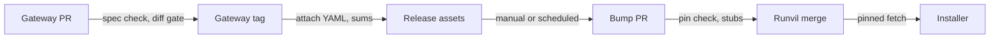
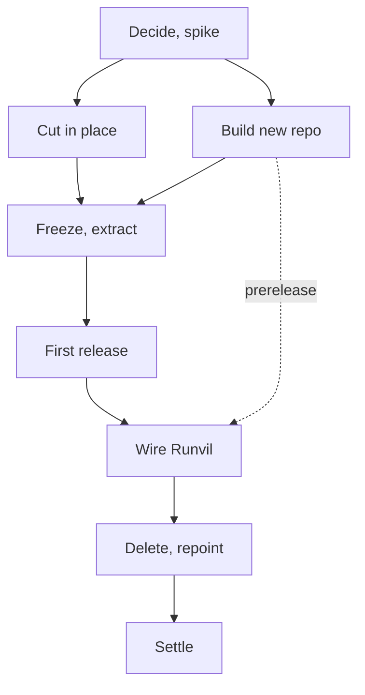

<!-- source: repository C:\Users\Vinnie\cursor\runvil at commit 08801150f (2026-10-27, clean tree); sibling repositories wg21-paperflow, wg21-website, runvil-docs, runvil-cloud-providers read-only; GitHub state read with gh on 2026-10-28; vendor documentation cited by URL in Appendix L -->

# Moving Gateway to its own repository: go, cut in place first, extract second

Report type: analytical and recommendation (feasibility variant). Prepared for Vinnie Falco, owner of the Runvil repository. Evidence snapshot: commit `08801150f` of `runvil`, 2026-10-27.

## Executive summary: go, but cut in place first and extract second

**Verdict: go, in stages.** Move the Gateway into its own repository, but not in one step. First settle three owner decisions and run three short spikes. Then cut every reference between Workshop and Gateway inside the current repository, under a machine check. Build the Gateway repository in parallel, extract the Gateway with its history, and publish a first Gateway release for all five installer targets. Only then switch Workshop to that release and delete the Gateway code. Confidence: high that the split is feasible and that this order is safest, because every step stays reversible until the final deletion. Confidence in the effort estimate is medium, because the spec generator and the Windows and macOS release builds are unproven.

**Why the split is feasible.** It is shallow in code and deep in plumbing. The Gateway family is 16 crates and 748 of 2,645 tracked files, and no Engine, Harness, or Plugin crate depends on it. Only three Workshop crates name Gateway code, through two public crates: `gateway-api-discovery` (22 Workshop files) and `gateway-api-types` (one two-field type, `Progress`). The weight sits elsewhere. Workshop's build compiles the Gateway from source, CI mixes both products in the same jobs, no Gateway release has ever been published, and no OpenAPI or AsyncAPI file exists.

**The do-nothing option ranks second.** Keeping one repository and finishing the contract work in place costs least and can be undone at any time. It is also stage one of the recommended plan. It fails on its own terms, because the second team would still share CI, a lockfile, and a version number with Workshop, and every Workshop agent would still see Gateway source. A one-day big-bang move ranks third: seven blockers would land at once and no Gateway release would exist to download.

**Direct answers to the owner's questions.**

- **How does the installer get the Gateway?** Workshop's release job downloads a pinned, checksummed Gateway release binary for each of the five target triples and stages it as today. The Gateway repository must first add Windows and macOS targets to its release configuration, which builds Linux only today.
- **Do we use a pinned git submodule?** No. A pin file with checksums gives the same one-line pin, and a submodule puts Gateway source in the working tree and keeps Workshop CI building the Gateway.
- **How do we get shared crates?** We do not share them. Six shared components are copied, moved, or inlined, and the seventh, `gateway-api-discovery`, has its client half forked behind a written contract. Zero shared crates is reachable.
- **How does Workshop get the API YAML and updates?** The Gateway release attaches `openapi.yaml` and `asyncapi.yaml`. The Runvil repository keeps a committed copy and a pin file. A scheduled workflow opens an update pull request, a human reviews the YAML diff, and conformance tests run before merge.

**Top five risks, most serious first.**

1. No Gateway release exists. The cargo-dist workflow has only ever run in plan mode on pull requests, and it targets two Linux triples. Likelihood that the first Windows or macOS build needs a fix: roughly even chance. Confidence in that evidence: medium.
2. Replacing `gateway-api-discovery` is the largest cut: a 2,445-line process-lifecycle protocol that OpenAPI cannot describe, used by 22 Workshop files and 12 test files.
3. The spec generator is unproven, and the Workshop UI's realtime decoder rejects unknown fields, so any additive realtime change breaks every installed Workshop.
4. Thirty speech-to-text fixture files and two baseline files are read or written by tests in both products, so the split strands shared test data.
5. Outside consumers break on the first Monday after the move. `runvil-cloud-providers` builds Gateway source from `master` every week, so its first run after the move very likely fails. Confidence in that evidence: high. Rewriting `runvil` history would also orphan pins held by other repositories.

**Six decisions only the owner can make** (details and defaults in section 10).

1. Is the Gateway repository public or private?
2. Does "an agent never sees Gateway source" mean not in the repository tree, or not anywhere in the workspace? This decides fork versus published crate for discovery.
3. Where does the repository live and what is it called? `cppalliance/runvil-gateway` is free.
4. Does the realtime ranges extension stay as experimental, or go before the first publication?
5. Should the Workshop UI decoder stop rejecting unknown fields?
6. Who owns the Gateway guide chapters after the split? No `CODEOWNERS` file exists in any repository.

**First three actions.**

1. Make decisions 1 to 3 this week. Owner: Vinnie. Next step: answer the three questions in section 10.
2. Run the spikes in scratch copies. Spec generation and the five-target cargo-dist dry run belong to the Gateway team (three days and one day, with eight proofs for the first in Appendix J). The 15-minute check that a stub sidecar satisfies `tauri-build` belongs to the Workshop maintainer.
3. Start cutting references inside the current repository. Owner: Workshop maintainer. Next step: add a check to `crates/build-xtask/src/product.rs` so any Workshop-to-Gateway edge fails, then clear the seven edges that exist today.

Confidence in the recommended order: high. Reason: it is the only path in which each step is verified by a machine check before anything is deleted, and it matches how the repository already enforces its family rules.

## Contents

- [1. Six criteria judge every option, under five fixed premises](#1-six-criteria-judge-every-option-under-five-fixed-premises)
  - [1.1 Five owner decisions are premises, not options](#11-five-owner-decisions-are-premises-not-options)
  - [1.2 Evidence is labeled and calibrated](#12-evidence-is-labeled-and-calibrated)
  - [1.3 Six criteria judge every option](#13-six-criteria-judge-every-option)
- [2. A staged split beats doing nothing and a big-bang move](#2-a-staged-split-beats-doing-nothing-and-a-big-bang-move)
  - [2.1 Four options compete](#21-four-options-compete)
  - [2.2 Option A wins on verifiability, and B is the safe fallback](#22-option-a-wins-on-verifiability-and-b-is-the-safe-fallback)
  - [2.3 Staging puts the first Gateway release at the hinge](#23-staging-puts-the-first-gateway-release-at-the-hinge)
- [3. A naive split leaves seven blockers, ten majors, and a long tail of minors](#3-a-naive-split-leaves-seven-blockers-ten-majors-and-a-long-tail-of-minors)
  - [3.1 The Gateway set is 748 files in 16 crates, and the cut line is narrow](#31-the-gateway-set-is-748-files-in-16-crates-and-the-cut-line-is-narrow)
  - [3.2 Seven blockers stop either repository from building](#32-seven-blockers-stop-either-repository-from-building)
  - [3.3 Ten majors lose a check, a test, or a promise](#33-ten-majors-lose-a-check-a-test-or-a-promise)
  - [3.4 The minor tail is long, but each item is mechanical](#34-the-minor-tail-is-long-but-each-item-is-mechanical)
- [4. Every shared component has an answer, and only one needs a real choice](#4-every-shared-component-has-an-answer-and-only-one-needs-a-real-choice)
  - [4.1 Cargo shares code across repositories only at a price](#41-cargo-shares-code-across-repositories-only-at-a-price)
  - [4.2 `shared-error-source`: copy a trimmed crate into each repository](#42-shared-error-source-copy-a-trimmed-crate-into-each-repository)
  - [4.3 `shared-loopback`: the Gateway keeps it, and Workshop inlines one function](#43-shared-loopback-the-gateway-keeps-it-and-workshop-inlines-one-function)
  - [4.4 `build-ceiling`: copy it now, and consider retiring it later](#44-build-ceiling-copy-it-now-and-consider-retiring-it-later)
  - [4.5 `build-ui`: trim a copy per repository, and consider a Node-script replacement later](#45-build-ui-trim-a-copy-per-repository-and-consider-a-node-script-replacement-later)
  - [4.6 `shared-ui`: move it wholly to the Gateway repository](#46-shared-ui-move-it-wholly-to-the-gateway-repository)
  - [4.7 `gateway-api-types`: Workshop owns a two-field `Progress`](#47-gateway-api-types-workshop-owns-a-two-field-progress)
  - [4.8 `gateway-api-discovery`: fork the client half behind a written contract](#48-gateway-api-discovery-fork-the-client-half-behind-a-written-contract)
  - [4.9 Workspace configuration and `build-xtask`: copy, trim, and list what must stay identical](#49-workspace-configuration-and-build-xtask-copy-trim-and-list-what-must-stay-identical)
  - [4.10 Resolver pins: keep each one where it is used](#410-resolver-pins-keep-each-one-where-it-is-used)
  - [4.11 The elimination budget: zero shared crates is reachable](#411-the-elimination-budget-zero-shared-crates-is-reachable)
- [5. Workshop should fetch a pinned Gateway release, not build the Gateway or use a submodule](#5-workshop-should-fetch-a-pinned-gateway-release-not-build-the-gateway-or-use-a-submodule)
  - [5.1 Workshop builds the Gateway from source inside one workspace today](#51-workshop-builds-the-gateway-from-source-inside-one-workspace-today)
  - [5.2 A pinned release download ranks first among seven delivery options](#52-a-pinned-release-download-ranks-first-among-seven-delivery-options)
  - [5.3 A submodule is the wrong mechanism, and the evidence is already on this machine](#53-a-submodule-is-the-wrong-mechanism-and-the-evidence-is-already-on-this-machine)
  - [5.4 Build-time inputs reduce to one pin file and one committed spec](#54-build-time-inputs-reduce-to-one-pin-file-and-one-committed-spec)
  - [5.5 Two sibling checkouts work with the staging script that already exists](#55-two-sibling-checkouts-work-with-the-staging-script-that-already-exists)
  - [5.6 Pull request CI uses a stub, and release CI uses the pinned binary](#56-pull-request-ci-uses-a-stub-and-release-ci-uses-the-pinned-binary)
  - [5.7 Version skew needs a runtime check, staged in two steps](#57-version-skew-needs-a-runtime-check-staged-in-two-steps)
  - [5.8 Packaging, signing, and native assets change little](#58-packaging-signing-and-native-assets-change-little)
  - [5.9 The recommended build and release flow has twelve steps](#59-the-recommended-build-and-release-flow-has-twelve-steps)
- [6. The spec reaches consumers as a committed, checksummed copy](#6-the-spec-reaches-consumers-as-a-committed-checksummed-copy)
  - [6.1 Consumers call nine HTTP operations and one WebSocket](#61-consumers-call-nine-http-operations-and-one-websocket)
  - [6.2 Generate with `utoipa` if a spike passes, and otherwise from a route table](#62-generate-with-utoipa-if-a-spike-passes-and-otherwise-from-a-route-table)
  - [6.3 Default-deny coverage needs three layers and a check command](#63-default-deny-coverage-needs-three-layers-and-a-check-command)
  - [6.4 Deliver the spec as a release asset, a committed copy, and a pull-style update](#64-deliver-the-spec-as-a-release-asset-a-committed-copy-and-a-pull-style-update)
  - [6.5 The breaking-change gate compares against the last release](#65-the-breaking-change-gate-compares-against-the-last-release)
  - [6.6 Hand-written client types stay, guarded by conformance tests](#66-hand-written-client-types-stay-guarded-by-conformance-tests)
  - [6.7 Agents read the raw YAML, and Pages hosts the rendered copy](#67-agents-read-the-raw-yaml-and-pages-hosts-the-rendered-copy)
- [7. Speech-to-text crosses the cut in test data, not in code](#7-speech-to-text-crosses-the-cut-in-test-data-not-in-code)
  - [7.1 Four hops touch no Gateway file, and six files read Gateway fixtures](#71-four-hops-touch-no-gateway-file-and-six-files-read-gateway-fixtures)
  - [7.2 Split the fixtures by kind: publish the protocol examples, freeze the snapshots](#72-split-the-fixtures-by-kind-publish-the-protocol-examples-freeze-the-snapshots)
  - [7.3 The realtime contract must state the wire, the rules, and the guarantees a schema cannot check](#73-the-realtime-contract-must-state-the-wire-the-rules-and-the-guarantees-a-schema-cannot-check)
  - [7.4 The daily workflow across two checkouts stays offline and spec-first](#74-the-daily-workflow-across-two-checkouts-stays-offline-and-spec-first)
  - [7.5 Keep the ranges extension as experimental until the Gateway team says otherwise](#75-keep-the-ranges-extension-as-experimental-until-the-gateway-team-says-otherwise)
- [8. CI, release, and history need a rehearsed, ordered cutover](#8-ci-release-and-history-need-a-rehearsed-ordered-cutover)
  - [8.1 Eleven workflow files split into move, duplicate, split, and stay](#81-eleven-workflow-files-split-into-move-duplicate-split-and-stay)
  - [8.2 A scheduled bot pull request is the trigger, after a manual start](#82-a-scheduled-bot-pull-request-is-the-trigger-after-a-manual-start)
  - [8.3 Extract the history with `git filter-repo` from a fresh clone, and never rewrite `runvil`](#83-extract-the-history-with-git-filter-repo-from-a-fresh-clone-and-never-rewrite-runvil)
  - [8.4 Name the repository `cppalliance/runvil-gateway`, and move the release assets by copy](#84-name-the-repository-cppalliancerunvil-gateway-and-move-the-release-assets-by-copy)
  - [8.5 Five outside repositories read or build runvil, and three of them break](#85-five-outside-repositories-read-or-build-runvil-and-three-of-them-break)
  - [8.6 The ordered cutover has seven stages, and stages 1 and 2 run in parallel](#86-the-ordered-cutover-has-seven-stages-and-stages-1-and-2-run-in-parallel)
- [9. Docs, assets, and names need owners more than code](#9-docs-assets-and-names-need-owners-more-than-code)
  - [9.1 Gateway guide chapters live outside the Runvil repository, so ownership is the real question](#91-gateway-guide-chapters-live-outside-the-runvil-repository-so-ownership-is-the-real-question)
  - [9.2 Prose and plan records still name Gateway internals, and no ignore file fixes that](#92-prose-and-plan-records-still-name-gateway-internals-and-no-ignore-file-fixes-that)
  - [9.3 Assets and licenses move with the code, and `local/` stays untracked](#93-assets-and-licenses-move-with-the-code-and-local-stays-untracked)
  - [9.4 Names such as `runvil-gateway` and `.runvil` act as contracts, so keep them](#94-names-such-as-runvil-gateway-and-runvil-act-as-contracts-so-keep-them)
  - [9.5 The cleanup list: 25 prose sites and about 2,400 lines would stay visible after a naive split](#95-the-cleanup-list-25-prose-sites-and-about-2400-lines-would-stay-visible-after-a-naive-split)
- [10. Thirteen decisions remain, and six of them gate the plan](#10-thirteen-decisions-remain-and-six-of-them-gate-the-plan)
- [11. Unknowns, assumptions, and limits stay visible, each with what would resolve it](#11-unknowns-assumptions-and-limits-stay-visible-each-with-what-would-resolve-it)
  - [11.1 Twenty-six unknowns, each with a way to resolve it](#111-twenty-six-unknowns-each-with-a-way-to-resolve-it)
  - [11.2 Assumptions, and the limits of the method](#112-assumptions-and-the-limits-of-the-method)
  - [11.3 Where the evidence disagreed, and how each case was settled](#113-where-the-evidence-disagreed-and-how-each-case-was-settled)
- [Appendix A. The Gateway set in numbers](#appendix-a-the-gateway-set-in-numbers)
- [Appendix B. The cut list](#appendix-b-the-cut-list)
- [Appendix C. Edits a Runvil-only checkout needs](#appendix-c-edits-a-runvil-only-checkout-needs)
- [Appendix D. The Gateway route inventory](#appendix-d-the-gateway-route-inventory)
- [Appendix E. The full compatibility policy](#appendix-e-the-full-compatibility-policy)
- [Appendix F. What the realtime AsyncAPI file must contain](#appendix-f-what-the-realtime-asyncapi-file-must-contain)
- [Appendix G. Handling of every speech-to-text test and fixture](#appendix-g-handling-of-every-speech-to-text-test-and-fixture)
- [Appendix H. Workflow-by-workflow disposition](#appendix-h-workflow-by-workflow-disposition)
- [Appendix I. `build-xtask` checks and resolver pins](#appendix-i-build-xtask-checks-and-resolver-pins)
- [Appendix J. Spikes and rehearsals](#appendix-j-spikes-and-rehearsals)
- [Appendix K. Commands and evidence](#appendix-k-commands-and-evidence)
- [Appendix L. Sources](#appendix-l-sources)

Section 10 collects the decisions, Section 11 the unknowns, and Appendices A to L hold the depth: tables, per-component detail, route and event inventories, and command evidence. Cutting from the bottom never removes the core.

## 1. Six criteria judge every option, under five fixed premises

This section states the premises, the terms, the evidence labels, and the criteria before any option appears, so the reader can weigh each later ranking against the same yardstick.

### 1.1 Five owner decisions are premises, not options

The report treats these as fixed and does not re-argue them.

1. The Gateway moves to its own repository because another team now works on it.
2. Workshop and the Harness depend on a documented API (OpenAPI plus AsyncAPI), never on Gateway source. This includes speech-to-text.
3. The spec is generated from Gateway source, committed, and checked in CI the way `crates/runvil/public-api.txt` is checked by `cargo xtask api`. A human reviews the spec diff, not the Rust.
4. An AI agent in the Workshop or Harness repository never sees Gateway source.
5. Working on speech-to-text across two local checkouts is acceptable.

Terms used throughout. The **Runvil repository** is the repository that keeps Engine, Harness, Plugins, Workshop, and build tooling after the split. The **Gateway repository** is the new one. The **Gateway set** is the 16 Gateway-family crates and their files (section 3.1). The **spec** means the OpenAPI and AsyncAPI files together. The **pin file** is one file in the Runvil repository that records the Gateway release, the binary checksums, the spec checksums, and the minimum Gateway version. The **Gateway team** is the second team that works on the Gateway; its members are not named anywhere in the repository (no `CODEOWNERS` file exists in `runvil` or `runvil-docs`). The **owner** is Vinnie Falco.

### 1.2 Evidence is labeled and calibrated

Seven analysts read the repositories in parallel and a lead analyst checked the disputed facts. Statements with a path, line, commit, command, or URL are observed. Statements that begin "Inferred" follow from observations without a direct check. Statements that begin "Judged" or "I recommend" are opinion. No analyst ran `cargo build`, `cargo test`, or `npm`, so every claim of the form "this would fail" is inferred from reading, not from running.

Likelihood uses one ladder: very unlikely, unlikely, roughly even chance, likely, very likely. Confidence in the evidence uses high, medium, or low and always appears in a separate sentence. Every recommendation ends with an owner, a next step, and a confidence level with a one-phrase reason.

Effort uses three sizes. S is under about two days of focused work, M is about a week, L is more than a week. These are judged from file counts, not measured.

### 1.3 Six criteria judge every option

Every ranked option in this report is scored against the same six criteria.

- **Effort.** The work to reach a green state in both repositories.
- **Risk of breakage.** The chance that a build, a release, or a shipped installer fails because of the change.
- **Ongoing cost for two teams.** The recurring work after the move: duplicated code, coordination, and review burden.
- **Build and release reproducibility.** Whether the same inputs give the same bits, and whether the pin is explicit and checkable.
- **Gateway source kept from agents.** How well the option keeps Gateway source out of the Workshop and Harness working trees and tools (fixed premise 4).
- **Ease of undo.** How cheaply the owner can reverse the step.

Where a criterion does not separate the options, the text says so rather than padding a table.

## 2. A staged split beats doing nothing and a big-bang move

The owner asked for options with ranking wherever a real choice exists. At the top level four options compete. This section ranks them against the six criteria from section 1.3 and then explains why the first Gateway release is the hinge of the staged plan.

### 2.1 Four options compete

**Option A: stage the split (recommended).** Stage 0 settles the owner decisions and runs two spikes. Stage 1 removes every Workshop-to-Gateway reference inside the current repository and adds a check that fails if one returns. Stage 2 builds the Gateway repository and rehearses the history extraction on a scratch repository. Stage 3 freezes the Gateway paths, extracts for real, and cuts the first Gateway release for five targets. Stage 4 wires the Runvil repository to that release. Stage 5 deletes the Gateway code and repoints outside consumers. Stage 6 settles rulesets, runner, and tokens. Each stage is verified before the next starts. Section 8.6 gives the full ordered plan and marks what runs in parallel.

**Option B: keep one repository and finish the contract work in place.** This is the do-nothing option, with the contract work done. The team would generate and commit the spec, add the CI check, tighten the product matrix so Workshop cannot name Gateway crates, and replace Workshop's two Gateway crate dependencies. The Gateway would stay in `runvil`.

**Option C: big bang.** Move the Gateway out in one change, then repair both repositories. It looks fastest on paper.

**Option D: split first and bridge back.** Move the Gateway out, then let Workshop reach back into it through a git submodule, a Cargo git dependency, or a path into a sibling checkout until the real fixes land.

### 2.2 Option A wins on verifiability, and B is the safe fallback

Table 1 compares the options on the six criteria. Option A is best or tied for best on four of the six criteria: risk, ongoing cost, reproducibility, and Gateway source kept from agents once stage 5 is done. Its weakness is total effort, which is the sum of all the cuts and cannot be avoided by any option that meets the premises.

**Table 1. The four top-level options against the six criteria (best first).**

| Option | Effort | Risk of breakage | Ongoing cost for two teams | Reproducibility | Gateway source kept from agents | Ease of undo |
|---|---|---|---|---|---|---|
| A. Staged split | L, spread over six stages | Low: each stage is checked before the next | Lowest after stage 5: own CI, own lockfile, own version | High: pin file with checksums | Good after stage 5; unchanged before it | Easy until stage 5, then a revert pull request |
| B. One repo, contract in place | M | Low | Highest: shared CI, lockfile, version lockstep | Unchanged from today | Poor: premise 4 not met | Trivial |
| C. Big bang | M to L, with a red period | High: seven blockers at once, no release to download | Same as A once green | Low until the first release exists | Good at once | Hard: re-extract and re-point everything |
| D. Split, then bridge | M | Medium | High while the bridge exists | Medium: bridge pins a commit | Poor until the bridge is removed | Medium |

Option B ranks second, not last, for two reasons. It is the position the project occupies after stage 1, so choosing A never forfeits it. And the owner can stop there if the spike or the first release shows the split costs more than expected. It ranks below A because it does not give the second team its own repository and does not satisfy premise 4 for the Workshop agent.

Option C ranks third. The Gateway set has 7 inbound edges from Workshop, 22 outbound edges to shared crates, 5 UI tests that read Gateway fixtures, and a sidecar build chain that assumes one workspace. All of those fail together under a naive move (section 3). Workshop CI cannot pass until a Gateway release exists, and no Gateway release has ever existed.

Option D ranks last. It defeats premises 2 and 4 during the transition, `deny.toml` would need an `allow-git` entry for any git dependency (`deny.toml` sets `unknown-git = "deny"`), and transitions have a habit of lasting. A bridge is acceptable only as a short rehearsal tool, never as a shipped state.

**Recommendation.** Take option A. Owner: Vinnie. Next step: approve stage 0 and the three decisions in the executive summary. Confidence: high. Reason: it is the only option in which a machine check proves each cut before anything is deleted.

### 2.3 Staging puts the first Gateway release at the hinge

The Runvil repository cannot build an installer without a Gateway binary, and no Gateway binary exists as a release. That fact orders everything. Stages 1 and 2 can run in parallel and neither touches `cppalliance/runvil` history. Stage 3 produces the artifact that stage 4 consumes. Stage 5 deletes only after stage 4 has produced five bootable installers from the pinned release.

Cutting in place first has three advantages beyond safety. First, a single `cargo metadata` query shows zero edges from Workshop to the Gateway set when stage 1 is done; today it shows 7 (`workshop`, `workshop-server`, `workshop-gateway` into `gateway-api-discovery`, plus `workshop-gateway` into `gateway-api-types`). Second, while both copies of the discovery code still sit in one workspace, a conformance test can run the Workshop's forked reader against the real Gateway writer, which is a stronger check than any test available after the move. Third, the repository already enforces family rules with `crates/build-xtask/src/product.rs` (module docs at lines 10-11, the `PUBLIC_GATEWAY` exception at line 146, matrix at lines 207-223), so tightening that check is the repository's own idiom.

The history rule that follows from the hinge: leave `cppalliance/runvil` append-only. Three other repositories pin it by commit (section 8.5), so the Gateway repository is built from a filtered clone and the Gateway code leaves `runvil` through an ordinary deletion commit.

## 3. A naive split leaves seven blockers, ten majors, and a long tail of minors

"Naive" here means: delete the Gateway set from the Runvil repository, create a repository containing only that set, and change nothing else. All "would fail" statements are inferred from reading, because no build was run. The ranking is blocker (a repository does not build or a release path cannot run), major (a check, test, or promise is lost or wrong, but the code builds), and minor (stale text or a rule that quietly stops guarding).

### 3.1 The Gateway set is 748 files in 16 crates, and the cut line is narrow

The Gateway set is 16 Rust crates: 14 under `crates/gateway/**` (`gateway` app, `gateway-config`, `gateway-config-ui`, `gateway-local`, `gateway-logging`, `gateway-progress`, `gateway-protocol`, `gateway-routing`, `gateway-web-search`, `gateway-stt`, `gateway-stt-engine`, `gateway-stt-backend-whisper`, `gateway-whisper-ffi`, `gateway-cloud-providers`) plus the two public crates `crates/gateway-api-types` and `crates/gateway-api-discovery`. Measured with `git ls-files`, the set is 748 tracked files, 160,723 lines, and 5,879,465 bytes. That is 28 percent of the 2,645 tracked files and 13.9 percent of the bytes. By type it is 576 Rust files (129,458 lines), 35 TypeScript files, 28 `.mjs` files, and 48 JSON files. Nothing is large: the biggest tracked file is an 85,002-byte fixture, and seven binary icon files total about 159 KB (Appendix A).

A `cargo metadata` query (`cargo metadata --format-version 1 --no-deps --offline`, parsed with `node`) shows exactly 7 edges from outside the set into it and 22 edges out of it.

- **Inbound (7).** `workshop`, `workshop-server`, and `workshop-gateway` each depend on `gateway-api-discovery` (normal, plus a dev dependency with feature `test-fixtures`), and `workshop-gateway` also depends on `gateway-api-types`. The Harness, Engine, and Plugin crates have no edge into the set, and `crates/build-xtask/src/product.rs:207-223` forbids one.
- **Outbound (22).** `build-ceiling` is a build dependency of all 16 Gateway crates. `shared-error-source` is used by three (`gateway-api-discovery`, `gateway-local`, `gateway-cloud-providers`), `shared-loopback` by two (`gateway`, `gateway-config-ui`), and `build-ui` by one (`gateway-config-ui`). Nothing goes to Engine, Harness, Plugin, or Workshop.

Four things stay in the Runvil repository despite their names. `harness-gateway-client` has no Gateway dependency and tests against mock servers, so it needs no change. The Workshop crate `workshop-gateway` is Workshop's client, not Gateway code. `tools/stage-gateway-sidecar.mjs` implements Tauri's sidecar naming rule, which is a Workshop packaging concern. The README promise "Every installer includes the gateway" (`README.md:18`) stays true under the recommended design.

No Rust test in Workshop, Harness, Engine, or Plugins spawns the real Gateway binary (`rg 'CARGO_BIN_EXE|assert_cmd|escargot|cargo_bin' crates --glob '!crates/gateway/**'` finds only `build-workshop`'s own binary). So the split removes no end-to-end check that exists today. It removes the compile-time sharing of two crates, and nothing replaces that sharing except the spec the owner has decided to generate.

### 3.2 Seven blockers stop either repository from building

Table 2 lists the blockers. "Repo" says where the break lands. The fix column names the stage of the plan in section 2.1 that clears it.

**Table 2. Blockers: what breaks, the evidence, and the fix.**

| # | Repo | What breaks | Evidence | Fix and stage |
|---|---|---|---|---|
| 1 | Runvil | Every cargo command, because the root manifest names missing paths | `Cargo.toml:3` lists 14 explicit Gateway members, `:14` excludes two Gateway containers, `:19` sets `default-members = ["crates/gateway/app"]`, and 14 `[workspace.dependencies]` entries point at deleted directories | Delete the entries and choose a new `default-members` (stage 5) |
| 2 | Runvil | Workshop code links Gateway crates | 22 Workshop files import `gateway_api_discovery` (12 in `workshop`, 9 in `workshop-gateway`, 1 in `workshop-server`); 5 import `gateway_api_types`; 12 test files use the `ValidatedGateway` fixture built on the real discovery crate (`crates/workshop/gateway/src/test_gateway.rs`) | Workshop-owned `Progress` type and a forked discovery reader behind a written contract (stage 1; sections 4.7 and 4.8) |
| 3 | Runvil | The sidecar build chain and every CI and release path compile `-p gateway` | `crates/workshop/desktop/build.rs:30-61`, `tauri.conf.json:13`, `crates/build-workshop/src/main/pipeline.rs:106`, `ci.yml:153,232`, `release-workshop.yml:159,163`, `nightly.yml:196,200`, `workshop-installer-smoke.yml:35` | Fetch a pinned release binary or a stub (stages 1 and 4; section 5) |
| 4 | Gateway | No Gateway release exists to download | `dist-workspace.toml:17` targets two Linux triples; no `gateway-v*` tag exists locally, on `upstream`, or on `origin`; the cargo-dist workflow has only plan-mode `pull_request` runs | Add three targets, extend the release-test gate, cut the first release (stage 3) |
| 5 | Runvil | Tests cannot find 30 Gateway fixture files, and one test writes into them | `crates/workshop/server/tests/it/realtime_relay.rs:53` uses compile-time `include_bytes!`, so the whole `workshop-server` integration-test binary stops compiling; five UI tests read the folder; `crates/workshop/ui/test/stt-replay.mjs:14` also rewrites the `ui` section of two JSON files | Vendor protocol examples, snapshot the replay streams, split the `ui` data (stage 1; section 7) |
| 6 | Gateway | The 16 manifests cannot parse and the shared crates are missing | Every crate inherits `[workspace.package]` and `[workspace.lints]` and uses `workspace = true`; the Gateway repository has no root manifest, lockfile, or toolchain file; `build-ceiling` (16 crates), `shared-error-source` (3), `shared-loopback` (2), `build-ui` (1), and npm `shared-ui` are all outside the set | Scaffold commit plus the component decisions (stage 2; section 4) |
| 7 | Gateway | `cargo test -p gateway-config` does not compile | `crates/gateway/config/src/config/tests/schema.rs:79-82` uses `include_str!` on `../../../gateway.local.example.toml`, a file at the Runvil repository root | Move the file and fix the path (stage 2) |

Blockers 1, 2, 3, and 5 land on the Runvil repository, and 4, 6, and 7 on the Gateway repository. Blocker 4 is the odd one: it is not a defect but a missing artifact, and it must be built before the Runvil repository can pass CI at all.

### 3.3 Ten majors lose a check, a test, or a promise

Table 3 lists the majors. The code builds in each case, but something that guards or ships the product quietly stops working.

**Table 3. Majors: what is lost, the evidence, and the fix.**

| # | Repo | What is lost | Evidence | Fix and stage |
|---|---|---|---|---|
| 1 | Both | The compiler no longer checks the discovery protocol (file format, two lock files, image name, `Host` rule) | `crates/gateway-api-discovery/src/lib.rs:1-37`; `ci.yml:169-180` runs discovery and Gateway tests inside the Workshop job; `crates/gateway/app/tests/it/boot/ownership.rs:141-164` takes a Workshop-style launch lock | Written contract, golden fixtures in both repositories, a conformance test against a real Gateway binary (stages 1 and 3) |
| 2 | Both | There is no spec to depend on, and the Workshop UI decoder rejects any unknown field | No OpenAPI or AsyncAPI file and no `utoipa`, `aide`, or `schemars` crate for generation in the workspace; `crates/workshop/ui/src/services/realtime-event-decoder.ts:123-137` (`exactRecord`) rejects extra keys and unknown event types return null (`realtime-transcription.ts:225-229`) | Generate and commit the spec; set a realtime evolution rule (stages 0 and 1; sections 6 and 7) |
| 3 | Both | Two test suites write the same two JSON files | `crates/gateway/stt/api/tests/it/replay.rs:36` (`FOREIGN_SECTIONS`) and `stt-replay.mjs:32-38,201-217`; 10 of 12 snapshot-changing commits since 2026-10-06 also edited the `ui` section | Workshop-owned `ui` baseline files (stage 1; section 7.2) |
| 4 | Runvil | The release gate assumes lockstep versions, and the installer shares strings with the Gateway that no compiler checks | `release-workshop.yml:54` hard-codes `0.3.0` and `:172` expects `runvil-gateway $version`; `installer.nsi` names `runvil-gateway.exe`, `--login` (line 891), `--browser` (493), registry value `RunvilGateway` (1032), and `InstallSTT` (869-877) | Gate on the pin, and add a Gateway test that asserts the flags and registry names (stages 3 and 4) |
| 5 | Both | The structural checks and hooks that bind the Gateway today | `build-xtask` treats a missing crate as a violation (`crates/build-xtask/src/tidy.rs:113-128`, `doc_hidden.rs:52`, `engine_guards.rs:8`), so copying it unchanged fails its own tests; `.githooks/pre-push:8-9` runs `cargo check -p gateway --no-default-features` and would block every Runvil push | Trimmed copy for the Gateway repository, pruned copy and edited hook for the Runvil repository (stages 2 and 5) |
| 6 | Gateway | Five Gateway tests lose their only Windows job | `ci.yml:173-182` runs one `gateway-api-discovery` test and four `gateway` tests in the Workshop Windows run | A `windows-latest` job in the Gateway CI (stage 2) |
| 7 | Outside | Three outside repositories break or go stale | `runvil-cloud-providers` `models.yml` clones `cppalliance/runvil` `master` and builds `-p gateway-cloud-providers` every Monday 12:00 UTC; `wg21-website` `gateway-compat` (`.github/workflows/actions.yml:72-108`) compares runvil pins; `promptforge-gateway-deploy` moves its `vendor/promptforge` pin to upstream `master` on the 1st and 15th | Repoint all three in one window (stage 5; section 8.5) |
| 8 | Gateway | Release assets and the GPU runner stay tied to the Runvil repository | 8 URL literals (`crates/gateway/local/src/artifacts/assets.rs:241`; `assets/whisper_rows.rs:18,40,56,72,88,108,124`) name `cppalliance/runvil` releases with sha256 pins; `whisper-lib.yml:391-392` says a rebuilt archive differs byte for byte; runner `CUDA-Blackwell` is registered at repository level and three Gateway jobs use it | Copy the three releases byte for byte, keep the old ones forever, re-register the runner (stage 2; section 8.4) |
| 9 | Both | Runtime version skew becomes a normal case with no check | `crates/gateway/app/src/health.rs:21-23` answers `{"status":"serving"}` with no version; `gateway.json` holds `version`; `ValidatedConnection::version()` (`crates/gateway-api-discovery/src/validated.rs:170-172`) is never called under `crates/workshop` | Version check at attach (section 5.7) |
| 10 | Runvil | The AI-visibility goal fails on prose | 25 default-visible sites name Gateway-private crates, paths, or wire shapes (for example `AGENTS.md:25,48,56`, `crates/README.md:3`); 2,158 lines in 167 `vibe/` plan records do too; `vibe/.cursorignore` holds `**/vibe/*/`, which matches nothing in that nested position, and Cursor's documentation says terminal and MCP tools ignore `.cursorignore` | Rewrite, move, or delete per section 9 (stage 5) |

Majors 1, 2, and 3 are design work, not edits. They decide whether the split gives the Workshop team a contract or only a boundary, and sections 4.8, 6, and 7 treat them in depth.

### 3.4 The minor tail is long, but each item is mechanical

Each item below has a one-line fix in the cleanup list (section 9.5 and Appendix C).

- Five byte-identical icon pairs sit in both products; the only sync rule is one sentence (`crates/workshop/desktop/icons/AGENTS.md:3`) and no test compares them.
- Four `.config/nextest.toml` overrides (lines 23, 28, 36, 40) and three `clippy.toml` entries (lines 15-17) are Gateway policy in root files. Whether clippy or nextest tolerates entries that match nothing is unknown (section 11).
- `.gitignore` (lines 6, 12, 17, 19) and `.gitattributes` (lines 11, 16) hold Gateway lines.
- `crates/build-ui/src/lib.rs:30-34` holds a Gateway fact (`CONFIG_UI_STATIC_FILES`) in a crate Workshop also uses, and its watcher still names `crates/shared-ui`.
- `crates/runvil-internal/types/src/models.rs:157-160` is an Engine rustdoc sentence naming `gateway_api_types::ModelInfo` and `gateway_local::gguf::ModelInfo`.
- `ci-green` is a static list, and `cppalliance/runvil` `master` has no branch protection and no rulesets (`gh api .../branches/master/protection` returns HTTP 404 and `.../rulesets` returns 0), so nothing blocks a merge on a red check today.
- One rolling `nightly` release holds both Gateway tarballs and Workshop installers, and `README.md:16` sends users to it.
- `dist-workspace.toml:38` names `gateway-v-release.yml`, but the real file is `runvil-gateway-v-release.yml`; a future `dist generate` would likely write a second file.
- Release Workshop builds the Gateway with `--release`, while cargo-dist builds with `--profile=dist` (`inherits = "release"`, `lto = "thin"` at `Cargo.toml:314-316`). The first release from the Gateway repository ships a differently optimized binary.
- `site.yml` guards on `github.repository == 'cppalliance/runvil'` (lines 26 and 65), so a copy in a new repository would silently skip.
- The guide chapters for the Gateway have no owner: `runvil-docs` has no `CODEOWNERS`, no CI, and a `CONTRIBUTING.md` that says "There is no freshness gate".
- The Gateway guide tells users to run `cargo install gateway` (`runvil-docs` `src/gateway/01-install-and-run.md:7-11`), but the package has `publish = false`.
- The secret `HF_TOKEN` is read by no workflow, and the repository default workflow permission is `write`.

Four problems exist today and the split does not cause them. Fixing them is outside this plan, but the first Gateway and Workshop releases will hit them. The `workshop-latest` tag exists on `upstream` (ref `e6fa867a`) but `gh release view workshop-latest` returns "release not found", so the updater URL at `crates/workshop/desktop/tauri.conf.json:39` does not resolve today. No tagged Workshop release has ever succeeded (one tag-push run, 2026-09-02, failed). The `ring` check in `ci.yml:316-333` covers `-p gateway` only, so nothing checks the Workshop binary. The last `whisper-lib.yml` push run (2026-10-27) failed at the macOS Intel upload step, and the Gateway repository inherits that workflow.

## 4. Every shared component has an answer, and only one needs a real choice

The owner asked what to do with each shared component, what the problem is, and what the choices are. Table 4 gives the answer for all ten items first. The subsections that follow give the reasoning, the ranked choices, and the elimination budget. In short: six small components reach zero shared code by copying, moving, or inlining, workspace configuration is copied, and `gateway-api-discovery` is the only component where a real design choice remains.

**Table 4. Recommended choice for every shared component.**

| Component | Problem the split creates | Recommended choice | Reaches zero shared code | Effort | Confidence |
|---|---|---|---|---|---|
| `shared-error-source` | 3 Gateway and 3 Workshop crates use it; its public API names `serde_json`, `reqwest`, and `turso` types | Trimmed copy in each repository | Yes | S | High - mechanical, no behavior change |
| `shared-loopback` | Workshop calls 1 of 5 exported items; the middleware signatures expose axum types | Gateway keeps it; Workshop inlines one 77-line function | Yes | S | High - one call site, tests exist |
| `build-ceiling` | Build dependency of 43 crates and a `#[path]` include in 10 more | Copy into the Gateway repository; consider an xtask replacement later | Yes | S | High for the copy, medium for the later change |
| `build-ui` | `gateway-config-ui` and `workshop-server` both build UIs through it; it holds a Gateway constant | Trimmed copy per repository; consider a Node-script replacement later | Yes | S to M | High that it works, medium on the replacement |
| `shared-ui` (npm) | One consumer, the Gateway config UI; Workshop already forked it | Move wholly to the Gateway repository | Already zero | S | High - one consumer |
| `gateway-api-types` | Workshop uses one two-field type, `Progress` | Workshop-owned `Progress` plus a contract test against the spec | Yes | S | High - one type, one crate |
| `gateway-api-discovery` | A 2,445-line process-lifecycle protocol; Workshop uses 18 of 34 public items | Fork the client half into the Runvil repository behind a written contract and a conformance test | Yes, at the cost of about 2,250 duplicated lines | M | Medium - needs the Gateway team's agreement and the owner's reading of premise 4 |
| Workspace configuration files | Cargo cannot inherit tables or a lockfile across repositories | Trimmed copy per repository; a short list of files kept identical | Yes | S to M | High - Cargo gives no alternative |
| `build-xtask` checks | A straight copy fails its own tests; the Runvil repository keeps dead rules | Trimmed copy for the Gateway repository, pruned copy for the Runvil repository | Yes | M | Medium - the cut inside two files needs a human read |
| Resolver pins | The two trees no longer share one lockfile | Keep each pin in the repository that uses the crate; rewrite three comments | Not applicable | S | High - no pin protects a cross-cut type |

### 4.1 Cargo shares code across repositories only at a price

The owner asked "how do we get shared crates." Cargo offers five mechanisms, and Table 5 shows what each does and how well it fits. The facts come from the Cargo Book (https://doc.rust-lang.org/cargo/reference/specifying-dependencies.html, https://doc.rust-lang.org/cargo/reference/workspaces.html, https://doc.rust-lang.org/cargo/reference/publishing.html).

**Table 5. Mechanisms for sharing code between two repositories.**

| Mechanism | What Cargo does | Fit for this split |
|---|---|---|
| Copy the code | Nothing is shared; each repository has its own lockfile and `[workspace.*]` tables | No link and no release coordination, but drift is possible. The agent in one repository never sees the other |
| Publish to crates.io | Every dependency must already be on crates.io; a publish "is generally permanent"; names are first come, first served | Works only for crates whose dependencies are public or can be inlined. Every internal crate here is `publish = false` today |
| Git dependency by tag or rev | Cargo "fetches the `git` repository at that location and traverses the file tree"; the commit is locked in `Cargo.lock` | The whole source repository is cloned onto the developer machine, which defeats premise 4 when the crate lives in the Gateway repository. `deny.toml` also needs an `allow-git` entry |
| Git submodule | Cargo fetches submodules recursively; a path dependency may point into a checked-out submodule | Puts the shared source inside the working tree, so the agent sees it. Acceptable for a small neutral crate, wrong for Gateway code |
| A third repository holding only shared crates | As above, by tag or crates.io | Neutral to both teams, but a permanent coordination point with its own release process |

A sixth path avoids sharing altogether: inline, redesign, or replace with spec-generated types. Judged: for every small component, copying or eliminating beats every sharing mechanism. Only `gateway-api-discovery` is large and protocol-bearing enough to justify a real choice.

Workspace inheritance adds a hard constraint. `[workspace.package]`, `[workspace.dependencies]`, `[workspace.lints]`, and `Cargo.lock` exist only inside one workspace, so each repository needs its own root manifest and lockfile. No option in this section changes that.

### 4.2 `shared-error-source`: copy a trimmed crate into each repository

The crate holds three newtype wrappers behind three features: `JsonSource(serde_json::Error)`, `HttpSource(reqwest::Error)`, and `DatabaseSource(turso::Error)` (`crates/shared-error-source/src/lib.rs:14-102`). It exists so a public error names no third-party type. It is 210 lines in 3 files, of which 75 are tests.

Consumers split cleanly by feature. Gateway crates use `JsonSource` and `HttpSource` (8 field sites in `gateway-api-discovery`, `gateway-local`, `gateway-cloud-providers`). Workshop crates use `JsonSource` and `DatabaseSource` (5 field sites in `workshop-run-log`, `workshop-user-state`, `workshop-workspace`). Only `JsonSource` is used on both sides. The `turso` dependency is Workshop-only and `reqwest` is Gateway-heavy, so a shared copy would tie both repositories to one major version of each.

`std` and `thiserror` do not replace it. A bare `#[from] serde_json::Error` field would name the third-party type, which the crate exists to prevent. The only std-only substitute is `Box<dyn std::error::Error + Send + Sync>` with `downcast_ref`, which gives up the compile-time type and changes 13 field sites and 7 tests.

Ranked choices:

1. **Trimmed copy in each repository (pick).** The Gateway repository keeps `json` and `http`; the Runvil repository keeps `json` and `database`. Same crate name and API, so no consumer line changes beyond manifests. Each copy is about 60 lines of code plus tests. Pros: no behavior change, and neither repository pulls the other's dependency. Cons: `JsonSource` exists twice (30 lines), and two unrelated crates share one name, which is confusing in search results. Effort S. Risk low.
2. **Replace with a boxed error and `downcast_ref`.** Zero shared and zero wrapper code. Cons: loses the compile-time type and touches 13 sites and 7 tests. Effort M. Risk medium.
3. **Inline one wrapper per consuming crate.** About 264 lines against about 120 for option 1, and it breaks the crate's stated aim of one name for the cause. Effort M. Risk low.
4. **Publish as a crate.** Its API names `reqwest::Error`, `serde_json::Error`, and `turso::Error`, so every major bump of any of them forces a major here. Effort M. Risk medium. Not recommended.

**Recommendation.** Take option 1. Owner: Workshop maintainer for the Runvil copy, Gateway team for the Gateway copy. Next step: copy `crates/shared-error-source` into the scaffold commit and drop the `database` feature there. Confidence: high - mechanical, no behavior change, every consumer unchanged.

### 4.3 `shared-loopback`: the Gateway keeps it, and Workshop inlines one function

The crate depends only on `axum` and exports five items (`require_loopback`, `is_loopback_peer`, `require_loopback_host`, `gateway_loopback_origin_allowed`, `workshop_same_origin_authority_allowed`). The Gateway uses four of them in `gateway` and `gateway-config-ui`. Workshop uses one, at one call site: `crates/workshop/server/src/routes/realtime.rs:61`. The crate's own `AGENTS.md` already says the two origin predicates must never share policy semantics.

What Workshop needs is `origin.rs:28-104`: the function plus four helpers, 77 lines with doc comments, and its tests. `workshop-server` already depends on `url` and uses `url::Url::parse` in `crates/workshop/server/src/cross_site.rs:99-113`.

1. **Move the crate to the Gateway repository; Workshop inlines its one function (pick).** Delete `workshop_same_origin_authority_allowed` from the Gateway copy and move its 4 tests. Pros: Workshop sheds a dependency and the axum link across the cut. Cons: 77 lines of near-duplicate parsing exist twice. Effort S. Risk low (a fail-closed predicate with tests that move with it). Agent visibility: good.
2. **Rewrite Workshop's function on the `url` crate.** An estimated 25 to 35 lines (inferred, not written). Pros: smaller. Cons: `url` normalizes differently from the hand parser (default ports, IPv6 forms), and the existing tests are the only specification. Effort S to M. Risk medium.
3. **Copy the whole crate into both repositories.** Leaves four unused public functions in Workshop. Not recommended.
4. **Publish as a crate.** Turns a security-sensitive crate with two product-specific predicates into a permanent public API. Not recommended.

**Recommendation.** Take option 1. Owner: Workshop maintainer. Next step: copy `origin.rs:28-104` and its tests into `workshop-server` during stage 1 and remove `shared-loopback` from `crates/workshop/server/Cargo.toml`. Confidence: high - one call site and existing tests. Elimination: reaches zero shared code.

### 4.4 `build-ceiling`: copy it now, and consider retiring it later

`build-ceiling` is the compile-time file-size rule. Its `check()` function (`crates/build-ceiling/src/lib.rs:49`) counts physical lines of every `.rs` file under `src`, `tests`, `benches`, `examples`, and `build.rs`, and fails the build above 500 lines (`LIMIT`, `lib.rs:14`). It has no dependencies and is 202 lines. Three groups use it:

- 43 crates name it as a build dependency (`cargo metadata`): 16 Gateway, 13 Workshop, 7 Engine, 5 build tools, and 2 shared crates.
- 10 crates include its source with `#[path = ".../build-ceiling/src/lib.rs"]` in `build.rs`: the 5 Harness crates, the 4 Plugin crates, and `runvil-vfs`. The product matrix forbids Harness and Plugin crates from naming a `build-*` crate, so they include the source instead. All 10 stay in the Runvil repository.
- `build-ceiling` includes its own source in its own `build.rs`. The three groups sum to 54, which is every workspace member.

Two counts appear in the evidence, 43 and 54, and both are correct. The count of 43 covers the build-dependency edge only. The count of 54 adds the `#[path]` includes and the crate itself. `crates/build-xtask/src/tidy-wiring.rs` (311 lines) enforces the wiring by reading each `build.rs` as tokens.

The rule works: `crates/` holds 1,620 Rust files and none exceeds 500 lines, and 31 Gateway files sit at 450 lines or more (the longest is 499 lines, `crates/gateway/app/src/boot/boot_speech_tests.rs`). The rule is recent. Commit `ab74323fb` (2026-10-04, "Enforce the 500-line limit at compile time in every crate") replaced an older xtask ceiling that covered only some crates and "silently skipped files it could not read".

1. **Copy the crate and its wiring check into the Gateway repository (pick).** The 16 Gateway `build.rs` files and manifests stay unchanged. Pros: both repositories keep the owner's rule, and no policy debate delays the split. Cons: two copies of a 202-line library. Effort S. Risk low.
2. **Move the rule into an xtask check in each repository and delete the build scripts.** About 40 lines using the existing `rust_files` helper (`crates/build-xtask/src/tidy.rs:369`). It deletes the crate, the 311-line wiring check, the 10 `#[path]` workarounds, and the `check()` call in 54 build scripts (50 of which become empty). It also removes a side effect noted in `ab74323fb`: the check makes the esbuild and Tauri build scripts rerun on every source edit. Cons: it reverses a 24-day-old decision, and feedback moves from compile time to `cargo test -p build-xtask` or the pre-push hook. Effort M. Risk medium, because it is a policy change.
3. **Drop the rule in the Gateway repository.** Zero code. The Gateway team's call; it loses a rule its code was written under.
4. **Publish it as a crate.** A permanent public name for an internal, opinionated tool. Not recommended.

**Recommendation.** Take option 1 for the split and treat option 2 as a later, independent cleanup that would remove the component from both repositories. Owner: Gateway team for the copy; Vinnie for the policy call in option 2. Next step: copy `crates/build-ceiling` and the wiring check into the scaffold commit. Confidence: high for the copy (mechanical, keeps behavior); medium that option 2 is worth doing (a policy call).

### 4.5 `build-ui`: trim a copy per repository, and consider a Node-script replacement later

`crates/build-ui/src/lib.rs` (423 lines) is the build-script helper that bundles a UI package with esbuild into `$OUT_DIR/ui-dist`. It has exactly two consumers, both from `build.rs`. `gateway-config-ui` calls `build_ui::build` with `CONFIG_UI_STATIC_FILES`, `define_app_version: true`, and `splitting: false`. `workshop-server` calls `build_ui::build_sibling("../ui", ...)` with `WORKSHOP_STATIC_FILES` and `splitting: true`, which produces content-hashed chunks and a stamped `index.html`.

Each side owns parts that the other does not need. The Workshop-only parts are the content-hash path (`finalize_hashing`, `hashed_entry`, about 50 lines) and the splitting branch. The shared parts are the esbuild lookup and the npm-workspace and lockfile search (about 110 lines). One piece is stale: `watched_paths` still adds `crates/shared-ui` "for both UIs" (`lib.rs:158-168`), although Workshop forked off `shared-ui` on 2026-09-27. Each UI also has a Node script doing the same job (`crates/gateway/config-ui/ui/build.mjs`, 66 lines; `crates/workshop/ui/build.mjs`, 147 lines), and a differential test (`crates/build-ui/tests/it/main.rs:8-14`) checks that the Rust and Node paths emit the same files.

One silent hazard needs a fix whichever option wins. `crates/gateway/config-ui/ui/build.mjs:15-24` reads the version from the root manifest four directories up and falls back to `dev` without an error when the file is missing. The Rust path reads `CARGO_PKG_VERSION` and is unaffected. In the Gateway repository the script's path must point at the new root manifest.

1. **Trimmed copy per repository (pick).** The Gateway copy drops `WORKSHOP_STATIC_FILES`, the hashing path, and the splitting branch, leaving about 360 lines. The Runvil copy drops `CONFIG_UI_STATIC_FILES` and the stale watch, about 20 lines. Pros: no behavior change, both copies stay under 500 lines. Cons: the 110-line workspace-search logic exists twice. Effort S to M. Risk low.
2. **Remove the Rust helper: each `build.rs` runs its UI's Node script.** Removes 870 lines, the differential test, and the duplicate implementation. Cons: the Rust helper's watch list (`lib.rs:142-170`) must be rebuilt in the shim or Cargo reruns the script too often or too rarely, and nobody tested that. Effort M per repository. Risk medium.
3. **Publish as a crate.** Two product constants live in it and it runs Node. Not recommended.

**Recommendation.** Take option 1. Owner: Gateway team for its copy, Workshop maintainer for the Runvil copy. Next step: copy and trim in the scaffold commit, and fix the `build.mjs` version path. Confidence: high that it works; medium that option 2 is the better end state, because Cargo cache invalidation was not tested.

### 4.6 `shared-ui`: move it wholly to the Gateway repository

`crates/shared-ui` is a TypeScript and CSS package of 16 files and 1,693 lines. It is not a Rust crate and the root manifest excludes it (`Cargo.toml:14`). It has one consumer: `crates/gateway/config-ui/ui/package.json:22` declares `"shared-ui": "file:../../../shared-ui"`, and the lockfile repeats the link (`package-lock.json:15,28,1482-1483`). Workshop does not use it. It forked the package on 2026-09-27 into `crates/workshop/look` (31 files, 4,738 lines, `look/AGENTS.md:3`: "no sync obligation"), and `crates/workshop/ui/test/no-shared-ui.mjs` fails if Workshop names the package.

1. **Move it wholly to the Gateway repository (pick).** If the Gateway repository keeps `crates/gateway/config-ui/ui` beside `crates/shared-ui`, the `file:` link still resolves. If the layout flattens, one path and the `build-ui` watch change. In the Runvil repository, delete the stale references: root `Cargo.toml:4-6,14`, `crates/build-ui/src/lib.rs:158-168`, `crates/workshop/look/tokens.css:8`, `look/AGENTS.md:3`, `look/test/boundary.mjs:7,109,114`, `no-shared-ui.mjs`, and the `shared-ui/package.json` description that still says Workshop consumes it. Pros: nothing is lost, and the Workshop agent no longer sees an unrelated UI package. Effort S. Risk none.
2. **Fold it into `config-ui/ui/src/shared/` and drop the package boundary.** Rewrite 13 import specifiers, move `THIRD_PARTY_NOTICES.md` (it holds the murm-ui MIT notice for `dropdown.ts` and `dropdown.css`), and delete the dependency and its lockfile entry. Removes a name that now misleads. Effort M. Risk low.
3. **Publish to npm or keep a third repository.** One consumer; nothing to share. Not recommended.

The notice file must travel with the code, and the Gateway repository needs its own `LICENSE` (Boost 1.0). **Recommendation.** Take option 1, and consider option 2 later inside the Gateway repository. Owner: Gateway team. Next step: include `crates/shared-ui` and its notice file in the scaffold commit. Confidence: high - one consumer and already forked. Elimination: it is already zero shared code.

### 4.7 `gateway-api-types`: Workshop owns a two-field `Progress`

`crates/gateway-api-types` is 775 lines in 6 files of serde types: the cloud provider `Sheet` family, the model metadata (`Capabilities`, `ModelInfo`, `ModelKind`, `ThinkingMode`), and `Progress`. Workshop uses only `Progress`, in 5 files of `workshop-gateway`: `progress/presenter.rs:15`, `progress/tests-presenter.rs:9`, `client/progress_stream.rs:16`, `client/tests/progress.rs:11`, and a doc mention at `lib.rs:27`. `Progress` is `{ busy: bool, text: String }` (`crates/gateway-api-types/src/progress.rs:13-26`), streamed on `GET /admin/progress` and embedded in `GET /admin/status`. Workshop only deserializes it. The crate docs say the `Sheet` is "consumed by the Gateway and the Workshop UI", but a search of `crates/workshop` (Rust and TypeScript) for `Sheet`, `ProviderSlice`, `cloud-models`, and `provider sheet` found no consumer. That sentence is stale.

The repository already works this way elsewhere. The Engine keeps its own `ModelInfo` (`crates/runvil-internal/types/src/models.rs:151-158`), the Harness gateway client owns its wire types, and `workshop-gateway` declares its own structs for `/admin/profiles` and `/admin/status` (`refresh.rs:41-48`).

1. **Workshop defines its own `Progress` (pick).** About 12 lines with docs, in `workshop-gateway`, deriving `Debug, Clone, Default, PartialEq, Eq, Deserialize`. The spec describes the same two fields, and one golden JSON fixture in each repository keeps them honest. Pros: matches the existing pattern, and Workshop depends on no Gateway crate for types. Cons: a hand-written copy of two fields; the type has no schema version and grows only by additive `#[serde(default)]` fields, so drift is cheap to catch. Effort S (4 files plus one manifest line). Risk low.
2. **Generate the type from the spec.** Best long-term fit for visibility, because generated code derives from the spec. Today it pays off for one type, and the main Rust generator, `progenitor`, reads only OpenAPI 3.0.x (issues https://github.com/oxidecomputer/progenitor/issues/1268 and https://github.com/oxidecomputer/progenitor/issues/762), while the recommended generator writes 3.1 or 3.2. Effort M. Risk medium. Revisit when `workshop-gateway` replaces its hand-written `/admin/*` structs.
3. **Publish `gateway-api-types`.** Brings the whole provider sheet to a consumer of one struct and makes the Gateway's internal vocabulary a public semver surface. Not recommended.
4. **Git dependency.** Fetches the whole Gateway repository. Rejected under premise 4.

**Recommendation.** Take option 1. Owner: Workshop maintainer. Next step: add the local type and a golden-JSON contract test in stage 1, then delete the `gateway-api-types` line from `crates/workshop/gateway/Cargo.toml`. Confidence: high - one type, two fields, one consumer crate.

### 4.8 `gateway-api-discovery`: fork the client half behind a written contract

This is the only shared component with a real choice, and it is the largest cut in the split. The crate is not a wire-types crate. It is the process-lifecycle seam between Workshop and a local Gateway, and an OpenAPI file cannot describe most of it.

**What the crate is.** It is 4,731 lines in 26 files (2,445 non-test lines), with per-OS code in `src/sys/` (255 lines using `libc` on macOS and `windows-sys` on Windows) and an entry on the unsafe allowlist (`crates/build-xtask/src/unsafe_allowlist.rs:24`). The protocol has five parts (`crates/gateway-api-discovery/src/lib.rs:1-37`):

1. A JSON file `gateway.json` in `<home>/.runvil/run` with six fields: `port`, `api_key`, `pid`, `epoch`, `version`, `started_at` (`file.rs:21-33`). Readers tolerate unknown fields (`file.rs:16-19`), and the file is written atomically with owner-only permissions.
2. Two OS advisory-lock files: `gateway.json.lock` for the launch election and `gateway.instance.lock` for process-lifetime ownership (`lock.rs:28,40`).
3. Stale detection: the pid must be alive, and its process image must be named `runvil-gateway` (`validated.rs:16-19`). One process boot must also stay unchanged across a same-socket `GET /health` proof and a bearer proof on `GET /v1/models`, sent with the bound address as the `Host` header.
4. A shutdown call, `POST /shutdown` with the bearer key (`shutdown.rs:14`).
5. The log path `gateway.log`.

**Who uses what.** Workshop uses 18 of the crate's 34 public items. The launcher in `crates/workshop/desktop/src/gateway/**` uses `CancellationToken`, `GatewayDiscoveryFile`, `HealthError`, `LaunchDecision`, `Resolution`, `ShutdownError`, `SidecarError`, `ValidatedConnection`, `default_run_dir`, `gateway_log_path`, `launch_or_attach_cancellable`, `request_shutdown_before`, `resolve`, `resolve_cancellable`, `wait_for_health`, and `wait_for_health_cancellable`. `workshop-gateway` uses `CancellationToken`, `GatewayDiscoveryFile`, `Resolution`, `ShutdownError`, `SidecarError`, `StaleReason`, `ValidatedConnection`, `default_run_dir`, `request_shutdown`, and `resolve`. `workshop-server` uses `ValidatedConnection` only (`serve.rs:53,78`), but exposes it in its public `serve` API. Workshop tests also reach for the Gateway-only writer: `GatewayDiscoveryFile::write_to` at about 20 sites and `GatewayInstanceLease::try_acquire` at 3 sites. The feature `test-fixtures` exposes `resolve_for_test` so a test binary not named `runvil-gateway` can run the full liveness check, and three Workshop crates enable it.

**Can it split into a client half and a server half?** Yes, but the halves are lopsided. The Gateway-only writer code is about 195 non-test lines, 8 percent of the crate: `atomic.rs` (78), `write_to` and `remove_if_mine` (`file.rs:110-172`, about 62), `GatewayInstanceLease` (`lock.rs:33-77`, about 45), and two path items. Everything else, about 2,250 lines, is read, validate, resolve, launch race, health wait, shutdown, and per-OS process lookup. The Gateway also calls part of the read side itself (`relaunch.rs`, `diagnostics.rs`). A two-crate split would therefore produce a small server crate and a large client crate that both repositories still need. Splitting does not remove the sharing problem.

**What can reach a spec.** Premise 2 says Workshop depends on a documented API. An OpenAPI file can describe `GET /health`, `GET /v1/models`, and `POST /shutdown`. It cannot describe the file, the locks, the lease, or the image-name rule. Those need a short written contract with a JSON Schema for `gateway.json` and golden fixtures, and that contract needs a home beside the OpenAPI file.

The ranking depends on how the owner reads premise 4, "an agent never sees Gateway source." Under the **strict reading** the source must not exist anywhere an agent can reach, including Cargo's registry and git caches. An agent can open source that it reaches through go-to-definition, and nobody checked whether Cursor indexes `~/.cargo`. Under the **tree-only reading** the source must not sit in the repository working tree. Table 6 ranks the options under both readings.

**Table 6. Options for `gateway-api-discovery`, ranked under both readings of premise 4.**

| Option | Rank, strict reading | Rank, tree-only reading | Effort | Risk | Ongoing cost |
|---|---|---|---|---|---|
| Fork the client half into the Runvil repository, with a written contract and a conformance test | 1 | 2 | M | Medium: drift, mitigated by the test | About 2,250 duplicated lines; platform fixes made twice |
| Publish the crate from the Gateway repository; both depend by version | 2 | 1 | M to L | Medium | A public semver surface; the Gateway must publish before Workshop can adopt a protocol change |
| Third repository for the client half | 3 | 3 | L | Medium | A third repository, CI, and release owner |
| Reimplement a simplified client from the contract | 4 | 4 | M | Medium to high | Weaker stale detection; needs approval from both teams |
| Redesign launch so Workshop needs no discovery file for its own sidecar | 5 | 5 | L | High | A product change, out of scope for the split |
| Git dependency or submodule on the Gateway repository | Rejected | Rejected | S | Low for the build, high for the goal | Puts the whole Gateway repository on the developer machine |

**Option 1, fork the client half (pick under the strict reading).** Workshop gets a crate of about 2,250 non-test lines plus tests, with a `test-fixtures` feature that keeps a writer and the lease for its test doubles. The Gateway keeps the full crate. Pros: it meets premises 2 and 4 under either reading, needs no release coordination, and lets the Workshop team change its client alone. Cons: the per-OS `unsafe` code and the security-relevant stale logic exist twice, so a platform bug is fixed twice. The rule "this is the only implementation" at `crates/gateway-api-discovery/AGENTS.md:1` must be rewritten, and the Runvil copy must join the unsafe allowlist. Effort M. The code moves as is, and the contract and fixtures are the new work. One naming rule applies: `crates/build-xtask/src/product.rs:65-83` classifies a crate by package-name prefix, so a fork that keeps the name `gateway-api-discovery` would read as a Gateway crate inside the Runvil repository. Give it a `workshop-` name, which brings the `## Invariants` marker rule for `workshop-*` crates (`tidy.rs:262-282`), or make it modules inside `workshop-gateway`.

**Option 2, publish the crate.** Prerequisites (from the Cargo Book): all its dependencies must be on crates.io. So `shared-error-source` must be inlined into it (one 30-line wrapper), and the `build-ceiling` build dependency must go or be published. The crate also needs `description`, `readme`, and `repository`, and the name must be free. Pros: one implementation, so the "only implementation" rule stays true, and Cargo versioning tells Workshop when the protocol moves. Cons: a publish is permanent, the crate becomes a public semver surface, and two local checkouts need a `[patch]` override while developing. Effort M to L.

**Option 3, a third repository.** Neither team hosts the other's code, but the Gateway's own startup path would then depend on a repository the Gateway team does not own alone. Effort L.

**Option 4, a simplified reimplementation.** Estimated 500 to 900 lines (inferred from module sizes, not written): file read, key probe over HTTP, launch lock, and shutdown, with no per-OS process lookup and no same-socket proof. It drops `windows-sys`, `libc`, and Workshop-owned `unsafe`. It also weakens the check that closes the pid-reuse case that `validated.rs` and `stale.rs:1-8` exist for, which is a behavior and security change that both teams must approve. Treat it as a later simplification of option 1, not the first step.

**Option 5, redesign launch.** Workshop would spawn its own sidecar and pass the key and port by argument or pipe. That loses attach-to-a-running-Gateway and the single Gateway per user, and the Gateway must keep the file for other hosts. It is a large product change and out of scope.

**The contract the fork needs.** It has seven parts. (1) A JSON Schema for `gateway.json`: six fields, nonzero port and pid, no line break in the key, unknown fields tolerated. (2) The run directory `<home>/.runvil/run`, the two lock file names and their semantics, and the atomic owner-only write. (3) The stale rule: pid alive, image named `runvil-gateway` (`runvil-gateway.exe` on Windows), same-socket health proof, bearer probe on `GET /v1/models`, `Host` set to the bound address, and deletion of a stale file. (4) The stale reasons that `StaleReason` enumerates. (5) `POST /shutdown` and the log path. (6) The three HTTP calls in the OpenAPI file. (7) Golden `gateway.json` fixtures, written by a Gateway test and read by a Workshop test.

**The conformance tests.** Keep the Gateway's own process-kill and ownership tests in the Gateway repository (`crates/gateway/app/tests/it/boot/ownership.rs:141-164`). Add one ignored Workshop integration test on Windows that runs the real pinned sidecar through `launch_or_attach`. It replaces the coverage that `ci.yml:169-180` gives today, which moves out of the Workshop job.

**Recommendation.** Take option 1 under the strict reading, and option 2 if the owner picks the tree-only reading. Owner: the owner decides the reading; the Gateway team writes the contract; the Workshop maintainer forks the client half. Next step: answer decision 2 (section 10), then have the Gateway team write the discovery contract and golden fixtures before stage 1 forks the code. Confidence: medium. Reason: the pick depends on the Gateway team accepting a stable, documented protocol and on the owner's reading, and the duplicated security logic is a real cost.

### 4.9 Workspace configuration and `build-xtask`: copy, trim, and list what must stay identical

Cargo cannot share `[workspace.package]`, `[workspace.dependencies]`, `[workspace.lints]`, or a lockfile across repositories, so every repository needs its own copy (https://doc.rust-lang.org/cargo/reference/workspaces.html). The root `Cargo.toml` holds 122 `[workspace.dependencies]` entries: 45 path entries to workspace crates and 77 external. Of the external entries, 26 are used only by Gateway crates, 28 are never used by the Gateway, and 23 are used by both sides. The 23 shared names are `anyhow`, `async-trait`, `axum`, `bytes`, `flate2`, `futures-util`, `libloading`, `rand`, `reqwest`, `rust-embed`, `serde`, `serde_json`, `sha2`, `tempfile`, `thiserror`, `time`, `tokio`, `tokio-tungstenite`, `toml`, `tower`, `tracing`, `url`, and `zip`.

**Ranked choices for the configuration files.**

1. **Each repository gets a trimmed copy, plus a short list of files that stay identical on purpose (pick).** Identical: `rust-toolchain.toml` (channel 1.99), `rustfmt.toml`, `clippy.toml`, the `[workspace.lints]` table, and the license list and sources policy in `deny.toml`. Trimmed: `[workspace.dependencies]`, `.config/nextest.toml`, `.githooks/pre-push`, and the `.cargo/config.toml` aliases. The Gateway repository must keep the Windows `rust-lld` linker and `+crt-static` lines, because the shipped Gateway binary depends on them, and it chooses its own `version` and `rust-version`. The Runvil repository keeps the `preserve_order` ban in `deny.toml` (recorder and replay JSON) and the Gateway repository drops the `cfg_block` clarification that only `turso` needs. Pros: each repository builds alone, and the Gateway team owns its policy. Cons: the lint policy can drift. Effort S to M. Risk low.
2. **A sync script that compares the identical files against a canonical copy.** Drift becomes visible, but the check needs the other repository's files and someone must own the canonical copy. Add it only if drift becomes a problem. Effort M.
3. **Let the Gateway team choose its policy from scratch.** Legitimate for a separate team, but inconsistent lints and licenses would follow. That is the Gateway team's call, not a default.
4. **A third repository of shared configuration.** Cargo cannot inherit a table from another repository, so such a repository would only hold files to copy. Not worth a repository.

**`build-xtask` is 56 files and 12,213 lines.** Copying it unchanged into the Gateway repository fails its own tests, because the checks treat a missing crate as a violation, not a skip (`crates/build-xtask/src/tidy.rs:113-128`, `doc_hidden.rs:52`, `engine_guards.rs:8`). Appendix I lists each check and where it goes. In short, the Gateway repository needs lint inheritance, ceiling wiring, the unsafe allowlist with its three Gateway owners (`crates/gateway/app`, `crates/gateway/stt/whisper-ffi`, `crates/gateway-api-discovery`), the doctest ban, `Debug` spelling, the walled-tier tripwire (`tidy.rs:294-351`), and a product matrix for its own family. The Runvil repository must remove `walled_tier_violations`, the three Gateway entries in `OWNED` (`unsafe_allowlist.rs:22-24`), and `PUBLIC_GATEWAY` with its exception (`product.rs:11-13,146,213-215`), and then add the forked discovery crate to `OWNED`. A trimmed Gateway copy is roughly 3,000 lines (inferred from module groups, not measured). Rule files change too: the sharing statements in `crates/gateway-api-discovery/AGENTS.md:1`, `crates/shared-loopback/AGENTS.md`, and `crates/shared-ui/AGENTS.md` must be rewritten, and `crates/workshop/ui/test/docs-claims.mjs` needs a copy for the Gateway repository with its `repoRoot` fixed (line 14 counts four parents up from `crates/workshop/ui/test`).

1. **Trimmed copy for the Gateway repository, pruned copy for the Runvil repository (pick).** The failure mode is a check that silently scans nothing, and the existing "scanned nothing" guards (`tidy.rs:213-221`, `tidy-wiring.rs:24-31`, `unsafe_allowlist.rs:37-43`) already fail loudly in that case. Effort M. Risk low to medium.
2. **No xtask in the Gateway repository.** Rely on clippy, `cargo deny`, and a few tests. It loses the walled-tier tripwire, lint inheritance, the doctest ban, `Debug` spelling, and the unsafe allowlist. Effort S. Risk medium.
3. **A shared xtask repository.** One implementation of 1,703 lines of generic checks, but a third repository to maintain. Effort L. Not recommended.

**Recommendation.** Take option 1 for both the files and `build-xtask`. Owner: Gateway team for the Gateway copies; Workshop maintainer for pruning the Runvil repository. Next step: build the scaffold commit with the trimmed files in stage 2, and prune the Runvil repository in the stage 5 deletion pull request. Confidence: high for the files (Cargo gives no alternative); medium for `build-xtask` (the cut inside `tidy.rs` and `product.rs` needs a human to read each rule).

### 4.10 Resolver pins: keep each one where it is used

The root manifest pins several crates so that the resolver links one copy across families. After the split the two trees no longer share a lockfile, so each pin must be re-read. The result is that no pin protects a type that crosses the cut once `shared-loopback` and `shared-error-source` stop being shared. Appendix I has the full table. The three that matter:

- **`reqwest = "0.13"` with the `rustls` feature** (`Cargo.toml:86-94`). It keeps one rustls backend, `aws-lc-rs`, "the one Tauri already selects", and 0.13 has no `ring` option. In the Gateway repository the Tauri reason disappears but the "no `ring` option" reason holds, so the pin stays and its comment is rewritten. The CI check that keeps `ring` out of the Gateway (`ci.yml:316-333`) moves with the Gateway. No CI step checks the Workshop binary.
- **`tokio-tungstenite = "0.29"`** (`Cargo.toml:118-120`), chosen to unify with the copy that axum's `ws` feature pulls in. Each repository uses both directly, so each needs its own pin. The two repositories never share a WebSocket type, because the link between them is the wire.
- **`toml = "1"`** (`Cargo.toml:124-128`), chosen to unify with `tauri-utils`. The Runvil repository keeps it. The Gateway repository keeps it at no cost, because `embed-resource` also wants toml 1, and rewrites the comment.

Relax nothing at split time. The only pin that can truly relax is the `axum` link across the cut, and that disappears when `shared-loopback` leaves the shared set. Loosening has one visible effect: the two repositories will each resolve their own `reqwest` and `rustls`, which is harmless because only JSON and text cross the wire.

**Recommendation.** Keep every pin, rewrite the comments that name Tauri when they land in the Gateway repository (`toml`, `reqwest`, `embed-resource`). Owner: Gateway team. Next step: edit three comments in the scaffold commit. Confidence: high - every pin protects a type or feature inside one family or one product.

### 4.11 The elimination budget: zero shared crates is reachable

The owner asked how far shared crates can be eliminated. Table 7 summarizes the budget.

**Table 7. The elimination budget.**

| Group | Components | How | Behavior change |
|---|---|---|---|
| Zero shared code now | `shared-error-source`, `shared-loopback`, `build-ceiling`, `build-ui`, `shared-ui`, `gateway-api-types`, workspace configuration | Copy, move, or inline | None |
| Zero shared code with a policy change | `build-ceiling`, `build-ui` | Replace with an xtask check and a Node script, so the component disappears from both repositories | Feedback moves from compile time to test or hook time |
| Cannot reach zero without a behavior or duplication cost | `gateway-api-discovery` | Duplicate about 2,250 lines (fork), publish one crate, or simplify and approve weaker stale detection | Fork: none; simplify: weaker stale detection |

The smallest remaining shared set depends on the pick for discovery. If the fork wins, **no shared crate remains**. What stays shared is a document and fixtures. The document covers the `gateway.json` schema (six fields), the two lock file names and semantics, the run directory, and the image name `runvil-gateway`. The three HTTP calls and the two-field `Progress` event also live in the spec files. If a published crate wins instead, exactly one crate remains: the client half of `gateway-api-discovery`, about 2,250 non-test lines. No other component needs sharing in either case.

## 5. Workshop should fetch a pinned Gateway release, not build the Gateway or use a submodule

The owner asked how Workshop will build and run, how its installer gets the Gateway, and whether a pinned git submodule is the right mechanism. This section answers in that order: how it works today, the ranked delivery options (Table 9), the direct answer on submodules, the build-time inputs, the developer loop, CI, version skew, packaging, and the recommended end-to-end flow.

### 5.1 Workshop builds the Gateway from source inside one workspace today

**Build time.** The Workshop installer needs one Gateway executable per target triple, named `runvil-gateway-<triple>[.exe]`, in `crates/workshop/desktop/binaries/`. Today that file comes from `cargo build -p gateway` in the same Cargo workspace, then `tools/stage-gateway-sidecar.mjs` copies it into place (`:32-41` destination, `:43-62` stage, `:64-68` remove). Tauri's `bundle.externalBin` (`crates/workshop/desktop/tauri.conf.json:13`, `"binaries/runvil-gateway"`) puts the file beside `runvil-workshop` in each installer. Tauri's rule is that a binary with the same name and a `-$TARGET_TRIPLE` suffix "must exist" on the declared path (https://v2.tauri.app/develop/sidecar/). A second reader of the same file exists: `crates/workshop/desktop/build.rs:23-25` runs `tauri-build`, which fails when the sidecar file is missing, so every Workshop compile, clippy, and test run needs some file there. `build.rs:30-61` also refreshes `binaries/runvil-gateway-<triple>` from `target/<profile>/runvil-gateway` when that is newer.

Other build-time inputs from the Gateway are small. The Gateway config UI's esbuild pipeline (Node 22 plus `npm ci` in `crates/gateway/config-ui/ui`) is needed only because the Workshop job builds the Gateway from source with default features (`release-workshop.yml:123-127`, `crates/gateway/app/Cargo.toml:130,138`). The workspace version is shared: `release-workshop.yml:54` hard-codes `0.3.0` and `:170-173` requires the staged binary to print `runvil-gateway <version>`. No native library is linked at build time, because the whisper runtime is opened at run time through `libloading`. Icons are byte-identical copies in both families with no cross-reference.

**Developer loop.** `cargo workshop` is the alias `run -p build-workshop --` (`.cargo/config.toml:10`). It builds the Gateway, stages it, builds Workshop, then removes the staged file (`crates/build-workshop/src/main/pipeline.rs:104-135`). Plain `cargo build` builds only the Gateway, because `default-members = ["crates/gateway/app"]` (`Cargo.toml:19`).

**Run time.** The desktop app looks for a sibling executable `runvil-gateway(.exe)` beside itself (`crates/workshop/desktop/src/gateway/boot.rs:16-21,138-141`). It decides in this order (`boot.rs:65-91,117-135`): attach to a live Gateway named by `<home>/.runvil/run/gateway.json`; otherwise launch the sibling detached; otherwise use an explicit `[gateway] base_url` from `workshop.toml` and supervise nothing; otherwise fail (`boot.rs:144-151`). A sibling executable wins over explicit config. While attached to a local sidecar, the app re-resolves every 5 seconds and relaunches the sibling if it vanishes (`supervisor.rs:30-31,69-137`). A live discovery file requires a live pid, a process image named `runvil-gateway`, and a same-socket health and bearer proof, but not a particular binary path, so a Gateway built anywhere attaches. One Gateway runs per user (`gateway.instance.lock`), so an installed Gateway and a development Gateway block each other. No environment variable names a Gateway binary (a search for `RUNVIL_GATEWAY_(BIN|PATH|EXE|BINARY|SIDECAR)|GATEWAY_BIN|WORKSHOP_GATEWAY` found zero matches). The existing variables are `RUNVIL_GATEWAY_URL` and `RUNVIL_GATEWAY_API_KEY` (Harness client, `crates/harness-gateway-client/src/transport.rs:173-174`) and `RUNVIL_GATEWAY_CONFIG` (the Gateway's own config path).

**Installer.** Bundle targets are `nsis`, `dmg`, `deb`, and `appimage` (`tauri.conf.json:10-35`). The custom NSIS template treats the Gateway as one of three independently checkable components, "Gateway, Workshop, and STT" (`installer.nsi:423-428`), and the section `Runvil Gateway` (`:782-811`) stops a running `runvil-gateway.exe` and copies the sidecar. Because the installer overwrites the sidecar, an updater run stops and relaunches the Gateway, so an installed Workshop and its sibling Gateway update together. The README promises "Every installer includes the gateway" (`README.md:18`). The updater endpoint is `https://github.com/cppalliance/runvil/releases/download/workshop-latest/latest.json` (`tauri.conf.json:39`).

**Packaging legs.** `release-workshop.yml:67-92` builds five legs, and each needs a Gateway for its own triple (Table 8).

**Table 8. The five packaging legs and the sidecar triple each one needs.**

| Leg | Runner | Triple the sidecar must have | Bundles |
|---|---|---|---|
| windows | `windows-latest` | `x86_64-pc-windows-msvc` | NSIS `-setup.exe` |
| macos-arm | `macos-latest` | `aarch64-apple-darwin` | `app`, `dmg` |
| macos-intel | `macos-latest` (cross) | `x86_64-apple-darwin` | `app`, `dmg` |
| linux | `ubuntu-22.04` | `x86_64-unknown-linux-gnu` | `deb`, AppImage |
| linux-arm | `ubuntu-22.04-arm` | `aarch64-unknown-linux-gnu` | `deb`, AppImage |

**Cost of building the Gateway in the Workshop job.** One manual release run (`gh run view 38497056732`, 2026-10-14) spent 1,089 runner-seconds building and staging the Gateway across five legs (132 to 312 seconds per leg), against 2,810 seconds for the Tauri builds. Judged: the Gateway source build is about 28 percent of release build time and a small part of per-push CI time (32 seconds in `check-workshop` and 67 seconds in `check-workshop-linux` on run 40590078291). Both figures are single samples with cache state unknown.

**After the split.** The run-time logic does not change: the desktop app still attaches to a live Gateway or launches its sibling, and the supervisor still re-resolves every 5 seconds. The build changes in one place. The `cargo build -p gateway` step, the Node and npm setup for the Gateway UI, and the in-workspace refresh in `build.rs` give way to one fetch-and-stage step that takes a pinned release binary or a stub. Everything from staging onward (Tauri, NSIS, install tests, the updater) stays as it is. Section 5.9 gives the full flow.

### 5.2 A pinned release download ranks first among seven delivery options

Table 9 ranks the ways the installer can get the Gateway. Five are real candidates and two are rejected. The "CI-only checkout" row is the keep-as-is variant: it builds from a second checkout inside the release workflow.

**Table 9. Delivery options for the Gateway sidecar, best first.**

| Rank | Option | Effort | Risk | CI time | Reproducible and offline | Pin expression | Gateway source kept from agents |
|---|---|---|---|---|---|---|---|
| 1 | Download the pinned, checksummed release binary per triple (with a `sidecar.json` manifest) | M | Medium-low | Saves 132 to 312 seconds per release leg; pull request jobs use a stub | Pinned and hash-checked; offline needs a cache | Pin file with tag and sha256 per triple | Best: only a release asset and spec files arrive |
| 2 | A purpose-built sidecar bundle archive per target (a refinement of option 1) | M to L | Low-medium | Same as 1 | Same as 1 | Same as 1 | Best |
| 3 | CI-only second checkout at a pinned ref, built from source | S to M | Low-medium | Keeps about 18 runner-minutes per release run | No: network, crates, npm | A ref in a file | Good locally; none in CI |
| 4 | Git submodule of the Gateway repository, built from source | S to M | Medium | Same as 3 | Source complete after clone; crates and npm still need the network | The gitlink commit | Breaks premise 4 once initialised |
| 5 | Do not bundle; attach to a Gateway the user installs | S for code, L for the product | High for the product | Saves every sidecar leg | The build needs no Gateway input | None for the binary | Perfect for the build |
| Rejected | Cargo git dependency or artifact dependency | M to L | High | Gateway still compiles inside the Workshop build | Only with `cargo vendor`, which puts source in the repository | `rev` in `Cargo.lock` | Poor: the whole repository sits in `~/.cargo/git` |
| Rejected | Publish crates and `cargo install` a pinned version | L | Medium to high | A full Gateway compile per leg | No | `=x.y.z --locked` | Poor: source sits in the registry cache |

**Option 1, download the pinned release binary (pick).** The Gateway repository's release (cargo-dist archives plus a checksum file, widened to five triples) becomes the only place Gateway binaries come from. The Runvil repository holds the pin file with the tag and a sha256 per triple. A new script, `tools/fetch-gateway-sidecar.mjs`, downloads the asset for `--target <triple>`, verifies the checksum, extracts `runvil-gateway[.exe]`, runs it with `--version` and compares the output to the pin, and then calls the existing staging function (`tools/stage-gateway-sidecar.mjs:43-62`). Everything after staging (Tauri, NSIS, tests, the updater) stays as it is. Pros: the Runvil repository and its CI need no Gateway source, build tools, or UI install. The shipped Gateway is byte for byte the release its own CI tested. The pin is data in a pull request, rollback is a revert, and the Gateway's release pipeline and release-test gate are reused. Cons: the Gateway repository must first publish Windows and macOS releases, and its release becomes a hard prerequisite for a Workshop release. A GitHub outage at release time blocks the job, which a cache or a mirror copy on a Workshop-owned release mitigates. The first release also ships a `--profile=dist` build instead of today's `--release` build.

**The precondition.** The Gateway repository must add three targets to its cargo-dist configuration: `x86_64-pc-windows-msvc`, `aarch64-apple-darwin`, and `x86_64-apple-darwin`. They join the two Linux triples that `dist-workspace.toml:17` lists today. The release-test gate must also run beyond `ubuntu-22.04` (`.github/workflows/gateway-release-test.yml:17`). cargo-dist 0.32.0 supports all five triples and defaults Windows archives to `.zip` and others to `.tar.xz`. It always builds with `--profile=dist` and, for `windows-msvc`, appends `-Ctarget-feature=+crt-static` (https://axodotdev.github.io/cargo-dist/book/reference/config.html, https://axodotdev.github.io/cargo-dist/book/artifacts/archives.html). It writes one `.sha256` per archive plus a unified `sha256.sum` (https://axodotdev.github.io/cargo-dist/book/artifacts/checksums.html). The download step must therefore unpack by operating system. The same crate builds for these targets in the Workshop job today, so a build is likely to work, but no cargo-dist run has ever built them. Likelihood that at least one of the three first builds needs a fix: roughly even chance. Confidence in that evidence: medium, because no dry run exists.

**Option 2, a bundle archive per target.** The Gateway publishes, per triple, an archive holding exactly `runvil-gateway-<triple>[.exe]` plus a `sidecar.json`, built with cargo-dist `[[dist.extra-artifacts]]` or an extra job. The Workshop script then no longer knows cargo-dist's archive layout. Take the manifest from this option on day one, because it is cheap and holds the version, commit, per-triple sha256, the CLI flags the installer relies on, and the config version. Delay the separate archive until the cargo-dist layout causes trouble.

**Option 3, CI-only checkout.** The release job checks out the Gateway repository at a ref from a small file, installs Node and the Gateway UI, and runs today's `cargo build --release --locked -p gateway --target <triple>`. It has the least new work, the same `--release` binary as today, and needs no Windows or macOS release pipeline in the Gateway repository. But Workshop CI keeps the Gateway's whole toolchain, so a Gateway build change breaks the Workshop release, and a retagged ref is not caught unless a full commit SHA is used. Keep it as a break-glass route and as the bridge if the first cargo-dist builds need more time.

**Option 5, do not bundle.** This is the cleanest split technically and would remove `externalBin`, the NSIS Gateway section, and all staging. It breaks the README promise and the three-component installer design, and it would force the Gateway repository to ship real Windows and macOS installers. Version skew would become the normal case, so a compatibility check must come first. Judged: not now, and possible as a later end state once the spec and the compatibility check are stable.

**Why not cargo dependencies.** Artifact dependencies (`bindeps`) remain nightly-only in October 2026: tracking issue https://github.com/rust-lang/cargo/issues/9096 is open, Cargo 1.99 lists them as "Nightly only", and this repository pins stable 1.99. A plain git dependency yields library crates, not the Gateway binary. Publishing sixteen crates to run `cargo install` needs Node for the UI build and unpacks the source into `~/.cargo/registry/src`.

**Recommendation.** Take option 1 with the manifest from option 2, and keep option 3 ready until the first five-target build is proven. Owner: Gateway team for the release targets, release-test gate, and `sidecar.json`; Workshop maintainer for the pin file and the fetch script. Next step: the five-target dry run (Appendix J, spike 2) on a rehearsal repository. Confidence: medium-high. The direction is high-confidence because it meets every stated premise and reuses the cargo-dist pipeline. The specifics are medium-confidence, because the first Windows and macOS builds and the stub-sidecar behavior are unproven.

### 5.3 A submodule is the wrong mechanism, and the evidence is already on this machine

A pinned git submodule gives a one-line pin visible in `git diff`. A pin file with checksums gives the same one-line pin and also verifies the bytes. The submodule costs more than it gives. It places the whole Gateway source in the Runvil working tree wherever it is initialised, and CI must initialise it to build. It invites path dependencies into the submodule, which make initialisation mandatory for every build. It keeps Workshop CI building the Gateway with Node 22, the Gateway UI install, and native toolchains, which is the coupling the split removes. It adds a nested Cargo workspace that needs an `exclude`. And an agent or IDE that runs `git submodule update --init` sees everything.

The evidence is concrete. `wg21-paperflow` vendors `runvil` as a submodule at `vendor/runvil` (`.gitmodules`: `https://github.com/cppalliance/runvil.git`). The checkout at `07e7e01b1` contains `crates/gateway/app/Cargo.toml`, so an agent working in `wg21-paperflow` sees Gateway source today. A submodule inside the Runvil repository would reproduce that exposure for the Workshop agent.

**Recommendation.** Do not use a submodule. Owner: Workshop maintainer. Next step: record this in the Runvil repository's contributor notes when the pin file lands. Confidence: high. Reason: the argument follows directly from premise 4 and the measured build steps.

### 5.4 Build-time inputs reduce to one pin file and one committed spec

The owner asked how shared crates and the spec are obtained at build time. Table 10 answers for the three delivery options that could realistically ship. Under the recommended option, the answer is that Workshop obtains no shared crates and reads the spec from a committed local copy.

**Table 10. How Workshop obtains the binary, shared crates, and spec under three delivery options.**

| Delivery option | Gateway binary | Shared Rust crates | Spec (OpenAPI, AsyncAPI) |
|---|---|---|---|
| Pinned release download (pick) | Release asset, pinned by sha256 in the pin file | None. Section 4 copies, moves, or inlines them; the discovery client is a fork inside the Runvil repository | Committed copy under a tracked folder; CI checks it against the hash in the pin file |
| CI-only checkout | Built from a pinned second checkout | Path dependencies into the checkout would need it present for every local build, so shared crates still must come from elsewhere | The checkout holds the spec, but agents read the committed copy |
| Git submodule | Built from the submodule | Path dependencies into the submodule are the natural and worst choice for premise 4 | A file inside the submodule, visible beside the source |

The pin file is the one hand-reviewed Gateway version in the Runvil repository. It is a single file because Workshop and the Harness live in the same repository. Judged fields: the Gateway release tag and version; per triple, the asset name, sha256, and size; the executable's name inside the archive; the sha256 of `openapi.yaml` and `asyncapi.yaml`; and `min_gateway`, the lowest Gateway release that has every operation the consumers call. Two small scripts maintain it. `tools/fetch-gateway-sidecar.mjs` downloads, verifies, and stages the binary (modes: `--target`, `--cache-dir`, `--stub` for compile-only jobs, and `--verify-attestation`, which calls `gh release verify-asset`). `tools/bump-gateway.mjs <tag>` downloads `sidecar.json` and the spec files from a release, runs `gh release verify`, rewrites the pin file and the committed spec copies, and prints the diff.

Keep to exactly one pin. If a published crate wins section 4.8, a second pin appears, a git or registry version in `Cargo.lock`. In that case the bump script must change both together, and CI must fail when they disagree, because two pins are the kind of drift this design is meant to prevent.

**Recommendation.** Keep one pin file for the binary and the spec, and no shared crate at build time. Owner: Workshop maintainer. Next step: write the pin file format, the fetch script, and the bump script in stage 1, using a hand-built spec if the spike has not finished. Confidence: medium-high. Reason: it depends on section 4 removing every shared crate, and on the stub sidecar behaving as third-party reports say.

### 5.5 Two sibling checkouts work with the staging script that already exists

For a person who changes both repositories, three loops work. They rank as follows, best first:

1. **Stage the locally built Gateway (pick for two-checkout work).** Run `cargo build` in the Gateway checkout, then stage the result. Today `node tools/stage-gateway-sidecar.mjs stage --target <triple> --source <path>` already accepts any source path as long as the file is named `runvil-gateway[.exe]` (`tools/stage-gateway-sidecar.mjs:43-62`). The new work is a `--gateway-binary <path>` flag on `cargo workshop` (replacing the `cargo build -p gateway` step at `crates/build-workshop/src/main/pipeline.rs:104-109`) and optionally an environment variable `RUNVIL_GATEWAY_SIDECAR` read by `build-workshop` and `desktop/build.rs`. Workshop then launches its sibling exactly as in production. Effort S.
2. **Attach to a long-running development Gateway.** Start the Gateway from its checkout (`cargo run -p gateway`), then start Workshop. Workshop attaches through the discovery file with no override. A Workshop build still needs some file in `binaries/`. One caution from `boot.rs:117-135`: if that file is a zero-byte stub and no Gateway is running, the planner chooses to launch the stub and boot fails, so always start the Gateway first. This loop suits quick UI iteration.
3. **Use the pinned release binary.** Run `tools/fetch-gateway-sidecar.mjs` for the host triple. This suits Workshop-only contributors and anyone who wants production behavior.

I would not add a runtime environment variable naming the Gateway executable to the desktop app. Attach already is the override, and the repository's own rule is to reuse an existing facility before adding one (`AGENTS.md`, Principles). Before running a development Gateway, quit any installed Gateway, because the per-user instance lock lets only one run. If the owner picks a published discovery crate, an untracked `.cargo/config.toml` with `[patch."<git url>"]` pointing at the sibling checkout handles local work (Cargo allows `[patch]` in config files; https://doc.rust-lang.org/cargo/reference/overriding-dependencies.html). The fork makes that unnecessary.

Models and fixtures for speech-to-text development are covered in section 7.4. For the build loop it is enough that downloaded runtimes and models go to `~/.runvil/{llama.cpp,whisper.cpp,models}` and the gitignored `local/` folder holds fixtures, so neither depends on which checkout built the Gateway.

**Recommendation.** Take loop 1 as the documented default, with loop 2 for UI iteration. Owner: Workshop maintainer. Next step: add `--gateway-binary` to `cargo workshop` and write a short "Gateway in development" note for contributors. Confidence: medium-high, because the staging script already supports it and the new flag is small.

### 5.6 Pull request CI uses a stub, and release CI uses the pinned binary

Table 11 lists which Workshop jobs need the real sidecar. `tauri-build` needs only a file to exist, and Workshop's desktop tests never run the real Gateway. They re-run the test binary as a named "validated gateway" fixture (`crates/workshop/desktop/src/gateway/tests.rs:158-170`, `crates/workshop/gateway/src/test_gateway.rs:1-60`) and plant an empty file named `runvil-gateway[.exe]` to fake a sibling (`tests.rs:190-198`).

**Table 11. Which Workshop jobs need the real sidecar.**

| Job | Needs | Reason |
|---|---|---|
| `ci.yml` `check-workshop` (clippy, tests) and `check-workshop-linux` (build) | Stub | `tauri-build` needs the file only, and tests use in-process fixtures |
| `workshop-installer-smoke.yml` (compiles the NSIS installer) | Stub | It compiles the installer only; confirm that the stub packages cleanly |
| `release-workshop.yml` build legs | Real, pinned | The binary goes into the shipped installer |
| `release-workshop.yml` test jobs (Windows, macOS, Linux deb, AppImage) | Real, pinned | They check that the sibling lands beside the app and that boot launches it |
| `nightly.yml` Workshop legs | Real, pinned (or the Gateway's nightly) | The installers must work |
| New: an ignored integration test through `launch_or_attach` with the real binary on Windows | Real, pinned | Replaces the cross-product race coverage that leaves the Workshop job |

Whether a stub is enough is unknown. The evidence is third-party only: projects report that a zero-byte placeholder satisfies the `externalBin` existence check (for example https://github.com/qluto/echo/commit/8f33e26abe2c595bfc6a04e160f32ec2f23acb2b and https://github.com/JRufer/VoxCtrl/pull/49), and Tauri's own page says only that the suffixed file "must exist". A 15-minute spike in a throwaway clone settles it (Appendix J, spike 3). The installer test jobs are the only place where the real sidecar boots from an installed package, so the smoke config files matter. `.github/fixtures/workshop-package-smoke/gateway.toml` and `gateway.state.toml` (two files, 139 bytes) are in the Gateway's private config schema (`config-version = 0`, `[[profile]]`, `models = []`). A Gateway test reads the same folder (`crates/gateway/app/tests/it/boot.rs:273-274`). Give the Gateway repository its own copy, and have the Runvil repository obtain its copy from the Gateway release or add a CI check that its `config-version` equals the one the pinned Gateway reports.

**Testing a cross-repository feature branch before a release exists.** Ranked best first:

1. **The Gateway publishes a prerelease on demand** (workflow dispatch or a pull request label) with the same five assets, `sidecar.json`, and spec files, tagged like `gateway-v0.4.0-pr123.abc1234`. The Workshop pull request runs `bump-gateway.mjs --allow-prerelease <tag>`, so CI follows exactly the production fetch path. A required check refuses to merge or release while the pin names a prerelease. Pros: one code path, no source access, reviewable. Cons: prerelease clutter in the release list, and the Gateway change must be far enough along to build five targets. Effort S to M.
2. **A manually dispatched break-glass workflow** with a `gateway_ref` input, using the CI-only checkout steps. It needs nothing published and works for a half-finished commit, but it is slow (about 18 runner-minutes for five legs) and puts Gateway source on the runner. Keep it manual. Effort S.
3. **A workflow artifact download** (`gh run download`). It avoids release clutter but needs a cross-repository token with Actions read access and expires with retention. Effort S to M.
4. **Local only.** Always available (section 5.5), but not CI.

Cross-repository steps need tokens. Events created with `GITHUB_TOKEN` do not start new workflow runs, except `workflow_dispatch` and `repository_dispatch`, and a pull request opened with `GITHUB_TOKEN` leaves its `pull_request` runs in an approval-required state. A GitHub App token or a personal access token avoids that (https://docs.github.com/en/actions/using-workflows/triggering-a-workflow). If the Gateway repository is private, the Runvil repository also needs a read token to download release assets. No secret is needed for a public release.

**Recommendation.** Use the stub in pull request CI, the pinned binary in release and nightly CI, and prerelease pinning for cross-repository branches, with the break-glass workflow as a backup. Owner: Workshop maintainer. Next step: run spike 3 (stub sidecar), then edit `ci.yml`, `workshop-installer-smoke.yml`, `release-workshop.yml`, and `nightly.yml` in stage 4. Confidence: medium. Reason: it depends on the stub spike and on how often the repositories must change together, which the owner expects mostly for speech-to-text.

### 5.7 Version skew needs a runtime check, staged in two steps

Today the Workshop and the Gateway always come from one commit, so nothing checks versions. Three skew cases exist after the split. The first is the bundled sidecar. The second is a local Gateway found through `gateway.json` that may come from another install, for example a standalone Linux install or a tray Gateway left running across a Workshop update. The third is an explicit LAN URL (`crates/workshop/gateway/src/resolve.rs:283-289`).

Observed: the Gateway exposes no version over HTTP. `GET /health` answers `{"status":"serving"}` (`crates/gateway/app/src/health.rs:21-23`), and `/admin/status` holds `config_generation` but no version. The version appears in four other places: the `version` field of `gateway.json` (set from `CARGO_PKG_VERSION`), `runvil-gateway --version`, the `diagnostics` report, and a start-up log line. `ValidatedConnection::version()` exposes the discovery-file version (`validated.rs:170-172`), and nothing under `crates/workshop` calls it. Skew shows up only reactively, for example as `GatewayError::Malformed` when a progress payload has an old shape (`crates/workshop/gateway/src/client/tests/progress.rs:108-131`).

1. **Check the existing version at attach (pick, step one).** Workshop's build embeds `min_gateway` from the pin file. On attach or launch it compares `ValidatedConnection::version()` with that value, shows a status-bar warning on mismatch, and logs both versions. It needs no Gateway change. Cons: it covers only the version string, and an explicit LAN configuration has no discovery file. Effort S.
2. **Add `api_version` and check it (step two).** Add an `api_version` field next to `version` in `gateway.json` (readers tolerate unknown fields), the same field on `/admin/status`, and an `X-Runvil-Api-Version` response header on every route including the SSE and WebSocket upgrade. Keep `/health` minimal to avoid fingerprinting an unauthenticated route. The rule: refuse a different major, warn or refuse below `min_gateway`, accept newer minors, and name both versions in the message. This works for LAN Gateways and for the Harness. Effort S to M. It depends on the spec existing.
3. **Capability negotiation.** The Gateway already lists endpoint readiness in `/admin/status` and the realtime protocol negotiates `session.include`. Consumers could check the feature they need. Better for optional features and weaker as a general safety net, so use it as a complement.
4. **Do nothing.** Skew then shows up as decode errors or failed requests. Rank last.

Likelihood that skew occurs after the split: likely. Confidence in that evidence: medium, because it is inferred from the install modes, not measured.

**Recommendation.** Take option 1 now and option 2 when the spec ships. Owner: Workshop maintainer for step one, Gateway team for the new fields in step two. Next step: add the version comparison to `boot.rs` or `workshop-gateway` in stage 1. Confidence: medium-high. Reason: a check is clearly needed; the exact fields are open.

### 5.8 Packaging, signing, and native assets change little

**Heavy native pieces are not in the installer.** Neither the installer nor the Gateway binary holds the whisper runtime or the llama-server builds. The Gateway downloads them at run time and checks a sha256 pinned in its source (`crates/gateway/local/src/artifacts/assets.rs:18-20` pins `LLAMA_RELEASE = "b10082"` and `WHISPER_RELEASE = "b4938"`). Seven whisper rows point at `cppalliance/runvil` release assets (`assets/whisper_rows.rs:18,40,56,72,88,108,124`), and the Blackwell CUDA llama-server zip does too (`assets.rs:241`). The release `whisper-lib-b4938` holds a 523,614,803-byte Windows CUDA zip and a 743,523,150-byte Linux CUDA zip, with CPU and Metal zips of 0.9 to 3.0 MB. The Gateway executable is 14,766,592 bytes and `runvil-workshop.exe` is 56,246,272 bytes. So splitting does not change what ships in the installer except that the one Gateway executable arrives from a release. The asset URLs are a Gateway-repository concern (section 8.4).

**Signing.** Nothing is signed on macOS or Windows today ("Platform code signing is still absent", `release-workshop.yml:13-14`). When macOS signing arrives, Tauri signs the sidecar and the app individually (Tauri pull request 7774, https://www.github.com/tauri-apps/tauri/pull/7774). Tauri's own macOS signing page does not mention sidecars (https://v2.tauri.app/distribute/sign/macos/). Because re-signing changes the bytes, the pin must hold the sha256 of the downloaded release asset and the job must check it before bundling, never after. The Gateway repository needs no Apple credentials and no `TAURI_SIGNING_*` secrets. Windows Authenticode on `externalBin` sidecars was not verified (section 11).

**Platforms.** The five legs above are the full matrix. No Windows ARM64 Workshop installer and no Windows ARM64 Gateway build exists in CI today (a search of `.github` and the tree for `aarch64-pc-windows` found nothing), and the split does not change that.

**The installer's shared strings need a contract and a test.** The NSIS template names `runvil-gateway.exe` (`installer.nsi:796-803,881,943-945`), the flags `--login` (line 891) and `--browser` (line 493), the registry value `HKCU\Software\Microsoft\Windows\CurrentVersion\Run\RunvilGateway` (line 1032), and the DWORD `HKCU\Software\Runvil\Runvil\InstallSTT`, which the installer writes (lines 869-877) and the Gateway reads on first run (`crates/gateway/app/src/boot.rs:35-56`, `boot/registry.rs:53-58`). The uninstaller removes `$PROFILE\.runvil` entirely, which deletes Gateway state and downloaded models with it (`installer.nsi:1058-1060`). No compiler checks any of this. After the split a rename on either side shows up only on a clean Windows install. The Gateway repository should add a test that asserts `--version` prints `runvil-gateway <version>`, `--help` lists `--login` and `--browser`, the image name is `runvil-gateway`, and the registry names match a constant list the installer's owner can read. The Runvil repository's installer smoke runs on every pin bump.

**Recommendation.** Write the installer-facing strings into the Gateway repository's bundling contract and test them there. Owner: Gateway team. Next step: add the test in stage 2. Confidence: high. Reason: the strings are observed and the test is small.

### 5.9 The recommended build and release flow has twelve steps

This flow assumes the pinned release download with the `sidecar.json` manifest, and a section 4 outcome in which the pin file is the only Gateway pin.

1. **A Gateway change merges** in the Gateway repository. Its CI builds, tests, and checks the spec, and a tag push also runs the release gate on every operating system.
2. **The Gateway releases.** A maintainer pushes a tag. cargo-dist builds five archives with checksum files. The release gate unpacks each, checks `--version`, and boots the Gateway on each OS. The release also holds `sidecar.json`, `openapi.yaml`, `asyncapi.yaml`, and a minimal smoke config. It is published immutable, or pinned by sha256 if the nightly conflict in section 11 stays open.
3. **A pin bump pull request** opens in the Runvil repository. A person or an app-authenticated bot runs `tools/bump-gateway.mjs <tag>`, which rewrites the pin file and the committed spec copies. Reviewers read the pin and spec diff and never Gateway Rust.
4. **Pull request CI** compiles, lints, and tests with a stub sidecar. A path-filtered job runs the Windows installer smoke with the real pinned binary. Spec conformance tests check the stub gateways against the committed spec.
5. **Merge.** The pin now names the Gateway the next Workshop release ships.
6. **The Workshop releases.** A maintainer pushes `workshop-vA.B.C`. The `prepare` job reads the version from `Cargo.toml` and the Gateway from the pin file, and refuses a prerelease pin. Each of the five legs runs the fetch script, then tauri-action builds, signs the updater bundles with the existing secrets, and uploads.
7. **Install tests** run on the built installers with the real pinned Gateway, using the smoke config from the Gateway release.
8. **Publish.** The existing publish job creates the release, `SHA256SUMS`, `latest.json`, and the rolling `workshop-latest` pointer.
9. **At run time** the installed Workshop launches its sibling Gateway or attaches to a running one, and warns in the status bar if the version is outside the pin's range.
10. **Hotfix.** A Gateway fix is a new Gateway tag, then steps 3 to 8. The Tauri updater replaces both binaries together, and the NSIS update path stops and relaunches the Gateway (`installer.nsi:782-803,884-893`).
11. **Cross-repository feature work.** The Gateway pull request publishes a prerelease, the Workshop pull request pins it, and the merge gate blocks until it is re-pinned to a final tag.
12. **Before the cutover.** Run one full tagged Workshop release dry run on the fork, run spikes 2 and 3, and keep the CI-only checkout ready as a fallback.

One open choice remains: whether the Workshop nightly uses the pinned Gateway or the Gateway's rolling nightly. Judged: pin it. A pinned nightly is reproducible, and a scheduled canary job that builds against the Gateway's newest release and opens an issue (not a pull request) on failure finds breakage early without making the nightly floating. Immutable releases conflict with a rolling `nightly` release, because a deleted immutable release frees its tag but the name cannot be reused (https://docs.github.com/en/code-security/concepts/supply-chain-security/immutable-releases). The Gateway's nightly job must therefore use dated tags if immutability is on, or immutability stays off and the sha256 pin provides the safety.

**Recommendation.** Adopt this flow. Owner: Workshop maintainer for steps 3 to 8 and 11, Gateway team for steps 1, 2, and 10. Next step: rehearse steps 1 to 8 on a scratch repository during stage 2. Confidence: medium-high. Reason: the direction follows the premises and the existing pipeline, while the first Windows and macOS builds, the stub sidecar, and the nightly choice are unproven.

## 6. The spec reaches consumers as a committed, checksummed copy

The owner asked how Workshop gets the API YAML and how it gets updates. This section covers the contract surface, how to generate the spec, how the build enforces coverage, how the files travel, the breaking-change gate, and what consumers do with the spec. No OpenAPI or AsyncAPI file exists today, and no workspace crate depends on `utoipa`, `aide`, or `schemars` for generation, so premise 2 has no artifact yet.

### 6.1 Consumers call nine HTTP operations and one WebSocket

**How routes are declared.** Open and walled routes are `RouteInfo` constants (`crates/gateway/app/src/registry.rs:36-64`). `registry::all()` lists 36 entries (`registry.rs:65-77`; a search for `RouteInfo::(open|walled)\(` finds 36 constructor calls in 24 files under `crates/gateway/app/src`). A test sweeps the registry against the live router. Two groups are not in the registry: the two speech-to-text routes merged at `lib.rs:460-470` under a separate auth layer, and the five config UI asset routes nested at `/config/` (`lib.rs:458-459`, `crates/gateway/config-ui/src/routes.rs:17-21`). That makes 43 mounted entries. Inferred: a coverage check built on the registry alone would silently miss seven routes. Feature gates also change the mounted surface: the defaults are `local`, `web-search`, `config-ui`, and `stt`, and a headless build lacks `/v1/cache`, web search, and `/config/`. The spec must describe the full-feature build and mark gated routes.

**What the consumers call.** A search of non-test code in the three repositories finds nine HTTP operations in use: `GET /health`, `GET /v1/models`, `POST /v1/chat/completions`, `POST /v1/tools/web_search`, `GET /admin/status`, `GET /admin/profiles`, `POST /admin/switch-profile`, `GET /admin/progress`, and `POST /shutdown`. There is one WebSocket, `/v1/realtime`. Workshop's config panel also forwards every method on `/admin/` except `GET /admin/progress`, plus `GET /v1/cache` and `DELETE /v1/cache/{64 hex}` (`crates/workshop/server/src/routes/gateway_config.rs:60-72`), and proxies the config SPA assets same-origin. Embeddings, rerank, speech, voices, and batch transcription have no caller in the three repositories' non-test code. They are product surface for outside hosts whose identity is unknown. Appendix D has the full route inventory.

**Where the types live.** Wire types sit in five places: `gateway-protocol` (chat, embeddings, rerank, speech), `gateway-api-types`, `gateway-web-search`, and private structs inside handler files (status, profiles, queue, cache, the models list, batch transcription). The fifth place is untyped `serde_json::json!` literals in eight handlers: `health.rs:21-23`, `speech.rs:325-340`, `cache.rs:138-142,176-186`, `error.rs:327-331`, and `Value` bodies for `/admin/config` and `/admin/chat-templates`. Chat, embeddings, rerank, and speech are deliberately open: every request keeps `#[serde(flatten)] rest: Map<String, Value>` and the inner payloads are `Vec<Value>`. The Gateway also adds a non-OpenAI field, `gateway_warning`, on emulated tool dialects. A faithful schema is "these named fields plus anything else". One exported type, `ModelsResponse` (`gateway-protocol/src/wire.rs:243-251`), is unused by any other file, so a generator that follows exported types would document a type the handler does not use.

**What the real clients tolerate.** This decides what counts as breaking (section 6.5). Every Rust reader ignores unknown JSON fields: the Harness search reader says "unknown fields are ignored so the Gateway can grow its reply" (`harness-gateway-client/src/search.rs:63-72`), and the discovery reader says "Readers must tolerate unknown fields" (`file.rs:16-19`). The Workshop UI realtime decoder is the exception: it is strict both ways, rejecting any missing key and any extra key, and an unknown event type returns null (`realtime-event-decoder.ts:123-137,254-262`). The Gateway as a server is strict on some requests: `WebSearchRequest` has `deny_unknown_fields` (`web-search/src/service.rs:82-84`), and realtime client events reject unknown fields.

**What OpenAPI cannot hold.** Four surfaces need their own written documents.
- The discovery file protocol (section 4.8).
- The launch contract: the binary `runvil-gateway` with `--config`, `--profile`, `--no-tray`, `--login`, `--print-url`, `--browser`, the `diagnostics` subcommand, and `--version`, plus the variables `RUNVIL_GATEWAY_CONFIG`, `RUNVIL_GATEWAY_URL`, and `RUNVIL_GATEWAY_API_KEY`.
- The config panel bridge: a set of `postMessage` frames (`rv-bridge-ready`, `rv-context`, `rv-api`, `rv-api-result`, `rv-action`) between Workshop and the Gateway's config SPA (`crates/workshop/ui/src/parts/gateway/gateway-config-bridge.ts:30-110`).
- The loopback and `Host` rules, which a spec can describe but not enforce.

The forwarding rule matters too. Workshop depends on a path prefix and on the Gateway-served SPA being the matching version, not on any admin response shape.

### 6.2 Generate with `utoipa` if a spike passes, and otherwise from a route table

Four generation approaches compete.

1. **G1: `utoipa` 6 on the real handlers (pick, behind a spike).** Derive `ToSchema` on wire types, put `#[utoipa::path]` on each handler, collect with `#[derive(OpenApi)]`, and optionally use `utoipa-axum`. AsyncAPI is a small hand-written skeleton whose payloads reference the generated schemas. Facts: `utoipa` 6.0.0 and `utoipa-axum` 0.3.0 were published 2026-09-22 with MSRV 1.88, the repository's `rust-version` is 1.95, and `utoipa-axum` needs `axum ^0.8.4` while `Cargo.lock:410-411` locks 0.8.9 (https://crates.io/api/v1/crates/utoipa, https://crates.io/api/v1/crates/utoipa-axum). Version 6 adds OpenAPI 3.2 and typed Server-Sent Events modeling (https://docs.rs/crate/utoipa/latest/source/CHANGELOG.md). Pros: mainstream, typed builders yield a valid document, the annotation sits next to the handler, and the `ToSchema` derives are reusable for AsyncAPI payloads. Cons: the attribute path literal duplicates `INFO.path`, and the default OpenAPI version is unclear. `RequiredNullable` and `OptionalNullable` (`crates/gateway/stt/api/src/realtime/wire/vocabulary.rs:162-258`) need manual schema impls or type overrides. Handlers also live in the `gateway` app crate, so generating from them may build the esbuild step (Node) and the speech engine crates. Effort M: about 16 public routes plus 2 STT routes, about 45 schema derives, about 10 small typed replies, and the coverage and fidelity tests. Risk medium.
2. **G2: a route table in a small leaf crate, `schemars`, and an xtask assembler.** Extend the `RouteInfo` idea into data (path, methods, tier, operation id, schema functions, media types, streaming flag, visibility). The app router binds each handler to a table entry and the xtask writes both YAML files. Pros: compile-time default-deny for routes in the table, the existing "bind `INFO.path`, never a literal" rule survives, a leaf crate builds fast with no Node or whisper, and one derive family covers REST and WebSocket schemas. `schemars` 1.x follows serde attributes, offers `with`, `required`, and `extend`, and turns `deny_unknown_fields` into `additionalProperties: false` (https://docs.rs/schemars/latest/schemars/derive.JsonSchema.html). Cons: a bespoke assembler (judged 600 to 900 lines), more ways to emit an invalid document, and custom code that the other team inherits. Effort M to L. Risk medium. This is the planned fallback.
3. **G3: `aide` with `schemars`.** It documents only routes registered through `api_route`, touches 24 router files, probably needs trait impls for the custom extractors (`WireJson`, `WirePath`, `WireQuery`, `AuthedCaller`, `LoopbackCaller`; from memory, unverified), and still needs manual entries for the bare-`Response` handlers, which are the hard ones. Effort L. Risk medium to high.
4. **G4: hand-written YAML plus validation tests.** Perfectly expressive and the cheapest first week (judged 1,500 to 2,500 lines of YAML), but it contradicts premise 3 ("generated from Gateway source"), every API change becomes two edits, and fidelity tests become the only guard. Effort S to M, then a permanent tax.

Why this order: G1 is the lowest-effort path that meets premise 3 with a mainstream tool, and its open questions can be answered in two or three days. G2 is the better design if the spike shows a heavy build or lint trouble. G4 is cheap but fails premise 3. G3 has the largest refactor for the smallest gain.

**Open facts that the spike must settle.** Which OpenAPI version `utoipa` 6 writes by default is not confirmed: the type `OpenApiVersion` has `Version31` and `Version32` with no stated default, one pull request says the default moved to 3.2 and a release note says 3.2 is opt-in (https://github.com/juhaku/utoipa/pull/1555, https://github.com/juhaku/utoipa/releases). Pin 3.1 and read the `openapi:` field of the output. Clippy's `allow_attributes` lint ignores `#[allow]` attributes from external or procedural macros, with a caveat that a macro reusing an input span can defeat the check (https://github.com/rust-lang/rust-clippy/pull/13599, https://doc.rust-lang.org/clippy/development/macro_expansions.html). Likelihood that G1 passes the workspace lints without Gateway code changes: likely. Confidence in that evidence: medium, because no run was made. Likelihood that a spec-only build avoids Node and the speech engine under G1: roughly even chance. Confidence: low.

**The AsyncAPI sub-decision.** Pick a hand-written skeleton with generated payload schemas and golden-fixture validation. The skeleton is one server, one channel, two operations, and 14 messages (4 client events and 10 server events; the `ServerEvent` enum at `crates/gateway/stt/api/src/realtime/wire/server.rs:153-230` has 10 variants). Payload schemas for server events come from the generated `ServerEvent` schema. Client events have no serde type today, because `wire/client.rs:10-98` parses a raw map, so add spec-only mirror structs and keep the existing fixtures (`client-events.json`, `invalid-sequences.json`) as proof that mirror and parser agree. The alternatives are weaker. `asyncapi-rust` 0.5.0 writes AsyncAPI 3.0 only, has one maintainer and one dependent crate, and takes message names from Rust variant identifiers instead of serde renames (https://crates.io/crates/asyncapi-rust). Describing the socket inside OpenAPI only cannot express message direction or order and loses the AsyncAPI diff gate.

**Recommendation.** Take G1 behind the spike in Appendix J, with G2 as the named fallback, and the hybrid AsyncAPI approach. Owner: Gateway team. Next step: run the three-day spike on four routes (typed JSON, chat with SSE, multipart transcription, and the realtime events). Confidence: medium. Reason: the evidence that G1 fits the typed routes is strong, while build weight and lint behavior are untested.

### 6.3 Default-deny coverage needs three layers and a check command

The owner wants a route that is not documented to fail CI. That needs three layers.

1. **The mounted set.** The Gateway builds the set M of method and path pairs from `registry::all()` (36 entries) plus an explicit list for the two STT routes and one for the five asset routes. The existing sweep test already proves each registry entry is mounted in the right tier (`registry-tests.rs`).
2. **A both-ways comparison.** A test builds the document and asserts that every path in M appears in the spec, either as a public operation or as an `internal` operation with a reason, and that every spec path is in M. With G2, the first half is a compile error for table routes.
3. **Nothing mounted outside M.** Today nothing detects a new `.route(...)` call that skips the registry (the STT routes already do). Add a structural check in the style of `build-xtask`'s boundary tests: in non-test Gateway source, every `.route(` first argument must be an `INFO.path` expression or one of the seven listed exceptions. This is the only layer that catches a forgotten route.

Per-operation checks add `operationId`, `summary`, a `tags` entry, a `security` entry (or an explicit none for `/health`), an `x-runvil-visibility` of `public` or `internal`, and at least one example per public operation.

**The command.** Model it on `cargo xtask api`, which prints violations and a listing difference, fails in check mode on any violation or difference, and in bless mode rewrites `crates/runvil/public-api.txt` (1,533 lines) and refuses while violations remain (`crates/build-xtask/src/api.rs:28-35,131-171`). That command refuses any toolchain except one pinned nightly, and CI installs that pin (`ci.yml:336-362`) before `cargo xtask api --check` (`ci.yml:371`). The new `cargo xtask spec` would regenerate in memory and print the difference, run in check mode as the CI step, and rewrite `api/openapi.yaml` and `api/asyncapi.yaml` in bless mode. The output must be byte-stable: sorted keys, LF endings, no timestamps, no absolute paths, and a "generated, do not edit" header naming the Gateway version. Routes behind a feature get an `x-runvil-feature` marker. Inferred: the generator reads in-memory schema objects, not rustdoc JSON, so it should run on stable and avoid the pinned-nightly machinery; the spike confirms. A human reviews the committed YAML diff in the Gateway pull request. A separate `api/openapi-internal.yaml` keeps internal operations out of the consumer-facing file.

**Recommendation.** Build all three layers with the check command. Owner: Gateway team. Next step: specify the three layers in the spike and confirm that deleting an annotation, adding a bare `.route(...)`, and adding a registry entry with no spec entry each fail with a message naming the route. Confidence: high that three layers are needed; medium on the exact mechanics until the spike runs.

### 6.4 Deliver the spec as a release asset, a committed copy, and a pull-style update

An AI agent reads the files in its working tree. A file downloaded into a gitignored folder such as `node_modules` or `target` is invisible to it, as the repository's own ignored folders are (`.gitignore` lists `/target` and the `node_modules` folders; inferred). So under premise 4 the spec must sit in a tracked folder, and updates must arrive as a reviewable diff of the YAML, not of Rust (premise 3). The repository already has a working precedent for a contract delivered as a pinned release asset: `DEFAULT_SHEET_URL` (`crates/gateway/app/src/boot.rs:24`) fetches `cloud-provider-models.json` from a `cppalliance/runvil-cloud-providers` release, and the Gateway checks a `schema_version` (`crates/gateway-api-types/src/lib.rs:21-33`). Table 12 ranks six ways to deliver the spec.

**Table 12. Delivery options for the spec, best first.**

| Rank | Option | How updates arrive | Pros | Cons | Effort | Gateway source kept from agents |
|---|---|---|---|---|---|---|
| 1 | A committed copy in each consumer, a pin file and sync script, with Gateway release assets as the transport | Someone runs the sync, or a bot does | File is in the tree, builds work offline, explicit pin per consumer, matches the in-house precedent | A copy per consumer and a script to maintain | S to M | Best: only YAML |
| 2 | A pull-style bot over option 1: a scheduled workflow or Renovate in each consumer opens the update pull request | Scheduled, with a manual dispatch button | Nobody must remember; no secret sits in the Gateway repository | Needs a GitHub App token or personal access token; Renovate rewriting a checksum was not verified | S once option 1 exists | Same as 1 |
| 3 | A spec-only repository that Gateway CI publishes into, used as a git submodule | Submodule bump | Git history of the spec | A third repository, a publish token, a two-step release, submodule friction; whether agent tooling indexes submodule files is unverified | M | Good if indexed |
| 4 | Download the pinned asset at build or test time only | Version bump in a script | Reproducible when releases are immutable | The file lands in an ignored folder, so agents never see it; builds need the network | S | Poor unless committed |
| 5 | A stable GitHub Pages URL with `latest/` and versioned paths | Fetched at build time | A good home for rendered docs | Free Pages needs a public repository; Pages content is mutable; `latest` is not reproducible | S to M | Poor unless committed |
| 6 | A package on npm or crates.io that holds the spec and generated types | Ordinary version ranges | Update bots in each ecosystem | Two pipelines and accounts; every Runvil crate is `publish = false`; the spec ends up in a cache agents cannot see; `progenitor` blocks generated Rust types | L | Poor |

Two further options appear in the evidence and lose. A push from the Gateway release (a repository dispatch or `gh workflow run`) makes the Gateway repository hold a list of its consumers and a token with write reach into them. A scheduled poll that builds against "latest" with no pull request lets unreviewed spec changes land in CI and makes runs non-reproducible.

**How the options relate.** Two lines of analysis picked different first options, and they fit together as one design. Option 1 is the artifact layout. The Gateway release holds `openapi.yaml`, `asyncapi.yaml`, and a checksum file (`[[dist.extra-artifacts]]` in cargo-dist builds and uploads extra files; https://axodotdev.github.io/cargo-dist/book/reference/config.html). Each consumer keeps `api/gateway/*.yaml` plus the pin file. Option 2 is the trigger. The manual bump is the day-one mode and option 2's fallback. Start with the manual bump, and add the scheduled workflow once the first Gateway release exists. The pin file from section 5.4 is the same file for binary and spec, so one bump pull request moves both.

**Who reviews what.** The Gateway reviewers read the YAML diff in the Gateway pull request. After a release, the bot's pull request in the Runvil repository shows the new pin, the new spec copy, and the output of `oasdiff changelog` and `asyncapi diff` between the old and new pin in its body. A Workshop or Harness reviewer approves it, and the consumer's own code changes land in the same pull request. A bot using `GITHUB_TOKEN` will not start the pull request's workflows. The deploy repository already solves this. Its `bump.yml` runs on the 1st and 15th at 14:00 UTC with `peter-evans/create-pull-request` and a token secret named `BUMP_PR_TOKEN`, and its header comment gives the same reason. The workflow was read during the analysis, and I did not re-read it.

Figure 1 shows the path from a Gateway pull request to a Workshop installer.

**Figure 1. How a spec change travels from a Gateway pull request to a Workshop installer.**

The update flow in six steps:

1. A Gateway pull request changes a handler or a wire type. CI runs the spec check in check mode, the author runs bless mode, and the Gateway reviewers read the YAML diff.
2. The same pull request runs `oasdiff breaking` and the AsyncAPI diff against the last released spec. A breaking change needs a version bump to pass.
3. A tag builds the archives and generates the spec. The release holds `openapi.yaml`, `asyncapi.yaml`, a checksum file, and `sidecar.json`. Publish as a draft, attach, then publish, so the release is immutable.
4. A consumer notices the release. On day one a person runs `tools/bump-gateway.mjs`. Later, a scheduled workflow does it and opens the pull request.
5. Consumer CI runs the pin-integrity check, the validating stubs, the realtime replays, and the usual suites. A reviewer reads the YAML diff.
6. On merge, the consumer's release job fetches the binary named in the pin, and at run time the attach check compares versions (section 5.7).

**Recommendation.** Take option 1 with release assets as transport, then option 2 in pull style. Use GitHub Pages only for rendered docs, and only if the Gateway repository is public. Owner: Gateway team for the release assets and diff gate; Workshop maintainer for the pin file, sync script, and bot. Next step: write `tools/bump-gateway.mjs` and the pin-integrity check in stage 1, against a hand-built spec if the spike has not finished. Confidence: high for option 1, because it is the only option that puts the file in the agent's tree and makes the diff the review without new infrastructure; medium for option 2, because token policy and bot choice are open.

### 6.5 The breaking-change gate compares against the last release

The gate runs in the Gateway repository on every pull request and compares against the spec of the last release tag, not the base branch, so breaks cannot accumulate between releases.

- `oasdiff breaking <last-release>/openapi.yaml api/openapi.yaml --fail-on ERR` exits 1 on definite breaking changes, and `oasdiff changelog` posted as a pull request comment lists all changes. oasdiff reads OpenAPI 3.0, 3.1, and 3.2 (3.1 is generally available from v1.15.0) and takes a severity file per check. Three version checks can fail a breaking change released without a major bump: `api-version-not-bumped`, `api-version-decreased`, and `api-major-version-not-bumped`. They default to INFO and should be raised to `err`. Below 1.0.0 the minor version plays the major's role (https://raw.githubusercontent.com/oasdiff/oasdiff/main/docs/BREAKING-CHANGES.md, https://raw.githubusercontent.com/oasdiff/oasdiff/main/docs/VERSIONING.md). oasdiff judges the declared contract, so it counts a widened response (a new enum value) as breaking unless the spec marks the enum extensible with `x-extensible-enum`.
- `asyncapi diff <last>/asyncapi.yaml api/asyncapi.yaml -t breaking` with an overrides file keyed by JSON pointer. It exits non-zero on breaking changes, and the CLI handles AsyncAPI 3 documents since 2.13.1 (https://github.com/asyncapi/cli/blob/master/docs/usage.md, https://github.com/asyncapi/diff/issues/154).
- `bump diff` is a single-tool alternative that needs no token for a two-file diff and has `--fail-on-breaking`. It uploads the documents for a public diff link, and its AsyncAPI 3 claim is contradicted between its docs page and its README, so treat it as optional (https://docs.bump.sh/help/continuous-integration/cli/, https://github.com/bump-sh/cli/).

**What counts as breaking.** The rules below are written against what the real clients do (section 6.1), which makes them stricter than "additive is safe" in one place. Table 13 gives the core rows, and Appendix E has the full table.

**Table 13. The core of the compatibility policy.**

| Change | Class | Why, with evidence |
|---|---|---|
| Remove or rename a path, method, parameter, header, event type, or enum value | Breaking | Plain contract break |
| Move a route between the open tier and the walled tier | Breaking | Workshop's forwarding rule and the loopback wall depend on it (`gateway_config.rs:60-72`) |
| Remove, rename, retype, or change nullability of a response field | Breaking | The Harness reads `choices`, `finish_reason`, and `message` with type checks (`wire/parse.rs:60-90`); Workshop requires `restart_required` (`client/events.rs:46-56`) |
| Add a required request field or newly reject an accepted request | Breaking | Web search rejects unknown fields (`web-search/src/service.rs:82-84`) |
| Change SSE framing: the `data: [DONE]` sentinel, the mid-stream error line, heartbeat comments, snapshot-first on `/admin/progress` | Breaking | Readers in `wire/stream.rs` and `client/progress_stream.rs` depend on them |
| Any change to a realtime server event: a new field, a new event type, a new `session.include` value | Breaking while the Workshop UI decoder stays exact | `exactRecord` rejects extra keys (`realtime-event-decoder.ts:123-137`) |
| Change the discovery file keys, lock names, image name, or `Host` and loopback rules | Breaking | Section 4.8 |
| Add an optional response field to a non-realtime JSON route | Non-breaking, minor | Every Rust reader ignores unknown fields |
| Add a path or an operation | Non-breaking, minor | Consumers call only what they know |
| Add an optional request field | Non-breaking for old clients, minor | A new client needs a minimum Gateway; record `x-runvil-since: <version>` on the field |

Anything under `/admin/` other than `status`, `profiles`, `switch-profile`, `progress`, the two queue-cancel routes, and `/shutdown` is outside the policy. Mark those operations `internal`. They may change in any release and are guarded by a bridge version instead (section 6.1 lists the bridge frames).

**Version number.** Set `info.version` to the Gateway release version and expose the same string at runtime as `api_version`. One number is easier to track than two, and cargo-dist already tags releases with a namespace. While below 1.0, a breaking change bumps the minor. After 1.0, it bumps the major. Alternative: an independent API version would let the Gateway ship fixes without touching the pin, at the price of a second version to manage. Confidence: medium.

**The realtime evolution rule.** While the Workshop UI decoder stays exact, every change to a realtime server event is breaking, because a deployed Workshop drops an event with an unknown field or type as `invalid_server_event`. The Gateway team must therefore treat server-event schemas as closed, class additions as breaking through AsyncAPI diff overrides, and add new behavior only behind a negotiated `include` token, the way the ranges extension did. The alternative is to relax the decoder so that unknown optional fields on known events are ignored. Judged: keep the exact decoder through the split, so no Workshop behavior change mixes into the move, write the closed-event rule now, and revisit relaxing the decoder after the first Gateway release. That is owner decision 5.

**Recommendation.** Run the oasdiff and AsyncAPI diff gates in the Gateway repository from the first release, with the three version checks raised to errors. Owner: Gateway team. Next step: add both jobs in stage 2 and test them in spike item 7 (Appendix J). Confidence: medium. Reason: the AsyncAPI 3 diff support and the closed-event overrides are unproven until the spike runs.

### 6.6 Hand-written client types stay, guarded by conformance tests

The owner asked whether consumers should generate client types from the spec. The consumers are deliberately lenient and bounded. The Harness client reads JSON as `serde_json::Value` on purpose, keeps its own private wire structs, caps bodies, times each receive, and reassembles SSE itself (`crates/harness-gateway-client/src/lib.rs:1-50`, `wire/*`). The Workshop UI never calls the Gateway directly. It talks to the Workshop server, whose `/v1/models` and `/v1/realtime` relays pass payloads through (`agents/relay.rs`, `routes/realtime.rs:1-20`), and its only Gateway-shaped TypeScript is the strict realtime decoder.

1. **Keep hand-written types, validated against the pinned spec by tests (pick).** It matches the clients' deliberate leniency, adds no runtime dependency to the Engine-adjacent Harness crate, and leaves no generated code to review. The cost is that nothing breaks at compile time when the spec moves, so the conformance tests do all the guarding. Effort S. Risk low.
2. **Generate TypeScript types only, with `openapi-typescript` 7.13.0.** It reads OpenAPI 3.0 and 3.1, is MIT-licensed, and produces runtime-free types (https://www.npmjs.com/package/openapi-typescript). Today almost nothing would feed it. Adopt it when the UI first reads a REST body directly. Effort S.
3. **Generate Rust types from JSON Schema for a few small shapes** (`Progress`, the status fields), for example with `typify` (from memory, unverified). A build step for about five structs that are cheaper to write by hand. Effort S.
4. **Generate a full Rust client with `progenitor`.** Rejected for now. It reads OpenAPI 3.0.x only and 3.1 support is an open request (https://github.com/oxidecomputer/progenitor/issues/1268, last updated 2026-07-01), the Harness needs hand-written SSE reassembly anyway, and one third-party build script filters out multipart operations before calling it. Effort L. Risk high.

**Conformance tests.** On the provider side, the Gateway repository extends its existing integration suites (`crates/gateway/app/tests/it/*.rs`, which drive the real router against stub backends). One check validates every response body against the generated schema for its method, path, and status. Another validates every golden realtime event against the AsyncAPI message schemas. This is the "the spec is true" test. Without it, the eight handlers that return a bare `Response` or an untyped `json!` can lie.

On the consumer side there are four checks:

- **Validating stubs.** The consumers already run many in-process fake gateways (9 files in `harness-gateway-client`, 6 in `workshop/gateway`, plus the Workshop server's relay and broker tests). Wrap the shared mock helper so each canned reply is validated against the pinned schema before it is sent, and each request the client makes is validated against the pinned request schema. When the pin moves, stubs that no longer match fail the update pull request. This needs a JSON Schema validator in Rust dev dependencies and in the UI tests; the spike picks one.
- **Realtime replays.** The fixture readers in section 7 switch to the examples that ship with the spec.
- **Pin integrity.** A fast job checks that the files hash to the recorded sha256, that the recorded version matches `info.version`, and that `min_gateway` is not above the pin.
- **Runtime smoke (optional).** One nightly job runs the real Gateway release named in the pin against the Workshop server's relay tests. It is slower and catches what stubs cannot.

Two smaller consumer-side fixes belong here. The Harness client's private wire types (`catalog.rs`, `search.rs`, `wire/*`) lose their guard, the Gateway source in the same workspace, the moment the repositories split, so the validating stubs replace it. And the config panel bridge needs a version field in `rv-bridge-ready`, read at `gateway-config-bridge.ts:56-110`, so the iframe and its host can detect a mismatch.

**Recommendation.** Keep hand-written types and add the validating stubs. Owner: Workshop maintainer for the consumer checks, Gateway team for the provider checks. Next step: wrap the mock helpers in `harness-gateway-client` and `workshop-gateway` once the first spec file exists. Confidence: high that hand-written types fit these clients; medium on the validator choice.

### 6.7 Agents read the raw YAML, and Pages hosts the rendered copy

An agent in the Runvil repository should read `api/gateway/openapi.yaml` and `asyncapi.yaml` directly. Make each file self-contained by bundling every `$ref`, so an agent never chases a second file. Make the spec worth reading as prose: a `summary` and `description` on every operation, the auth and tier rules stated once in `info.description`, and an `examples` block on each public operation and event. The examples double as test fixtures. Add a one-page `api/gateway/README.md` that states which Gateway version the folder holds, how it is updated, the closed-event rule, and the sentence "there is no Gateway source in this repository". Add the same pointer to `AGENTS.md` using the repository's defined terms, because `docs-claims.mjs` scans every `AGENTS.md` for wording. Keep the internal admin surface out of the consumer copy. Judged: that leaves about 18 public operations instead of 43 mounted entries and avoids teaching an agent routes it must not call directly. Rendered HTML is for people, and agents should not be sent to a URL.

**Hosting the rendered docs.** Facts from the hosting research (vendor pricing pages, 2026-10-28):

- Bump.sh has no free plan (Basic is $50 a month), though its open-source programme gives free Pro access by email (https://bump.sh/pricing). Redocly has no free plan (Pro is $249 a month; https://redocly.com/pricing). Scalar lists a free plan, but the same page says publishing a docs site needs a paid plan after a 7-day trial, so a free public site is unclear (https://scalar.com/pricing).
- Scalar, Redoc, and Swagger UI render OpenAPI as a static page that GitHub Pages hosts for free. `@asyncapi/html-template` 3.5.x renders AsyncAPI 3 to static HTML through the AsyncAPI CLI (https://github.com/asyncapi/html-template/). AsyncAPI Studio is a free editor, not a host.
- GitHub Pages is free only for public repositories on GitHub Free. A private repository needs a paid plan, and the published site is then still public unless the organization uses Enterprise Cloud. Making a repository private later unpublishes a Free-plan site (https://docs.github.com/en/get-started/learning-about-github/githubs-plans).
- Pages content is mutable, so never use it as the pin. Pin to an immutable release asset and publish Pages as a convenience copy with a `/v0.4.0/` path per release plus `/latest/`.
- If the Gateway repository is private, consumers' CI needs a read token to download release assets. A public spec channel (Pages or a spec repository) would avoid the token, at the cost of making the contract public. That is part of owner decision 1.

**Recommendation.** Commit the raw YAML in a tracked folder, render it to Pages with free static renderers if the Gateway repository is public, and decide visibility first. Owner: Vinnie for visibility; Gateway team for rendering. Next step: answer decision 1, then add the render step to the Gateway release workflow. Confidence: high that agents should read the raw file; medium on hosting, because visibility is open.

## 7. Speech-to-text crosses the cut in test data, not in code

Premise 2 says speech-to-text depends on the documented API like everything else. The analysis shows the cut is shallow for speech-to-text in code and sharp in test data. This section covers what crosses, who owns the fixtures, what the realtime contract must hold, the daily workflow across two checkouts, and the one extension with no known user.

### 7.1 Four hops touch no Gateway file, and six files read Gateway fixtures

The audio path has nine hops. Microphone capture (`crates/workshop/ui/src/services/speech-capture.ts`, 24 kHz mono PCM16 in 100 ms chunks), the level meter (`parts/status/mic-meter.ts`), the dictation controller (`parts/stt/realtime-stt.ts`), and the take reducer (`parts/take/`, 1,676 lines of pure logic over push-to-talk takes) touch no Gateway file. The browser realtime client (`services/realtime-transcription.ts`) and the event decoder (`services/realtime-event-decoder.ts`, 397 lines) speak the wire. The Workshop server relay (`crates/workshop/server/src/routes/realtime.rs`, 186 lines) is payload-opaque: it passes frames through unparsed, fixes the upstream target at `/v1/realtime?intent=transcription` with a bearer header, forwards no browser query, `Origin`, or subprotocol, and turns every upstream handshake failure into HTTP 502 (`crates/workshop/gateway/src/client/socket.rs:20-45,70`). The Gateway route, the engine, and the whisper backend sit on the other side.

Types are duplicated by hand. Server events are one typed serde enum in Rust (`wire/server.rs:153-230`) and a hand-written strict decoder in TypeScript. Client events are untyped object literals in TypeScript and a raw-map parser in Rust (`wire/client.rs:10-98`). The number 24,000 is written by hand in at least five places. Drift is caught today only because both sides read the same fixture files: `crates/workshop/ui/test/realtime-wire-fixtures.mjs` (553 lines) requires the decoder to accept every canonical event and reject every field mutation, addition, and removal. That is the strongest drift check in the system, and it covers only shapes that appear in the fixtures.

**Six files outside `crates/gateway/` read Gateway fixtures by relative path.** `crates/workshop/server/tests/it/realtime_relay.rs:52-54` (`include_bytes!` of `valid-sequences.json`, compile time); `agent-stt.mjs:24-36` (`valid-sequences.json`); `pcm-worklet.mjs:9-18` (`audio/pcm16le-24khz.json`); `realtime-wire-fixtures.mjs:22-30` (all five `realtime/*.json`); `stt-replay.mjs:14` (the `replay/` folder: reads 11 `*.snapshots.json` files, and reads and rewrites `baseline.json` and `metrics.json`); and `stt-stream.mjs:13` (`client-events.json`, `server-events.json`). No Workshop or Harness crate depends on any `gateway-stt*` crate. The batch endpoint `POST /v1/audio/transcriptions` has no caller outside the Gateway's own tests, so it does not cross the cut and needs spec coverage only for completeness.

**What breaks if nothing changes.**

- The whole `workshop-server` integration-test binary stops compiling, because `realtime_relay.rs` is one module of the single `it` binary (`tests/it/main.rs:16`), so every Workshop server integration test goes red, including the Windows Workshop job.
- Five Workshop UI test files fail to load (`agent-stt.mjs` and `stt-stream.mjs` read at top level; the others at first use), and `npm test` goes red.
- The drift detector disappears: after the split both copies can diverge with both CIs green, and a Gateway release that adds a field to a server event makes every deployed Workshop drop that event as `invalid_server_event` (`realtime-transcription.ts:225-229`).
- The `ui` sections strand in the wrong repository, and Gateway tuning would force cross-repository baseline edits. Since 2026-10-06, 10 of the 12 commits that changed snapshots also changed the `ui` section.
- A Gateway change to the handshake breaks Workshop silently as "Dictation is connecting" (`realtime-stt.ts:314-315`), because the relay collapses 401, 403, 429, and 503 into 502.
- Two string error codes drive reducer behavior and are copied by hand: `too_much_unfinalized_audio` and `precommit_transcription_failed` (`parts/take/take-registry-events.ts:97-99`). A Gateway rename would pass Workshop CI.

Two more facts shape the fixture work. First, the fixtures freeze shapes, not reachable behavior. `server-events.json` holds an example error with code `engine_replaced`, but commit `bcc9ab4f5` (2026-09-09, "Load speech once from the boot command, delete replacement") removed the feature, and a search of `crates/gateway` and `crates/workshop/server` finds the string only in that fixture. Workshop's `agent-stt.mjs:1571` still feeds the code to the reducer. A published contract cannot be built by copying the fixture's error list. Second, no automated test covers the real relay talking to the real Gateway. The design plan says so on purpose ("The installed Windows package is the real dual-server acceptance" and "Manual microphone acceptance is a real release gate", `vibe/2026-09/2026-09-05-2-generic-realtime-stt.md:204,280`), and the acceptance record the plan names is not found in the repository. That gap exists today and the split does not widen it.

### 7.2 Split the fixtures by kind: publish the protocol examples, freeze the snapshots

Fixtures are not one thing. Four kinds exist.

- **Protocol examples (contract data).** `realtime/client-events.json`, `effective-sessions.json`, `server-events.json`, `valid-sequences.json` (14 sequences), and `invalid-sequences.json` (38 cases): 112,703 bytes in five files, plus `audio/pcm16le-24khz.json` (233 bytes). They change slowly: 7 commits in 8 weeks.
- **Gateway quality measurements.** `replay/scripted-*.json` (9 files), `jfk-native*.json` (2), the non-`ui` sections of `baseline.json` and `metrics.json`, and everything in `local/stt-fixtures`. They change fast: 14 snapshot-changing commits in three days (2026-10-06 to 2026-10-08).
- **Dual.** The 11 `*.snapshots.json` files (38,364 bytes) are the Gateway's golden output, and Workshop uses them only as realistic input to the reducer.
- **Workshop data stored in Gateway files.** The `ui` sections (11 entries each) of `baseline.json` and `metrics.json`.

Table 14 ranks the ownership options. "Keep as is" is not a real option, because the six references are relative file paths between crates and die with the split. A sparse submodule of only `tests/fixtures` would keep them alive but is option 2 with worse versioning and keeps the lock-step.

**Table 14. Options for fixture and baseline ownership, best first.**

| Rank | Option | Pros | Cons | Effort | Risk | Gateway source kept from agents |
|---|---|---|---|---|---|---|
| 1 | A frozen Workshop-owned copy of the 11 snapshot streams, with its own `ui` baseline files | Ends the lock-step; deterministic and offline; takes the `ui` sections out of Gateway files; reducer regressions still caught | The corpus ages and the test no longer notices when Gateway changes make rendered text flicker more; 38 KB duplicated | S | Low | Good: the agent reads data |
| 2 | The Gateway publishes protocol examples with each spec release, and Workshop vendors a pinned copy | One source for protocol examples; changes show in the spec diff; consumers upgrade on purpose | Wrong for the snapshot streams, because it would turn Gateway tuning into a published surface; needs release plumbing | M | Low to medium | Good |
| 3 | Drop the UI-level metric as a gate | Matches `AGENTS.md:44` ("Gate on yes/no properties, never on a score threshold that ordinary work edits"); simplest | Loses an automatic guard for reducer changes that raise flicker | S | Low to medium | Neutral |
| 4 | A separate golden-stream repository | A neutral home | A third repository for about 148 KiB (112,703 + 38,364 + 233 bytes) whose only producer is the Gateway side | M | Low | Good |
| 5 | Consumer-driven contract tests (Pact style) | The Gateway team learns what Workshop depends on | Heavy for one consumer; duplicates what spec plus golden streams already freeze; ordering rules still need scenarios | L | Medium | Neutral to good |
| 6 | Move the replay test to the Gateway | One repository sees snapshots and the rendered metric together | Forces the Gateway repository to import Workshop code (below) | M to L | Medium to high | Mixed |

The honest check on option 6: yes, it forces the Gateway repository to import Workshop source. The replay test builds the real take reducer with esbuild from `src/parts/take/` (`crates/workshop/ui/test/take-reducer-loader.mjs:12-17`). The Gateway repository would need that source through a submodule, a vendored copy, or a published package, plus a Node and esbuild toolchain. The reducer is portable (2,073 lines with the decoder, no `@workshop/*` imports), but the dependency direction inverts, so a Workshop-only reducer edit could turn Gateway CI red.

Options 1 and 2 do not compete, because they cover different files. Use option 2 for the five `realtime/` files and the audio example, and option 1 for the 11 snapshot streams and the `ui` baseline. Option 3 is a clean fallback if the owner prefers to follow `AGENTS.md:44` to the letter. The `ui` baseline is a score threshold that ordinary work edited in 10 of 12 commits.

**Recommendation.** Take options 2 and 1 together, split by kind. Owner: Workshop maintainer for the frozen copy and the vendoring; Gateway team for publishing the examples. Next step: in stage 1, copy the 11 streams into a Workshop-owned folder, move the `ui` sections into `ui-baseline.json` and `ui-metrics.json`, and repoint the six path constants; remove `"ui"` from `FOREIGN_SECTIONS` at `crates/gateway/stt/api/tests/it/replay.rs:36` in the Gateway repository. Confidence: high on splitting by kind, because it follows how each file is used today; medium on freezing the streams, because it gives up the live flicker signal and the owner may value that signal.

### 7.3 The realtime contract must state the wire, the rules, and the guarantees a schema cannot check

The AsyncAPI file must let a Workshop-side agent maintain the decoder, relay, and reducer without reading Gateway source. Appendix F lists the contents in full. The essentials:

- **Handshake and transport.** `ws(s)://<gateway>/v1/realtime?intent=transcription`, where the query must be exactly one `intent` parameter with the literal value `transcription` (`intent=%74ranscription` is rejected). Auth is a bearer key and then a loopback `Origin` check. Pre-upgrade statuses are 400 (bad query), 401, 403 (bad `Origin`), 429 (8 sessions active, no wait queue), and 503 (no active generation with a final-pass model). Frames are JSON text, a binary frame gets an `invalid_frame` error, and each server send has a 500 ms deadline.
- **Fourteen messages.** Four client events (`session.update`, `input_audio_buffer.append`, `.commit`, `.clear`) and ten server events. Every object is closed, and an unknown key is the error `unknown_field`.
- **Field states.** The wire distinguishes three cases. A required key may be null (`previous_item_id`, `content[0].transcript`). A key may be absent and may be null when present (`error.param`, `error.event_id`, where absent, null, and a string mean three different things). A key may be absent and is never null when present (`finalized_through_ms`, `finalized_seq`). The spec must state this per field, because the Rust types use three custom wrappers (`RequiredNullable`, `OptionalNullable`, `deserialize_present`).
- **Extensions beyond OpenAI's Realtime transcription protocol.** The include token `item.input_audio_transcription.hypothesis` switches the live stream from append-only `delta` events to replacement `hypothesis` snapshots. A second token, `...hypothesis.ranges`, adds `finalized_through_ms` and `finalized_seq`. The logical model `realtime-transcribe` is the only accepted model. The accepted surface is narrower than OpenAI's: `language`, `logprobs`, `keywords`, and `delay_ms` are rejected by name, and the OpenAI page now names `languages`, `keywords`, and `delay` (https://platform.openai.com/docs/guides/realtime-transcription), which the Gateway would reject as unknown. The contract should say "subset" loudly. It also defines an error type, `overload_error`, and a standard-client delta mode with a two-word hold-back.
- **Lifecycle and ordering.** `session.created` is the first frame. The first `append` freezes the buffer's configuration. `commit` immediately yields `committed` then `item.created` with the same `item_id`. At most four committed items finalize at once and they may finish in any order. `revision` is non-decreasing on the wire, not strictly increasing: an unchanged snapshot is re-sent with the same `revision` and a newer audio window (`session/route.rs:195-248`), and Workshop applies only a strictly greater revision (`take-registry-events.ts:325`). The fixture invariant says "revisions increase monotonically", which is looser than the code. A client author must be told.
- **Limits.** 15 MiB per append, 30 seconds of unfinalized audio, 100 ms minimum commit, 4 committed items, 8 sessions, 2 seconds of queue lag, 24 kHz mono little-endian PCM16.

**Guarantees a schema cannot check.** Fifteen guarantees exist that JSON Schema has no keyword for, such as `transcript == finalized + agreed + tentative` with no separators, `audio_start_ms <= audio_end_ms`, and revision order. Each has a test today, with one exception: no test pins "an unchanged snapshot keeps its revision and is re-sent with a newer window" (a keyword search of four Gateway test files found none; add that test). Rules for these live in three places: AsyncAPI for shapes, numbered prose rules for behavior, and golden streams for sequences. Turn each `invariants` label in `valid-sequences.json` into a rule ID that the prose defines. Today the labels are prose strings that no test maps to an assertion. Also decide whether `ServerEvent::validate`, which exists only under `#[cfg(test)]` (`server.rs:127,296,392`), should become a production check or stay a documented guarantee.

**AsyncAPI facts that shape the file.** AsyncAPI 3.1.0 is current (2026-01-31). A channel `address` must not contain query parameters, so the `intent` query goes in the WebSockets binding, which also allows one channel per connection. Every message on a channel must validate against exactly one message object, which the `type` literal already guarantees. Spectral's ready-made example validation does not cover AsyncAPI 3, so the example-to-schema test must be written (it is needed anyway). Sources: https://www.asyncapi.com/docs/reference/specification/latest, https://www.asyncapi.com/docs/reference/bindings/websockets, https://github.com/stoplightio/spectral/pull/2697.

**How to produce the file.** Four options, ranked:

1. **Hybrid (pick).** Generate JSON Schemas for the ten server events from the Rust enum. Hand-write the AsyncAPI skeleton, the four client-event schemas, and the prose, and commit all of it. CI regenerates the generated part and compares, and a conformance test validates every example and every invalid case. It follows premise 3 where the source is typed, and the hand-parsed client side stays covered by 14 valid sequences and 38 invalid cases. Cons: it needs a schema derive (none in the workspace) and hand-written schema impls for the three wrappers. Effort M. Risk medium-low.
2. **Hand-written AsyncAPI plus conformance tests, no generation.** No new Rust dependency and it handles the three-state `error.event_id` naturally, but it departs from premise 3, and a new Rust field that appears in no example slips through. Effort S to M. The safe fallback if the schema-derive spike fails.
3. **Fully generated through `asyncapi-rust`.** Needs the client parser rebuilt as serde types, per-field error codes do not derive from serde, and the tool is young. Effort L. It cannot beat option 1.
4. **Keep the golden JSON as the contract and write no AsyncAPI.** It fails premise 2.

**Recommendation.** Take the hybrid approach. Owner: Gateway team. Next step: a one-day spike on `ServerEvent` with a schema derive against the three wrappers, plus the missing same-revision test. Confidence: medium. Reason: the derive was not spiked, and the claim that only one maintained Rust AsyncAPI generator exists rests on one search.

### 7.4 The daily workflow across two checkouts stays offline and spec-first

Workshop's speech-to-text tests need no Gateway binary. They use a fake upstream router (`realtime_relay.rs:239`) and scripted sockets. So the real question is how a Workshop pull request gets new contract data before the Gateway releases. Four options, ranked:

1. **Spec-first with a vendored bundle (pick).** The Gateway pull request or branch publishes the spec and examples. A Workshop script copies them from a Gateway ref or release into the Runvil repository, writes a `SOURCE` file with the version and a folder hash, and CI checks hash and conformance. Merge order: Gateway first. Pros: it matches how the tests already work, it is fast and offline, and reviewers see a spec diff on both sides. Cons: nothing exercises the real relay against the real Gateway, and a rule must stop a Workshop pull request from merging ahead of the Gateway pull request it names. Effort S to M.
2. **A nightly end-to-end job on the existing self-hosted CUDA runner.** Install the latest Gateway and a Workshop build, stream `jfk.wav` through the real relay and real whisper, and report. It closes the gap noted in section 7.1 and reuses the runner and pinned assets of `stt-miri.yml`. Cons: it needs a new headless client, depends on hardware, and runs only for same-repository events. Effort M to L.
3. **Manual testing across two local checkouts**, with manual microphone acceptance as the release gate. Zero work and matches today's practice, but it relies on discipline.
4. **Workshop CI checks out the Gateway at a pinned ref and builds it.** Real integration is possible, but it puts Gateway source in the CI workspace, adds long native builds, and is the weakest on premise 4.

**The workflow by change type.**

1. *Protocol-additive change.* Gateway first: add the behavior behind a new include token, never as an unconditional new field, because Workshop's decoder rejects unknown fields. Update spec and examples, then run the Workshop vendor step against the Gateway branch, update decoder, reducer, and tests, and turn the token on. The Gateway pull request merges first, and the Workshop pull request names the Gateway commit.
2. *Breaking removal.* Workshop first (stop sending or using it), then the Gateway removes it after an agreed window.
3. *Algorithm-only change* (agreement, segmentation, decode profile, prompt, models). Gateway repository only. Workshop's frozen streams do not move.
4. *Reducer-only change.* Runvil repository only, tested against the frozen streams.
5. *Attaching two local checkouts.* Start the Gateway from its checkout with a config like `gateway.local.example.toml` (the `[[stt_model]]` pair is fetched by sha256 and the whisper runtime from release assets). Start Workshop from its checkout and it attaches through `~/.runvil/run/gateway.json` or `workshop.toml`. For a Tauri bundle, run the staging script with a source path into the Gateway checkout's `target/debug/runvil-gateway`.
6. *Assets in development.* Native test assets live in the Gateway checkout's untracked `local/stt-fixtures/` (603,155,929 bytes under `local/`, nearly all of it there) and are found through the variables `RUNVIL_WHISPER_LIBRARY`, `RUNVIL_WHISPER_MODEL`, `RUNVIL_WHISPER_FINAL_MODEL`, `RUNVIL_WHISPER_AUDIO`, `RUNVIL_SILERO_MODEL`, `RUNVIL_NOISE_CLIPS`, and `RUNVIL_LONG_SPEECH_CLIPS`. The Runvil checkout needs none of them, and no Workshop file names `stt-fixtures`.
7. *Capture-score loop.* In the Gateway checkout, run the native capture test with `RUNVIL_REALTIME_CAPTURE` set to a path outside both repositories. In the Runvil checkout, run `stt-capture-score.mjs` with `RUNVIL_REALTIME_CAPTURE`, `RUNVIL_CAPTURE_LINES`, and `RUNVIL_CAPTURE_SCORE`. No code change is needed.

How a developer runs a hand dictation session against a development Gateway is not recorded: `local/gateway.toml` has no `[stt]` table, and the tracked `gateway.local.example.toml` shows the STT shape.

**Recommendation.** Take option 1, add option 2 later, and keep option 3 as the release gate. Owner: Workshop maintainer. Next step: write the vendor script with the `SOURCE` file in stage 1, and document the seven workflows in the contributor notes. Confidence: high for option 1, because Workshop's speech-to-text tests already need no Gateway binary.

### 7.5 Keep the ranges extension as experimental until the Gateway team says otherwise

No consumer in this repository uses the ranges extension. Workshop dropped its ranges request on 2026-10-07 (`vibe/2026-10/2026-10-07-2-stt-debt-removal.md:134,368`) and its test now pins that the decoder rejects range fields (`realtime-wire-fixtures.mjs:330-361`). The only user is the Gateway's own native capture test (`crates/gateway/app/tests/it/realtime_stt/capture.rs:135`), whose comment still says "the session update Workshop sends", which is no longer true. Whether another client of the Gateway team uses it is unknown.

1. **Keep it as experimental, outside the compatibility promise (pick).** No behavior change, the capture tool keeps working, and it costs one prose section and an `x-` marker. Cons: a public surface with no known consumer.
2. **Delete it before the first publication.** Removes two fields, one token, one client event, one effective session, one server event, one valid sequence, one invalid case, and Workshop's rejection test. It breaks any client the Gateway team has.
3. **Keep it as a stable, negotiated feature.** It promises compatibility for something nobody uses.

**Recommendation.** Take option 1. Owner: Gateway team. Next step: ask the Gateway team whether any client uses it, before the first spec publication. Confidence: low to medium. Reason: the deciding fact, another client, is unknown.

## 8. CI, release, and history need a rehearsed, ordered cutover

The owner needs to know what breaks and what must be moved, duplicated, or redesigned in CI, release automation, and repository tooling, and what extracting the Gateway history involves. This section covers workflows, triggers, history, naming, outside consumers, and the ordered plan that marks what can run in parallel.

### 8.1 Eleven workflow files split into move, duplicate, split, and stay

The repository has eleven workflow files (including `dist-ci/build-setup.yml`). Appendix H lists each job. In summary:

- **Moves to the Gateway repository.** `runvil-gateway-v-release.yml` (cargo-dist output with three documented hand edits), `gateway-release-test.yml`, `whisper-lib.yml`, `stt-miri.yml`, `llama-cuda-blackwell.yml`, `dist-ci/build-setup.yml`, `dist-workspace.toml`, the Gateway tarball jobs of `nightly.yml` (`gateway-x64`, `gateway-arm64`), and the Gateway steps of `ci.yml`.
- **Duplicates, with each repository running its own copy over its own crates.** `fmt`, `clippy`, `test`, `docs`, and `supply-chain` (each repository has its own lockfile, and the `ring` step moves with the Gateway). `ci-green` needs a rewritten `needs:` list in each repository.
- **Splits.** `check-workshop` runs one Windows nextest job that mixes Workshop crates with five Gateway tests (`ci.yml:173-182`), and those need a `windows-latest` job in the Gateway repository. The `ui` job splits by directory. The sidecar steps become a download or a stub.
- **Stays in the Runvil repository, edited.** `release-workshop.yml` (the version check at line 54, npm at lines 121-127, the Gateway build and version check at lines 145-172 become a download, checksum, and pin check), `nightly.yml` (its Workshop part), `workshop-installer-smoke.yml`, `site.yml`, `api-surface`, and `msrv`.

Four settings need a decision in the Gateway repository. The default workflow token permission on upstream is `write` and `ci.yml` has no `permissions:` block, so set `contents: read` as the default. Branch protection and rulesets do not exist on upstream, so add a ruleset that requires the aggregated `ci-green` check in both repositories. The generated release workflow has three documented hand edits (lines 16-23 make the default token read-only, 62-65 pass `DIST_PLAN_COMMAND` through the environment, and 300-306 make `announce` require the release-test gate), so regenerating loses them unless re-applied from the checklist in `dist-workspace.toml:35-40`. And `dist-workspace.toml:38` names `.github/workflows/gateway-v-release.yml` while the real file is `runvil-gateway-v-release.yml`. cargo-dist's `tag-namespace` setting renames the generated workflow to `<namespace>release.yml` and writes the new file without deleting the old (https://axodotdev.github.io/cargo-dist/book/ci/customizing.html). A future `dist generate` would therefore likely create a second file, and `allow-dirty = ["ci"]` would hide the drift.

**Tag namespace.** No Gateway tag exists, so the choice is free. Plain `v*` in a one-product repository gives cargo-dist's default `release.yml` and removes the name drift. `gateway-v*` keeps today's strings and avoids confusion with the old workspace tags `v0.1.0` and `v0.3.0`. Judged: lean to `v*`. Confidence: low to medium. Reason: it is a style choice and the Gateway team may prefer otherwise.

**The GPU runner.** One repository-level self-hosted runner, `CUDA-Blackwell` (Windows, X64, labels `self-hosted`, `Windows`, `X64`, `cuda`), is online on upstream. Three jobs use it, all Gateway work: `whisper-lib.yml` (the `windows-x86_64-cuda` entry), `stt-miri.yml` (`native-whisper`), and `llama-cuda-blackwell.yml` (`smoke`). They would queue forever in the Gateway repository. Options, ranked:

1. **Re-register the runner for the Gateway repository and remove it from the old one (pick).** Workshop does not use it. Keep the same-repository-only guard (`stt-miri.yml:47-50`), which means pull requests from forks will not run `native-whisper`. Effort S. Risk low.
2. **An organization-level runner group shared by both repositories.** It serves more repositories later but exposes the machine to more of them. Effort S to M.
3. **Stop running native GPU tests in CI.** It loses the only native Whisper and CUDA coverage. Effort S. Risk high.

Whether a repository-level runner can be shared by a second repository without re-registration was not verified on a vendor page. **Recommendation.** Take option 1. Owner: whoever administers the runner machine (not named in the repository). Next step: ask them and re-register during stage 2. Confidence: medium. Reason: runner sharing rules are unverified.

### 8.2 A scheduled bot pull request is the trigger, after a manual start

The Runvil repository must learn about a new Gateway release. Four ways exist, ranked:

1. **A scheduled poll that opens a bot pull request, plus a manual dispatch button.** A workflow reads the latest Gateway release and, when it is newer, opens a pull request that edits the pin file and the committed spec copy. CI on that pull request runs the contract checks. Pros: a human reviews the spec diff and the pin in one place (premise 3); no secret sits in the Gateway repository and the Gateway never learns about Workshop; Workshop adopts on its own schedule. The pattern already runs in this organization (`promptforge-gateway-deploy` `bump.yml`). Cons: latency up to one cron period. It needs a personal access token or GitHub App token, because a pull request opened with `GITHUB_TOKEN` starts its CI in an approval-required state (https://docs.github.com/en/actions/using-workflows/triggering-a-workflow). Scheduled workflows can also run late, and in a public repository they are disabled after 60 days without activity (https://docs.github.com/en/actions/reference/workflows-and-actions/events-that-trigger-workflows). Effort S to M.
2. **A manual bump of the pin file.** No automation and no tokens, and it fits the two-checkout working mode. Drift goes unnoticed until something breaks. Effort S. Right as day one, and option 1 can be added on top.
3. **A push from the Gateway release** (`repository_dispatch` or `gh workflow run`). It is immediate, but `GITHUB_TOKEN` reaches only its own repository, so the Gateway needs a token with write access to the Runvil repository and a list of its consumers, which is the reverse coupling the split removes. `wg21-paperflow` already does this (`notify-superproject-vendor-pin.yml`, secret `SUPERPROJECT_DISPATCH_TOKEN`). Effort M.
4. **A scheduled poll that builds against "latest" with no pull request.** Unreviewed spec changes land in CI and runs are not reproducible. Effort S. Risk high.

**Recommendation.** Start with option 2 and add option 1 once the first Gateway release exists. Owner: Workshop maintainer. Next step: write the manual bump script in stage 1, and the scheduled workflow with an App token after stage 3. Confidence: medium. Reason: the Gateway team's release cadence is unknown, and cadence decides whether polling latency matters.

### 8.3 Extract the history with `git filter-repo` from a fresh clone, and never rewrite `runvil`

**Measurements.** `git count-objects -vH` shows 6,074 loose objects (21.89 MiB) and 73,285 packed objects in 4 packs, with `size-pack` 64.86 MiB. `HEAD` has 2,322 commits (4,285 across all refs), the history is linear (`git log --merges` returns 0), the first commit is `5f4eda982` (2026-07-28, "Create PromptForge parser and one-shot runner"), and one author wrote 97 percent (2,257 commits). The product was renamed on 2026-10-16 (`26a338c0f`, "Rename the product to Runvil", 1,241 files), so older history sits under old names.

**The names the Gateway code has had** (from `git log -M -l20000 --name-status` and a rename walk back from the 748 current files, which produced 1,573 historical file names):

- `26a338c0f` (2026-10-16) renamed `promptforge*` to `runvil*` and the release workflow `promptforge-gateway-v-release.yml` to `runvil-gateway-v-release.yml` (`R100`).
- `32e4cf055` (2026-09-17) moved the flat `crates/gateway-*` crates under the `crates/gateway/` container. `a56d71f91` (2026-09-02) renamed the early `crates/promptforge-gateway*` crates to `crates/gateway-*`.
- Before that, Gateway code lived in `crates/promptforge-gateway`, `-config`, `-config-ui`, `-local`, `-protocol`, `-routing`, and in `crates/shared-protocol`, `shared-progress`, `shared-cloud-providers`, `shared-sidecar`, `shared-gateway-api`, `shared-gateway-discovery`, `whisper-ffi`, `promptforge-stt`, `promptforge-transcribe`, `promptforge-progress`, and `promptforge-web-search-service`. Seven individual files came from `crates/promptforge-wb-server/src` and `crates/promptforge-ws-server/src`, which were Workshop server crates whose speech-to-text files became Gateway STT.

The path set a history-preserving extraction needs is a 55-line file. It holds 35 directory prefixes, including `crates/build-llama-cuda/` and `crates/shared-ui/`, which are owner choices and not rename lineage. It also holds 7 individual files, the workflow and release files by every historical name, the root files `gateway.toml` (historic) and `gateway.local.example.toml`, and `tools/gateway-tts-live.mjs` with its test. Not in the set and an owner call: `design/*gateway*.md`, `research/*gateway*.md`, `guide/books/gateway`, and 17 `vibe/*gateway*.md` plan notes.

**A dry run settled the cost.** In a throwaway clone (`git clone --no-local`, then `git filter-repo --paths-from-file <list> --prune-empty always`, never pushed), the extraction took about 3 seconds ("Completely finished after 2.51 seconds") and kept 593 commits (25.5 percent of 2,322), 787 files at `HEAD`, and a 5.48 MiB pack against 64.86 MiB. The new root is `67fdaf2` "Add authenticated inference gateway" (2026-07-29). `git log --follow` on `crates/gateway/app/src/lib.rs` returns 130 commits through two renames (`R098`, then `R100`), so blame survives. The result has no root `Cargo.toml`, `Cargo.lock`, `rust-toolchain.toml`, or lint tables, so it cannot build until a scaffold commit adds them. All 12 source tags survived, re-pointed at kept commits, and need deleting. About 7 in 10 touching commits also changed non-Gateway paths, so many commit messages describe a change whose other half is not in the Gateway repository. Only 3 of 593 messages cite `#NN` issue numbers, which would link to the wrong repository. `git filter-repo --version` printed `a40bce548d2c` (Git 2.56.0.windows.1). A `git subtree split --prefix=crates/gateway` would keep only 282 commits and cannot include the 21 commits under the two public crates' prefixes. The throwaway clone from the dry run sits under the system temporary folder and can be deleted.

Table 15 ranks the extraction options.

**Table 15. History extraction options, best first.**

| Rank | Option | Pros | Cons | Effort | Risk |
|---|---|---|---|---|---|
| 1 | `git filter-repo` with an explicit path list, paths left unchanged | 593 commits kept; blame and `git log --follow` survive both renames; 5.48 MiB pack; runs in seconds, so it can re-run on the final `master`; authors preserved; `commit-map` records old to new ids | All SHAs change; 26 unmappable digit strings in the dry run (harmless); mixed commit messages; `#NN` references need a rewrite file; tags and the missing workspace root need handling; the path list needs one human review | M | Low to medium |
| 2 | A fresh repository with a snapshot and a pointer back | Simplest; no SHA confusion; a clean start for the other team | Loses blame, `log`, and the reasoning in commit messages and `vibe/` plans for 593 commits | S | Low technically, medium for knowledge loss |
| 3 | `git subtree split --prefix=crates/gateway` | Needs only git; re-splits are deterministic | One prefix only (`-P` is mandatory and names one path), so the two public crates, `build-llama-cuda`, and the workflows are left out; 282 commits starting 2026-09-02, while Gateway history starts 2026-07-29; no rename follow across prefixes | S to M | Medium: it looks complete and is not |
| 4 | Keep one repository | No extraction | Excluded by premise 1 | None | Not applicable |

Four git-filter-repo facts matter (https://raw.githubusercontent.com/newren/git-filter-repo/main/Documentation/git-filter-repo.txt). It aborts in a repository that is not a fresh clone unless `--force`, and for a local source the documentation prefers `--no-local` on the clone. `--paths-from-file` can express every path option. By default it rewrites commit hashes mentioned in messages and logs failures to `.git/filter-repo/suboptimal-issues`. The normal run removes the `origin` remote. The `git subtree` facts come from https://raw.githubusercontent.com/git/git/master/contrib/subtree/git-subtree.adoc.

**Sub-choices for option 1.** Keep every path unchanged on the first move, so blame and the xtask allowlists keep working, and rename later in ordinary commits. Delete all 12 source tags from the extracted clone before pushing. Add a `--replace-message` rewrite for `#NN` references. Run on a fresh `--no-local` clone. Re-run on the frozen `master` on cutover day.

**Never rewrite `cppalliance/runvil`.** `wg21-paperflow` records `vendor/runvil` at `fc4a1c0ed6ecef94d80226ae7e5fbab036c5ac4c`, the deploy repository pins a commit through a submodule, `wg21-website` compares runvil commits through the GitHub compare API, and the Workshop updater URL and the Pages site live on this repository. A history rewrite changes every SHA and orphans all of them. Rewriting also gains little: the Runvil repository's history still holds Gateway source, but agents read the working tree, and I judge that exposure acceptable. This is a judgment, not a measured fact.

**Issues, pull requests, and branches.** Only open issues transfer, only between repositories owned by the same account or organization, and labels transfer only when a label of the same name exists in the target (https://docs.github.com/en/issues/tracking-your-work-with-issues/administering-issues/transferring-an-issue-to-another-repository). Of 54 open issues, 29 mention Gateway-related words in the title and 14 have the `Gateway` label. Create `Gateway`, `Bug`, and `Feature` labels first, then run `gh issue transfer`. Closed issues (13) and all pull requests stay behind. Only one pull request is open (#178, not Gateway). Leave a pinned issue in the Runvil repository pointing to the new one. Three Gateway-related branches exist on upstream: `gateway-restart-to-apply` (2 commits, `a12e6da6f`, `c2baa0571`), `describe-config-hard-breaks` (1 commit, `8613a3b57`), and `surface-gateway-boot-failures` (1 commit, `ddb906f09`, which touches `crates/gateway/logging`, `crates/gateway-api-discovery`, `crates/workshop/desktop`, and `Cargo.lock`, so it straddles both repositories). Port them with `git format-patch` and `git am`, which works if the extracted repository keeps the same paths, and split the third by hand. Four old branches (`peek`, `recovery/aborted-review-2026-08-09`, `wip/core-redesign`, `wip/gateway-review`) share nothing with `master` and use pre-reorganization paths.

**Recommendation.** Take option 1 with the sub-choices. Owner: Gateway team reviews the path list; Workshop maintainer runs the extraction. Next step: rehearse on a scratch repository in stage 2 and review the 55-line list once, including the four owner calls on `vibe/`, `design/`, `research/`, and the guide book. Confidence: high. Reason: it was measured on a dry run; the one open item is the path review.

### 8.4 Name the repository `cppalliance/runvil-gateway`, and move the release assets by copy

**Name and topology.** Options, ranked:

1. **`cppalliance/runvil-gateway`, forked to `vinniefalco/runvil-gateway` (pick).** It matches the shipped names (the `runvil-gateway` binary and the `RUNVIL_GATEWAY_*` variables) and the organization's `runvil-*` pattern (`runvil-docs`, `runvil-design`, `runvil-cloud-providers`). Probes of `cppalliance/runvil-gateway`, `vinniefalco/runvil-gateway`, and `cppalliance/gateway` all return HTTP 404, so the names are free. It mirrors today's `origin` and `upstream` arrangement. Effort S. Risk low.
2. **`cppalliance/gateway`.** Short, but generic, and it matches no other repository or shipped name.
3. **The inverse split** (keep the Runvil repository for the Gateway and move Workshop out). Excluded: it would break the Workshop updater URL, the `wg21-paperflow` submodule URL, the docs site, and Pages.

Copy the settings: rebase-merge only (`allow_rebase_merge` true; squash and merge commit false), `delete_branch_on_merge` false, issues on, wiki, projects, and discussions off, BSL-1.0, default branch `master`. Add default read-only workflow permissions, a ruleset requiring `ci-green`, and a `CODEOWNERS` file for the Gateway team. The other team already pushes branches on upstream, so give it write access from day one.

**Release assets.** The Gateway downloads `whisper-lib-b4938` (7 rows), `llama-cuda-blackwell-b10082` (1 row), and CI uses `stt-long-speech-1`, all from `cppalliance/runvil` releases with sha256 pins. `whisper-lib.yml:391-396` explains why they must not be rebuilt: "Released gateways pin each archive's sha256 and a rebuilt archive differs byte for byte". That is why the publish step is add-only. The release marked "Latest" in `cppalliance/runvil` is `stt-long-speech-1`, so any consumer that downloads "latest" from that repository gets the wrong thing, and every pin must name a tag. Options, ranked:

1. **Copy the three releases byte for byte into the Gateway repository and verify the checksums (pick).** Change the 8 URL literals and 3 workflow URLs in a separate commit after the extraction, and keep the old releases in place for shipped binaries. `whisper-lib.yml` and `llama-cuda-blackwell.yml` publish into the repository that runs them, so they work unchanged afterwards. Pros: the Gateway repository becomes self-contained and already shipped Gateways keep resolving through the old URLs. Cons: two copies, and the copy must be verified (`gh release download`, then `sha256sum -c`, then `gh release create`). Effort S to M. Risk low.
2. **Freeze and migrate on the next version bump.** Leave the three releases in the Runvil repository, publish new assets from the Gateway repository from now on, and change the URLs at the next whisper or llama bump. Pros: no edit to shipped code now. Cons: two homes for assets until old binaries age out, and the Runvil repository can never be archived.
3. **A neutral assets repository.** One more repository and the same URL churn as option 1.
4. **Do nothing and move the workflows as is.** The Gateway repository would publish to itself while its code fetches from the Runvil repository, a silent mismatch the first time anyone bumps a version.

Under every option, never delete the old releases. Shipped Gateways and the `wg21-paperflow` pin resolve through them.

**Related items.** `crates/build-llama-cuda` (13 files, 76,922 bytes) moves with `llama-cuda-blackwell.yml`. The `HF_TOKEN` secret is read by no workflow, so do not recreate it; a plan note from 2026-09-18 calls retiring it a manual follow-up. The standalone crate `gateway-cloud-providers` builds a binary named `shared-cloud-providers` (`crates/gateway/cloud-providers/src/main.rs:1-3`) that the `runvil-cloud-providers` weekly workflow runs (section 8.5), which resolves where that "aggregation workflow" lives.

**Recommendation.** Take the name `cppalliance/runvil-gateway` and the asset copy in option 1. Owner: Vinnie for the name and organization; Gateway team for the copy. Next step: create the repository after decision 3, and run the copy as track 2C with checksums verified before anything is deleted. Confidence: high for the name (free and matches every shipped identifier); medium-high for the asset copy (mechanical, but one risky literal edit).

### 8.5 Five outside repositories read or build runvil, and three of them break

A text search of `C:\Users\Vinnie\cursor` for `runvil`, `promptforge`, `runvil-gateway`, and `crates/gateway`, plus read-only GitHub reads, found these consumers. The rest of the folders searched (`rig`, `umbra-archive`, `pi`, `zed`, `bashkit`, `everruns`, and others) have no mention. A scan limited to this machine can miss other organizations' repositories; a GitHub code search across `cppalliance` would settle it (section 11).

- **`runvil-cloud-providers` (breaks).** `.github/workflows/models.yml` runs weekly (cron `0 12 * * 1`) and on dispatch. It clones `https://github.com/cppalliance/runvil` `master`, runs `cargo build --release --locked -p gateway-cloud-providers`, and runs `runvil/target/release/shared-cloud-providers` with 14 provider key secrets. It publishes the rolling release `models` that every shipped Gateway downloads (`crates/gateway/app/src/boot.rs:24`). The first run after the Gateway crate leaves `master` very likely fails. Confidence in that evidence: high, because the clone and package name are read from the workflow. Shipped Gateways keep their cached sheet, so the effect is a stale sheet, not an outage. Fix: change the clone URL to the Gateway repository (check the `Swatinem/rust-cache` `workspaces: runvil` key, the binary path, and `README.md:23`). Effort S. A later option: have the Gateway CI publish the sheet binary as a release asset so the publisher stops cloning source with 14 secrets in the environment. Effort M.
- **`wg21-website` (breaks).** The `gateway-compat` job (`.github/workflows/actions.yml:72-108`) reads the `vendor/runvil` pin of `wg21-paperflow` and of the deploy repository, then calls `gh api repos/cppalliance/runvil/compare/<paperflow-pin>...<deploy-pin>` and fails unless the status is `identical` or `ahead`. `docs/deployment.md:144` calls it the gate that blocks Deploy. Once the deploy repository pins a Gateway repository commit, which is not in `cppalliance/runvil`, the compare call errors and CI blocks Deploy. Fix: remove the job at the cutover (S), then replace it with a spec-version gate once the spec exists (M). This job is a hand-built version of what a published spec version gives.
- **The private deploy repository (breaks).** On GitHub today it is `cppalliance/promptforge-gateway-deploy`: private, last pushed 2026-10-15. Its `.gitmodules` has `vendor/promptforge` at `https://github.com/cppalliance/promptforge.git`, the pre-rename name of this repository, which works only through GitHub's redirect, and `bump.yml` moves that pin to upstream `master` on the 1st and 15th. Its README builds a Docker image from the submodule. After the split the next bump brings in a tree without the Gateway. Fix: repoint the submodule to the Gateway repository and check its build command, which I did not inspect beyond those two files (section 11). The name needs care: `wg21-website` `master` and its CI run on 2026-10-26 use `promptforge-gateway-deploy`, but an unmerged branch `rename-runvil` of `wg21-website` (commit `e2c197a5`, 2026-10-16) already says `runvil-gateway-deploy`. That name returns HTTP 404 from GitHub today, so it is a planned rename that has not happened. The repository will need its rename, the Gateway repointing, and the `wg21-website` workflow edit to agree.
- **`wg21-paperflow` (builds unchanged).** `.gitmodules` has `vendor/runvil` at `https://github.com/cppalliance/runvil.git`. The recorded gitlink is `fc4a1c0ed6ecef94d80226ae7e5fbab036c5ac4c` (2026-10-19); the local checkout sits at `07e7e01b131f0de5c27ae18d2f314d4a349f694c` (2026-10-16), which `git submodule status` marks with a plus. Both are ancestors of runvil `HEAD` and are contained in `upstream/master`. The crate `paperweight` path-depends on `harness` and `harness-gateway-client` (`crates/paperweight/Cargo.toml:18-19`), which stay in the Runvil repository, and talks to a Gateway only over HTTP through `RUNVIL_GATEWAY_URL` and `RUNVIL_GATEWAY_API_KEY`. Its CI checks out with `submodules: recursive` (`tests.yml:91-93`, `release-paperweight.yml:20-22`). Nothing is required, and the benefit is that bumping the pin past the split drops Gateway source from the vendored checkout, which today contains `crates/gateway/app/Cargo.toml`. The risk is a history rewrite. Optional: README lines 75-76 say the Gateway comes from "the runvil release installer's Gateway component", which needs updating when installers move.
- **`runvil-docs` (process only).** The Gateway chapters have no code paths in the text (section 9.1).

`runvil-design`, `vibelight`, `design-ws`, `tools-public`, `chat-logs`, `situation-room`, and `umbra` mention runvil in prose or test strings only and are not affected.

**Recommendation.** Repoint the three breaking consumers in one window during stage 5, before the next Monday at 12:00 UTC, and leave `wg21-paperflow` alone until the pin moves past the split. Owner: Vinnie for the three repositories outside `runvil` (the deploy repository is private and the owner's account can see it). Next step: read the deploy repository's workflows and `.gitmodules`, and draft the three edits during stage 4 so they are ready at the deletion. Confidence: high for `runvil-cloud-providers` and `wg21-website`, whose workflows were read; medium for the deploy repository, whose build command was not.

### 8.6 The ordered cutover has seven stages, and stages 1 and 2 run in parallel

The plan below uses the dual-run style: stand up the Gateway repository and publish a release while the Runvil repository still holds the Gateway code, wire Runvil to the release, and only then delete. A one-day big bang is the alternative and loses on risk: if the first Gateway release or the new Runvil wiring has a fault, Runvil CI stays red, because blockers 3 and 4 apply at once. Figure 2 shows the order.

**Figure 2. The ordered cutover. Solid arrows are hard orders; the dotted arrow is an early start.**

**Stage 0: decide and spike (serial, first).** The owner answers decisions 1 to 3 and confirms the order. Run the spikes in scratch copies: spec generation (three days), the five-target cargo-dist dry run on a rehearsal repository, the stub sidecar (15 minutes), and the throwaway-clone checks listed in Appendix J. Create a private scratch repository for rehearsals. Nothing changes in the real repositories.

**Stage 1: cut in place (in the current repository).** This track runs in parallel with stage 2.
- Replace `gateway_api_types::Progress` with a Workshop-owned type and a contract test.
- Inline the one `shared-loopback` function into `workshop-server`.
- Vendor the protocol examples, freeze the 11 snapshot streams, and split the `ui` baseline files.
- Fork the discovery client half behind the written contract and the conformance test.
- Add the version check at attach and the `--gateway-binary` flag to `cargo workshop`.
- Write `tools/bump-gateway.mjs`, `tools/fetch-gateway-sidecar.mjs`, and the pin file.
- Last, tighten `product.rs` so a Workshop-to-Gateway edge fails `cargo test -p build-xtask`, and remove the `PUBLIC_GATEWAY` exception. Gate: `cargo metadata` shows zero edges from Workshop to the Gateway set, where it shows 7 today.

**Stage 2: build the Gateway repository (three parallel tracks).** None touches `cppalliance/runvil`.
- **2A, build out.** Create `cppalliance/runvil-gateway` with the copied settings and labels, register the GPU runner, write the scaffold commit (root manifest, lockfile copy, toolchain, lint tables, hooks, trimmed `build-xtask`, `AGENTS.md`, the shared-component copies), and write the workflows with cargo-dist set to five targets.
- **2B, rehearse the extraction.** On a fresh `--no-local` clone, run `git filter-repo` with the path list, delete the 12 tags, add the `#NN` rewrite, spot-check `git log --follow`, push to the scratch repository, and run the new CI there until green.
- **2C, copy the release assets** (`whisper-lib-b4938`, `llama-cuda-blackwell-b10082`, `stt-long-speech-1`) byte for byte and verify the checksums.

**Stage 3: freeze, extract, and release (serial).** Tell the Gateway team to stop merging Gateway changes. Re-run 2B on the frozen tip and push it with the scaffold commit to the real repository. Get CI green, including the Windows job and the GPU runner. Then cut the first Gateway release for all five triples, with the release-test gate, checksums, `sidecar.json`, the spec files, and the copied assets in place. This is the artifact that stage 4 consumes.

**Stage 4: wire the Runvil repository (starts during stage 1, finishes after stage 3).** On a branch, edit `ci.yml`, `release-workshop.yml`, `nightly.yml`, `workshop-installer-smoke.yml`, and `crates/build-workshop`, prune `build-xtask`, and fix the hooks and `AGENTS.md`. Use a prerelease from the Gateway repository as a stand-in until stage 3 ends. Prove it with a non-publishing `Release Workshop` dispatch and a nightly dispatch: five installers must boot with the downloaded sidecar. Run one full tagged Workshop release dry run on the fork, so the cutover does not hide a pre-existing publish bug.

**Stage 5: delete and repoint (serial after stage 4).** Merge the deletion pull request. Then, in parallel and before the next Monday at 12:00 UTC, repoint `runvil-cloud-providers` and the deploy repository, and remove the `gateway-compat` job from `wg21-website`. Transfer the open Gateway issues (create labels first), port the three in-flight branches by patch, fix README links, and unfreeze.

**Stage 6: settle (parallel, after stage 5).** Add rulesets requiring `ci-green` on both repositories, retire `HF_TOKEN`, deregister the runner from the Runvil repository, turn on the scheduled bump workflow, optionally bump the `wg21-paperflow` pin, and leave a pinned pointer issue. After about a week of stability, keep all old releases and tags permanently, because shipped Gateways and the `wg21-paperflow` pin resolve through them.

**What runs in parallel:** the stage 1 and stage 2 tracks (2A, 2B, 2C); stage 4 wiring with stages 1 and 3 through the prerelease stand-in; and the repointing of outside repositories inside stage 5. **What cannot:** freeze, then extraction, then push, then first release, then Runvil merge, then deletion.

**Recommendation.** Run this plan. Owner: Vinnie for approval and the ordering; the Gateway team for tracks 2A and 2C and the release; the Workshop maintainer for stages 1, 4, and 5. Next step: approve stage 0. Confidence: high on the order and on what must be serial; low on durations, because only the extraction was measured and it takes seconds.

## 9. Docs, assets, and names need owners more than code

After the code moves, several non-code things still mention the Gateway or depend on it. This section covers docs ownership, prose and plan records that keep Gateway internals in the Runvil repository's view, assets and licenses, names that act as contracts, and the cleanup list. Counts exclude `target/`, `node_modules/`, `dist/`, lockfiles, and generated outlines unless stated.

### 9.1 Gateway guide chapters live outside the Runvil repository, so ownership is the real question

**How the guide is built.** The chapters are not in `runvil`. They live in `cppalliance/runvil-docs` (a local clone has 34 commits). Only one Gateway file lives in this repository: `guide/books/gateway/book.toml` (302 bytes, title "Runvil Gateway Guide"). The crate `crates/build-user-guide` stages the chapters. `main.rs:26-30` holds `const BOOKS` with three entries (`gateway`, `workshop`, `language`), commented as "the only list of books; nothing else names them". `stage.rs:18-60` reads `RUNVIL_DOCS` (the root of a `runvil-docs` checkout), copies each book's chapters, and a missing `src/<book>/` fails the run (`main.rs:80-85`). `cargo xtask site` then builds each book with mdBook, builds rustdoc for five sites (`runvil`, `harness`, `harness-gateway-client`, `plugin-web`, `plugin-mcp`), and writes a landing page (`crates/build-xtask/src/site.rs:1-70`). No Gateway crate has a rustdoc site; the Gateway row on the landing page comes from `book.toml`. `.github/workflows/site.yml` runs on push to `main` or `master`, on a nightly cron (`17 7 * * *`), on dispatch, and on pull requests touching the site crates. It checks out `runvil-docs` with no token and deploys to Pages. Both jobs are guarded by `github.repository == 'cppalliance/runvil'` (`site.yml:26,65`). Pushes to `runvil-docs` do not start it, so the nightly run publishes them, up to a day late.

**What the Gateway chapters hold.** `src/gateway/` has 11 chapters (82,854 bytes, about 4 percent of the 1.9 MB of chapter text). Four commits touched them, the last on 2026-10-16. They name no `crates/` path and no `.rs` file, so the text does not break when source moves. They pin versions that are really Gateway facts: whisper.cpp `b4938` (`05-speech.md:47`) and llama-server `b10082` (`04-local-models.md:40`). The coupling to Workshop runs both ways: 8 of 11 chapters mention it (panel mode in `10-config-ui.md:83`, the `/v1/realtime` relay in `05-speech.md:75`, supervised restart in `07-profiles.md:64`, and a deprecated `[workshop]` config section in `11-serving-and-observing.md:27`). The Language book mentions the gateway on 54 lines in 9 chapters, so a Gateway behavior change can need edits in a book the Gateway team does not own. The Workshop book is a 14-byte stub, so the voice chapter that the realtime design plan names (`guide/src/workshop/07-voice.md`) does not exist there yet, and the design notes the plan names (`design/generic-realtime-stt*.md`) are not tracked in this repository.

**Hosting.** Each `book.toml` sets `site-url = "/runvil/<book>/"` and `git-repository-url = "https://github.com/cppalliance/runvil-docs"`. `README.md:65` says the site is `runvil.org` but links `https://gh.cppalliance.org/runvil/language/` and `.../gateway/`. No `CNAME` is tracked, so the custom domain lives in repository settings outside git (not found in git).

**No ownership exists.** `runvil-docs` has no `.github` directory and no `CODEOWNERS`, and its `CONTRIBUTING.md` says "There is no freshness gate" and "No generator exists for these sets yet, so update a chapter by hand when its sources change". The `runvil` repository has no `CODEOWNERS`, `CONTRIBUTING`, `SECURITY`, `CHANGELOG`, or dependabot file either.

Options for who owns the Gateway chapters, ranked:

1. **Keep the chapters in `runvil-docs` and the site in the Runvil repository, and add `CODEOWNERS` for `src/gateway/` (pick).** No code change. `BOOKS`, `site.yml`, the landing page, the `site-url` paths, and `runvil.org` stay. Cons: the Gateway team edits a book it does not build, a doc change lands in a third repository rather than in the code pull request, and publishing waits for the nightly run. Effort S. Risk low.
2. **The Gateway repository owns its book, and the site job checks out a third repository.** Docs change with code. But `build-user-guide` takes one docs root, so `BOOKS`, `stage.rs`, and its tests (`stage-tests.rs:85-160`) must learn a second source, and a broken Gateway chapter then blocks the shared site. Effort M. Risk medium.
3. **The Gateway publishes its own site, and the landing page links to it.** Independent cadence, but `site-landing.rs:14-27` builds rows only for rustdoc sites and staged books, so an outside row needs code, links in `README.md:65` and `crates/gateway/app/README.md:3` change, and two Pages setups result. Effort M to L.
4. **Do nothing.** The new team has no clear write path.

**Recommendation.** Take option 1, and fix the `cargo install gateway` instruction in `src/gateway/01-install-and-run.md:7-11` (the package has `publish = false`, so it cannot work from crates.io) when the install story is restated. Owner: Vinnie, with the Gateway team accepting the chapters. Next step: add `.github/CODEOWNERS` to `runvil-docs` naming the Gateway team for `src/gateway/`, and a freshness note in `CONTRIBUTING.md` saying which repository a chapter's sources live in. Confidence: medium. Reason: it needs no code, but depends on the Gateway team accepting chapters in a repository it does not build. This is owner decision 6.

### 9.2 Prose and plan records still name Gateway internals, and no ignore file fixes that

**Default-visible prose.** An agent in the Runvil repository reads these by default, and they point at something that will no longer exist locally. A search found 25 sites naming a Gateway-private crate, path, or wire shape. That count is a floor, because a paraphrase with no crate name would be missed. Four sites are in root and container docs (`AGENTS.md:25,48,56` and `crates/README.md:3`) and 21 are in crate docs and comments. Three more sit in the two public crates. Section 9.5 lists them. The three root rules read as follows. `AGENTS.md:25` says "Inside `crates/gateway/stt/`, a bare 'engine' means the speech engine". `AGENTS.md:48` holds the `gateway-progress` rule and says "Consumers outside the family read only the `Progress` wire type from `gateway-api-types`". `AGENTS.md:56` names the headless gate `cargo check -p gateway --no-default-features`, which also runs at `.githooks/pre-push:8-9` and `ci.yml:77-78`. Descriptive comments are a different matter: 822 comment lines mention "gateway" in 158 files that stay, and 91 of them state server behavior (for example `harness-gateway-client/src/transport.rs:110` "when the gateway answers 401 or 403"). They describe the HTTP and discovery contract, not Gateway source files, so leave them, and add the spec section name where one states a specific status code, size limit, or field. `.cursor/rules` is clean: the only hit is `.cursor/rules/workshop-spa.mdc:12`, which names Workshop's own `parts/gateway/` folder.

**Plan records.** `vibe/` holds 250 Markdown plan records (95,270 lines). Of those, 6,618 lines say "gateway", and 167 files name a private Gateway crate or a `crates/gateway` path (2,158 lines). Twenty files are 20 percent or more Gateway lines and 36 have a Gateway-related word in the file name; those 36 hold 1,022 of the 2,158 private-name lines. The 16 flat files from the last nine days hold 80 such lines in 15 files. Older records use pre-rename crate names (for example `shared-gateway-api` and `crates/gateway/Cargo.toml` in `vibe/2026-09/2026-09-14-6-model-taxonomy-cloud-ui.md:104`), so even a `crates/gateway` grep misses part of the history. Nothing outside `vibe/` points agents at it.

**The ignore rule protects nothing.** `vibe/.cursorignore` holds one line, `**/vibe/*/`. An analyst tested the same pattern in a nested `.gitignore` in a throwaway repository and it matched nothing (`git check-ignore` exit 1), while the same pattern at the repository root matches month folders and spares flat files. Cursor documents a root `.cursorignore` and does not document nested ones (https://cursor.com/docs/context/ignore-files). The same page says "The terminal and MCP server tools used by Agent cannot block access to code governed by `.cursorignore`". Inferred: `vibe/.cursorignore` probably protects nothing, and no ignore file stops an agent that runs `rg` in a terminal. For premise 4 the only guarantee is that the text is absent from the checkout.

Options for the root `AGENTS.md` rules, ranked:

1. **Split by repository (pick).** The Runvil repository drops the three Gateway rules and keeps one client rule ("Consumers read only the wire types named in the Gateway spec"). The Gateway repository gets its own `AGENTS.md` with those rules and the term definitions its wording rules need. Decide whether the Gateway repository runs a copy of `docs-claims.mjs`. Cons: the shared term list exists twice and can drift. Effort S to M. Risk low.
2. **Copy the whole file to both repositories and edit later.** Workshop agents keep Gateway rules, including a `cargo check -p gateway` gate that fails there.
3. **A shared rulebook in a third repository.** About 70 lines in a fourth repository. Effort L.
4. **Do nothing.** Three dangling rules and a failing gate.

Options for `vibe/`, ranked:

1. **Split by topic and fix the ignore (pick).** Move the Gateway-centric records (the 20 densest, up to 36 by file name) to the Gateway repository, keep the rest, and replace the dead nested rule with a root-level `.cursorignore` rule `vibe/*/` (or delete the nested file). The Gateway team gets its history. About 150 cross-cutting files keep incidental mentions, so exposure falls a lot but not to zero. Effort M. Risk low.
2. **Move all of `vibe/` to an archive repository.** The best result for premise 4, but plan files are the working surface (16 flat files are from the last nine days) and the planning workflow changes. Effort M. Risk medium. The fallback if the owner wants a hard guarantee.
3. **Leave as is.** Agents can grep 2,158 lines of Gateway internals. Premise 4 is not met.
4. **Rewrite or redact the 167 files.** Effort L, and it falsifies history. Not recommended.

**Recommendation.** Take option 1 for `AGENTS.md` and option 1 for `vibe/`. Owner: Vinnie (the plan records are his working surface) with the Workshop maintainer. Next step: split `AGENTS.md` in stage 5 and move the Gateway-centric records after the extraction, using the same path-list approach. Confidence: high for `AGENTS.md` (smallest change that removes the dangling rules); medium for `vibe/` (the number of incidental mentions left after the move is a judgment call).

### 9.3 Assets and licenses move with the code, and `local/` stays untracked

**`local/` is untracked and has one reader.** `.gitignore:6` ignores `/local/`, and no file in it is tracked. It holds 603,155,929 bytes, of which `stt-fixtures/` is 602,021,523 bytes in 18 files. The largest are `cublasLt64_13.dll` (463,655,536 bytes), `ggml-tiny.en.bin` (77,704,715), and `cublas64_13.dll` (52,697,712). Only Gateway tests read it (`crates/gateway/app/tests/it/realtime_stt/native.rs:20,27` and `crates/gateway/stt/api/tests/it/replay/native_capture.rs:419`), and no Workshop, Harness, `tools/`, or `.github` file does. Cursor ignores gitignored files and, by default, `*.dll`, `*.wav`, and `*.bin` (https://cursor.com/docs/context/ignore-files), so these files do not enter its index. `.gitignore:11` points at a design document that has moved to `runvil-design/design-prev/design-runvil-workshop.md`, so the pointer is stale. I did not open `local/gateway.env`, `local/mcp-service.env`, or `local/gateway.toml`, because they may hold secrets.

1. **Leave the folder, and give the Gateway checkout its own `local/stt-fixtures` by copy or a Windows junction (pick).** No code. It matches the accepted two-checkout workflow, and `native.rs:20` keeps working if `local/` sits at the Gateway repository root. Cons: manual setup. Effort S. Risk low.
2. **A SHA-pinned fixture manifest and a download script in the Gateway repository.** Reproducible onboarding, but it needs a host for about 600 MB, and NVIDIA's redistribution terms for the CUDA DLLs must be read first (from memory, unverified). Effort M. Risk medium.
3. **Track the large files with Git LFS.** It bloats the Gateway repository and hits hosting limits. Not recommended.

**Other assets.** `gateway.local.example.toml` (6,657 bytes, repository root) is a Gateway test input and moves. `tools/gateway-tts-live.mjs` (13,256 bytes) and its test move. `tools/stage-gateway-sidecar.mjs` stays (section 5). `prompts/` and `images/` have no Gateway content and stay. `.vibelight/` is generated and gitignored, holds 36 Gateway-family outline files (4.18 MB), and the next `vibelight` run in the trimmed repository removes them (the tool's README says a run removes outlines that no crate of the run writes any more). The `vibelight` cargo alias points at `../vibelight`, a sibling checkout, in both repositories: copy it or drop it.

**Licenses.** The root `LICENSE` is Boost 1.0, "Copyright (c) 2024-2026 The C++ Alliance, Inc.", and no source file has an SPDX header. The Gateway repository needs its own copy. `deny.toml` is one policy for the workspace: 15 allowed licenses, crates.io only, `unknown-git = "deny"`, and one `[[licenses.clarify]]` for `cfg_block`; its line 2 cites a rulebook id `RV-ROOT-008` that appears nowhere else in the repository. No vendored whisper.cpp or llama.cpp source exists. `whisper-lib.yml` builds upstream `ggml-org/whisper.cpp` at `b4938` and copies upstream `LICENSE` and `whisper.h` into every archive, and `llama-cuda-blackwell.yml` builds upstream llama.cpp `b10082`. `crates/shared-ui/THIRD_PARTY_NOTICES.md` (the murm-ui MIT notice) moves with `shared-ui`. A gap exists today and is not caused by the split: no notice file under `crates/gateway` covers the npm packages the config UI bundles (`dompurify`, `gray-matter`, `lucide`, `markdown-it`), and whether esbuild's default keeps their license comments was not verified. LibriSpeech (CC BY 4.0) clips and `jfk.wav` in `local/stt-fixtures` are untracked, so an attribution duty arises only if they are ever published.

**Recommendation.** Take option 1 for `local/`, and move `LICENSE`, `deny.toml`, `shared-ui` with its notice, and the other assets with the code. Owner: Gateway team. Next step: include them in the scaffold commit and write the master-icon commit hash in the Gateway README. Confidence: high. Reason: `local/` has one reader, and the rest is mechanical.

### 9.4 Names such as `runvil-gateway` and `.runvil` act as contracts, so keep them

Table 16 lists the names that hold repository assumptions.

**Table 16. Names that act as contracts across the cut.**

| Name | Defined in | Who depends on it | Observation |
|---|---|---|---|
| Binary `runvil-gateway`, package `gateway` | `[[bin]]` in `crates/gateway/app/Cargo.toml` | `tauri.conf.json:13`, `installer.nsi`, `crates/build-workshop/src/main/pipeline.rs:194-196`, `gateway-api-discovery/src/validated.rs:16-19`, 7 workflow files, `tools/stage-gateway-sidecar.mjs`, the docs | A contract, not a label: a rename silently breaks stale detection and installed Workshops |
| State directory `~/.runvil` | `gateway-api-discovery/src/paths.rs:19-22`, `workshop/desktop/src/config.rs:82-84` | Gateway: `gateway.toml`, `gateway.env`, `gateway.state.toml`, `run/gateway.json`, `logs/gateway.log`, the model cache. Workshop: `workshop.toml`, sessions | Shared by both products. `installer.nsi:1058-1060` deletes the whole directory at uninstall, Gateway state and models included |
| `RUNVIL_GATEWAY_URL`, `RUNVIL_GATEWAY_API_KEY` | `harness-gateway-client/src/transport.rs:173-174,324-334` | `wg21-paperflow` (`crates/paperweight/src/lib.rs:12-16`), `wg21-website` (`config/settings.py:528-529`, `.env.example:123-124`) | Public client contract owned by the Harness side. Document it in the spec's conventions page |
| `RUNVIL_GATEWAY_CONFIG`, `RUNVIL_PROFILE`, `RUNVIL_MODELS_SHEET_URL`, and the `RUNVIL_WHISPER_*` and other test variables | `gateway/app/src/cli.rs:44` and others | Gateway only | Move with the Gateway |
| Config locations | `~/.runvil/gateway.toml`, `/etc/runvil/gateway.toml` (`app/packaging/gateway.service:8`), Workshop `[gateway] base_url` and `api_key` in `workshop.toml` | Both products | Keep |
| Manifest `repository` | root `Cargo.toml:28`, inherited by all 16 Gateway manifests | `--version` string checked at `release-workshop.yml:172` | The Gateway repository needs its own value. cargo-dist deriving installer text from it is from memory, unverified |
| Model namespace `"gateway"` | `runvil-internal/types/src/models.rs:31` (`ModelId::GATEWAY`), `crates/runvil/public-api.txt:463,623` | Engine, Harness, recorded runs | A protocol word, independent of repository layout. Keep |

Options, ranked:

1. **Keep everything and document it in the spec's conventions page (pick).** Shipped Workshops, the installer, the discovery image check, `wg21-paperflow`, and `wg21-website` keep working. Change only the manifests' `repository` field. Cons: the Gateway keeps the Runvil prefix and `.runvil` stays shared. Effort S. Risk low.
2. **Split `~/.runvil` into per-product directories.** Workshop uninstall would stop deleting Gateway data. It needs a migration in both products, and the discovery path is a public contract. Effort L. Risk high.
3. **Rename the binary and variables with a deprecation window.** Gives independence but breaks `tauri.conf.json:13`, `installer.nsi`, discovery, and two outside repositories. Effort L. Risk high.
4. **Keep the names and leave them undocumented.** They stay implicit contracts that two repositories can break.

**Recommendation.** Take option 1. Owner: Vinnie, with the Gateway team. Next step: write the names in the spec's conventions page and the Gateway repository's bundling contract. Confidence: high. Reason: shipped installers and two repositories I can see read these names.

### 9.5 The cleanup list: 25 prose sites and about 2,400 lines would stay visible after a naive split

**The Gateway repository takes or creates.**
- Takes: the Gateway crates, `gateway.local.example.toml`, `crates/build-llama-cuda`, `tools/gateway-tts-live.mjs` and its test, the five Gateway workflows plus `dist-ci/build-setup.yml`, `dist-workspace.toml`, the four nextest overrides, the headless check from `.githooks/pre-push`, the Gateway lines of `.gitignore` and `.gitattributes`, `LICENSE`, `deny.toml`, `crates/shared-ui` with its notice, and the Gateway-centric `vibe/` records.
- Creates: `AGENTS.md`, `README.md` (taking over `README.md:61` and `crates/gateway/app/README.md:3`), a notice for the config UI's npm packages, `local/` by hand, a docs `CODEOWNERS` request, and the bundling contract and test.
- Fixes on the way: the `repository` URL, the `dist-workspace.toml:38` name, the `deny.toml:2` id, the `.gitignore:11` path, and the 8 asset URLs only if the asset copy proceeds.

**The Runvil repository rewrites, deletes, or decides.** Rewrite or delete the 25 prose sites:
- `AGENTS.md:25,48,56` and `crates/README.md:3` (section 9.2);
- `crates/runvil-internal/types/src/models.rs:157-159` (an Engine rustdoc sentence naming `gateway_api_types::ModelInfo` and `gateway_local::gguf::ModelInfo`; delete the second and point the first at the spec schema name);
- `crates/workshop/gateway/src/lib.rs:27-28` and `resolve.rs:5` (say "the spec's Progress schema" and "the discovery file contract");
- `crates/workshop/support/src/config.rs:4` (cites `CFG-007`, a requirement id that exists only in Gateway test comments);
- `crates/workshop/run-log/src/lib.rs:12`, `crates/workshop/agents/src/lib.rs:25`, and `crates/workshop/desktop/build.rs:9` (the first two sit inside `## Invariants` blocks that xtask checks);
- `crates/workshop/desktop/AGENTS.md:4` and `icons/AGENTS.md:3` (keep rule 4, reword the icon rule to say the Gateway repository keeps its own copies);
- `crates/workshop/look/{AGENTS.md:3,tokens.css:8,test/boundary.mjs:7,109,114}` (write "forked from `shared-ui` on 2026-09-27, no sync obligation" without naming a path that has left);
- `crates/harness-gateway-client/src/search.rs:4` and `crates/plugin-web/src/{lib.rs:40,search.rs:3,provider.rs:119,search-tests.rs:192,204}` (replace "the Gateway's shape" and the `WebSearchResponse` reference with the spec's schema name, and add a contract test against the spec);
- `crates/shared-loopback/{README.md:3,AGENTS.md:3}` and `crates/build-ui/src/lib.rs:5,158-166` (follow sections 4.3 and 4.5);
- the stale `.gitignore:11` pointer and `deny.toml:2` id.

Also decide: `vibe/` (section 9.2), `AGENTS.md` (section 9.2), and the `README.md:8,18,61,65` Gateway paragraph and links (point them at the Gateway repository and the site, and make `runvil.org` and `gh.cppalliance.org` consistent). Leave `.cursor/rules`, `prompts/`, `images/`, `tools/stage-gateway-sidecar.*`, the 822 descriptive comment lines, `site.yml`, and `BOOKS`. Run `cargo vibelight` once to clear the stale outlines. The machine-checked edits (Cargo, xtask, workflows, config, Workshop tests, about 200 lines) are in Appendices B and C.

**Other repositories.**
- `runvil-docs`: add `CODEOWNERS`, rewrite the install chapter, add the contributing note.
- `runvil-cloud-providers`: the `models.yml` clone URL and `README.md:23`.
- `wg21-website`: remove the `gateway-compat` job and update `docs/deployment.md:144`.
- `wg21-paperflow`: nothing required; bump the pin after the split.
- The deploy repository: repoint the `vendor/promptforge` submodule and verify its build command.

**The exposure count.** A naive split removes `crates/gateway/**` and nothing else. An agent in the Runvil repository would still hit four groups. First, 25 default-visible prose sites naming Gateway-private things (plus 3 in the two public crates). Second, 2,158 lines in 167 `vibe/` records. Third, about 200 machine-checked lines in Cargo, xtask, workflows, configuration, and Workshop code and tests. Fourth, 91 descriptive comments that state Gateway behavior. That is about 2,400 lines that name Gateway-private things, 90 percent of them history in `vibe/`. The 25 prose sites are what an agent reads first. Confidence: high on the `vibe/` and machine-checked counts, which are mechanical; medium on the prose count, which is a floor from pattern search plus one manual pass. After the split, a scan of the Runvil repository for the removed crate names and paths should return zero hits outside the allowed spec references, and every hit is an orphan.

**Recommendation.** Work this list in stage 5, in the same pull request as the deletion where the edit is mechanical. Owner: Workshop maintainer for the Runvil repository, Gateway team for the Gateway repository. Next step: after the deletion, run the scan above and treat each hit as a defect. Confidence: high on the list; medium on completeness, because the prose count is a floor.

## 10. Thirteen decisions remain, and six of them gate the plan

Table 17 collects every decision the owner must make. The first six gate stages of the plan, and each has a default that the plan assumes if the owner does not decide. The last seven have safe defaults and can wait for the stage that needs them. Where a decision belongs to the Gateway team, the table says so.

**Table 17. The decision register.**

| # | Decision | Why it matters | Default assumed | Needed by | Decides |
|---|---|---|---|---|---|
| 1 | Is the Gateway repository public or private? | GitHub Pages (free only on public repositories), anonymous release downloads, CI token needs, and whether the spec channel is public | Public: shipped Gateways already fetch public release assets, and every sibling `runvil-*` repository except the deploy repository is public | Stage 0 | Owner |
| 2 | Does "an agent never sees Gateway source" mean not in the repository tree, or not anywhere in the workspace? | Decides fork (strict) versus published crate (tree-only) for `gateway-api-discovery` | Strict reading, so fork the client half | Stage 0 | Owner |
| 3 | Where does the repository live and what is it called? | Every URL, secret, and pin names it | `cppalliance/runvil-gateway`, forked to `vinniefalco/runvil-gateway` (both free) | Stage 0 | Owner |
| 4 | Does the realtime ranges extension stay as experimental or go before the first publication? | The first AsyncAPI file's surface and compatibility promise | Keep as experimental; ask the Gateway team whether another client uses it | Stage 2 | Owner, after asking the Gateway team |
| 5 | Should the Workshop UI decoder stop rejecting unknown fields? | While it rejects them, every realtime change is breaking | Keep the exact decoder through the split, write the closed-event rule, and revisit after the first release | Before the first Gateway release | Owner |
| 6 | Who owns the Gateway guide chapters after the split? | No `CODEOWNERS` file exists anywhere, and the Gateway team has no docs write path | Keep chapters in `runvil-docs` and add `CODEOWNERS` for `src/gateway/` | Stage 5 | Owner, with the Gateway team |
| 7 | Tag namespace for Gateway releases: `v*` or `gateway-v*` | Names the generated release workflow and avoids drift | `v*` | Stage 2 | Gateway team |
| 8 | Does the Workshop nightly use the pinned Gateway or the Gateway's rolling nightly? | Reproducibility versus early breakage | Pinned, plus a scheduled canary job that opens an issue on failure | Stage 4 | Owner |
| 9 | Immutable releases on or off in the Gateway repository? | Immutability conflicts with a rolling `nightly` release | On, with dated nightly tags | Stage 2 | Gateway team |
| 10 | How are `vibe/` records split? | Premise 4 exposure | Split by topic and move the Gateway-centric records | Stage 5 | Owner |
| 11 | Do Engine, Harness, and Plugins stay in the Runvil repository? | The `build-ceiling` `#[path]` includes and the product matrix assume they do | They stay | Stage 0 | Owner |
| 12 | Does the Gateway repository keep the 500-line rule and the `build-xtask` checks? | Decides what the scaffold commit copies | Keep both, copied | Stage 2 | Gateway team |
| 13 | Should the Workshop relay pass 429 and 503 through instead of collapsing them to 502? | The UI could say why dictation is unavailable instead of "connecting" | Leave as is; a product choice for later | After the split | Owner |

Decisions 1 to 3 cannot wait, because stage 0 creates artifacts that name the repository and sets the discovery option. Decision 2 is the one with the largest effect: it flips the ranking in Table 6 between forking and publishing. Decisions 4 and 5 are about the contract's promise, and decision 5 has a direct cost: until the decoder tolerates unknown fields, the Gateway team can add nothing to a realtime event without a coordinated Workshop change.

**Recommendation.** Answer decisions 1 to 3 and 11 now. Owner: Vinnie. Next step: reply to the four questions, and ask the Gateway team the question in decision 4. Confidence: high. Reason: each default is the option the evidence favors, so a silent owner leaves the plan on its recommended path.

## 11. Unknowns, assumptions, and limits stay visible, each with what would resolve it

This section lists what the evidence does not settle, the assumptions the plan rests on, and the limits of the method. Where a row gives a likelihood, it uses the ladder from section 1.2, and the evidence confidence sits in its own column.

### 11.1 Twenty-six unknowns, each with a way to resolve it

Table 18 lists the unknowns, with a likelihood for each bad outcome, the confidence in the evidence, and what would resolve it.

**Table 18. Unknowns, likelihoods, and resolution steps.**

| # | Unknown | Likelihood of the bad outcome | Confidence in the evidence | What resolves it |
|---|---|---|---|---|
| 1 | A zero-byte stub sidecar satisfies `tauri-build` | Unlikely to fail | Medium: third-party reports only | A 15-minute spike in a throwaway clone (Appendix J, spike 3) |
| 2 | The first Windows and macOS cargo-dist builds of the Gateway succeed | Roughly even chance that at least one needs a fix | Medium: the same crate builds for these targets in the Workshop job, but cargo-dist never ran for them | A five-target dry run on a rehearsal repository (spike 2) |
| 3 | The tagged Workshop publish path works | Roughly even chance of a pre-existing fault | Medium: one tag-push run ever, a failure on 2026-09-02; all other runs are manual dispatches | A tagged dry run on the fork |
| 4 | `utoipa` 6 writes OpenAPI 3.1 by default, and the derives pass the workspace lints | Unlikely to fail on lints | Medium: documentation and clippy pull requests, no run | The generation spike (spike 1) |
| 5 | A spec-only build avoids the Node step and the speech engine crates | Roughly even chance that it does | Low | Spike 1, with a timed clean build |
| 6 | `asyncapi diff` and `bump diff` handle AsyncAPI 3 | Unlikely to fail for `asyncapi diff`; unknown for `bump diff` | Medium and low: the Bump.sh docs page and README disagree | Spike item 7 |
| 7 | Cargo refuses to load the Runvil workspace when 14 Gateway members are missing | Very likely | Medium: read from `Cargo.toml:3`; Cargo's behavior is from memory | Delete the directories in a throwaway clone and run `cargo metadata --no-deps --offline` |
| 8 | `cargo test -p build-xtask` still passes in the Runvil repository with no edits | Likely (it passes) | Medium: code paths read, not run | The same throwaway clone |
| 9 | Clippy errors on the Gateway-only `clippy.toml` entries (lines 15-17) when the crate is absent | Unlikely | Low: clippy documents `allow-invalid` defaulting to false | Run clippy on one non-Gateway crate in the clone |
| 10 | Nextest tolerates a filter that matches no package (`.config/nextest.toml:23,28,36,40`) | Unlikely to fail | Low | The nextest documentation or one run in the clone |
| 11 | Removing the Gateway changes the Workshop feature set through Cargo feature unification | Roughly even chance for some crate | Low | `cargo tree -e features` before and after in the clone |
| 12 | The Gateway team accepts a documented, versioned discovery contract | Unknown | Not applicable | Ask them; decides fork versus publish |
| 13 | Another client uses the ranges extension, or calls embeddings, rerank, speech, voices, or batch transcription | Unknown | Not applicable | Ask the Gateway team; decides experimental versus delete and public versus internal |
| 14 | Another organization's repositories read `cppalliance/runvil` releases | Unlikely | Medium: a search of this machine and a read of the org listing only | A GitHub code search across `cppalliance` |
| 15 | The deploy repository's build command, and whether a private `runvil-gateway-deploy` exists under a name the owner's account cannot see | Unknown | Low: only `.gitmodules` and `bump.yml` were read; `runvil-gateway-deploy` returns HTTP 404 | The owner reads its workflows and the organization's repository list |
| 16 | Cursor honors a nested `vibe/.cursorignore`, and indexes `~/.cargo` | Unlikely for the first | Medium: documentation silent, git semantics say no | Add a root rule and test an `@` mention; open a Cargo cache file in an editor |
| 17 | Windows Authenticode applies to `externalBin` sidecars | Unknown | Low | Test when a certificate exists |
| 18 | The first `--profile=dist` Gateway starts cleanly under the installer's `--login` and `--browser` paths | Unknown | Not applicable | Installer smoke on Windows plus one manual NSIS update run |
| 19 | Five parallel download legs hit GitHub rate limits, or a job token cannot read another repository's release | Unknown | Not verified | The first bump run in CI, with an explicit tag and token |
| 20 | A repository-level self-hosted runner can serve a second repository | Unknown | Not verified on a vendor page | GitHub's runner documentation, or ask the runner's administrator |
| 21 | Cargo prunes unused packages from a copied `Cargo.lock` | Unknown | Not verified | `cargo metadata --locked` in the clone |
| 22 | The Workshop binary links `ring` today | Unknown | Low: CI checks `-p gateway` only | The same `cargo tree` query for `-p workshop` |
| 23 | esbuild keeps the license comments of the config UI's npm packages | Unknown | Not verified | Build the UI and search the bundle |
| 24 | The installed-package acceptance record that the realtime design plan names | Not found | High that it is absent from git and its history | Ask the owner |
| 25 | Whether a Gateway test pins "an unchanged snapshot keeps its revision" | Not found | Medium: a keyword search of four files | Read `window_revision.rs` and the route tests |
| 26 | Why the `workshop-latest` release does not exist although its tag does | Unknown | High that the release is missing | Ask the owner whether it was deleted or never published |

### 11.2 Assumptions, and the limits of the method

**Assumptions.** The plan assumes that Engine, Harness, and Plugins stay with Workshop in the Runvil repository (decision 11). It assumes that "the Gateway team" is the second team and that its members have or will get write access. It assumes the Gateway keeps the name `runvil-gateway` for its binary. It assumes the evidence snapshot, commit `08801150f` of 2026-10-27 with a clean tree, represents the state at cutover; the repository gained commits during analysis, and the extraction is designed to re-run on the frozen tip.

**Limits.** No build, test, or `npm` command was run, so every "would fail" claim is inferred from reading. Counts from pattern searches are floors, because a paraphrase with no matching name is missed. CI timings are single samples with cache state unknown. External-tool facts come from the vendor pages cited in Appendix L, and several rest on a search answer, which the text marks. A throwaway extraction clone from the dry run sits under the system temporary folder and can be deleted.

### 11.3 Where the evidence disagreed, and how each case was settled

Seven analysts worked in parallel, and a lead analyst checked the disputed facts by running the commands in Appendix K. Four disputes mattered, and a few smaller ones changed numbers.

- **The `wg21-paperflow` pin.** Three commit ids appeared. The recorded gitlink is `fc4a1c0ed6ecef94d80226ae7e5fbab036c5ac4c` (`git ls-tree HEAD vendor/runvil`). The local checkout sits at `07e7e01b131f0de5c27ae18d2f314d4a349f694c` (`git submodule status` shows a plus). The third id, `cfd2849424eb7279d9abd2cb2969dd8e4ea33ade`, is a `wg21-paperflow` commit ("update to latest version of runvil", 2026-10-19), not a `runvil` commit. Both real commits are ancestors of runvil `HEAD` and are contained in `upstream/master`.
- **The deploy repository name.** GitHub shows `cppalliance/promptforge-gateway-deploy` (private, last pushed 2026-10-15), and `runvil-gateway-deploy` returns HTTP 404. `wg21-website` `master` and a CI run on 2026-10-26 use `promptforge-gateway-deploy`. The name `runvil-gateway-deploy` exists only on an unmerged branch of `wg21-website`. Observed: the real name today. Inferred: `runvil-gateway-deploy` is a planned rename. Whether a private repository of the new name exists that the owner's account cannot see stays open (unknown 15).
- **Crates that use `build-ceiling`.** 43 build-dependencies (16 Gateway, 27 other), 10 `#[path]` includes, and the crate itself make 54 (section 4.4).
- **Gateway releases.** None has ever existed: no `gateway-v*` tag exists locally, on `upstream`, or on `origin`, and the cargo-dist workflow has only plan-mode `pull_request` runs. The cargo-dist setup has never produced a release.
- **Smaller numbers.** Gateway path entries in `[workspace.dependencies]` are 14, not 18. Edges out of the Gateway set are 22, not 23. `ServerEvent` has 10 variants, not 11. Files mentioning "gateway" outside the set are 612 by one method (`rg -i -c`, lockfiles excluded) and 634 by another (`Select-String` over `git ls-files` outside `crates/gateway/`, which includes the two public crates). The report relies on neither total and uses the per-area counts in section 9.2.
- **Choices where analysts agreed on direction.** Extraction is one recommendation (a filtered clone, `runvil` history untouched, and an ordinary deletion commit, because three repositories pin it by SHA). The discovery decision is one ranked choice that names the premise-4 reading it depends on (section 4.8). The binary delivery and the spec delivery are one flow each (sections 5 and 6.4).

## Appendix A. The Gateway set in numbers

All figures come from `git ls-files` plus a counting script at commit `08801150f`. Lines are physical lines, blanks included. Bytes are tracked bytes. Table A1 lists the move list with sizes, and Table A2 lists tracked Gateway-only assets outside the set.

**Table A1. The move list with sizes.**

| Group | Files | Lines | Bytes | Notes |
|---|---|---|---|---|
| `crates/gateway/app` | 181 | 38,830 | 1,494,733 | 5 binary files (icons, tray `.rgba`), `packaging/gateway.service`, `tests/it/` integration suite |
| `crates/gateway/cloud-providers` | 55 | 12,435 | 423,262 | `tests/fixtures/*.json` provider sheets |
| `crates/gateway/config` | 39 | 8,431 | 256,208 | |
| `crates/gateway/config-ui` (Rust side) | 6 | 326 | 11,734 | `build.rs`, `src/*.rs` |
| `crates/gateway/config-ui/ui` (TypeScript) | 72 | 23,303 | 879,262 | `package.json`, `package-lock.json` (55,711 bytes), 2 PNG icons |
| `crates/gateway/local` | 89 | 20,495 | 772,215 | 16 `.jinja` chat templates (112,368 bytes) |
| `crates/gateway/logging` | 26 | 5,654 | 189,537 | |
| `crates/gateway/progress` | 5 | 319 | 9,387 | |
| `crates/gateway/protocol` | 23 | 3,693 | 137,703 | |
| `crates/gateway/routing` | 8 | 896 | 31,533 | |
| `crates/gateway/web-search` | 10 | 1,581 | 55,407 | |
| `crates/gateway/stt/api` (excluding fixtures) | 118 | 26,802 | 908,791 | |
| `crates/gateway/stt/api/tests/fixtures` | 30 | 3,091 | 183,099 | 1 audio, 5 realtime, 24 replay JSON files; read by Workshop tests |
| `crates/gateway/stt/backend-whisper` | 16 | 2,824 | 98,219 | Tests also use gitignored `tests/fixtures/` (`.gitignore:12`) |
| `crates/gateway/stt/engine` | 24 | 3,867 | 127,784 | |
| `crates/gateway/stt/whisper-ffi` | 12 | 2,587 | 97,032 | No C or C++ source is tracked; it loads the runtime with `libloading` |
| `crates/gateway/README.md`, `crates/gateway/stt/README.md` | 2 | 83 | 10,938 | |
| `crates/gateway-api-types` | 6 | 775 | 28,461 | |
| `crates/gateway-api-discovery` | 26 | 4,731 | 164,160 | Per-OS code in `src/sys/{linux,macos,windows}.rs` |
| **Total** | **748** | **160,723** | **5,879,465** | 576 `.rs` (129,458 lines), 35 `.ts`, 28 `.mjs`, 48 `.json` |

Large or binary tracked files are all under 100 KB. Seven binary files total about 159 KB: `icon.ico` (68,688 bytes), two config UI PNGs (54,530 and 18,306 bytes), `64x64.png`, `tray-icon-template.rgba`, `tray-icon.rgba`, and `32x32.png`. The biggest text files are `valid-sequences.json` (85,002 bytes), `settings-page.ts` (56,434 bytes), and `package-lock.json` (55,711 bytes). `.gitattributes:11,16` mark the config UI as `text eol=lf` and its PNGs as binary.

**Table A2. Tracked Gateway-only assets outside the set.**

| Path | Files | Bytes | Why it is Gateway-only | Disposition |
|---|---|---|---|---|
| `gateway.local.example.toml` | 1 | 6,657 | `include_str!` target of `crates/gateway/config/src/config/tests/schema.rs:79-82` | Moves; the test path changes |
| `crates/shared-ui/` | 16 | 57,409 | One consumer, `config-ui/ui/package.json:22` | Moves (section 4.6) |
| `crates/build-llama-cuda/` | 13 | 76,922 | Builds the CUDA `llama-server` zip the Gateway downloads (`assets.rs:231`) | Moves with its workflow |
| `tools/gateway-tts-live.mjs` and test | 2 | 22,772 | Builds and spawns the real Gateway | Moves |
| `tools/stage-gateway-sidecar.mjs` and test | 2 | 7,452 | Stages the Gateway binary for Workshop's installer | Stays (Workshop concern) |
| `dist-workspace.toml` | 1 | 2,124 | `members = ["cargo:crates/gateway/app"]`, tag namespace `gateway-v` | Moves |
| `guide/books/gateway/book.toml` | 1 | 302 | The Gateway book | Stays under the recommended docs option |
| `.github/fixtures/workshop-package-smoke/{gateway.toml,gateway.state.toml}` | 2 | 139 | Gateway config used by Workshop's installer smoke and by a Gateway test (`boot.rs:273-274`) | Copy to both; see section 5.6 |
| Five Gateway workflows | 5 | n/a | `gateway-release-test.yml`, `runvil-gateway-v-release.yml`, `whisper-lib.yml`, `stt-miri.yml`, `llama-cuda-blackwell.yml` | Move (Appendix H) |

**Five icon pairs are byte-identical across the families** (SHA-256 first 12 hex): `crates/gateway/app/assets/icon.ico` equals `crates/workshop/desktop/icons/icon.ico` (`719953FB8F38`); the two `runvil-icon.png` copies (`AD7342738629`); the `@2x` pair (`930654F1E5A6`); and `32x32.png` and `64x64.png` (`04742509F0BB`, `2BD1794FA47B`). The only rule is one sentence at `crates/workshop/desktop/icons/AGENTS.md:3`.

**Cargo.lock.** The lockfile has 836 packages: 54 workspace crates and 782 external. The Gateway family reaches 577 packages, 39 reachable only from Gateway crates (25 external, including `darling` 0.20.11, `dotenvy`, `hmac`, `hound`, `ksni`, `minijinja`, `nvml-wrapper`, `sysinfo`, and the `windows` 0.62.2 family; the rest of the workspace uses `windows` 0.61.3). 532 external packages are reached by both sides, so splitting the lockfile produces two lockfiles that start nearly identical and can drift.

## Appendix B. The cut list

Each row is one severed reference and its replacement. Severity is for the day of a naive split. "Both" means the break lands in both repositories. Table B1 lists them.

**Table B1. The cut list.**

| ID | Reference | Direction | Repo | Severity | Replacement |
|---|---|---|---|---|---|
| C1 | `workshop-gateway` uses `gateway_api_types::Progress`: `src/progress/presenter.rs:15`, `src/progress/tests-presenter.rs:9`, `src/client/progress_stream.rs:16`, `src/client/tests/progress.rs:11`, doc `src/lib.rs:27`; manifest `crates/workshop/gateway/Cargo.toml:17` | Workshop to Gateway | Runvil | Blocker | A Workshop-owned `Progress` plus a golden-JSON contract test |
| C2 | `gateway-api-discovery` used by 22 Workshop files: `crates/workshop/desktop/src/main.rs:264`, `src/gateway/{boot,identity,supervisor}.rs`, `src/gateway/supervisor/{launch,lifecycle,recovery}.rs`, `src/gateway/tests.rs`, `src/gateway/tests/{boot,boot-launch-wait,cancellation,recovery}.rs`; `crates/workshop/gateway/src/{binding.rs,binding/publication.rs,binding/shutdown.rs,binding/tests.rs,binding/tests/publication.rs,resolve.rs,resolve-tests.rs,test_gateway.rs,test_gateway-process.rs}`; `crates/workshop/server/src/serve.rs:53,78`. Manifests: `desktop/Cargo.toml:31,67`, `server/Cargo.toml:43,78`, `gateway/Cargo.toml:21,37` | Workshop to Gateway | Runvil | Blocker | A forked discovery client behind a written contract |
| C3 | The `ValidatedGateway` fixture in 12 files and the feature `gateway-api-discovery/test-fixtures` | Workshop to Gateway | Runvil | Blocker | A Workshop test double that writes `gateway.json` per the contract; drop `resolve_for_test` |
| C4 | Root `Cargo.toml:3,14,19,38-42,45-46,55,59-60,62-64,77` | Root | Both | Blocker | Runvil: delete entries and set a new `default-members`. Gateway: a new root manifest |
| C5 | Five UI tests read `crates/gateway/stt/api/tests/fixtures/**` (`stt-replay.mjs:14`, `stt-stream.mjs:13`, `realtime-wire-fixtures.mjs:27-29`, `agent-stt.mjs:29-35`, `pcm-worklet.mjs:14-18`), `realtime_relay.rs:53`; `stt-replay.mjs:32-38,201-217` writes `ui`; `replay.rs:36` | Workshop to Gateway, plus a write | Both | Blocker | Vendored examples, frozen snapshots, Workshop-owned `ui` files |
| C6 | Sidecar chain: `crates/workshop/desktop/build.rs:30-61`, `tauri.conf.json:13`, `crates/build-workshop/src/main/pipeline.rs:106,192-197`, `tools/stage-gateway-sidecar.mjs:19-20`, `installer.nsi` | Workshop to Gateway binary | Runvil | Blocker | Fetch the pinned release binary (section 5) |
| C7 | `.githooks/pre-push:8-9` | Root | Runvil | Major | Delete the lines; write a Gateway hook |
| C8 | `crates/gateway/config/src/config/tests/schema.rs:79-82` includes root `gateway.local.example.toml` | Gateway to root | Gateway | Blocker | Move the file and fix the path |
| C9 | `crates/gateway/app/tests/it/boot.rs:273-274` reads `.github/fixtures/workshop-package-smoke` | Gateway to Workshop CI fixture | Gateway | Major | A copy in the Gateway repository |
| C10 | `shared-error-source` (3 crates), `shared-loopback` (2), `build-ceiling` (16), `build-ui` (1), npm `shared-ui` (`config-ui/ui/package.json:22`, lock `:15,28,1482-1483`) | Gateway to shared | Gateway | Blocker | Section 4 |
| C11 | Workspace fabric: `[workspace.package]`, `[workspace.lints]`, `[workspace.dependencies]` (122 entries), `Cargo.lock`, `rust-toolchain.toml` (channel 1.99), `.cargo/config.toml`, `clippy.toml`, `rustfmt.toml`, `deny.toml`, `.config/nextest.toml`, `.gitattributes`, `dist-workspace.toml`, `.githooks/*` | Root to Gateway | Gateway | Blocker | Copy and trim (section 4.9) |
| C12 | `docs-claims.mjs` checks Gateway wording; root `AGENTS.md` definitions | Workshop to Gateway | Gateway | Major | Copy the test and definitions, or accept the loss |
| C13 | `build-xtask` checks that bind Gateway crates: product matrix, lint inheritance, ceiling wiring, unsafe allowlist (`unsafe_allowlist.rs:21-28`), walled tier (`tidy.rs:294-298,315-351`) | Tooling | Gateway | Major | Trimmed copy; prune the Runvil repository |
| C14 | Five icon pairs | Duplicate | Both | Minor | Copy at the split and note the master commit |
| C15 | `.config/nextest.toml:23,28,36,40` | Root | Both | Minor | Move the four overrides to the Gateway repository |
| C16 | `clippy.toml:15-17` | Root | Both | Minor | Keep in the Gateway; remove from Runvil only after a scratch check |
| C17 | `crates/build-ui/src/lib.rs:30-34,163-166` | A shared crate holds Gateway facts | Both | Minor | Section 4.5 |
| C18 | `crates/runvil-internal/types/src/models.rs:157-160` rustdoc prose | Engine to Gateway names | Runvil | Minor | Reword the sentence |

## Appendix C. Edits a Runvil-only checkout needs

Harness, Engine, and Plugins need no source edits: their manifests have no Gateway edge, and the matrix forbids one (`product.rs:209-223`).

**Root.**
- `Cargo.toml:3`: remove the 14 `crates/gateway/...` member strings (the two public crates leave through the `crates/*` glob when their directories go).
- `Cargo.toml:14`: remove `crates/gateway`, `crates/gateway/stt`, and `crates/shared-ui` if it moves, and update the comment at lines 4-13.
- `Cargo.toml:19`: replace `default-members = ["crates/gateway/app"]`. Judged: choose the Workshop server or the xtask, so plain `cargo build` stays cheap (the comment at lines 15-18 says the Gateway was chosen because it builds without CUDA or Tauri packages).
- `Cargo.toml:38-42,45-46,55,59-60,62-64,77`: remove 14 Gateway path entries. Optional: the 26 workspace dependency names only the Gateway uses become unused.
- `Cargo.lock` regenerates; do not hand-edit. Delete `dist-workspace.toml` and the `[profile.dist]` section if the Gateway repository takes over cargo-dist.
- `.githooks/pre-push:8-9`, `.gitignore:12,17,19`, `.gitattributes:11,16`: delete. `.config/nextest.toml:22-41`: delete the Gateway overrides after checking nextest's tolerance. `clippy.toml:15-17`: candidates to delete after a scratch run.

**`workshop-gateway` (`crates/workshop/gateway`).** `Cargo.toml:16-17,21,36-37`: remove `gateway-api-types`, `gateway-api-discovery`, and the dev dependency with `test-fixtures`. Use a local `Progress` in the four files of C1. Replace the discovery types (`ValidatedConnection`, `CancellationToken`, `ShutdownError`, `Resolution`, `SidecarError`, `StaleReason`, `GatewayDiscoveryFile`, `resolve`, `default_run_dir`, `resolve_for_test`) in `binding.rs`, `binding/publication.rs`, `binding/shutdown.rs`, `binding/tests.rs`, `binding/tests/publication.rs`, `resolve.rs`, `resolve-tests.rs`. In `test_gateway.rs` and `test_gateway-process.rs`, replace `GatewayInstanceLease` and `GatewayDiscoveryFile`; keep the copy-the-test-binary trick only if the Workshop reader keeps an image-name check.

**`workshop-server` (`crates/workshop/server`).** `Cargo.toml:43,78`: remove. `src/serve.rs:53,78`: `ValidatedConnection` appears in the public `serve` API, so swap in the Workshop-owned type. `src/fixtures.rs:17`, `src/serve-tests.rs`, and `tests/it/workshop_socket/menu/restart.rs` follow the fixture decision (C3). Also inline the origin function in `routes/realtime.rs:61`.

**`workshop` desktop (`crates/workshop/desktop`).** `Cargo.toml:31,67`: remove. Swap the discovery types in `src/main.rs:264`, `src/gateway/{boot,identity,supervisor}.rs`, `src/gateway/supervisor/{launch,lifecycle,recovery}.rs`, and the tests `src/gateway/tests.rs`, `tests/{boot,boot-launch-wait,cancellation,recovery}.rs`, `src/quit-tests.rs`. Replace `build.rs:30-61` (the stale-copy refresh) or key it to `RUNVIL_GATEWAY_SIDECAR`.

**Other Workshop-side files.** `crates/build-workshop/src/main/pipeline.rs:104-128` and `src/main.rs:20-31` (remove the `cargo build -p gateway` step, add `--gateway-binary`), and their tests (`src/main/tests.rs`, `tests-failures.rs`, `tests/interruption.rs`). The five UI tests that read fixtures. `crates/build-xtask/src/product.rs`: delete `PUBLIC_GATEWAY` and its doc lines after C1 to C3, so a Workshop-to-Gateway edge becomes a hard failure before the split. `tools/stage-gateway-sidecar.mjs` and its test stay.

## Appendix D. The Gateway route inventory

Handlers are under `crates/gateway/app/src` unless stated. "UI only" means the Gateway's own settings UI calls it (`crates/gateway/config-ui/ui/src/services/gateway-api.ts`); "via proxy" means Workshop forwards it for the config panel (`crates/workshop/server/src/routes/gateway_config.rs:60-72`). Auth tiers (`auth.rs:162-212`, `lib.rs:446-454`): the open tier takes a bearer token, or the `/auth` handoff cookie with Fetch Metadata checks, or loopback trust when `[server] trust_loopback` is on and no `Authorization` header is sent; a wrong bearer is refused even on loopback. The walled tier applies the loopback wall first (403 for a non-loopback peer) and then the same auth. `/health` takes no auth. Every request also passes the host-authority wall when bound to loopback (`lib.rs:482-489`). Table D1 lists the open-tier routes, Table D2 the walled-tier routes, and Table D3 the speech-to-text and static routes.

**Table D1. Open-tier routes.**

| Route | Methods | Handler | Shape | Consumers |
|---|---|---|---|---|
| `/health` | GET | `health.rs:21` | `{"status":"serving"}`, untyped, no auth | Workshop client (`workshop/gateway/src/client.rs:243`), heartbeat, discovery probe; no consumer parses the body |
| `/v1/models` | GET | `models.rs:71` | Private `CatalogModelsResponse` over `ModelInfo`, or an untagged speech variant | Workshop client and relay, Harness (`harness-gateway-client/src/catalog.rs:12-36`), the discovery key probe |
| `/v1/chat/completions` | POST | `relay.rs:81` | `ChatRequest` (`gateway-protocol/src/wire.rs:31-43`, open with flatten); JSON `ChatResponse` or SSE `ChatChunk` ending in `data: [DONE]` | Harness `GatewayChat` (always `stream: true`), used by `workshop-server` |
| `/v1/embeddings`, `/v1/rerank` | POST | `relay.rs:216`, `:245` | `EmbeddingRequest`/`Response`, `RerankRequest`/`Response`, inner `Vec<Value>` | No caller in non-test code |
| `/v1/audio/speech`, `/v1/audio/voices` | POST, GET | `speech.rs:56`, `:325` | `SpeechRequest` (`#[non_exhaustive]`); byte passthrough or SSE with base64 audio; untyped voices list | No caller found |
| `/v1/tools/web_search` | POST | `web_search.rs:33` | `WebSearchRequest` with `deny_unknown_fields`; `WebSearchResponse` | Harness `GatewaySearch` (own wire types), `plugin-web`, `workshop-server` |
| `/v1/cache` | GET, POST | `cache.rs:66`, `:111` | `CacheRequest`; list, JSON, or SSE (`downloading`, `ready`, `error`) | UI only; via proxy for GET only |
| `/v1/cache/{sha256}` | DELETE | `cache.rs:168` | Untyped `{"status":"deleted","sha256"}` | UI only; via proxy |
| `/admin/status` | GET | `admin/open/status.rs:107` | Private `StatusReply` with `Progress`, `QueueReply`, endpoint list, `speech` when `stt` is on | Workshop client (decodes only `profile`), Workshop server, UI |
| `/admin/profiles` | GET | `admin/open/profiles.rs:55` | Private `ProfilesReply{profiles}` | Workshop client |
| `/admin/switch-profile` | POST | `profiles.rs:82` | `SwitchProfileRequest{name}` and `SwitchProfileReply{profile, restart_required}` | Workshop client (own copy `SwitchProfileBody`), UI |
| `/admin/progress` | GET | `admin/open/progress.rs:50` | SSE of `Progress{busy, text}`: snapshot first, a `: heartbeat` comment every 15 seconds | Workshop client; UI in standalone mode only (the proxy refuses it) |
| `/admin/queue/cancel`, `/admin/queue/cancel-pending` | POST | `admin/open/queue.rs:39`, `:56` | `{index}` and `{cancelled: bool}`, private | UI only; via proxy |

**Table D2. Walled-tier routes (loopback peers only, then bearer).**

| Route | Methods | Handler | Consumers |
|---|---|---|---|
| `/shutdown` | POST | `admin/walled/shutdown.rs:38` | Workshop through the discovery crate (`shutdown.rs:14`) and `workshop/gateway/src/binding/shutdown.rs:16`; the quit path in `workshop/desktop/src/quit.rs` |
| `/admin/restart`, `/admin/system` | POST, GET | `restart.rs:35`, `system.rs:157` | UI only |
| `/admin/config`, `/admin/config-pending`, `/admin/config-dirty`, `/admin/config-apply`, `/admin/config-revert` | GET, PUT, POST | `config.rs:59,76`, `config_pending.rs:79,160`, `config_apply.rs:96,165` | UI only |
| `/admin/env`, `/admin/cloud-models`, `/admin/cloud-models/refresh`, `/admin/reveal` | GET, PUT, POST | `env_file.rs:69,106`, `cloud_models.rs:386,404`, `reveal.rs:107` | UI only |
| `/admin/hf/search`, `/admin/hf/model/{owner}/{name}`, `.../readme`, `/admin/chat-templates`, `/admin/orphans`, `/admin/model-info` | GET | `hf.rs:181,287,303`, `chat_templates.rs:63`, `orphans.rs:52`, `model_info.rs:53` | UI only |
| `/config` (redirect) and `/auth` (cookie handoff) | GET | `handoff.rs:52`, `:80` | Browser flow, not an API client |

Workshop forwards the whole `/admin/` space except `GET /admin/progress`, so it depends on the path rule and on the Gateway-served SPA being the matching version.

**Table D3. Speech-to-text and static routes (outside the registry).**

| Route | Methods | Handler | Notes |
|---|---|---|---|
| `/v1/audio/transcriptions` | POST | `gateway/stt/api/src/batch.rs:103` | Multipart parsed field by field (`file` capped at 25 MiB, `model`, `language` (only `en`), `response_format` (`json` or `verbose_json`), `timestamp_granularities[]`, `temperature`, `prompt`); responses are private structs behind an untagged enum; errors built with `json!`. No consumer outside the Gateway's tests |
| `/v1/realtime` | GET, upgrade to WebSocket | `gateway/stt/api/src/realtime/route.rs:130` | Query exactly `intent=transcription`; pre-upgrade failures are bare status codes (400, 503, 429); consumers are the Workshop relay (`routes/realtime.rs:24`), Workshop client (`client/socket.rs:68`), and UI decoder |
| `GET /`, `/app.js`, `/app.css`, `/icons/runvil-icon.png`, `/icons/runvil-icon@2x.png` | GET | `config-ui/src/routes.rs:17-48` | Browser assets under `/config/`, proxied same-origin by Workshop |

One error envelope serves every JSON route: `{"error":{"message","type","code"}}`, chosen by `GatewayError::classify`, with `Retry-After: 5` on a loading model (`error.rs:327-351`). The same envelope appears as a `data:` line when a chat stream fails midway (`relay.rs:190`). Realtime errors use a different shape (`wire/vocabulary.rs:83-101`). `X-Runvil-Client` is an optional fair-queue header (`relay.rs:24-25`) that no consumer sets.

## Appendix E. The full compatibility policy

Table E1 extends Table 13. Evidence paths are relative to `crates/` unless a repository is named.

**Table E1. What counts as breaking, non-breaking, or outside the policy.**

| Change | Class | Why, with evidence |
|---|---|---|
| Remove or rename a path, method, query parameter, header, event type, or enum value | Breaking | Plain contract break |
| Move a route between the open and walled tiers | Breaking | Workshop's forwarding and the loopback wall depend on it (`workshop/server/src/routes/gateway_config.rs:60-72`) |
| Remove, rename, retype, or change nullability of any response field | Breaking | The Harness reads `choices`, `finish_reason`, `message` with type checks (`harness-gateway-client/src/wire/parse.rs:60-90`); Workshop requires `restart_required` (`workshop/gateway/src/client/events.rs:46-56`) |
| Add a required request field, narrow an accepted value, or newly reject an accepted request | Breaking | An oasdiff rule; web search rejects unknown fields (`gateway/web-search/src/service.rs:82-84`) |
| Change the error envelope keys, or the status for an existing condition | Breaking | The client's `classify_http_failure` reads both |
| Change SSE framing: the `data: [DONE]` sentinel, the mid-stream error `data:` line, heartbeat comments, the snapshot-first rule on `/admin/progress` | Breaking | Readers in `wire/stream.rs` and `progress_stream.rs` depend on them |
| Add a value to a response enum such as `thinking` or `kind` | Breaking unless declared extensible and the clients tolerate it | Inferred: `ModelsListEntry.thinking` is a typed enum (`catalog.rs:20-31`), so an unknown value likely fails the whole decode; a unit test in the catalog reader would settle it |
| Any change to a realtime server event: a new field, a new event type, a new `session.include` value | Breaking while the Workshop UI decoder stays exact | `exactRecord` rejects extras (`realtime-event-decoder.ts:123-137`); mark the schemas closed and use AsyncAPI diff overrides |
| Change the discovery file's required keys, the lock names, the image name, or the `Host` and loopback rules | Breaking | Section 4.8; versioned in its own short document |
| Add an optional response field to a non-realtime JSON route | Non-breaking, minor | Every Rust reader ignores unknown fields (`search.rs:63-72`, `file.rs:16-19`, `refresh.rs:42-53`) |
| Add a new path or operation | Non-breaking, minor | Consumers call only what they know |
| Add an optional request field | Non-breaking for old clients, minor | A new client needs a minimum Gateway; record `x-runvil-since: <version>` on the field |
| Deprecate an operation or field | Non-breaking | Keep it for at least one minor release before removal |
| Documentation, example, or summary changes | Patch | No wire change |
| Anything under `/admin/` other than `status`, `profiles`, `switch-profile`, `progress`, the queue cancels, and `/shutdown` | Outside the policy | Marked `internal`; may change in any release; guarded by the bridge version |

## Appendix F. What the realtime AsyncAPI file must contain

Each item says what the file holds, so a Workshop-side agent can build and maintain the decoder, relay, and reducer without reading Gateway source. Confidence that the list is complete for today's wire: medium to high, because it is built from the wire modules and fixtures, and not every Gateway test body was read. After the 16 items, Table F1 lists the client events with their rejection codes and Table F2 lists the server events.

1. **`info`**: title, a contract version tied to the Gateway release, a plain statement that this is a subset of OpenAI's Realtime transcription protocol plus Runvil extensions, the date it was last compared with OpenAI's documentation, and the license.
2. **`servers`**: the Gateway (`ws` or `wss`, host, base path) and the Workshop relay (same-origin mirror: no bearer from the browser, a same-origin `Origin` rule, query ignored, payload forwarded unparsed, upstream failures reported as 502).
3. **One channel `/v1/realtime`** with the WebSockets binding: method GET, a query object with `intent` required and constant `transcription` with `additionalProperties: false`, an `Authorization: Bearer` header, an `Origin` rule in prose, and a table of pre-upgrade statuses (400, 401, 403, 429, 503).
4. **Operations**: `send` for the 4 client events and `receive` for the 10 server events.
5. **Message and schema definitions** for all 14, every object closed, with the field states from section 7.3 spelled out per field. Constants for `type`, `object`, `content_index: 0`, `format.type`, `format.rate: 24000`, `model`, and `usage.type`. `include` as an enum of the three allowed arrays. Base64 audio with the 20,971,520-character limit. 64-bit unsigned numbers for `revision`, `audio_start_ms`, `audio_end_ms`. The three-state `error.event_id`.
6. **Examples**: one per message from the golden files, the 14 valid sequences as ordered flows, and the 38 invalid cases with expected code and type.
7. **Error catalog**: every reachable code with its type (`invalid_request_error`, `overload_error`, `server_error`), `param`, trigger, whether the session survives, and what a client should do. Mark the two codes Workshop depends on (`too_much_unfinalized_audio`, `precommit_transcription_failed`). Record retired codes as removed (`engine_replaced`).
8. **Lifecycle and ordering rules as numbered prose**, with rule IDs that examples and tests can cite. They cover the first frame, update then ready, configuration frozen at first append, and a provisional item id before commit. They also cover commit yielding `committed` then `item.created`, items finishing independently with exactly one terminal event each, clear scope, precommit failure behavior, and `completed` being authoritative and possibly empty.
9. **Revision and hypothesis rules.** `revision` is non-decreasing on the wire, and an equal revision means an identical snapshot with a newer window. Clients apply only strictly greater revisions. `finalized` only grows, `agreed` never shrinks within a window, and `tentative` may change each tick. `transcript` is the three fields concatenated exactly, and `audio_start_ms <= audio_end_ms`.
10. **Negotiation and evolution policy**: all schemas closed, additions allowed only behind a negotiated include token, and how removals and deprecations are announced.
11. **Limits table**: 15 MiB per append, 30 s of unfinalized audio, 100 ms minimum commit, 4 committed items finalizing per session, 8 sessions per Gateway, 2 s audio-queue lag, 500 ms send deadline, 24 kHz mono little-endian PCM16, and a recommended 100 ms append size.
12. **Extensions**: the hypothesis include token; the standard-client delta mode with its two-word hold-back and the single rest-delta after `item.created`; the ranges token, marked experimental.
13. **Close semantics**: normal close; an error event then close code 1011 when the Gateway ends a session; sessions dropped when a send exceeds its deadline; the relay mirrors close codes and reasons.
14. **Rejected options**: no voice activity detection, no noise reduction, and `language`, `logprobs`, `keywords`, `delay_ms`, and any model other than `realtime-transcribe`; say plainly that OpenAI's `languages`, `keywords`, and `delay` options are not supported.
15. **Pointers**: the OpenAPI file for `POST /v1/audio/transcriptions` and `/v1/models`'s `kind: "transcription"` entries; how to run the conformance test; how vendoring works and what the `SOURCE` file holds.
16. **Security notes**: bearer on the Gateway, the loopback `Origin` rule, the relay's same-origin rule, and the fact that the browser never holds the Gateway key.

**Table F1. Client events and their stable rejection codes.**

| Event | Fields | Rejection codes |
|---|---|---|
| `session.update` | `type`, `session {type: "transcription" required, audio?, include?}`, `event_id?` | `unsupported_session_type`, `unsupported_noise_reduction`, `unsupported_turn_detection`, `unsupported_audio_format`, `unsupported_language`, `unsupported_logprobs`, `unsupported_keywords`, `unsupported_delay`, `unsupported_model`, `invalid_prompt`, `invalid_include`, `unsupported_include`, `missing_required_field`, `invalid_field`, `unknown_field` |
| `input_audio_buffer.append` | `type`, `audio` (Base64 PCM16, 24 kHz, mono), `event_id?` | `invalid_base64_audio`, `audio_append_too_large`, `invalid_pcm_audio`, `too_much_unfinalized_audio`, `precommit_transcription_failed` |
| `input_audio_buffer.commit` | `type`, `event_id?` | `audio_too_short`, `input_audio_buffer_empty`, `too_many_committed_items`, `audio_queue_lag` |
| `input_audio_buffer.clear` | `type`, `event_id?` | Answered with `input_audio_buffer.cleared`; under a backlog it can fail with `audio_queue_lag` |

Other codes: `invalid_json`, `unsupported_event_type`, `invalid_frame`, `internal_error`.

**Table F2. Server events.**

| Event | Fields |
|---|---|
| `session.created`, `session.updated` | `event_id`, `session` (effective session: `id`, `object`, `type`, `audio.input {format, noise_reduction: null, transcription {model, prompt}, turn_detection: null}`, `include`) |
| `input_audio_buffer.committed` | `event_id`, `item_id`, `previous_item_id` (string or null, key required) |
| `input_audio_buffer.cleared` | `event_id` |
| `conversation.item.created` | `event_id`, `previous_item_id`, `item {id, type "message", status "completed", role "user", content [{type "input_audio", transcript null}]}` |
| `conversation.item.input_audio_transcription.delta` | `event_id`, `item_id`, `content_index: 0`, `delta` (sent only when hypotheses are not negotiated) |
| `...hypothesis` | `event_id`, `item_id`, `content_index: 0`, `revision`, `transcript`, `finalized`, `agreed`, `tentative`, `audio_start_ms`, `audio_end_ms`; plus `finalized_through_ms` and `finalized_seq` when ranges were negotiated (both or neither) |
| `...completed` | `event_id`, `item_id`, `content_index: 0`, `transcript`, `usage {type "duration", seconds}` |
| `...failed` | `event_id`, `item_id`, `content_index: 0`, `error {type, code, message, param?}` |
| `error` | `event_id`, `error {type, code, message, param?, event_id?}` |

## Appendix G. Handling of every speech-to-text test and fixture

Labels: **stays** (stays with its side as is), **moves** (goes with the Gateway), **needs a split** (part stays, part moves or changes owner). Paths under `crates/workshop/ui/test/` are shortened to the file name. Table G1 covers the Workshop-side tests, and Table G2 covers the Gateway-side tests and fixtures.

**Table G1. Workshop-side tests.**

| Test | Gateway coupling today | Handling | Action | Confidence |
|---|---|---|---|---|
| `stt-replay.mjs` | Reads 11 `*.snapshots.json`; reads and rewrites `ui` in `baseline.json` and `metrics.json` | Needs a split | Stays in Workshop, reading Workshop-owned frozen streams and Workshop-owned `ui` files; the `ui` data leaves the Gateway files | Medium-high |
| `stt-capture-score.mjs` | None in the tree; reads a capture file named by `RUNVIL_REALTIME_CAPTURE` | Stays | No change; document the loop | High |
| `stt-stream.mjs` | `client-events.json`, `server-events.json` (line 13) | Stays | Repoint to the vendored examples | High |
| `agent-stt.mjs` | `valid-sequences.json` (lines 24-36) | Stays | Repoint to the vendored examples | High |
| `agent-stt-boot.mjs`, `speech-capture.mjs`, `mic-meter.mjs` | None | Stay | None | High |
| `pcm-worklet.mjs` | `audio/pcm16le-24khz.json` (lines 9-18) | Stays | Vendor the 233-byte example, or inline its 7 samples | Medium-high |
| `realtime-wire-fixtures.mjs` | All five `realtime/*.json` (lines 22-30) | Stays | The consumer-side conformance test; repoint and add spec-schema validation | High |
| `take-registry.mjs`, `take-registry-regressions.mjs`, `take-reducer-loader.mjs` | None | Stay | None | High |
| `crates/workshop/server/tests/it/realtime_relay.rs` and its submodules | Only `canonical_server_frames()` (lines 50-74) includes a Gateway fixture | Stay | Replace that one include with Workshop-owned frames; the other submodules use a fake upstream already | High |

**Table G2. Gateway-side tests and fixtures.**

| Item | Kind | Handling | Action | Confidence |
|---|---|---|---|---|
| `stt/api/tests/it/replay.rs`, `replay/*`, `fixtures/replay/*` | Gateway quality corpus | Moves | Drop `"ui"` from `FOREIGN_SECTIONS` (keep `"native"`); delete `ui` from the two JSON files; fix the comment at `replay.rs:35` | High |
| `realtime_fixtures*.rs`, `wire/tests.rs`, app `canonical_sequence.rs`, `realtime_session/*`, app `realtime_stt/*` | Provider-side conformance and behavior tests | Move | Unchanged | High |
| Native tests, `stt-miri.yml`, `whisper-lib.yml`, `local/stt-fixtures` | Native assets and CI | Move | Unchanged; workflows in Appendix H | High |
| `realtime/*.json` (5 files) | Protocol examples | Gateway owns and publishes with the spec; Workshop vendors a pinned copy | Replace the retired `engine_replaced` sample first | High |
| `audio/pcm16le-24khz.json` | Protocol example | As above | None | High |
| `replay/scripted-*.json` (9), `jfk-native*.json` (2) | Gateway quality corpus | Stay in the Gateway | None | High |
| `replay/*.snapshots.json` (11) | Dual | Gateway keeps its golden copies; Workshop gets a frozen copy | Copy once, refresh by script | Medium-high |
| `replay/baseline.json`, `metrics.json` | Gateway quality measurements | Gateway only, minus `ui` | Remove the `ui` sections | High |
| `ui` sections (11 entries each) | Workshop data | Move to `ui-baseline.json` and `ui-metrics.json` in the Runvil repository | New files | High |
| `local/stt-fixtures/` | Gateway native-test assets (untracked) | Gateway checkout only | Copy or junction by hand | High |

## Appendix H. Workflow-by-workflow disposition

"Repo-wide" means the job runs over the whole workspace. Secret names appear without values: `HF_TOKEN`, `TAURI_SIGNING_PRIVATE_KEY`, `TAURI_SIGNING_PRIVATE_KEY_PASSWORD`. No repository variables exist. Table H1 covers `ci.yml`, and Table H2 covers the other workflows.

**Table H1. Jobs in `ci.yml` (push to `master` or `main` and every pull request; no `permissions:` block).**

| Job (line) | What it does | Scope | After the split |
|---|---|---|---|
| `fmt` (13) | `cargo fmt --all --check` | Repo-wide | Stays in both repositories |
| `clippy` (21) | `npm ci` for Workshop and the config UI, `cargo build --locked -p gateway`, then clippy for the workspace minus three Workshop crates | Repo-wide, mostly Gateway | Duplicates: each repository lints its own crates |
| `test` (50) | Nextest for the workspace minus three Workshop crates, `cargo check -p gateway --no-default-features`, a clean-tree check | Repo-wide | Duplicates; the headless check moves with the Gateway |
| `docs` (91) | `cargo doc --workspace` with `-D warnings`, facade docs for `runvil` and `harness`, Engine private items | Repo-wide | Duplicates; Gateway rustdoc moves |
| `check-workshop` (128) | Builds a featureless Gateway, stages it, clippy for three Workshop crates, a Windows nextest run mixing Workshop crates with 5 Gateway tests (173-182), docs, a clean-tree check | Workshop, with 5 Gateway tests | Splits: the 5 tests need a Windows job in the Gateway repository; the sidecar step becomes a stub |
| `check-workshop-linux` (205) | Tauri system packages, featureless Gateway build (232), stage (235), `cargo build -p workshop` | Workshop | Stays; the sidecar becomes a stub |
| `ui` (256) | Typecheck, build, test for the Workshop npm workspace, then for the Gateway config UI | Both, in two halves | Splits by directory |
| `supply-chain` (301) | `cargo deny check`, `cargo audit`, and the `cargo tree --locked -p gateway -e normal -i ring --depth 0` check (325) | Repo-wide, plus one Gateway step | Duplicates; the `ring` step moves |
| `api-surface` (340) | `cargo xtask api --check` on the pinned nightly, plus nightly-only xtask fixtures | Engine only | Stays |
| `msrv` (379) | Builds 7 Engine crates at `rust-version` 1.95 | Engine only | Stays |
| `ci-green` (410) | Aggregates the 10 jobs above; `needs:` is a static list (412) | Repo-wide | Each repository gets its own list |

**Table H2. Other workflows.**

| Workflow | What it does | After the split |
|---|---|---|
| `nightly.yml` | `check`, `gateway-x64`, `gateway-arm64` (Linux tarballs), `workshop` (five runners, builds the Gateway from source at lines 196-200), `publish` (deletes and recreates the rolling `nightly` release, lines 253-262) | The two Gateway jobs move and publish a Gateway nightly there; `workshop` downloads the pinned Gateway; `publish` lists Workshop installers only |
| `release-workshop.yml` | `prepare` hard-codes `0.3.0` (line 54); `build` (5 legs) builds the Gateway (159, 163) and requires `--version` to print `runvil-gateway <version>` (172); `test` installs each installer on a clean machine; `publish` creates the release, `latest.json`, and `workshop-latest` (605-609) | Stays; the Gateway build becomes download, checksum, and a pin check; the version check reads `Cargo.toml` |
| `runvil-gateway-v-release.yml` | cargo-dist 0.32.0 output with 3 documented hand edits; plan-mode on every pull request; tags `gateway-v**[0-9]+.[0-9]+.[0-9]+*` (lines 48-49); two Linux targets | Moves; regenerate with five targets and re-apply the hand edits |
| `gateway-release-test.yml` | Reusable gate: checksum check, install `gateway-x86_64-unknown-linux-gnu.tar.xz`, `--version` against the tag, boot and fetch `/config/`; Linux x64 only | Moves; extend to Windows and macOS |
| `workshop-installer-smoke.yml` | Builds a featureless Gateway (line 35), stages it, builds an unsigned debug NSIS installer; triggers on `build-workshop`, `installer.nsi`, `tauri*.conf.json`, the staging script | Stays; the Gateway build becomes a stub |
| `whisper-lib.yml` | Six-platform matrix including `[self-hosted, windows, cuda]`; Linux CUDA job (240-minute timeout, dispatch only); add-only publish to `whisper-lib-$WHISPER_TAG`; its last push run (2026-10-27) failed at "Upload the platform archive" on the macOS Intel runner | Moves; the Gateway repository inherits the failure |
| `stt-miri.yml` | `pure-stt-state` (Miri `nightly-2026-09-05`) and `native-whisper` on the self-hosted runner, same-repository pull requests only; downloads fixtures pinned by hash from two `cppalliance/runvil` releases (lines 64-66, 126-127) | Moves; two URLs change with the asset copy |
| `llama-cuda-blackwell.yml` | Dispatch only: builds a CUDA `llama-server` zip on `windows-2022`, smoke-tests on the self-hosted runner, publishes `llama-cuda-blackwell-<tag>` | Moves with `crates/build-llama-cuda` |
| `site.yml` | mdBook plus rustdoc to GitHub Pages; push, nightly cron, dispatch; guarded by `github.repository == 'cppalliance/runvil'` | Stays |
| `dist-ci/build-setup.yml` | Node 22 and two `npm ci` runs injected into cargo-dist's `build-local-artifacts`; its comment says "Keep in sync with the setup steps in ci.yml" | Moves; drop the Workshop `npm ci` |

`.github/fixtures/workshop-package-smoke/{gateway.toml,gateway.state.toml}` tie Workshop CI to the Gateway config schema (section 5.6). The Workshop `npm ci --prefix crates/workshop` lines in Gateway-only jobs (`ci.yml:39,71,111`, `nightly.yml:69`, `dist-ci/build-setup.yml`) look unnecessary. `crates/build-ui/src/lib.rs:246-263` searches for esbuild upward from the Gateway UI directory only as far as the nearest lockfile. This is inferred, and one clean Gateway build after only `npm ci --prefix crates/gateway/config-ui/ui` would prove it.

## Appendix I. `build-xtask` checks and resolver pins

Table I1 lists each `build-xtask` check and where it goes, and Table I2 lists the resolver pins and what each protects.

**Table I1. What each `build-xtask` check does and where it goes.**

| Check | Binds | Runvil repository after | Gateway repository after |
|---|---|---|---|
| Product matrix (`product.rs`) | Every crate by package-name prefix, including `PUBLIC_GATEWAY` (line 146) and container privacy for `crates/gateway` and `gateway/stt` | Gateway rows become dead; delete them and the exception | Only Gateway-inward rules and the `gateway/stt` container rule stay meaningful |
| Tier graph, `workshop-*` (`tidy.rs:30-50,110-155`) | 9 tiered Workshop crates | Unchanged | Not needed |
| Marker check (`tidy.rs:262-282`) | `workshop-*`, `harness-*`, `plugin-*` | Unchanged | Not needed |
| Lint inheritance (`tidy.rs:181-241`) | Every crate must have `[lints] workspace = true`, and the root must set `unreachable_pub` | Unchanged | Needs the same `[workspace.lints]` in the new root manifest |
| Ceiling wiring (`tidy-wiring.rs`, 311 lines) | Every crate's `build.rs` calls `build_ceiling::check()` through a build dependency or a `#[path]` include | Unchanged | Needs a copy of `build-ceiling` |
| Unsafe allowlist (`unsafe_allowlist.rs:21-28`) | Six owner directories: `crates/gateway/app`, `crates/gateway/stt/whisper-ffi`, `crates/gateway-api-discovery`, `crates/workshop/desktop`, `crates/harness-internal/plugin-loader`, `crates/harness-internal/test-plugin` | Shrinks to 3, plus the forked discovery crate | Its own list of 3; needs the `syn` tokenizer |
| Walled-tier tripwire (`tidy.rs:295-351`) | `crates/gateway/app/src` only | Dead; a missing directory yields zero files, so it passes silently (inferred) | Moves; the hard-coded path must match the new layout |
| Engine deps, Engine clippy, Engine guards, test-support leak, facade shape, doc-hidden, Harness bans | Engine and Harness | Unchanged | Not needed |
| No doctests, `Debug` spelling | Every crate | Unchanged | Optional |
| `cargo xtask site` and `RUSTDOC_SITES` (`site.rs:52-70`) | Five rustdoc sites plus books | Stays | None unless the Gateway wants its own docs site |
| `cargo xtask new-crate` (`new_crate.rs:12-50`) | Scaffolds only `workshop-*` | Unchanged | None |
| `cargo xtask api` (`api.rs`) | The `runvil` facade and `crates/runvil/public-api.txt` | Unchanged | The Gateway analog is the spec check |
| `docs-claims.mjs` | Every `AGENTS.md` (7 are Gateway), `.cursor/rules`, every `## Invariants` crate doc; a Gateway carve-out at line 105 | Keeps working with fewer files | Needs a copy with `repoRoot` adjusted (line 14) |

**Table I2. Resolver pins and what each protects.**

| Pin (root `Cargo.toml`) | What it protects | After the split |
|---|---|---|
| `reqwest = "0.13"` with `rustls` (86-94) | One rustls backend, `aws-lc-rs`, "the one Tauri already selects"; 0.13 has no `ring` option; locked at `reqwest 0.13.4`, `rustls 0.23.46`, `aws-lc-rs 1.18.1`; `ring 0.17.14` is in the lock through `quinn-proto` and `rustls-webpki` | Each repository keeps its own pin; the Gateway keeps it for the no-`ring` reason and rewrites the Tauri comment; the `ring` check moves with the Gateway |
| `tauri-plugin-updater` with default features off (245-260) | Drops the one default that pins rustls to `ring` | Stays in the Runvil repository |
| `tokio-tungstenite = "0.29"` (118-120) | Unifies with the copy axum's `ws` feature pulls in; locked at 0.29.0 | Each repository needs its own pin; they never share a WebSocket type |
| `toml = "1"` (124-128) | Unifies with `tauri-utils`; the lock also holds `toml 0.8.2` and `0.9.12`, so "one toml line" is not fully true today | The Runvil repository keeps it; the Gateway keeps it at no cost because `embed-resource` wants toml 1, and rewrites the comment |
| `axum = "0.8"` (111) | No reason stated; locked at 0.8.9 | Only `shared-loopback` exposes axum types across the cut; once it moves, the two repositories upgrade axum independently |
| `serde_json` with `float_roundtrip` (83-85) | Recorder and replay JSON reads back bit for bit | Copy the line; no cross-repository effect because the wire is text |
| `turso = "=0.7.2"`, `rmcp = "=3.5.1"`, `rustdoc-types = "=0.61.0"`, `tauri = "~2.11"` | Deliberate upgrades tied to one tool or product | Stay in the Runvil repository |
| `tokio-util` without default features (106-108) | Only the `sync` module is needed | Moves with the Gateway |
| `libc`, `windows-sys` (224-227) | Process-image shims for `gateway-api-discovery`'s stale detection | Go with the discovery crate; a forked copy in Runvil uses them too |
| `embed-resource = "3"` (235-237) | "Already in the tree through tauri-build" | In the Gateway repository the reason is false; it becomes a direct dependency and the comment is rewritten |

## Appendix J. Spikes and rehearsals

None of these was run. Each lists what it must prove, so the owner can assign it and judge the result.

**Spike 1: spec generation (Gateway team, about three days, in a scratch copy, never merged).** Build a tiny generator for four routes that cover the hard cases: `GET /admin/profiles` (typed JSON), `POST /v1/chat/completions` (JSON or SSE, open schema), `POST /v1/audio/transcriptions` (multipart), and `GET /v1/realtime` with the `ServerEvent` enum and the four client events (AsyncAPI). It must prove eight things:

1. **Lints.** The derives and annotations compile under the workspace lints with warnings denied (`missing_docs`, `unreachable_pub`, `allow_attributes`, pedantic) on stable 1.95, without adding a single `#[expect]` to Gateway code, including `RequiredNullable` and `OptionalNullable` in `ServerEvent`.
2. **Version and shape.** Read the `openapi:` field of the output, pin 3.1.x, and confirm that `oasdiff`, `openapi-typescript`, and one renderer accept the file and that the SSE and multipart entries come out as intended.
3. **Determinism.** Two runs, and a Windows run against a Linux run, give byte-identical files.
4. **Default-deny.** Delete one annotation, add one bare `.route(...)`, and add one registry entry with no spec entry. Each must fail CI with a message that names the route.
5. **Build cost.** Time a clean-checkout generation and list the toolchains it needs. The target is no Node and no whisper. If it needs them, G1 needs doc-only stubs in a leaf crate, or G2 wins.
6. **Fidelity.** Validate real outputs against the generated schemas with an off-the-shelf JSON Schema validator. The outputs are a non-streaming chat reply, one SSE chunk, `/v1/models`, `/admin/status`, a web search reply, the batch JSON reply, and every event in `server-events.json`. Also validate every entry of `client-events.json` against the client schemas, and confirm that every `invalid-sequences.json` case is rejected.
7. **Gate.** Remove a response field and confirm that `oasdiff breaking --fail-on ERR` exits 1. Add an optional field and confirm exit 0. Run `asyncapi diff -t breaking` on a changed event with an overrides file and confirm that a new field on a server event is classed breaking. Check whether `bump diff` really handles AsyncAPI 3.
8. **Rendering.** `asyncapi validate` passes, `@asyncapi/html-template` renders the file, and the OpenAPI file renders in one static renderer.

**Spike 2: five-target cargo-dist dry run (Gateway team, on a rehearsal repository).** Run `dist plan` and a dispatch run, or `dist build --artifacts=local` per target, with `x86_64-pc-windows-msvc`, `aarch64-apple-darwin`, `x86_64-apple-darwin`, and the two Linux triples. It must prove that the Gateway builds with default features and `--profile=dist` on all five, that the release-test gate runs on Windows and macOS (unpack, `--version`, boot, fetch `/config/`), that the three hand edits and `dist-ci/build-setup.yml` steps still apply. It must also compare the `dist` binary with a `--release` binary in size, startup, and the existing integration suite. A manual NSIS update run on Windows (stop, replace, relaunch) with a pin bump covers the `--login` and `--browser` paths.

**Spike 3: stub sidecar (Workshop maintainer, 15 minutes, in a throwaway clone).** Stage a zero-byte stub named by the staging script's rule, run `cargo build -p workshop`, then `tauri build --debug --bundles nsis --config tauri.nightly.conf.json`. It must prove that compile, clippy, test, and a compile-only NSIS bundle work with a stub, and that the stub packages cleanly.

**Spike 4: throwaway-clone checks (Workshop maintainer, in a clone under `$env:TEMP`).** Delete the Gateway directories, then run seven checks:
- `cargo metadata --no-deps --offline` (does Cargo load the workspace?);
- `cargo test -p build-xtask` (do the checks tolerate the missing crates?);
- clippy on one non-Gateway crate (does clippy accept the `clippy.toml` entries?);
- a nextest run with the Gateway filters (does it tolerate filters that match nothing?);
- `cargo tree -e features` before and after (does feature unification change?);
- `cargo metadata --locked` on a copied lockfile (does Cargo prune it?);
- `cargo tree -p workshop -e normal -i ring --depth 0` (does the Workshop binary link `ring`?).

**Spike 5: schema derive for realtime events (Gateway team, one day).** Derive a schema for `ServerEvent`, including the three wrappers, and confirm the example-to-schema validation. Settles whether the hybrid AsyncAPI approach or its fallback applies.

**Spike 6: enum tolerance (Workshop maintainer, one hour).** Add a unit test in the Harness catalog reader with an unknown `thinking` or `kind` value to learn whether the whole decode fails.

**Rehearsals.** (a) The history extraction on a scratch repository (stage 2, track 2B). (b) A full tagged Workshop release dry run on the fork, to find pre-existing publish faults. (c) A prerelease pin of a Gateway build in a Workshop pull request. (d) A one-hour test of whether agent tooling indexes files inside a git submodule and inside `~/.cargo`.

## Appendix K. Commands and evidence

All commands were read-only against the repositories. Table K1 lists the commands the lead analyst re-ran to settle disputed facts, and Table K2 lists the main commands the analysts ran.

**Table K1. Commands the lead analyst ran, and what they showed.**

| Purpose | Command | Result |
|---|---|---|
| `wg21-paperflow` recorded pin | `git -C wg21-paperflow ls-tree HEAD vendor/runvil` | `160000 commit fc4a1c0ed6ecef94d80226ae7e5fbab036c5ac4c vendor/runvil` |
| Checked-out submodule commit | `git -C wg21-paperflow submodule status` | `+07e7e01b131f0de5c27ae18d2f314d4a349f694c vendor/runvil (nightly-2-g07e7e01b1)` |
| What the third id is | `git -C wg21-paperflow log --format='%H %cI %s' -- vendor/runvil`; `git -C runvil cat-file -t cfd28494` | `cfd2849424eb7279d9abd2cb2969dd8e4ea33ade` is a paperflow commit (2026-10-19); `cat-file` reports "Not a valid object name" in runvil |
| Pins exist in runvil history | `git merge-base --is-ancestor <pin> HEAD`; `git branch -r --contains <pin>`; `git rev-list --count <pin>..HEAD` | Both are ancestors of `HEAD` and are in `upstream/master`; 114 and 103 commits behind |
| Vendored checkout holds Gateway source | `Test-Path wg21-paperflow/vendor/runvil/crates/gateway/app/Cargo.toml` | True |
| Deploy repository names | `gh repo view cppalliance/runvil-gateway-deploy`; `gh api repos/cppalliance/promptforge-gateway-deploy`; `gh api orgs/cppalliance/repos` | First: "Could not resolve"; second: exists, private, `pushed_at` 2026-10-15T14:06:34Z; the organization list shows no `runvil-gateway-deploy` |
| Which name the website uses | `git -C wg21-website show origin/master:.github/workflows/actions.yml`; `gh run view 40374200723 --repo cppalliance/wg21-website`; `git branch -a --contains e2c197a5` | `master` reads `promptforge-gateway-deploy`; the 2026-10-26 run's gateway-compat step "Compare the promptforge pins" succeeded; `runvil-gateway-deploy` appears only on branch `rename-runvil` |
| `build-ceiling` users | `cargo metadata --format-version 1 --no-deps --offline` parsed with `node`; `rg` for `#[path = ...build-ceiling...]` in `build.rs` | 54 packages; 43 build dependencies (16 Gateway, 27 other); 10 `#[path]` files |
| Boundary edges | the same `cargo metadata` parse | 7 inbound edges, 22 outbound edges |
| Gateway tags and releases | `git tag -l 'gateway-v*'`; `git ls-remote --tags upstream 'gateway-v*'` and `origin`; `gh api repos/cppalliance/runvil/tags`; `gh release list --repo cppalliance/runvil` | No `gateway-v*` or `workshop-v*` tag; 12 tags; 4 releases (Nightly, `stt-long-speech-1`, `whisper-lib-b4938`, `llama-cuda-blackwell-b10082`) |
| Release workflow runs | `gh run list --workflow runvil-gateway-v-release.yml`; `--workflow release-workshop.yml` on upstream and on the fork | Gateway workflow: 41 runs, all `pull_request`; Workshop on upstream: one `push` run on a tag, a failure (2026-09-02); on the fork: only `workflow_dispatch` runs |
| Updater release | `gh release view workshop-latest --repo cppalliance/runvil`; `gh api .../git/ref/tags/workshop-latest` | "release not found"; the tag exists (`e6fa867a...`) |
| Gateway set size | `git ls-files crates/gateway crates/gateway-api-types crates/gateway-api-discovery` and a line count | 748 files of 2,645; discovery 26 files, 4,731 lines; types 6 files, 775 lines; 30 fixture files |
| Route registry | `rg` for `RouteInfo::open(` and `RouteInfo::walled(` over `crates/gateway/app/src` | 36 constructor calls in 24 files |
| Branch protection and names | `gh api .../branches/master/protection`; `gh api .../rulesets`; `gh api repos/cppalliance/runvil-gateway`; `repos/vinniefalco/runvil-gateway`; `repos/cppalliance/gateway` | "Branch not protected" (404); 0 rulesets; the three names return 404 |
| Last `whisper-lib.yml` run | `gh run list --workflow whisper-lib.yml`; `gh run view <id> --json jobs` | Failure on 2026-10-27 at "Upload the platform archive" on `macos-x86_64` |

**Table K2. Main commands the analysts ran.**

| Area | Commands |
|---|---|
| Boundary | `cargo metadata --format-version 1 --no-deps --offline`, a `node` script over `git ls-files` for counts and bytes, a `node` script that walks `Cargo.lock` as text, `rg` for `include_str!`, `include!`, `CARGO_MANIFEST_DIR`, `#[path` and path joins, `Get-FileHash` on icon copies |
| Shared components | `git log` and `git show` on the commits that created each shared crate (`387c1eac7`, `ab74323fb`, `db0f37558`, `0fc6250b6`), a script for per-module line counts, a `Cargo.lock` script for `ring`, `toml`, and `tokio-tungstenite` |
| Build and installer | `git ls-files -s` for icon blobs, `gh release view whisper-lib-b4938 --json assets,tagName,isImmutable`, `gh run view 38497056732` and `gh run view 40590078291` for step timings, directory listings of `local/` and `%USERPROFILE%\.runvil` (names only) |
| Contract | `rg` for `RouteInfo`, `.route(`, `deny_unknown_fields`, `serving`, and fixture paths; a scan of `Cargo.lock` for `schemars` and `axum` |
| Speech-to-text | `git log` with rename following, a script that compared the `ui` section of `baseline.json` and `metrics.json` across the 19 commits touching the replay folder, a `node` scan of tracked files for `gateway/stt` and fixture paths |
| CI and history | `git count-objects -vH`, `git rev-list --count`, `git log --name-status -M -l20000`, `git log --follow`, `git filter-repo --version`, a rename-walk script, a dry run of `git filter-repo --paths-from-file ... --prune-empty always` in a clone made with `git clone --no-local`, `git for-each-ref`, `git cherry`, many `gh api` GET calls |
| Docs and consumers | `rg` over `C:\Users\Vinnie\cursor` for `runvil`, `promptforge`, `runvil-gateway`, and `crates/gateway`; `Select-String` line counts; a throwaway `git init` that tested ignore-file pattern semantics; one fetch of https://cursor.com/docs/context/ignore-files |

## Appendix L. Sources

Repository evidence is cited inline by `path:line`, commit, or command. External sources, by topic:

**Cargo and Rust.** Specifying dependencies (https://doc.rust-lang.org/cargo/reference/specifying-dependencies.html), workspaces (https://doc.rust-lang.org/cargo/reference/workspaces.html), publishing (https://doc.rust-lang.org/cargo/reference/publishing.html), overriding dependencies (https://doc.rust-lang.org/cargo/reference/overriding-dependencies.html), configuration (https://doc.rust-lang.org/cargo/reference/config.html), unstable features and artifact dependencies (https://doc.rust-lang.org/nightly/cargo/reference/unstable.html#artifact-dependencies, tracking issue https://github.com/rust-lang/cargo/issues/9096), the Cargo changelog (https://doc.rust-lang.org/stable/cargo/CHANGELOG.html), cargo-deny source policy (https://embarkstudios.github.io/cargo-deny/checks/sources/cfg.html), and clippy macro handling (https://doc.rust-lang.org/clippy/development/macro_expansions.html, https://github.com/rust-lang/rust-clippy/pull/13599).

**Tauri and release tooling.** Sidecars (https://v2.tauri.app/develop/sidecar/), macOS signing (https://v2.tauri.app/distribute/sign/macos/), sidecar signing change (https://www.github.com/tauri-apps/tauri/pull/7774), tauri-action (https://github.com/tauri-apps/tauri-action/blob/dev/README.md), cargo-dist configuration, archives, checksums, schema, and CI customizing (https://axodotdev.github.io/cargo-dist/book/reference/config.html, https://axodotdev.github.io/cargo-dist/book/artifacts/archives.html, https://axodotdev.github.io/cargo-dist/book/artifacts/checksums.html, https://axodotdev.github.io/cargo-dist/book/reference/schema.html, https://axodotdev.github.io/cargo-dist/book/ci/customizing.html), and extra artifacts (https://github.com/axodotdev/cargo-dist/pull/613). Third-party reports on placeholder sidecars: https://github.com/qluto/echo/commit/8f33e26abe2c595bfc6a04e160f32ec2f23acb2b, https://github.com/JRufer/VoxCtrl/pull/49, https://github.com/equanimitech/zenborg/commit/3fad278a61b0fdf5fa42421b10a12d2d2932ac2e.

**GitHub.** Releases and limits (https://docs.github.com/en/repositories/releasing-projects-on-github/about-releases), release asset links (https://docs.github.com/en/repositories/releasing-projects-on-github/linking-to-releases), the release REST object (https://docs.github.com/en/rest/releases/releases), immutable releases (https://docs.github.com/en/code-security/concepts/supply-chain-security/immutable-releases), release verification (https://cli.github.com/manual/gh_release_verify), `gh release download` (https://cli.github.com/manual/gh_release_download), triggering workflows and token limits (https://docs.github.com/en/actions/using-workflows/triggering-a-workflow), scheduled workflows (https://docs.github.com/en/actions/reference/workflows-and-actions/events-that-trigger-workflows), issue transfer (https://docs.github.com/en/issues/tracking-your-work-with-issues/administering-issues/transferring-an-issue-to-another-repository), plans and Pages (https://docs.github.com/en/get-started/learning-about-github/githubs-plans).

**History tools.** git-filter-repo (https://raw.githubusercontent.com/newren/git-filter-repo/main/Documentation/git-filter-repo.txt) and git-subtree (https://raw.githubusercontent.com/git/git/master/contrib/subtree/git-subtree.adoc).

**API specification tooling.** utoipa (https://crates.io/api/v1/crates/utoipa, https://docs.rs/crate/utoipa/latest/source/CHANGELOG.md, https://github.com/juhaku/utoipa/pull/1555, https://github.com/juhaku/utoipa/releases), utoipa-axum (https://crates.io/api/v1/crates/utoipa-axum), schemars (https://docs.rs/schemars/latest/schemars/derive.JsonSchema.html), asyncapi-rust (https://crates.io/crates/asyncapi-rust, https://github.com/mlilback/asyncapi-rust), oasdiff (https://raw.githubusercontent.com/oasdiff/oasdiff/main/docs/BREAKING-CHANGES.md, https://raw.githubusercontent.com/oasdiff/oasdiff/main/docs/VERSIONING.md, https://github.com/oasdiff/oasdiff/blob/main/docs/OPENAPI-31.md), AsyncAPI CLI and diff (https://github.com/asyncapi/cli/blob/master/docs/usage.md, https://github.com/asyncapi/diff/issues/154), Bump.sh (https://docs.bump.sh/help/continuous-integration/cli/, https://github.com/bump-sh/cli/, https://bump.sh/pricing), progenitor (https://github.com/oxidecomputer/progenitor/issues/1268, https://github.com/oxidecomputer/progenitor/issues/762), openapi-typescript (https://www.npmjs.com/package/openapi-typescript), AsyncAPI HTML (https://github.com/asyncapi/html-template/), Renovate custom managers (https://docs.renovatebot.com/modules/datasource/github-releases/), Redocly (https://redocly.com/pricing), and Scalar (https://scalar.com/pricing).

**AsyncAPI and the realtime baseline.** The AsyncAPI specification (https://www.asyncapi.com/docs/reference/specification/latest), the WebSockets binding (https://www.asyncapi.com/docs/reference/bindings/websockets), Spectral's AsyncAPI 3 ruleset (https://github.com/stoplightio/spectral/pull/2697), Pact message contracts (https://docs.pact.io/implementation_guides/javascript/docs/messages), and OpenAI's Realtime transcription guide (https://platform.openai.com/docs/guides/realtime-transcription).

**Cursor.** Ignore files (https://cursor.com/docs/context/ignore-files).

*2026-10-28 05:10 - claude-sonnet-5-5*
