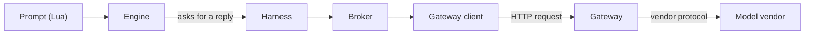
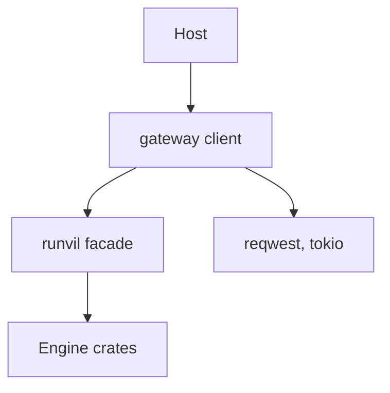
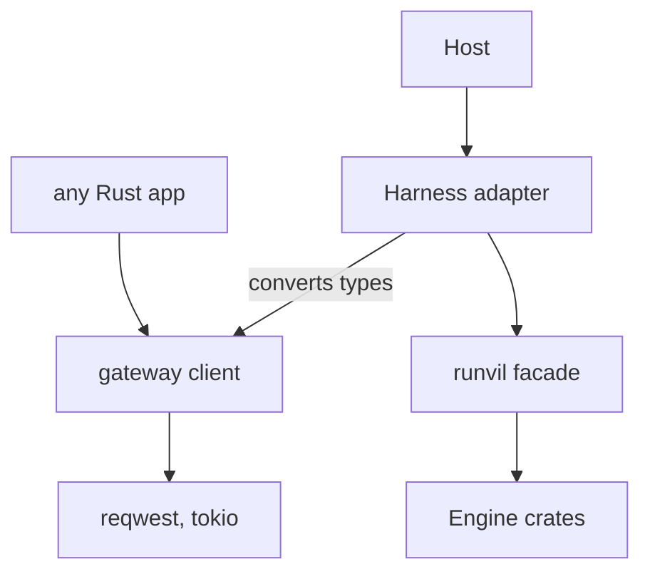

# Moving harness-gateway-client to its own repository: one lean crate that any Rust program can use

- Report type: analytical, with recommendations, updated on 2026-11-25 to say what shipped
- Written for: a new contributor to Runvil, such as the owner of follow-up work on the client, and for the project owner, Vinnie Falco, who decides the open points
- Code read: `runvil-harness` at `22a0992f3`, `runvil-gateway` at `52fd92dbf`, `runvil-workshop` at `f40a4fce1`, `runvil-classroom` at `dd13113d6`, and `runvil-design` at `cee741d8a`, all on 2026-11-23
- Status: the client, the Gateway fixture, the Harness adapter, Workshop's pin, and the `runvil` change all merged on 2026-11-25 (section 9). Sections 1 to 3 describe the code as it was on 2026-11-23, before the move; their counts come from reading code or from `cargo tree`, and nothing was built or run then. The commit ids, test counts, CI jobs, and public names of the shipped work come from the merged repositories
- Repository: https://github.com/cppalliance/gateway-client

## Executive summary

**Recommendation, and what shipped.** Move the Gateway client into a repository of its own, as one crate, and let messages cross by serde, with the Harness adapter converting. That is what shipped [19][21]. The repository is https://github.com/cppalliance/gateway-client and the crate is `gateway-client`. It has plain types of its own for messages, tools, replies, and errors, so a stranger adds one crate. Messages cross by serde and the adapter converts. Runvil's Harness reaches the client through the adapter `harness-gateway-client`, which stays in `runvil-harness`, and Workshop reaches it through the Harness. The Harness pins the client by Git commit, and Workshop pins the Harness. Confidence: high that the client's types must stay apart from the Engine's, because the Engine's build checks fail any Engine crate that depends on the `tokio` or `reqwest` libraries that the client needs. Confidence: medium that two sets of types costs less than a shared crate would have, because the cost shows only when a new piece of reply data arrives (section 4).

**Why the client could not leave Runvil before the move.** Runvil runs prompts, which are Markdown files with Lua code, and its Engine is the part that executes them. The Gateway is Runvil's server that forwards each model request to a vendor such as Anthropic or OpenAI, and the Gateway client is the Rust library that sends each request to it. Three ties kept the client inside Runvil. It depended on the whole `runvil` crate, which brought in 54 of its 150 dependencies, among them a Lua interpreter. The message, tool, reply, and error types in its signatures belonged to the Engine. And it assumed a Runvil Gateway, so a stock OpenAI model list returned nothing. The move cut the first two ties and loosened the third: the client's model list now keeps the entries that a stock server sends (section 3).

**What it should speak.** One OpenAI-shaped protocol, chat completions, plus a few opt-in extensions, while the Gateway translates for each vendor. Of 105 vendor features studied, the Gateway alone handles 65. One opaque field, an optional message field that holds data a vendor expects back unchanged, handles 25 more, and it is designed and not yet built. Ten need a little compatibility code in the Gateway, and five that Runvil does not use today need a separate path. Code for a vendor's own protocol can wait for a program that must reach a vendor without the Gateway.

**Runtime and discovery.** The code that builds requests and reads replies runs without an async runtime. The one HTTP call goes straight to `reqwest` on `tokio` in `transport.rs`, and the transport trait that would let another runtime plug in is deferred. Discovery, which finds a Gateway on the machine, existed in two copies of about 5,000 lines each, one in the Gateway repository and one in Workshop. The client now holds a reader of its own, as a `discovery` Cargo feature that is on by default. `Gateway::find()` reads `gateway.json` and proves the Gateway live without deleting the file, `Gateway::find_env()` reads two environment variables, and a version check refuses a Gateway older than 0.3.0. The writer stays in the Gateway, and Workshop keeps the launch lock and the start code.

**Costs and decisions.** The Engine's error type split in two: the client has a small `Error` of its own, and the adapter converts it. The conversions are four traits of the adapter's own, because Rust's orphan rule forbids `From` between two types that the adapter does not own. A fix to the request or reply format goes through a chain of pins: the client, then the Harness, then Workshop, then `runvil`. Item 3 of the lesson plan of 2026-11-17, the standalone-client project, is delivered by this move, and that lesson plan still lists it as unassigned. The project owner still decides whether the crate goes to crates.io, how a client asks a Gateway for an extension, whether the client also gets code for vendors' own protocols, and whether discovery stays a feature or becomes a second crate. The work shipped in four stages, all merged on 2026-11-25 (section 9).

**Evidence.** Counts in sections 1 to 3 come from reading code at named commits before the move. The shipped facts come from the merged commits named in section 9. Documents still disagree on two points that the project owner must settle, and the open items of the move remain (section 10).

## Contents

- Terms used throughout
- 1. The client sends every model request to the Gateway, and only Runvil programs use it
- 2. The goal is one lean crate that any Rust program can add to get inference
- 3. Three ties kept the client inside Runvil: the Engine, borrowed types, and Gateway assumptions
- 4. The client has chat types of its own, and messages cross by serde
- 5. The client should speak one protocol, and the Gateway should translate for each vendor
- 6. The protocol code needs no async runtime, and the transport trait is deferred
- 7. Discovery existed twice, and the client now holds a reader-only feature
- 8. The new repository stands alone, is named gateway-client, and is pinned by commit
- 9. Four stages shipped the work, and each repository pins the one before it
- 10. Limits: some sources are stale, and open items remain
- References
- Appendix A. The client's public names and a sketch of its use
- Appendix B. Where the 15 exports of the old crate went, and what the adapter holds

## Terms used throughout

Each term has one meaning.

**Parts of Runvil**

- **Runvil:** a Rust project that runs prompts, which are Markdown files that hold instructions for a model plus Lua code for the logic.
- **Engine:** the part that executes a prompt and keeps the conversation as a list of messages. It leaves every network call to others.
- **Harness:** the part that steps the Engine and answers each request the Engine makes: a model reply, a tool result, a timer.
- **Host:** an application that runs prompts through the Harness, such as Workshop, Runvil's desktop application.
- **Plugin:** a library that adds tools to Runvil. The Harness loads it through a C contract, the crate `runvil-plugin-sys`.
- **Gateway:** Runvil's server. It forwards each model request to a vendor or to a local model. It lives in the repository `runvil-gateway`.
- **Broker:** the Host's object that answers the Harness's request for a model reply, as the `InferenceBroker` trait defines.
- **Client:** the crate `gateway-client`, in the repository `cppalliance/gateway-client`: the Rust library that sends each model request to the Gateway. Before the move it was the crate `harness-gateway-client`.
- **Adapter:** the crate `harness-gateway-client`, which stays in `runvil-harness`. It connects the Engine's broker trait, error codes, and model catalog to the client, and converts between the client's types and the Engine's.
- **Discovery:** finding a running Gateway on the machine and learning its address and key from the file `gateway.json`. The client only reads that file. Deciding which program starts an installed Gateway when none is running belongs to Workshop's launcher.
- **Lesson plan and decision page:** a lesson plan, in the repository `runvil-classroom`, lists numbered work items for students. A decision page, in `runvil-design`, records a design choice that the project owner approved.

**Model APIs**

- **Vendor:** a company that makes models and defines its own API, such as Anthropic, OpenAI, or Google.
- **Chat completions:** OpenAI's request and reply format for chat models (`POST /v1/chat/completions`), which most vendors and local servers accept.
- **Protocol:** a request and reply format that a server speaks. Chat completions and Anthropic's Messages API are two protocols.
- **Endpoint:** the address a client sends requests to: a base URL, plus a key when the server needs one. The protocol the server speaks there is the endpoint's shape.
- **Stock server:** a server that speaks a standard protocol and nothing that Runvil adds.
- **Universal API:** Runvil's planned API between the client and the Gateway: chat completions plus a few optional extra fields.
- **Extension:** a field or route that the Gateway adds to a standard API when a feature needs it. A client must still work without it.
- **Thinking:** the reasoning text that some models write before an answer. Anthropic signs it and OpenAI encrypts it, and each expects it back unchanged.
- **Opaque field:** an optional extra field on an assistant message in the universal API. The Gateway fills it with thinking and other data that a vendor expects back unchanged. The client and the Engine store it and send it back unread. It is designed and not yet built.
- **Tool loop:** the cycle in which the model asks for a tool call, the program runs the tool, and the model continues.

**Rust**

- **Crate:** Rust's unit of shared code. A program lists the library crates it uses as dependencies.
- **Trait:** Rust's name for an interface, a set of methods that a type can implement.
- **Facade:** a crate that only re-exports names from other crates, so that a user sees one crate. `runvil` is the Harness's facade.
- **Pin:** naming a dependency by exact Git commit, so that every build uses the same code.
- **Runtime, tokio, reqwest:** a future is work still in progress, such as waiting for bytes from a socket. A runtime wakes a waiting future when its bytes arrive. tokio is the runtime most Rust network programs use, and reqwest is an HTTP client library built on it.
- **Serde:** the Rust library that writes a value as JSON and reads JSON back into a value. A type that implements serde's `Serialize` can be written as JSON, so one crate can hand another crate its values without sharing the Rust type.
- **Orphan rule:** Rust's rule that a crate may implement a trait for a type only when the crate owns the trait or the type. It is why the adapter cannot implement `From` between two types that other crates own.

## 1. The client sends every model request to the Gateway, and only Runvil programs use it

Every model request starts in a prompt's Lua code. The Engine runs the prompt and keeps the conversation as a list of messages, but it never touches the network. When a run needs a reply, the Engine emits a request and waits. The Harness answers by calling a broker that the Host supplies. The standard broker, `GatewayBroker`, lived in the client crate before the move and handed the request to the client's HTTP code [4][8]. Now it lives in the adapter `harness-gateway-client`, which hands the request to the `gateway-client` crate. The client sends it to the Gateway, and the Gateway forwards it to the model vendor (Figure 1).

*Figure 1. The path of one model request.*



The client builds the request body, sends it, reads the streamed reply under a size cap and a time limit for each receive, sorts failures into error codes, and fetches the Gateway's list of models. Before the move the crate was small, and few programs used it (Table 1).

*Table 1. The Gateway client before the move, at commit `22a0992f3` of `runvil-harness`.*

| Measure | Value |
|---|---|
| Code outside tests | About 2,500 lines, 1,550 without comment lines |
| Tests | 160 test functions; the list saved when the move began held 161 |
| Public names | 15, of which 6 are used outside the crate |
| Dependencies | 150 crates, 54 of them only through `runvil` |
| Callers | Workshop, two student programs, and the tests of `runvil` |
| Published | Not on crates.io; Hosts name it by Git commit |

Sources: [1], [7], [18]. The crate has changed since the lesson plan of 2026-11-11 described it: `GatewaySearch`, its web search client, was deleted on 2026-11-19, so that plan's counts are out of date [1][9]. After the move the wire code, the types, and the model-list fetch are in `gateway-client`, and `harness-gateway-client` is the adapter (sections 4 and 8). A reader who is new to agent harnesses can start with the tutorial "How an Agent Harness Works" [17].

## 2. The goal is one lean crate that any Rust program can add to get inference

The project owner described the target in class on 2026-11-06. The inference endpoint "has multiple shapes": the Gateway speaks OpenAI's generic protocol, and a program that wants the most from a vendor's model must use that vendor's own API [12]. The lesson plan of 2026-11-11 then set goals for the client. It should work with any OpenAI-compatible endpoint and depend on no Runvil crate. It should have a clean public API (the names it exports), handle streaming deliberately, and leave room for images, audio, and video [9]. Item 3 of the lesson plan of 2026-11-17, the standalone client, was unassigned when this report was first written [10]. The move delivers it, and `runvil-classroom` was not edited, so that lesson plan still says "unassigned".

In the design discussion of 2026-11-22 the project owner added the shape he wants: one crate with a lean API that any program can use. It has a client, and beside it a discovery part that finds a Gateway already running on the machine, starts an installed one that is stopped, or falls back to a remote Gateway named in configuration. Many programs on one machine, ten for example, all use the same Gateway. The crate also works against stock OpenAI and stock Anthropic servers, and the Gateway's extra features fall away cleanly on a server that lacks them. The shipped crate finds a running Gateway and reads a remote Gateway from the environment. Starting an installed Gateway stays with Workshop (section 7).

These points from that discussion were the current answers when the work began. Point 2 changed before the code was written, and point 4 holds in part, as noted.

1. Backward compatibility does not matter. The Harness's `AGENTS.md` says there are no users or recorded runs to preserve [4].
2. The client has chat types of its own, and the Engine keeps its own. The discussion settled a types crate below both, and the team thread that followed replaced it: messages cross by serde and the adapter converts (section 4).
3. The client's error is small and need not record Lua source locations.
4. Constructors are public, so a caller can build every kind of message. The client has `Message::text` and `Message::tool`. An assistant message that echoes tool calls has no constructor yet (section 10).
5. The client knows nothing about the Harness or the Engine.
6. Consumers pin the new code by Git commit.
7. The Gateway repository uses no code from the rest of Runvil, the client included. The JSON on the wire is the contract between the Gateway and its clients [8]. The one shared file is the `gateway.json` fixture (section 7).

These goals give the criteria for judging each option below:

- A stranger can use the crate without Runvil.
- The Engine's build stays free of tokio and reqwest.
- Each type has one definition.
- The crate works against stock servers.
- Its public surface stays small.
- A change that spans the crate and Runvil stays cheap.

The shipped design meets the first two and the last directly. It meets "works against stock servers" in part (section 5). It misses two. "Each type has one definition" fails: the client and the Engine each define a message, a tool, a reply, and an error, and a test in the adapter keeps the two message types writing the same JSON (section 4). "Its public surface stays small" is open: the client exports 20 names against a target of about 11 (section 10).

## 3. Three ties kept the client inside Runvil: the Engine, borrowed types, and Gateway assumptions

This section describes the client as it was on 2026-11-23, before the move. The end of the section says what the move changed.

**It needed the whole Engine to build.** The client depended on `runvil`, the Harness's facade, for its vocabulary. Outside tests it imported 29 items from that crate: 24 from the chat vocabulary and 5 from the Harness, such as `InferenceBroker` and `Timer` [1]. That one dependency brought in 54 crates that the client's other dependencies did not: the Engine's crates, a vendored Lua interpreter (`mlua`), and a library loader for Plugins [1]. A program that wanted one chat call would have compiled Lua. The two crates also depended on each other in tests, because `runvil` listed the client as a dev-dependency [1]. The lesson plan of 2026-11-11 counted 59 items that the client imported from `runvil` [9]. A recount of the same imports gave 29 outside tests and 40 with tests [1].

**It borrowed the Engine's types.** Runvil splits one job in two. The Engine decides what to ask the model, and the Host makes the network call. Both sides must agree on what a message and a reply are, so the Engine defines them, in the crates `runvil-model-client` and `runvil-types` [2][8]. The client performed the handoff, so every public signature named those types. An outside program met a tangle: Table 2 lists what it could not build or could not satisfy.

*Table 2. What an outside program could not build or could not satisfy.*

| Type | Defined in | The obstacle |
|---|---|---|
| System message, tool schema, assistant tool-call message | `runvil-model-client` | Only Engine code builds them; the crate's tests borrow a tool schema |
| `Error` | `runvil-types` | One type for all of Runvil, with 67 codes |
| `ModelInfo` | `runvil-types` | Requires a context window and a thinking mode |

Sources: [1], [2]. Of the 67 error codes, 14 cover prompt parsing, Lua, and tasks, and the type records Lua source locations. The client raised 12 of the 13 codes for transport and wire failures [2]. Two wrapper types added names of their own: `SecretString` holds the key and prints `<redacted>`, and `GatewayEndpoint` holds a URL that was checked once [1].

**It assumed it talked to the Runvil Gateway.** Five places in the code showed it [1]:

- The model-list parser required a `context` field (the model's context window) and skipped entries without one. A stock OpenAI list lacks it [9], so the parser kept nothing. An entry with `context` but no `thinking` failed the whole list.
- The client sent the thinking switch as `chat_template_kwargs.enable_thinking`, a field that only local servers such as llama.cpp and vLLM understand [14]. The Gateway's planned work includes translating it for remote providers [8].
- `GatewayChat::from_env` read `RUNVIL_GATEWAY_URL` and `RUNVIL_GATEWAY_API_KEY`. Nothing called it, and two student programs read the same variables themselves [18].
- A missing key was accepted only for a loopback address, which mirrors the Gateway's `trust_loopback` setting.
- The word `Gateway` was in five names, and the paths `/chat/completions` and `/models` were written into the code.

**What the move changed.** The client no longer depends on `runvil`: `runvil` and `runvil-engine` are gone from its manifests, and it builds in a repository that holds no Runvil crate. It has plain types of its own, so no signature names an Engine type. Of the five Gateway assumptions, two changed. `fetch_models` returns every entry that the server lists, with `context`, `thinking`, and `provider` as optional fields, and the adapter applies the Harness's rules to the list. `GatewayChat::from_env` is gone, and `Gateway::find_env` and `Gateway::find_env_named(url_var, key_var)` replace it; nothing reads the environment unless a Host calls one of them. The other three stand. The client still sends `chat_template_kwargs.enable_thinking` when a caller sets the thinking option, `Gateway::find_env` still accepts a missing key only for a loopback URL, and the public names still say `Gateway`. Renaming public names is a later job (section 10).

## 4. The client has chat types of its own, and messages cross by serde

The client defines plain chat types of its own, and the Engine keeps its own. Messages cross by serde: the client's request function takes `&[M] where M: Serialize + Sync`, the Engine's `Message` already serializes in the OpenAI shape, and so the adapter passes `&messages` straight in. The adapter copies tools and options through the Engine's public getters, and it converts the client's reply, error, and model list into Engine types. No types crate is shared. The Engine, the `runvil` facade, and the facade check (`cargo xtask api`) are unchanged. Confidence: high that the client's types must stay out of the Engine - the Engine's own build checks fail any Engine crate that depends on `tokio` or `reqwest` [3], the client needs both, and so the Engine cannot depend on the client for its types.

The client writes messages straight into the request body [1], so both sides must agree on the shape of a message, which is JSON, and need not share a Rust type. The types could have lived in four places (Table 3).

*Table 3. Four homes for the chat types.*

| Home | Engine build | Types written | Verdict |
|---|---|---|---|
| The Engine, reached through `runvil` (before the move) | Unchanged | Once | The client could not leave Runvil |
| The client crate | Gains `tokio` and `reqwest` | Once | Refused by the Engine's checks |
| Two sets, with messages crossing by serde and the adapter converting | Unchanged | Twice, plus the conversion | Chosen and shipped |
| A types crate below both | Gains one small crate | Once | Not built: the team thread dropped it |

The structural check in `engine_deps.rs` fails the build when an Engine crate depends on `tokio`, `reqwest`, or four other crates, directly or through another crate [3]. The project owner's rule is "tokio is not allowed anywhere in the engine" [8]. A Cargo feature would not keep them out, because Cargo enables a feature for the whole build when any crate asks for it. Two sets of types mean writing each new piece of reply data three times: the client's type, the Engine's type, and the conversion. The vendor plan adds several such pieces, among them the opaque field and a cache write count [14]. A new field on a message costs less, because messages cross by serde and a field that the Engine's `Message` writes reaches the wire without a conversion. Confidence: medium - the cost shows only when new reply data arrives. Before the move the client reached the Engine's types through the `runvil` facade (Figure 2). As shipped, the client depends on no Runvil crate, and the adapter depends on both the client and the facade (Figure 3). Each arrow points from a crate to a crate it depends on.

*Figure 2. Dependencies before the move.*



*Figure 3. Dependencies as shipped.*



Table 4 lists what the client defines and what stays behind. The llama.cpp timings and vLLM metrics that the client parsed before the move are Runvil features, so the parsing moved into the adapter, which reads them from the reply's raw response JSON.

*Table 4. What the client defines and what stays with the Engine or the adapter.*

| The client's own types | Stays with the Engine or the adapter |
|---|---|
| `Message` and `Role` | The Engine's `Message`, which crosses by serde |
| `Tool`, with parameters as a JSON object, and `ToolCall` | The Engine's tool schema, which the adapter copies through public getters |
| `Options`: model, temperature, token cap, thinking | How a prompt picks a model: `ModelBinding` and the five model roles |
| `Reply`, `Outcome`, `Usage`, and `ClientTiming` | The llama.cpp timings and vLLM metrics parsing, in the adapter |
| `Error` and `ErrorKind` | The Engine's own error type, with its 67 codes |
| `Model` and `Thinking`, with optional fields | The model catalog rules that require a context window and a thinking mode, in the adapter |

**The error splits in two.** The Engine's `Error` keeps its 67 codes and Lua locations. The client has a small `Error` with an `ErrorKind`, two texts (a summary written in the crate's own words and a message for logs), and the few values the Engine acts on, such as the token counts of a context overflow and the finish reason. The adapter converts it into an Engine `Error`, and the `match` on `ErrorKind` has no wildcard arm. The client has no `#[non_exhaustive]` anywhere, so a new variant breaks the adapter's build and not its behavior at run time.

**The adapter converts through four traits of its own.** Rust's orphan rule forbids `impl From<A> for B` in a crate that owns neither type, and every conversion here pairs a client type with an Engine type. The adapter has `IntoEngine`, `TryIntoEngine`, `IntoWire`, and `TryIntoWire` instead. The call sites read the same, as `error.into_engine()`, and a shared types crate would have allowed real `From` impls. That is part of what dropping it costs. The reply conversion builds each `ToolCall` and the `Completion` through the Engine's constructors, so the Engine's checks run on every reply.

**Two copies of the client are possible, and the client sets no `links` key yet.** Two commits of a crate with shared types would be two different types, and the build would fail. The Plugin contract solves this: `runvil-plugin-sys` lives in its own repository, the Harness pins it by commit, and the crate sets `links`, a Cargo key that allows only one copy of a crate in a build [4]. Nothing shared crosses repositories now, because messages cross by serde, so the client needs no `links` key. If a Host names `gateway-client` directly and also uses the adapter at another commit, the build fails with a compile error about two `GatewayEndpoint` types, and `links` plus an empty build script would turn that into a clear Cargo error. Add the key then. Confidence: medium - it works for the Plugin contract and has not been tried here.

The Gateway depends on nothing from the client. An earlier version of this report said that the client's tests check its requests against the Gateway's pinned `openapi.json`. That was unverified and wrong: no such check exists in `runvil-harness` or in the client. The one check that reaches the Gateway's repository is the `gateway.json` fixture (section 7). What a message holds is a separate decision. The client's `Message` holds a role and text for now. A student proposal [11] makes it a role plus typed parts (text, image, audio, video). Confidence: medium - the proposal fits the goals, and the project owner has not adopted it.

## 5. The client should speak one protocol, and the Gateway should translate for each vendor

The client should keep speaking chat completions, with the opaque field and a few opt-in extensions, and the Gateway should translate that protocol into each vendor's own. A program that must talk to a vendor directly is the exception, and it can wait. Confidence: medium - the vendor research supports this for the tool loop, and nobody has run it end to end.

**What the project owner asked for.** The Gateway should "[s]upport the generic API and add just enough extensions", so that other programs that use it are not bothered and Runvil uses the extensions [12]. The Gateway's written rule agrees: the standard shape plus the smallest opt-in addition, and a client that works without it [5].

**What the vendor research found.** Of 105 vendor-specific features studied [14], the Gateway alone handles 65, and one opaque field handles 25 more. Ten need a little compatibility code, all of it in the Gateway. Five would need a separate path around the universal API: vendor file stores, conversations stored by the vendor, background runs, batch jobs, and a WebSocket transport. Runvil does not use those five today, and no feature forces a prompt to know its vendor. The study sent no request to a live model [14].

The client takes part through the opaque field. Some vendors send data that they expect back unchanged, such as Anthropic's signed thinking blocks, and the client stores it and sends it back unread. The field is designed and not built. A search of three repositories on 2026-11-23 found no code that mentions it, and its working name, `provider_content`, appears only in research notes [15]. The client has four small duties for it: ask for it, keep it, send it back, and leave it off for a stock server [15]. The move did not build it. The client takes any messages that serde writes, so an Engine message that holds the field reaches the wire without a change to the client, and the adapter can read the field from the reply's raw `response`, as it reads the llama.cpp metrics. Confidence: medium - that path follows the metrics code, and nobody has built the field.

**How a client asks for an extension is open.** A client asks what a server offers before it relies on an extension [5]. The Gateway's README prefers a capability route, which it calls a capability endpoint: one request at connect time that reports what the server offers. The README says that the route does not exist yet, and none of the 12 paths in the published spec is one [5]. Chat completions does not define an include token, a request field that names optional features to turn on, so the usual way to ask is missing. The survey of 2026-11-17 recommended a request header for now, with low confidence [15]. The recommendation here follows the README: add the capability route with the first extension that needs it. Confidence: medium - it is the Gateway's stated preference, and nobody has built it.

**How the client degrades.** Three rules cover a server that lacks an extension.

- Extra facts, such as a model's context window or thinking mode, are optional values. A Gateway fills them, and a stock server leaves them empty. The client's `Model` makes `context`, `thinking`, and `provider` optional for this reason.
- Extra actions, such as web search or reranking, return a clear "unsupported here" error on a stock server.
- Request settings, such as the thinking switch, are translated per vendor or left out.

**Stock servers.** A stock OpenAI-shaped server (OpenAI, Ollama, llama.cpp, vLLM) should work once the assumptions in section 3 are removed, and the move removed two. The client's model list keeps entries without `context`. The client sends the standard fields, plus `chat_template_kwargs.enable_thinking` only when a caller sets the thinking option, so a request that leaves thinking unset is standard. Translating the thinking switch for remote vendors stays the Gateway's planned work. Confidence: medium - the code paths are standard, and nobody has run the client against a stock server. Stock Anthropic works today only through its OpenAI-compatible endpoint, which by Anthropic's own page returns no thinking, does not support prompt caching, and is not production-ready [15]. The Messages API returns thinking and supports caching, and it is a second protocol (Table 5).

*Table 5. Three ways to reach a vendor's own API.*

| Option | What changes | Cost | Verdict |
|---|---|---|---|
| One protocol in the client; the Gateway translates | Gateway gains a translator per vendor | Stock Anthropic lacks thinking and caching | Chosen |
| Vendor modules in the client, behind Cargo features | Client gains a translator per vendor | The same translation lives in two repositories | Later, for a program that must go direct |
| The Gateway also accepts Anthropic-format requests | Gateway gains a second inbound route | Callers choose a route by vendor | Refused by the decision page |

The decision page rules out an Anthropic-shaped request because the Gateway's purpose is "exactly one way of doing things" [8]. A port study and a student report recommend such a route. The vendor research sides with the decision page: OpenRouter, a commercial service that puts one OpenAI-style API in front of many vendors, added routes in Anthropic's and OpenAI's formats, and its callers now choose a route by vendor [14]. Item 2 of the lesson plan of 2026-11-17 (vendor chat completions, owner Justin) builds the Gateway's translator first and expects little work in the client [10][15].

## 6. The protocol code needs no async runtime, and the transport trait is deferred

The client does not have to be tied to tokio, and the transport trait that would free it is not built. The protocol code stays runtime-free, as it was before the move, and `transport.rs` calls `reqwest` and `tokio` directly. A small transport trait that defaults to reqwest on tokio is a later change, and nothing in the shipped code blocks it. A caller on another runtime could then pass its own transport once the trait is public (Table 6). Confidence: high that the protocol code stays runtime-free - it was before the move and the move left it as it was. Confidence: medium that deferring the trait is right until a caller on another runtime exists. The lesson plan of 2026-11-11 faults the crate for exports made for a second transport that does not exist [9], and the project owner may want another runtime sooner.

Rust's standard library gives a program futures and stops there. A runtime wakes a waiting future when bytes arrive or a timer fires, and writing one is the hard part. The coupling to tokio is thin. Before the move the crate named `reqwest` on 12 lines and `tokio` on 4 outside tests [1]. The `reqwest` lines are the HTTP calls of the chat path and the model-list fetch, and the error conversion, and they moved into the client. The `tokio` lines are two `tokio::time::timeout` calls for the time limit on each receive, the error type of that timeout, and the sleep behind `TokioTimer`, the Harness's timer, which stayed in the adapter. The `wire` code outside tests uses neither, it reads chunks through the `ChunkSource` trait, and the crate spawns no task [1].

*Table 6. Four shapes for the crate's use of a runtime.*

| Shape | What the caller needs | Cost |
|---|---|---|
| tokio and reqwest only (shipped) | A tokio runtime | Programs on another runtime are excluded |
| A transport trait with a tokio default (deferred) | tokio, or another runtime's own transport | One small trait |
| A generic socket and timer | A byte stream and a timer | The crate writes HTTP, TLS, proxies, and pooling itself |
| A private runtime thread inside the crate | Nothing | One thread, and a channel hop per chunk |

When the trait comes, the split falls at the HTTP level: send this request, and give back the status and the body in chunks. `ChunkSource` already covers the body half, and the time limit for each receive is applied in its one implementation, in `transport.rs`, so the protocol code needs no timer [1]. The model-list fetch and the error conversions that call `reqwest` would move onto the same transport. `TokioTimer` and `GatewayBroker` are Harness features and stay in the adapter. Discovery needs no runtime either: it probes `/health` over a plain blocking TCP connection [6], and `Gateway::find` blocks for up to about two seconds, so a Host on an async runtime calls it from a blocking task.

## 7. Discovery existed twice, and the client now holds a reader-only feature

Discovery shipped as a `discovery` Cargo feature of the client, on by default, and it only reads. The writer, `GatewayInstanceLease`, and the six-field `gateway.json` contract stay in `runvil-gateway`. Workshop keeps the launch lock and shutdown. The report first proposed discovery as a crate of its own, behind a Cargo feature of the client, with four additions. As shipped, the code is a module of the client behind the `discovery` feature, and one addition, the version check, was built. Confidence: medium that a feature is the right shape - the code and its contract exist, the per-OS code argues for keeping it apart, and the Harness's house style prefers a second crate to a feature (section 10).

**What existed.** The Gateway writes `gateway.json` in `~/.runvil/run` after it binds, with its port, key, process id, start time, and version [6]. The operating system assigns the port at each start, and the Gateway generates its key once and reuses it [8]. A reader trusts the file only after it checks that the process is alive, that its image is named `runvil-gateway`, and that `GET /health` and an authenticated `GET /v1/models` succeed on the same socket [6]. Two lock files elect one launcher when several programs start together, so only one of them starts the Gateway [6]. The discovery crate decides who launches but does not start the process. In Workshop the desktop app starts it, in about 1,200 lines that also handle restart and recovery [7]. Workshop's `plan_gateway` follows the order the project owner described: attach to a running Gateway, else launch the installed one, else use a configured remote, else fail [7].

**It existed twice.** The Gateway's `gateway-api-discovery` has 26 files and 4,739 lines [6]. Workshop's fork, `workshop-gateway-discovery`, has 30 files and 5,356 lines. Five files match the original byte for byte, and the fork adds `peer.rs`, which finds the installed Gateway, the contract `CONTRACT.md`, and test fixtures [7]. The 2026-10-28 report chose the fork so that Workshop would depend on a written contract and not on Gateway source [13]. That contract describes the Gateway's behavior, yet it lives in the fork [7]. The same report ranked a separate repository for this code in third place of five [13]. That repository exists now, and it holds a third copy of the reader half: the client's `discovery` feature is copied from the Gateway's crate, and the Gateway's crate and Workshop's fork keep their own readers. Workshop dropping its reader half is optional, and the move does not need it (section 10).

**What the client's reader does.** `Gateway::find()` reads `<home>/.runvil/run/gateway.json` and proves the Gateway live: the process is alive, its image is named `runvil-gateway`, its boot identity matches, and the health probe and a bearer-key proof succeed on the same socket. It never deletes the file. Deleting belongs to the lock holder, and a reader that is not the lock holder may race the Gateway's atomic write, so the reader reports a stale file and leaves it. `Gateway::find_in(run_dir)` does the same in a directory the caller names. `Gateway::find_env()` and `Gateway::find_env_named(url_var, key_var)` read the environment, and the key is optional for a loopback URL. `Gateway::new(endpoint)` and `with_key` build one from a known address. `GatewayChat::from_env` is gone, and `find_env` replaced it. `Gateway::find` blocks for up to about two seconds.

**The four additions the report proposed, and what shipped.** Of the four, the version check shipped. The other three were left out of the move, and the code that does each job stays where it was.

- **Finding an installed Gateway stays with Workshop.** Workshop looks only next to itself: beside its executable, beside the AppImage on Linux, or beside its `.app` bundle on macOS. It reads no PATH or setting [7]. The client's reader finds a Gateway that is already running, through the discovery file.
- **Starting a Gateway stays with Workshop.** Workshop's supervisor starts the installed Gateway and handles restart and recovery, with the launch lock [7]. The client only reads the discovery file.
- **A remote Gateway comes in through the environment.** `Gateway::find_env()` reads `RUNVIL_GATEWAY_URL` and `RUNVIL_GATEWAY_API_KEY`, `find_env_named` reads names the Host picks, and `Gateway::new` takes a known address. The `[gateway]` table of Workshop's `workshop.toml` stays in Workshop [7][18].
- **A version check shipped.** `Gateway::find` and `find_in` refuse a Gateway whose `version` in the file is older than 0.3.0, and say plainly that it is too old. Workshop's own check, a minimum copied at build time that it applies only when the Gateway came from the discovery file [7], is unchanged. Confidence: high that the check is right - programs built at different times meet one Gateway, and the file already records the version. The port changes at each start, so a long-lived Host must call `Gateway::find` again when a connection fails [8].

The per-OS code is 255 lines with 7 `unsafe` blocks, each under `#[expect(unsafe_code)]`, and the Harness workspace denies `unsafe` code [1][6]. The code moved into `discovery/sys` of the client, so a program that talks only to a stock server turns the feature off and compiles none of it. The Gateway repository owns the contract, and it now holds a golden `gateway.json` fixture with a test that the writer's output equals it (merged at `c3dcf65b79608fed4389772942b3d2d78940aeb3`) [20]. The client keeps a pinned copy of the fixture, and its `contract` CI job diffs that copy against the Gateway's at that commit [19]. This is a new check. The client's own tests also parse the pinned copy and assert every field.

## 8. The new repository stands alone, is named gateway-client, and is pinned by commit

The client has a repository of its own, https://github.com/cppalliance/gateway-client, with one crate, `gateway-client`. The crate is edition 2024, `rust-version` 1.88, licensed BSL-1.0, `publish = false`, and pinned by Git commit [19]. It is not on crates.io. The name is settled: the repository exists under it. Confidence: medium that crates.io stays closed - it follows the project owner's rule and may change once the API settles.

**The location is a repository of its own.** The new code depends on no other Runvil repository, so it stands alone. The lesson plan of 2026-11-17 names one other candidate, the planned `runvil-hosts` repository of item 7 [10], which would put a client meant for any Rust program inside a collection of Hosts. Staying in `runvil-harness` was the do-nothing option: every consumer keeps one pin, and the client stays tied to the Engine as section 3 describes.

**Why the code was built in the new repository and not in the Harness workspace.** The Harness's product-boundary check (`product.rs` in `build-xtask`) classifies every workspace crate by name. `gateway-client` belongs to no family, and the matrix says that Harness crates may not depend on unaffiliated crates, so a copy inside the Harness workspace would fail `cargo test -p build-xtask`. The same file ignores a dependency on a crate that the workspace does not hold, so a Git dependency passes. Building in the new repository also avoided creating a crate in the Harness and deleting it later. Confidence: high - the rule is in the check's code.

**The name is plain.** `runvil-types` and `runvil-model-client` are private Engine crates [2]. The project owner wants outsiders to see one `runvil` crate and not many `runvil-*` crates [8], and `gateway-client` has no `runvil-` prefix. It does not follow the workspace rulebook's advice to prefix crates with the project name [16], and it keeps the word "Gateway" that the lesson plan of 2026-11-11 doubted [9]. The adapter keeps its name, `harness-gateway-client`, because Workshop, the Harness's tests, the product-boundary rules, and Workshop's `harness_pin` check all name that crate, so none of them change. A rename of the adapter would touch about 30 files. Confidence: medium that the adapter's name stays.

**One crate, and no `links` key yet.** The report's first draft had two crates, a types crate and a client. As shipped there is one, because the client has its own types and no types cross repositories. Without a shared type, the single-copy guarantee that `links` gives is not needed yet (section 4).

**Publish by Git dependency for now.** Hosts name crates by Git commit [4]. The project owner has decided never to publish `runvil` crates to crates.io, because "someone is already squatting on runvil in crates.io" [8]. A Git dependency still lets any Rust program use the crate [10], and a release under the neutral name stays possible once the API settles. The Harness names the client in `[workspace.dependencies]` with `git` and `rev`, and a `version` beside them keeps cargo-deny's wildcard check quiet, as the entry for `runvil-plugin-sys` does. The Harness's `deny.toml` adds the client's Git source to `allow-git` [21]. Workshop's `deny.toml` got the same line, in the Workshop pull request that pinned the new Harness commit [22], because its lock now holds that source through `harness-gateway-client` and `unknown-git = "deny"` refuses it otherwise. Confidence: medium - it follows the project owner's rule, and strangers find crates on crates.io more easily.

**Fresh history, a stated Rust version, and an API check.** Nearly every file moved onto new types, so the repository started with fresh history: a scaffold commit copied from the Harness's own files, pushed straight to `master` because a pull request needs a base branch. The old crate declared no minimum Rust version, and the Harness's CI job for one did not build it [1]. By the release notes its let chains need Rust 1.88, and the Harness workspace sets 1.95 [1]. The new crate states `rust-version` 1.88, and an `msrv` CI job builds it at that version. A `public-api.txt` snapshot lists the names the crate exports, and an `api-surface` CI job compares it on a pinned nightly, as `cargo xtask api` does for the facades [3]. The client's CI runs these jobs:

- `fmt`, and `clippy`, which also runs without the `discovery` feature and on Windows and macOS.
- Tests on Linux, Windows, and macOS, also without the feature.
- `docs`, and `supply-chain`, which runs cargo-deny, cargo-audit, and a check for one rustls backend.
- `contract`, which diffs the pinned `gateway.json` fixture against the Gateway's (section 7).
- `api-surface`, `dylint`, and `msrv`.

Confidence: high that these checks are right - the Harness already runs most of them for its own crates, and the new ones (`contract` and `msrv` on the new crate) are small.

**The Harness pins the new repository at one commit, and the Harness's pages were edited.** The Harness pins `gateway-client` at `91e4685c4bdbd70cc89a10fa791e1a37641f728f`. Workshop pins the Harness, and through it the client, at the adapter's commit. Workshop's `harness_pin` check lists `runvil`, `harness-gateway-client`, and `plugin-mcp`, which must all name one `rev`, and the adapter kept its name, so the check needs no change. This corrects the report's first draft, which said the check must learn the new repository. The student programs pin the Harness 95 to 123 commits back, and their pins still contain `GatewaySearch` [1]. They change when their authors bump a pin, and no backward compatibility is owed [4]. A wire fix goes through a chain of pins: the client, then the Harness, then Workshop, then `runvil`, and that is the standing cost of the split. The adapter's change edited the two Harness decision pages that describe this crate, `harness-and-host` and `models-and-conversations`, the README row for the crate, and the crate's `AGENTS.md`. The lesson plans and tutorials that name the crate are in `runvil-classroom`, which was not part of the move, so they still describe the old crate [9][10][17].

## 9. Four stages shipped the work, and each repository pins the one before it

The work ran in four stages, in the order A, C, B, D. Each repository pins the merged commit of the one before it, so a pull request could not open until its dependency was merged and its id was known. Every merge was fast-forward only, done by `git push`, so the commit ids that the pins name stay valid. Stage C runs before Stage B so that the Harness pins the final crate once. Confidence: high that the order was right - each stage needed the id of the one before it.

1. **Stage A, the new repository.** A scaffold copied from the Harness's own files (toolchain, lints, `deny.toml`, CI) went in first. Pull request 1 added the client's own types, the wire code and its tests ported onto them, a runnable example, and the API snapshot. It merged at `819f644c1121e8b750604052c5a6b48b2b5118d3` [19].
2. **Stage C, discovery.** In `runvil-gateway`, the golden `gateway.json` fixture and the test that the writer's output equals it merged at `c3dcf65b79608fed4389772942b3d2d78940aeb3` [20]. Then pull request 2 of the client added the `discovery` feature, the `Gateway` type, and the `contract` job pinned at that commit. It merged at `91e4685c4bdbd70cc89a10fa791e1a37641f728f` [19].
3. **Stage B, the Harness adapter.** `harness-gateway-client` became an adapter over the client, pinned at `91e4685c4bdbd70cc89a10fa791e1a37641f728f`. It keeps `GatewayBroker`, `TokioTimer`, `provide_gateway_resources`, and the re-exports of `GatewayEndpoint` and `SecretString`. It converts through its four traits, keeps the llama.cpp and vLLM metrics parsing and the model catalog rules, and `deny.toml` allows the client's Git source. The pull request also includes the decision-page, README, and `AGENTS.md` edits (section 8). It merged at `92abc305b9223513621eba95107648bdf8e4e47f` [21].
4. **Stage D, the repositories that pin the Harness.** Workshop pins its three Harness crates at the adapter's id, allows the client's Git source in `deny.toml`, and refreshes its lock. It merged at `2894471d13252d6d940c8fc1819d360e59bf2175`, with no Workshop source change [22]. Then `runvil` moved its Workshop pin to that commit and added `gateway-client` as a fifth rustdoc site. It merged at `2bd5f8b6e666640f5a4e87192a39353466da558a` [23]. This report goes last, so that it can say what shipped.

Test accounting was done name by name. The old crate's 161 tests are all accounted for: each is in the client, in the adapter, or merged into a new test, and one has no adapter counterpart, because the client always attaches a client timing to a reply. The client now has 194 tests with discovery, and the adapter has 52. The one live test, `a_host_sends_the_shipped_hello_prompt_through_a_real_gateway`, stays in the adapter, and CI's live job runs it against a real Gateway.

The lesson plan of 2026-11-17 asks the client's owner to leave room for vendors' own protocols, while item 2 builds the Gateway's translators first [10]. The client leaves that room because it takes any messages that serde writes. A message type that holds the opaque field reaches the wire without a change to the client.

The lesson plan of 2026-11-11 left eight decisions open [9]. Table 7 gives the answer to each as shipped and says who decides what is still open.

*Table 7. The eight decisions of the 2026-11-11 plan, with the answer as shipped.*

| # | Decision | Answer | Who decides, or status |
|---|---|---|---|
| 1 | Where does the broker trait live? | Runvil keeps `InferenceBroker`; the adapter implements it | Shipped in the adapter |
| 2 | Whose types? | Serde plus adapter conversion: the client has its own types, and the adapter converts | Settled 2026-11-22 as a types crate, replaced by the team thread before the work began, and shipped |
| 3 | What assumes the Gateway? | Five places; two changed (the model list keeps stock entries, and `from_env` became `Gateway::find_env`), and three stand | Partly shipped; the three that stand are open |
| 4 | What happens to search? | Gone: the web search client was deleted on 2026-11-19 | Done |
| 5 | What shape is streaming? | A callback for each piece, which shipped; cancellation is open | Project owner |
| 6 | What does a message hold? | A role and text for now; typed parts, as a student proposes, are not adopted | Project owner |
| 7 | What is public? | 20 names (Appendix A), against 15 before; the target of about 11 needs a `Chat` builder, a later job | Open |
| 8 | Where does it live, and what is it called? | A repository of its own, `cppalliance/gateway-client` | Settled and shipped |

The project owner still decides whether the crate goes to crates.io (section 8). The same person decides how a client asks a Gateway for an extension and whether the client gets code for vendors' own protocols (section 5), and whether discovery stays a feature (section 10).

## 10. Limits: some sources are stale, and open items remain

**What was checked.** Every count in sections 1 to 3 comes from reading code or from `cargo tree` at the commits named at the top, before the move, and nothing was built or run then. The shipped facts - the commit ids, the 20 public names, the 194 tests in the client and 52 in the adapter, and the CI jobs - come from the merged repositories [19][20][21][22][23]. The client has not been run against a stock OpenAI-shaped server, and the opaque field, the capability route, and the transport trait are not built.

**Some sources are older than the code.** The crates page says the client depends on `plugin-web`, and the Harness page lists `GatewaySearch`; neither is true today [1][8]. The lesson plan of 2026-11-11 counted 14 public names and 59 imported items before the changes described in section 1 [9]. The class transcripts are generated automatically and may contain errors [12]. The 105-feature study sent no request to a live model [14], and the survey of Anthropic's API is not committed to any repository [15].

**Not checked.** Whether a crates.io name is free. How existing Rust clients such as `async-openai`, `rig`, and `genai` shape this API; the lesson plan of 2026-11-11 assigns that survey to the item 3 owner [9], and nobody has done it. Whether the opaque field fits OpenAI's Responses API and Gemini as well as it fits Anthropic's, where the study went deepest [14][15]. What layout the Windows installer gives the Gateway, which matters if a program ever has to start an installed Gateway.

**Where documents disagree, the project owner settles the point.**

- **A second inbound route.** The decision page puts an Anthropic-shaped request outside the Gateway's API [8]. A port study and a student report recommend serving `/v1/messages` [14]. The survey of 2026-11-17 recommends translating behind the existing route [15].
- **Publishing.** The project owner never publishes `runvil` crates to crates.io [8], and the lesson plan of 2026-11-17 wants any Rust program to use the client [10].

**Open items of the move.** Each is the current answer and open to change.

- **Names.** The repository is `cppalliance/gateway-client`, the crate is `gateway-client`, and the adapter keeps `harness-gateway-client`. The Harness hard-codes the adapter's name in its product-boundary rules (`PUBLIC_HARNESS` in `product.rs`) and in Workshop's `harness_pin`, so a rename touches those too, about 30 files in all. Confidence: medium that the name stays - a rename is cosmetic and costly.
- **Public surface.** The client exports 20 names, 19 from the first pull request and `Gateway` from the second, against the report's target of about 11. The `Chat` builder and the API rename are a later job. Confidence: medium - the names work today, and a rename breaks every caller that bumps its pin.
- **Discovery as a feature, against the house style.** The Harness's `AGENTS.md` says a Cargo feature gates "a real constraint such as a toolchain requirement or heavy native build, not product shape", and it prefers "more, smaller crates to fewer, larger ones". The `discovery` feature rests on a real constraint, 255 lines of per-OS `unsafe` and the `libc` and `windows-sys` dependencies. The alternative that fits the house style is a second crate in the same repository, `gateway-discovery`, which the client depends on without a feature and which holds the reader. `Gateway::find` stays in the client either way. The feature was kept so that `find` sits beside `Gateway::new` and a program on a stock server can turn it off. Confidence: low to medium - the feature works, and the second crate is the project owner's call.
- **The reader exists three times.** The client's reader is a copy of the Gateway's reader half, and Workshop's fork keeps its own. Workshop could drop its reader half and use the client's, and `workshop-gateway` could use the client's model-list fetch and error-body cap [7]. Nothing in the move needs either. Confidence: medium - dropping the copies removes drift, and it is a change in Workshop that nobody has scheduled.
- **The `links` key.** Add it when a Host names `gateway-client` directly and also uses the adapter (section 4). Confidence: medium.
- **The transport trait** from section 6 is a small later change, and nothing in the shipped code blocks it. Confidence: medium that deferring is right.
- **Environment variable names.** `RUNVIL_GATEWAY_URL` and `RUNVIL_GATEWAY_API_KEY` stay for now, though the crate name is neutral. Confidence: low - they are the names student programs already read.
- **A keyless `Gateway` cannot build a `GatewayBroker`,** which needs a key. A discovered Gateway always has one, so discovery is unaffected. A `GatewayBroker::from_gateway` helper is a small later addition. Confidence: medium.
- **No constructor for an assistant message that echoes tool calls.** A stranger's tool loop needs one, and the Runvil path does not, because it sends the Engine's own `Message`. Confidence: medium - add it when a stranger's program needs it.
- **`Gateway::find` blocks** for up to about two seconds, the reader's liveness budget. A Host on an async runtime calls it from a blocking task. Confidence: high - the call is synchronous by design.
- **The image-name check** stays `runvil-gateway`.

## References

Each entry gives the source, the commit or date, and the kind of source. The bracketed numbers in the text point here.

1. The client crate: `runvil-harness`, `crates/harness-gateway-client/`, commit `22a0992f3`. Code, read and counted on 2026-11-23; not built.
2. The Engine's vocabulary: `runvil-harness`, `crates/runvil-internal/model-client/` and `crates/runvil-internal/types/`, commit `22a0992f3`. Code, read.
3. The structural checks: `runvil-harness`, `crates/build-xtask/src/` (`api.rs`, `engine_deps.rs`, `harness_bans.rs`, `product.rs`), commit `22a0992f3`. Code, read; not run.
4. `runvil-harness`, `README.md` and `AGENTS.md`, commit `22a0992f3`. Repository documentation.
5. The Gateway's API principle and spec: `runvil-gateway`, `crates/gateway/README.md` and `crates/gateway/app/openapi.json`, commit `52fd92dbf`. Documentation and a generated spec.
6. The Gateway's discovery crate: `runvil-gateway`, `crates/gateway-api-discovery/`, commit `52fd92dbf`. Code, read.
7. Workshop: `runvil-workshop`, `crates/workshop/desktop/src/gateway/`, `crates/workshop/gateway-discovery/` (with `CONTRACT.md`), `crates/workshop/gateway/`, and `crates/build-xtask/src/harness_pin.rs`, commit `f40a4fce1`. Code, read.
8. Decision pages: `runvil-design`, `decisions/` - `gateway.md`, `models-and-conversations.md`, `harness-and-host.md`, `engine.md`, `crates-build-and-ci.md`, `workshop-app.md`, commit `cee741d8a`. Design records that the project owner approved. Their code facts are dated by their headers, and some are older than the code.
9. Lesson plan of 2026-11-11: `runvil-classroom/lesson-plans/2026-11-11.md`, commit `dd13113d6`. The brief for the standalone client. Its inventory predates changes to the crate.
10. Lesson plan of 2026-11-17: `runvil-classroom/lesson-plans/2026-11-17.md`, items 2, 3, and 7, commit `dd13113d6`. A work plan.
11. "What does a message hold?", a student's decision proposal of 2026-11-11: `runvil-classroom/students/robles/decisions/2026-11-11-message-content.md`, commit `dd13113d6`. Not adopted by the project owner.
12. Class transcripts of 2026-11-06 and 2026-11-11: `runvil-classroom/transcripts/`, commit `dd13113d6`. Generated automatically and may contain errors.
13. "Moving the Gateway to its own repository", report of 2026-10-28: `runvil-design/research/2026-10/2026-10-28-split-report-gateway-repo.md`, commit `cee741d8a`. A research report. Its code facts are at older commits.
14. "Mapping vendor features onto Runvil's universal inference API", report of 2026-11-22: `runvil-design/research/2026-11-22-openrouter-universal-api-deep-dive.md`, commit `cee741d8a`. Research from documentation, code, and recorded traffic; no request went to a live model.
15. "How agent harnesses handle Anthropic's Messages API, and what Runvil should build", report of 2026-11-17. A research report that cites Anthropic's documentation. It is kept in the workspace and is not committed to any repository.
16. `tools-public/rulebooks/rust-crate-rulebook.md`, commit `2d5c71cec`. A workspace rulebook of 2026-09-17, distilled from a research report.
17. Tutorials for beginners: `runvil-classroom/tutorials/tutorial-agent-harnesses.md` ("How an Agent Harness Works") and `tutorial-plugin-architecture.md`, commit `dd13113d6`.
18. Student programs that use the client: `runvil-classroom/students/kirill/runner`, `students/robles/checkprompt`, and `students/wheeler/host`, commit `dd13113d6`. Code, read.
19. The new repository: `cppalliance/gateway-client` (https://github.com/cppalliance/gateway-client), `crates/gateway-client/`, `.github/workflows/ci.yml`, and `public-api.txt`, at commit `819f644c1121e8b750604052c5a6b48b2b5118d3` (pull request 1) and commit `91e4685c4bdbd70cc89a10fa791e1a37641f728f` (pull request 2). Code and CI configuration, read on 2026-11-25. The test counts come from the move's test accounting.
20. The Gateway's contract fixture: `runvil-gateway`, `crates/gateway-api-discovery/tests/fixtures/gateway.json` and `tests/it/contract.rs`, commit `c3dcf65b79608fed4389772942b3d2d78940aeb3`. Code, read on 2026-11-25.
21. The adapter: `runvil-harness`, `crates/harness-gateway-client/`, `Cargo.toml`, and `deny.toml`, commit `92abc305b9223513621eba95107648bdf8e4e47f`. Code and documentation, read on 2026-11-25.
22. The Workshop pin: `runvil-workshop`, `Cargo.toml`, `Cargo.lock`, and `deny.toml`, commit `2894471d13252d6d940c8fc1819d360e59bf2175`. Code and configuration, read on 2026-11-25.
23. The `runvil` change: `runvil`, `Cargo.toml` (`[workspace.metadata.workshop]`) and `crates/build-xtask/src/site.rs`, commit `2bd5f8b6e666640f5a4e87192a39353466da558a`. Code, read on 2026-11-25.

## Appendix A. The client's public names and a sketch of its use

The client exports 20 public names [19]:

- Messages and requests: `Message`, `Role`, `Tool`, `Options`.
- Replies: `Reply`, `Outcome`, `ToolCall`, `Usage`, `ClientTiming`, `StreamDelta`.
- Errors: `Error`, `ErrorKind`.
- Models: `Model`, `Thinking`, and the function `fetch_models`.
- Endpoints and the client: `GatewayEndpoint`, `SecretString`, `GatewayChat`, and `Gateway`.
- One helper: `escape_controls`.

The first pull request exported 19 names, and `Gateway` came with discovery. The first sketch of this appendix aimed at eleven names behind a `Client` and `Chat` builder, with `Message::raw` and `Reply::raw` as escape hatches. That builder is a later cleanup (section 10), so the sketch below uses the shipped names and follows the README and the `chat` example. `GatewayChat::complete` takes any messages that serde writes as chat-completions messages, an optional slice of tools, an `Options`, and a callback for each `StreamDelta`. `Reply::request` and `Reply::response` hold the body that was sent and the response, reassembled into the buffered chat-completion shape.

```rust
// Find a Gateway: the one on this machine, or the one the environment names.
let gateway = Gateway::find().or_else(|_| Gateway::find_env())?;
let client = gateway.client();

// Or name any server that speaks chat completions.
let endpoint = GatewayEndpoint::new("http://127.0.0.1:8081/v1")?;
let client = Gateway::new(endpoint).with_key(key).client();

// One question, one answer.
let messages = [Message::text(Role::User, "Why is the sky blue?")];
let options = Options::new("qwen3-30b");
let reply = client.complete(&messages, None, &options, |_piece| {}).await?;
if let Outcome::Text(text) = reply.outcome() {
    println!("{text}");
}

// Show the reply as it forms.
let reply = client
    .complete(&messages, None, &options, |piece| {
        if let StreamDelta::Text(text) = piece {
            print!("{text}");
        }
    })
    .await?;

// A tool round: offer a tool, then read the calls the model asks for.
let weather = Tool::new("get_weather", "Looks up the weather for a city", schema);
let reply = client.complete(&messages, Some(&[weather]), &options, |_piece| {}).await?;
if let Outcome::ToolCalls(calls) = reply.outcome() {
    for call in calls {
        println!("{} wants {:?}", call.name(), call.arguments());
    }
}
```

Sending a tool's result back needs the assistant turn that asked for the call, and `Message` has no constructor for that turn, so a stranger's tool loop uses a message type of its own that serde writes in the chat-completions shape (section 10).

## Appendix B. Where the 15 exports of the old crate went, and what the adapter holds

Table 8 lists each public name of the old client at `22a0992f3` [1] and where it went. Outside the crate, callers used only six of the fifteen. Table 9 lists the source files of the adapter, `harness-gateway-client`, after the split [21].

*Table 8. Where the 15 exports went.*

| Export | Went to | Reason |
|---|---|---|
| `GatewayBroker` | Adapter | Implements the Harness's `InferenceBroker` |
| `TokioTimer` | Adapter | Implements the Harness's `Timer`; 10 files use it |
| `provide_gateway_resources` | Adapter | Writes into the Harness's `HostResources`, and is the one place in the adapter that reads the key, through `expose_secret` |
| `GatewayChat` | Client, same name | The HTTP client itself; `complete` takes any messages that serde writes and returns the client's `Reply` |
| `fetch_model_catalog` | Client as `fetch_models`, and adapter as the private `catalog_from` | The client returns the list as the server sent it, with optional fields; the adapter applies the Harness's rules |
| `StreamDelta` | Client, same name | One piece of a streaming reply; the adapter maps it to the Harness's `Delta` |
| `GatewayEndpoint` | Client, re-exported by the adapter | A checked URL; Workshop names it |
| `SecretString` | Client, re-exported by the adapter | Prints `<redacted>`; Workshop names it |
| `escape_controls` | Client, same name | Escapes control characters in server text |
| `ChunkSource` | Private in the client | No code outside the crate uses it |
| The five other wire functions | Private in the client | No code outside the crate calls them |

*Table 9. The adapter's source files after the split.*

| File | Change | What it holds |
|---|---|---|
| `lib.rs` | Changed | The exports: `GatewayBroker`, `TokioTimer`, `provide_gateway_resources`, and the re-exported `GatewayEndpoint` and `SecretString` |
| `broker.rs` | Changed | `round()` and `models()`, which call the client and convert |
| `convert.rs` | New | The four traits and the conversions from client types to Engine types |
| `catalog.rs` | Changed | `catalog_from()`, which applies the Harness's model list rules to the client's list |
| `metrics.rs` | New | The llama.cpp and vLLM parsing, cut from the old `wire/parse.rs` |
| `fail.rs` | New | Three helpers copied from the old `failure.rs`: `malformed()`, `with_detail()`, and `decoded()` |
| `resources.rs` | Changed | The imports and the `expose_secret()` call |
| `timer.rs` | Moved, unchanged | `TokioTimer` |
| `test_support.rs` | New | The four mock-gateway helpers that the broker tests use, copied because another crate's test code cannot be reached |

Each `*-tests.rs` file sits beside the file it tests.

*2026-11-23 10:08 - Claude Sonnet 5.5*

*2026-11-25 11:40 - updated to say what shipped - Claude Sonnet 5.5*
