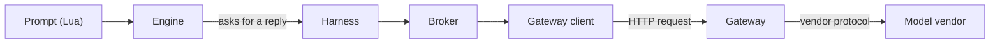
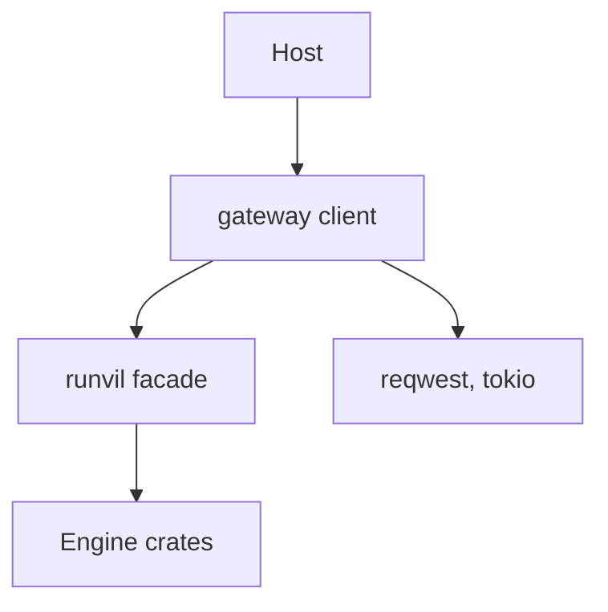
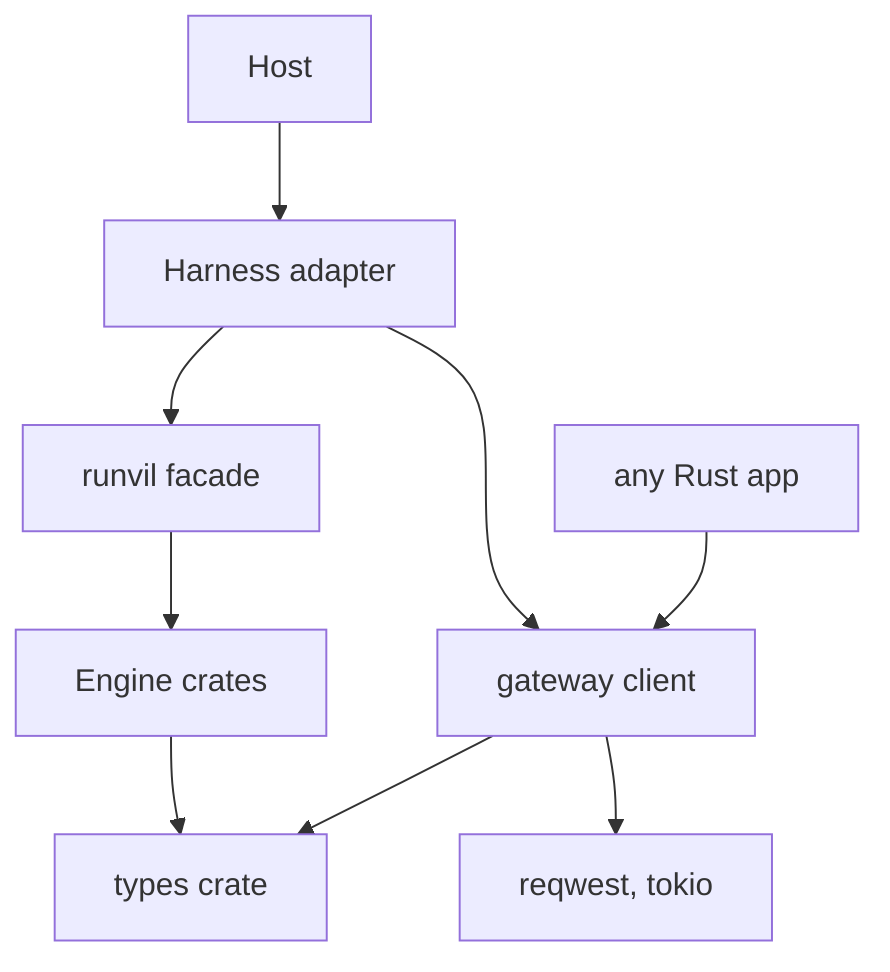

# Moving harness-gateway-client to its own repository: one lean crate that any Rust program can use

- Report type: analytical, with recommendations
- Written for: a new contributor to Runvil, such as the future item 3 owner in the lesson plan of 2026-11-17, and for the project owner, Vinnie Falco, who decides the open points
- Code read: `runvil-harness` at `22a0992f3`, `runvil-gateway` at `52fd92dbf`, `runvil-workshop` at `f40a4fce1`, `runvil-classroom` at `dd13113d6`, and `runvil-design` at `cee741d8a`, all on 2026-11-23
- Status: nothing here was built or run; every count comes from reading code or from `cargo tree`

## Executive summary

**Recommendation.** Move the Gateway client into a repository of its own, as two crates. A types crate holds the messages, tools, replies, and errors that cross the network. A client crate depends on it and re-exports it, so that a stranger adds one crate. Runvil's Harness, through a small adapter, and its Workshop desktop app then depend on both, pinned by Git commit. Confidence: high that the types belong below the client and Runvil's Engine, because the Engine's build checks fail any Engine crate that depends on the `tokio` or `reqwest` libraries that the client needs. Confidence: medium on the rest, because none of it is built.

**Why the client cannot leave Runvil today.** Runvil runs prompts, which are Markdown files with Lua code, and its Engine is the part that executes them. The Gateway is Runvil's server that forwards each model request to a vendor such as Anthropic or OpenAI, and the Gateway client is the Rust library that sends each request to it. Three ties keep the client inside Runvil. It depends on the whole `runvil` crate, which brings in 54 of its 150 dependencies, among them a Lua interpreter. The message, tool, reply, and error types in its signatures belong to the Engine. And it assumes a Runvil Gateway, so a stock OpenAI model list returns nothing.

**What it should speak.** One OpenAI-shaped protocol, chat completions, plus a few opt-in extensions, while the Gateway translates for each vendor. Of 105 vendor features studied, the Gateway alone handles 65. One opaque field, an optional message field that holds data a vendor expects back unchanged, handles 25 more, and it is designed and not yet built. Ten need a little compatibility code in the Gateway, and five that Runvil does not use today need a separate path. Code for a vendor's own protocol can wait for a program that must reach a vendor without the Gateway.

**Runtime and discovery.** The code that builds requests and reads replies already runs without an async runtime, so the one HTTP call can sit behind a transport that defaults to `reqwest` on `tokio`. Discovery, which finds or starts a Gateway on the machine, exists in two copies of about 5,000 lines each, one in the Gateway repository and one in Workshop. The new repository should hold one, plus four additions: a record of where the Gateway is installed, a way to start it, one setting for a remote Gateway, and a version check.

**Costs and decisions.** The Engine's error type splits in two, constructors that only the Engine could call become public, and a fix to the request or reply format takes two steps: release the client, then bump the pin. The project owner decides who takes item 3 of the lesson plan, the unassigned standalone-client project. The owner also decides the repository's name, whether the crates go to crates.io, how a client asks a Gateway for an extension, and whether the client also gets code for vendors' own protocols. The first step is the new crates, the largest of four jobs (section 9).

**Evidence.** Counts come from reading code at named commits. Four documents disagree on points that the project owner must settle (section 10).

## Contents

- Terms used throughout
- 1. The client sends every model request to the Gateway, and only Runvil programs use it
- 2. The goal is one lean crate that any Rust program can add to get inference
- 3. Three ties keep the client inside Runvil: the Engine, borrowed types, and Gateway assumptions
- 4. The chat types belong in a small crate below both the client and the Engine
- 5. The client should speak one protocol, and the Gateway should translate for each vendor
- 6. The protocol code needs no async runtime, so tokio can sit in one default transport
- 7. Discovery exists twice today, and the shared crate needs four additions
- 8. The new repository should stand alone, use a neutral name, and be pinned by commit
- 9. One medium job starts the work, and smaller jobs follow
- 10. Limits: nothing was built, some sources are stale, and four documents disagree
- References
- Appendix A. A sketch of the client's Rust API
- Appendix B. Where the 15 exports of today's crate go

## Terms used throughout

Each term has one meaning.

**Parts of Runvil**

- **Runvil:** a Rust project that runs prompts, which are Markdown files that hold instructions for a model plus Lua code for the logic.
- **Engine:** the part that executes a prompt and keeps the conversation as a list of messages. It leaves every network call to others.
- **Harness:** the part that steps the Engine and answers each request the Engine makes: a model reply, a tool result, a timer.
- **Host:** an application that runs prompts through the Harness, such as Workshop, Runvil's desktop application.
- **Plugin:** a library that adds tools to Runvil. The Harness loads it through a C contract, the crate `runvil-plugin-sys`.
- **Gateway:** Runvil's server. It forwards each model request to a vendor or to a local model. It lives in the repository `runvil-gateway`.
- **Broker:** the Host's object that answers the Harness's request for a model reply, as the `InferenceBroker` trait defines.
- **Client:** the crate `harness-gateway-client`, the Rust library that sends each model request to the Gateway.
- **Adapter:** in the proposal, a small Harness crate that connects the Engine's broker trait, error codes, and model catalog to the client.
- **Discovery:** finding a running Gateway on the machine and learning its address and key from the file `gateway.json`, and deciding which program starts an installed Gateway when none is running.
- **Lesson plan and decision page:** a lesson plan, in the repository `runvil-classroom`, lists numbered work items for students. A decision page, in `runvil-design`, records a design choice that the project owner approved.

**Model APIs**

- **Vendor:** a company that makes models and defines its own API, such as Anthropic, OpenAI, or Google.
- **Chat completions:** OpenAI's request and reply format for chat models (`POST /v1/chat/completions`), which most vendors and local servers accept.
- **Protocol:** a request and reply format that a server speaks. Chat completions and Anthropic's Messages API are two protocols.
- **Endpoint:** the address a client sends requests to: a base URL, plus a key when the server needs one. The protocol the server speaks there is the endpoint's shape.
- **Stock server:** a server that speaks a standard protocol and nothing that Runvil adds.
- **Universal API:** Runvil's planned API between the client and the Gateway: chat completions plus a few optional extra fields.
- **Extension:** a field or route that the Gateway adds to a standard API when a feature needs it. A client must still work without it.
- **Thinking:** the reasoning text that some models write before an answer. Anthropic signs it and OpenAI encrypts it, and each expects it back unchanged.
- **Opaque field:** an optional extra field on an assistant message in the universal API. The Gateway fills it with thinking and other data that a vendor expects back unchanged. The client and the Engine store it and send it back unread. It is designed and not yet built.
- **Tool loop:** the cycle in which the model asks for a tool call, the program runs the tool, and the model continues.

**Rust**

- **Crate:** Rust's unit of shared code. A program lists the library crates it uses as dependencies.
- **Trait:** Rust's name for an interface, a set of methods that a type can implement.
- **Facade:** a crate that only re-exports names from other crates, so that a user sees one crate. `runvil` is the Harness's facade.
- **Pin:** naming a dependency by exact Git commit, so that every build uses the same code.
- **Runtime, tokio, reqwest:** a future is work still in progress, such as waiting for bytes from a socket. A runtime wakes a waiting future when its bytes arrive. tokio is the runtime most Rust network programs use, and reqwest is an HTTP client library built on it.
- **Types crate:** a crate of plain data types (messages, tools, replies, errors) and the code that builds and checks them. It does no networking. The proposal creates it.

## 1. The client sends every model request to the Gateway, and only Runvil programs use it

Every model request starts in a prompt's Lua code. The Engine runs the prompt and keeps the conversation as a list of messages, but it never touches the network. When a run needs a reply, the Engine emits a request and waits. The Harness answers by calling a broker that the Host supplies. The standard broker, `GatewayBroker`, lives in the client crate today and hands the request to the client's HTTP code [4][8]. The client sends it to the Gateway, and the Gateway forwards it to the model vendor (Figure 1).

*Figure 1. The path of one model request.*



The client builds the request body, sends it, reads the streamed reply under a size cap and a time limit for each receive, sorts failures into error codes, and fetches the Gateway's list of models. The crate is small, and few programs use it (Table 1).

*Table 1. The Gateway client today, at commit `22a0992f3` of `runvil-harness`.*

| Measure | Value |
|---|---|
| Code outside tests | About 2,500 lines, 1,550 without comment lines |
| Tests | 160 test functions |
| Public names | 15, of which 6 are used outside the crate |
| Dependencies | 150 crates, 54 of them only through `runvil` |
| Callers | Workshop, two student programs, and the tests of `runvil` |
| Published | Not on crates.io; Hosts name it by Git commit |

Sources: [1], [7], [18]. The crate has changed since the lesson plan of 2026-11-11 described it: `GatewaySearch`, its web search client, was deleted on 2026-11-19, so that plan's counts are out of date [1][9]. A reader who is new to agent harnesses can start with the tutorial "How an Agent Harness Works" [17].

## 2. The goal is one lean crate that any Rust program can add to get inference

The project owner described the target in class on 2026-11-06. The inference endpoint "has multiple shapes": the Gateway speaks OpenAI's generic protocol, and a program that wants the most from a vendor's model must use that vendor's own API [12]. The lesson plan of 2026-11-11 then set goals for the client. It should work with any OpenAI-compatible endpoint and depend on no Runvil crate. It should have a clean public API (the names it exports), handle streaming deliberately, and leave room for images, audio, and video [9]. Item 3 of the lesson plan of 2026-11-17, the standalone client, is unassigned [10].

In the design discussion of 2026-11-22 the project owner added the shape he wants: one crate with a lean API that any program can use. It has a client, and beside it a discovery part that finds a Gateway already running on the machine, starts an installed one that is stopped, or falls back to a remote Gateway named in configuration. Many programs on one machine, ten for example, all use the same Gateway. The crate also works against stock OpenAI and stock Anthropic servers, and the Gateway's extra features fall away cleanly on a server that lacks them.

These points from that discussion are settled. Each is the current answer, and none is written in a decision page yet.

1. Backward compatibility does not matter. The Harness's `AGENTS.md` says there are no users or recorded runs to preserve [4].
2. The chat types live in a types crate below both the client and the Engine.
3. The types crate's error is small and need not record Lua source locations.
4. Constructors are public, so a caller can build every kind of message.
5. The client knows nothing about the Harness or the Engine.
6. Consumers pin the new code by Git commit.
7. The Gateway repository uses no code from the rest of Runvil, the types crate included. The JSON on the wire is the contract between the Gateway and its clients [8].

These goals give the criteria for judging each option below:

- A stranger can use the crate without Runvil.
- The Engine's build stays free of tokio and reqwest.
- Each type has one definition.
- The crate works against stock servers.
- Its public surface stays small.
- A change that spans the crate and Runvil stays cheap.

## 3. Three ties keep the client inside Runvil: the Engine, borrowed types, and Gateway assumptions

**It needs the whole Engine to build.** The client depends on `runvil`, the Harness's facade, for its vocabulary. Outside tests it imports 29 items from that crate: 24 from the chat vocabulary and 5 from the Harness, such as `InferenceBroker` and `Timer` [1]. That one dependency brings in 54 crates that the client's other dependencies do not: the Engine's crates, a vendored Lua interpreter (`mlua`), and a library loader for Plugins [1]. A program that wants one chat call would compile Lua. The two crates also depend on each other in tests, because `runvil` lists the client as a dev-dependency [1]. The lesson plan of 2026-11-11 counted 59 items that the client imports from `runvil` [9]. A recount of the same imports gives 29 outside tests and 40 with tests [1].

**It borrows the Engine's types.** Runvil splits one job in two. The Engine decides what to ask the model, and the Host makes the network call. Both sides must agree on what a message and a reply are, so the Engine defines them, in the crates `runvil-model-client` and `runvil-types` [2][8]. The client performs the handoff, so every public signature names those types. An outside program meets a tangle: Table 2 lists what it cannot build or cannot satisfy.

*Table 2. What an outside program cannot build or cannot satisfy.*

| Type | Defined in | The obstacle |
|---|---|---|
| System message, tool schema, assistant tool-call message | `runvil-model-client` | Only Engine code builds them; the crate's tests borrow a tool schema |
| `Error` | `runvil-types` | One type for all of Runvil, with 67 codes |
| `ModelInfo` | `runvil-types` | Requires a context window and a thinking mode |

Sources: [1], [2]. Of the 67 error codes, 14 cover prompt parsing, Lua, and tasks, and the type records Lua source locations. The client raises 12 of the 13 codes for transport and wire failures [2]. Two wrapper types add names of their own: `SecretString` holds the key and prints `<redacted>`, and `GatewayEndpoint` holds a URL that was checked once [1].

**It assumes it talks to the Runvil Gateway.** Five places in the code show it [1]:

- The model-list parser requires a `context` field (the model's context window) and skips entries without one. A stock OpenAI list lacks it [9], so the parser keeps nothing. An entry with `context` but no `thinking` fails the whole list.
- The client sends the thinking switch as `chat_template_kwargs.enable_thinking`, a field that only local servers such as llama.cpp and vLLM understand [14]. The Gateway's planned work includes translating it for remote providers [8].
- `GatewayChat::from_env` reads `RUNVIL_GATEWAY_URL` and `RUNVIL_GATEWAY_API_KEY`. Nothing calls it, and two student programs read the same variables themselves [18].
- A missing key is accepted only for a loopback address, which mirrors the Gateway's `trust_loopback` setting.
- The word `Gateway` is in five names, and the paths `/chat/completions` and `/models` are written into the code.

## 4. The chat types belong in a small crate below both the client and the Engine

Put the chat types in a new types crate that does no networking, keep it in the same repository as the client, and make both the client and the Engine depend on it. The client re-exports the types, so a stranger still adds one crate and sees one set of names. Confidence: high - the Engine's own build checks fail any Engine crate that depends on `tokio` or `reqwest` [3], the client needs both, and so the types cannot live in the client.

The client writes the Engine's messages straight into the request body [1], so both sides must share one `Message`. The types could live in four places (Table 3).

*Table 3. Four homes for the chat types.*

| Home | Engine build | Types written | Verdict |
|---|---|---|---|
| The Engine, reached through `runvil` (today) | Unchanged | Once | The client cannot leave Runvil |
| The client crate | Gains `tokio` and `reqwest` | Once | Refused by the Engine's checks |
| Two sets, converted by the Harness | Unchanged | Twice, plus the conversion | Works, at three edits per new field |
| A types crate below both | Gains one small crate | Once | Chosen |

The structural check in `engine_deps.rs` fails the build when an Engine crate depends on `tokio`, `reqwest`, or four other crates, directly or through another crate [3]. The project owner's rule is "tokio is not allowed anywhere in the engine" [8]. A Cargo feature would not keep them out, because Cargo enables a feature for the whole build when any crate asks for it. Two sets of types would mean writing each new piece of reply data three times: the client's type, the Engine's type, and the conversion. The vendor plan adds several such pieces, among them the opaque field and a cache write count [14]. Today the client reaches the Engine's types through the `runvil` facade (Figure 2). In the proposal both depend on the types crate (Figure 3). Each arrow points from a crate to a crate it depends on.

*Figure 2. Dependencies today.*



*Figure 3. Dependencies proposed.*



Table 4 lists which types move and which stay. The llama.cpp timings and vLLM metrics that the client parses today are Runvil features, so the adapter reads them from the reply's raw JSON.

*Table 4. What moves into the types crate and what stays in the Engine.*

| Moves to the types crate | Stays in the Engine |
|---|---|
| Message and role, with room for the opaque field | The Engine's own error type, with its 67 codes |
| Tool schema and tool call | How a prompt picks a model: `ModelBinding` and the five model roles |
| The reply: result, finish reason, reasoning text, usage, raw exchange | The model catalog that requires a context window and a thinking mode |
| Request options: model, temperature, token cap, thinking | |
| A small failure kind | |

**The error splits in two.** The Engine's `Error` keeps its 67 codes and Lua locations. The types crate gets a small error: a kind, a message, and the few values the Engine acts on, such as the token counts of a context overflow and the finish reason. The adapter converts it into an Engine `Error`.

**Both sides must build against one commit.** Two commits of the types crate are two different `Message` types, and the build fails. The Plugin contract already solves this: `runvil-plugin-sys` lives in its own repository, the Harness pins it by commit, and the crate sets `links`, a Cargo key that allows only one copy of a crate in a build [4]. The types crate can do the same. Confidence: medium - it works for the Plugin contract and has not been tried here.

**The facade check must change.** The command `cargo xtask api` accepts a `runvil` re-export only from the Engine's private crates and `runvil-plugin`, and it accepts one outside crate in signatures, `runvil_plugin_sys` [3]. A types crate in another repository fails both. The project owner wants outsiders to "only see one runvil crate" [8], and Hosts that use the client already name two: `runvil` and the client. Two changes would work. The heavier one names the types crate in the rule and re-exports it through `runvil`. The lighter one allows the types crate in signatures, as with `runvil_plugin_sys`, and lets a Host that writes its own broker depend on it directly. Confidence: low - nobody has tried either change.

The Gateway depends on neither crate, and the client's tests check its requests against the Gateway's pinned `openapi.json` [5][13]. What a message holds is a separate decision. A student proposal [11] makes it a role plus typed parts (text, image, audio, video). Confidence: medium - the proposal fits the goals, and the project owner has not adopted it.

## 5. The client should speak one protocol, and the Gateway should translate for each vendor

The client should keep speaking chat completions, with the opaque field and a few opt-in extensions, and the Gateway should translate that protocol into each vendor's own. A program that must talk to a vendor directly is the exception, and it can wait. Confidence: medium - the vendor research supports this for the tool loop, and nobody has run it end to end.

**What the project owner asked for.** The Gateway should "[s]upport the generic API and add just enough extensions", so that other programs that use it are not bothered and Runvil uses the extensions [12]. The Gateway's written rule agrees: the standard shape plus the smallest opt-in addition, and a client that works without it [5].

**What the vendor research found.** Of 105 vendor-specific features studied [14], the Gateway alone handles 65, and one opaque field handles 25 more. Ten need a little compatibility code, all of it in the Gateway. Five would need a separate path around the universal API: vendor file stores, conversations stored by the vendor, background runs, batch jobs, and a WebSocket transport. Runvil does not use those five today, and no feature forces a prompt to know its vendor. The study sent no request to a live model [14].

The client takes part through the opaque field. Some vendors send data that they expect back unchanged, such as Anthropic's signed thinking blocks, and the client stores it and sends it back unread. The field is designed and not built. A search of three repositories on 2026-11-23 found no code that mentions it, and its working name, `provider_content`, appears only in research notes [15]. The client has four small duties for it: ask for it, keep it, send it back, and leave it off for a stock server [15].

**How a client asks for an extension is open.** A client asks what a server offers before it relies on an extension [5]. The Gateway's README prefers a capability route, which it calls a capability endpoint: one request at connect time that reports what the server offers. The README says that the route does not exist yet, and none of the 12 paths in the published spec is one [5]. Chat completions does not define an include token, a request field that names optional features to turn on, so the usual way to ask is missing. The survey of 2026-11-17 recommended a request header for now, with low confidence [15]. The recommendation here follows the README: add the capability route with the first extension that needs it. Confidence: medium - it is the Gateway's stated preference, and nobody has built it.

**How the client degrades.** Three rules cover a server that lacks an extension.

- Extra facts, such as a model's context window or thinking mode, are optional values. A Gateway fills them, and a stock server leaves them empty.
- Extra actions, such as web search or reranking, return a clear "unsupported here" error on a stock server.
- Request settings, such as the thinking switch, are translated per vendor or left out.

**Stock servers.** A stock OpenAI-shaped server (OpenAI, Ollama, llama.cpp, vLLM) works once the assumptions in section 3 are removed. The model list keeps entries without `context`, and the client sends only standard fields until it knows the server is a Gateway. Stock Anthropic works today only through its OpenAI-compatible endpoint, which by Anthropic's own page returns no thinking, does not support prompt caching, and is not production-ready [15]. The Messages API returns thinking and supports caching, and it is a second protocol (Table 5).

*Table 5. Three ways to reach a vendor's own API.*

| Option | What changes | Cost | Verdict |
|---|---|---|---|
| One protocol in the client; the Gateway translates | Gateway gains a translator per vendor | Stock Anthropic lacks thinking and caching | Chosen |
| Vendor modules in the client, behind Cargo features | Client gains a translator per vendor | The same translation lives in two repositories | Later, for a program that must go direct |
| The Gateway also accepts Anthropic-format requests | Gateway gains a second inbound route | Callers choose a route by vendor | Refused by the decision page |

The decision page rules out an Anthropic-shaped request because the Gateway's purpose is "exactly one way of doing things" [8]. A port study and a student report recommend such a route. The vendor research sides with the decision page: OpenRouter, a commercial service that puts one OpenAI-style API in front of many vendors, added routes in Anthropic's and OpenAI's formats, and its callers now choose a route by vendor [14]. Item 2 of the lesson plan of 2026-11-17 (vendor chat completions, owner Justin) builds the Gateway's translator first and expects little work in the client [10][15].

## 6. The protocol code needs no async runtime, so tokio can sit in one default transport

The client does not have to be tied to tokio. Keep the protocol code runtime-free, as it is today, and put the HTTP call behind one small transport trait that defaults to reqwest on tokio. A caller on another runtime could pass its own transport once the trait is public (Table 6). Confidence: high that the protocol code stays runtime-free - it already is, and a CI check can hold it there. Confidence: medium that the trait stays private until such a caller exists. The lesson plan of 2026-11-11 faults the crate for exports made for a second transport that does not exist [9], and the project owner may want another runtime sooner.

Rust's standard library gives a program futures and stops there. A runtime wakes a waiting future when bytes arrive or a timer fires, and writing one is the hard part. The coupling to tokio is thin. Outside tests the crate names `reqwest` on 12 lines and `tokio` on 4 [1]. The `reqwest` lines are the HTTP calls of the chat path and the model-list fetch, and the error conversion. The `tokio` lines are two `tokio::time::timeout` calls for the time limit on each receive, the error type of that timeout, and the sleep behind `TokioTimer`, the Harness's timer. The `wire` code outside tests uses neither, it reads chunks through the `ChunkSource` trait, and the crate spawns no task [1].

*Table 6. Four shapes for the crate's use of a runtime.*

| Shape | What the caller needs | Cost |
|---|---|---|
| tokio and reqwest only (today) | A tokio runtime | Programs on another runtime are excluded |
| A transport trait with a tokio default | tokio, or another runtime's own transport | One small trait |
| A generic socket and timer | A byte stream and a timer | The crate writes HTTP, TLS, proxies, and pooling itself |
| A private runtime thread inside the crate | Nothing | One thread, and a channel hop per chunk |

The split falls at the HTTP level: send this request, and give back the status and the body in chunks. `ChunkSource` already covers the body half, and the time limit for each receive is applied in its one implementation, in `transport.rs`, so the protocol code needs no timer [1]. The model-list fetch and the error conversions that call `reqwest` move onto the same transport. `TokioTimer` and `GatewayBroker` are Harness features and stay in the adapter. Discovery needs no runtime either: it probes `/health` over a plain blocking TCP connection [6].

## 7. Discovery exists twice today, and the shared crate needs four additions

Build discovery in the new repository as a crate of its own, behind a Cargo feature of the client, and keep the written contract for it in the Gateway repository. Confidence: medium - most of the code and its contract exist, and the per-OS code argues for keeping it apart.

**What exists.** The Gateway writes `gateway.json` in `~/.runvil/run` after it binds, with its port, key, process id, start time, and version [6]. The operating system assigns the port at each start, and the Gateway generates its key once and reuses it [8]. A reader trusts the file only after it checks that the process is alive, that its image is named `runvil-gateway`, and that `GET /health` and an authenticated `GET /v1/models` succeed on the same socket [6]. Two lock files elect one launcher when several programs start together, so only one of them starts the Gateway [6]. The discovery crate decides who launches but does not start the process. In Workshop the desktop app starts it, in about 1,200 lines that also handle restart and recovery [7]. Workshop's `plan_gateway` follows the order the project owner described: attach to a running Gateway, else launch the installed one, else use a configured remote, else fail [7].

**It exists twice.** The Gateway's `gateway-api-discovery` has 26 files and 4,739 lines [6]. Workshop's fork, `workshop-gateway-discovery`, has 30 files and 5,356 lines. Five files match the original byte for byte, and the fork adds `peer.rs`, which finds the installed Gateway, the contract `CONTRACT.md`, and test fixtures [7]. The 2026-10-28 report chose the fork so that Workshop would depend on a written contract and not on Gateway source [13]. That contract describes the Gateway's behavior, yet it lives in the fork [7]. The same report ranked a separate repository for this code in third place of five [13]. That repository will exist anyway.

**What is missing.**

- **A way to find an installed Gateway from any program.** Workshop looks only next to itself: beside its executable, beside the AppImage on Linux, or beside its `.app` bundle on macOS. It reads no PATH or setting [7]. Any other program starts elsewhere. The Gateway can write its own executable path under `~/.runvil/` at each start for every program to read. Confidence: medium - it follows the discovery file's pattern, and nobody has built it.
- **A way to start it.** The shared crate needs a small helper that starts the installed Gateway detached, then waits until the discovery file and `/health` show it ready. Workshop's supervisor does this today and is the model [7]. Confidence: medium - the logic exists, and it must work on three operating systems.
- **One setting for a remote Gateway.** Today it comes from the `[gateway]` table of Workshop's `workshop.toml`, or from two environment variables that student programs read themselves [7][18]. One file under `~/.runvil/`, readable by its owner only and holding the URL and the key, would serve every program. Confidence: medium - it mirrors the discovery file.
- **A version check.** Workshop compares the Gateway's version with a minimum copied at build time, and only when the Gateway came from the discovery file [7]. Programs built at different times will meet one Gateway, so the shared crate should compare the file's `version` with a minimum it states and say plainly when the Gateway is too old. Confidence: high - the file already records the version. The port changes at each start, so a long-lived client must run discovery again when a connection fails [8].

The per-OS code is 255 lines with 7 `unsafe` blocks, and the Harness workspace denies `unsafe` code [1][6]. A discovery crate of its own keeps that code out of a program that talks only to a stock server. The Gateway repository owns the contract and its golden fixtures, and the new repository commits a pinned copy and tests against it, as consumers already do with the Gateway's spec [13].

## 8. The new repository should stand alone, use a neutral name, and be pinned by commit

Give the client and the types crate a repository of their own, name the crates with a shared project name and the roles `-types` and `-client`, and keep them off crates.io for now. Confidence: medium - the location follows from the goals, and the name and the publishing rule are the project owner's call.

**The location is a repository of its own.** The new code depends on no other Runvil repository, so it can stand alone. The lesson plan of 2026-11-17 names one other candidate, the planned `runvil-hosts` repository of item 7 [10], which would put a client meant for any Rust program inside a collection of Hosts. Staying in `runvil-harness` is the do-nothing option: every consumer keeps one pin, and the client stays tied to the Engine as section 3 describes.

**The name should be neutral.** The lesson plan of 2026-11-11 says "Gateway" no longer fits [9]. `runvil-types` and `runvil-model-client` are private Engine crates [2]. The workspace rulebook says to prefix crates with the project name and to use `-types` and `-client` [16]. The project owner wants outsiders to see one `runvil` crate and not many `runvil-*` crates [8]. A neutral project name shared by the repository and both crates meets all of these.

**Publish by Git dependency for now.** Hosts name crates by Git commit [4]. The project owner has decided never to publish `runvil` crates to crates.io, because "someone is already squatting on runvil in crates.io" [8]. A Git dependency still lets any Rust program use the crate [10], and a release under a neutral name stays possible once the API settles. Confidence: medium - it follows the project owner's rule, and strangers find crates on crates.io more easily.

**Start with fresh history, a stated Rust version, and an API check.** Nearly every file moves onto new types, so a fresh history with one clean first commit loses little. The crate declares no minimum Rust version, and the Harness's CI job for one does not build it [1]. By the release notes its let chains need Rust 1.88, and the Harness workspace sets 1.95 [1]. The new repository should state one version, test it, and commit a snapshot of the names the crates export, which CI compares, as `cargo xtask api` does for the facades [3]. Confidence: medium - the Harness already runs both checks for its own crates.

**Everyone pins the new repository at one commit, and the written plans and pages need edits.** The Harness, Workshop, and any other Host pin it at one commit. Workshop's `harness_pin` check lists the crates it may take from `runvil-harness`, and the client is one of them, so the check must learn the new repository [7]. The student programs pin the Harness 95 to 123 commits back, and their pins still contain `GatewaySearch` [1]. They change when their authors bump a pin, and no backward compatibility is owed [4]. A wire fix for the Harness takes two steps, release the client and then bump the pin, and that is the standing cost of the split. Six decision pages, two lesson plans, and two tutorials name the crate and need edits when the move happens [8][9][10][17].

## 9. One medium job starts the work, and smaller jobs follow

The first job is the only medium one, and the sizes are estimates from reading the code. Confidence: medium - nothing is built.

1. **Build the types crate and the client in the new repository (medium).** Port the wire code and its tests onto the new types, add the transport trait, remove the five Gateway assumptions, and write the README, an example, and CI. Owner: the item 3 owner, not yet assigned [10].
2. **Write the Harness adapter (small).** `GatewayBroker`, `TokioTimer`, and `provide_gateway_resources` stay in the Harness and wrap the client. The adapter converts the client's small error into an Engine `ErrorCode`, the client's model list into the Engine's catalog, and the Engine's request settings into the client's options. The facade rule change from section 4 belongs here, with the tests and the example of `runvil` that use `TokioTimer` [1].
3. **Move the consumers (small).** Workshop and the student programs bump their pins, and Workshop's `harness_pin` check learns the new repository. `workshop-gateway` repeats two things the client does, the model-list fetch and the cap on an error body, and could use the client's versions [7].
4. **Add discovery and the Gateway side (small to medium).** The discovery crate, the install record, the start helper, the remote-setting file, the version check, the move of `CONTRACT.md`, and the capability route. Workshop then drops its discovery fork. Most of this is in the Gateway repository, where item 2 is also at work, and the project owner assigns it.

The lesson plan of 2026-11-17 asks the item 3 owner to leave room for vendors' own protocols, while item 2 builds the Gateway's translators first [10]. The types crate leaves that room, because it holds the opaque field.

The lesson plan of 2026-11-11 left eight decisions open [9]. Table 7 gives a proposed answer to each and says who decides or what the status is.

*Table 7. The eight decisions of the 2026-11-11 plan, with a proposed answer.*

| # | Decision | Proposed answer | Who decides, or status |
|---|---|---|---|
| 1 | Where does the broker trait live? | Runvil keeps `InferenceBroker`; the adapter implements it | Project owner |
| 2 | Whose types? | A types crate below both | Settled 2026-11-22 |
| 3 | What assumes the Gateway? | Five places; each is made optional or removed | Item 3 owner |
| 4 | What happens to search? | Gone: the web search client was deleted on 2026-11-19 | Done |
| 5 | What shape is streaming? | A callback for each piece; cancellation is open | Project owner |
| 6 | What does a message hold? | A role plus typed parts, as a student proposes | Project owner |
| 7 | What is public? | About a dozen names (Appendix A), against 15 today | Item 3 owner |
| 8 | Where does it live, and what is it called? | A repository of its own, under a neutral name | Project owner |

The project owner also decides who takes item 3, the repository's name, and whether the crates go to crates.io (section 8). The same person decides how a client asks a Gateway for an extension and whether the client gets code for vendors' own protocols (section 5), and how the facade check admits a crate from another repository (section 4).

## 10. Limits: nothing was built, some sources are stale, and four documents disagree

**Nothing was built or run.** Every count comes from reading code or from `cargo tree` at the commits named at the top. The transport trait, the `links` key for the types crate, the facade rule change, the capability route, the start helper, and the install record are proposals. `runvil-harness` is 14 commits ahead of its remote, and the commit that Workshop pins, `ee89d0882`, holds the same client as HEAD [1].

**Some sources are older than the code.** The crates page says the client depends on `plugin-web`, and the Harness page lists `GatewaySearch`; neither is true today [1][8]. The lesson plan of 2026-11-11 counted 14 public names and 59 imported items before the changes described in section 1 [9]. The class transcripts are generated automatically and may contain errors [12]. The 105-feature study sent no request to a live model [14], and the survey of Anthropic's API is not committed to any repository [15].

**Not checked.** Whether a crates.io name is free. How existing Rust clients such as `async-openai`, `rig`, and `genai` shape this API; the lesson plan of 2026-11-11 assigns that survey to the item 3 owner [9]. Whether the opaque field fits OpenAI's Responses API and Gemini as well as it fits Anthropic's, where the study went deepest [14][15]. What layout the Windows installer gives the Gateway, which matters for the install record.

**Where documents disagree, the project owner settles the point.**

- **A second inbound route.** The decision page puts an Anthropic-shaped request outside the Gateway's API [8]. A port study and a student report recommend serving `/v1/messages` [14]. The survey of 2026-11-17 recommends translating behind the existing route [15].
- **Publishing.** The project owner never publishes `runvil` crates to crates.io [8], and the lesson plan of 2026-11-17 wants any Rust program to use the client [10].
- **Dependencies.** The lesson plans say the client depends on no Runvil crate or repository [9][10]. It depends on `runvil` today [1].
- **One public crate or two.** The project owner wants outsiders to see one `runvil` crate, and the Harness already names the client as a second public crate [8].

## References

Each entry gives the source, the commit or date, and the kind of source. The bracketed numbers in the text point here.

1. The client crate: `runvil-harness`, `crates/harness-gateway-client/`, commit `22a0992f3`. Code, read and counted on 2026-11-23; not built.
2. The Engine's vocabulary: `runvil-harness`, `crates/runvil-internal/model-client/` and `crates/runvil-internal/types/`, commit `22a0992f3`. Code, read.
3. The structural checks: `runvil-harness`, `crates/build-xtask/src/` (`api.rs`, `engine_deps.rs`, `harness_bans.rs`), commit `22a0992f3`. Code, read; not run.
4. `runvil-harness`, `README.md` and `AGENTS.md`, commit `22a0992f3`. Repository documentation.
5. The Gateway's API principle and spec: `runvil-gateway`, `crates/gateway/README.md` and `crates/gateway/app/openapi.json`, commit `52fd92dbf`. Documentation and a generated spec.
6. The Gateway's discovery crate: `runvil-gateway`, `crates/gateway-api-discovery/`, commit `52fd92dbf`. Code, read.
7. Workshop: `runvil-workshop`, `crates/workshop/desktop/src/gateway/`, `crates/workshop/gateway-discovery/` (with `CONTRACT.md`), `crates/workshop/gateway/`, and `crates/build-xtask/src/harness_pin.rs`, commit `f40a4fce1`. Code, read.
8. Decision pages: `runvil-design`, `decisions/` - `gateway.md`, `models-and-conversations.md`, `harness-and-host.md`, `engine.md`, `crates-build-and-ci.md`, `workshop-app.md`, commit `cee741d8a`. Design records that the project owner approved. Their code facts are dated by their headers, and some are older than the code.
9. Lesson plan of 2026-11-11: `runvil-classroom/lesson-plans/2026-11-11.md`, commit `dd13113d6`. The brief for the standalone client. Its inventory predates changes to the crate.
10. Lesson plan of 2026-11-17: `runvil-classroom/lesson-plans/2026-11-17.md`, items 2, 3, and 7, commit `dd13113d6`. A work plan.
11. "What does a message hold?", a student's decision proposal of 2026-11-11: `runvil-classroom/students/robles/decisions/2026-11-11-message-content.md`, commit `dd13113d6`. Not adopted by the project owner.
12. Class transcripts of 2026-11-06 and 2026-11-11: `runvil-classroom/transcripts/`, commit `dd13113d6`. Generated automatically and may contain errors.
13. "Moving the Gateway to its own repository", report of 2026-10-28: `runvil-design/research/2026-10/2026-10-28-split-report-gateway-repo.md`, commit `cee741d8a`. A research report. Its code facts are at older commits.
14. "Mapping vendor features onto Runvil's universal inference API", report of 2026-11-22: `runvil-design/research/2026-11-22-openrouter-universal-api-deep-dive.md`, commit `cee741d8a`. Research from documentation, code, and recorded traffic; no request went to a live model.
15. "How agent harnesses handle Anthropic's Messages API, and what Runvil should build", report of 2026-11-17. A research report that cites Anthropic's documentation. It is kept in the workspace and is not committed to any repository.
16. `tools-public/rulebooks/rust-crate-rulebook.md`, commit `2d5c71cec`. A workspace rulebook of 2026-09-17, distilled from a research report.
17. Tutorials for beginners: `runvil-classroom/tutorials/tutorial-agent-harnesses.md` ("How an Agent Harness Works") and `tutorial-plugin-architecture.md`, commit `dd13113d6`.
18. Student programs that use the client: `runvil-classroom/students/kirill/runner`, `students/robles/checkprompt`, and `students/wheeler/host`, commit `dd13113d6`. Code, read.

## Appendix A. A sketch of the client's Rust API

The names are placeholders, and none of this is built. A caller learns eleven public names: `Client`, `Chat`, `Message`, `Tool`, `Reply`, `ToolCall`, `Delta`, `Usage`, `Model`, `Error`, and `ErrorKind`. Two escape hatches, `Message::raw` and `Reply::raw`, let a caller send multimodal parts and read the raw reply.

```rust
// Find a Gateway: one already running, an installed one that gets started,
// or the remote one named in configuration.
let gateway = Gateway::find()?;
let client = gateway.client();

// Or build a client for any server that speaks chat completions.
let client = Client::new("http://127.0.0.1:8081/v1")?.with_key(key);

// One question, one answer.
let reply = client.chat("qwen3-30b").user("Why is the sky blue?").send().await?;
println!("{}", reply.text());

// Show the reply as it forms.
let reply = client
    .chat("qwen3-30b")
    .system("Answer in one sentence.")
    .user("Why is the sky blue?")
    .stream(|piece| if let Delta::Text(text) = piece { print!("{text}") })
    .await?;

// A tool round.
let weather = Tool::new("get_weather", "Looks up the weather for a city", schema)?;
let reply = client.chat("qwen3-30b").messages(&history).tool(&weather).send().await?;
history.push(reply.message());
for call in reply.tool_calls() {
    history.push(Message::tool(call.id(), run_tool(call.name(), call.arguments())));
}
```

## Appendix B. Where the 15 exports of today's crate go

Table 8 lists each public name of the client at `22a0992f3` [1]. Outside the crate, callers use only six of the fifteen.

*Table 8. Where the 15 exports go.*

| Export | Goes to | Reason |
|---|---|---|
| `GatewayBroker` | Harness adapter | Implements the Harness's `InferenceBroker` |
| `TokioTimer` | Harness adapter | Implements the Harness's `Timer`; 10 files use it |
| `provide_gateway_resources` | Harness adapter | Writes into the Harness's `HostResources` |
| `GatewayChat` | Client: `Client` and `Chat` | The HTTP client itself |
| `fetch_model_catalog` | Client: a models call | Returns models with optional fields |
| `StreamDelta` | Client: `Delta` | One piece of a streaming reply |
| `GatewayEndpoint` | Inside `Client::new` | A checked URL; the name goes away |
| `SecretString` | Inside the key setter | Prints `<redacted>`; the name goes away |
| `ChunkSource` | Private until a second transport exists | No code outside the crate uses it |
| The six other wire functions | Private | No code outside the crate calls them |

*2026-11-23 10:08 - Claude Sonnet 5.5*
