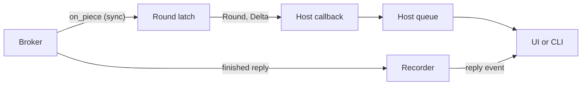

# Streaming a model reply to a Host: a callback on `InferenceBroker::chat`

- Report type: design proposal, with recommendations
- Written for: the project owner, who decides the open points; the authors of Hosts and brokers; and whoever migrates Workshop
- Code read: `runvil-harness` at `22a0992f3`, `runvil-workshop` at `f40a4fce1`, `runvil-design` at `82500eae7`, and `runvil-classroom` at `dd13113d6`, all on 2026-11-24; pull request 73 at head `849fc85` on base `6df50ab`; issue 72
- Libraries read: six, on 2026-11-24, at the versions listed in the references
- Status: nothing here is built; every count comes from reading code

## Executive summary

**Background.** The design question is how a Host application receives a model's reply piece by piece while the reply is still forming. Runvil runs prompts, which are Markdown files that hold text for a model plus Lua code. The Harness is the part that performs each step a prompt needs, including each model request. A Host is an application that runs prompts through the Harness, such as Workshop, Runvil's desktop app. The Host supplies a broker, the object that sends each model request to a model and returns the reply. The Gateway is Runvil's server that forwards such a request to a model vendor.

**Recommendation.** Put streaming on the `InferenceBroker` trait. Its method `chat` takes an optional callback, `on_piece`, which the broker calls once for each piece of the reply as the model produces it, and the trait gains a required method, `supports_streaming()`, which reports whether the broker streams. A Host turns streaming on for one run with `RunSetup::streaming(callback)`. `RunSetup` is the struct the Host builds for each run, and the new setter joins the setters for that run's limits, arguments, and model. The Harness passes `on_piece` to the broker only for a prompt section's own model rounds, because only the finished reply of a nested `models.infer` round is used, and it wraps the Host's callback in a latch for each round. The latch is a flag that closes when the Host's callback returns `ControlFlow::Break` and keeps the Harness from calling the callback again for the rest of that round. The Host keeps its own queue behind the callback, so it chooses how much to buffer. Confidence: high that the callback belongs on `chat`, because the Harness already dispatches every model round through that one method; medium-high on the latch, because the latch rule follows from the Harness polling a whole run inside one future but nothing is built.

**Streaming works today through one method on `GatewayBroker`.** The trait says the Harness takes only the finished reply, and a broker "that shows the reply as it forms streams it on its own." The one way to stream is `GatewayBroker::chat_streaming`, a method of `GatewayBroker` itself and not of the trait. A Host that holds the broker only as `Arc<dyn InferenceBroker>`, the type `RunSetup` stores, cannot call it. Workshop wraps the Gateway broker in a per-run `RunBroker` to call it, and the `runvil` facade's own tests contain a second copy of the wrapper. Pull request 73, an open change to the Gateway client that fixes issue 72, attaches a channel sender to the broker, and every clone of the broker shares that sender.

- **The setting belongs on `RunSetup`.** A callback set there is scoped to one run, because the Host's launch code builds one `RunSetup` for each run and every optional field has a setter of its own name. Round ids count from 0 within a run, so two runs that share one sender produce pieces that cannot be told apart.
- **A slow Host must never block the run.** The Harness polls every effect of a run inside one future and starts no task. A callback that waited for the Host would stall tool calls, timers, and cancel handling, so the callback the Harness gives to the broker returns at once.
- **Libraries disagree about a slow consumer.** Of the six libraries read (LangChain, the OpenAI Agents SDK, the Vercel AI SDK, async-openai, genai, and rig), a slow consumer makes LangChain's callbacks, the Vercel AI SDK, genai's stream, and rig's bounded queue of 32 run events block the producer. A queue grows without limit in the OpenAI Agents SDK, async-openai, and LangChain's event stream, and genai's channel sink drops pieces and counts the drops. The design's fourth behavior is to stop one response at a prefix and leave the rest to the finished reply.
- **The finished reply fills in whatever the Host did not receive.** The broker still returns the whole `Completion`, and the Harness still records it as an `assistant_reply` event. A Host that stopped receiving pieces replaces its partial text with that reply, or prints the missing tail.
- **Replay and reload leave streaming idle.** A reattach replays the durable log, which records only durable events. A reload would re-run an agent from its recorded history, and the code for that, the run-replay driver, is still to be built and feeds recorded answers to the run without calling the broker. To turn streaming off for rounds that the model answers live, a Host returns `Break` at the first piece of each round.
- **The change breaks every `InferenceBroker` implementation once.** Fifteen implementations in 13 files, in `runvil-harness`, `runvil-workshop`, and `runvil-classroom`, gain a parameter and a method. The `runvil-classroom` repository holds student programs that implement the trait. Four decision pages in `runvil-design` change: two quote the rule that the Harness knows nothing about streaming, one describes `RunBroker`, and one describes test brokers. Workshop deletes `RunBroker`, whose job the Harness takes over, and adds a per-round sequence number, `seq`, to `agent_delta`, so that the browser, the last step from broker to reader, can detect a gap in a round's pieces and stop appending.

**Evidence.** The code was read at pinned commits and six libraries at pinned versions, all on 2026-11-24. Nothing is built, so the latch rule and the sequence number are untested. The growth of async-openai's channel and of a Vercel AI SDK stream-splitting buffer is inferred from their types.

**Open decisions for the project owner.**

- Whether to approve this recommendation. It gives the Harness's public API a streaming callback, which changes the rule, recorded on two decision pages, that the Harness knows nothing about streaming.
- Whether `supports_streaming` is required, as proposed, so that every broker author must answer it, or defaulted, so that existing brokers keep compiling.
- Whether to rework pull request 73 and issue 72 to match this design, or merge the pull request as a stopgap.
- Whether the Harness crate ships a ready-made queue for Hosts that want one.
- When Workshop adds the sequence number.

## Contents

- Terms used throughout
- 1. Today the Harness takes only the finished reply
- 2. The interface has to work for authors outside the project
- 3. A callback on `chat` beats the alternatives
- 4. Libraries block, buffer, or drop when the consumer is slow
- 5. The interface and the prefix rule
- 6. What a Host sees in six cases
- 7. The change touches every broker and four decision pages
- 8. The work splits into four jobs
- 9. Limits and open decisions
- References
- Appendix A. New acceptance criteria for issue 72
- Appendix B. Tests for the prefix rule

## Terms used throughout

Each term has one meaning.

**Parts of Runvil**

- **Runvil:** a Rust project that runs prompts, which are Markdown files that hold text for a model plus Lua code for the logic.
- **Engine:** the part that executes a prompt as a state machine. It makes no network calls. It returns effects, such as a model round, for its caller to perform.
- **Effect:** one piece of outside work that the Engine asks for, such as a model round, a tool call, or a timer. The caller performs it and returns the answer.
- **Harness:** the part that steps the Engine and performs each effect it returns. Its effect loop, in the runner crate, does this work, and it runs one future for each run and starts no task.
- **Performer and `Dropped`:** a performer is the code that performs one kind of effect, such as a broker for a model round. If a performer panics or its effect is abandoned, the Harness answers the effect `Dropped`.
- **Host:** an application that runs prompts through the Harness. Workshop is one. A command-line tool is another, and so is a program that someone outside the project writes. A headless Host runs unattended, such as a batch runner.
- **Broker:** the Host's object that answers the Harness's model rounds, as the `InferenceBroker` trait defines. `GatewayBroker` is the standard one.
- **Gateway:** Runvil's server. It forwards each model request to a vendor or to a local model.
- **Gateway client:** the crate `harness-gateway-client`, the Rust library that sends each model request to the Gateway. Its HTTP client is `GatewayChat`, and it includes `GatewayBroker`.
- **`runvil-classroom`:** the repository for Runvil's course, with lesson plans and student programs, some of which are Hosts.
- **Facade:** the `runvil` crate, which re-exports the Engine and Harness names that a Host uses.
- **Workshop:** Runvil's desktop app. Its agent window shows a reply as it forms.
- **Harness adapter:** a small crate that a research report of 2026-11-23 proposes inside the Harness to hold `GatewayBroker`, so that the Gateway client can become a standalone library.
- **Decision pages:** the pages in `runvil-design/decisions` that record how each part of Runvil is designed and why the project owner approved it.
- **Pull request 73 and issue 72:** an open change to the Gateway client in the `runvil-harness` repository, and the issue it fixes. The issue proposes `GatewayBroker::with_streaming(tx)`, and the pull request implements it.

**Names in the code**

- **`InferenceBroker` and `chat`:** the trait a broker implements, and its method that runs one model round and returns the finished reply. `supports_streaming()` is the new method in the design.
- **`chat_streaming` and `with_streaming`:** `GatewayBroker`'s existing method that runs a round and passes each piece to a callback, and the method that pull request 73 adds in its place. Both call the private helper `GatewayBroker::round`, which runs one round and passes each piece to a closure.
- **Compile break:** a change that stops existing code from compiling until it is updated.
- **`RunSetup`:** the struct the Host's launch code builds for each run. It holds the recorder, the broker, a timer, and per-run settings such as limits and arguments, and each optional setting has a setter named after it.
- **`on_piece` and `PieceSink`:** the new optional callback on `chat`, and its type, `Arc<dyn Fn(Delta) + Send + Sync>`. The broker calls it once for each piece.
- **Host callback and `HostSink`:** the function a Host passes to `RunSetup::streaming`, and its type, `Arc<dyn Fn(Round, Delta) -> ControlFlow<()> + Send + Sync>`. It receives each piece with its round and answers with the standard `ControlFlow` values, written `Continue` and `Break` below. `Break` means stop delivering pieces for the rest of this round.
- **`RunControl`:** the handle a Host uses to steer a running run. Its `send` delivers a message, `stop_round` drops the effects in flight, and `cancel` ends the run.
- **`StreamDelta` and `Delta`:** the Gateway client's type for a piece, and the new Harness type. Both have `Text` and `Reasoning` variants.
- **`WorkshopBroker` and `RunBroker`:** Workshop's two brokers. `WorkshopBroker` sends each round to the Gateway that Workshop is connected to at that moment. `RunBroker` wraps it for one run and streams that run's pieces into the run's conversation.
- **`publish_delta`:** the `Conversation` method that puts one piece on the conversation's delta broadcast.
- **`PieceQueue`:** an optional ready-made queue, a `Mutex<VecDeque>` with a waker, that the Harness crate could ship for Hosts that want one.
- **`seq`:** the per-round sequence number this design proposes to add to `agent_delta`.
- **Pending item:** the browser's in-progress reply or thought, built from deltas and replaced when the matching durable event arrives.

**Words this design uses**

- **Round:** one model request and its reply. `Round` is the Engine struct that holds a round's id and origin. Ids count from 0 within a run. The origin is `Chat` for a prompt section's own round, run by the Lua call `models.loop`, and `Infer` for a nested call to `models.infer`.
- **Piece:** one live fragment of a reply, either answer text or reasoning text. The code also calls a piece a delta.
- **Finished reply:** the complete `Completion` that a round returns. The Harness records it as an `assistant_reply` event.
- **Recorder:** the Host's store for a run's history. It receives each finished reply and never a piece.
- **Latch:** a flag the Harness keeps for one round. It starts open, closes when the Host asks to stop, and stays closed until the round ends.
- **Prefix:** an unbroken run of pieces from the start of a reply, in order.
- **Pulled stream:** a stream that the consumer polls for the next item, such as a Rust `Stream` or an async iterator.
- **Wire:** the JSON messages that Workshop's server and its browser exchange over a socket.
- **Conversation:** Workshop's in-memory object for one launched agent. It holds the transcript and the broadcast channels that the browser socket reads.
- **`agent_delta` and `agent_event`:** Workshop's two kinds of message to the browser. A delta is an ephemeral piece. An event is a durable entry of the conversation's log, numbered from 0, which the server keeps and replays on reattach. The event kinds include `agent_message` for a finished reply and `agent_thought` for finished reasoning. Each delta and each model-round event holds the round's `reply` id, which lets the browser match a delta to the event that replaces it.
- **Reattach, replay, and reload:** when a browser socket reconnects, the server sends the conversation's log again from index 0. A run replay, still to be built, re-executes a recorded run from its recorded answers and compares the results with the record. A reload would use that replay to bring an agent back from its recorded history.

## 1. Today the Harness takes only the finished reply

The trait's doc comments say what the Harness expects. `InferenceBroker::chat` "Runs one model round and returns the finished reply", and its doc comment adds: "The Harness takes only the finished reply. A broker that shows the reply as it forms streams it on its own." [1] The effect loop calls `broker.chat` in one place, where it dispatches an `Effect::Chat` (`effect_loop.rs`, lines 575 to 589) [1]. The trait also tells brokers not to block, because the Harness polls each round inside the run's own future (`performers.rs`, lines 44 to 77) [1].

A round's identity is a small `Copy` struct, `Round`, that holds an id and an origin. Ids number the run's rounds from 0 in dispatch order, and `Chat` rounds and nested `Infer` rounds share one sequence. The origin's doc comment says a `Chat` round is the kind "whose live deltas the caller can stream", and an `Infer` round is one "where only the completed reply is consumed" (`effect.rs`, lines 69 to 85) [1]. The Engine marks each round `Chat` or `Infer`, so the Harness can already tell which rounds a Host may want to stream.

The Gateway client already produces pieces. Its HTTP client, `GatewayChat`, has a method `complete` that takes `on_delta: impl Fn(StreamDelta)` and calls it for each piece it decodes. `StreamDelta` is a `#[non_exhaustive]` enum with `Text` and `Reasoning` variants (`transport.rs`, line 259; `wire/delta.rs`, lines 12 to 20) [1]. `GatewayBroker::chat_streaming` passes a Host's `Arc<dyn Fn(StreamDelta) + Send + Sync>` to `complete`. `chat_streaming` names that parameter `on_piece`, the name that the new callback on `chat` reuses, and its doc comment says the callback "is called inline as each piece is read, so it must not block." The trait method, `GatewayBroker::chat`, passes `|_| {}` and discards every piece (`broker.rs`, lines 78 to 96 and 126 to 135) [1].

Workshop reaches `chat_streaming` through `RunBroker`. The server builds one `RunBroker` for each run. For a `Chat` round it builds a closure that maps each `StreamDelta` to Workshop's `DeltaKind` (text or reasoning) and calls `Conversation::publish_delta(round.id, kind, content)`, and then it calls `chat_streaming` on the inner `WorkshopBroker`. For any other round it forwards `chat` unchanged (`agents/broker.rs`, lines 184 to 234) [2]. The `runvil` facade's tests hold a second copy of that wrapper pattern, a `Streaming` test broker that sends `(round id, piece)` to a channel for `Chat` rounds only (`tests/suite/host.rs`, lines 128 to 168) [1].

Issue 72 and pull request 73, both in the `runvil-harness` repository, ask to let `GatewayBroker` stream through the trait's `chat` method. The issue says that `GatewayBroker`'s `chat` "passes a no-op `on_piece` callback", and it proposes `GatewayBroker::with_streaming(tx)`, called before the broker goes to the Harness, so that streaming stays on the existing `chat` path "without changing the `InferenceBroker` trait." [5] The pull request implements that: `with_streaming` stores an unbounded `tokio` channel sender, `chat` sends `(StreamDelta, Round)` pairs for `Chat` rounds only, and `chat_streaming` is removed. At the head commit `849fc85` of the pull request's branch, the pull request is open, its 11 CI checks pass, the check from CodeRabbit, an automated review service, is neutral because the service reached its review limit, and the one review comment, a request for a test of the nested `Infer` case, is addressed in the last commit [5]. Workshop pins an earlier commit of `runvil-harness`, so the removal of `chat_streaming` does not yet affect it [2].

In Workshop, pieces go from the broker into a `Conversation`'s delta broadcast of 256 slots (`DELTA_CAPACITY`), which every attached socket and a status reporter read. The status reporter is a task that turns deltas into the status bar's activity light (`conversation.rs`, lines 37, 105, and 160; `status.rs`, lines 22 to 24) [2]. When a receiver lags, `forward_delta`, the server function that sends each delta to a socket, logs the skip and keeps sending (`socket.rs`, lines 172 to 193), so a slow browser shows text with a gap in it [2]. In the browser, `foldDelta` opens a pending item from the first piece it receives for a round and appends later pieces, and the durable `agent_message` event with the same `reply` id replaces the pending text (`agent-session.ts`, lines 583 to 620) [2]. The `agent_delta` frame's doc comment states the rule: deltas "may drop under lag; the completed-reply event is the repair path" (`wire.rs`, lines 373 to 386) [2].

A rule recorded on two decision pages conflicts with giving the Harness a streaming callback. The pages quote the project owner: "the engine, the harness would not know anything about streaming. only the host, through the inference broker. and for headless hosts, they dont need to stream at all" (`harness-and-host.md`, lines 178 to 182; `models-and-conversations.md`, lines 245 to 249) [3]. Under the design, the Engine stays free of streaming, and streaming stays off unless a Host turns it on. The part of the rule that covers the Harness changes: the Harness's public API gains the callback `on_piece`, which the Harness builds from the Host's own callback, set with `RunSetup::streaming`, and passes to the broker.

A research report of 2026-11-23 proposes a standalone Gateway client in its own repository, with `GatewayBroker` moving into a small Harness adapter, and it lists the shape of streaming as an open decision, proposed as "a callback for each piece" [6]. In the design, a callback for each piece also serves the boundary between the Harness and the broker, and the Gateway client's own `on_delta` callback stays as it is.

## 2. The interface has to work for authors outside the project

Hosts include command-line tools and programs written outside the project, and Host authors write their own brokers, so the interface has to work for people who never read Workshop's code. The Harness connects Hosts and brokers. The requirements below refer to the callback `on_piece` on `chat`, which a broker calls once for each piece of a reply, and to the setting `RunSetup::streaming`, which holds the Host's own callback and turns streaming on. Ten requirements follow from the Harness's role and from how the code is built.

- **Streaming is part of the broker interface.** Every broker, including one a stranger writes, can offer streaming, and a Host can use it through `Arc<dyn InferenceBroker>`, the form `RunSetup` stores.
- **A Host can ask whether a broker streams.** A Host that shows live text can call `supports_streaming()` and tell the person using it when the broker cannot stream.
- **A broker that cannot stream still works.** The callback for pieces is never called, and the Host still receives the finished reply.
- **Streaming is configured in one place.** The Host's calling code stays short: it finds the Gateway, builds a `GatewayBroker`, and sets every per-run option, streaming included, on `RunSetup`.
- **Pieces are scoped to one run.** Round ids repeat across runs, so pieces from two runs must never share a destination, such as one channel, that cannot tell them apart.
- **The Harness stays runtime-agnostic and transport-agnostic.** A transport is the network layer, such as HTTP. The module header of `harness.rs` says the Harness "starts no task and names no runtime", and the runner crate, the Harness crate that holds the effect loop, depends on `futures-util`, with `tokio` only as a dev-dependency (`harness.rs`, line 12; the runner crate's `Cargo.toml`, lines 14 and 41) [1]. The HTTP code is in the Gateway client, a separate crate.
- **The Engine stays unchanged.** It already tags each round `Chat` or `Infer`, which is all the Harness needs to choose the `Chat` rounds for streaming. A `Chat` round is the kind whose live pieces a Host can stream, and for an `Infer` round only the finished reply is used, by the Lua code that called `models.infer` (`effect.rs`, lines 80 to 83) [1].
- **A slow Host must not stall the run.** The Harness polls each round inside the run's one future, so a callback that blocks would also block tool calls, timers, and the handling of `RunControl::cancel`. The Host's callback therefore returns at once, and the Host buffers the pieces.
- **A Host never loses the reply.** The finished reply reaches the recorder as it does today, as an `assistant_reply` event, even after the Host's callback has returned `Break`.
- **A Host that lags still sees a prefix.** A Host lags when the queue it keeps behind its callback is full. The callback then returns `Break`, the later pieces of that round are not delivered, and the pieces it did receive are the first pieces of the reply, in order.

## 3. A callback on `chat` beats the alternatives

The chosen design has three parts. `chat` gains an optional callback, `on_piece`. `InferenceBroker` gains `supports_streaming()`. `RunSetup::streaming` turns streaming on for one run.

| Option | Scoped to one run | Reaches any broker | Harness API unchanged | Verdict |
|---|---|---|---|---|
| Sender on the broker (pull request 73) | Only with one broker per run | `GatewayBroker` only | Yes | Replaced by the chosen design |
| Per-run Host wrapper plus a Host-side trait | Yes | Yes, if each broker implements the trait | Yes | Workable; each Host rewrites it |
| Defaulted trait method for streaming | Yes | Yes | No | Fallback if a compile break is unwelcome |
| Callback parameter on `chat` | Yes | Yes | No | Chosen |
| Broker returns a stream | Yes | Yes | No | Rewrites every broker and the client |
| Task-local context | Yes | Only brokers that run on the task that polls the round | Yes | Hidden dependency |
| Recorder receives pieces | Yes | Yes | No | Pieces do not belong in the record |
| Queue owned by the Harness | Yes | Yes | No | A second queue in front of Workshop's broadcast |

*The ways to get pieces from a broker to a Host, and the verdict on each.*

**Sender on the broker.** The sender is part of the broker value. `GatewayBroker` derives `Clone`, and every clone shares the sender. Workshop caches one `GatewayBroker`, builds a new one only when the Gateway is replaced or relaunched, and shares the cached broker across conversations (`agents/broker.rs`, lines 39 to 46) [2][3]. A sender attached to the cached broker therefore mixes the pieces of different conversations, and `Round.id` cannot separate them, because two conversations both have a round 0. A Host that holds `Arc<dyn InferenceBroker>` cannot call `with_streaming` at all, because the method is not on the trait. The helper `GatewayBroker::round`, which both `chat_streaming` and the pull request's `chat` call, is what `GatewayBroker`'s `chat` calls in the chosen design too.

**Per-run Host wrapper.** This is what Workshop's `RunBroker` does today. It works and leaves the Harness unchanged. Each Host writes its own wrapper and its own check that a round is a `Chat` round, and a wrapper over an arbitrary broker needs a Host-side trait that every broker implements. The chosen design makes that trait the `InferenceBroker` trait itself.

**Defaulted trait method.** A second trait method, for example `chat_with_sink(.., sink)`, whose default implementation calls `chat` compiles for every existing implementation. The Harness then chooses between two methods, a broker can implement one and forget the other, and the Host cannot see which brokers stream. It is the fallback if the project decides that a compile break is unacceptable.

**Broker returns a stream.** A `chat` that returns a `Stream` of events that ends in the `Completion` is the most idiomatic async shape. The Harness would poll it, backpressure would be natural, and cancel would mean dropping the stream. It changes the return type of every broker, and the Gateway client's transport is callback-based (`on_delta: impl Fn(StreamDelta)`), so the client would need rewriting too.

**Task-local context.** The Harness could set a thread-local or task-local sink while it polls a round, and brokers could read it. That avoids a trait change. A broker that spawns a task loses the context, and no function signature shows that a broker depends on it.

**Recorder receives pieces.** The recorder is per run and already supplied by the Host. The decision page `harness-and-host.md` says the record "contains the finished reply, as an `assistant_reply` event, and omits the pieces". It also explains that a replay compares the stored payloads with the results of a second run, so pieces do not belong in the record (lines 178 to 182 and 232) [3].

**Queue owned by the Harness.** The Harness would own a bounded queue and give the Host a reader, so every Host would get the same behavior when it lags. To avoid depending on a runtime such as `tokio`, the Harness crate would need its own queue and a way to wake the reader. Workshop already has a 256-slot broadcast that every attached socket reads, so a Harness queue would sit in front of it, need a Workshop task to move pieces from one queue to the other, and buffer every piece twice.

The callback parameter meets the ten requirements. Streaming is in the broker interface, because the Harness dispatches every round through `chat`. A required `supports_streaming()` answers the Host's question. A broker that never calls the callback stays valid. The setting is on `RunSetup`, and the Harness builds a new closure for each round, so the latch state belongs to that round alone. Confidence: high - the Harness already dispatches every model round through `chat`, and a compile break costs least while few brokers exist (15 implementations in `runvil-harness`, `runvil-workshop`, and `runvil-classroom` today, most of them test or placeholder brokers).

## 4. Libraries block, buffer, or drop when the consumer is slow

The survey covers six libraries, read at pinned versions on 2026-11-24 [8][9][10][11][12][13]. They include libraries that call back into the application and libraries that return a stream, in Python, JavaScript, and Rust, and they are a sample of the field. For each library, the survey records four things from its source and documentation: where the streaming hook, the place where application code asks for or receives live pieces, attaches; whether the consumer is a callback or a pulled stream; what a slow consumer does; and what happens with a model that cannot stream. The producer is the library code that reads the model's reply, and the consumer is the application code that receives the pieces. A cell that reads "Not verified" marks an answer that the survey could not confirm from the library's source or documentation.

| Library | Hook | Consumer | Slow consumer | Model that cannot stream |
|---|---|---|---|---|
| LangChain | Per call, inherited by a run | Inline callbacks plus a pulled iterator | Callbacks block; event stream grows without limit | One chunk from `invoke`; callback never called |
| OpenAI Agents SDK | Per call | Pulled async iterator | Queue grows without limit; producer never blocks | No streaming-support flag found; the SDK always streams |
| Vercel AI SDK | Per call | Awaited `onChunk` plus pulled streams | Producer blocks; a `tee` branch may buffer without limit | Opt-in middleware sends one chunk |
| async-openai | Per call | Pulled `Stream` | Unbounded channel on native Rust targets | Not verified |
| genai | Per call, or client default | Pulled stream plus optional sync sink | Stream stalls; channel sink drops and counts frames (pieces) | Not verified |
| rig | Per call, plus per-run hooks | Pulled stream plus async hooks | Bounded queue of 32 events; producer blocks | Not verified |

*How six libraries attach streaming, and what they do with a slow consumer and with a model that cannot stream.*

All six attach the hook to a call, and LangChain and rig also accept one for a whole run, the per-run level that `RunSetup` gives Runvil. A callback called inline fits Runvil, because the broker's `chat` future is polled inside the run's future. A pulled stream would make the Harness read each piece and then forward it to the Host, a second step.

A slow consumer produces three behaviors: the producer blocks, a queue grows without limit, or pieces are dropped. The Vercel AI SDK documents the first with "The stream processing will pause until the callback promise is resolved." genai's documentation says "a slow sink stalls the stream." Pieces are dropped only in genai's `ChannelSink`, which drops a frame, genai's word for a piece, when its channel is full and counts the drops. Blocking cannot work for Runvil, because the callback runs inside the one future that also polls tool calls, timers, and cancel. An unbounded queue grows with the reply. Dropping leaves a gap in the middle of the text, which a reader sees as corrupted output until the finished reply replaces it.

A Host that lags should keep a prefix of the reply and receive the rest in the finished reply. The nearest behaviors come from three libraries, and in each the consumer decides what to keep. genai delivers the full text in its final `StreamEnd` event when its capture option, which keeps the full text, is on, so a consumer that lost frames still receives the whole text. rig lets a consumer drop the event stream while the run still resolves with the final response. The Vercel AI SDK's `consumeStream` drains the remaining output after a client disconnects. In this design the Host triggers the stop by returning `Break`. Its callback runs inline and returns at once, so it can always give that answer, and the finished reply replaces the missing text.

For a model that cannot stream, LangChain's default `stream` calls `invoke` and yields one chunk, so its `on_llm_new_token` callback is never called, and its `disable_streaming` setting forces the same fallback. The Vercel AI SDK simulates a single-chunk stream through opt-in middleware. For async-openai, genai, and rig the answer was not verified. A callback that is never called is the right behavior for Runvil, because the Harness then needs no special case for a broker that cannot stream, and LangChain ships it. The method `supports_streaming()` is new in the design: it lets a Host tell the person using it that nothing will stream.

## 5. The interface and the prefix rule



*How a piece and the finished reply reach the Host.*

### The trait gains `on_piece` and `supports_streaming`

```rust
pub type PieceSink = Arc<dyn Fn(Delta) + Send + Sync>;

#[derive(Debug, Clone, PartialEq, Eq)]
#[non_exhaustive]
pub enum Delta {
    Text(String),
    Reasoning(String),
}

pub trait InferenceBroker: Send + Sync {
    fn models(&self) -> BoxFuture<'static, Result<ModelCatalog, Error>>;

    /// True when this broker calls `on_piece` while a reply forms.
    fn supports_streaming(&self) -> bool;

    fn chat(
        &self,
        binding: ModelBinding,
        messages: Vec<Message>,
        tools: Vec<ToolSchema>,
        options: CompletionOptions,
        round: Round,
        on_piece: Option<PieceSink>,
    ) -> BoxFuture<'static, Result<Box<Completion>, Error>>;
}
```

- The broker calls `on_piece` synchronously, inline from its read loop, once for each piece, in the order the model produced them.
- The callback returns at once. A broker skips per-piece work when `on_piece` is `None`.
- The finished `Completion` still holds the whole reply, and `chat` returns it as it does today.
- `supports_streaming()` is a hint for Hosts. The Harness passes the callback whatever the answer, so a wrapper broker that forgets to forward the flag misleads a Host's display and affects nothing else. A required method makes every broker and every wrapper answer, because code that omits it does not compile, and Workshop's `WorkshopBroker` forwards both the callback and the flag to the `GatewayBroker` it wraps.
- `Delta` is `#[non_exhaustive]` and is defined in the Harness crate, so the Engine does not change and later variants, such as image parts, do not break callers. `GatewayBroker` maps the client's `StreamDelta` to `Delta` with a two-arm match. If the research report's plan moves `GatewayBroker` into a Harness adapter, the same mapping fits there [6].
- A callback that panics inside the broker's round future ends that round like a panic in a broker. The Harness catches the panic where it polls the future, answers the round's effect `Dropped`, and logs it (`effect_loop.rs`, lines 89 to 91) [1].

### `RunSetup::streaming` turns streaming on for one run

The doc comment on `RunSetup::new` says that each optional field has a method of its own name that sets it and returns the setup (`setup.rs`, lines 133 to 138) [1]. Streaming follows that pattern.

```rust
pub type HostSink = Arc<dyn Fn(Round, Delta) -> ControlFlow<()> + Send + Sync>;

impl RunSetup {
    /// Turns streaming on for the run. `sink` is called for each piece of a
    /// section's own model round, in order, and must not block.
    #[must_use]
    pub fn streaming(
        mut self,
        sink: impl Fn(Round, Delta) -> ControlFlow<()> + Send + Sync + 'static,
    ) -> RunSetup {
        self.streaming = Some(Arc::new(sink));
        self
    }
}
```

`std::ops::ControlFlow<()>` is the standard type for the answer "keep going" or "stop", so the design needs no new type for that answer. A Host's calling code looks like this:

```rust
// endpoint and key come from wherever the Host finds the Gateway
let broker = GatewayBroker::new(endpoint, key);
// recorder and timer are the run's other two services
let setup = RunSetup::new(recorder, broker, timer)
    .streaming(|round, delta| publish(round, delta)); // the Host's own publish returns Continue or Break
// host and prompt are the Host and the parsed prompt that Harness::new takes
let harness = Harness::new(host, prompt, setup);
```

### The Harness wraps the Host's callback in a latch for each round

```rust
// where the effect loop dispatches Effect::Chat; `self.streaming` is the
// Host's callback from RunSetup, and `round.origin` is Chat or Infer.
// An Infer round uses only the finished reply, so it gets None.
let on_piece = match (&self.streaming, round.origin) {
    (Some(host), ReplyOrigin::Chat) => Some(latched(Arc::clone(host), round)),
    _ => None,
};
let completion = broker.chat(binding, messages, tools, options, round, on_piece).await;

fn latched(host: HostSink, round: Round) -> PieceSink {
    let open = AtomicBool::new(true);
    Arc::new(move |delta| {
        if open.load(Ordering::Acquire) && host(round, delta).is_break() {
            open.store(false, Ordering::Release);
        }
    })
}
```

The callback type is `Fn`, so the closure cannot change a captured boolean, and the latch is an atomic flag. The Harness builds a new closure for each round, so every round starts open. Pieces arrive from one round's read loop, one at a time, so the atomic is uncontended.

### A Host sees a prefix, then the finished reply

- For each round, the Host receives an unbroken run of pieces from the start of the reply, in order. The run ends at the whole reply or at the piece after which the Host's callback returned `Break`.
- Text and reasoning stop at the same piece, because the latch belongs to the round.
- Streaming never resumes inside a round, because resuming would leave a gap in the middle of the text. The callback receives the next round's first piece.
- A Host learns that a round ended normally from its recorder, which receives the finished reply as an `assistant_reply` event.
- A graphical Host replaces its prefix with the finished reply. A terminal Host prints `reply[received..]`, where `reply` is the answer text of the finished reply and `received` is the number of bytes of answer text it already printed. Pieces are whole strings, so the cut falls on a character boundary.
- A cancelled or failed round ends without a finished reply, so a Host drops its prefix when the `RunReport` that `Harness::run` returns, or its recorder, shows the cancel or the error. Workshop drops it today at the next message from the person using the agent window, or once a later round settles, that is, once that round's finished event arrives (`agent-session.ts`, lines 8 to 11) [2].

### The Host owns the queue

Workshop's callback calls `Conversation::publish_delta`, which feeds the 256-slot broadcast that every attached socket and the status reporter read [2]. The status reporter is the task that turns deltas into the status bar's activity light. A broadcast `send` never reports a slow receiver, so Workshop's callback gets no such signal and always returns `Continue`, and lag is handled on the last hop, the step from Workshop's server to the browser. A command-line Host with a bounded channel returns `Break` when `try_send` reports the channel full. Each Host chooses its capacity, its fan-out, and what "full" means. The Harness crate could ship a small `PieceQueue`, a `Mutex<VecDeque>` with a waker, for Hosts that want a ready-made queue, and the design does not depend on it.

### Workshop's last hop needs a sequence number

On the last hop, two behaviors break the prefix today. A browser that attaches in the middle of a round opens a pending item from the first piece it receives, so its text starts partway through the reply. A browser whose receiver lags loses pieces, and `forward_delta`, the server function that sends each delta to a socket, keeps sending the later ones, so its text has a gap (`agent-session.ts`, lines 583 to 620; `socket.rs`, lines 172 to 193) [2].

The fix is a `seq` field on `agent_delta`, a counter for each round that starts at 0 and is assigned by `Conversation::publish_delta`. The browser remembers the next `seq` it expects for each round. A piece with the expected value is appended. A piece with any other value, or a first-seen piece whose `seq` is above 0, marks the rest of that round's pieces as ignored until the durable event replaces the pending text. Every browser attached to a conversation then sees a prefix whatever its lag, and only the browser tracks which `seq` it expects. Three places change: `AgentDeltaFrame` in `wire.rs` (lines 388 to 398), `AgentDeltaFrame` in `protocol.ts` (lines 247 to 252), and `foldDelta`, the browser function that folds each delta into the transcript [2]. Confidence: medium - the sequence-number rule follows from reading those three places, and nothing was run.

### Replay and reload leave streaming idle

- **Reattach.** The socket subscribes to deltas when it attaches and then sends the durable log from index 0 (`socket.rs`, lines 406 to 441) [2]. The log holds only durable events, so a reattach replays no pieces, and deltas flow only for rounds that are live. Under this design the callback exists only for live rounds.
- **Run replay and reload.** A reload would re-run an agent from its recorded history. The driver that re-executes a recorded run is still to be built (`harness-and-host.md`, lines 16, 36, and 284; the Workshop plan `2026-11-08-3-run-inbox-fixes.plan.md` lists "A replay driver for run logs" as out of scope) [3][4]. As the decision page describes it, the driver passes recorded answers to `Run::resume`, the Engine call that returns an effect's answer to the run, in their recorded order, without the effect loop's broker call. No round reaches a broker, so the callback is never built and nothing needs turning off. If the driver later switches a replayed run to live execution, the first live `Chat` round dispatches with the callback when the run's setup has one.
- **Streaming held off for live rounds.** To turn streaming off for a while, a Host returns `Break` at the first piece of each round and discards that piece. That closes the round's latch, and the finished reply arrives as usual. The Host stops returning `Break` when it wants streaming back, and streaming resumes at the next round.

A replay does cost work today, but that work is in the browser on a reattach and comes from rendering. `AgentSessionService`, the browser's session model, fires a transcript change for each event (`agent-session.ts`, line 574), and the view responds by rebuilding the whole transcript model (`agent-session-view.ts`, lines 154 and 263 to 269) [2]. A long log therefore costs work proportional to its length for each event. A marker frame sent after the last replayed event, to tell the browser it has caught up, with rendering batched until the marker arrives, would fix it. That is a separate change, and the cost was not measured.

## 6. What a Host sees in six cases

**A full stream.** The Host sets `streaming` on `RunSetup`. The effect loop dispatches a `Chat` round, builds a closure that holds a fresh latch, and passes the closure to `chat` as `on_piece`. `GatewayBroker` maps each `StreamDelta` to a `Delta` and calls the closure, which calls the Host's callback. Workshop's callback publishes to the `Conversation` broadcast and returns `Continue`. The socket frames an `agent_delta` with the round's `reply` id and its `seq`, and the browser appends the text to its pending item. When the round ends, the Harness records the `assistant_reply` event, Workshop frames it as an `agent_message` event with the same `reply` id, and the browser replaces the pending text with the finished reply.

**A stalled Host.** A command-line Host's callback calls `try_send` on a channel of 64 pieces, and its reader has stopped. Once 64 pieces fill the channel, the next `try_send` fails and the callback returns `Break`, so the latch closes. The broker keeps reading and calling the closure, which now returns after one atomic load of the latch. The round ends, the finished reply reaches the recorder, and the Host prints the rest of the answer text, `reply[received..]`. The next round's latch starts open, and the Host receives that round's pieces again if its reader has resumed.

**A nested `Infer` round.** A prompt calls `models.infer` inside a section. The round's origin is `Infer`, so the Harness passes `None` as `on_piece`. The broker skips per-piece work, and the Host sees the reply only when the round finishes.

**A cancelled, stopped, or withdrawn round.** A Host calls `RunControl::cancel` to end the run, and every effect in flight is answered `Dropped`. It calls `RunControl::stop_round` to drop the effects in flight the same way and let the run go on. It calls `RunControl::send` to deliver a message, and a message that arrives while a round is waiting for its answer withdraws the round, meaning that the run abandons it. The run then reissues the round with the message appended (`harness.rs`, lines 292 to 336) [1], under a new id (`wire.rs`, lines 373 to 386) [2]. In each case the round ends without a finished reply, and the Host holds the prefix of the reply that it already received. Workshop's browser keeps the pending text until the next message or until a later round settles, meaning that round's finished event arrives [2].

**A broker that cannot stream.** `supports_streaming()` returns false and the broker ignores `on_piece`. A Host that called `supports_streaming()` shows nothing live, and a Host that did not call it receives no pieces. Workshop's window shows the whole reply when the `agent_message` event arrives, because the browser's event handler adds the finished reply to the transcript whether or not a pending item exists (`agent-session.ts`, lines 503 to 517) [2].

**A reload.** Once the run-replay driver exists, a Host can replay a recorded run and then continue it. The replayed rounds never reach the broker. The first round that the model answers live dispatches with the callback, and the callback starts receiving pieces. To skip streaming for that round, a Host returns `Break` at the round's first piece. On a reattach, Workshop's server replays durable events only, so pieces start with the next round that the model answers live.

## 7. The change touches every broker and four decision pages

The new `on_piece` parameter and the new `supports_streaming` method are a compile break: each existing `InferenceBroker` implementation needs one update before it compiles again, except `RunBroker`, which is deleted. A search of the local copies of `runvil-harness`, `runvil-workshop`, and `runvil-classroom` finds 15 `impl InferenceBroker` lines in 13 files [1][2][7].

| Repository | Where | What changes |
|---|---|---|
| `runvil-harness` | Trait, `RunSetup`, effect loop | Add `Delta`, `PieceSink`, `streaming`, the latch |
| `runvil-harness` | Gateway client `broker.rs` (1 implementation) | Map `StreamDelta`; remove `chat_streaming` |
| `runvil-harness` | 8 test brokers and the built-in `OfflineBroker` (9 implementations, 8 files) | Add the parameter and the method |
| `runvil-workshop` | `agents/broker.rs` (2 implementations) | Adapt `WorkshopBroker`; delete `RunBroker` |
| `runvil-workshop` | `wire.rs`, `protocol.ts`, `agent-session.ts`, frame fixture | Add `seq` and the browser's check of it |
| `runvil-classroom` | 3 student programs, 3 implementations | Add the parameter and the method |

*What changes in each repository.*

The facade's public API snapshot, `crates/runvil/public-api.txt`, is a committed list of the crate's public names, and `cargo xtask api` compares it with the code in CI [1]. It changes with the new names and the trait signature. The Engine's snapshot, `crates/runvil-engine/public-api.txt`, is unchanged because `Delta` is defined in the Harness crate.

After the project owner accepts this design, four decision pages change. `harness-and-host.md` (lines 166 to 182) describes the trait and quotes the rule that the Harness knows nothing about streaming, which this design changes. `models-and-conversations.md` (lines 245 to 249) quotes the rule again. `workshop-app.md` (lines 25, 175, and 193) describes `RunBroker`. `testing-and-debugging.md` (line 77) says Harness tests supply a broker through the trait, which now takes the new parameter [3].

On the Workshop wire, a shared JSON file of example frames, `tests/fixtures/agent-frames.json`, and the tests on both sides pin each frame shape, so `seq` changes the fixture, the Rust frame tests, and the browser suite together (`wire.rs`, lines 39 to 42) [2].

Pull request 73 and issue 72 need rework. The pull request adds `with_streaming` and a channel sender. Under this design the pull request keeps its use of `GatewayBroker::round` and drops `with_streaming` and the sender. Its channel tests become tests that record the pieces the `on_piece` callback receives. Appendix A lists the acceptance criteria that replace the issue's. If the project wants Workshop to stream before the Harness change ships, merging the pull request as a stopgap would work, at the cost of a second, small migration for Workshop: first from `chat_streaming` to `with_streaming`, then to `RunSetup::streaming`.

## 8. The work splits into four jobs

The prefix rule is that a Host receives an unbroken run of pieces from the start of a reply, and the finished reply, which the Host receives through its recorder, supplies the rest. The sizes below are rough comparisons of effort, from reading the code alone. Confidence: medium - nothing is built.

1. **Harness (moderate).** Add `Delta`, `PieceSink`, `HostSink`, the `streaming` field and setter, the latch in the effect loop, and the trait change (`on_piece` and `supports_streaming`). Update the 9 other `InferenceBroker` implementations in `runvil-harness`. Regenerate the facade's `public-api.txt` snapshot, the committed list of its public names, and update the Harness crate's own docs.
2. **Gateway client (small).** `GatewayBroker::chat` maps `StreamDelta` to `Delta` and passes `on_piece` to `GatewayBroker::round`. `supports_streaming` returns true, and `chat_streaming` is removed. Pull request 73 deleted the test helper `recording()`, which records each piece a callback receives, and wrote channel tests instead. Under this design the helper returns as the test double that records pieces, and the nested `Infer` test asserts that the callback is never called, because an `Infer` round gets `None` for `on_piece`.
3. **Workshop (small to moderate).** Delete `RunBroker`. Set `RunSetup::streaming` in the Host's launch code so that the callback calls `publish_delta`. Adapt `WorkshopBroker` to the trait change. Add `seq` to the frame types in `wire.rs` and `protocol.ts`, to the frame fixture, and to `foldDelta`.
4. **Decision pages and the other Hosts (small).** Edit `harness-and-host.md`, `models-and-conversations.md`, `workshop-app.md`, and `testing-and-debugging.md` in `runvil-design`, update the three student programs in `runvil-classroom`, and rewrite issue 72.

Job 1 defines the types that jobs 2 and 3 use, and job 3 needs job 2 because `WorkshopBroker` wraps `GatewayBroker`. Job 4 can start once job 1 compiles. Two optional jobs can follow the four: the ready-made `PieceQueue` in the Harness crate, and batched rendering in the browser with the "caught up" marker. The tests in Appendix B pin the prefix rule.

## 9. Limits and open decisions

**Nothing was built or run.** Every count and every claim about behavior comes from reading code at the commits listed in the references. The trait change, the `RunSetup` setter, the latch, the `seq` field, and the ready-made queue are proposals, and the latch code is a sketch that was not compiled.

**Some claims are inferred.** The unbounded growth of async-openai's channel and of the buffer that the Vercel AI SDK's `tee` creates when it splits a stream in two follows from the channel and stream types, and neither was measured. In the library survey, the answer to what happens with a model that cannot stream reads "not verified" for async-openai, genai, and rig. The browser's cost of rendering a long log on reattach is a reading of the code and was not timed. The statement that a panic in the Host's callback ends the round follows from the Harness polling the round's future under `catch_unwind` (`effect_loop.rs`, lines 89 to 91), and no test ran it. The survey is a sample of six libraries: LangChain, the OpenAI Agents SDK, the Vercel AI SDK, async-openai, genai, and rig.

**Not checked.** Whether the fourteen agent programs that the research report of 2026-11-08 compares, such as Claude Code and OpenAI Codex, stream the same way; a survey of their streaming was not made [14]. The per-piece cost of the latch was not measured. It is one atomic load for each piece, plus the Host's callback while the latch is open.

**Where documents disagree, the project owner settles the point.**

- The rule recorded on two decision pages says the Harness "would not know anything about streaming". In the design, the Harness has a callback parameter and a setter, and the Engine stays unchanged.
- Issue 72 asks for streaming "without changing the `InferenceBroker` trait". In the design, the trait changes.
- The research report of 2026-11-23 proposes "a callback for each piece" for the standalone Gateway client's own interface. In the design, that client callback stays as it is, and a second callback, `on_piece`, is added at the Harness boundary.
- The decision pages describe `RunBroker` and `chat_streaming` as the Host's way to stream. In the design, `on_piece` and `RunSetup::streaming` replace both.

| Decision | Proposed answer | Who decides |
|---|---|---|
| The Harness's public API gains a streaming callback | Yes; the Engine is unchanged | Project owner |
| `supports_streaming` required or defaulted | Required, so every broker author must answer it | Project owner |
| Pull request 73 and issue 72 | Rework both; merge the pull request only as a stopgap | Project owner |
| A ready-made `PieceQueue` in the Harness crate | Later, optional | Project owner |
| `seq` on `agent_delta` | When Workshop moves to the new trait | Whoever migrates Workshop |
| Batched rendering for a long log on reattach | A separate change | Whoever migrates Workshop |
| A panic in the Host's callback ends the round | Yes, as a panic in a broker does today | Project owner |

*The open decisions and the answer proposed for each.*

Confidence in the proposed answers: medium - they follow from the code as read, and the project's priorities can change them.

## References

Each entry gives the source, the commit or version, and the kind of source. The bracketed numbers in the text point here.

1. `runvil-harness` at `22a0992f3`: `crates/harness-internal/runner/src/` (`performers.rs`, `effect_loop.rs`, `setup.rs`, `harness.rs`, `Cargo.toml`), `crates/runvil-internal/runtime/src/execute/run/effect.rs`, `crates/harness-gateway-client/src/` (`broker.rs`, `transport.rs`, `wire/delta.rs`), `crates/runvil/tests/suite/host.rs`, and the two `public-api.txt` snapshots. Code, read on 2026-11-24; not built.
2. `runvil-workshop` at `f40a4fce1`: `crates/workshop/server/src/agents/` (`broker.rs`, `socket.rs`, `wire.rs`, `status.rs`), `crates/workshop/agents/src/` (`conversation.rs`, `conversation-run.rs`), and `crates/workshop/ui/src/` (`services/agent-session.ts`, `services/protocol.ts`, `parts/agent/agent-session-view.ts`), plus the workspace `Cargo.toml` that pins `runvil-harness`. Code, read on 2026-11-24.
3. Decision pages in `runvil-design` at `82500eae7`: `harness-and-host.md`, `models-and-conversations.md`, `workshop-app.md`, `testing-and-debugging.md`, and `engine.md`. Design records that the project owner approved; their code facts are dated by their headers.
4. Workshop plans `plan/2026-11-08-2-run-inbox-user-pack.plan.md` and `plan/2026-11-08-3-run-inbox-fixes.plan.md` in `runvil-workshop` at `f40a4fce1`. Plans; the second lists a replay driver for run logs as out of scope.
5. Pull request 73, "Stream Gateway reply deltas through `InferenceBroker::chat`", and issue 72 of the same title, in `cppalliance/runvil-harness`. Head `849fc85`, base `6df50ab`; read through the GitHub API on 2026-11-24, with its check runs, Copilot's review thread, and CodeRabbit's comment.
6. `runvil-design/research/2026-11-23-gateway-client-new-repository.md`. A research report; it plans to move `GatewayBroker` into a Harness adapter and proposes a callback for each piece as the shape of streaming.
7. Student programs in `runvil-classroom` at `dd13113d6`: `students/parsons/verify-briefer.rs`, `students/kirill/runner/src/main.rs`, and `students/robles/host/src/main.rs`. Code, read.
8. LangChain: `langchain-core` 1.8.4 at commit `fb10639a73d980ce05ea8614a84deaf08d572550` (`language_models/chat_models.py`, `callbacks/manager.py`, `tracers/event_stream.py`, `tracers/memory_stream.py`), and `@langchain/core` 1.5.1 at commit `a22d0d0c4cb8ec345c2650e1a8aaec8a6a751f74`; documentation at https://docs.langchain.com/oss/python/langchain/models. Source and documentation, read on 2026-11-24.
9. OpenAI Agents SDK: `openai-agents` 0.26.0, tag `v0.26.0`, commit `0ad2d63a9371a23333a95ea6878141a826c9cdda` (`src/agents/result.py`, `run_loop.py`, `run.py`); documentation at https://openai.github.io/openai-agents-python/streaming/ and https://openai.github.io/openai-agents-python/results/. Source and documentation, read on 2026-11-24.
10. Vercel AI SDK: `ai` 7.0.181 at commit `8956ca55ed9c31b4b7680621a10ad0269f9629b1` (`packages/ai/src/generate-text/stream-text.ts`); documentation at https://ai-sdk.dev/docs/reference/ai-sdk-core/stream-text, https://ai-sdk.dev/docs/ai-sdk-core/generating-text, and https://ai-sdk.dev/docs/ai-sdk-ui/chatbot-message-persistence. Source and documentation, read on 2026-11-24.
11. async-openai 0.43.0, tag `async-openai-v0.43.0`, commit `e4daebb` (`async-openai/src/client.rs`, `chat.rs`). Source, read on 2026-11-24.
12. genai 0.7.5 at commit `2a8a5b39c96028d2143d8754ee2bba42a79e32c5` (`src/chat/chat_stream.rs`, `src/chat/frame_sink.rs`). Source, read on 2026-11-24.
13. rig-core 0.47.0 at commit `4d5fb5ea999f7ec082bd6416aa45d03368535351` (`crates/rig-core/src/streaming/mod.rs`, `crates/rig-agent/src/agent/hook.rs`); documentation at https://docs.rs/rig-agent/0.47.0/rig_agent/agent/struct.RunEvents.html. Source and documentation, read on 2026-11-24.
14. `runvil-design/research/2026-11-08-harness-survey-input-steering.md`, "How Agent Harnesses Handle User Input, Stop, Queues, and Subagent Steering". A research report that compares fourteen agent harnesses on messages, stops, and queues; it does not cover streaming.

## Appendix A. New acceptance criteria for issue 72

Issue 72's four criteria ask that `Chat` rounds send each piece on a channel as a `(StreamDelta, Round)` pair, that `Infer` rounds send nothing, that `chat` still returns the full reply when no sender is set or the receiver has closed, and that `chat_streaming` is removed and `with_streaming` documented. These six replace them.

- `InferenceBroker::chat` takes `on_piece: Option<PieceSink>`, and `InferenceBroker` has a required `supports_streaming()` method.
- With streaming set on `RunSetup`, the Harness passes `on_piece` to the broker for each `Chat` round and `None` for each `Infer` round.
- The Host's callback receives `(Round, Delta)` for each piece, in the order the reply arrives, for both text and reasoning.
- When the callback returns `ControlFlow::Break`, the Harness makes no further call to it for that round, and the first piece of the next round still reaches it.
- `GatewayBroker` returns true from `supports_streaming()`, maps `StreamDelta` to `Delta`, and returns the finished reply whether or not `on_piece` is set and whether or not the Host stopped early.
- `GatewayBroker::chat_streaming` is removed, and the Harness crate's docs describe `RunSetup::streaming`.

## Appendix B. Tests for the prefix rule

The prefix rule says that a Host receives an unbroken run of pieces from the start of a reply, and the finished reply, which the Host receives through its recorder, supplies the rest.

Harness tests, with a scripted broker that calls `on_piece` a known number of times:

- A callback that returns `Break` after k pieces receives the first k pieces in order, and the finished reply holds all of them.
- After a `Break` in one round, the first piece of the next round reaches the callback.
- A `Chat` round receives `Some` and an `Infer` round receives `None`.
- On a setup that leaves `streaming` unset, every round receives `None`.
- A broker whose `supports_streaming()` is false never calls the callback, and the run records the same events as a run without streaming.
- A callback that panics ends its round as `Dropped`, the answer for an abandoned effect, so the round gets no finished reply, and the run continues.
- A run with streaming on records the same events as the same run with streaming off.

Gateway client tests: pieces arrive in the order the mock reply sends them, reasoning first and then text; an `Infer` round never calls the callback; a callback that stopped early still leaves the whole finished reply.

Workshop tests: `seq` counts from 0 within each round. A gap in `seq`, meaning a piece whose `seq` skips a number, makes the browser ignore the rest of the round's pieces, so the pending item stops growing until the durable event arrives. A first-seen piece whose `seq` is above 0 is ignored. The durable event still replaces the pending item. The Rust tests and the browser tests read the same fixture file, `tests/fixtures/agent-frames.json`.

*2026-11-24 08:26 - Claude Sonnet 5.5*

