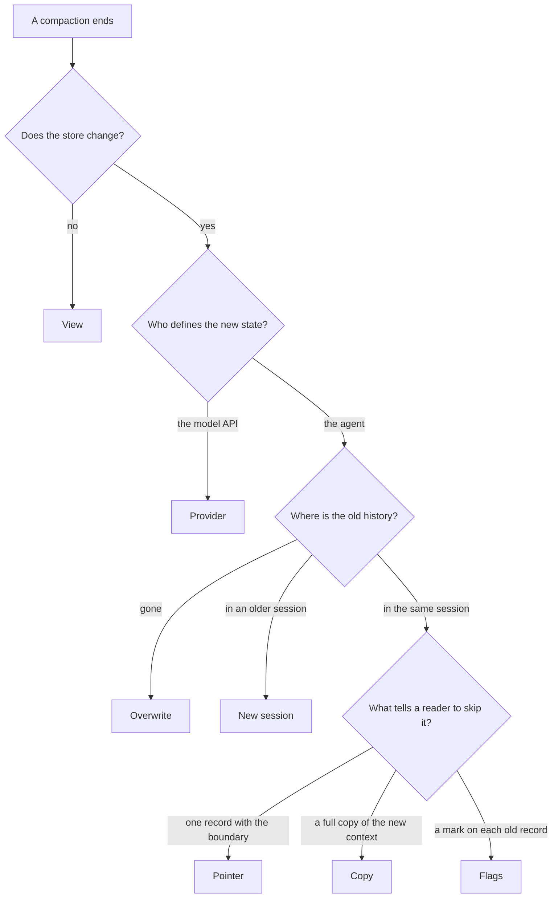

# How headless agents store conversation history after a compaction

*What 29 agents, agent frameworks, and model APIs write to their store when a conversation is compacted, explained three times, each time in more detail, as the code stands on 2026-11-26*

This report is for a reader who designs the run log of an agent runtime and wants to know what other projects write when a conversation is compacted.
*Headless* means that a program, not a person at a terminal, starts the agent, reads its events, and may resume it later from its store.
A *compaction* replaces a part of the conversation with a shorter text, the summary, so that the next request fits the model's context window.
After a compaction the store must answer three questions: where the old history is, what the next request holds, and how a later process rebuilds that request.

Read all of it as a snapshot.
The sources are public repositories at pinned commits, public docs, and, for the closed products, the published packages.
Section 16 lists each repository and its commit, and each product section links the lines that it reads.
No agent was run and no session file on a real machine was read: every statement about a format comes from the code that writes it or reads it.
A second reader checked each product section and each table row against the sources and corrected them.
A statement about a closed product names what it rests on: `(docs)`, `(SDK types)`, `(strings in the binary)`, `(changelog)`, or `(news post)`.
`(inferred)` marks a conclusion from code that no test and no run confirmed, and `(not verified)` marks a statement that no source settles.

## In one paragraph

The 29 products store a compacted conversation in seven ways, and most of them keep the old history.
Thirteen keep every old record as it was and add one record that says where the context now starts: pi, OpenClaw, Claude Code, opencode, Crush, OpenHands, Google ADK, Deep Agents, Letta, Copilot CLI, Amp, Factory Droid, and Zed.
Four write a full copy of the new context beside the old history: Codex, Cline, Gemini CLI, and Cursor.
Three mark each old record as hidden from the model: Goose, Hermes, and Roo Code.
Four overwrite the stored conversation, so that the old history is gone or stays only in an earlier snapshot: Amazon Q CLI, Continue CLI, the OpenAI Agents SDK, and LangChain.
The other five start a new session, store no compaction at all, or store an item whose meaning the model API defines.
Where a project says why it keeps the old history, the reasons are replay, evaluation, search, and undo, and the bug reports show the price: stores that grow without a limit, a rebuilt context that differs from the live one, and a boundary that names the wrong record.

## In five paragraphs

A compaction splits one thing into two: the history of the conversation, and the context that the model receives.
A store can keep both, keep only the context, or keep the history and compute the context again for each request.
The 29 products do this in seven ways, which this report names pointer, copy, flags, overwrite, new session, view, and provider.
Twenty of them keep the old history in the same store, which for Copilot CLI is not verified, and six of those also give the model a way to read it.

The pointer way is the most common.
The store keeps every old record as it was, and one new record holds the summary and the boundary.
The products differ in how they write the boundary down: pi, OpenClaw, and opencode name the first kept record by id, Claude Code lists the kept rows by UUID, OpenHands lists the forgotten events by id, Crush points the session row at the summary message, Google ADK gives an interval of timestamps, Deep Agents stores an index and a message id, and Zed stores nothing but the position of the summary item in the message list.
A rebuild reads the newest such record, and then the summary, the kept tail, and every later record make the context.
pi, opencode, Crush, Google ADK, Deep Agents, and Zed build the context of each live request with that same code, so no second piece of code can disagree with it.

The other ways trade the boundary for something else.
A copy needs no boundary: Codex appends a line that holds the whole new context, and Cline saves it in a second file beside an unchanged transcript.
The copy costs space, and one Codex session file of 732 MB held 337.8 MB of such lines.
Flags keep one list and mark each old record as hidden from the model, as Goose, Hermes, and Roo Code do.
An overwrite keeps only the context: Amazon Q CLI and Continue CLI rewrite one JSON document, the OpenAI Agents SDK deletes the rows that it replaces, and LangChain replaces the message list in the graph state.
Aider and SWE-agent store no compaction, one page of Kiro's docs describes a new session for each compaction, and the OpenAI and Anthropic APIs return an item that the client stores and sends back.

The bug reports repeat five failures.
The store grows without a limit, because nothing is deleted and copies add up.
The live context and a rebuilt one differ, because two pieces of code compute them.
The boundary names a record that is absent or that moved.
A failed or cut summary is stored as a good one, and no later request reads the old history again.
A cut leaves a tool result without its tool call, and the provider rejects the next request.
A headless program often sees none of this: `codex exec --json`, Gemini CLI's `stream-json`, `opencode run --format json`, Roo Code's CLI, and `crush run` print no event for a compaction.

Runvil's run log stores no message list.
It stores each model request as a delta: a `Chat` record names an earlier round in `after`, counts the equal leading messages in `keep`, and holds the rest.
So the old history stays in the earlier records, and the first request after a compaction holds the whole compacted list again, which is the copy way.
The log has no record that says that a compaction happened, and the decision pages list that record as planned work.
The closest relative is in Claude Code: its transcript stores each request as `base`, `keep`, and a `tail` of message hashes, with each message stored once under its hash.

## Section by section

Sections 1 to 6 compare the products, and section 7 reads Runvil's run log against them.
Sections 8 to 14 describe the products one at a time, grouped by the way in which each one stores a compaction.
The statements in sections 1 to 5 come from the product sections, which hold the links to the code.

### 1. The words and the seven ways

The products use many words for the same things: compaction, compression, condensation, summarization.
This report uses one word for each thing.

- **The context** is the list of messages that one model request carries.
- **The store** is what an agent writes to disk or to a database for one conversation.
- **The old history** is the part of the conversation that a compaction removes from the context.
- **The summary** is the text that stands for the old history.
- **The kept tail** is the newest part of the conversation, which a compaction leaves in the context word for word.
- **The boundary** is the place where the old history ends and the kept tail starts.
- **A rebuild** is what a later process does to make the context from the store, as in a resume.

A way is a rule for what a compaction does to the store.
Many products combine two ways, and the table puts each product under its main one.

| Way | What a compaction does to the store | How a rebuild finds the context | Products |
|---|---|---|---|
| Pointer | Adds one record with the summary and the boundary; the old records stay as they were | Reads the newest such record, then the kept tail, then the later records | [pi](#pi), [OpenClaw](#openclaw), [Claude Code](#claude-code-and-the-claude-agent-sdk), [opencode](#opencode), [Crush](#crush), [OpenHands](#openhands), [Google ADK](#google-adk), [Deep Agents](#deep-agents), [Letta](#letta), [Copilot CLI](#github-copilot-cli-and-the-copilot-sdk), [Amp](#amp), [Factory Droid](#factory-droid), [Zed](#zed-agent) |
| Copy | Writes one record or file that holds the whole new context; the old records stay | Loads the newest copy, then the later records | [Codex](#openai-codex-cli), [Cline](#cline), [Gemini CLI](#gemini-cli), [Cursor](#cursor-cli-and-the-cursor-sdk) |
| Flags | Marks each old record as hidden from the model, and adds the summary | Reads the records that are not hidden | [Goose](#goose), [Hermes](#hermes-agent), [Roo Code](#roo-code) |
| Overwrite | Replaces the stored conversation with the new context | Loads what the store holds | [Amazon Q CLI](#amazon-q-developer-cli), [Continue CLI](#continue-cli), [OpenAI Agents SDK](#openai-agents-sdk), [LangChain](#langchain-and-langgraph) |
| New session | Starts a session that holds the summary and links to the old one | Loads the new session | [Kiro CLI](#kiro-cli-and-others) (docs); earlier generations of Hermes, Amp, and Factory Droid |
| View | Nothing: the reduction runs for each request | Runs the reduction again | [Aider](#aider), [SWE-agent](#swe-agent) |
| Provider | Stores an item that the model API returned, as it is | Sends the item back | [OpenAI Responses API](#openai-responses-api), [Anthropic API](#anthropic-api) |

The second ways are these.
Hermes and Cline also copy: Hermes inserts the whole new context as new rows, and Cline's copy carries a count and a hash of the transcript prefix that it replaces.
Gemini CLI also points: a tombstone record names the ids that a reader must drop.
Codex and opencode can hold a provider item inside their own record.
LangChain's earlier checkpoints act as copies of the old history.
Claude Code can overwrite: an opt-in setting rewrites a large file without the old history.



A store that keeps the old history keeps it for a reader, and the products differ in who that reader is.

| Who can read the old history | Products |
|---|---|
| The model, through a tool or through a path that the summary names | OpenClaw, Claude Code, Deep Agents, Letta, Amp, Hermes |
| A person or a program, through a UI, an export, a search, or an API | pi, opencode, Crush, OpenHands, Google ADK, Copilot CLI, Zed, Codex, Cline, Goose, Roo Code |
| A reader of earlier checkpoints only | LangChain |
| Nobody: the store does not hold it | Amazon Q CLI, Continue CLI, OpenAI Agents SDK |

### 2. How the boundary is written down

The boundary is the one fact that a pointer record must hold.
The products encode it in many ways, and each encoding depends on something that can break.

| Encoding | Products | Field | What it depends on |
|---|---|---|---|
| Id of the first kept record | pi, OpenClaw, opencode | `firstKeptEntryId`, `metadata.keepID` | Ids that never change. A fork that copies records under new ids must remap the field, as opencode does |
| List of the kept records' ids | Claude Code | `compactMetadata.preservedMessages` | Every listed row is in the file. One report shows a list that names rows that were never written |
| Set of the forgotten records' ids, and an offset for the summary | OpenHands | `forgotten_event_ids`, `summary_offset` | The order of the fold: the offset is an index into the list that remains |
| Pointer from the session to the summary record | Crush | `sessions.summary_message_id` | An order of the rows. `created_at` has a resolution of one second, so the query can return rows from before the summary, and the caller cuts them by id |
| Interval of timestamps | Google ADK | `start_timestamp`, `end_timestamp` | Clock values as floats, with no ids, indices, or counts |
| Index of the first kept message, with its id | Deep Agents | `cutoff_index`, `cutoff_message_id` | The reader looks for the id first and falls back to the index |
| List of the ids in the context | Letta | `in_context_message_ids` | The list is rewritten whole, and a reader prunes it to the messages that it finds |
| Count and hash of the replaced prefix | Cline | `source_message_count`, `source_prefix_hash` | A stable serialization. A hash over fields that storage regenerates rejected every copy |
| Mark on each record | Goose, Hermes, Roo Code | `agentVisible`, `active` and `compacted`, `condenseParent` | Each code path that deletes or restores records must know the marks, and Goose's rewind does not |
| Tombstone of the removed ids | Gemini CLI | `$patch` with `removeIds` | A reader that applies the records in file order |
| Position in the log or the list | Codex, Copilot CLI, Zed, the model APIs | The `compacted` line, the `session.compaction_complete` event, the `Compaction` item in `messages`, the `compaction` item | A reader that scans back to the newest marker |
| None | Amazon Q CLI, Continue CLI, LangChain, OpenAI Agents SDK | None | Nothing: the store holds only the context |

The rule that places the boundary differs as much as its encoding.

| Product | The kept tail |
|---|---|
| pi | The newest entries up to `keepRecentTokens`, 20000 by default, cut at a point that keeps a tool result with its tool call |
| opencode | The newest messages within 15,000 tokens, which the model receives as text inside the summary message, not as messages |
| Cline | The newest messages up to `preserveRecentTokens`, 20,000 by default, cut at an assistant message or a typed user turn |
| Codex | Pinned items and the newest user messages, up to 20,000 tokens; a remote compaction also keeps some inter-agent messages, up to 64,000 tokens |
| Zed | The newest user messages before the summary item, up to 80,000 bytes, with the message that crosses the limit cut to fit; computed for each request and not stored |
| Gemini CLI | The turns from the first user turn that is not a tool response, once 70 percent of the characters lie before it |
| Aider | The newest messages, up to half of the token limit |
| Google ADK | The last `event_retention_size` raw events, in token-threshold mode |
| Kiro CLI | The larger of 2 message pairs and 2 percent of the context window (docs) |
| Copilot CLI | The pending input of the turn and the messages that arrive during the compaction (SDK types, docs) |
| Crush, Goose, Roo Code, Continue CLI, and Amazon Q CLI by default | None: the context starts at the summary |

### 3. Reductions that are not summaries

A compaction is not the only thing that makes the context smaller.
Most agents also cut, clear, or replace old tool results, and the question for the store is the same: is the reduction a stored fact, or does a reader compute it again for each request?

| Product | Reduction | Stored, or computed for each request |
|---|---|---|
| pi | `context_edit` omits or replaces one entry's content | Persisted, as an append-only entry |
| OpenClaw | Pruning of old tool results | Persisted, as hidden `openclaw.cache-ttl` snapshot and delta entries |
| Claude Code and Agent SDK | Oversized tool results replaced; old tool results cleared | First persisted in `content-replacement` rows; second's persistence not verified |
| opencode | Kept tail as text, tool results cut to 1,250 characters | For each read, from the stored rows |
| OpenHands | Tool output truncation, and a 50,000-character cap on tool messages | First persisted in the event, second for each request |
| Google ADK | `ContextFilterPlugin` keeps the last N invocations | For each request, on the request contents only |
| Deep Agents | Old `write_file` and `edit_file` arguments cut to 20 characters | For each request, not persisted |
| Letta (`letta-code`) | Oversized tool results clipped, orphan tool results removed | In memory at each load; only the id list persists |
| Copilot CLI and SDK | `session.truncation` of old messages; large tool output saved to file | Persisted: a counts-only event; truncated `content` on the result event |
| Factory Droid | Long tool results are cut, with a notice (changelog) | Not documented |
| Zed | Terminal tool output capped at 16 KiB by default | Persisted, in the stored tool result |
| Codex CLI | Tool-output truncation in the live context | Not persisted, rollout keeps full payload and the limit |
| Cline | Caps on tool results and file content; stale reads replaced | For each request by `MessageBuilder`; nothing persisted |
| Gemini CLI | Tool output masking; old function responses collapsed to 2 KB | Persisted as `$patch` `updates`; masked output saved to a file |
| Cursor CLI and SDK | Fallback: a trimmed copy of the transcript | Persisted, in place of the summary |
| Goose | Tool pair summarization, off by default; large results to files | Persisted: pair rows flagged, description row added, pointer text stored |
| Hermes Agent | Pruning of tool results between compactions | Persisted: rows rewritten in place, with archived twins |
| Roo Code | Sliding-window truncation hides 50 % of visible messages | Persisted as `truncationParent` tags plus one marker message |
| Amazon Q Developer CLI | Sliding window drains oldest entries; truncation in the summary request | Window persisted at next save; truncation not persisted |
| Continue CLI | Summary request prunes messages from the end | Not persisted; pruned messages are in neither summary nor store |
| Agents SDK (Python) | `ToolOutputTrimmer` replaces old large tool outputs with previews | For each request, before the model call |
| LangChain on LangGraph | `ClearToolUsesEdit` replaces old tool results with a placeholder | For each request, on a deep copy |
| Aider | Oversized head cut before the summarizer reads it | In memory; cut messages reach neither summary nor kept tail |
| SWE-agent | `LastNObservations` replaces old observations with a one-line placeholder | For each query; each step's `query` records the result |
| Responses API | `truncation: "auto"` drops items from the start of the conversation | For each request, on the server (SDK types) |
| Anthropic API | Context editing clears old tool results and thinking | For each request, on the server; client history whole |

Three reports tie a reduction, or the compaction request itself, to the provider's prompt cache.

- **SWE-agent.** Eliding old observations changes every query and breaks prompt caching, by the processor's own docstring ([`history_processors.py#L106-L111`](https://github.com/SWE-agent/SWE-agent/blob/3ea751c087f32b16e039a2233dd6eefecef325d5/sweagent/agent/history_processors.py#L106-L111)).
- **Goose.** Tool pair summarization invalidates most of the prompt cache, and it is now off by default ([issue 11764](https://github.com/aaif-goose/goose/issues/11764), closed).
- **Zed.** The compaction request dropped the tool definitions, so a provider billed the whole context as input with no cache hit ([issue #59528](https://github.com/zed-industries/zed/issues/59528), closed by [PR #64938](https://github.com/zed-industries/zed/pull/64938), merged 2026-11-04).

### 4. What a headless program sees

A program that drives an agent wants two things from a compaction: an event that says that it happened, and a way to control it.
The table lists the events, their fields, and the hook or the replacement point of each product.

| Product | Events | Fields | Hook or replacement |
|---|---|---|---|
| pi | `compaction_start`, `compaction_end` | `reason`, `result`, `aborted`, `willRetry`, `errorMessage` | `session_before_compact` cancels or replaces |
| OpenClaw | `compaction` on the gateway stream; inner `compaction_start`, `compaction_end` | `phase`, `itemId`, `completed`, `willRetry`, `outcome` | `before_compaction`, `after_compaction` observe; `registerCompactionProvider()` replaces (docs) |
| Claude Code and Agent SDK | `system/status`, `system/compact_boundary` | `trigger`, `pre_tokens`, `post_tokens`, `duration_ms`, `preserved_messages`; no summary text | `PreCompact` steers or blocks; `PostCompact` reads the summary; a hook's answer can replace the compaction (strings in the binary, not in the docs) |
| opencode | `session.compaction.started`, `session.compaction.delta`, `session.compaction.ended`, `session.compaction.failed`; none in `opencode run --format json` | `sessionID`, `reason`, `text`, `model`, `native`, `cost`, `tokens`, `error`, `inputID` | Session hook `compaction` can replace it |
| Crush | none in `crush run`; a message event in process and, in client/server mode, on the server's SSE stream | `IsSummaryMessage = true`; no token counts | `PreCompact` can block; none can replace |
| OpenHands | `Condensation`, `CondensationRequest` | Forgotten ids, summary, offset, response id; no reason, no token counts | Replace the condenser class; no hook |
| Google ADK | none in the run stream | Session event with `actions.compaction`; OpenTelemetry span `compact_events {trigger}` | `EventsCompactionConfig.summarizer` replaces the summarizer |
| Deep Agents | `summarization_started` in `dcode`; a state update in the SDK | `_summarization_event` in the update; token counts only in `OffloadResult` | `PreCompact` hook can block |
| Letta (`letta-code`) | `event_message`, `summary_message` | `event_type`, `event_data.trigger`, `summary`, `compaction_stats` | `PreCompact` hook; `compaction_settings`; `conversation_compact` command |
| Copilot CLI and SDK | `session.compaction_start`, `session.compaction_summarized`, `session.compaction_complete` | trigger, token counts, `messagesRemoved`, `summaryContent`, `checkpointNumber`, `checkpointPath` | `preCompact` hook; config replaces model and prompt |
| Amp | none in the documented `--stream-json`; `compaction_started`, `compaction_complete` in the binary (not verified) | none documented | No hook; a custom agent sets `compactionThresholdTokens` |
| Factory Droid | `session_compacted` notification; working state `compacting_conversation` | `summaryId`, `removedCount`, `visibleBoundaryMessageId` | `PreCompact` hook blocks manual only |
| Zed | none in `eval-cli`, which writes `thread.json` and `thread.md` at the end; `ContextCompaction` events in process | Status and summary text; the `Compaction` items in `thread.json` | No hook found; settings choose the threshold and the model |
| Codex CLI | `item/started` and `item/completed` in the app-server, none in `codex exec --json` | `contextCompaction` item with `id`, `startedAtMs`, `completedAtMs` | `PreCompact` hook can stop, not replace |
| Cline | `notice` with `noticeType: "status"` | `reason`, `message`, and `metadata` with phase, token counts, message counts | Custom `compaction.compact`; no `pre_compact` dispatch found |
| Gemini CLI | `chat_compressed` in the core and the SDK; none in `stream-json` | `originalTokenCount`, `newTokenCount`, `compressionStatus` | `PreCompress` hook, advisory only |
| Cursor CLI and SDK | SDK `summary` message; none in the CLI's documented `stream-json` | `agent_id`, `run_id`, `status`, `fallback` | `preCompact` hook, observe only |
| Goose | `AgentEvent::HistoryReplaced` in the process; ACP `status_message`; `stream-json` `message` | Whole conversation inside the process; notice text and usage for clients | No hook; prompt templates, or `CompactionEffect::compact` when embedded |
| Hermes Agent | `session:compress`, `post_compaction` | `session_id`, `old_session_id`, `in_place`, `compression_count`, `kind`, `reason`, `before_tokens`, `after_tokens`, `messages_removed` | Hooks observe; a `context.engine` extension replaces |
| Roo Code | none: the CLI JSON output drops `condense_context` and `sliding_window_truncation` | none | No hook; custom summary prompt only |
| Amazon Q Developer CLI | none | Plain text lines on stdout and stderr | No hook; a custom prompt steers the summary |
| Continue CLI | One JSON status line for a manual `/compact`; nothing for an automatic one | `status`, `message`, `historyLength` | `PreCompact` hook defined, no caller found |
| Agents SDK (Python) | none from the wrapper; `compaction_item` run item only for a `compaction` item in model output | `type`, and compaction usage added to the run usage | `should_trigger_compaction` decides, the API summarizes |
| LangChain on LangGraph | none | A `messages` state update whose first item is a `RemoveMessage` | `summarizer` replaces the summary call only |
| Kiro CLI | `PreCompact` and `PostCompact` hooks; Devin CLI: `PostCompaction` hook | `summary`, `summary_path`; Devin CLI: `summary` | `PreCompact` cancels with exit code 2 |
| Aider | none | Two text lines with `--verbose` | none |
| Responses API | `compaction` output item, `response.compaction.compacting` stream event | `id`, `encrypted_content`, and `usage` on the compacted response | No, the client chooses when |
| Anthropic API | `stop_reason: "compaction"`, `compaction` block | `content`, `encrypted_content`, `signature`, `tool_changes`; usage in `usage.iterations` | No hook; `instructions` and `pause_after_compaction` only |

Two things stand out in the table.

- **Many scripts see nothing.**
  No compaction event reaches `codex exec --json`, Gemini CLI's `stream-json`, `opencode run --format json`, Roo Code's CLI output, `crush run`, Amazon Q Developer CLI, Aider, or Zed's `eval-cli`.
  Google ADK's run stream, Amp's documented `--stream-json`, and Cursor CLI's documented `stream-json` have none either.
  In most of these products the event exists inside the process or on another interface, and the output for scripts drops it.
- **Few products let a program replace the compaction.**
  pi, OpenClaw (docs), opencode, OpenHands, Google ADK, Cline, Hermes, LangChain, and an embedded Goose take a replacement for the compaction or for its summarizer.
  Claude Code has such a path in the binary and not in the docs.
  The other products let a program block the compaction, observe it, or change its prompt, or give no control.

### 5. The second compaction, undo, and fork

A design that works for one compaction meets three more cases: a second compaction, an undo to a point before a compaction, and a fork.
The links for each row are in the product sections.

| Product | What a second compaction does |
|---|---|
| pi | Summarizes from the first boundary, so it summarizes the first kept tail again, and the summarizer updates the first summary |
| opencode | Updates the previous summary; the earlier `compaction` rows stay |
| Crush | Overwrites the pointer on the session row; the older summary rows stay |
| Zed | Summarizes the compacted context, which holds the kept tail, the previous summary, and the later messages; the earlier `Compaction` items stay in the list |
| OpenHands | Appends another `Condensation`, which forgets the earlier summary after the summarizer read it |
| Google ADK | A range that contains another range replaces it; ranges that overlap only in part both stay in the context |
| Deep Agents | Overwrites the one event slot, and converts the new cutoff to an absolute index as `prior_cutoff + effective_cutoff - 1` |
| Codex | Reads the previous summary and does not keep it, so the new summary replaces it |
| Cline | An automatic compaction starts from the copy and the transcript tail; a manual `/compact` summarizes the full transcript again, to avoid "summary-of-summary drift" |
| Gemini CLI | Summarizes the previous summary, which is an ordinary user turn, and removes its record |
| Goose | Hides the first summary row too, and asks the model to merge the earlier summary |
| Hermes | Archives the active rows, the previous summary row included, and inserts a new full set |
| Amazon Q CLI | Sends the previous summary to the summarizer and overwrites `latest_summary` |

| Product | Undo to a point before a compaction | Fork |
|---|---|---|
| pi | Yes (inferred): `/tree` moves the leaf to any entry, and a leaf before the `compaction` entry gives the raw path | The file is a tree: the next entry after a leaf move starts a branch |
| OpenHands | Yes (inferred), in the SDK only: `navigate_to` moves `leaf_event_id`, and a later `Condensation` is off the path; the CLI pins a release without the event tree | The next event starts a sibling branch |
| Codex | `thread/revert` writes a new rollout over a prefix of the old one; when the cut falls before a `compacted` line, the scan finds an older line or the start, and no test for this case was found | A paginated `thread/fork` works the same way |
| opencode | A committed revert deletes every row at or after the target, the `compaction` row included (inferred) | Copies the rows under new ids and remaps `keepID` |
| Zed | Yes: `truncate` removes every message from the chosen user message on, the `Compaction` items included, and a test covers the removal; that the next request then starts at an older item or sends the whole remaining list is inferred | No fork command; two debug actions copy a thread through the clipboard into a new row |
| Cline | Yes: a checkpoint restore starts a new session from the transcript, cut at a user turn | Not read |
| Roo Code | Yes: a rewind removes the summaries and markers that it cuts, and the hidden messages reach the model again | Not read |
| LangChain | Yes, while earlier checkpoints exist: a run that names an older `checkpoint_id` branches from it | The same call |
| Google ADK | A rewind is an appended event, and a rewind to before a compaction event also drops that event (inferred) | Not read |
| Goose | No: a rewind deletes rows and does not restore `agentVisible`, so it deletes the summary and leaves the older rows hidden (open bug) | Copies all rows with their flags |
| Hermes | No (inferred): a rewind only turns active rows off | Not read |
| Gemini CLI | No: `/rewind` needs an id in the current order, although the docs say that it works across compactions; only a checkpoint from before the compaction restores the old history | No fork command |
| Claude Code | Not read | The Python `fork_session` remaps `logicalParentUuid` and does not remap the UUIDs in `preservedMessages` |
| Copilot CLI | Two calls remove a suffix of the log; their reach across a compaction is not verified (SDK types) | Not read |
| OpenClaw | Not verified; the compaction checkpoints that allowed it were removed | Not read |

### 6. What went wrong

The issue trackers and the commit messages show the same failures in product after product.
Each line below is one report or one fix, with its source.

**The store grows without a limit.**
A store that never deletes grows with the session, and a copy or a snapshot for each compaction grows faster.

- **Codex.** [Issue 24948](https://github.com/openai/codex/issues/24948) reports a 732 MB session file with "337.8 MB from `compacted` records", because every `compacted` line holds a full copy.
- **Claude Code.** A second compaction in one process appended rows that were already in the file, and files reached 2.26 GB and 4.1 GB, until a maintainer wrote "Compaction shouldn't write duplicate rows to your transcript anymore, as of 2.1.310." ([issue 92089](https://github.com/anthropics/claude-code/issues/92089)).
- **Copilot CLI.** Without rotation the event log grows with the session, and one `events.jsonl` reached a 50 MB limit and failed turns with `EFBIG` ([issue 2261](https://github.com/microsoft/copilot-sdk/issues/2261), open).
- **Copilot CLI.** The cost of a resume grows with the log: a session of about 532 MB used about 8.5 GB and about 70 minutes of CPU to resume in 1.0.74 ([issue 4251](https://github.com/github/copilot-cli/issues/4251), open).
- **Gemini CLI.** The dead lines make the file grow: "Session JSONL files accumulate dead weight and can become too large" ([issue #26935](https://github.com/google-gemini/gemini-cli/issues/26935), closed as not planned).
- **LangChain.** A full snapshot at every step made 500 turns cost 221 MB, which a `DeltaChannel` cuts to 10.53 MB, by the text of [langgraph PR #7586](https://github.com/langchain-ai/langgraph/pull/7586).
- **Crush.** Before the loader became a SQL range query, "one session decoded 34.2 MB to keep a single message" ([PR #3807](https://github.com/charmbracelet/crush/pull/3807), merged 2026-09-16).

**The live context and the rebuilt one differ.**
This failure needs two pieces of code that compute the context, such as one in the running process and one in the resume path.

- **OpenHands.** The live incremental view does not enforce tool pairing after a `Condensation`, so an orphaned tool result can reach the model, and a rebuild drops it ([issue #4498](https://github.com/OpenHands/software-agent-sdk/issues/4498), open).
- **Roo Code.** A resume replaced a trailing summary message, which made every tagged message active again and sent the full history ([issue #11487](https://github.com/RooCodeInc/Roo-Code/issues/11487), fixed by [pull request #11488](https://github.com/RooCodeInc/Roo-Code/pull/11488)).
- **Claude Code.** A resume read a copy that had been appended again and brought the old history back, so the input grew from 390K to 862K tokens ([issue 107157](https://github.com/anthropics/claude-code/issues/107157)).
- **Zed.** The detailed summary request sent every message, not the compacted context, until a fix made it and the title request "respect compaction boundaries" ([PR #60141](https://github.com/zed-industries/zed/pull/60141), merged 2026-06-30).
- **Claude Code.** The docs say that `getSessionMessages` "returns the linked message chain the agent would see on resume" ([docs](https://code.claude.com/docs/en/agent-sdk/session-storage)), but the Python `get_session_messages` walks `parentUuid` only and never relinks the kept tail ([`sessions.py#L1008-L1022`](https://github.com/anthropics/claude-agent-sdk-python/blob/6c1b03f920981a5e93efae884a31fadbfabb9418/src/claude_agent_sdk/_internal/sessions.py#L1008-L1022)).
- **Gemini CLI.** After tool output masking, the stored first user message merges into the `<session_context>` message, and a resume drops it ([issue #30015](https://github.com/google-gemini/gemini-cli/issues/30015), open).
- **Codex.** [Pull request 10574](https://github.com/openai/codex/pull/10574) says that a stored copy "could carry stale developer instructions (permissions/personality/collab-mode guidance) across session changes".
- **Aider.** A restore parses the whole log and summarizes it again only when it is too big, so the restored context is not the earlier one ([`base_coder.py#L519-L523`](https://github.com/Aider-AI/aider/blob/5dc9490bb35f9729ef2c95d00a19ccd30c26339c/aider/coders/base_coder.py#L519-L523)).

**The boundary names the wrong record.**

- **Claude Code.** A boundary row can name kept rows that never reached the file, as when a subagent ends right after a compaction ([issue 97665](https://github.com/anthropics/claude-code/issues/97665)).
- **pi.** A second compaction silently dropped the messages that the first compaction kept ([issue 2608](https://github.com/earendil-works/pi/issues/2608)).
- **pi.** After a compaction by an extension, `firstKeptEntryId` pointed past the first `system` message, so the request kept only the tools of a later tool update, although the entry held `systemMessage` ([issue 9789](https://github.com/earendil-works/pi/issues/9789)).
- **Deep Agents.** An index alone could shift when earlier history was edited, so [deepagents PR #7567](https://github.com/langchain-ai/deepagents/pull/7567) added `cutoff_message_id`.
- **Deep Agents.** Claude rejected kept reasoning blocks after a compaction replaced the history before them, and [deepagents PR #7127](https://github.com/langchain-ai/deepagents/pull/7127) added `created_at_index` as the fix.
- **Cline.** The prefix hash first covered message `id` and `ts`, which storage regenerates, so every save rejected the sidecar and every turn past the trigger ran the summarizer again ([pull request #12747](https://github.com/cline/cline/pull/12747)).
- **Goose.** A rewind across a compaction deletes the summary and leaves every older row hidden from the model ([issue 13817](https://github.com/aaif-goose/goose/issues/13817), open, with the fix in [pull request 13818](https://github.com/aaif-goose/goose/pull/13818), open).
- **Roo Code.** Each later truncation hid messages that were already hidden, earlier markers included ([pull request #9844](https://github.com/RooCodeInc/Roo-Code/pull/9844)).
- **Crush.** A dangling pointer makes the loader fall back to the whole session "rather than sending nothing" ([`message/message.go#L550-L554`](https://github.com/charmbracelet/crush/blob/152e565f9f63c73d1d61157db1eb31afea46ba8e/internal/message/message.go#L550-L554)).

**A bad summary is stored as a good one.**
After that, no request reads the old history again, so the loss is permanent for the model even when the store still holds every record.

- **Google ADK.** A truncated or refused summary is stored as a valid compaction, and no request uses the raw events again ([adk-python issue #8127](https://github.com/google/adk-python/issues/8127)).
- **OpenHands.** A summarizer that returns no text at the output limit still forgets its events ([issue #6957](https://github.com/OpenHands/software-agent-sdk/issues/6957), open).
- **LangChain.** A failed summary call deleted the history and stored the error text as the summary, by the title of [langchain issue #38867](https://github.com/langchain-ai/langchain/issues/38867).
- **Cursor.** Before v2026.09.22 a failed or stopped summarization could replace the conversation "with an empty or interrupted summary" ([CLI changelog](https://cursor.com/docs/cli/changelog)) (changelog).

**A compaction stops half-way.**
A compaction is a model call and then a write, and a failure between the two leaves a state that a resume must survive.

- **Copilot CLI.** Four `session.compaction_start` events with no completion made a session impossible to resume, because each `--resume` enters the same compaction and runs out of memory ([issue 4780](https://github.com/github/copilot-cli/issues/4780), open).
- **Hermes.** A failed in-place commit followed by a flush left "~15 real turns stored as 3,814 rows, the first user message repeated 893 times", by a code comment ([issue 99477](https://github.com/NousResearch/hermes-agent/issues/99477)).
- **Hermes.** Compression held the database lock during the model call, and the fix clones the rows that arrive in that time ([issue 75316](https://github.com/NousResearch/hermes-agent/issues/75316)).
- **Zed.** A turn that the model refuses is removed from its prompt on, and a `Compaction` item that the same turn inserted goes with it, so the summary is lost and the next prompt compacts again ([`thread.rs#L3074-L3078`](https://github.com/zed-industries/zed/blob/e4fa16422543ab77b129d7f4ad825630b993ecdd/crates/agent/src/thread.rs#L3074-L3078), [`thread.rs#L9337-L9384`](https://github.com/zed-industries/zed/blob/e4fa16422543ab77b129d7f4ad825630b993ecdd/crates/agent/src/thread.rs#L9337-L9384)).
- **OpenAI Agents SDK.** The changelog lists fixes that defer an automatic compaction for pending approvals, recover handoffs after a cancelled compaction, and strip output-only metadata from compaction replay ([`CHANGELOG.md#L153`](https://github.com/openai/openai-agents-python/blob/6afdd47b4fab14d61e0e6f7c002e6ec9b36fcd71/CHANGELOG.md#L153), [`CHANGELOG.md#L341-L344`](https://github.com/openai/openai-agents-python/blob/6afdd47b4fab14d61e0e6f7c002e6ec9b36fcd71/CHANGELOG.md#L341-L344)) (changelog).

**A cut separates a tool call from its result.**

- **LangChain.** The cutoff keeps orphan tool messages, and the provider answers 400 on the next call, by the title of [langchain issue #38352](https://github.com/langchain-ai/langchain/issues/38352).
- **pi.** Recovery from a response cut off at the output limit omitted the tool call from the context but kept its result, and the broken history was persisted ([issue 11227](https://github.com/earendil-works/pi/issues/11227)).
- **Google ADK.** One orphaned function call blocked every later compaction until a second pass over dead call ids fixed it ([adk-python issue #7236](https://github.com/google/adk-python/issues/7236)).

**Summaries of summaries.**

- **Amp.** The team removed compaction on 2025-10-23 because it "encourages long, meandering threads" and leads to "stacking summary on top of summary" ([Handoff (No More Compaction)](https://ampcode.com/news/handoff)) (news post).
- **Amp.** A thread that was compacted over 68 times broke the thread reader: "A 21-million-token thread doesn't fit into a single context window" ([Read Bigger Threads](https://ampcode.com/news/read-bigger-threads)) (news post).
- **Cline.** A manual `/compact` summarizes the full transcript again, to avoid "summary-of-summary drift" ([`compaction.ts#L52-L132`](https://github.com/cline/cline/blob/2a0f0485807a95c181bf8077da5689101f8b3cb1/apps/cli/src/runtime/interactive/compaction.ts#L52-L132)).

### 7. Where Runvil stands

This section is my reading of Runvil against the survey, and it is not part of the survey.
It describes the local commit `f8b61160` of `runvil-harness`, and the paths are relative to that repository.

Runvil has one `messages` list for each section entry.
A compactor, which is a Lua function, edits that list in place with `messages:replace(first, last, records...)`, and the Engine keeps a snapshot that it puts back when the compactor fails (`crates/runvil-internal/lua/src/messages.rs:156-171` and `:224-231`).
The run log does not store the list.
It stores each model request as a `Chat` record with `after`, the earlier round whose request this one extends, `keep`, the count of equal leading messages, and `messages`, the rest (`crates/runvil-internal/runtime/src/execute/run/effect.rs:447-463`).
`MessageList::commit` computes `keep` as the length of the common prefix of the list's previous send and this one (`messages.rs:177-187`).
A compaction leaves the previous send in place, so the next request still compares with it, and a test asserts this (`crates/runvil-internal/lua/src/compactors-tests.rs:161-179`).

Three things follow from that code.
No run log was read, so they are inferences.

- **The old history stays in the log.**
  No record is rewritten: the earlier `Chat` records still hold every message that a compaction removed.
- **The record after a compaction is a copy.**
  The compacted list shares only its leading messages with the previous send, so `keep` is small, and `messages` holds the summary and the whole kept tail again.
  This is the copy way, as in a Codex `compacted` line.
  The decision page accepts the cost: "its price is a little extra log at each compaction" (`decisions/models-and-conversations.md`, section 5).
- **No record says that a compaction happened.**
  A reader can infer one only from a `keep` that is smaller than the length of the earlier request.
  The log holds neither the reason, `precheck` or `provider`, nor the range that `replace` changed.
  The same page lists "A log entry for a compaction" as planned work.

| Runvil | Nearest relative | Difference |
|---|---|---|
| A `Chat` record with `after`, `keep`, and `messages` | Claude Code's `api-request` row with `base`, `keep`, and `tail` (strings in the binary) | Claude Code computes `keep` the same way, but `tail` holds hashes, and a second kind of row holds each message once under its hash. A boundary row clears the chain, so the next row has no `base`; Runvil keeps `after` with a small `keep` |
| The first record after a compaction holds the whole compacted list | Codex's `replacement_history`, Cline's second file | Codex and Cline load the copy on a resume. Runvil's planned replay runs the compactor again and compares the result with the record |
| `replace(first, last, ...)` by position, on records that have no id (`crates/runvil-internal/lua/src/protocol/record.rs:90-100`) | Classic Cline's `conversationHistoryDeletedRange`, Deep Agents' `cutoff_index` | Deep Agents added a message id beside its index. Runvil's `keep` counts into one recorded request, which never changes |
| A snapshot that is put back when a compactor fails | The OpenAI Agents SDK, which tries to restore the old items; Hermes, which commits in one transaction | Runvil's snapshot is in memory, and a failed compaction leaves no record |
| No compaction entry | Gemini CLI, which has no record type for a compaction | Section 4 lists what the products with an entry put in it |

Four points from the survey bear on the planned entry.

- **The copy has a cheaper form.**
  Each Runvil compaction logs the compacted list once more, kept tail included.
  The same cost in Codex added up to 337.8 MB of a 732 MB session file ([issue 24948](https://github.com/openai/codex/issues/24948)).
  Claude Code's request rows avoid it: a kept message costs one hash in `tail`, because a separate row holds each message once (strings in the binary).
- **One function for the live list and the replayed one.**
  The failures under "The live context and the rebuilt one differ" in section 6 all have two pieces of code that compute the context.
  pi, opencode, Crush, Google ADK, Deep Agents, and Zed have one.
  Runvil's planned replay runs the same compactor against the recorded answers and reports where the second run diverges (`decisions/harness-and-host.md`, planned work), so the same failure would show as a reported divergence and not as a silent difference.
- **A positional edit list fits better than one boundary.**
  Runvil's records have no id, and a compactor may replace any range, so a single "first kept record" cannot describe every compaction.
  The nearest forms in the survey are edit records: Gemini CLI's `$patch` with `removeIds` and `updates`, and classic Cline's deleted range.
- **The fields that other entries carry.**
  The entries and events of section 4 carry a trigger or a reason, token counts before and after, a count of removed messages, the outcome, and in OpenHands the id of the summarizer's response.
  Runvil already has the first as the compactor's reason, and it has a round id for the summary request when the compactor calls `models.infer`.

### 8. Pointer: one record says where the context starts

Thirteen products keep every old record as it was and add one record with the summary and the boundary.
The table compares them, and one section for each product follows.
Copilot CLI, Amp, and Factory Droid are closed, and their rows rest on docs, type files, and strings in the packages.

| Product | Store | A compaction writes | Old history | Rebuild reads | Boundary is | Undo across it |
|---|---|---|---|---|---|---|
| pi | Append-only JSONL tree, one file for each session | One `compaction` entry: `summary`, `firstKeptEntryId`, `tokensBefore`, `details`, `usage`, `systemMessage` | Same file, unchanged, before the entry | Last compaction on the leaf path, entries from `firstKeptEntryId`, later entries | Entry id in `firstKeptEntryId` | Yes (inferred): move the leaf |
| OpenClaw | SQLite file for each agent by default, table `transcript_events` | One `compaction` event, and `compactionCount + 1` on the session row | Same table, same session id | Last `reset` or `compaction`, entries from `firstKeptEntryId`, later entries | Entry id in `firstKeptEntryId` | Not verified; checkpoints removed |
| Claude Code and Agent SDK | One JSONL file for each session, appended to | Boundary row, summary row, attachment rows; kept tail as a UUID list | Stays in file; opt-in trim deletes it | Last boundary row, summary, relinked kept tail, later rows; skips old history | Marker row with null parent, plus UUID list | Fork at stored UUID, unless trimmed |
| opencode | SQLite rows, mutable, ordered by `seq` | One `compaction` row, updated in place, with summary and `metadata.keepID` | All rows stay; UI, API, flag-gated tool | Newest completed compaction row onward; kept tail rendered as text | `metadata.keepID` on the compaction row | Yes: revert deletes, fork copies |
| Crush | SQLite `sessions` and `messages` rows, mutable | One flagged assistant summary row; `sessions.summary_message_id` set; token counters reset | All rows stay; UI lists them | Messages from the summary row onward; summary read as user | Pointer on session row, flag on message | None found |
| OpenHands | One immutable JSON file for each event | One `Condensation` event: forgotten ids, summary, summary offset | Unchanged event files in the same folder | Events on the active branch, folded in order | Forgotten id set plus an insert offset | Move the branch head, or fork |
| Google ADK | Append-only session events, by session service | One event with `actions.compaction`: `start_timestamp`, `end_timestamp`, `compacted_content` | Untouched, in the same session | All events: drops raw events in surviving ranges, inserts the summaries | Closed timestamp interval, float seconds | Rewind event (inferred); no fork |
| Deep Agents | LangGraph checkpoints, `messages` on a `DeltaChannel` | State keys `_summarization_event` and `_summarization_session_id`, and a Markdown file section | Still in `messages`; copy in Markdown file | Stored summary, then `messages[cutoff:]`, for each model call | Message index plus message id | LangGraph fork; none in `dcode` |
| Letta (`letta-code`, local backend) | `messages.jsonl` appended, `conversation.json` rewritten | One `compaction` JSONL entry and a new `in_context_message_ids` list | Same JSONL file, searchable | Messages named by `in_context_message_ids`, from a bounded tail of the JSONL | Ordered list of message ids | None found |
| Copilot CLI and SDK | JSONL event log for each session, appended | `session.compaction_start`, `session.compaction_complete` with `summaryContent`, plus a checkpoint Markdown file | Same log, or `events.N.jsonl` archives (not verified) | Log replayed; replay skips the compacted history and uses the summary | Event positions and counts, no message id | Rewind deletes events; reach not verified |
| Amp | Server-side thread; format not public | A compaction summary, likely a separate record (not verified); no message deleted | Same thread; `full: true` reads it | Latest summary as a user message, then messages after the cut point | A cut point in the messages; encoding not public | Not documented; fork removed |
| Factory Droid | One `.jsonl` file for each session | A summary record in place, likely a `compaction_state` event (not verified) | Same session file; reloaded on reopen | Not documented; inferred: latest summary plus messages from the boundary | Message id in `visibleBoundaryMessageId` (not verified) | Not documented; rewind makes new session |
| Zed | SQLite `threads` row that holds the whole thread as compressed JSON, written over on each save | One `Compaction` item with the summary, inserted into `messages`; a manual one also adds an empty user message | All messages stay in the list; the UI shows them | The kept user messages, then the list from the newest `Compaction` item on | Position of the item in the list | `truncate` removes the items after the cut; no fork, only a debug clipboard copy |

#### pi

pi is a coding agent whose headless modes, `pi -p` and `--mode json`, run the same `AgentSession` as its TUI ([`print-mode.ts#L34-L143`](https://github.com/earendil-works/pi/blob/db79712854e5154f48f10564c3f235abadfcefdc/packages/coding-agent/src/modes/print-mode.ts#L34-L143)).
Its word for compaction is `compaction`.
After a compaction the store holds every earlier entry unchanged, plus one `compaction` entry with the summary and the id of the first kept entry.
The code is [`earendil-works/pi` at `db797128`](https://github.com/earendil-works/pi/tree/db79712854e5154f48f10564c3f235abadfcefdc).

- **Store.** One JSONL file for each session holds a tree of entries with `id` and `parentId`, and `_persist` only appends to it ([`session-manager.ts#L43-L62`](https://github.com/earendil-works/pi/blob/db79712854e5154f48f10564c3f235abadfcefdc/packages/coding-agent/src/core/session-manager.ts#L43-L62), [`session-manager.ts#L1184-L1201`](https://github.com/earendil-works/pi/blob/db79712854e5154f48f10564c3f235abadfcefdc/packages/coding-agent/src/core/session-manager.ts#L1184-L1201)).
  The leaf, which selects the active branch, is not persisted ([`session-manager.ts#L1115-L1134`](https://github.com/earendil-works/pi/blob/db79712854e5154f48f10564c3f235abadfcefdc/packages/coding-agent/src/core/session-manager.ts#L1115-L1134)).
- **What a compaction writes.** `appendCompaction` appends one `compaction` entry as a child of the leaf ([`session-manager.ts#L1283-L1309`](https://github.com/earendil-works/pi/blob/db79712854e5154f48f10564c3f235abadfcefdc/packages/coding-agent/src/core/session-manager.ts#L1283-L1309)).
  `firstKeptEntryId` is the boundary: the kept tail is not copied.
  `details` holds the built-in compactor's `readFiles` and `modifiedFiles` ([`compaction.ts#L51-L55`](https://github.com/earendil-works/pi/blob/db79712854e5154f48f10564c3f235abadfcefdc/packages/coding-agent/src/core/compaction/compaction.ts#L51-L55)).
  `systemMessage` snapshots the system prompt and the tool declarations.
- **The old history.** It stays in the file, and the RPC command `get_entries` returns it ([`rpc-mode.ts#L645-L661`](https://github.com/earendil-works/pi/blob/db79712854e5154f48f10564c3f235abadfcefdc/packages/coding-agent/src/modes/rpc/rpc-mode.ts#L645-L661)).
  pi has no built-in tool that gives it to the model (not verified).
- **Rebuild.** `buildContextEntries` takes the last `compaction` entry on the path from the leaf to the root ([`session-manager.ts#L484-L513`](https://github.com/earendil-works/pi/blob/db79712854e5154f48f10564c3f235abadfcefdc/packages/coding-agent/src/core/session-manager.ts#L484-L513)).
  The context is that entry as `[systemMessage, compactionSummary]`, then the entries from `firstKeptEntryId` without `system` messages, then every later entry ([`session-manager.ts#L461-L464`](https://github.com/earendil-works/pi/blob/db79712854e5154f48f10564c3f235abadfcefdc/packages/coding-agent/src/core/session-manager.ts#L461-L464)).
  The live process keeps no compacted list: every provider request takes its messages from `buildSessionProjection()` ([`agent-session.ts#L852-L875`](https://github.com/earendil-works/pi/blob/db79712854e5154f48f10564c3f235abadfcefdc/packages/coding-agent/src/core/agent-session.ts#L852-L875)).
  A resume uses the same projection, so the two contexts are equal when the leaf is the last entry of the file (inferred from the code).
- **The boundary.** The compactor walks backward from the newest entry until chars/4 estimates reach `keepRecentTokens`, 20000 by default ([`compaction.ts#L789-L816`](https://github.com/earendil-works/pi/blob/db79712854e5154f48f10564c3f235abadfcefdc/packages/coding-agent/src/core/compaction/compaction.ts#L789-L816)).
  The cut moves to the closest valid cut point at or after that entry ([`compaction.ts#L811-L815`](https://github.com/earendil-works/pi/blob/db79712854e5154f48f10564c3f235abadfcefdc/packages/coding-agent/src/core/compaction/compaction.ts#L811-L815)).
  A `toolResult` is never one, so a tool result stays with its tool call ([`compaction.ts#L351-L364`](https://github.com/earendil-works/pi/blob/db79712854e5154f48f10564c3f235abadfcefdc/packages/coding-agent/src/core/compaction/compaction.ts#L351-L364)).
- **Repeated compactions.** The second compaction summarizes from the first boundary, so it summarizes the first kept tail again ([`compaction.ts#L867-L899`](https://github.com/earendil-works/pi/blob/db79712854e5154f48f10564c3f235abadfcefdc/packages/coding-agent/src/core/compaction/compaction.ts#L867-L899)).
  The summarizer gets the first summary in `<previous-summary>` tags and updates it ([`compaction.ts#L540-L579`](https://github.com/earendil-works/pi/blob/db79712854e5154f48f10564c3f235abadfcefdc/packages/coding-agent/src/core/compaction/compaction.ts#L540-L579)).
- **Undo and fork.** `/tree` moves the leaf to any entry in the file ([`agent-session.ts#L4139-L4336`](https://github.com/earendil-works/pi/blob/db79712854e5154f48f10564c3f235abadfcefdc/packages/coding-agent/src/core/agent-session.ts#L4139-L4336)).
  From a leaf before the compaction entry, the rebuild returns the raw path, so a session can go back (inferred from the code) ([`session-manager.ts#L490-L492`](https://github.com/earendil-works/pi/blob/db79712854e5154f48f10564c3f235abadfcefdc/packages/coding-agent/src/core/session-manager.ts#L490-L492)).
  A compaction entry on the abandoned path enters the branch summarizer as its summary text ([`branch-summarization.ts#L103-L108`](https://github.com/earendil-works/pi/blob/db79712854e5154f48f10564c3f235abadfcefdc/packages/coding-agent/src/core/compaction/branch-summarization.ts#L103-L108)).
- **Other reductions.** A `context_edit` entry omits or replaces what the model sees of one earlier entry, which never changes ([`session-manager.ts#L174-L180`](https://github.com/earendil-works/pi/blob/db79712854e5154f48f10564c3f235abadfcefdc/packages/coding-agent/src/core/session-manager.ts#L174-L180)).
  The rebuild applies the latest edit for each target ([`session-manager.ts#L546-L576`](https://github.com/earendil-works/pi/blob/db79712854e5154f48f10564c3f235abadfcefdc/packages/coding-agent/src/core/session-manager.ts#L546-L576)).
  pi writes them when it retries a failed attempt, in overflow recovery or after a retryable error, for that attempt and its tool results ([`agent-session.ts#L1308-L1341`](https://github.com/earendil-works/pi/blob/db79712854e5154f48f10564c3f235abadfcefdc/packages/coding-agent/src/core/agent-session.ts#L1308-L1341), [`agent-session.ts#L3960-L3961`](https://github.com/earendil-works/pi/blob/db79712854e5154f48f10564c3f235abadfcefdc/packages/coding-agent/src/core/agent-session.ts#L3960-L3961)).
- **What a headless program sees.** JSON mode and RPC mode print `compaction_start` with `reason`, then `compaction_end` with `reason`, `result`, `aborted`, `willRetry`, and `errorMessage` ([`print-mode.ts#L85-L89`](https://github.com/earendil-works/pi/blob/db79712854e5154f48f10564c3f235abadfcefdc/packages/coding-agent/src/modes/print-mode.ts#L85-L89), [`agent-session.ts#L223-L234`](https://github.com/earendil-works/pi/blob/db79712854e5154f48f10564c3f235abadfcefdc/packages/coding-agent/src/core/agent-session.ts#L223-L234)).
  An extension handler for `session_before_compact` cancels the compaction or returns its own `CompactionResult` ([`extensions/types.ts#L810-L821`](https://github.com/earendil-works/pi/blob/db79712854e5154f48f10564c3f235abadfcefdc/packages/coding-agent/src/core/extensions/types.ts#L810-L821)).
- **Why, and what went wrong.** A second compaction once dropped the first kept tail ([issue 2608](https://github.com/earendil-works/pi/issues/2608)).
  A boundary past the first `system` message once left only a later tool update in the context, although the entry held `systemMessage` ([issue 9789](https://github.com/earendil-works/pi/issues/9789)).

The record, from [`session-manager.ts#L91-L104`](https://github.com/earendil-works/pi/blob/db79712854e5154f48f10564c3f235abadfcefdc/packages/coding-agent/src/core/session-manager.ts#L91-L104):

```ts
export interface CompactionEntry<T = unknown> extends SessionEntryBase {
	type: "compaction";
	summary: string;
	firstKeptEntryId: string;
	tokensBefore: number;
	/** Extension-specific data (e.g., ArtifactIndex, version markers for structured compaction) */
	details?: T;
	/** Usage from the LLM call(s) that generated this summary, if available */
	usage?: Usage;
	/** True if generated by an extension, undefined/false if pi-generated (backward compatible) */
	fromHook?: boolean;
	/** Complete prompt and tool state at this compaction boundary. */
	systemMessage?: SystemMessage;
}
```

#### OpenClaw

OpenClaw adapts pi's session tree and compaction code, and a program drives it headless through gateway RPCs ([third-party notices](https://github.com/openclaw/openclaw/blob/b6a0808d1235b5eb340ac47841f2e5af2e8b1e17/THIRD_PARTY_NOTICES.md#L18-L21), [`core-descriptors.ts#L252`](https://github.com/openclaw/openclaw/blob/b6a0808d1235b5eb340ac47841f2e5af2e8b1e17/src/gateway/methods/core-descriptors.ts#L252)).
Its word for compaction is `compaction`.
After a compaction the store holds every earlier event, one new `compaction` event, and a session row with a higher `compactionCount`.
The code is [`openclaw/openclaw` at `b6a0808d`](https://github.com/openclaw/openclaw/tree/b6a0808d1235b5eb340ac47841f2e5af2e8b1e17).

- **Store.** By default, one SQLite file for each agent, `openclaw-agent.sqlite`, replaces pi's JSONL files ([`session-sqlite-target-paths.ts#L16-L47`](https://github.com/openclaw/openclaw/blob/b6a0808d1235b5eb340ac47841f2e5af2e8b1e17/src/config/sessions/session-sqlite-target-paths.ts#L16-L47)).
  Its table `transcript_events` has one row for each tree entry, and `session_nodes` holds the mutable session row ([`openclaw-agent-schema.sql#L456-L507`](https://github.com/openclaw/openclaw/blob/b6a0808d1235b5eb340ac47841f2e5af2e8b1e17/src/state/openclaw-agent-schema.sql#L456-L507), [`openclaw-agent-schema.sql#L16-L52`](https://github.com/openclaw/openclaw/blob/b6a0808d1235b5eb340ac47841f2e5af2e8b1e17/src/state/openclaw-agent-schema.sql#L16-L52)).
  The docs call the stream append-only, but `removeTrailingEntriesAsync` deletes trailing rows ([schema reference](https://github.com/openclaw/openclaw/blob/b6a0808d1235b5eb340ac47841f2e5af2e8b1e17/docs/reference/session-management-compaction/schema.md#L76), [`session-accessor.sqlite-transcript-suffix.ts#L431-L440`](https://github.com/openclaw/openclaw/blob/b6a0808d1235b5eb340ac47841f2e5af2e8b1e17/src/config/sessions/session-accessor.sqlite-transcript-suffix.ts#L431-L440)).
- **What a compaction writes.** A compaction appends one `compaction` entry: pi's entry without `usage` and `systemMessage`, plus `tokensAfter` and a private `__openclaw` ([`types.ts#L77-L89`](https://github.com/openclaw/openclaw/blob/b6a0808d1235b5eb340ac47841f2e5af2e8b1e17/packages/agent-core/src/harness/types.ts#L77-L89), [`session-manager-types.ts#L46-L55`](https://github.com/openclaw/openclaw/blob/b6a0808d1235b5eb340ac47841f2e5af2e8b1e17/src/agents/sessions/session-manager-types.ts#L46-L55)).
  The session row gets `compactionCount + 1` and a new `totalTokens` ([`session-entry-projection.ts#L111-L163`](https://github.com/openclaw/openclaw/blob/b6a0808d1235b5eb340ac47841f2e5af2e8b1e17/src/config/sessions/session-entry-projection.ts#L111-L163)).
  A `context-engine` extension can return a successor session instead ([`compaction-successor.ts#L46-L57`](https://github.com/openclaw/openclaw/blob/b6a0808d1235b5eb340ac47841f2e5af2e8b1e17/src/agents/embedded-agent-runner/compaction-successor.ts#L46-L57)).
- **The old history.** It stays in `transcript_events` under the same session id, and the model reads it with the tools `sessions_search` and `sessions_history` ([`sessions-history-tool.ts#L360`](https://github.com/openclaw/openclaw/blob/b6a0808d1235b5eb340ac47841f2e5af2e8b1e17/src/agents/tools/sessions-history-tool.ts#L360)).
- **Rebuild.** The reader takes the last `reset` or `compaction` entry on the active path, then the entries from `firstKeptEntryId`, then the later entries ([`session.ts#L29-L44`](https://github.com/openclaw/openclaw/blob/b6a0808d1235b5eb340ac47841f2e5af2e8b1e17/packages/agent-core/src/harness/session/session.ts#L29-L44)).
  After the commit the live process takes its messages from the same projection, `buildSessionContext()` ([`agent-session-compaction.ts#L494-L510`](https://github.com/openclaw/openclaw/blob/b6a0808d1235b5eb340ac47841f2e5af2e8b1e17/src/agents/sessions/agent-session-compaction.ts#L494-L510)).
- **Undo and fork.** [Pull request 154131](https://github.com/openclaw/openclaw/pull/154131) removed the compaction checkpoints: "Compaction checkpoint browsing, branching, and restoration are no longer available." ([compaction reference](https://github.com/openclaw/openclaw/blob/b6a0808d1235b5eb340ac47841f2e5af2e8b1e17/docs/reference/session-management-compaction/compaction.md#L120)).
  Whether `sessions.rewind` crosses a compaction is not verified.
- **Other reductions.** Pruning of old tool results is persisted: a hidden `custom` entry of type `openclaw.cache-ttl` stores a snapshot or a delta of them ([`cache-ttl-checkpoint.ts#L19-L42`](https://github.com/openclaw/openclaw/blob/b6a0808d1235b5eb340ac47841f2e5af2e8b1e17/src/agents/embedded-agent-runner/cache-ttl-checkpoint.ts#L19-L42)).
  One docs page still calls pruning "No (in-memory only, per request)", and the code disagrees ([compaction concepts](https://github.com/openclaw/openclaw/blob/b6a0808d1235b5eb340ac47841f2e5af2e8b1e17/docs/concepts/compaction.md#L550-L554)).
  Before a compaction, a silent memory flush turn writes notes to memory files (docs).
  It runs detached, so its prompts and replies never enter the transcript ([`memory-flush-session.ts#L44-L92`](https://github.com/openclaw/openclaw/blob/b6a0808d1235b5eb340ac47841f2e5af2e8b1e17/src/auto-reply/reply/memory-flush-session.ts#L44-L92)).
- **What a headless program sees.** A gateway client gets an event on the stream `compaction` with `phase`, `completed`, `willRetry`, and `outcome` ([`embedded-agent-subscribe.handlers.lifecycle.ts#L47-L69`](https://github.com/openclaw/openclaw/blob/b6a0808d1235b5eb340ac47841f2e5af2e8b1e17/src/agents/embedded-agent-subscribe.handlers.lifecycle.ts#L47-L69)).

The record, from [`session-compaction-persistence.ts#L101-L124`](https://github.com/openclaw/openclaw/blob/b6a0808d1235b5eb340ac47841f2e5af2e8b1e17/src/agents/sessions/session-compaction-persistence.ts#L101-L124):

```ts
export function createSessionCompactionEntry(
...
): CompactionEntry {
  return {
    type: "compaction",
    id: generateSessionEntryId(),
    parentId,
    timestamp: new Date().toISOString(),
    summary,
    firstKeptEntryId,
    tokensBefore,
    details,
    fromHook,
    ...(tokensAfter !== undefined ? { tokensAfter } : {}),
    ...(metadata?.runId || metadata?.itemId ? { __openclaw: metadata } : {}),
  };
}
```

#### Claude Code and the Claude Agent SDK

Claude Code is a closed-source CLI agent that runs headless as `claude -p` or under the Claude Agent SDK.
By default a compaction (`/compact`) only appends to the session's JSONL file: a boundary row and a summary row.
The evidence is the Python SDK's source ([`anthropics/claude-agent-sdk-python` at `6c1b03f9`](https://github.com/anthropics/claude-agent-sdk-python/tree/6c1b03f920981a5e93efae884a31fadbfabb9418)), docs, issues, the types of `@anthropic-ai/claude-agent-sdk@0.3.332`, and strings in the binary of `@anthropic-ai/claude-code-darwin-arm64@2.1.332`.

- **Store.** Each session is one JSONL file, `~/.claude/projects/<sanitized-cwd>/<session-id>.jsonl` ([docs](https://code.claude.com/docs/en/sessions#where-transcripts-are-stored)).
  Rows chain through `uuid` and `parentUuid`, read back from the newest leaf ([`sessions.py#L1008-L1022`](https://github.com/anthropics/claude-agent-sdk-python/blob/6c1b03f920981a5e93efae884a31fadbfabb9418/src/claude_agent_sdk/_internal/sessions.py#L1008-L1022)).
  Each subagent has its own file, `<session-id>/subagents/agent-<agentId>.jsonl` ([`sessions.py#L1427-L1440`](https://github.com/anthropics/claude-agent-sdk-python/blob/6c1b03f920981a5e93efae884a31fadbfabb9418/src/claude_agent_sdk/_internal/sessions.py#L1427-L1440), [`sessions.py#L1443-L1471`](https://github.com/anthropics/claude-agent-sdk-python/blob/6c1b03f920981a5e93efae884a31fadbfabb9418/src/claude_agent_sdk/_internal/sessions.py#L1443-L1471)).
- **What a compaction writes.** The boundary row is a `system` row with `subtype: "compact_boundary"`, `parentUuid: null`, and `logicalParentUuid` set to the previous leaf (strings in the binary, `@anthropic-ai/claude-code-darwin-arm64@2.1.332`).
  Its `compactMetadata.preservedMessages` lists the kept tail by UUID behind an `anchorUuid`, without a copy (strings in the binary, `@anthropic-ai/claude-code-darwin-arm64@2.1.332`).
  The summary is a `user` row with `isCompactSummary: true`, whose parent is the boundary row ([`sessions.py#L1248-L1261`](https://github.com/anthropics/claude-agent-sdk-python/blob/6c1b03f920981a5e93efae884a31fadbfabb9418/src/claude_agent_sdk/_internal/sessions.py#L1248-L1261), [issue 111438](https://github.com/anthropics/claude-code/issues/111438)).
  `attachment` rows follow for up to five files, the plan, and invoked skills ([docs](https://code.claude.com/docs/en/context-window#what-survives-compaction)).
- **The old history.** It stays in the file, and the summary gives the model its path (strings in the binary, `@anthropic-ai/claude-code-darwin-arm64@2.1.332`).
  With `CLAUDE_CODE_TRANSCRIPT_LOCAL_GC=1`, a headless run rewrites a file over 5 MB after a compaction, without the old history ([docs](https://code.claude.com/docs/en/env-vars)).
- **Rebuild.** A resume starts at the last boundary: the context is its summary, the kept tail, and every later row ([docs](https://code.claude.com/docs/en/sessions)).
  The CLI's loader links the kept tail behind the summary row, and in a file over 5,242,880 bytes it finds rows by a byte scan and parses the listed kept rows and those from the last boundary on (strings in the binary, `@anthropic-ai/claude-code-darwin-arm64@2.1.332`).
  The Python `get_session_messages` ignores `logicalParentUuid` and `preservedMessages`, so it never relinks the kept tail ([`sessions.py#L940-L943`](https://github.com/anthropics/claude-agent-sdk-python/blob/6c1b03f920981a5e93efae884a31fadbfabb9418/src/claude_agent_sdk/_internal/sessions.py#L940-L943)).
- **Request records.** The docs list "a record of a request" among the line kinds ([docs](https://code.claude.com/docs/en/sessions#where-transcripts-are-stored)), and the rest is strings in the binary of `@anthropic-ai/claude-code-darwin-arm64@2.1.332`.
  An `api-request` row stores a request as a delta: `base` is the `id` of the previous such row, `keep` counts the equal leading message hashes, and `tail` lists the other hashes, not messages.
  `api-request-blob` rows hold a `message` under its `hash`, and `api-request-shape` rows hold a `system` and `tools` pair under a `shapeHash`.
  Writing a boundary row clears the chain, so the next request row has no `base`.
  The loader ignores these rows, and a second reader compares their hash lists with a newly built request.
- **Undo and fork.** The Python `fork_session` copies the old history and remaps `logicalParentUuid`, but not the UUIDs in `preservedMessages` ([`session_mutations.py#L366-L383`](https://github.com/anthropics/claude-agent-sdk-python/blob/6c1b03f920981a5e93efae884a31fadbfabb9418/src/claude_agent_sdk/_internal/session_mutations.py#L366-L383), [`session_mutations.py#L429-L442`](https://github.com/anthropics/claude-agent-sdk-python/blob/6c1b03f920981a5e93efae884a31fadbfabb9418/src/claude_agent_sdk/_internal/session_mutations.py#L429-L442)).
- **What a headless program sees.** The stream carries `system` messages: `status: "compacting"`, then `compact_boundary` with `trigger`, `pre_tokens`, and the kept UUIDs, without the summary (SDK types, `@anthropic-ai/claude-agent-sdk@0.3.332`).
  A `PreCompact` hook can add instructions through stdout or block with exit code 2, and `PostCompact` only reads the summary ([docs](https://code.claude.com/docs/en/hooks#precompact-output), [docs](https://code.claude.com/docs/en/hooks#precompact)).
  The binary also has a path where a hook's answer replaces the compaction: the result holds the boundary, no summary messages, and the answer's messages, and the event name is `tengu_compact_replaced_by_hook` (strings in the binary, `@anthropic-ai/claude-code-darwin-arm64@2.1.332`).
  The docs do not describe that path, and which hook can give such an answer is not verified.
- **Why, and what went wrong.** The UUID list named rows that were never written ([issue 97665](https://github.com/anthropics/claude-code/issues/97665)), and compactions appended rows twice ([issue 92089](https://github.com/anthropics/claude-code/issues/92089)).
  On 2.1.326 a compaction wrote the kept tail's assistant rows again ([issue 111438](https://github.com/anthropics/claude-code/issues/111438)).
- **Not verified.** No transcript was read and nothing was run: the `attachment` rows, the kept-tail rule, and the effect of the Python gaps are unconfirmed.

The boundary row's stream form, from `sdk.d.ts#L4155-L4190` in `@anthropic-ai/claude-agent-sdk@0.3.332`:

```ts
export declare type SDKCompactBoundaryMessage = {
    type: 'system';
    subtype: 'compact_boundary';
    compact_metadata: {
        trigger: 'manual' | 'auto';
        pre_tokens: number;
        post_tokens?: number;
        ...
        /**
         * Ordered messagesToKeep UUIDs. Supersedes preserved_segment — readers look up each UUID directly and relink uuids[i] to uuids[i-1] (uuids[0] to anchor_uuid) instead of walking the parentUuid chain. Unset when compaction summarizes everything.
         */
        preserved_messages?: {
            anchor_uuid: UUID;
            uuids: UUID[];
        };
    };
    ...
};
```

#### opencode

opencode 2 is a server with a SQLite database, and `opencode run`, `opencode serve`, and the SDK use it headless.
Its own word is `compaction`.
After a compaction, the store holds every earlier row and one `compaction` row with the summary and the id of the first kept message.
The code is [`anomalyco/opencode` at `314842df`](https://github.com/anomalyco/opencode/tree/314842df119544845441fe6f7a3dec0bba857624).

- **Store.** `session_message` holds one mutable row for each message, with a per-session `seq` and JSON `data` ([`sql.ts#L86-L105`](https://github.com/anomalyco/opencode/blob/314842df119544845441fe6f7a3dec0bba857624/packages/core/src/session/sql.ts#L86-L105), [`projector.ts#L810-L848`](https://github.com/anomalyco/opencode/blob/314842df119544845441fe6f7a3dec0bba857624/packages/core/src/session/projector.ts#L810-L848)).
- **What a compaction writes.** The start event inserts one `session_message` row of type `compaction` with `status: "running"` ([`projector.ts#L820-L831`](https://github.com/anomalyco/opencode/blob/314842df119544845441fe6f7a3dec0bba857624/packages/core/src/session/projector.ts#L820-L831)).
  The end event updates that row in place to `status: "completed"` with the summary ([`message-updater.ts#L427-L455`](https://github.com/anomalyco/opencode/blob/314842df119544845441fe6f7a3dec0bba857624/packages/core/src/session/message-updater.ts#L427-L455)).
  Its `metadata.keepID` holds the id of the first kept message, and that id is the boundary ([`compaction.ts#L578-L580`](https://github.com/anomalyco/opencode/blob/314842df119544845441fe6f7a3dec0bba857624/packages/core/src/session/compaction.ts#L578-L580)).
  No older row is deleted, overwritten, or flagged.
  A provider-side compaction stores the provider's replacement window in the same row ([`compaction.ts#L583-L593`](https://github.com/anomalyco/opencode/blob/314842df119544845441fe6f7a3dec0bba857624/packages/core/src/session/compaction.ts#L583-L593)).
- **The old history.** All earlier rows stay, and a UI pages over them with `SessionStore.messages` ([`store.ts#L196-L206`](https://github.com/anomalyco/opencode/blob/314842df119544845441fe6f7a3dec0bba857624/packages/core/src/session/store.ts#L196-L206)).
  The model can read them with the `opencode.session.read` tool, but only under the `sqlite_fts` flag, which release builds leave off by default ([`session-search.ts#L62-L67`](https://github.com/anomalyco/opencode/blob/314842df119544845441fe6f7a3dec0bba857624/packages/core/src/tool/plugin/session-search.ts#L62-L67), [`resolve.ts#L21-L22`](https://github.com/anomalyco/opencode/blob/314842df119544845441fe6f7a3dec0bba857624/packages/core/src/flag/resolve.ts#L21-L22)).
- **Rebuild.** The reader finds the newest `compaction` row with status `completed` and reads every row from its `seq` onward ([`history.ts#L61-L86`](https://github.com/anomalyco/opencode/blob/314842df119544845441fe6f7a3dec0bba857624/packages/core/src/session/history.ts#L61-L86), [`history.ts#L202-L214`](https://github.com/anomalyco/opencode/blob/314842df119544845441fe6f7a3dec0bba857624/packages/core/src/session/history.ts#L202-L214)).
  It skips a provider window that the current model cannot replay and starts at the compaction row before it ([`history.ts#L220-L223`](https://github.com/anomalyco/opencode/blob/314842df119544845441fe6f7a3dec0bba857624/packages/core/src/session/history.ts#L220-L223)).
  On each read it renders the rows from the `keepID` message up to the compaction row as text, in memory only ([`history.ts#L253-L279`](https://github.com/anomalyco/opencode/blob/314842df119544845441fe6f7a3dec0bba857624/packages/core/src/session/history.ts#L253-L279)).
  The model receives the compaction row as one user message with a `<summary>` block and that text in a `<recent-context>` block, not the kept rows as messages ([`to-llm-message.ts#L316-L331`](https://github.com/anomalyco/opencode/blob/314842df119544845441fe6f7a3dec0bba857624/packages/core/src/session/runner/to-llm-message.ts#L316-L331)).
  The live loop uses the same reader, so a rebuilt context equals the live one ([`runner/llm.ts#L252-L262`](https://github.com/anomalyco/opencode/blob/314842df119544845441fe6f7a3dec0bba857624/packages/core/src/session/runner/llm.ts#L252-L262)).
- **The boundary.** The kept tail is the newest messages within `keep` tokens, 15,000 by default ([`compaction.ts#L1060-L1075`](https://github.com/anomalyco/opencode/blob/314842df119544845441fe6f7a3dec0bba857624/packages/core/src/session/compaction.ts#L1060-L1075), [`compaction.ts#L273-L281`](https://github.com/anomalyco/opencode/blob/314842df119544845441fe6f7a3dec0bba857624/packages/core/src/session/compaction.ts#L273-L281)).
  Its text form keeps user and assistant text word for word, cuts each tool result to 1,250 characters, and leaves reasoning out ([`recent-text.ts#L6-L55`](https://github.com/anomalyco/opencode/blob/314842df119544845441fe6f7a3dec0bba857624/packages/core/src/session/recent-text.ts#L6-L55)).
- **Repeated compactions.** The next summary updates the previous one, and earlier compaction rows stay in the table ([`compaction.ts#L231-L247`](https://github.com/anomalyco/opencode/blob/314842df119544845441fe6f7a3dec0bba857624/packages/core/src/session/compaction.ts#L231-L247)).
- **Undo and fork.** A committed revert deletes every row at or after the target message, and the target may lie before a compaction ([`projector.ts#L1161-L1167`](https://github.com/anomalyco/opencode/blob/314842df119544845441fe6f7a3dec0bba857624/packages/core/src/session/projector.ts#L1161-L1167), [`revert.ts#L83-L90`](https://github.com/anomalyco/opencode/blob/314842df119544845441fe6f7a3dec0bba857624/packages/core/src/session/revert.ts#L83-L90)).
  That revert deletes the compaction row too, so the reader falls back to the earlier history (inferred, no test read).
  A fork copies every settled parent row up to its boundary under new ids, the old history included, and remaps `keepID` ([`projector.ts#L199-L222`](https://github.com/anomalyco/opencode/blob/314842df119544845441fe6f7a3dec0bba857624/packages/core/src/session/projector.ts#L199-L222), [`projector.ts#L236-L256`](https://github.com/anomalyco/opencode/blob/314842df119544845441fe6f7a3dec0bba857624/packages/core/src/session/projector.ts#L236-L256)).
- **What a headless program sees.** The event stream carries `session.compaction.started`, `session.compaction.delta`, `session.compaction.ended`, and `session.compaction.failed`, with `reason`, the summary text, and the usage of the request ([`session-event.ts#L598-L649`](https://github.com/anomalyco/opencode/blob/314842df119544845441fe6f7a3dec0bba857624/packages/schema/src/session-event.ts#L598-L649)).
  `opencode run --format json` prints none of them ([`run/noninteractive.ts#L483-L561`](https://github.com/anomalyco/opencode/blob/314842df119544845441fe6f7a3dec0bba857624/packages/cli/src/run/noninteractive.ts#L483-L561)).
  An extension can replace the compaction: its session hook `compaction` may set `result`, which skips the model call ([`plugin/src/effect/session.ts#L45-L56`](https://github.com/anomalyco/opencode/blob/314842df119544845441fe6f7a3dec0bba857624/packages/plugin/src/effect/session.ts#L45-L56), [`compaction.ts#L664-L665`](https://github.com/anomalyco/opencode/blob/314842df119544845441fe6f7a3dec0bba857624/packages/core/src/session/compaction.ts#L664-L665)).
- **Why, and what went wrong.** A code comment states the design: "A summary compaction references its kept messages by `metadata.keepID` instead of storing them" ([`history.ts#L241-L245`](https://github.com/anomalyco/opencode/blob/314842df119544845441fe6f7a3dec0bba857624/packages/core/src/session/history.ts#L241-L245)).
- **The older generation.** Version 1 stored a user message with a `compaction` part and an assistant message with `summary: true` ([`schema/src/v1/session.ts#L195-L201`](https://github.com/anomalyco/opencode/blob/314842df119544845441fe6f7a3dec0bba857624/packages/schema/src/v1/session.ts#L195-L201)).
  The migration folds each pair into one compaction row with the old tail as text in `metadata.recent` ([`v1-migration.bun.ts#L283-L320`](https://github.com/anomalyco/opencode/blob/314842df119544845441fe6f7a3dec0bba857624/packages/core/src/database/v1-migration.bun.ts#L283-L320)).
- **Not verified.** No compaction was run.

The record, from [`session-message.ts#L254-L281`](https://github.com/anomalyco/opencode/blob/314842df119544845441fe6f7a3dec0bba857624/packages/schema/src/session-message.ts#L254-L281):

```ts
const CompactionBase = { type: Schema.tag("compaction"), ...Base }
...
export const CompactionCompleted = Schema.Struct({
  ...CompactionBase,
  status: Schema.tag("completed"),
  reason: Schema.Literals(["auto", "manual"]),
  model: Model.Ref.pipe(optional),
  /** A provider compaction stores its replacement window in `native.messages`, replayed instead of `summary`. */
  native: Native.pipe(optional),
  /** Read by the session search index's SQL (`packages/core/src/session/search-index.ts`); a rename needs its `Version` bumped. */
  summary: Schema.String,
  ...CompactionUsage,
}).annotate({ identifier: "Session.Message.Compaction.Completed" })
```

#### Crush

Crush keeps sessions and messages in a SQLite database for each project, and it runs headless as `crush run`.
Its word for compaction is `summarize`.
After a compaction, the store holds every earlier row, one new assistant message row that holds the summary, and that row's id on the session row.
The code is [`charmbracelet/crush` at `152e565f`](https://github.com/charmbracelet/crush/tree/152e565f9f63c73d1d61157db1eb31afea46ba8e).

- **Store.** The database is `<data directory>/crush.db`, and its rows are mutable ([`db/connect.go#L101-L101`](https://github.com/charmbracelet/crush/blob/152e565f9f63c73d1d61157db1eb31afea46ba8e/internal/db/connect.go#L101-L101), [`db/sql/messages.sql#L39-L50`](https://github.com/charmbracelet/crush/blob/152e565f9f63c73d1d61157db1eb31afea46ba8e/internal/db/sql/messages.sql#L39-L50)).
- **What a compaction writes.** The agent creates an empty assistant message row with `is_summary_message = 1` and streams the summary into it ([`agent.go#L1587-L1596`](https://github.com/charmbracelet/crush/blob/152e565f9f63c73d1d61157db1eb31afea46ba8e/internal/agent/agent.go#L1587-L1596), [`agent.go#L1616-L1633`](https://github.com/charmbracelet/crush/blob/152e565f9f63c73d1d61157db1eb31afea46ba8e/internal/agent/agent.go#L1616-L1633)).
  It then sets `sessions.summary_message_id` to that row's id and resets the token counters ([`agent.go#L1684-L1693`](https://github.com/charmbracelet/crush/blob/152e565f9f63c73d1d61157db1eb31afea46ba8e/internal/agent/agent.go#L1684-L1693)).
  No earlier row is deleted, overwritten, or flagged.
- **The old history.** All earlier rows stay in `messages`, and the UI and the API list the whole transcript ([`settle.go#L185-L193`](https://github.com/charmbracelet/crush/blob/152e565f9f63c73d1d61157db1eb31afea46ba8e/internal/agent/settle.go#L185-L193)).
  No tool that lets the model read them was found.
- **Rebuild.** The loader selects the messages from the summary row onward and changes the summary's role to `user` in memory only ([`db/sql/messages.sql#L12-L20`](https://github.com/charmbracelet/crush/blob/152e565f9f63c73d1d61157db1eb31afea46ba8e/internal/db/sql/messages.sql#L12-L20), [`agent.go#L1927-L1949`](https://github.com/charmbracelet/crush/blob/152e565f9f63c73d1d61157db1eb31afea46ba8e/internal/agent/agent.go#L1927-L1949)).
  The live turn, the summarizer, and a resumed session call this one function, so a rebuilt context equals the live one ([`agent.go#L955-L963`](https://github.com/charmbracelet/crush/blob/152e565f9f63c73d1d61157db1eb31afea46ba8e/internal/agent/agent.go#L955-L963), [`agent.go#L1552-L1559`](https://github.com/charmbracelet/crush/blob/152e565f9f63c73d1d61157db1eb31afea46ba8e/internal/agent/agent.go#L1552-L1559)).
- **The boundary.** There is no kept tail: the loader sends nothing from before the summary row.
  When an automatic compaction cuts a turn with tool calls pending, the agent queues a new user message that quotes that turn's prompt word for word ([`agent.go#L1399-L1405`](https://github.com/charmbracelet/crush/blob/152e565f9f63c73d1d61157db1eb31afea46ba8e/internal/agent/agent.go#L1399-L1405)).
  The pointer `sessions.summary_message_id` and the flag `messages.is_summary_message` both encode the boundary ([`20250515105448_add_summary_message_id.sql#L1-L9`](https://github.com/charmbracelet/crush/blob/152e565f9f63c73d1d61157db1eb31afea46ba8e/internal/db/migrations/20250515105448_add_summary_message_id.sql#L1-L9), [`20250810000000_add_is_summary_message.sql#L1-L5`](https://github.com/charmbracelet/crush/blob/152e565f9f63c73d1d61157db1eb31afea46ba8e/internal/db/migrations/20250810000000_add_is_summary_message.sql#L1-L5)).
  A later compaction overwrites the pointer, and older summary rows stay in `messages`.
- **What a headless program sees.** `crush run` has no JSON or event output flag ([`cmd/run.go#L179-L185`](https://github.com/charmbracelet/crush/blob/152e565f9f63c73d1d61157db1eb31afea46ba8e/internal/cmd/run.go#L179-L185)).
  In client/server mode the server's event stream sends each message, and the field `is_summary_message` marks the summary ([`server/proto.go#L238-L238`](https://github.com/charmbracelet/crush/blob/152e565f9f63c73d1d61157db1eb31afea46ba8e/internal/server/proto.go#L238-L238), [`server/events.go#L162-L166`](https://github.com/charmbracelet/crush/blob/152e565f9f63c73d1d61157db1eb31afea46ba8e/internal/server/events.go#L162-L166), [`proto/message.go#L40-L40`](https://github.com/charmbracelet/crush/blob/152e565f9f63c73d1d61157db1eb31afea46ba8e/internal/proto/message.go#L40-L40)).
  The `PreCompact` hook can block the compaction, and no hook can supply the summary ([`hooks/events.go#L33-L36`](https://github.com/charmbracelet/crush/blob/152e565f9f63c73d1d61157db1eb31afea46ba8e/internal/hooks/events.go#L33-L36)).
- **Why, and what went wrong.** The loader became a SQL range query because "one session decoded 34.2 MB to keep a single message" ([PR #3807](https://github.com/charmbracelet/crush/pull/3807)).
  On a large window one turn can overshoot the window, after which the session cannot recover ([issue #3620](https://github.com/charmbracelet/crush/issues/3620), open).

The records, from [`db/models.go#L37-L53`](https://github.com/charmbracelet/crush/blob/152e565f9f63c73d1d61157db1eb31afea46ba8e/internal/db/models.go#L37-L53) and [`db/models.go#L61-L74`](https://github.com/charmbracelet/crush/blob/152e565f9f63c73d1d61157db1eb31afea46ba8e/internal/db/models.go#L61-L74):

```go
type Message struct {
	ID                      string          `json:"id"`
	SessionID               string          `json:"session_id"`
	Role                    string          `json:"role"`
	Parts                   string          `json:"parts"`
	...
	CreatedAt               int64           `json:"created_at"`
	...
	IsSummaryMessage        int64           `json:"is_summary_message"`
	...
}

type Session struct {
	ID               string         `json:"id"`
	...
	SummaryMessageID sql.NullString `json:"summary_message_id"`
	...
}
```

#### OpenHands

OpenHands is an agent whose current generation, a Python SDK with an agent server and a CLI, runs headless.
A compaction, a `condensation` in its own words, appends one immutable `Condensation` event file and rewrites no event.
The code is [`OpenHands/software-agent-sdk` at `d7263334`](https://github.com/OpenHands/software-agent-sdk/tree/d7263334df62150bdfdfabec5991484dd001064d).

- **Store.** A conversation directory holds `base_state.json`, a rewritten snapshot, and one JSON file for each event under `events/` ([`persistence_const.py#L4-L10`](https://github.com/OpenHands/software-agent-sdk/blob/d7263334df62150bdfdfabec5991484dd001064d/openhands-sdk/openhands/sdk/conversation/persistence_const.py#L4-L10), [`state.py#L600-L621`](https://github.com/OpenHands/software-agent-sdk/blob/d7263334df62150bdfdfabec5991484dd001064d/openhands-sdk/openhands/sdk/conversation/state.py#L600-L621)).
  `EventLog` appends event files and has no method to update or delete one ([`event_store.py#L315-L373`](https://github.com/OpenHands/software-agent-sdk/blob/d7263334df62150bdfdfabec5991484dd001064d/openhands-sdk/openhands/sdk/conversation/event_store.py#L315-L373), [`event_store.py#L45-L519`](https://github.com/OpenHands/software-agent-sdk/blob/d7263334df62150bdfdfabec5991484dd001064d/openhands-sdk/openhands/sdk/conversation/event_store.py#L45-L519)).
  Each event has a `parent_id`, and `leaf_event_id` in the snapshot is the head of the active branch ([`base.py#L21-L41`](https://github.com/OpenHands/software-agent-sdk/blob/d7263334df62150bdfdfabec5991484dd001064d/openhands-sdk/openhands/sdk/event/base.py#L21-L41), [`state.py#L258-L272`](https://github.com/OpenHands/software-agent-sdk/blob/d7263334df62150bdfdfabec5991484dd001064d/openhands-sdk/openhands/sdk/conversation/state.py#L258-L272)).
- **What a compaction writes.** The agent emits one `Condensation` event in place of a model action, and the normal event path appends its file and moves the head ([`agent.py#L902-L911`](https://github.com/OpenHands/software-agent-sdk/blob/d7263334df62150bdfdfabec5991484dd001064d/openhands-sdk/openhands/sdk/agent/agent.py#L902-L911), [`state.py#L485-L507`](https://github.com/OpenHands/software-agent-sdk/blob/d7263334df62150bdfdfabec5991484dd001064d/openhands-sdk/openhands/sdk/conversation/state.py#L485-L507)).
  The event holds `forgotten_event_ids`, the `summary` text, and `summary_offset`, the index in the remaining list where the summary goes ([`condenser.py#L11-L37`](https://github.com/OpenHands/software-agent-sdk/blob/d7263334df62150bdfdfabec5991484dd001064d/openhands-sdk/openhands/sdk/event/condenser.py#L11-L37)).
  A fourth field, `llm_response_id`, names the summarizer's response ([`llm_summarizing_condenser.py#L228-L280`](https://github.com/OpenHands/software-agent-sdk/blob/d7263334df62150bdfdfabec5991484dd001064d/openhands-sdk/openhands/sdk/context/condenser/llm_summarizing_condenser.py#L228-L280)).
- **The old history.** The forgotten events stay as files in `events/`, and the agent server's event search returns them ([`state.py#L358-L360`](https://github.com/OpenHands/software-agent-sdk/blob/d7263334df62150bdfdfabec5991484dd001064d/openhands-sdk/openhands/sdk/conversation/state.py#L358-L360), [`event_router.py#L105-L176`](https://github.com/OpenHands/software-agent-sdk/blob/d7263334df62150bdfdfabec5991484dd001064d/openhands-agent-server/openhands/agent_server/event_router.py#L105-L176)).
  No tool returns them to the agent's model, but the opt-in `TomConsultTool` sends the whole log to a second model ([`executor.py#L193-L198`](https://github.com/OpenHands/software-agent-sdk/blob/d7263334df62150bdfdfabec5991484dd001064d/openhands-tools/openhands/tools/tom_consult/executor.py#L193-L198)).
- **Rebuild.** A resume folds the events on the path from `leaf_event_id` to the root into a `View`, the list that becomes the context ([`state.py#L562-L574`](https://github.com/OpenHands/software-agent-sdk/blob/d7263334df62150bdfdfabec5991484dd001064d/openhands-sdk/openhands/sdk/conversation/state.py#L562-L574)).
  Each `Condensation` on the path removes its forgotten ids from the list so far and inserts a summary event at `summary_offset` ([`view.py#L147-L165`](https://github.com/OpenHands/software-agent-sdk/blob/d7263334df62150bdfdfabec5991484dd001064d/openhands-sdk/openhands/sdk/context/view/view.py#L147-L165), [`condenser.py#L83-L96`](https://github.com/OpenHands/software-agent-sdk/blob/d7263334df62150bdfdfabec5991484dd001064d/openhands-sdk/openhands/sdk/event/condenser.py#L83-L96)).
  The summary event is never stored: the fold makes it from the `Condensation`, as a `user` message ([`condenser.py#L120-L132`](https://github.com/OpenHands/software-agent-sdk/blob/d7263334df62150bdfdfabec5991484dd001064d/openhands-sdk/openhands/sdk/event/condenser.py#L120-L132)).
- **Repeated compactions.** Each compaction appends another `Condensation`, which forgets the earlier summary event by its id after the summarizer reads its text ([`llm_summarizing_condenser.py#L228-L280`](https://github.com/OpenHands/software-agent-sdk/blob/d7263334df62150bdfdfabec5991484dd001064d/openhands-sdk/openhands/sdk/context/condenser/llm_summarizing_condenser.py#L228-L280)).
- **Undo and fork.** `navigate_to(event_id)` sets `leaf_event_id` and rebuilds the `View` from the new path, and the next event starts a sibling branch ([`local_conversation.py#L1129-L1152`](https://github.com/OpenHands/software-agent-sdk/blob/d7263334df62150bdfdfabec5991484dd001064d/openhands-sdk/openhands/sdk/conversation/impl/local_conversation.py#L1129-L1152)).
  A later `Condensation` is not on that path, so the context holds the old history again (inferred from the fold).
  The CLI at `283c6ac3` pins `openhands-sdk==1.28.1` ([`pyproject.toml#L25-L26`](https://github.com/OpenHands/OpenHands-CLI/blob/283c6ac3610f4299f405f7389f65766dcb83e12a/pyproject.toml#L25-L26)).
  That release has no `parent_id` and no `leaf_event_id`: it folds the whole log and has no head to move ([release v1.28.1](https://github.com/OpenHands/software-agent-sdk/releases/tag/v1.28.1)).
- **Other reductions.** A condenser returns a `View`, which filters one step and writes nothing, or a `Condensation`, which is stored ([`base.py#L16-L30`](https://github.com/OpenHands/software-agent-sdk/blob/d7263334df62150bdfdfabec5991484dd001064d/openhands-sdk/openhands/sdk/context/condenser/base.py#L16-L30)).
  Of the three shipped condensers, `LLMSummarizingCondenser` writes the event, and `PipelineCondenser` stops at the first member that returns one ([`__init__.py#L14-L22`](https://github.com/OpenHands/software-agent-sdk/blob/d7263334df62150bdfdfabec5991484dd001064d/openhands-sdk/openhands/sdk/context/condenser/__init__.py#L14-L22), [`pipeline_condenser.py#L45-L51`](https://github.com/OpenHands/software-agent-sdk/blob/d7263334df62150bdfdfabec5991484dd001064d/openhands-sdk/openhands/sdk/context/condenser/pipeline_condenser.py#L45-L51)).
- **What a headless program sees.** SDK callbacks get the `Condensation` event after its write, and the CLI's JSON lines and the server's WebSocket carry it ([`local_conversation.py#L566-L578`](https://github.com/OpenHands/software-agent-sdk/blob/d7263334df62150bdfdfabec5991484dd001064d/openhands-sdk/openhands/sdk/conversation/impl/local_conversation.py#L566-L578), [`utils.py#L267-L271`](https://github.com/OpenHands/OpenHands-CLI/blob/283c6ac3610f4299f405f7389f65766dcb83e12a/openhands_cli/utils.py#L267-L271)).
  It has no trigger reason and no token counts ([`llm_summarizing_condenser.py#L46-L51`](https://github.com/OpenHands/software-agent-sdk/blob/d7263334df62150bdfdfabec5991484dd001064d/openhands-sdk/openhands/sdk/context/condenser/llm_summarizing_condenser.py#L46-L51)).
  A program can set its own `CondenserBase` subclass, and no hook fires on a compaction ([`base.py#L288-L291`](https://github.com/OpenHands/software-agent-sdk/blob/d7263334df62150bdfdfabec5991484dd001064d/openhands-sdk/openhands/sdk/agent/base.py#L288-L291), [`types.py#L9-L17`](https://github.com/OpenHands/software-agent-sdk/blob/d7263334df62150bdfdfabec5991484dd001064d/openhands-sdk/openhands/sdk/hooks/types.py#L9-L17)).
- **Why, and what went wrong.** The condenser README gives the reason: an append-only log is "an almost perfect record of what transpired" ([`README.md#L15-L21`](https://github.com/OpenHands/software-agent-sdk/blob/d7263334df62150bdfdfabec5991484dd001064d/openhands-sdk/openhands/sdk/context/condenser/README.md#L15-L21)).
  The live process can keep an orphaned tool result after a compaction, and a rebuild drops it ([issue #4498](https://github.com/OpenHands/software-agent-sdk/issues/4498), [`view.py#L75-L110`](https://github.com/OpenHands/software-agent-sdk/blob/d7263334df62150bdfdfabec5991484dd001064d/openhands-sdk/openhands/sdk/context/view/view.py#L75-L110)).
- **The older generation.** V0, whose condensers [pull request #14057](https://github.com/OpenHands/OpenHands/pull/14057) removed, recorded a compaction as one `CondensationAction` event ([`agent.py#L108-L136`](https://github.com/OpenHands/OpenHands/blob/c5e0de8ecd85cef10e7808d57e9f939f3770ab9d/openhands/events/action/agent.py#L108-L136)).
  Three of its condensers only filtered each step and wrote nothing: `RecentEventsCondenser`, `ObservationMaskingCondenser`, and `BrowserOutputCondenser` ([`recent_events_condenser.py#L17-L22`](https://github.com/OpenHands/OpenHands/blob/c5e0de8ecd85cef10e7808d57e9f939f3770ab9d/openhands/memory/condenser/impl/recent_events_condenser.py#L17-L22), [`observation_masking_condenser.py#L19-L28`](https://github.com/OpenHands/OpenHands/blob/c5e0de8ecd85cef10e7808d57e9f939f3770ab9d/openhands/memory/condenser/impl/observation_masking_condenser.py#L19-L28)).

The record, from [`condenser.py#L11-L37`](https://github.com/OpenHands/software-agent-sdk/blob/d7263334df62150bdfdfabec5991484dd001064d/openhands-sdk/openhands/sdk/event/condenser.py#L11-L37):

```python
class Condensation(Event):
    """This action indicates a condensation of the conversation history is happening."""
    forgotten_event_ids: set[EventID] = Field(
        default_factory=set,
        description="The IDs of the events that are being forgotten "
        "(removed from the `View` given to the LLM).",
    )
    summary: str | None = Field(
        default=None, description="An optional summary of the events being forgotten."
    )
    summary_offset: int | None = Field(
        default=None,
        ge=0,
        description="An optional offset to the start of the resulting view (after"
        " forgotten events have been removed) indicating where the summary should be"
        " inserted. If not provided, the summary will not be inserted into the view.",
    )
    ...
```

#### Google ADK

Google's Agent Development Kit (ADK) runs headless through the `Runner` SDK, `adk run`, and `adk api_server` ([`cli_tools_click.py#L1017-L1058`](https://github.com/google/adk-python/blob/03725e8c67ca27b2c07569797a0c18e867e0b217/src/google/adk/cli/cli_tools_click.py#L1017-L1058)).
Compaction (`EventCompaction`) is off unless an `App` or a plugin's `before_run_callback` configures a token threshold or a sliding window of invocations ([`_configs.py#L82-L101`](https://github.com/google/adk-python/blob/03725e8c67ca27b2c07569797a0c18e867e0b217/src/google/adk/apps/_configs.py#L82-L101), [`runners.py#L1144-L1147`](https://github.com/google/adk-python/blob/03725e8c67ca27b2c07569797a0c18e867e0b217/src/google/adk/runners.py#L1144-L1147)).
After a compaction the session holds every raw event as before, plus one appended event that carries a timestamp range and the summary.
The code is [`google/adk-python` at `03725e8c`](https://github.com/google/adk-python/tree/03725e8c67ca27b2c07569797a0c18e867e0b217).

- **Store.** A session is an append-only list of events, kept by a session service: in memory, SQL, SQLite, or Vertex AI.
  The SQL and SQLite services keep one row for each event, with the whole event as JSON in `event_data` ([`v1.py#L163-L223`](https://github.com/google/adk-python/blob/03725e8c67ca27b2c07569797a0c18e867e0b217/src/google/adk/sessions/schemas/v1.py#L163-L223), [`sqlite_session_service.py#L131-L141`](https://github.com/google/adk-python/blob/03725e8c67ca27b2c07569797a0c18e867e0b217/src/google/adk/sessions/sqlite_session_service.py#L131-L141)).
  No statement updates an event row, and only `delete_session` deletes events ([`database_session_service.py#L940-L951`](https://github.com/google/adk-python/blob/03725e8c67ca27b2c07569797a0c18e867e0b217/src/google/adk/sessions/database_session_service.py#L940-L951)).
  Vertex AI stores the compaction under `custom_metadata["_compaction"]` of the event ([`vertex_ai_session_service.py#L508-L517`](https://github.com/google/adk-python/blob/03725e8c67ca27b2c07569797a0c18e867e0b217/src/google/adk/sessions/vertex_ai_session_service.py#L508-L517)).
- **What a compaction writes.** One event with `author='user'` and no `content`, through a normal `append_event` ([`compaction.py#L807-L813`](https://github.com/google/adk-python/blob/03725e8c67ca27b2c07569797a0c18e867e0b217/src/google/adk/apps/compaction.py#L807-L813), [`runners.py#L952-L959`](https://github.com/google/adk-python/blob/03725e8c67ca27b2c07569797a0c18e867e0b217/src/google/adk/runners.py#L952-L959)).
  Its `actions.compaction` holds `start_timestamp` and `end_timestamp`, the timestamps of the first and the last covered event, and `compacted_content`, the summary ([`llm_event_summarizer.py#L165-L184`](https://github.com/google/adk-python/blob/03725e8c67ca27b2c07569797a0c18e867e0b217/src/google/adk/apps/llm_event_summarizer.py#L165-L184)).
  Nothing is deleted, overwritten, or flagged.
- **The old history.** All raw events stay in the same session, so `get_session`, the web UI, and any export see them.
  The model cannot reach them: the summary names no location.
- **Rebuild.** No compacted list is stored: live and resumed requests run the same function over `session.events`, so the results are equal ([`_contents.py#L506-L553`](https://github.com/google/adk-python/blob/03725e8c67ca27b2c07569797a0c18e867e0b217/src/google/adk/flows/llm_flows/context/_contents.py#L506-L553)).
  The filter drops each raw event whose timestamp lies inside a surviving range, and it inserts each surviving summary as a synthetic event at its `end_timestamp` ([`_compaction.py#L125-L152`](https://github.com/google/adk-python/blob/03725e8c67ca27b2c07569797a0c18e867e0b217/src/google/adk/flows/llm_flows/context/_compaction.py#L125-L152)).
  It puts back a compacted function call whose response survives ([`_compaction.py#L155-L254`](https://github.com/google/adk-python/blob/03725e8c67ca27b2c07569797a0c18e867e0b217/src/google/adk/flows/llm_flows/context/_compaction.py#L155-L254)).
- **The boundary.** A closed interval `[start_timestamp, end_timestamp]` in float seconds, with no event ids, indices, or counts.
  Token-threshold mode keeps the last `event_retention_size` raw events ([`compaction.py#L509-L562`](https://github.com/google/adk-python/blob/03725e8c67ca27b2c07569797a0c18e867e0b217/src/google/adk/apps/compaction.py#L509-L562)).
- **Repeated compactions.** A range that contains another range supersedes it, and of two identical ranges the latest event wins ([`compaction.py#L231-L270`](https://github.com/google/adk-python/blob/03725e8c67ca27b2c07569797a0c18e867e0b217/src/google/adk/apps/compaction.py#L231-L270)).
  Summaries whose ranges overlap only in part both stay in the context ([`_compaction.py#L99-L110`](https://github.com/google/adk-python/blob/03725e8c67ca27b2c07569797a0c18e867e0b217/src/google/adk/flows/llm_flows/context/_compaction.py#L99-L110)).
  Token-threshold mode gives the summarizer the previous summary as a seed event with the previous `start_timestamp`, so the new range contains the old one ([`compaction.py#L545-L560`](https://github.com/google/adk-python/blob/03725e8c67ca27b2c07569797a0c18e867e0b217/src/google/adk/apps/compaction.py#L545-L560)).
  Sliding-window mode leaves a sequence of overlapping summaries.
- **Undo and fork.** A rewind is an appended event with `actions.rewind_before_invocation_id`, and readers drop everything back to the first event of the named invocation ([`_rewind_events.py#L27-L73`](https://github.com/google/adk-python/blob/03725e8c67ca27b2c07569797a0c18e867e0b217/src/google/adk/events/_rewind_events.py#L27-L73)).
  A rewind to before a compaction event also drops that event (inferred from the code).
- **What a headless program sees.** `Runner.run_async` does not yield the compaction event ([`runners.py#L1144-L1147`](https://github.com/google/adk-python/blob/03725e8c67ca27b2c07569797a0c18e867e0b217/src/google/adk/runners.py#L1144-L1147), [`_runner_utils.py#L279-L283`](https://github.com/google/adk-python/blob/03725e8c67ca27b2c07569797a0c18e867e0b217/src/google/adk/utils/_runner_utils.py#L279-L283)).
  A program finds it by reading the session, or in the OpenTelemetry span `compact_events {trigger}` ([`compaction.py#L154-L195`](https://github.com/google/adk-python/blob/03725e8c67ca27b2c07569797a0c18e867e0b217/src/google/adk/apps/compaction.py#L154-L195)).
  `EventsCompactionConfig.summarizer` replaces the summarizer ([`_configs.py#L53-L80`](https://github.com/google/adk-python/blob/03725e8c67ca27b2c07569797a0c18e867e0b217/src/google/adk/apps/_configs.py#L53-L80)).
- **Why, and what went wrong.** A docstring gives the stance: "Raw events remain persisted and a later turn can re-evaluate compaction against its newer snapshot." ([`runners.py#L919-L927`](https://github.com/google/adk-python/blob/03725e8c67ca27b2c07569797a0c18e867e0b217/src/google/adk/runners.py#L919-L927)).
  An open issue reports that a truncated or refused summary is stored as a valid compaction ([issue 8127](https://github.com/google/adk-python/issues/8127)).

The record, from [`event_actions.py#L90-L107`](https://github.com/google/adk-python/blob/03725e8c67ca27b2c07569797a0c18e867e0b217/src/google/adk/events/event_actions.py#L90-L107):

```python
class EventCompaction(BaseModel):  # type: ignore[misc]
  """The compaction of the events."""

  model_config = ConfigDict(
      extra='forbid',
      alias_generator=alias_generators.to_camel,
      populate_by_name=True,
  )
  """The pydantic model config."""

  start_timestamp: float
  """The start timestamp of the compacted events, in seconds."""

  end_timestamp: float
  """The end timestamp of the compacted events, in seconds."""

  compacted_content: Content
  """The compacted content of the events."""
```

#### Deep Agents

Deep Agents is an SDK and a CLI, `dcode`, on LangGraph checkpoints, and `dcode -n` is its headless mode ([`main.py#L2794-L2802`](https://github.com/langchain-ai/deepagents/blob/9db4ce12c4e3026f83f0292813e71df9c81fcca9/libs/code/deepagents_code/main.py#L2794-L2802)).
Its word for a compaction is `summarization`.
After a compaction `messages` still holds every message: a state key holds the summary and the boundary, and a Markdown file holds a copy of the old history.
The code is [`langchain-ai/deepagents` at `9db4ce12`](https://github.com/langchain-ai/deepagents/tree/9db4ce12c4e3026f83f0292813e71df9c81fcca9).

- **Store.** LangGraph checkpoints, with `messages` on a `DeltaChannel` that writes a snapshot every 50 updates ([`graph.py#L77-L80`](https://github.com/langchain-ai/deepagents/blob/9db4ce12c4e3026f83f0292813e71df9c81fcca9/libs/deepagents/deepagents/graph.py#L77-L80)).
  `dcode` keeps all threads in one SQLite database, `sessions.db` ([`sessions.py#L352-L371`](https://github.com/langchain-ai/deepagents/blob/9db4ce12c4e3026f83f0292813e71df9c81fcca9/libs/code/deepagents_code/sessions.py#L352-L371)).
- **What a compaction writes.** One state update sets two private keys, `_summarization_event` and `_summarization_session_id`, and removes no message ([`summarization.py#L1736-L1770`](https://github.com/langchain-ai/deepagents/blob/9db4ce12c4e3026f83f0292813e71df9c81fcca9/libs/deepagents/deepagents/middleware/summarization.py#L1736-L1770)).
  When the request is still too large, the update also replaces the last tool results of the kept tail with clipped copies, by message id ([`_overflow_clip.py#L1-L14`](https://github.com/langchain-ai/deepagents/blob/9db4ce12c4e3026f83f0292813e71df9c81fcca9/libs/deepagents/deepagents/middleware/_overflow_clip.py#L1-L14)).
  The event holds the boundary as `cutoff_index` and `cutoff_message_id`, the index and the id of the first kept message ([`summarization.py#L1741-L1747`](https://github.com/langchain-ai/deepagents/blob/9db4ce12c4e3026f83f0292813e71df9c81fcca9/libs/deepagents/deepagents/middleware/summarization.py#L1741-L1747)).
  It also holds `summary_message`, the `file_path` of the Markdown file or `None`, and `created_at_index`, the number of state messages at that time.
- **The old history.** It stays in `messages`, so every reader of the thread state sees it.
  The middleware appends it to `{artifacts_root}/conversation_history/{session_id}.md`, under a heading `## Summarized at <ISO timestamp>` ([`summarization.py#L1396-L1425`](https://github.com/langchain-ai/deepagents/blob/9db4ce12c4e3026f83f0292813e71df9c81fcca9/libs/deepagents/deepagents/middleware/summarization.py#L1396-L1425), [`summarization.py#L840-L874`](https://github.com/langchain-ai/deepagents/blob/9db4ce12c4e3026f83f0292813e71df9c81fcca9/libs/deepagents/deepagents/middleware/summarization.py#L840-L874)).
  The SDK's default `StateBackend` keeps that file in the `files` state channel (inferred from the code), and `dcode` keeps it under `~/.deepagents/conversation_history/` ([`graph.py#L687`](https://github.com/langchain-ai/deepagents/blob/9db4ce12c4e3026f83f0292813e71df9c81fcca9/libs/deepagents/deepagents/graph.py#L687), [`offload.py#L164-L182`](https://github.com/langchain-ai/deepagents/blob/9db4ce12c4e3026f83f0292813e71df9c81fcca9/libs/code/deepagents_code/offload.py#L164-L182)).
  `dcode` writes the same `{session_id}.md` name, and its thread deletion looks for `{thread_id}.md`, which no writer creates (inferred from the code) ([`offload_middleware.py#L1541-L1550`](https://github.com/langchain-ai/deepagents/blob/9db4ce12c4e3026f83f0292813e71df9c81fcca9/libs/code/deepagents_code/offload_middleware.py#L1541-L1550), [`offload.py#L414-L454`](https://github.com/langchain-ai/deepagents/blob/9db4ce12c4e3026f83f0292813e71df9c81fcca9/libs/code/deepagents_code/offload.py#L414-L454)).
  The summary tells the model: "The full conversation history has been saved to {file_path} should you need to refer back to it for details." ([`summarization.py#L920-L934`](https://github.com/langchain-ai/deepagents/blob/9db4ce12c4e3026f83f0292813e71df9c81fcca9/libs/deepagents/deepagents/middleware/summarization.py#L920-L934)).
- **Rebuild.** For every model call, the middleware computes the effective message list, which becomes the context, from the full `messages` and the event ([`summarization.py#L980-L998`](https://github.com/langchain-ai/deepagents/blob/9db4ce12c4e3026f83f0292813e71df9c81fcca9/libs/deepagents/deepagents/middleware/summarization.py#L980-L998)).
  It finds the cutoff by `cutoff_message_id`, and falls back to `cutoff_index` ([`summarization.py#L574-L592`](https://github.com/langchain-ai/deepagents/blob/9db4ce12c4e3026f83f0292813e71df9c81fcca9/libs/deepagents/deepagents/middleware/summarization.py#L574-L592)).
  The list is the stored `summary_message`, then `messages[cutoff:]`.
  A resume runs the same computation, so the summary and the kept tail equal the live ones.
- **Repeated compactions.** The state has one event slot, and each compaction overwrites it.
  The new summary comes from the effective list, which starts with the previous summary, and so covers it.
  The middleware converts the new cutoff to an absolute index as `prior_cutoff + effective_cutoff - 1` ([`summarization.py#L1000-L1030`](https://github.com/langchain-ai/deepagents/blob/9db4ce12c4e3026f83f0292813e71df9c81fcca9/libs/deepagents/deepagents/middleware/summarization.py#L1000-L1030)).
  Earlier events survive only in earlier checkpoints, and the Markdown file gains one section for each compaction.
- **Other reductions.** For old `write_file` and `edit_file` calls, a string argument longer than 2000 characters becomes its first 20 characters plus "...(argument truncated)" ([`summarization.py#L1111-L1137`](https://github.com/langchain-ai/deepagents/blob/9db4ce12c4e3026f83f0292813e71df9c81fcca9/libs/deepagents/deepagents/middleware/summarization.py#L1111-L1137), [`summarization.py#L1179-L1234`](https://github.com/langchain-ai/deepagents/blob/9db4ce12c4e3026f83f0292813e71df9c81fcca9/libs/deepagents/deepagents/middleware/summarization.py#L1179-L1234)).
  The middleware computes this truncation for each request and does not store it.
- **What a headless program sees.** The SDK shows only a state update with `_summarization_event`, without token counts.
  `dcode` adds a `custom` stream chunk `{"type": "summarization_started"}`, and its `PreCompact` hook can block a compaction ([`non_interactive.py#L1976-L2014`](https://github.com/langchain-ai/deepagents/blob/9db4ce12c4e3026f83f0292813e71df9c81fcca9/libs/code/deepagents_code/client/non_interactive.py#L1976-L2014), [`offload_middleware.py#L1075-L1099`](https://github.com/langchain-ai/deepagents/blob/9db4ce12c4e3026f83f0292813e71df9c81fcca9/libs/code/deepagents_code/offload_middleware.py#L1075-L1099)).
- **Why, and what went wrong.** The code gives the reason: "Preserving the raw log enables replay, evals, and shared state with `SummarizationToolMiddleware`'s `compact_conversation` tool." ([`summarization.py#L1940-L1958`](https://github.com/langchain-ai/deepagents/blob/9db4ce12c4e3026f83f0292813e71df9c81fcca9/libs/deepagents/deepagents/middleware/summarization.py#L1940-L1958)).
  Claude rejected kept reasoning blocks once the history before them was replaced, so the effective list omits those blocks up to `created_at_index` ([pull request 7127](https://github.com/langchain-ai/deepagents/pull/7127)).

The record, from [`summarization.py#L158-L184`](https://github.com/langchain-ai/deepagents/blob/9db4ce12c4e3026f83f0292813e71df9c81fcca9/libs/deepagents/deepagents/middleware/summarization.py#L158-L184):

```python
class SummarizationEvent(TypedDict):
    ...
    cutoff_index: int
    """The index in the messages list where summarization occurred."""

    cutoff_message_id: NotRequired[str | None]
    """Id of the message at `cutoff_index`; stays correct when earlier messages are removed.
    ...
    summary_message: HumanMessage
    """The `HumanMessage` containing the summary."""

    file_path: str | None
    """Path where the conversation history was offloaded, or `None` if offload failed."""

    created_at_index: NotRequired[int]
    """Number of state messages when the summary was created.
    ...
```

#### Letta

Letta's current code is `letta-ai/letta-code`: the `main` branch of `letta-ai/letta` is a landing page ([`README.md#L5`](https://github.com/letta-ai/letta/blob/8816d3a8516893bfdc0fa14bfb1235226012e295/README.md#L5)).
`letta-code` runs headless as `letta -p --output-format stream-json`, with the default `api` backend, a remote server whose storage is not public, or the `local` backend ([`headless.ts#L2248-L2278`](https://github.com/letta-ai/letta-code/blob/5ea8ffcf6b5c6a38f8f3fb9a115631a052a0c0a6/src/headless.ts#L2248-L2278), [`backend-mode.ts#L7-L11`](https://github.com/letta-ai/letta-code/blob/5ea8ffcf6b5c6a38f8f3fb9a115631a052a0c0a6/src/backend/backend-mode.ts#L7-L11)).
In the local backend, a `compaction` appends one entry to `messages.jsonl`, which keeps every message, and rewrites the in-context id list in `conversation.json`.
The code is [`letta-ai/letta-code` at `5ea8ffcf`](https://github.com/letta-ai/letta-code/tree/5ea8ffcf6b5c6a38f8f3fb9a115631a052a0c0a6).

- **Store.** A conversation is a directory with `messages.jsonl`, which a turn appends to, and `conversation.json`, which every state change rewrites whole ([`local-store.ts#L2950-L2964`](https://github.com/letta-ai/letta-code/blob/5ea8ffcf6b5c6a38f8f3fb9a115631a052a0c0a6/src/backend/local/local-store.ts#L2950-L2964), [`local-store.ts#L2747-L2794`](https://github.com/letta-ai/letta-code/blob/5ea8ffcf6b5c6a38f8f3fb9a115631a052a0c0a6/src/backend/local/local-store.ts#L2747-L2794)).
  A fork writes its new file whole, and a record update on a fully loaded conversation rewrites the file with only the in-context messages (inferred from the code) ([`local-store.ts#L2861-L2886`](https://github.com/letta-ai/letta-code/blob/5ea8ffcf6b5c6a38f8f3fb9a115631a052a0c0a6/src/backend/local/local-store.ts#L2861-L2886), [`local-store.ts#L2154-L2176`](https://github.com/letta-ai/letta-code/blob/5ea8ffcf6b5c6a38f8f3fb9a115631a052a0c0a6/src/backend/local/local-store.ts#L2154-L2176)).
- **What a compaction writes.** One call builds the summary message, sets `in_context_message_ids` to the ids of the summary and the kept tail, and appends one `compaction` entry ([`local-store.ts#L1129-L1193`](https://github.com/letta-ai/letta-code/blob/5ea8ffcf6b5c6a38f8f3fb9a115631a052a0c0a6/src/backend/local/local-store.ts#L1129-L1193), [`local-store.ts#L2931-L2947`](https://github.com/letta-ai/letta-code/blob/5ea8ffcf6b5c6a38f8f3fb9a115631a052a0c0a6/src/backend/local/local-store.ts#L2931-L2947)).
- **The old history.** It stays in the same file, and search reads every row ([`transcript-search.ts#L501`](https://github.com/letta-ai/letta-code/blob/5ea8ffcf6b5c6a38f8f3fb9a115631a052a0c0a6/src/backend/local/transcript-search.ts#L501)).
  The model reaches it through a recall sub-agent that runs `letta messages search` ([`recall_subagent_local.md#L83`](https://github.com/letta-ai/letta-code/blob/5ea8ffcf6b5c6a38f8f3fb9a115631a052a0c0a6/src/agent/prompts/recall_subagent_local.md#L83)).
- **Rebuild.** A load maps each id in `in_context_message_ids` to the latest transcript row with that id, in list order ([`local-store.ts#L2076-L2082`](https://github.com/letta-ai/letta-code/blob/5ea8ffcf6b5c6a38f8f3fb9a115631a052a0c0a6/src/backend/local/local-store.ts#L2076-L2082), [`local-transcript.ts#L299-L312`](https://github.com/letta-ai/letta-code/blob/5ea8ffcf6b5c6a38f8f3fb9a115631a052a0c0a6/src/backend/local/local-transcript.ts#L299-L312)).
  So the id list drives the rebuild, and no reader uses the entry's `firstKeptEntryId` or `tokensBefore`.
  A normal resume reads only a byte-bounded tail of the file and prunes the id list to the messages found there ([`local-transcript.ts#L700-L764`](https://github.com/letta-ai/letta-code/blob/5ea8ffcf6b5c6a38f8f3fb9a115631a052a0c0a6/src/backend/local/local-transcript.ts#L700-L764)).
- **Why, and what went wrong.** A pull request states the design: "Keep `messages.jsonl` non-lossy: normal turns append completed messages, compaction appends a `compaction` entry instead of rewriting away historical rows." ([pull request 2585](https://github.com/letta-ai/letta-code/pull/2585)).
  In a synthetic probe, a stale id list forced a full read of a 269 MB transcript ([pull request 5072](https://github.com/letta-ai/letta-code/pull/5072)).
- **The older generation.** The retired V1 Python server is on the `archive` branch ([`README.md#L36-L38`](https://github.com/letta-ai/letta/blob/8816d3a8516893bfdc0fa14bfb1235226012e295/README.md#L36-L38)).
  There, a compaction inserts one summary row into `messages` and replaces the id list in `agents.message_ids`, or sets `in_context = False` on the old `conversation_messages` rows ([`letta_agent_v3.py#L779-L816`](https://github.com/letta-ai/letta/blob/56ba9c25552605eec89de8ed3dc6394b625c1993/letta/agents/letta_agent_v3.py#L779-L816), [`conversation_manager.py#L752-L797`](https://github.com/letta-ai/letta/blob/56ba9c25552605eec89de8ed3dc6394b625c1993/letta/services/conversation_manager.py#L752-L797)).

The record, from [`local-transcript.ts#L127-L149`](https://github.com/letta-ai/letta-code/blob/5ea8ffcf6b5c6a38f8f3fb9a115631a052a0c0a6/src/backend/local/local-transcript.ts#L127-L149):

```ts
interface LocalTranscriptEntryBase {
  id: string;
  parentId: string | null;
  timestamp: string;
}
...
export interface LocalTranscriptCompactionEntry
  extends LocalTranscriptEntryBase {
  type: "compaction";
  summary: string;
  firstKeptEntryId: string | null;
  tokensBefore: number;
  message: LocalMessage;
  details?: {
    stats?: LocalCompactionStats;
  };
}
```

#### GitHub Copilot CLI and the Copilot SDK

GitHub Copilot CLI is a closed agent that runs headless as `copilot -p`, and the Copilot SDK drives the same runtime.
Its word is also compaction: `/compact` by hand, and `infiniteSessions` when automatic.
After a compaction the store holds every old event (not verified), two new events, and a checkpoint file with the summary.
No runtime code is public: the evidence is the types and docs in [`microsoft/copilot-sdk` at `661f503e`](https://github.com/microsoft/copilot-sdk/tree/661f503e957165d29a16918efb1b629e6b5db85a), GitHub's docs, issues, and strings in the binary.

- **Store.** A session is one JSONL event log, `~/.copilot/session-state/<session-id>/events.jsonl`, written by appends, beside a `checkpoints/` folder ([`session-persistence.md#L527-L554`](https://github.com/microsoft/copilot-sdk/blob/661f503e957165d29a16918efb1b629e6b5db85a/docs/features/session-persistence.md#L527-L554), [`session-persistence.md#L182-L185`](https://github.com/microsoft/copilot-sdk/blob/661f503e957165d29a16918efb1b629e6b5db85a/docs/features/session-persistence.md#L182-L185)) (docs).
  With `COPILOT_SESSION_EVENT_LOG_ROTATION_BYTES` set, the runtime can move the log to `events.N.jsonl` and start a new `events.jsonl` with a `session.journal_link` event and `checkpoint: true` copies of the events that a replay needs ([`session-persistence.md#L194-L206`](https://github.com/microsoft/copilot-sdk/blob/661f503e957165d29a16918efb1b629e6b5db85a/docs/features/session-persistence.md#L194-L206), [`session-events.ts#L2511-L2527`](https://github.com/microsoft/copilot-sdk/blob/661f503e957165d29a16918efb1b629e6b5db85a/nodejs/src/generated/session-events.ts#L2511-L2527)) (docs, SDK types).
- **What a compaction writes.** The runtime appends `session.compaction_start`, calls the summarizer, and appends `session.compaction_complete` ([`rpc.ts#L62267-L62269`](https://github.com/microsoft/copilot-sdk/blob/661f503e957165d29a16918efb1b629e6b5db85a/nodejs/src/generated/rpc.ts#L62267-L62269)) (SDK types).
  The second event has 39 fields: the ten in the record below and `activeWorkflowSummary`, `attemptMetrics`, `clientRequestId`, `compactionAttemptId`, `compactionTokensUsed`, `conversationTokens`, `customInstructions`, `error`, `execution`, `failureDiagnostics`, `failureReason`, `fusion`, `initialModel`, `model`, `outcome`, `outcomeReason`, `reasoningEffort`, `requestId`, `serviceRequestId`, `statusCode`, `summarizerProgress`, `switchTargetModel`, `systemTokens`, `targetPromptTokenLimit`, `tokenAccountingBasis`, `tokenLimit`, `tokensRemoved`, `toolDefinitionsTokens`, and `trigger` (SDK types).
  The runtime also writes the summary to `checkpoints/NNN-<title>.md` and lists it in `checkpoints/index.md` ([`session-persistence.md#L536-L538`](https://github.com/microsoft/copilot-sdk/blob/661f503e957165d29a16918efb1b629e6b5db85a/docs/features/session-persistence.md#L536-L538), [`rpc.ts#L57432-L57448`](https://github.com/microsoft/copilot-sdk/blob/661f503e957165d29a16918efb1b629e6b5db85a/nodejs/src/generated/rpc.ts#L57432-L57448)) (docs, SDK types).
- **The old history.** A compaction deletes and flags no event, so the old history stays in `events.jsonl` ([copilot-sdk issue 2261](https://github.com/microsoft/copilot-sdk/issues/2261)) (not verified).
  One SDK comment names "runtime-owned compaction" among the operations that "replace the live path atomically", which may mean rotation ([`rpc.ts#L63431`](https://github.com/microsoft/copilot-sdk/blob/661f503e957165d29a16918efb1b629e6b5db85a/nodejs/src/generated/rpc.ts#L63431)) (SDK types).
  `session.eventLog.read` returns it in the view `history`, which also follows the archived files ([`rpc.ts#L21902-L21905`](https://github.com/microsoft/copilot-sdk/blob/661f503e957165d29a16918efb1b629e6b5db85a/nodejs/src/generated/rpc.ts#L21902-L21905)) (SDK types).
  `@github/copilot-darwin-arm64` 1.0.116 holds a `<session_context>` text that tells the model to read `checkpoints/index.md` for earlier work (strings in the binary).
- **Rebuild.** A resume validates `events.jsonl`, repairs a damaged file on the next append, replays its events in order, and appends `session.resume` ([`session-persistence.md#L170-L185`](https://github.com/microsoft/copilot-sdk/blob/661f503e957165d29a16918efb1b629e6b5db85a/docs/features/session-persistence.md#L170-L185), [`session-events.ts#L2854-L2857`](https://github.com/microsoft/copilot-sdk/blob/661f503e957165d29a16918efb1b629e6b5db85a/nodejs/src/generated/session-events.ts#L2854-L2857)) (docs, SDK types).
  A successful `session.compaction_complete` makes the replay skip the old history and use the summary: `responsesReasoning` is "Reasoning baseline on the replacement summary, preserved when replay skips the compacted history" ([`session-events.ts#L6047-L6050`](https://github.com/microsoft/copilot-sdk/blob/661f503e957165d29a16918efb1b629e6b5db85a/nodejs/src/generated/session-events.ts#L6047-L6050)) (SDK types).
  Four points are not verified: which messages follow the summary, where the replay starts, whether a resume reads the checkpoint files, and whether the result equals the live context.
- **The boundary.** The kept tail is the pending input of the turn, which `retainedInputMessages` counts, plus the messages that arrive between the two events, and no field names the first kept message ([`session-events.ts#L5785-L5790`](https://github.com/microsoft/copilot-sdk/blob/661f503e957165d29a16918efb1b629e6b5db85a/nodejs/src/generated/session-events.ts#L5785-L5790), [GitHub's docs](https://docs.github.com/en/copilot/concepts/prompting-and-context/context-management)) (SDK types, docs).
- **Undo and fork.** Two calls delete events, `session.history.truncate` and `session.history.rewind`: each removes a suffix of the log ([`rpc.ts#L26575-L26580`](https://github.com/microsoft/copilot-sdk/blob/661f503e957165d29a16918efb1b629e6b5db85a/nodejs/src/generated/rpc.ts#L26575-L26580), [`rpc.ts#L26462-L26471`](https://github.com/microsoft/copilot-sdk/blob/661f503e957165d29a16918efb1b629e6b5db85a/nodejs/src/generated/rpc.ts#L26462-L26471)) (SDK types).
- **What a headless program sees.** The SDK stream carries both events, and a background compaction adds `session.compaction_summarized`, which is never persisted ([`session-events.ts#L5816-L5889`](https://github.com/microsoft/copilot-sdk/blob/661f503e957165d29a16918efb1b629e6b5db85a/nodejs/src/generated/session-events.ts#L5816-L5889)) (SDK types).
  Background compaction is on by default, starts at `backgroundCompactionThreshold`, 0.80 of the context window, and blocks the turn at `bufferExhaustionThreshold`, 0.95 ([`types.ts#L2491-L2516`](https://github.com/microsoft/copilot-sdk/blob/661f503e957165d29a16918efb1b629e6b5db85a/nodejs/src/types.ts#L2491-L2516)) (SDK types).
  `session.history.setCompactionConfig` replaces the summarizer's model and prompt, and no callback supplies the summary ([`rpc.ts#L26525-L26554`](https://github.com/microsoft/copilot-sdk/blob/661f503e957165d29a16918efb1b629e6b5db85a/nodejs/src/generated/rpc.ts#L26525-L26554)) (SDK types).
- **Why, and what went wrong.** Without rotation the log grows with the session: a session of about 532 MB and 184 checkpoints took about 70 CPU minutes to resume in 1.0.74 ([copilot-cli issue 4251](https://github.com/github/copilot-cli/issues/4251)).

The record, from [`session-events.ts#L5934-L6105`](https://github.com/microsoft/copilot-sdk/blob/661f503e957165d29a16918efb1b629e6b5db85a/nodejs/src/generated/session-events.ts#L5934-L6105), without comments:

```ts
  ...
  behaviorModelId?: string;
  checkpointNumber?: number;
  checkpointPath?: string;
  ...
  messagesRemoved?: number;
  ...
  postCompactionTokens?: number;
  preCompactionMessagesLength?: number;
  preCompactionTokens?: number;
  ...
  responsesReasoning?: ResponsesReasoning;
  ...
  success: boolean;
  ...
  summaryContent?: string;
  ...
```

#### Amp

Amp is a closed agent that runs headless as `amp -x`.
Its own word is also compaction, which starts automatically.
After a compaction the thread on Amp's servers keeps its full transcript and gains the compaction summary.
The evidence is Amp's docs and news posts, the types of its Plugin API, and strings in the CLI binary.

- **Store.** A thread, Amp's word for a session, lives on Amp's servers, and the CLI is a client of it ([Threads](https://ampcode.com/docs/threads)) (docs).
  No record format is public, and no local copy is documented.
- **What a compaction writes.** `@ampcode/cli-darwin-arm64` 0.0.1795680045-g9e093e holds the names `addCompactionRecord`, `compactionRecords`, and `threadMessages`, and its raw export lists "stored messages, subagent messages, and compaction summaries" (strings in the binary).
  That a compaction adds a summary record to a list apart from the messages is not verified.
- **The old history.** It stays in the same thread: `Thread.messages({ full: true })` reads "the entire transcript, including compacted-away messages" (`@ampcode/plugin` 0.0.0-20261126001149-g951b8d9, `index.d.ts` L1506-L1516) (SDK types).
  The model reads it through the `read_thread` sub-agent, which "also works on the thread you're in" ([Read Bigger Threads](https://ampcode.com/news/read-bigger-threads)) (news post).
- **Rebuild.** A new turn sees "the latest compaction summary (as a user message) followed by the messages after the compaction cut point" (`@ampcode/plugin` 0.0.0-20261126001149-g951b8d9, `index.d.ts` L1379-L1389) (SDK types).
  The cut point is the boundary, and its rule and encoding are not public.
- **What a headless program sees.** The documented `amp -x --stream-json` schema has no compaction message ([Streaming JSON](https://ampcode.com/docs/cli/streaming-json)) (docs).
- **Why, and what went wrong.** On 2025-10-23 the team removed compaction, because it "encourages long, meandering threads" and leads to "stacking summary on top of summary" ([Handoff (No More Compaction)](https://ampcode.com/news/handoff)) (news post).
  The rebuilt CLI of 2026-05-06 brought compaction back and removed the handoff command: "Today's leading frontier models are great at handling compaction." ([Amp, Rebuilt](https://ampcode.com/news/neo)) (news post).
- **The older generation.** Between those dates a handoff replaced compaction: it started a new thread from a generated prompt, and the post names no change to the old thread ([Handoff (No More Compaction)](https://ampcode.com/news/handoff)) (news post).
  The Threads page still describes a handoff that the agent starts on request ([Threads](https://ampcode.com/docs/threads)) (docs).

#### Factory Droid

Factory Droid is a closed agent that runs headless as `droid exec`.
Its command for compaction is `/compress`.
After a compaction the session file keeps the old history, and the summary is likely a `compaction_state` event in it (not verified).
The evidence is Factory's docs and changelog, the SDK docs in [`Factory-AI/droid-sdk-typescript` at `a4103054`](https://github.com/Factory-AI/droid-sdk-typescript/tree/a4103054d643fa5fcd7b837b8f8a6d4ea4786bd7), and `@factory/droid-sdk` 0.11.0.

- **Store.** A session is one `.jsonl` file under `~/.factory/sessions/` (`@factory/droid-sdk` 0.11.0, `dist/node.d.ts` L905-L909) (SDK types).
- **What a compaction writes.** Since CLI v0.228.0 (2026-09-26) a compaction works in place and "keeps the source session ID and handle" ([Full Changelog](https://docs.factory.com/changelog/release-notes), [`typescript-sdk-reference.md#L184-L185`](https://github.com/Factory-AI/droid-sdk-typescript/blob/a4103054d643fa5fcd7b837b8f8a6d4ea4786bd7/docs/typescript-sdk-reference.md#L184-L185)) (changelog, docs).
  `@factory/droid-sdk` 0.11.0 names a `compaction_state` event with `summaryText` as what `/handoff` writes, and the notification `session_compacted` with `summaryId`, `removedCount`, and `visibleBoundaryMessageId` (strings in the bundle, SDK types).
  `/handoff` makes a new session from the summary, and the source session stays loadable ([`typescript-sdk-reference.md#L761-L764`](https://github.com/Factory-AI/droid-sdk-typescript/blob/a4103054d643fa5fcd7b837b8f8a6d4ea4786bd7/docs/typescript-sdk-reference.md#L761-L764)) (docs).
- **The old history.** It stays in the session file: "Reopening a session whose history was compacted now loads all of its older messages" ([Full Changelog](https://docs.factory.com/changelog/release-notes)) (changelog).
- **Rebuild.** The undocumented algorithm is likely the latest summary plus the messages from the boundary message on (not verified).
- **The older generation.** Before v0.228.0 `/compress` made a successor session, which Factory's online [TypeScript SDK](https://docs.factory.com/sdk/typescript) page still describes (docs).

#### Zed Agent

Zed's own agent keeps each thread as one row in a SQLite database, and the headless runner found is `eval-cli`, a binary for benchmarks.
Its word for compaction is `compaction`, and `/compact` or the setting `agent.auto_compact` starts one.
After a compaction, the thread's message list holds every earlier message and one new `Compaction` item with the summary, and the next save writes the whole thread over its row.
The code is [`zed-industries/zed` at `e4fa1642`](https://github.com/zed-industries/zed/tree/e4fa16422543ab77b129d7f4ad825630b993ecdd).

- **Store.** The database is `<data directory>/threads/threads.db`, with one row for each thread in the table `threads` ([`db.rs#L459-L473`](https://github.com/zed-industries/zed/blob/e4fa16422543ab77b129d7f4ad825630b993ecdd/crates/agent/src/db.rs#L459-L473)).
  A save turns the whole thread into JSON, compresses it with zstd, and writes it over the row's `data` column ([`db.rs#L527-L607`](https://github.com/zed-industries/zed/blob/e4fa16422543ab77b129d7f4ad825630b993ecdd/crates/agent/src/db.rs#L527-L607)).
  The agent saves on each change that the thread reports, except a change that only streams a reply ([`agent.rs#L948-L950`](https://github.com/zed-industries/zed/blob/e4fa16422543ab77b129d7f4ad825630b993ecdd/crates/agent/src/agent.rs#L948-L950), [`agent.rs#L400-L410`](https://github.com/zed-industries/zed/blob/e4fa16422543ab77b129d7f4ad825630b993ecdd/crates/agent/src/agent.rs#L400-L410)).
- **What a compaction writes.** The agent streams the summary, refuses an empty one, and inserts one `Message::Compaction(CompactionInfo::Summary(text))` into `messages` ([`thread.rs#L3597-L3680`](https://github.com/zed-industries/zed/blob/e4fa16422543ab77b129d7f4ad825630b993ecdd/crates/agent/src/thread.rs#L3597-L3680)).
  An automatic compaction inserts the item before a last user message that has no reply yet ([`thread.rs#L4870-L4874`](https://github.com/zed-industries/zed/blob/e4fa16422543ab77b129d7f4ad825630b993ecdd/crates/agent/src/thread.rs#L4870-L4874)).
  A manual one appends an empty user message as a marker and then the item.
  No message is removed or changed.
- **The old history.** Every earlier message stays in `messages`, and a loaded thread shows all of them with one compaction entry for each item ([`thread.rs#L1637-L1656`](https://github.com/zed-industries/zed/blob/e4fa16422543ab77b129d7f4ad825630b993ecdd/crates/agent/src/thread.rs#L1637-L1656)).
  No tool that lets the model read them was found.
- **Rebuild.** One function finds the newest `Compaction` item, sends the kept tail, and then sends the messages from that item to the end ([`thread.rs#L5376-L5408`](https://github.com/zed-industries/zed/blob/e4fa16422543ab77b129d7f4ad825630b993ecdd/crates/agent/src/thread.rs#L5376-L5408)).
  The item goes to the model as a user message that starts with "The previous conversation was compacted. Use this summary as context:" ([`thread.rs#L233-L248`](https://github.com/zed-industries/zed/blob/e4fa16422543ab77b129d7f4ad825630b993ecdd/crates/agent/src/thread.rs#L233-L248)).
  The live request, the next compaction, the detailed summary, and the title request all call this function, and a loaded thread takes `messages` from the row and calls it too ([`thread.rs#L4748-L4803`](https://github.com/zed-industries/zed/blob/e4fa16422543ab77b129d7f4ad825630b993ecdd/crates/agent/src/thread.rs#L4748-L4803), [`thread.rs#L4313-L4313`](https://github.com/zed-industries/zed/blob/e4fa16422543ab77b129d7f4ad825630b993ecdd/crates/agent/src/thread.rs#L4313-L4313), [`thread.rs#L5482-L5482`](https://github.com/zed-industries/zed/blob/e4fa16422543ab77b129d7f4ad825630b993ecdd/crates/agent/src/thread.rs#L5482-L5482), [`thread.rs#L1874-L1874`](https://github.com/zed-industries/zed/blob/e4fa16422543ab77b129d7f4ad825630b993ecdd/crates/agent/src/thread.rs#L1874-L1874)).
  A test compacts a thread, saves it, loads it, and expects "exactly one compaction" ([`agent.rs#L6121-L6275`](https://github.com/zed-industries/zed/blob/e4fa16422543ab77b129d7f4ad825630b993ecdd/crates/agent/src/agent.rs#L6121-L6275)).
- **The boundary.** The boundary is the position of the item in `messages`, and no id, index, or count is stored.
  The kept tail is the newest user messages before the item, up to 80,000 bytes, with the message that crosses the limit cut to fit ([`thread.rs#L128-L129`](https://github.com/zed-industries/zed/blob/e4fa16422543ab77b129d7f4ad825630b993ecdd/crates/agent/src/thread.rs#L128-L129), [`thread.rs#L5436-L5468`](https://github.com/zed-industries/zed/blob/e4fa16422543ab77b129d7f4ad825630b993ecdd/crates/agent/src/thread.rs#L5436-L5468)).
  The agent computes the kept tail for each request and does not store it, so a change to that constant changes the context that every stored thread rebuilds (an inference from the code).
  Assistant messages and tool results from before the item are not sent.
- **Repeated compactions.** The next compaction request is built from the compacted context, which holds the kept tail, the previous summary, and the later messages, with the compaction prompt at the end ([`thread.rs#L4952-L4980`](https://github.com/zed-industries/zed/blob/e4fa16422543ab77b129d7f4ad825630b993ecdd/crates/agent/src/thread.rs#L4952-L4980)).
  The earlier `Compaction` items stay in `messages`, and the rebuild reads only the newest.
- **Undo and fork.** `truncate` removes every message from the chosen user message on, compaction items included ([`thread.rs#L2650-L2683`](https://github.com/zed-industries/zed/blob/e4fa16422543ab77b129d7f4ad825630b993ecdd/crates/agent/src/thread.rs#L2650-L2683)).
  When the cut falls before the newest item, the rebuild starts at an older item or sends the whole remaining list (an inference from the code).
  One test cuts at the marker of a manual compaction and expects the item to be gone, and it does not check the next request ([`thread.rs#L8522-L8530`](https://github.com/zed-industries/zed/blob/e4fa16422543ab77b129d7f4ad825630b993ecdd/crates/agent/src/thread.rs#L8522-L8530)).
  A turn that the model refuses is removed from its prompt on, and a `Compaction` item that the same turn inserted goes with it, so the summary is lost and the next prompt compacts again ([`thread.rs#L3074-L3078`](https://github.com/zed-industries/zed/blob/e4fa16422543ab77b129d7f4ad825630b993ecdd/crates/agent/src/thread.rs#L3074-L3078), [`thread.rs#L9337-L9384`](https://github.com/zed-industries/zed/blob/e4fa16422543ab77b129d7f4ad825630b993ecdd/crates/agent/src/thread.rs#L9337-L9384)).
  No fork command was found.
  Two actions for debugging copy a thread through the clipboard, and the load saves the copied message list as a new row ([`agent_ui.rs#L318-L321`](https://github.com/zed-industries/zed/blob/e4fa16422543ab77b129d7f4ad825630b993ecdd/crates/agent_ui/src/agent_ui.rs#L318-L321), [`agent_panel.rs#L3957-L4034`](https://github.com/zed-industries/zed/blob/e4fa16422543ab77b129d7f4ad825630b993ecdd/crates/agent_ui/src/agent_panel.rs#L3957-L4034)).
- **Provider compaction.** The record has a second variant, `ProviderNative`, that holds a provider's items as raw JSON, and Zed's model clients can ask a provider to compact ([`language_model.rs#L559-L574`](https://github.com/zed-industries/zed/blob/e4fa16422543ab77b129d7f4ad825630b993ecdd/crates/language_model/src/language_model.rs#L559-L574), [`completion.rs#L571-L575`](https://github.com/zed-industries/zed/blob/e4fa16422543ab77b129d7f4ad825630b993ecdd/crates/anthropic/src/completion.rs#L571-L575)).
  The agent does not use either: it sets `compact_at_tokens: None`, it ignores the `Compaction` event, and only tests build a `ProviderNative` item ([`thread.rs#L4554-L4554`](https://github.com/zed-industries/zed/blob/e4fa16422543ab77b129d7f4ad825630b993ecdd/crates/agent/src/thread.rs#L4554-L4554), [`thread.rs#L3897-L3897`](https://github.com/zed-industries/zed/blob/e4fa16422543ab77b129d7f4ad825630b993ecdd/crates/agent/src/thread.rs#L3897-L3897), [`thread.rs#L9460-L9488`](https://github.com/zed-industries/zed/blob/e4fa16422543ab77b129d7f4ad825630b993ecdd/crates/agent/src/thread.rs#L9460-L9488)).
  A `ProviderNative` item sends no message of its own and has no kept tail, so a rebuild from one starts with the messages after it.
- **Other reductions.** The terminal tool cuts a command's output to the first 16 KiB unless the model asks for a range of lines, and the tool result is stored cut ([`terminal_tool.rs#L25-L25`](https://github.com/zed-industries/zed/blob/e4fa16422543ab77b129d7f4ad825630b993ecdd/crates/agent/src/tools/terminal_tool.rs#L25-L25), [`terminal_tool.rs#L717-L721`](https://github.com/zed-industries/zed/blob/e4fa16422543ab77b129d7f4ad825630b993ecdd/crates/agent/src/tools/terminal_tool.rs#L717-L721), [`terminal_tool.rs#L958-L968`](https://github.com/zed-industries/zed/blob/e4fa16422543ab77b129d7f4ad825630b993ecdd/crates/agent/src/tools/terminal_tool.rs#L958-L968)).
  No pruning or masking of stored messages was found.
- **What a headless program sees.** `eval-cli` takes one instruction and has no option to resume a thread ([`main.rs#L66-L108`](https://github.com/zed-industries/zed/blob/e4fa16422543ab77b129d7f4ad825630b993ecdd/crates/eval_cli/src/main.rs#L66-L108)).
  At the end it writes `thread.json`, which is the row's `DbThread` as plain JSON without the `version` field and so holds the `Compaction` items, and `thread.md`, which has a `## Context Compaction (Completed)` heading for each item ([`main.rs#L921-L936`](https://github.com/zed-industries/zed/blob/e4fa16422543ab77b129d7f4ad825630b993ecdd/crates/eval_cli/src/main.rs#L921-L936), [`thread.rs#L279-L290`](https://github.com/zed-industries/zed/blob/e4fa16422543ab77b129d7f4ad825630b993ecdd/crates/agent/src/thread.rs#L279-L290)).
  In process, the thread emits `ContextCompaction` and `ContextCompactionUpdate` events with the status `InProgress`, `Completed`, `Failed`, or `Canceled` ([`thread.rs#L927-L928`](https://github.com/zed-industries/zed/blob/e4fa16422543ab77b129d7f4ad825630b993ecdd/crates/agent/src/thread.rs#L927-L928), [`acp_thread.rs#L936-L943`](https://github.com/zed-industries/zed/blob/e4fa16422543ab77b129d7f4ad825630b993ecdd/crates/acp_thread/src/acp_thread.rs#L936-L943)).
  Zed also shows the compaction updates that an external agent sends over the Agent Client Protocol ([`acp_thread.rs#L5220-L5231`](https://github.com/zed-industries/zed/blob/e4fa16422543ab77b129d7f4ad825630b993ecdd/crates/acp_thread/src/acp_thread.rs#L5220-L5231)).
  No hook was found, and the settings can change the threshold and the model of the summary request ([`agent-settings.md#L58-L98`](https://github.com/zed-industries/zed/blob/e4fa16422543ab77b129d7f4ad825630b993ecdd/docs/src/ai/agent-settings.md#L58-L98)).
- **Why, and what went wrong.** The compaction request dropped the tool definitions, so a provider billed the whole context as input with no cache hit ([issue #59528](https://github.com/zed-industries/zed/issues/59528), closed).
  The fix keeps the tool definitions and sends `tool_choice: none` for the providers that opt in, and Anthropic and Google models through Zed's cloud still get a rebuilt prompt ([PR #64938](https://github.com/zed-industries/zed/pull/64938), merged 2026-11-04; [`language_model.rs#L164-L172`](https://github.com/zed-industries/zed/blob/e4fa16422543ab77b129d7f4ad825630b993ecdd/crates/language_model/src/language_model.rs#L164-L172), [`language_models_cloud.rs#L563-L567`](https://github.com/zed-industries/zed/blob/e4fa16422543ab77b129d7f4ad825630b993ecdd/crates/language_models_cloud/src/language_models_cloud.rs#L563-L567)).
  The detailed summary request sent every message, not the compacted context, until a fix made it and the title request "respect compaction boundaries" ([PR #60141](https://github.com/zed-industries/zed/pull/60141), merged 2026-06-30).
  An automatic compaction ran once in a turn, so a long turn ran out of context ([issue #65061](https://github.com/zed-industries/zed/issues/65061), closed by [PR #66215](https://github.com/zed-industries/zed/pull/66215), merged 2026-10-28).
  The summary request sends the whole compacted context, so a thread that is already over a model's window cannot be compacted ([issue #61373](https://github.com/zed-industries/zed/issues/61373), open).
- **The older generation.** Before compaction, the way to continue a long thread was `New From Summary`, which starts a new thread from a summary of the old one ([`agent-panel.md#L41-L41`](https://github.com/zed-industries/zed/blob/e4fa16422543ab77b129d7f4ad825630b993ecdd/docs/src/ai/agent-panel.md#L41-L41), [`agent_panel.rs#L3590-L3640`](https://github.com/zed-industries/zed/blob/e4fa16422543ab77b129d7f4ad825630b993ecdd/crates/agent_ui/src/agent_panel.rs#L3590-L3640)).
  It is still what Zed offers for a model with a window under 80,000 tokens, where automatic compaction is off ([`thread.rs#L122-L126`](https://github.com/zed-industries/zed/blob/e4fa16422543ab77b129d7f4ad825630b993ecdd/crates/agent/src/thread.rs#L122-L126), [`agent-panel.md#L161-L161`](https://github.com/zed-industries/zed/blob/e4fa16422543ab77b129d7f4ad825630b993ecdd/docs/src/ai/agent-panel.md#L161-L161)).
  The marker type came first ([PR #58089](https://github.com/zed-industries/zed/pull/58089), merged 2026-06-01), compaction came next as an experiment ([PR #58315](https://github.com/zed-industries/zed/pull/58315), merged 2026-06-02), and it opened to all users after that ([PR #58931](https://github.com/zed-industries/zed/pull/58931), merged 2026-06-10).
- **Not verified.** Nothing was run.
  How Zed stores the threads of external agents was not read.
  Whether another headless way to run the Zed Agent exists was not checked beyond `eval-cli`.

The record, from [`thread.rs#L216-L231`](https://github.com/zed-industries/zed/blob/e4fa16422543ab77b129d7f4ad825630b993ecdd/crates/agent/src/thread.rs#L216-L231):

```rust
#[derive(Debug, PartialEq, Serialize, Deserialize)]
pub enum Message {
    User(UserMessage),
    Agent(AgentMessage),
    Resume,
    Compaction(CompactionInfo),
}

#[derive(Debug, PartialEq, Serialize, Deserialize)]
pub enum CompactionInfo {
    Summary(SharedString),
    ProviderNative {
        provider: LanguageModelProviderId,
        items: Vec<serde_json::Value>,
    },
}
```

### 9. Copy: one record holds the new context

Four products write the whole new context as one record or one file, and keep the old history beside it.
A rebuild loads the newest copy, so it needs no boundary.
Gemini CLI writes its copy as ordinary message records, so it also appends a record that removes the old ids.

| Product | Store | A compaction writes | Old history | Rebuild reads | Boundary is | Undo across it |
|---|---|---|---|---|---|---|
| Codex CLI | Append-only JSONL file for each thread | `compacted` line with full copy, plus `world_state`, `turn_context`, `event_msg` | Same file, before the `compacted` line | Newest usable `compacted` line's copy, then the later lines | A full copy, no index | `thread/revert` or `thread/fork` at a turn |
| Cline | One transcript JSON document for each session | One sidecar file: context copy, prefix count, prefix hash | Unchanged in the transcript file | Sidecar messages plus the transcript tail, if the hash matches | Count and hash of the replaced prefix | New session from the trimmed transcript |
| Gemini CLI | Append-only JSONL file for each session | Summary and kept-turn copies as messages, then `$patch.removeIds` | Dead lines in the file; loader drops them | Whole file replayed; surviving messages plus a fresh environment turn | Implicit in the surviving ids | Earlier checkpoint only; docs claim rewind |
| Cursor CLI and SDK | Content-addressed checkpoint blobs, pointer, run event log | A new checkpoint with the summary; schema has summary archives (bundle) | Archived message blobs, by the schema (bundle) | The latest checkpoint of the agent, with no replay | Not documented; latest user message kept | `/rewind`, `/fork`; reach not documented |

#### OpenAI Codex CLI

Codex CLI, OpenAI's Rust agent, runs headless as `codex exec` or `codex app-server` ([`exec.ts#L94-L95`](https://github.com/openai/codex/blob/af71942309704997f4bdc86c020717646423c080/sdk/typescript/src/exec.ts#L94-L95), [`client.py#L215`](https://github.com/openai/codex/blob/af71942309704997f4bdc86c020717646423c080/sdk/python/src/openai_codex/client.py#L215)).
Its word for compaction is `compact`.
After a compaction the store holds every earlier line, plus one `compacted` line with a full copy of the new context.
The code is [`openai/codex` at `af719423`](https://github.com/openai/codex/tree/af71942309704997f4bdc86c020717646423c080).

- **Store.** Each session, a thread, is an append-only JSONL file, a rollout, under `<codex_home>/sessions/` ([`recorder.rs#L1668-L1690`](https://github.com/openai/codex/blob/af71942309704997f4bdc86c020717646423c080/codex-rs/rollout/src/recorder.rs#L1668-L1690), [`recorder.rs#L1707-L1727`](https://github.com/openai/codex/blob/af71942309704997f4bdc86c020717646423c080/codex-rs/rollout/src/recorder.rs#L1707-L1727)).
  A thread is `legacy` or `paginated`, and `codex exec` requests `paginated` ([`lib.rs#L1612`](https://github.com/openai/codex/blob/af71942309704997f4bdc86c020717646423c080/codex-rs/exec/src/lib.rs#L1612)).
  SQLite holds a compaction only as a `contextCompaction` item row of a paginated thread ([`thread_history_projection.rs#L77-L99`](https://github.com/openai/codex/blob/af71942309704997f4bdc86c020717646423c080/codex-rs/app-server-protocol/src/protocol/thread_history_projection.rs#L77-L99)).
- **What a compaction writes.** One call appends four lines: `compacted`, `world_state`, `turn_context`, and an `event_msg` with the thread settings ([`mod.rs#L5225-L5233`](https://github.com/openai/codex/blob/af71942309704997f4bdc86c020717646423c080/codex-rs/core/src/session/mod.rs#L5225-L5233)).
  In `compacted`, `replacement_history` is a clone of the list that the same call installs as the live context ([`mod.rs#L5173-L5184`](https://github.com/openai/codex/blob/af71942309704997f4bdc86c020717646423c080/codex-rs/core/src/session/mod.rs#L5173-L5184)).
  A local compaction puts the model's summary in that list as a user-role message ([`compact.rs#L846-L859`](https://github.com/openai/codex/blob/af71942309704997f4bdc86c020717646423c080/codex-rs/core/src/compact.rs#L846-L859)).
  A remote compaction adds a `compaction_trigger` item to a `/responses` request and puts the returned encrypted `compaction` item in that list ([`compact_remote_v2_attempt.rs#L252-L254`](https://github.com/openai/codex/blob/af71942309704997f4bdc86c020717646423c080/codex-rs/core/src/compact_remote_v2_attempt.rs#L252-L254), [`compact_remote_v2.rs#L557-L604`](https://github.com/openai/codex/blob/af71942309704997f4bdc86c020717646423c080/codex-rs/core/src/compact_remote_v2.rs#L557-L604)).
- **The old history.** It stays in the file, before the `compacted` line.
  Turn lists and search still show it ([`thread_history_projection.rs#L77-L99`](https://github.com/openai/codex/blob/af71942309704997f4bdc86c020717646423c080/codex-rs/app-server-protocol/src/protocol/thread_history_projection.rs#L77-L99), [`search.rs#L325-L377`](https://github.com/openai/codex/blob/af71942309704997f4bdc86c020717646423c080/codex-rs/rollout/src/search.rs#L325-L377)).
- **Rebuild.** For a paginated thread, a backward scan stops at the newest `compacted` line that has `replacement_history` and `window_number` ([`model_context.rs#L186-L214`](https://github.com/openai/codex/blob/af71942309704997f4bdc86c020717646423c080/codex-rs/thread-store/src/local/model_context.rs#L186-L214)).
  The reader installs that copy and replays only the later lines ([`rollout_reconstruction.rs#L563-L578`](https://github.com/openai/codex/blob/af71942309704997f4bdc86c020717646423c080/codex-rs/core/src/session/rollout_reconstruction.rs#L563-L578)).
  If the newest line lacks either field, the scan stops at no older line and loads the whole file, as for a legacy thread ([`model_context.rs#L32-L49`](https://github.com/openai/codex/blob/af71942309704997f4bdc86c020717646423c080/codex-rs/rollout/src/model_context.rs#L32-L49), [`model_context.rs#L76-L86`](https://github.com/openai/codex/blob/af71942309704997f4bdc86c020717646423c080/codex-rs/thread-store/src/local/model_context.rs#L76-L86)).
  The reader bounds the replay by the same test, plus `resume_metadata` in a legacy thread ([`rollout_reconstruction.rs#L66-L93`](https://github.com/openai/codex/blob/af71942309704997f4bdc86c020717646423c080/codex-rs/core/src/session/rollout_reconstruction.rs#L66-L93)).
  Without a bound, it scans every line and still installs the newest copy that no rollback dropped ([`rollout_reconstruction.rs#L342-L378`](https://github.com/openai/codex/blob/af71942309704997f4bdc86c020717646423c080/codex-rs/core/src/session/rollout_reconstruction.rs#L342-L378)).
  An old line with no copy is rebuilt from replayed items and `message`, and the result differs from the live context ([`rollout_reconstruction.rs#L621-L641`](https://github.com/openai/codex/blob/af71942309704997f4bdc86c020717646423c080/codex-rs/core/src/session/rollout_reconstruction.rs#L621-L641)).
- **The boundary.** The store marks no boundary: the copy holds the summary and the kept tail.
  Local compaction keeps pinned items and the newest user messages, up to 20,000 tokens ([`compact.rs#L760-L845`](https://github.com/openai/codex/blob/af71942309704997f4bdc86c020717646423c080/codex-rs/core/src/compact.rs#L760-L845)).
  Remote compaction also keeps some inter-agent messages, up to 64,000 tokens ([`compact_remote_v2.rs#L642-L691`](https://github.com/openai/codex/blob/af71942309704997f4bdc86c020717646423c080/codex-rs/core/src/compact_remote_v2.rs#L642-L691), [`compact_remote_v2.rs#L743-L760`](https://github.com/openai/codex/blob/af71942309704997f4bdc86c020717646423c080/codex-rs/core/src/compact_remote_v2.rs#L743-L760)).
- **Repeated compactions.** A compaction reads the previous summary and does not keep it, so the new summary replaces it ([`compact.rs#L635-L655`](https://github.com/openai/codex/blob/af71942309704997f4bdc86c020717646423c080/codex-rs/core/src/compact.rs#L635-L655), [`compact_remote_v2.rs#L680-L691`](https://github.com/openai/codex/blob/af71942309704997f4bdc86c020717646423c080/codex-rs/core/src/compact_remote_v2.rs#L680-L691)).
- **Undo and fork.** `thread/revert` and a paginated `thread/fork` write a new rollout whose `history_base` points at a prefix of the old one ([`revert_thread.rs#L125-L155`](https://github.com/openai/codex/blob/af71942309704997f4bdc86c020717646423c080/codex-rs/thread-store/src/local/revert_thread.rs#L125-L155), [`paginated_fork.rs#L64-L115`](https://github.com/openai/codex/blob/af71942309704997f4bdc86c020717646423c080/codex-rs/thread-store/src/local/paginated_fork.rs#L64-L115)).
  A cut can fall before a `compacted` line, and the scan then finds an older line or the start ([`paginated_fork.rs#L167-L185`](https://github.com/openai/codex/blob/af71942309704997f4bdc86c020717646423c080/codex-rs/thread-store/src/local/paginated_fork.rs#L167-L185), [`model_context.rs#L155-L159`](https://github.com/openai/codex/blob/af71942309704997f4bdc86c020717646423c080/codex-rs/thread-store/src/local/model_context.rs#L155-L159)).
  No test for this case was found.
- **Other reductions.** Tool-output truncation runs in memory: the rollout keeps the full payload and the limit, and a replay truncates again ([`history.rs#L709-L711`](https://github.com/openai/codex/blob/af71942309704997f4bdc86c020717646423c080/codex-rs/core/src/context_manager/history.rs#L709-L711), [`mod.rs#L4224-L4239`](https://github.com/openai/codex/blob/af71942309704997f4bdc86c020717646423c080/codex-rs/core/src/session/mod.rs#L4224-L4239)).
- **What a headless program sees.** `codex exec --json` emits nothing, because its mapper drops the `ContextCompaction` item ([`event_processor_with_jsonl_output.rs#L305-L326`](https://github.com/openai/codex/blob/af71942309704997f4bdc86c020717646423c080/codex-rs/exec/src/event_processor_with_jsonl_output.rs#L305-L326)).
  The app-server sends `item/started` and `item/completed` with a `contextCompaction` item whose payload holds only `id` ([`item.rs#L518-L522`](https://github.com/openai/codex/blob/af71942309704997f4bdc86c020717646423c080/codex-rs/app-server-protocol/src/protocol/v2/item.rs#L518-L522)).
  A `PreCompact` hook receives `transcript_path` and can stop a compaction, and no hook can supply the summary ([`compact.rs#L23-L43`](https://github.com/openai/codex/blob/af71942309704997f4bdc86c020717646423c080/codex-rs/hooks/src/events/compact.rs#L23-L43), [`hook_runtime.rs#L571-L602`](https://github.com/openai/codex/blob/af71942309704997f4bdc86c020717646423c080/codex-rs/core/src/hook_runtime.rs#L571-L602)).
- **Why, and what went wrong.** A code comment gives the copy's purpose: "ensuring the live and persisted histories remain identical" ([`compact.rs#L75-L78`](https://github.com/openai/codex/blob/af71942309704997f4bdc86c020717646423c080/codex-rs/core/src/compact.rs#L75-L78)).
  [Issue 24948](https://github.com/openai/codex/issues/24948) reports a 732 MB session file with "337.8 MB from `compacted` records".

The record, from [`lib.rs#L592-L613`](https://github.com/openai/codex/blob/af71942309704997f4bdc86c020717646423c080/codex-rs/history/src/lib.rs#L592-L613):

```rust
#[derive(Clone, Debug, PartialEq)]
pub struct CompactedItem {
    pub message: String,
    pub replacement_history: Option<Vec<ResponseItemEnvelope>>,
    ...
    pub window_number: Option<u64>,
    ...
    /// Responses API ID for the model-backed compaction request, when one exists.
    pub compaction_response_id: Option<String>,
    /// Snapshot of the latest reachable token usage record when this compaction was written.
    ///
    /// `thread/resume` can restore token usage totals from this field without scanning arbitrarily
    /// far past the compaction.
    pub latest_token_usage_record: Option<TokenUsageRecord>,
    /// Resume metadata for values not represented by the companion rollout records.
    /// Presence distinguishes explicitly persisted values from legacy fallback reconstruction.
    pub resume_metadata: Option<CompactionResumeMetadata>,
}
```

#### Cline

Cline is a coding agent whose CLI, VS Code extension, and SDK share one core, and `cline --json` runs it headless.
A `compaction`, the product's own word, leaves the transcript file unchanged and writes a sidecar file with the compacted context.
The code is [`cline/cline` at `2a0f0485`](https://github.com/cline/cline/tree/2a0f0485807a95c181bf8077da5689101f8b3cb1).

- **Store.** A session directory holds a manifest, the transcript `<sessionId>.messages.json`, and the sidecar `<sessionId>.compaction.json` ([`session-artifacts.ts#L75-L94`](https://github.com/cline/cline/blob/2a0f0485807a95c181bf8077da5689101f8b3cb1/sdk/packages/core/src/services/session-artifacts.ts#L75-L94)).
  The transcript is one JSON document with every message: each persist rewrites it, and its content only grows ([`session-manifest-store.ts#L220-L255`](https://github.com/cline/cline/blob/2a0f0485807a95c181bf8077da5689101f8b3cb1/sdk/packages/core/src/session/stores/session-manifest-store.ts#L220-L255), [`ARCHITECTURE.md#L596-L619`](https://github.com/cline/cline/blob/2a0f0485807a95c181bf8077da5689101f8b3cb1/sdk/ARCHITECTURE.md#L596-L619)).
- **What a compaction writes.** A compaction writes the sidecar in one atomic write, and the transcript stays as it is ([`session-manifest-store.ts#L305-L313`](https://github.com/cline/cline/blob/2a0f0485807a95c181bf8077da5689101f8b3cb1/sdk/packages/core/src/session/stores/session-manifest-store.ts#L305-L313), [`agent-runtime.ts#L1685-L1712`](https://github.com/cline/cline/blob/2a0f0485807a95c181bf8077da5689101f8b3cb1/sdk/packages/agents/src/agent-runtime.ts#L1685-L1712)).
  With the default `agentic` strategy, the sidecar's `messages` are a full copy of the compacted context: a `user` summary message, then the kept tail ([`compaction-shared.ts#L799-L823`](https://github.com/cline/cline/blob/2a0f0485807a95c181bf8077da5689101f8b3cb1/sdk/packages/core/src/extensions/context/compaction-shared.ts#L799-L823), [`agentic-compaction.ts#L222-L235`](https://github.com/cline/cline/blob/2a0f0485807a95c181bf8077da5689101f8b3cb1/sdk/packages/core/src/extensions/context/agentic-compaction.ts#L222-L235)).
  The `basic` strategy, also the fallback, runs no summarizer: its copy keeps typed user prompts and the newest messages ([`basic-compaction.ts#L443-L456`](https://github.com/cline/cline/blob/2a0f0485807a95c181bf8077da5689101f8b3cb1/sdk/packages/core/src/extensions/context/basic-compaction.ts#L443-L456)).
  `source_message_count` counts the transcript messages that the copy replaces, and `source_prefix_hash` is a SHA-256 hash of them ([`session-compaction.ts#L140-L166`](https://github.com/cline/cline/blob/2a0f0485807a95c181bf8077da5689101f8b3cb1/sdk/packages/core/src/session/models/session-compaction.ts#L140-L166), [`session-compaction.ts#L82-L104`](https://github.com/cline/cline/blob/2a0f0485807a95c181bf8077da5689101f8b3cb1/sdk/packages/core/src/session/models/session-compaction.ts#L82-L104)).
- **The old history.** It stays in the transcript, which the SDK reads for display ([`ClineCore.ts#L541-L547`](https://github.com/cline/cline/blob/2a0f0485807a95c181bf8077da5689101f8b3cb1/sdk/packages/core/src/ClineCore.ts#L541-L547)).
  No tool that lets the model read it was found.
- **Rebuild.** A resume reads the transcript and loads the sidecar ([`resume.ts#L4-L13`](https://github.com/cline/cline/blob/2a0f0485807a95c181bf8077da5689101f8b3cb1/apps/cli/src/utils/resume.ts#L4-L13), [`local-runtime-host.ts#L626-L653`](https://github.com/cline/cline/blob/2a0f0485807a95c181bf8077da5689101f8b3cb1/sdk/packages/core/src/runtime/host/local-runtime-host.ts#L626-L653)).
  Before each model request, live or resumed, `prepareTurn` checks `source_prefix_hash` against the first `source_message_count` transcript messages ([`session-compaction.ts#L168-L198`](https://github.com/cline/cline/blob/2a0f0485807a95c181bf8077da5689101f8b3cb1/sdk/packages/core/src/session/models/session-compaction.ts#L168-L198)).
  On a match, the context is the sidecar's `messages` plus the rest of the transcript ([`compaction.ts#L768-L844`](https://github.com/cline/cline/blob/2a0f0485807a95c181bf8077da5689101f8b3cb1/sdk/packages/core/src/extensions/context/compaction.ts#L768-L844)).
  On a mismatch, the turn ignores the sidecar and sends the full transcript, unless the request reaches the automatic trigger ([`compaction.ts#L768-L844`](https://github.com/cline/cline/blob/2a0f0485807a95c181bf8077da5689101f8b3cb1/sdk/packages/core/src/extensions/context/compaction.ts#L768-L844), [`compaction.ts#L364-L397`](https://github.com/cline/cline/blob/2a0f0485807a95c181bf8077da5689101f8b3cb1/sdk/packages/core/src/extensions/context/compaction.ts#L364-L397)).
  At the trigger it compacts the full transcript again, and the new sidecar replaces the stale file ([`local-runtime-host.ts#L1745-L1773`](https://github.com/cline/cline/blob/2a0f0485807a95c181bf8077da5689101f8b3cb1/sdk/packages/core/src/runtime/host/local-runtime-host.ts#L1745-L1773)).
- **The boundary.** The `agentic` strategy keeps the newest messages until they reach `preserveRecentTokens`, 20,000 by default, and cuts at an assistant message or a typed user turn ([`compaction-shared.ts#L368-L401`](https://github.com/cline/cline/blob/2a0f0485807a95c181bf8077da5689101f8b3cb1/sdk/packages/core/src/extensions/context/compaction-shared.ts#L368-L401), [`compaction-shared.ts#L354-L366`](https://github.com/cline/cline/blob/2a0f0485807a95c181bf8077da5689101f8b3cb1/sdk/packages/core/src/extensions/context/compaction-shared.ts#L354-L366)).
- **Repeated compactions.** An automatic compaction starts from the sidecar plus the transcript tail, and the summarizer gets the earlier summary ([`compaction.ts#L768-L844`](https://github.com/cline/cline/blob/2a0f0485807a95c181bf8077da5689101f8b3cb1/sdk/packages/core/src/extensions/context/compaction.ts#L768-L844), [`agentic-compaction.ts#L65-L87`](https://github.com/cline/cline/blob/2a0f0485807a95c181bf8077da5689101f8b3cb1/sdk/packages/core/src/extensions/context/agentic-compaction.ts#L65-L87)).
  A manual `/compact` summarizes the full transcript again, to avoid "summary-of-summary drift" ([`compaction.ts#L52-L132`](https://github.com/cline/cline/blob/2a0f0485807a95c181bf8077da5689101f8b3cb1/apps/cli/src/runtime/interactive/compaction.ts#L52-L132)).
- **Undo and fork.** A checkpoint restore starts a new session from the transcript trimmed to a user run, so it can go back before a compaction ([`local-runtime-host.ts#L1236-L1268`](https://github.com/cline/cline/blob/2a0f0485807a95c181bf8077da5689101f8b3cb1/sdk/packages/core/src/runtime/host/local-runtime-host.ts#L1236-L1268)).
- **Other reductions.** `MessageBuilder.buildForApi` caps tool results and replaces stale file reads for each request, and stores nothing ([`message-builder.ts#L29-L44`](https://github.com/cline/cline/blob/2a0f0485807a95c181bf8077da5689101f8b3cb1/sdk/packages/core/src/session/services/message-builder.ts#L29-L44), [`message-builder.ts#L114-L117`](https://github.com/cline/cline/blob/2a0f0485807a95c181bf8077da5689101f8b3cb1/sdk/packages/core/src/session/services/message-builder.ts#L114-L117)).
- **What a headless program sees.** `cline --json` prints each agent event as one NDJSON line ([`output.ts#L129-L139`](https://github.com/cline/cline/blob/2a0f0485807a95c181bf8077da5689101f8b3cb1/apps/cli/src/utils/output.ts#L129-L139)).
  A compaction emits `notice` events with a `reason` such as `auto_compaction` and token and message counts in `metadata` ([`types.ts#L181-L196`](https://github.com/cline/cline/blob/2a0f0485807a95c181bf8077da5689101f8b3cb1/sdk/packages/shared/src/agents/types.ts#L181-L196), [`compaction.ts#L627-L637`](https://github.com/cline/cline/blob/2a0f0485807a95c181bf8077da5689101f8b3cb1/sdk/packages/core/src/extensions/context/compaction.ts#L627-L637)).
  A program can replace the compactor with `compaction.compact`, and no dispatch of the declared `pre_compact` hook was found ([`compaction.ts#L564-L586`](https://github.com/cline/cline/blob/2a0f0485807a95c181bf8077da5689101f8b3cb1/sdk/packages/core/src/extensions/context/compaction.ts#L564-L586), [`events.ts#L67`](https://github.com/cline/cline/blob/2a0f0485807a95c181bf8077da5689101f8b3cb1/sdk/packages/shared/src/hooks/events.ts#L67)).
- **Why, and what went wrong.** [Pull request #10651](https://github.com/cline/cline/pull/10651) states the change: "compaction no longer rewrites or replaces canonical session history".
  The first hash covered message `id` and `ts`, which storage regenerates, so every save rejected the sidecar ([pull request #12747](https://github.com/cline/cline/pull/12747)).
- **The older generation.** Classic Cline kept the API history file complete and stored the truncated index range, `conversationHistoryDeletedRange`, on the history item ([`HistoryItem.ts#L16`](https://github.com/cline/cline/blob/2a0f0485807a95c181bf8077da5689101f8b3cb1/apps/vscode/src/shared/HistoryItem.ts#L16), [`legacy-task-handling.ts#L82-L121`](https://github.com/cline/cline/blob/2a0f0485807a95c181bf8077da5689101f8b3cb1/apps/vscode/src/sdk/legacy-task-handling.ts#L82-L121)).
  Its `contextHistoryUpdates` map in `context_history.json` held timestamped edits for each message block, which a checkpoint restore cut by timestamp ([`ContextManager.ts#L45-L53`](https://github.com/cline/cline/blob/791d2389966d927396830470c51d456d04687b69/apps/vscode/src/core/context/context-management/ContextManager.ts#L45-L53), [`ContextManager.ts#L552-L557`](https://github.com/cline/cline/blob/791d2389966d927396830470c51d456d04687b69/apps/vscode/src/core/context/context-management/ContextManager.ts#L552-L557)).

The record, from [`session-compaction.ts#L25-L34`](https://github.com/cline/cline/blob/2a0f0485807a95c181bf8077da5689101f8b3cb1/sdk/packages/core/src/session/models/session-compaction.ts#L25-L34):

```typescript
export const SessionCompactionStateSchema = z.object({
	version: z.literal(1),
	updated_at: z.string().datetime(),
	conversation_id: z.string().min(1).optional(),
	source_message_count: z.number().int().nonnegative(),
	source_prefix_hash: z.string().min(1).optional(),
	source_last_message_key: z.string().min(1).optional(),
	messages: z.array(MessageWithMetadataSchema),
	system_prompt: z.string().optional(),
});
```

#### Gemini CLI

Gemini CLI runs headless as `gemini -p` and calls a compaction `compression` ([`nonInteractiveCli.ts#L368-L374`](https://github.com/google-gemini/gemini-cli/blob/60f8082b14ffa7f10b608270232f3f57b5abbec8/packages/cli/src/nonInteractiveCli.ts#L368-L374)).
After a compaction, the session file gains the summary as a user message, a new copy of each kept turn, and one `$patch` that removes every earlier id except the environment-context turn.
The code is [`google-gemini/gemini-cli` at `60f8082b`](https://github.com/google-gemini/gemini-cli/tree/60f8082b14ffa7f10b608270232f3f57b5abbec8).

- **Store.** A session is one JSONL file, and in normal operation the recorder only appends to it ([`chatRecordingService.ts#L959-L989`](https://github.com/google-gemini/gemini-cli/blob/60f8082b14ffa7f10b608270232f3f57b5abbec8/packages/core/src/services/chatRecordingService.ts#L959-L989)).
  The loader replays the lines: `$patch` updates, removes, or reorders messages, and `$rewindTo` drops a message and everything after it ([`chatRecordingService.ts#L319-L564`](https://github.com/google-gemini/gemini-cli/blob/60f8082b14ffa7f10b608270232f3f57b5abbec8/packages/core/src/services/chatRecordingService.ts#L319-L564)).
- **What a compaction writes.** A compaction has no record type of its own.
  Only the interactive UI appends an `info` notice record ([`useGeminiStream.ts#L1513-L1543`](https://github.com/google-gemini/gemini-cli/blob/60f8082b14ffa7f10b608270232f3f57b5abbec8/packages/cli/src/ui/hooks/useGeminiStream.ts#L1513-L1543), [`useHistoryManager.ts#L89-L124`](https://github.com/google-gemini/gemini-cli/blob/60f8082b14ffa7f10b608270232f3f57b5abbec8/packages/cli/src/ui/hooks/useHistoryManager.ts#L89-L124)).
  The client starts a new chat on the same file from the summary as a user turn, a fixed acknowledgement, and the kept tail ([`chatCompressionService.ts#L819-L829`](https://github.com/google-gemini/gemini-cli/blob/60f8082b14ffa7f10b608270232f3f57b5abbec8/packages/core/src/context/chatCompressionService.ts#L819-L829), [`client.ts#L1303-L1322`](https://github.com/google-gemini/gemini-cli/blob/60f8082b14ffa7f10b608270232f3f57b5abbec8/packages/core/src/core/client.ts#L1303-L1322)).
  The recorder appends an ordinary message record for each turn, under a new id ([`geminiChat.ts#L468-L476`](https://github.com/google-gemini/gemini-cli/blob/60f8082b14ffa7f10b608270232f3f57b5abbec8/packages/core/src/core/geminiChat.ts#L468-L476), [`chatRecordingService.ts#L1599-L1611`](https://github.com/google-gemini/gemini-cli/blob/60f8082b14ffa7f10b608270232f3f57b5abbec8/packages/core/src/services/chatRecordingService.ts#L1599-L1611)).
  It then appends one `$patch` whose `removeIds` names every earlier id except the environment-context turn ([`chatRecordingService.ts#L1695-L1714`](https://github.com/google-gemini/gemini-cli/blob/60f8082b14ffa7f10b608270232f3f57b5abbec8/packages/core/src/services/chatRecordingService.ts#L1695-L1714)).
  A subagent chat reuses its earlier ids by position instead, so its `$patch` carries `updates` ([`local-executor.ts#L968-L977`](https://github.com/google-gemini/gemini-cli/blob/60f8082b14ffa7f10b608270232f3f57b5abbec8/packages/core/src/agents/local-executor.ts#L968-L977)).
- **The old history.** The old lines stay in the file, but the loader behind `--resume` and `/rewind` deletes every id in a `removeIds` ([`chatRecordingService.ts#L372-L387`](https://github.com/google-gemini/gemini-cli/blob/60f8082b14ffa7f10b608270232f3f57b5abbec8/packages/core/src/services/chatRecordingService.ts#L372-L387), [`rewindCommand.tsx#L40-L64`](https://github.com/google-gemini/gemini-cli/blob/60f8082b14ffa7f10b608270232f3f57b5abbec8/packages/cli/src/ui/commands/rewindCommand.tsx#L40-L64)).
  Only `/stats heatmap` was found to read them, for token counts, and no tool gives them to the model ([`usageAggregator.ts#L302-L385`](https://github.com/google-gemini/gemini-cli/blob/60f8082b14ffa7f10b608270232f3f57b5abbec8/packages/core/src/services/usageAggregator.ts#L302-L385)).
- **Rebuild.** `--resume` replays the file, then skips `info`, `error`, and `warning` records and user messages that start with `/`, `?`, `<session_context>`, or `<hook_context>` ([`gemini.tsx#L425-L432`](https://github.com/google-gemini/gemini-cli/blob/60f8082b14ffa7f10b608270232f3f57b5abbec8/packages/cli/src/gemini.tsx#L425-L432), [`sessionUtils.ts#L121-L333`](https://github.com/google-gemini/gemini-cli/blob/60f8082b14ffa7f10b608270232f3f57b5abbec8/packages/core/src/utils/sessionUtils.ts#L121-L333)).
  `resumeChat` prepends a fresh environment-context turn ([`client.ts#L363-L383`](https://github.com/google-gemini/gemini-cli/blob/60f8082b14ffa7f10b608270232f3f57b5abbec8/packages/core/src/core/client.ts#L363-L383), [`environmentContext.ts#L84-L111`](https://github.com/google-gemini/gemini-cli/blob/60f8082b14ffa7f10b608270232f3f57b5abbec8/packages/core/src/utils/environmentContext.ts#L84-L111)).
  The result is the compacted context, and no compaction runs on load.
- **The boundary.** The kept tail starts at the first user turn that is not a tool response once 70 percent of the characters lie before it ([`chatCompressionService.ts#L380-L420`](https://github.com/google-gemini/gemini-cli/blob/60f8082b14ffa7f10b608270232f3f57b5abbec8/packages/core/src/context/chatCompressionService.ts#L380-L420)).
  The store encodes no boundary: the surviving ids imply it.
- **Repeated compactions.** The next compaction summarizes the previous summary, an ordinary user turn, and removes its record ([`chatCompressionService.ts#L741-L747`](https://github.com/google-gemini/gemini-cli/blob/60f8082b14ffa7f10b608270232f3f57b5abbec8/packages/core/src/context/chatCompressionService.ts#L741-L747)).
- **Undo and fork.** `/rewind` needs an id in the recorder's current order, which holds only the new ids after a compaction ([`chatRecordingService.ts#L1456-L1499`](https://github.com/google-gemini/gemini-cli/blob/60f8082b14ffa7f10b608270232f3f57b5abbec8/packages/core/src/services/chatRecordingService.ts#L1456-L1499), [`chatRecordingService.ts#L1756-L1756`](https://github.com/google-gemini/gemini-cli/blob/60f8082b14ffa7f10b608270232f3f57b5abbec8/packages/core/src/services/chatRecordingService.ts#L1756-L1756)).
  The docs say the opposite: "Rewind works across chat compression points by reconstructing the history from stored session data" ([the rewind docs](https://github.com/google-gemini/gemini-cli/blob/60f8082b14ffa7f10b608270232f3f57b5abbec8/docs/cli/rewind.md#L50-L51)).
  No fork command exists.
  Only a checkpoint taken before the compaction, by `/resume save <tag>` or tool-call checkpointing, restores the earlier history ([`chatCommand.ts#L160-L232`](https://github.com/google-gemini/gemini-cli/blob/60f8082b14ffa7f10b608270232f3f57b5abbec8/packages/cli/src/ui/commands/chatCommand.ts#L160-L232), [`restoreCommand.ts#L110-L127`](https://github.com/google-gemini/gemini-cli/blob/60f8082b14ffa7f10b608270232f3f57b5abbec8/packages/cli/src/ui/commands/restoreCommand.ts#L110-L127)).
- **Other reductions.** Tool output masking, and the truncation inside a compaction, each save the full output to a file and leave a placeholder with the path ([`toolOutputMaskingService.ts#L160-L241`](https://github.com/google-gemini/gemini-cli/blob/60f8082b14ffa7f10b608270232f3f57b5abbec8/packages/core/src/context/toolOutputMaskingService.ts#L160-L241), [`chatCompressionService.ts#L547-L568`](https://github.com/google-gemini/gemini-cli/blob/60f8082b14ffa7f10b608270232f3f57b5abbec8/packages/core/src/context/chatCompressionService.ts#L547-L568)).
  The recorder persists the masking as a `$patch` whose `updates` carry the new content ([`client.ts#L1340-L1369`](https://github.com/google-gemini/gemini-cli/blob/60f8082b14ffa7f10b608270232f3f57b5abbec8/packages/core/src/core/client.ts#L1340-L1369), [`chatRecordingService.ts#L1614-L1657`](https://github.com/google-gemini/gemini-cli/blob/60f8082b14ffa7f10b608270232f3f57b5abbec8/packages/core/src/services/chatRecordingService.ts#L1614-L1657)).
- **What a headless program sees.** `--output-format stream-json` has no event for a compaction ([`output/types.ts#L30-L37`](https://github.com/google-gemini/gemini-cli/blob/60f8082b14ffa7f10b608270232f3f57b5abbec8/packages/core/src/output/types.ts#L30-L37)).
  The core event `chat_compressed` carries the token counts before and after, and the SDK passes it to its caller ([`turn.ts#L203-L212`](https://github.com/google-gemini/gemini-cli/blob/60f8082b14ffa7f10b608270232f3f57b5abbec8/packages/core/src/core/turn.ts#L203-L212), [`sdk/src/session.ts#L246-L251`](https://github.com/google-gemini/gemini-cli/blob/60f8082b14ffa7f10b608270232f3f57b5abbec8/packages/sdk/src/session.ts#L246-L251)).
  The `PreCompress` hook is advisory and cannot block or replace the compaction ([`hooks/types.ts#L648-L669`](https://github.com/google-gemini/gemini-cli/blob/60f8082b14ffa7f10b608270232f3f57b5abbec8/packages/core/src/hooks/types.ts#L648-L669)).
- **Why, and what went wrong.** Before the fix for [issue #21335](https://github.com/google-gemini/gemini-cli/issues/21335), a resume loaded "the original, uncompressed history from the session file".
  After masking, a resume drops the stored first user message ([issue #30015](https://github.com/google-gemini/gemini-cli/issues/30015), open).
- **Not verified.** No compaction was run: the appended lines follow from the code above.

The records, from [`chatRecordingTypes.ts#L123-L147`](https://github.com/google-gemini/gemini-cli/blob/60f8082b14ffa7f10b608270232f3f57b5abbec8/packages/core/src/services/chatRecordingTypes.ts#L123-L147):

```ts
export interface RewindRecord {
  $rewindTo: string;
}
...
export interface MessagePatchRecord {
  $patch: {
    id?: string;
    content?: PartListUnion;
    toolCalls?: ToolCallPatch[];
    updates?: MessagePatch[];
    removeIds?: string[];
    orderIds?: string[];
  };
}
```

#### Cursor CLI and the Cursor SDK

Cursor CLI is a closed agent that runs headless as `agent -p`, and the Cursor SDK runs local agents.
Cursor calls compaction summarization: `/summarize` or `agent.summarize()`.
After a compaction the latest checkpoint of a local SDK agent holds the summary, and its schema archives the summarized messages (docs, strings in the bundle).
The evidence is Cursor's docs and `@cursor/sdk` 1.5.2.

- **Store.** A local SDK agent persists to SQLite by default: `checkpoints` holds content-addressed conversation blobs, each `agents` row holds one pointer, `latestCheckpoint.rootBlobId`, and `runEvents` is an append-only log ([TypeScript SDK](https://cursor.com/docs/sdk/typescript)) (docs).
  The CLI's own chat store is not documented.
- **What a compaction writes.** Later sends "give the model the summary instead of the full transcript" (`@cursor/sdk` 1.5.2, `README.md` L276-L279) (docs).
  The checkpoint schema has `summary` and `summary_archives`, whose entries have `summarized_messages` (strings in the bundle).
- **The old history.** The transcript writer reads each archive's messages, and the SDK deletes blobs only with the agent (`dist/esm/544.js`, `dist/esm/index.js`) (strings in the bundle).
- **Rebuild.** A resume replays nothing: "Each call to `agent.send()` loads the latest checkpoint for that agent and passes it to the model" ([TypeScript SDK](https://cursor.com/docs/sdk/typescript)) (docs).
- **What a headless program sees.** The SDK emits a `summary` message with `status` and `fallback` (`@cursor/sdk` 1.5.2, `messages.d.ts` L84-L93) (SDK types).

The record, from `local-agent-store.d.ts` L6-L10 in `@cursor/sdk` 1.5.2:

```ts
/** Pointer to the latest conversation checkpoint for an agent. */
export interface LocalAgentCheckpointRef {
    readonly schemaVersion: 1;
    readonly rootBlobId: string;
}
```

### 10. Flags: each old record is marked

Three products keep one list of records and mark the old ones as hidden from the model.
A rebuild is a filter over that list.
Each code path that deletes or restores records must know the marks, and section 6 shows what happens when one does not.

| Product | Store | A compaction writes | Old history | Rebuild reads | Boundary is | Undo across it |
|---|---|---|---|---|---|---|
| Goose | SQLite `messages` table, a row for each message | `agentVisible: false` on old rows; inserts summary, continuation, prompt, turn-context rows | Same rows, `userVisible` unchanged, hidden from the model | All rows in time order, filtered by `agentVisible`, before every step | Flags on each message, no index | None; rewind leaves old rows hidden |
| Hermes Agent | SQLite `state.db`, tables `sessions` and `messages` | Flags old rows `active=0`, `compacted=1` except tail originals; inserts head, summary, tail | Same table, same session id, flagged | Rows of the session with `active = 1`, in `id` order | Flags and copied rows, no id | No (inferred): rewind never restores |
| Roo Code | One JSON array for each task, rewritten | A `condenseParent` tag on every untagged message, plus one appended summary message | Same array, tagged, hidden from the model | Messages from the last summary on, filtered for each request | Last summary's position; tags name its id | Rewind removes the summary, clears tags |

#### Goose

Goose is a Rust agent that runs headless as `goose run` and as the ACP servers `goose acp` and `goose serve` ([`cli.rs#L849-L850`](https://github.com/aaif-goose/goose/blob/162f1f5015132d04b758ebfdbf8599bc404aef0d/crates/goose-cli/src/cli.rs#L849-L850), [`cli.rs#L873-L876`](https://github.com/aaif-goose/goose/blob/162f1f5015132d04b758ebfdbf8599bc404aef0d/crates/goose-cli/src/cli.rs#L873-L876)).
Its word for compaction is `compact`.
After a compaction the store holds every old row with `agentVisible: false`, and new rows that hold the summary and a continuation message.
The code is [`aaif-goose/goose` at `162f1f50`](https://github.com/aaif-goose/goose/tree/162f1f5015132d04b758ebfdbf8599bc404aef0d).

- **Store.** One SQLite file, `sessions.db`, holds one row for each message in the table `messages` ([`session_manager.rs#L1219-L1229`](https://github.com/aaif-goose/goose/blob/162f1f5015132d04b758ebfdbf8599bc404aef0d/crates/goose/src/session/session_manager.rs#L1219-L1229)).
  The column `metadata_json` of a row holds the two visibility flags, `userVisible` and `agentVisible` ([`message.rs#L827-L865`](https://github.com/aaif-goose/goose/blob/162f1f5015132d04b758ebfdbf8599bc404aef0d/crates/oi-kit-provider-types/src/conversation/message.rs#L827-L865)).
- **What a compaction writes.** One transaction sets `agentVisible` to `false` on every row that the compaction read, and it changes nothing else ([`session_manager.rs#L2338-L2361`](https://github.com/aaif-goose/goose/blob/162f1f5015132d04b758ebfdbf8599bc404aef0d/crates/goose/src/session/session_manager.rs#L2338-L2361)).
  It inserts the summary (`compactionSummary: true`), a continuation message, and, when automatic, a copy of the pending user prompt ([`layout.rs#L61-L87`](https://github.com/aaif-goose/goose/blob/162f1f5015132d04b758ebfdbf8599bc404aef0d/crates/oi-kit-agent/src/compaction/layout.rs#L61-L87)).
  A copy of that prompt's turn-context message follows, when one exists ([`layout.rs#L89-L104`](https://github.com/aaif-goose/goose/blob/162f1f5015132d04b758ebfdbf8599bc404aef0d/crates/oi-kit-agent/src/compaction/layout.rs#L89-L104)).
  Only the model sees these rows, and no row is deleted.
  In the default in-band mode, the compaction request and the model's reply to it are rows too, and this transaction hides both from the model ([`compaction/mod.rs#L244-L281`](https://github.com/aaif-goose/goose/blob/162f1f5015132d04b758ebfdbf8599bc404aef0d/crates/oi-kit-agent/src/compaction/mod.rs#L244-L281)).
- **The old history.** It stays in the same rows, and `userVisible` keeps its value.
  An ACP `session/load` replays every user-visible message, so a client shows the whole conversation and never the summary ([`load_session.rs#L24-L36`](https://github.com/aaif-goose/goose/blob/162f1f5015132d04b758ebfdbf8599bc404aef0d/crates/goose/src/acp/server/load_session.rs#L24-L36)).
  The JSON export holds every message and its flags ([`session_manager.rs#L601-L612`](https://github.com/aaif-goose/goose/blob/162f1f5015132d04b758ebfdbf8599bc404aef0d/crates/goose/src/session/session_manager.rs#L601-L612), [`session_manager.rs#L2848-L2851`](https://github.com/aaif-goose/goose/blob/162f1f5015132d04b758ebfdbf8599bc404aef0d/crates/goose/src/session/session_manager.rs#L2848-L2851)).
  The model cannot read it: the `chatrecall` extension searches only rows with `agentVisible = 1` ([`chat_history_search.rs#L144-L159`](https://github.com/aaif-goose/goose/blob/162f1f5015132d04b758ebfdbf8599bc404aef0d/crates/goose/src/session/chat_history_search.rs#L144-L159)).
- **Rebuild.** A resume has no path of its own: the state machine loads the session from the database before every step ([`machine.rs#L248-L263`](https://github.com/aaif-goose/goose/blob/162f1f5015132d04b758ebfdbf8599bc404aef0d/crates/oi-kit-agent/src/machine.rs#L248-L263), [`state_machine/session.rs#L293-L311`](https://github.com/aaif-goose/goose/blob/162f1f5015132d04b758ebfdbf8599bc404aef0d/crates/goose/src/agents/state_machine/session.rs#L293-L311)).
  The load reads all rows in the order `created_timestamp, id`, and the inference step keeps those with `agent_visible` ([`session_manager.rs#L2185-L2221`](https://github.com/aaif-goose/goose/blob/162f1f5015132d04b758ebfdbf8599bc404aef0d/crates/goose/src/session/session_manager.rs#L2185-L2221), [`inference.rs#L281-L311`](https://github.com/aaif-goose/goose/blob/162f1f5015132d04b758ebfdbf8599bc404aef0d/crates/oi-kit-agent/src/inference.rs#L281-L311)).
  The rebuilt context equals the live context (inferred from the code).
- **The boundary.** No kept tail exists, and the store encodes the boundary only as flags on each message ([`layout.rs#L61-L87`](https://github.com/aaif-goose/goose/blob/162f1f5015132d04b758ebfdbf8599bc404aef0d/crates/oi-kit-agent/src/compaction/layout.rs#L61-L87)).
- **Repeated compactions.** A second compaction hides the first summary row too, and the request tells the model to merge the earlier summary ([`compaction_request.md#L42`](https://github.com/aaif-goose/goose/blob/162f1f5015132d04b758ebfdbf8599bc404aef0d/crates/oi-kit-context-management/src/prompts/compaction_request.md#L42)).
  The first summary row stays in the table, and the JSON export still holds it.
- **Undo and fork.** A fork copies all rows with their flags ([`session_manager.rs#L2905-L2953`](https://github.com/aaif-goose/goose/blob/162f1f5015132d04b758ebfdbf8599bc404aef0d/crates/goose/src/session/session_manager.rs#L2905-L2953)).
  A rewind deletes the rows from a point on and does not restore `agentVisible` ([`session_manager.rs#L2955-L2996`](https://github.com/aaif-goose/goose/blob/162f1f5015132d04b758ebfdbf8599bc404aef0d/crates/goose/src/session/session_manager.rs#L2955-L2996)).
  A rewind across a compaction deletes the summary and leaves every older row hidden from the model.
- **Other reductions.** Tool pair summarization hides an old tool call and its result from the model and inserts a one-message description into the store ([`ops_tool_pair_compaction.rs#L158-L173`](https://github.com/aaif-goose/goose/blob/162f1f5015132d04b758ebfdbf8599bc404aef0d/crates/goose/src/agents/state_machine/ops_tool_pair_compaction.rs#L158-L173)).
  The code default is off ([`context_mgmt/mod.rs#L59-L63`](https://github.com/aaif-goose/goose/blob/162f1f5015132d04b758ebfdbf8599bc404aef0d/crates/goose/src/context_mgmt/mod.rs#L59-L63)), although the docs describe the feature as active ([context management guide](https://github.com/aaif-goose/goose/blob/162f1f5015132d04b758ebfdbf8599bc404aef0d/documentation/docs/guides/sessions/smart-context-management.md#L51-L53)).
- **What a headless program sees.** Inside the process, `AgentEvent::HistoryReplaced` carries the whole replaced conversation ([`events.rs#L8-L18`](https://github.com/aaif-goose/goose/blob/162f1f5015132d04b758ebfdbf8599bc404aef0d/crates/oi-kit-agent/src/events.rs#L8-L18)).
  `goose run --output-format stream-json` shows a compaction only as `message` events that hold system notifications ([`session/mod.rs#L150-L177`](https://github.com/aaif-goose/goose/blob/162f1f5015132d04b758ebfdbf8599bc404aef0d/crates/goose-cli/src/session/mod.rs#L150-L177)).
  An ACP client gets a usage update and, if it accepts goose custom notifications, a `status_message` notice, without the conversation ([`server.rs#L2196-L2223`](https://github.com/aaif-goose/goose/blob/162f1f5015132d04b758ebfdbf8599bc404aef0d/crates/goose/src/acp/server.rs#L2196-L2223)).
  No hook fires for a compaction ([`hooks/mod.rs#L55-L68`](https://github.com/aaif-goose/goose/blob/162f1f5015132d04b758ebfdbf8599bc404aef0d/crates/goose/src/hooks/mod.rs#L55-L68)).
- **Why, and what went wrong.** The store is the only state: "The conversation is execution state." ([pull request 9574](https://github.com/aaif-goose/goose/pull/9574)).
  The rewind bug is open: "one auto-compaction followed by one in-place edit dropped a 1500-message conversation to system-prompt-only" ([pull request 13818](https://github.com/aaif-goose/goose/pull/13818), [issue 13817](https://github.com/aaif-goose/goose/issues/13817)).

The record, from [`message.rs#L827-L865`](https://github.com/aaif-goose/goose/blob/162f1f5015132d04b758ebfdbf8599bc404aef0d/crates/oi-kit-provider-types/src/conversation/message.rs#L827-L865):

```rust
#[serde(rename_all = "camelCase")]
pub struct MessageMetadata {
    /// Whether the message should be visible to the user in the UI
    pub user_visible: bool,
    /// Whether the message should be included in the agent's context window
    pub agent_visible: bool,
    ...
    /// Whether this message is the summary that compaction left in place of
    /// the messages it removed.
    #[serde(default, skip_serializing_if = "std::ops::Not::not")]
    pub compaction_summary: bool,
    ...
    /// What an operation did to this message, keyed by operation name. Read back
    /// from the persisted conversation so a rebuilt pipeline knows what already
    /// happened. Never sent to providers.
    #[serde(default, skip_serializing_if = "Option::is_none")]
    pub operations: Option<Box<OperationNotes>>,
}
```

#### Hermes Agent

Hermes Agent runs headless in one-shot runs (`hermes chat -q`) and cron runs, by [the developer guide](https://github.com/NousResearch/hermes-agent/blob/76b55a46791914921da552c91a2264569dca2055/website/docs/developer-guide/context-compression-and-caching.md#L690-L693) (docs).
Its word for compaction is `compression`.
After a compaction the store holds the old rows with `active=0`, plus new active rows: the protected head, the summary, and the kept tail.
The code is [`NousResearch/hermes-agent` at `76b55a46`](https://github.com/NousResearch/hermes-agent/tree/76b55a46791914921da552c91a2264569dca2055).

- **Store.** One SQLite file, `~/.hermes/state.db` (docs), holds a `sessions` table and a `messages` table with one row for each message ([`_schema_ddl.py#L197-L228`](https://github.com/NousResearch/hermes-agent/blob/76b55a46791914921da552c91a2264569dca2055/persistence/sqlite/_schema_ddl.py#L197-L228)).
  A row is live (`active=1`), archived by a compaction (`active=0, compacted=1`), or rewound (`active=0, compacted=0`) ([`search.py#L186-L191`](https://github.com/NousResearch/hermes-agent/blob/76b55a46791914921da552c91a2264569dca2055/persistence/sqlite/conversation/_store/search.py#L186-L191)).
- **What a compaction writes.** By default (`compression.in_place: true`), one transaction archives the active rows of the session ([`config_defaults.py#L672`](https://github.com/NousResearch/hermes-agent/blob/76b55a46791914921da552c91a2264569dca2055/hermes_cli/config_defaults.py#L672), [`messages_sql.py#L82`](https://github.com/NousResearch/hermes-agent/blob/76b55a46791914921da552c91a2264569dca2055/persistence/sqlite/conversation/_store/messages_sql.py#L82)).
  The same transaction inserts the compacted list as new active rows ([`messages.py#L845-L889`](https://github.com/NousResearch/hermes-agent/blob/76b55a46791914921da552c91a2264569dca2055/persistence/sqlite/conversation/_store/messages.py#L845-L889), [`context_compressor.py#L5136-L5166`](https://github.com/NousResearch/hermes-agent/blob/76b55a46791914921da552c91a2264569dca2055/agent/context_compressor.py#L5136-L5166)).
  The summary row is a normal `user` or `assistant` message with `_compressed_summary = 1` ([`messages.py#L213-L216`](https://github.com/NousResearch/hermes-agent/blob/76b55a46791914921da552c91a2264569dca2055/persistence/sqlite/conversation/_store/messages.py#L213-L216)).
  The originals of the kept tail get the rewound flags instead, so that a search returns each kept message once ([`messages.py#L861-L866`](https://github.com/NousResearch/hermes-agent/blob/76b55a46791914921da552c91a2264569dca2055/persistence/sqlite/conversation/_store/messages.py#L861-L866)).
- **The old history.** The archived rows stay in `messages` under the same session id, and display reads and the search include them ([`messages.py#L1660-L1684`](https://github.com/NousResearch/hermes-agent/blob/76b55a46791914921da552c91a2264569dca2055/persistence/sqlite/conversation/_store/messages.py#L1660-L1684), [`search.py#L182-L193`](https://github.com/NousResearch/hermes-agent/blob/76b55a46791914921da552c91a2264569dca2055/persistence/sqlite/conversation/_store/search.py#L182-L193)).
  A transcript export holds the same rows, and a JSON export holds every row with its flags ([`session_export.py#L217-L222`](https://github.com/NousResearch/hermes-agent/blob/76b55a46791914921da552c91a2264569dca2055/hermes_cli/session_export.py#L217-L222)).
  The model reaches them through the tool `session_search`, which a footer of the summary names ([`context_compressor.py#L907-L921`](https://github.com/NousResearch/hermes-agent/blob/76b55a46791914921da552c91a2264569dca2055/agent/context_compressor.py#L907-L921)).
- **Rebuild.** A resume reads the session's rows in `id` order, keeps those with `active` set, drops `session_meta` rows, and repairs role alternation ([`messages.py#L1677-L1680`](https://github.com/NousResearch/hermes-agent/blob/76b55a46791914921da552c91a2264569dca2055/persistence/sqlite/conversation/_store/messages.py#L1677-L1680)).
  It follows no pointer: the summary row and the kept tail are the active rows.
  The live process continues with the inserted list, so the two contexts are equal up to that repair (inferred from the code) ([`conversation_compression.py#L3615-L3630`](https://github.com/NousResearch/hermes-agent/blob/76b55a46791914921da552c91a2264569dca2055/agent/conversation_compression.py#L3615-L3630)).
- **Repeated compactions.** Each compaction archives the active rows, the previous summary row included, and inserts a new full set ([`messages_sql.py#L82`](https://github.com/NousResearch/hermes-agent/blob/76b55a46791914921da552c91a2264569dca2055/persistence/sqlite/conversation/_store/messages_sql.py#L82)).
- **Undo and fork.** A rewind only turns active rows off, so a session cannot go back before a compaction (inferred from the code) ([`mutation_transcript.py#L9-L42`](https://github.com/NousResearch/hermes-agent/blob/76b55a46791914921da552c91a2264569dca2055/persistence/sqlite/conversation/_store/mutation_transcript.py#L9-L42)).
- **Other reductions.** Pruning between compactions rewrites the changed rows in place, after it archives a twin of each row's old content ([`prune_rewrite.py#L129-L158`](https://github.com/NousResearch/hermes-agent/blob/76b55a46791914921da552c91a2264569dca2055/persistence/sqlite/conversation/_store/prune_rewrite.py#L129-L158)).
- **The older generation.** With `compression.in_place: false`, one transaction inserts a child `sessions` row with `parent_session_id` and the compacted list as its messages ([`compression.py#L415-L453`](https://github.com/NousResearch/hermes-agent/blob/76b55a46791914921da552c91a2264569dca2055/persistence/sqlite/conversation/_store/compression.py#L415-L453)).
  The parent gets `end_reason = 'compression'` and keeps its message rows ([`compression.py#L424-L442`](https://github.com/NousResearch/hermes-agent/blob/76b55a46791914921da552c91a2264569dca2055/persistence/sqlite/conversation/_store/compression.py#L424-L442)).
  A resume follows the chain to its live tip ([`messages.py#L1424-L1464`](https://github.com/NousResearch/hermes-agent/blob/76b55a46791914921da552c91a2264569dca2055/persistence/sqlite/conversation/_store/messages.py#L1424-L1464)).
- **What a headless program sees.** The gateway hook event `session:compress` carries `session_id`, `old_session_id`, `in_place`, and `compression_count` ([`conversation_compression.py#L3372-L3383`](https://github.com/NousResearch/hermes-agent/blob/76b55a46791914921da552c91a2264569dca2055/agent/conversation_compression.py#L3372-L3383)).
  The extension hook `post_compaction` carries `kind`, `reason`, `before_tokens`, `after_tokens`, and `messages_removed`, and it only observes ([`compaction_events.py#L239-L250`](https://github.com/NousResearch/hermes-agent/blob/76b55a46791914921da552c91a2264569dca2055/agent/compaction_events.py#L239-L250)).
  An extension that `context.engine` selects can replace the compaction ([`context_engine.py#L97-L110`](https://github.com/NousResearch/hermes-agent/blob/76b55a46791914921da552c91a2264569dca2055/agent/context_engine.py#L97-L110)).
- **Why, and what went wrong.** The older generation left "hundreds of orphan child sessions in `state.db`" ([issue 38763](https://github.com/NousResearch/hermes-agent/issues/38763)).
  A failed in-place commit left "~15 real turns stored as 3,814 rows, the first user message repeated 893 times", by a code comment ([`conversation_compression.py#L3681-L3690`](https://github.com/NousResearch/hermes-agent/blob/76b55a46791914921da552c91a2264569dca2055/agent/conversation_compression.py#L3681-L3690), [issue 99477](https://github.com/NousResearch/hermes-agent/issues/99477)).
- **Not verified.** The user guide still says that a compaction "creates a new continuation session", and the code disagrees ([user guide](https://github.com/NousResearch/hermes-agent/blob/76b55a46791914921da552c91a2264569dca2055/website/docs/user-guide/sessions.md#L337-L345)).

The record, from [`_schema_ddl.py#L197-L228`](https://github.com/NousResearch/hermes-agent/blob/76b55a46791914921da552c91a2264569dca2055/persistence/sqlite/_schema_ddl.py#L197-L228):

```sql
CREATE TABLE IF NOT EXISTS messages (
    id INTEGER PRIMARY KEY AUTOINCREMENT,
    session_id TEXT NOT NULL REFERENCES sessions(id),
    role TEXT NOT NULL,
    content TEXT,
    ...
    _compressed_summary INTEGER NOT NULL DEFAULT 0,
    active INTEGER NOT NULL DEFAULT 1,
    compacted INTEGER NOT NULL DEFAULT 0,
    ...
```

#### Roo Code

Roo Code is a VS Code extension whose CLI runs it headless inside a VS Code shim.
A compaction, a `condense` in its own words, tags every old message in the store and appends one summary message to the same array.
The repository was archived on 2026-05-15 with no official successor, so [`RooCodeInc/Roo-Code` at `b867ec91`](https://github.com/RooCodeInc/Roo-Code/tree/b867ec9145750d0ae1ff7f02d35406e9bf2a0b16) is the final state.

- **Store.** Each task directory holds `api_conversation_history.json`, one JSON array of messages that every save rewrites in full ([`apiMessages.ts#L109-L121`](https://github.com/RooCodeInc/Roo-Code/blob/b867ec9145750d0ae1ff7f02d35406e9bf2a0b16/src/core/task-persistence/apiMessages.ts#L109-L121)).
- **What a compaction writes.** A compaction appends one `user` message with `isSummary` and a new `condenseId`, and sets `condenseParent` to that id on every message without the tag ([`index.ts#L459-L480`](https://github.com/RooCodeInc/Roo-Code/blob/b867ec9145750d0ae1ff7f02d35406e9bf2a0b16/src/core/condense/index.ts#L459-L480), [`index.ts#L444-L457`](https://github.com/RooCodeInc/Roo-Code/blob/b867ec9145750d0ae1ff7f02d35406e9bf2a0b16/src/core/condense/index.ts#L444-L457)).
  No kept tail survives: after a compaction the context is the summary message alone ([`index.ts#L236-L254`](https://github.com/RooCodeInc/Roo-Code/blob/b867ec9145750d0ae1ff7f02d35406e9bf2a0b16/src/core/condense/index.ts#L236-L254)).
- **The old history.** It stays in the same array, tagged, and the Markdown export includes it ([`ClineProvider.ts#L1705-L1712`](https://github.com/RooCodeInc/Roo-Code/blob/b867ec9145750d0ae1ff7f02d35406e9bf2a0b16/src/core/webview/ClineProvider.ts#L1705-L1712)).
  The model cannot read it.
- **Rebuild.** A resume reads the full array, tags included ([`Task.ts#L847-L849`](https://github.com/RooCodeInc/Roo-Code/blob/b867ec9145750d0ae1ff7f02d35406e9bf2a0b16/src/core/task/Task.ts#L847-L849)).
  For each request, live or resumed, `getEffectiveApiHistory` returns the messages from the last summary on, minus those that a live truncation marker hides ([`index.ts#L539-L633`](https://github.com/RooCodeInc/Roo-Code/blob/b867ec9145750d0ae1ff7f02d35406e9bf2a0b16/src/core/condense/index.ts#L539-L633)).
  The filter finds the boundary by the position of the last summary message, and its result does not depend on the `condenseParent` tags ([`index.ts#L539-L633`](https://github.com/RooCodeInc/Roo-Code/blob/b867ec9145750d0ae1ff7f02d35406e9bf2a0b16/src/core/condense/index.ts#L539-L633)).
  A resume once replaced a trailing summary message, and every tagged message became active again ([issue #11487](https://github.com/RooCodeInc/Roo-Code/issues/11487)).
- **Undo and fork.** A rewind removes the summaries and markers whose UI records it cuts, so the hidden messages reach the model again, and `cleanupAfterTruncation` clears the orphaned tags ([`index.ts#L148-L211`](https://github.com/RooCodeInc/Roo-Code/blob/b867ec9145750d0ae1ff7f02d35406e9bf2a0b16/src/core/message-manager/index.ts#L148-L211), [`index.ts#L646-L694`](https://github.com/RooCodeInc/Roo-Code/blob/b867ec9145750d0ae1ff7f02d35406e9bf2a0b16/src/core/condense/index.ts#L646-L694)).
  Before [pull request #9665](https://github.com/RooCodeInc/Roo-Code/pull/9665), a compaction deleted messages, and a rewind to a point before it found them "permanently lost".
- **Other reductions.** When a compaction is off or fails and the context is too large, a sliding-window truncation hides 50 % of the visible messages ([`index.ts#L329-L369`](https://github.com/RooCodeInc/Roo-Code/blob/b867ec9145750d0ae1ff7f02d35406e9bf2a0b16/src/core/context-management/index.ts#L329-L369)).
  It sets `truncationParent` on them and inserts one marker message with `isTruncationMarker` and a `truncationId` ([`index.ts#L65-L131`](https://github.com/RooCodeInc/Roo-Code/blob/b867ec9145750d0ae1ff7f02d35406e9bf2a0b16/src/core/context-management/index.ts#L65-L131)).
- **What a headless program sees.** Nothing: the CLI's JSON emitter drops `condense_context`, `condense_context_error`, and `sliding_window_truncation` from its output ([`json-event-emitter.ts#L78-L89`](https://github.com/RooCodeInc/Roo-Code/blob/b867ec9145750d0ae1ff7f02d35406e9bf2a0b16/apps/cli/src/agent/json-event-emitter.ts#L78-L89)).

The record, from [`apiMessages.ts#L12-L38`](https://github.com/RooCodeInc/Roo-Code/blob/b867ec9145750d0ae1ff7f02d35406e9bf2a0b16/src/core/task-persistence/apiMessages.ts#L12-L38):

```typescript
export type ApiMessage = Anthropic.MessageParam & {
	ts?: number
	isSummary?: boolean
	id?: string
	...
	// For non-destructive condense: unique identifier for summary messages
	condenseId?: string
	// For non-destructive condense: points to the condenseId of the summary that replaces this message
	// Messages with condenseParent are filtered out when sending to API if the summary exists
	condenseParent?: string
	// For non-destructive truncation: unique identifier for truncation marker messages
	truncationId?: string
	// For non-destructive truncation: points to the truncationId of the marker that hides this message
	// Messages with truncationParent are filtered out when sending to API if the marker exists
	truncationParent?: string
	// Identifies a message as a truncation boundary marker
	isTruncationMarker?: boolean
}
```

### 11. Overwrite: the stored conversation is replaced

Four products store only the context.
After a compaction the old history is gone from the store, or, in LangChain, it stays only in earlier checkpoints of the thread.

| Product | Store | A compaction writes | Old history | Rebuild reads | Boundary is | Undo across it |
|---|---|---|---|---|---|---|
| Amazon Q Developer CLI | SQLite row, one JSON blob for each directory | Nothing at once; next assistant message saves drained `history` and `latest_summary` | Dropped by default; display strings remain in `transcript` | The blob; summary pair, then remaining `history`, then new message | Not encoded; what is left in `history` | None by default |
| Continue CLI | One JSON file for each session, rewritten whole | One assistant item with `conversationSummary` replaces history; file overwritten, except manual headless | Gone; in-memory undo stack only | The file; items from first `conversationSummary` item on, new system message | Field `conversationSummary` on the summary item | None in the store |
| Agents SDK (Python) | Session store, one row for each item | Returned window replaces stored items, in a transaction or by clear-then-add | Deleted from the store | `get_items()`, the stored list as it is | None, `compaction` item is an ordinary row | No |
| LangChain on LangGraph | Checkpoint snapshot at each super-step, by default | One `messages` update: remove-all sentinel, summary, kept tail | Only in earlier checkpoints, if kept | The latest checkpoint, whose stored list is the context | Not encoded: kept tail is copied | Fork from an earlier checkpoint |

#### Amazon Q Developer CLI

Amazon Q Developer CLI is a terminal chat agent that runs headless as `q chat --no-interactive` ([`chat/mod.rs#L229-L254`](https://github.com/aws/amazon-q-developer-cli/blob/15cc8f3cd18c4272925ce1c7053268eedff1ea0a/crates/chat-cli/src/cli/chat/mod.rs#L229-L254)).
Its word for compaction is `/compact`, and the only automatic compaction follows a context window overflow error ([`chat/mod.rs#L988-L1032`](https://github.com/aws/amazon-q-developer-cli/blob/15cc8f3cd18c4272925ce1c7053268eedff1ea0a/crates/chat-cli/src/cli/chat/mod.rs#L988-L1032)).
After a compaction the stored state holds the summary in the field `latest_summary`, and the old history is dropped.
The code is [`aws/amazon-q-developer-cli` at `15cc8f3c`](https://github.com/aws/amazon-q-developer-cli/tree/15cc8f3cd18c4272925ce1c7053268eedff1ea0a).

- **Store.** A local SQLite file holds one JSON blob of `ConversationState` for each working directory, with the path as the key ([`database/mod.rs#L384-L411`](https://github.com/aws/amazon-q-developer-cli/blob/15cc8f3cd18c4272925ce1c7053268eedff1ea0a/crates/chat-cli/src/database/mod.rs#L384-L411)).
  Each save rewrites the whole blob ([`database/mod.rs#L470-L475`](https://github.com/aws/amazon-q-developer-cli/blob/15cc8f3cd18c4272925ce1c7053268eedff1ea0a/crates/chat-cli/src/database/mod.rs#L470-L475)).
- **What a compaction writes.** Nothing at once.
  In memory, `replace_history_with_summary` drains `history` and sets `latest_summary` to the summary text ([`conversation.rs#L732-L741`](https://github.com/aws/amazon-q-developer-cli/blob/15cc8f3cd18c4272925ce1c7053268eedff1ea0a/crates/chat-cli/src/cli/chat/conversation.rs#L732-L741)).
  The only save is in `push_assistant_message`, so the next assistant message writes the blob ([`conversation.rs#L420-L422`](https://github.com/aws/amazon-q-developer-cli/blob/15cc8f3cd18c4272925ce1c7053268eedff1ea0a/crates/chat-cli/src/cli/chat/conversation.rs#L420-L422)).
  After a `/compact` with no later reply, the store still holds the earlier state (inferred from the code).
  The next summary request includes the previous summary, and its result overwrites `latest_summary` ([`conversation.rs#L684-L692`](https://github.com/aws/amazon-q-developer-cli/blob/15cc8f3cd18c4272925ce1c7053268eedff1ea0a/crates/chat-cli/src/cli/chat/conversation.rs#L684-L692)).
- **The old history.** It leaves the state at once, and it leaves the store at the next save.
  The field `transcript` keeps display strings without tool arguments or tool results, and the request builder never reads it ([`conversation.rs#L892-L908`](https://github.com/aws/amazon-q-developer-cli/blob/15cc8f3cd18c4272925ce1c7053268eedff1ea0a/crates/chat-cli/src/cli/chat/conversation.rs#L892-L908)).
  Each experimental checkpoint in the blob holds a copy of `history` ([`checkpoint.rs#L74-L82`](https://github.com/aws/amazon-q-developer-cli/blob/15cc8f3cd18c4272925ce1c7053268eedff1ea0a/crates/chat-cli/src/cli/chat/checkpoint.rs#L74-L82)).
- **Rebuild.** `q chat --resume` deserializes the blob of the current directory ([`chat/mod.rs#L718-L751`](https://github.com/aws/amazon-q-developer-cli/blob/15cc8f3cd18c4272925ce1c7053268eedff1ea0a/crates/chat-cli/src/cli/chat/mod.rs#L718-L751)).
  For each request, a synthetic user and assistant pair holds the summary, and the stored `history` and the next user message follow it ([`conversation.rs#L804-L865`](https://github.com/aws/amazon-q-developer-cli/blob/15cc8f3cd18c4272925ce1c7053268eedff1ea0a/crates/chat-cli/src/cli/chat/conversation.rs#L804-L865), [`conversation.rs#L1003-L1016`](https://github.com/aws/amazon-q-developer-cli/blob/15cc8f3cd18c4272925ce1c7053268eedff1ea0a/crates/chat-cli/src/cli/chat/conversation.rs#L1003-L1016)).
- **The boundary.** The default summarizes the whole history, so there is no kept tail ([`compact.rs#L93-L101`](https://github.com/aws/amazon-q-developer-cli/blob/15cc8f3cd18c4272925ce1c7053268eedff1ea0a/crates/chat-cli/src/cli/chat/cli/compact.rs#L93-L101)).
  The overflowing message stays in `next_message`, outside `history`, and is sent again ([`chat/mod.rs#L1701-L1705`](https://github.com/aws/amazon-q-developer-cli/blob/15cc8f3cd18c4272925ce1c7053268eedff1ea0a/crates/chat-cli/src/cli/chat/mod.rs#L1701-L1705)).
  `--messages-to-exclude N`, or a retry with N set to 1, keeps the last N pairs in `history`, and the store has no field for the boundary ([`conversation.rs#L732-L741`](https://github.com/aws/amazon-q-developer-cli/blob/15cc8f3cd18c4272925ce1c7053268eedff1ea0a/crates/chat-cli/src/cli/chat/conversation.rs#L732-L741), [`chat/mod.rs#L1599-L1647`](https://github.com/aws/amazon-q-developer-cli/blob/15cc8f3cd18c4272925ce1c7053268eedff1ea0a/crates/chat-cli/src/cli/chat/mod.rs#L1599-L1647)).
- **What a headless program sees.** Only text lines on stdout and stderr report a compaction ([`chat/mod.rs#L1023-L1029`](https://github.com/aws/amazon-q-developer-cli/blob/15cc8f3cd18c4272925ce1c7053268eedff1ea0a/crates/chat-cli/src/cli/chat/mod.rs#L1023-L1029), [`chat/mod.rs#L1712-L1718`](https://github.com/aws/amazon-q-developer-cli/blob/15cc8f3cd18c4272925ce1c7053268eedff1ea0a/crates/chat-cli/src/cli/chat/mod.rs#L1712-L1718)).
  No hook fires for a compaction ([`hook.rs#L15-L26`](https://github.com/aws/amazon-q-developer-cli/blob/15cc8f3cd18c4272925ce1c7053268eedff1ea0a/crates/chat-cli/src/cli/agent/hook.rs#L15-L26)).
- **Not verified.** The README names the closed source Kiro CLI as the successor ([`README.md#L3-L4`](https://github.com/aws/amazon-q-developer-cli/blob/15cc8f3cd18c4272925ce1c7053268eedff1ea0a/README.md#L3-L4)), and its store is unknown (not verified).

The record, from [`conversation.rs#L105-L152`](https://github.com/aws/amazon-q-developer-cli/blob/15cc8f3cd18c4272925ce1c7053268eedff1ea0a/crates/chat-cli/src/cli/chat/conversation.rs#L105-L152):

```rust
/// Tracks state related to an ongoing conversation.
#[derive(Debug, Clone, Serialize, Deserialize)]
pub struct ConversationState {
    ...
    history: VecDeque<HistoryEntry>,
    ...
    /// Similar to history in that stores user and assistant responses, except that it is not used
    /// in message requests. Instead, the responses are expected to be in human-readable format,
    /// e.g user messages prefixed with '> '. Should also be used to store errors posted in the
    /// chat.
    pub transcript: VecDeque<String>,
    ...
    /// Stores the latest conversation summary created by /compact
    latest_summary: Option<(String, RequestMetadata)>,
    ...
}
```

#### Continue CLI

Continue CLI is the binary `cn`, which runs headless with `-p` ([`index.ts#L184-L194`](https://github.com/continuedev/continue/blob/5522c6f44ca0ac3528b37244818fbfa39b5af470/extensions/cli/src/index.ts#L184-L194)).
Its word for compaction is `compact`.
An automatic compaction overwrites the session file with one assistant item that carries the summary.
The code is the folder `extensions/cli` of [`continuedev/continue` at `5522c6f4`](https://github.com/continuedev/continue/tree/5522c6f44ca0ac3528b37244818fbfa39b5af470).

- **Store.** Each session is one JSON file, `~/.continue/sessions/<sessionId>.json` ([`session.ts#L48-L68`](https://github.com/continuedev/continue/blob/5522c6f44ca0ac3528b37244818fbfa39b5af470/extensions/cli/src/session.ts#L48-L68)).
  Every save writes the whole file again ([`session.ts#L116-L120`](https://github.com/continuedev/continue/blob/5522c6f44ca0ac3528b37244818fbfa39b5af470/extensions/cli/src/session.ts#L116-L120), [`history.ts#L111-L134`](https://github.com/continuedev/continue/blob/5522c6f44ca0ac3528b37244818fbfa39b5af470/core/util/history.ts#L111-L134)).
- **What a compaction writes.** `compactChatHistory` returns a new history: the system message, if any, and one assistant item ([`compaction.ts#L140-L161`](https://github.com/continuedev/continue/blob/5522c6f44ca0ac3528b37244818fbfa39b5af470/extensions/cli/src/compaction.ts#L140-L161)).
  That item holds the summary in `message.content` and in `conversationSummary`.
  An automatic compaction saves at once, drops the system message, and writes the whole file ([`streamChatResponse.autoCompaction.ts#L189-L201`](https://github.com/continuedev/continue/blob/5522c6f44ca0ac3528b37244818fbfa39b5af470/extensions/cli/src/stream/streamChatResponse.autoCompaction.ts#L189-L201), [`session.ts#L211-L231`](https://github.com/continuedev/continue/blob/5522c6f44ca0ac3528b37244818fbfa39b5af470/extensions/cli/src/session.ts#L211-L231)).
  A manual `/compact` under `-p` is not saved: the history service skips its save in headless mode (inferred from the code) ([`ChatHistoryService.ts#L44-L71`](https://github.com/continuedev/continue/blob/5522c6f44ca0ac3528b37244818fbfa39b5af470/extensions/cli/src/services/ChatHistoryService.ts#L44-L71), [`services/index.ts#L293-L297`](https://github.com/continuedev/continue/blob/5522c6f44ca0ac3528b37244818fbfa39b5af470/extensions/cli/src/services/index.ts#L293-L297)).
- **The old history.** The save removes it from the store.
  Earlier histories stay on an undo stack in memory until the process ends ([`ChatHistoryService.ts#L52-L57`](https://github.com/continuedev/continue/blob/5522c6f44ca0ac3528b37244818fbfa39b5af470/extensions/cli/src/services/ChatHistoryService.ts#L52-L57)).
- **Rebuild.** `cn --resume` loads the newest session file ([`session.ts#L301-L332`](https://github.com/continuedev/continue/blob/5522c6f44ca0ac3528b37244818fbfa39b5af470/extensions/cli/src/session.ts#L301-L332)).
  The CLI selects the items from the first item with `conversationSummary` on ([`compaction.ts#L174-L181`](https://github.com/continuedev/continue/blob/5522c6f44ca0ac3528b37244818fbfa39b5af470/extensions/cli/src/compaction.ts#L174-L181), [`compaction.ts#L230-L237`](https://github.com/continuedev/continue/blob/5522c6f44ca0ac3528b37244818fbfa39b5af470/extensions/cli/src/compaction.ts#L230-L237)).
  That item is at index 0, so the request holds the whole stored history, after a new system message.
- **What a headless program sees.** A manual `/compact` prints one JSON line with `status`, `message`, and `historyLength` ([`chat.ts#L142-L149`](https://github.com/continuedev/continue/blob/5522c6f44ca0ac3528b37244818fbfa39b5af470/extensions/cli/src/commands/chat.ts#L142-L149)).

The record, from [`compaction.ts#L144-L151`](https://github.com/continuedev/continue/blob/5522c6f44ca0ac3528b37244818fbfa39b5af470/extensions/cli/src/compaction.ts#L144-L151):

```ts
const compactionMessage: ChatHistoryItem = {
  message: {
    role: "assistant",
    content: compactionContent,
  },
  contextItems: [],
  conversationSummary: compactionContent,
};
```

#### OpenAI Agents SDK

The OpenAI Agents SDK is a Python library that keeps each conversation as Responses API items in a session store.
Its word for compaction is `compaction`, and the wrapper `OpenAIResponsesCompactionSession` runs it through `responses.compact` after a turn, if a decision hook returns true ([`openai_responses_compaction_session.py#L458-L473`](https://github.com/openai/openai-agents-python/blob/6afdd47b4fab14d61e0e6f7c002e6ec9b36fcd71/src/agents/memory/openai_responses_compaction_session.py#L458-L473), [`session_persistence.py#L716-L778`](https://github.com/openai/openai-agents-python/blob/6afdd47b4fab14d61e0e6f7c002e6ec9b36fcd71/src/agents/run_internal/session_persistence.py#L716-L778)).
After a compaction the store holds the returned window, and the replaced items are deleted.
The code is [`openai/openai-agents-python` at `6afdd47b`](https://github.com/openai/openai-agents-python/tree/6afdd47b4fab14d61e0e6f7c002e6ec9b36fcd71).

- **Store.** A session store keeps one row for each item, and `SQLiteSession` inserts and deletes rows ([`sqlite_session.py#L241-L252`](https://github.com/openai/openai-agents-python/blob/6afdd47b4fab14d61e0e6f7c002e6ec9b36fcd71/src/agents/memory/sqlite_session.py#L241-L252), [`sqlite_session.py#L521-L536`](https://github.com/openai/openai-agents-python/blob/6afdd47b4fab14d61e0e6f7c002e6ec9b36fcd71/src/agents/memory/sqlite_session.py#L521-L536)).
- **What a compaction writes.** For an automatic compaction, the SQLite and SQLAlchemy stores replace the rows of the latest model exchange with the window in one transaction, and older rows stay ([`sqlite_session.py#L394-L445`](https://github.com/openai/openai-agents-python/blob/6afdd47b4fab14d61e0e6f7c002e6ec9b36fcd71/src/agents/memory/sqlite_session.py#L394-L445)).
  The Redis store replaces the whole history atomically, for a manual compaction too ([`redis_session.py#L717-L731`](https://github.com/openai/openai-agents-python/blob/6afdd47b4fab14d61e0e6f7c002e6ec9b36fcd71/src/agents/extensions/memory/redis_session.py#L717-L731), [`openai_responses_compaction_session.py#L566-L588`](https://github.com/openai/openai-agents-python/blob/6afdd47b4fab14d61e0e6f7c002e6ec9b36fcd71/src/agents/memory/openai_responses_compaction_session.py#L566-L588)).
  A manual compaction on those SQL stores, and any compaction on another store, calls `clear_session()`, then `add_items(output_items)`, and tries to restore the old items on a failure ([`openai_responses_compaction_session.py#L590-L598`](https://github.com/openai/openai-agents-python/blob/6afdd47b4fab14d61e0e6f7c002e6ec9b36fcd71/src/agents/memory/openai_responses_compaction_session.py#L590-L598)).
  The `compaction` item becomes an ordinary row, with no marker or flag ([`sqlite_session.py#L261-L275`](https://github.com/openai/openai-agents-python/blob/6afdd47b4fab14d61e0e6f7c002e6ec9b36fcd71/src/agents/memory/sqlite_session.py#L261-L275)).
  The JS SDK always clears, then adds ([`openaiResponsesCompactionSession.ts#L508-L533`](https://github.com/openai/openai-agents-js/blob/ccceb64ff6ceb6d1d10b475d24c2ebeb7eb04ed8/packages/agents-openai/src/memory/openaiResponsesCompactionSession.ts#L508-L533)).
- **The old history.** The store deletes it, and no archive was found ([`sqlite_session.py#L435-L441`](https://github.com/openai/openai-agents-python/blob/6afdd47b4fab14d61e0e6f7c002e6ec9b36fcd71/src/agents/memory/sqlite_session.py#L435-L441)).
- **Rebuild.** The runner reads `get_items()` and puts that list in front of the new input ([`session_persistence.py#L424-L468`](https://github.com/openai/openai-agents-python/blob/6afdd47b4fab14d61e0e6f7c002e6ec9b36fcd71/src/agents/run_internal/session_persistence.py#L424-L468)).

#### LangChain and LangGraph

LangChain keeps agent state in LangGraph channels, and the checkpointer that the caller passes persists them.
Its compaction is the `SummarizationMiddleware`, which checks its trigger before every model call ([`summarization.py#L478-L517`](https://github.com/langchain-ai/langchain/blob/30c4e38d71c2fdf6af474e0bb21832491aaa983e/libs/langchain_v1/langchain/agents/middleware/summarization.py#L478-L517)).
After a compaction the `messages` channel holds the summary and the kept tail, and only earlier checkpoints hold the old history.
The code is [`langchain-ai/langchain` at `30c4e38d`](https://github.com/langchain-ai/langchain/tree/30c4e38d71c2fdf6af474e0bb21832491aaa983e) and [`langchain-ai/langgraph` at `3e3dbd42`](https://github.com/langchain-ai/langgraph/tree/3e3dbd42c5329dd404669ccd923c005c814bee3a).

- **Store.** A checkpointer inserts a snapshot of the channel values at each super-step, or only at exit under durability `exit` ([`checkpoint/base/__init__.py#L103-L124`](https://github.com/langchain-ai/langgraph/blob/3e3dbd42c5329dd404669ccd923c005c814bee3a/libs/checkpoint/langgraph/checkpoint/base/__init__.py#L103-L124), [`_loop.py#L1336-L1339`](https://github.com/langchain-ai/langgraph/blob/3e3dbd42c5329dd404669ccd923c005c814bee3a/libs/langgraph/langgraph/pregel/_loop.py#L1336-L1339)).
  SQLite stores the full message list in each checkpoint row, and Postgres stores a full blob for each channel version ([`sqlite/__init__.py#L431-L449`](https://github.com/langchain-ai/langgraph/blob/3e3dbd42c5329dd404669ccd923c005c814bee3a/libs/checkpoint-sqlite/langgraph/checkpoint/sqlite/__init__.py#L431-L449), [`postgres/__init__.py#L314-L338`](https://github.com/langchain-ai/langgraph/blob/3e3dbd42c5329dd404669ccd923c005c814bee3a/libs/checkpoint-postgres/langgraph/checkpoint/postgres/__init__.py#L314-L338)).
  So in both the size grows quadratically with the number of messages (derived from the code, not measured).
  The beta `DeltaChannel` stores only each step's writes and a periodic snapshot, and a read replays the writes ([`delta.py#L25-L64`](https://github.com/langchain-ai/langgraph/blob/3e3dbd42c5329dd404669ccd923c005c814bee3a/libs/langgraph/langgraph/channels/delta.py#L25-L64)).
  Its pull request measures 500 turns at 221 MB without it and 10.53 MB with it ([pull request 7586](https://github.com/langchain-ai/langgraph/pull/7586)).
- **What a compaction writes.** One update of `messages`: a `RemoveMessage` with the id `"__remove_all__"`, the summary, and the kept tail ([`summarization.py#L511-L517`](https://github.com/langchain-ai/langchain/blob/30c4e38d71c2fdf6af474e0bb21832491aaa983e/libs/langchain_v1/langchain/agents/middleware/summarization.py#L511-L517)).
  The reducer discards everything before that sentinel ([`message.py#L207-L211`](https://github.com/langchain-ai/langgraph/blob/3e3dbd42c5329dd404669ccd923c005c814bee3a/libs/langgraph/langgraph/graph/message.py#L207-L211)).
  The summary is a `HumanMessage` marked only by `additional_kwargs={"lc_source": "summarization"}` ([`summarization.py#L835-L842`](https://github.com/langchain-ai/langchain/blob/30c4e38d71c2fdf6af474e0bb21832491aaa983e/libs/langchain_v1/langchain/agents/middleware/summarization.py#L835-L842)).
  On a `DeltaChannel` the update is one `checkpoint_writes` row, and a replay resets at the sentinel ([`_messages.py#L492-L497`](https://github.com/langchain-ai/langgraph/blob/3e3dbd42c5329dd404669ccd923c005c814bee3a/libs/langgraph/langgraph/pregel/_messages.py#L492-L497)).
- **The old history.** The latest state does not hold it or link to it, and the model cannot reach it.
  Earlier checkpoints hold it, unless durability `exit` or the deprecated `ShallowPostgresSaver` kept none, and `get_state_history` lists them ([`main.py#L1529-L1567`](https://github.com/langchain-ai/langgraph/blob/3e3dbd42c5329dd404669ccd923c005c814bee3a/libs/langgraph/langgraph/pregel/main.py#L1529-L1567), [`shallow.py#L169-L175`](https://github.com/langchain-ai/langgraph/blob/3e3dbd42c5329dd404669ccd923c005c814bee3a/libs/checkpoint-postgres/langgraph/checkpoint/postgres/shallow.py#L169-L175)).
  `prune(strategy="keep_latest")` or `delete_thread` removes them ([`checkpoint/base/__init__.py#L398-L439`](https://github.com/langchain-ai/langgraph/blob/3e3dbd42c5329dd404669ccd923c005c814bee3a/libs/checkpoint/langgraph/checkpoint/base/__init__.py#L398-L439), [`checkpoint/base/__init__.py#L344-L353`](https://github.com/langchain-ai/langgraph/blob/3e3dbd42c5329dd404669ccd923c005c814bee3a/libs/checkpoint/langgraph/checkpoint/base/__init__.py#L344-L353)).
- **Rebuild.** A resume loads the latest checkpoint, whose stored list is the context and equals the live context ([`_checkpoint.py#L458-L499`](https://github.com/langchain-ai/langgraph/blob/3e3dbd42c5329dd404669ccd923c005c814bee3a/libs/langgraph/langgraph/pregel/_checkpoint.py#L458-L499)).
- **Undo and fork.** A run that names an older `checkpoint_id` saves a `source: "fork"` checkpoint and branches from it ([`_loop.py#L1135-L1158`](https://github.com/langchain-ai/langgraph/blob/3e3dbd42c5329dd404669ccd923c005c814bee3a/libs/langgraph/langgraph/pregel/_loop.py#L1135-L1158)).
- **Why, and what went wrong.** The summary prompt says: "This context will then overwrite the conversation history presented below." ([`summarization.py#L65`](https://github.com/langchain-ai/langchain/blob/30c4e38d71c2fdf6af474e0bb21832491aaa983e/libs/langchain_v1/langchain/agents/middleware/summarization.py#L65)).
  A closed issue's title reports that a failed summary call deleted the history ([issue 38867](https://github.com/langchain-ai/langchain/issues/38867)).

The update, from [`summarization.py#L511-L517`](https://github.com/langchain-ai/langchain/blob/30c4e38d71c2fdf6af474e0bb21832491aaa983e/libs/langchain_v1/langchain/agents/middleware/summarization.py#L511-L517):

```python
        return {
            "messages": [
                RemoveMessage(id=REMOVE_ALL_MESSAGES),
                *new_messages,
                *preserved_messages,
            ]
        }
```

### 12. New session: the summary starts a linked session

One page of Kiro's docs says that each compaction makes a new session.
Three other products did the same in an earlier generation and then changed.
Hermes rotated to a child session, which is now the mode that a setting turns on.
Factory Droid's `/compress` made a successor session before v0.228.0.
Amp replaced compaction with a handoff to a new thread, and later brought compaction back.
Their sections are under sections 8 and 10.

| Product | Store | A compaction writes | Old history | Rebuild reads | Boundary is | Undo across it |
|---|---|---|---|---|---|---|
| Kiro CLI | SQLite database in `~/.kiro/`, keyed by directory | A new session (docs disagree), plus a summary file | The original session, resumable (docs disagree) | Summary plus the most recent messages, kept verbatim | Not documented; larger of 2 pairs, 2% | Resume the original session (docs disagree) |

#### Kiro CLI and others

Kiro CLI is a closed agent, and its command for compaction is `/compact`.
By the CLI docs, each compaction makes a new session, and the original session stays in the store.
Devin CLI documents only a hook, and no public statement was found for Warp or Junie.
The evidence is the vendors' docs alone.

- **Store.** Kiro CLI saves sessions to a SQLite database in `~/.kiro/` ([Session Management](https://kiro.dev/docs/cli/chat/session-management/)) (docs).
- **What a compaction writes.** Kiro's docs say: "Compaction will create a new session. You can resume the original via `/chat resume`." ([Context management (CLI)](https://kiro.dev/docs/cli/chat/context/)) (docs).
  The full summary is also a file, and the `PostCompact` hook gets its path as `summary_path` ([Hook types](https://kiro.dev/docs/hooks/types/)) (docs).
- **The old history.** It is the original session, which `/chat resume` opens ([Context management (CLI)](https://kiro.dev/docs/cli/chat/context/)) (docs).
  The Compaction page says that earlier history "is not recoverable within the session" ([Compaction](https://kiro.dev/docs/compaction/)) (docs).
- **Rebuild.** The docs say: "Older conversation history is replaced by the summary, while your most recent messages are kept verbatim" ([Compaction](https://kiro.dev/docs/compaction/)) (docs).
  The kept tail is the larger of two settings, by default 2 message pairs and 2 percent of the context window ([Compaction](https://kiro.dev/docs/compaction/)) (docs).
- **What a headless program sees.** Kiro has `PreCompact` and `PostCompact` hooks, and Devin CLI has a `PostCompaction` hook that gets the summary text ([Hook types](https://kiro.dev/docs/hooks/types/), [Lifecycle Hooks](https://docs.devin.ai/cli/extensibility/hooks/lifecycle-hooks)) (docs).

### 13. View: nothing is stored

Two products store no compaction.
Aider keeps its summary in memory, and SWE-agent applies its history processors again for each request.

| Product | Store | A compaction writes | Old history | Rebuild reads | Boundary is | Undo across it |
|---|---|---|---|---|---|---|
| Aider | No context store; append-only Markdown log | Nothing by default; replaces `done_messages` in memory | Complete in the Markdown log, as text | With `--restore-chat-history`: whole Markdown log, parsed, summarized again if too big | Not encoded; token-budget tail at run time | None |
| SWE-agent | One `.traj` JSON file, rewritten each step | Nothing; each step records its processed `query` | `history` key, in full | `processors(history)` for each query; no resume | None | None |

#### Aider

Aider is a command-line chat agent that runs headless with `--message` ([`main.py#L1126-L1134`](https://github.com/Aider-AI/aider/blob/5dc9490bb35f9729ef2c95d00a19ccd30c26339c/aider/main.py#L1126-L1134)).
Its word for compaction is `summarize` ([`history.py#L27-L31`](https://github.com/Aider-AI/aider/blob/5dc9490bb35f9729ef2c95d00a19ccd30c26339c/aider/history.py#L27-L31)).
It has no store for the context: a compaction replaces `done_messages` in memory, and no file records it by default.
The code is [`Aider-AI/aider` at `5dc9490b`](https://github.com/Aider-AI/aider/tree/5dc9490bb35f9729ef2c95d00a19ccd30c26339c).

- **Store.** The context is two lists in memory, `done_messages` and `cur_messages`, and no file holds them as structured data.
  The file `.aider.chat.history.md` is an append-only Markdown log for people ([`io.py#L1117-L1136`](https://github.com/Aider-AI/aider/blob/5dc9490bb35f9729ef2c95d00a19ccd30c26339c/aider/io.py#L1117-L1136)).
- **What a compaction writes.** Nothing by default.
  `--verbose` appends two notice lines to the Markdown log, and `--llm-history-file` logs the next request with the summary in it ([`base_coder.py#L1002-L1034`](https://github.com/Aider-AI/aider/blob/5dc9490bb35f9729ef2c95d00a19ccd30c26339c/aider/coders/base_coder.py#L1002-L1034), [`base_coder.py#L1793`](https://github.com/Aider-AI/aider/blob/5dc9490bb35f9729ef2c95d00a19ccd30c26339c/aider/coders/base_coder.py#L1793)).
  A background thread summarizes a copy of `done_messages`, and `summarize_end` swaps the result in ([`base_coder.py#L1014-L1034`](https://github.com/Aider-AI/aider/blob/5dc9490bb35f9729ef2c95d00a19ccd30c26339c/aider/coders/base_coder.py#L1014-L1034)).
- **The old history.** It stays in the Markdown log as text, without the summary.
  The model reads the log only if the user adds the file to the chat.
- **Rebuild.** Without `--restore-chat-history`, a new process starts with empty lists.
  With it, Aider parses the whole log into user and assistant messages, drops the tool output, and summarizes the result when it is too big ([`utils.py#L148-L196`](https://github.com/Aider-AI/aider/blob/5dc9490bb35f9729ef2c95d00a19ccd30c26339c/aider/utils.py#L148-L196), [`base_coder.py#L519-L523`](https://github.com/Aider-AI/aider/blob/5dc9490bb35f9729ef2c95d00a19ccd30c26339c/aider/coders/base_coder.py#L519-L523)).
  The rebuilt context is not the context of the earlier process.
- **The boundary.** The kept tail is the newest messages, up to half of the token limit ([`history.py#L33-L96`](https://github.com/Aider-AI/aider/blob/5dc9490bb35f9729ef2c95d00a19ccd30c26339c/aider/history.py#L33-L96)).
  No file encodes the boundary.

#### SWE-agent

SWE-agent has no compaction with a summary: its history processors (`history_processors`) are functions that it applies to the in-memory history for each query.
The `.traj` file holds the full history and, for every step, the processed messages that were sent.
The code is [`SWE-agent/SWE-agent` at `3ea751c0`](https://github.com/SWE-agent/SWE-agent/tree/3ea751c087f32b16e039a2233dd6eefecef325d5).

- **Store.** One JSON file, `<output_dir>/<problem id>.traj`, which the agent rewrites whole after every step ([`agents.py#L589`](https://github.com/SWE-agent/SWE-agent/blob/3ea751c087f32b16e039a2233dd6eefecef325d5/sweagent/agent/agents.py#L589), [`agents.py#L779-L787`](https://github.com/SWE-agent/SWE-agent/blob/3ea751c087f32b16e039a2233dd6eefecef325d5/sweagent/agent/agents.py#L779-L787)).
- **What a compaction writes.** Nothing: the processors run in the `messages` property each time the agent queries the model ([`agents.py#L539-L551`](https://github.com/SWE-agent/SWE-agent/blob/3ea751c087f32b16e039a2233dd6eefecef325d5/sweagent/agent/agents.py#L539-L551)).
  Each trajectory step stores `query`, a deep copy of the processed messages for that step ([`agents.py#L1026`](https://github.com/SWE-agent/SWE-agent/blob/3ea751c087f32b16e039a2233dd6eefecef325d5/sweagent/agent/agents.py#L1026)).
- **The old history.** The `history` key of the file holds the full history, and the model cannot reach an elided observation.
  Two processors change the stored entries in place, but only their cache marks and tags ([`history_processors.py#L288-L300`](https://github.com/SWE-agent/SWE-agent/blob/3ea751c087f32b16e039a2233dd6eefecef325d5/sweagent/agent/history_processors.py#L288-L300), [`history_processors.py#L208-L212`](https://github.com/SWE-agent/SWE-agent/blob/3ea751c087f32b16e039a2233dd6eefecef325d5/sweagent/agent/history_processors.py#L208-L212)).
- **Rebuild.** Each query applies the processors to the history again, and no code resumes a run from a `.traj` file: a batch run deletes an unfinished one ([`run_batch.py#L383-L401`](https://github.com/SWE-agent/SWE-agent/blob/3ea751c087f32b16e039a2233dd6eefecef325d5/sweagent/run/run_batch.py#L383-L401)).

mini-swe-agent has no compaction, and its README gives the reason: "So there's no difference between the trajectory and the messages that you pass on to the LM. Great for debugging & fine-tuning." ([`README.md#L45-L47`](https://github.com/SWE-agent/mini-swe-agent/blob/04d809ceab9df28f9adaed044884180159172930/README.md#L45-L47)).
Pydantic AI, unlike SWE-agent, writes a history processor's output back into the run's message list ([`process_history.py#L31-L40`](https://github.com/pydantic/pydantic-ai/blob/d5a04c67a79cad136c33a9514467f400c3cdb619/pydantic_ai_slim/pydantic_ai/capabilities/process_history.py#L31-L40)).

### 14. Provider: the model API defines the compacted state

Two model APIs return the compacted state as an item, and the client must store it and send it back.
An agent on such an API stores the item inside its own record: Codex in `replacement_history`, opencode in its `compaction` row, and the OpenAI Agents SDK as an ordinary row.

| Product | Store | A compaction writes | Old history | Rebuild reads | Boundary is | Undo across it |
|---|---|---|---|---|---|---|
| Responses API | Client item list, or server response chain | `compaction` item with `id` and `encrypted_content`, among retained items | Not returned; client's copy, or stored responses (docs) | Returned window as it is, or items from newest `compaction` item on | Position of the `compaction` item; none after `/responses/compact` | Client resends older items it kept |
| Anthropic API | Client's `messages` array; server-held only with `thread` | A `compaction` block with `content`, `encrypted_content`, `signature` in the response | Client-held; server ignores it before the block | Messages from the last `compaction` block on | Position of the block in `messages` | If the client kept the messages |

#### OpenAI Responses API

The Responses API is OpenAI's model API, with a closed-source server.
Its word for compaction is `compaction`.
After a compaction the store holds one opaque `compaction` item that stands for the old history (docs).
The types are in [`openai/openai-python` at `f2b2399c`](https://github.com/openai/openai-python/tree/f2b2399c8615bcc667660b5a014b8f34792e37c5).

- **Store.** A stateless client holds the item list and must store the `compaction` item, and with `previous_response_id` the server keeps the response chain (docs).
- **What a compaction writes.** A compaction starts from `context_management`, from a final `compaction_trigger` input item, or from `/responses/compact` ([`response_create_params.py#L396-L401`](https://github.com/openai/openai-python/blob/f2b2399c8615bcc667660b5a014b8f34792e37c5/src/openai/types/responses/response_create_params.py#L396-L401), [`response_input_item_param.py#L734-L741`](https://github.com/openai/openai-python/blob/f2b2399c8615bcc667660b5a014b8f34792e37c5/src/openai/types/responses/response_input_item_param.py#L734-L741)).
  Each returns a `compaction` item with `id` and `encrypted_content` ([`response_compaction_item.py#L11-L26`](https://github.com/openai/openai-python/blob/f2b2399c8615bcc667660b5a014b8f34792e37c5/src/openai/types/responses/response_compaction_item.py#L11-L26)).
- **The old history.** The API does not return it, and the client cannot read `encrypted_content`, so a client that wants it keeps a copy (docs).
- **Rebuild.** After `/responses/compact`, the client sends the whole returned window, and [the compaction guide](https://developers.openai.com/api/docs/guides/compaction) says "do not prune `/responses/compact` output" (docs).
  After a compaction from `context_management`, a stateless client may drop the items before the newest `compaction` item (docs).
  With `previous_response_id`, the client sends only the new user message and does not prune (docs).
- **Not verified.** The SDK docstring names only user messages and one `compaction` item in the returned window ([`compacted_response.py#L28-L32`](https://github.com/openai/openai-python/blob/f2b2399c8615bcc667660b5a014b8f34792e37c5/src/openai/types/responses/compacted_response.py#L28-L32)).
  The guide allows other retained items (docs), and the Agents SDK handles assistant messages there ([`openai_responses_compaction_session.py#L856-L867`](https://github.com/openai/openai-agents-python/blob/6afdd47b4fab14d61e0e6f7c002e6ec9b36fcd71/src/agents/memory/openai_responses_compaction_session.py#L856-L867)).

#### Anthropic API

By default the Messages API is stateless: the client holds the history and sends it in each request.
Server-side `compaction` returns a content block that the client must store and send back unchanged.
The cited SDKs are [`anthropics/anthropic-sdk-python` at `f1edcd7d`](https://github.com/anthropics/anthropic-sdk-python/tree/f1edcd7d751a4cd6d72cf8b6454930d8aab2c97c) and [`anthropics/anthropic-sdk-typescript` at `554d74b2`](https://github.com/anthropics/anthropic-sdk-typescript/tree/554d74b26bebc9d065372aa5919d2a7fa6df9b3c).

- **Store.** By default the server keeps nothing: the client's `messages` array is the store ([docs](https://platform.claude.com/docs/en/build-with-claude/compaction-threshold)).
  A beta `thread` field makes the server hold the conversation state ([`message_create_params.py#L289-L296`](https://github.com/anthropics/anthropic-sdk-python/blob/f1edcd7d751a4cd6d72cf8b6454930d8aab2c97c/src/anthropic/types/beta/message_create_params.py#L289-L296)).
- **What a compaction writes.** The assistant message in the response holds a `compaction` block with the summary in `content`, plus `encrypted_content` and `signature` ([`beta_compaction_block.py#L15-L40`](https://github.com/anthropics/anthropic-sdk-python/blob/f1edcd7d751a4cd6d72cf8b6454930d8aab2c97c/src/anthropic/types/beta/beta_compaction_block.py#L15-L40)).
  A `compact_20260112` edit compacts at a token threshold ([`beta_compact_20260112_edit_param.py#L11-L25`](https://github.com/anthropics/anthropic-sdk-python/blob/f1edcd7d751a4cd6d72cf8b6454930d8aab2c97c/src/anthropic/types/beta/beta_compact_20260112_edit_param.py#L11-L25)), and a top-level `compaction` parameter compacts on demand ([`beta_compaction_config_param.py#L9-L27`](https://github.com/anthropics/anthropic-sdk-python/blob/f1edcd7d751a4cd6d72cf8b6454930d8aab2c97c/src/anthropic/types/beta/beta_compaction_config_param.py#L9-L27)).
- **The old history.** After a threshold compaction the client may keep sending it, because the API drops all content before the last `compaction` block ([docs](https://platform.claude.com/docs/en/build-with-claude/compaction-threshold#how-compaction-works)).
  The SDK tool runners send an on-demand compaction, then replace their message list with the response and the messages appended meanwhile, and keep no archive ([`_beta_runner.py#L427-L445`](https://github.com/anthropics/anthropic-sdk-python/blob/f1edcd7d751a4cd6d72cf8b6454930d8aab2c97c/src/anthropic/lib/tools/_beta_runner.py#L427-L445), [`BetaToolRunner.ts#L418-L431`](https://github.com/anthropics/anthropic-sdk-typescript/blob/554d74b26bebc9d065372aa5919d2a7fa6df9b3c/src/lib/tools/BetaToolRunner.ts#L418-L431)).
- **Rebuild.** Without a `thread`, nothing is rebuilt on the server: each request carries the context, and the API reads from the last `compaction` block with non-null `content` ([docs](https://platform.claude.com/docs/en/build-with-claude/compaction-threshold#working-with-compaction-blocks)).
- **Other reductions.** Context editing (`clear_tool_uses_20250919`, `clear_thinking_20251015`) clears tool results and thinking on the server for one request, and the client's history stays whole ([docs](https://platform.claude.com/docs/en/build-with-claude/context-editing)).

### 15. Not verified

- **Nothing was run.**
  No agent was started, no compaction was triggered, and no session file was read.
  A format in this report is what the writing code and the reading code say.
- **Closed products.**
  Claude Code's row formats, the `api-request` rows included, come from strings in one binary, version 2.1.332.
  Copilot CLI, Amp, Cursor, Factory Droid, and Kiro CLI rest on docs, type files, changelogs, and strings in packages.
- **Copilot CLI.**
  Where the replay starts after a `session.compaction_complete` event, which messages follow the summary, and whether a compaction ever removes an event are not verified.
- **Amp.**
  The record format of a thread is not public, and neither the encoding of the cut point nor that a compaction adds a record apart from the messages is verified.
- **Factory Droid.**
  That the summary is a `compaction_state` event in the session file is not verified.
  That `visibleBoundaryMessageId` is the boundary of the context, and not only a cut for the UI, is not verified either.
- **Kiro CLI.**
  Two pages of its docs disagree: one says that a compaction makes a new session, and the other says that the session continues.
- **Codex.**
  No test was found for a revert or a fork whose cut falls before a `compacted` line.
- **OpenAI Responses API.**
  The server's behaviour comes from docs alone, and the SDK docstring and the guide differ on what `/responses/compact` returns.
  Whether a request can continue from a stored response that is older than a compaction is not verified.
- **OpenClaw.**
  Whether `sessions.rewind` crosses a compaction is not verified.
  That the gateway forwards the compaction event, and `registerCompactionProvider()`, rest on docs alone.
- **Letta.**
  Only the `local` backend was read, and the default `api` backend keeps its store on a server whose format is not public.
- **Claude Code.**
  The rule for the kept tail and the `attachment` rows are not confirmed.
  Whether cleared old tool results are stored, and which hook can replace a compaction, are not verified.
- **Inferences.**
  The statements marked `(inferred)` follow from the code and were not run: among them the undo across a compaction in pi, OpenHands, opencode, Google ADK, and Hermes.
- **Runvil.**
  Section 7 reads the code and the decision pages at a local commit, no run log was read, and replay is planned work.
- **Cursor.**
  Whether a compaction fills the summary archives of a checkpoint, and how far `/rewind` and `/fork` reach across a compaction, are not verified.
- **OpenAI Agents SDK.**
  Whether a trimmed tool output reaches the store is not verified.
- **Anthropic API.**
  What a `thread` that the server holds allows after a compaction is not verified.
- **LangChain.**
  The bodies of issues 38867 and 38352 were not read, and their two lines in section 6 rest on the titles.
- **Continue CLI.**
  That an automatic compaction prints nothing in headless mode is an inference from the code.
- **Zed.**
  How Zed stores the threads of external agents was not read, and no headless way to run its agent other than `eval-cli` was looked for.
- **Statements of absence.**
  A statement that no tool, hook, fork, or undo was found rests on a text search of the pinned code.
  Among them are the undo in Crush and Letta, the fork in Google ADK, the hook in Zed, the pruning of old tool outputs in opencode, and the `pre_compact` dispatch in Cline.

### 16. Sources and commits

Each link in the product sections names a full commit, so it shows the lines that this report read.

| Product | Source | Commit | Date and notes |
|---|---|---|---|
| pi | [`earendil-works/pi`](https://github.com/earendil-works/pi/tree/db79712854e5154f48f10564c3f235abadfcefdc) | `db797128` | 2026-11-26T02:40:06Z |
| OpenClaw | [`openclaw/openclaw`](https://github.com/openclaw/openclaw/tree/b6a0808d1235b5eb340ac47841f2e5af2e8b1e17) | `b6a0808d` | 2026-11-26T01:03:35-08:00 |
| Claude Code | [`anthropics/claude-agent-sdk-python`](https://github.com/anthropics/claude-agent-sdk-python/tree/6c1b03f920981a5e93efae884a31fadbfabb9418) | `6c1b03f9` | 2026-11-25T02:22:18Z |
| Claude Code | npm `@anthropic-ai/claude-code-darwin-arm64@2.1.332`, tarball sha256 `5595da3b4ae283732a85a8588c5f8c6bc50ad39d0dd3de678c4d6307dd9a079d`, build time 2026-11-24T19:09:44Z | | |
| Claude Code | npm `@anthropic-ai/claude-agent-sdk@0.3.332`, tarball sha256 `622bbf059f41467d249f3d5b49ebbb5b79d8e655f0a148f1b26e1a9860865aa0`, published 2026-11-25 | | |
| Claude Code | [`anthropics/claude-code`](https://github.com/anthropics/claude-code/tree/9587741f62205d168459b1be9441fdb901a1b482) | `9587741f` | 2026-11-26T03:54:37Z, for its issues only: the section cites no file at this SHA |
| opencode | [`anomalyco/opencode`](https://github.com/anomalyco/opencode/tree/314842df119544845441fe6f7a3dec0bba857624) | `314842df` | 2026-11-26T03:59:33-05:00 |
| Crush | [`charmbracelet/crush`](https://github.com/charmbracelet/crush/tree/152e565f9f63c73d1d61157db1eb31afea46ba8e) | `152e565f` | 2026-11-25T16:22:42-05:00 |
| OpenHands | [`OpenHands/software-agent-sdk`](https://github.com/OpenHands/software-agent-sdk/tree/d7263334df62150bdfdfabec5991484dd001064d) | `d7263334` | 2026-11-25T19:01:30-05:00 |
| OpenHands | [`OpenHands/OpenHands-CLI`](https://github.com/OpenHands/OpenHands-CLI/tree/283c6ac3610f4299f405f7389f65766dcb83e12a) | `283c6ac3` | 2026-10-22T19:52:37-04:00 |
| OpenHands | [`OpenHands/OpenHands`](https://github.com/OpenHands/OpenHands/tree/c5e0de8ecd85cef10e7808d57e9f939f3770ab9d) | `c5e0de8e` | 2026-03-30T10:20:58-04:00, tag 1.6.0, the last tag with the V0 condensers |
| OpenHands | [`OpenHands/OpenHands`](https://github.com/OpenHands/OpenHands/tree/6deb332c3602329306180fd7a99b3534753909df) | `6deb332c` | 2026-11-26T00:02:53+01:00, cited by this digest only |
| Google ADK | [`google/adk-python`](https://github.com/google/adk-python/tree/03725e8c67ca27b2c07569797a0c18e867e0b217) | `03725e8c` | 2026-11-25T19:38:20-08:00 |
| Deep Agents | [`langchain-ai/deepagents`](https://github.com/langchain-ai/deepagents/tree/9db4ce12c4e3026f83f0292813e71df9c81fcca9) | `9db4ce12` | 2026-11-26T00:36:20-08:00 |
| Letta | [`letta-ai/letta-code`](https://github.com/letta-ai/letta-code/tree/5ea8ffcf6b5c6a38f8f3fb9a115631a052a0c0a6) | `5ea8ffcf` | 2026-11-26T06:44:15Z |
| Letta | [`letta-ai/letta`](https://github.com/letta-ai/letta/tree/8816d3a8516893bfdc0fa14bfb1235226012e295) | `8816d3a8` | (branch `main`), 2026-10-18T15:28:01-07:00 |
| Letta | [`letta-ai/letta`](https://github.com/letta-ai/letta/tree/56ba9c25552605eec89de8ed3dc6394b625c1993) | `56ba9c25` | (branch `archive`), 2026-08-13T20:08:39-07:00 |
| Copilot CLI | [`microsoft/copilot-sdk`](https://github.com/microsoft/copilot-sdk/tree/661f503e957165d29a16918efb1b629e6b5db85a) | `661f503e` | 2026-11-26T02:14:09Z |
| Copilot CLI | [`github/copilot-cli`](https://github.com/github/copilot-cli/tree/6bf6e8df26da5409e0b4dd779528900770e86edc) | `6bf6e8df` | 2026-11-25T17:03:14Z |
| Copilot CLI | `@github/copilot-darwin-arm64` at 1.0.116, changelog date 2026-11-25, an npm package with no repository | | |
| Amp | `@ampcode/plugin` at 0.0.0-20261126001149-g951b8d9, an npm package with no repository | | |
| Amp | `@ampcode/cli-darwin-arm64` at 0.0.1795680045-g9e093e, an npm package with no repository | | |
| Factory Droid | [`Factory-AI/droid-sdk-typescript`](https://github.com/Factory-AI/droid-sdk-typescript/tree/a4103054d643fa5fcd7b837b8f8a6d4ea4786bd7) | `a4103054` | 2026-11-12T23:29:04-08:00 |
| Factory Droid | `@factory/droid-sdk` at 0.11.0, an npm package | | |
| Zed | [`zed-industries/zed`](https://github.com/zed-industries/zed/tree/e4fa16422543ab77b129d7f4ad825630b993ecdd) | `e4fa1642` | 2026-11-26T10:56:03Z |
| Codex | [`openai/codex`](https://github.com/openai/codex/tree/af71942309704997f4bdc86c020717646423c080) | `af719423` | 2026-11-26T04:00:27Z |
| Cline | [`cline/cline`](https://github.com/cline/cline/tree/2a0f0485807a95c181bf8077da5689101f8b3cb1) | `2a0f0485` | 2026-11-25T18:03:15-08:00 |
| Cline | [`cline/cline`](https://github.com/cline/cline/tree/791d2389966d927396830470c51d456d04687b69) | `791d2389` | 2026-05-25T21:35:59+02:00, the classic code before its deletion |
| Gemini CLI | [`google-gemini/gemini-cli`](https://github.com/google-gemini/gemini-cli/tree/60f8082b14ffa7f10b608270232f3f57b5abbec8) | `60f8082b` | 2026-11-25T17:59:29Z |
| Cursor | `@cursor/sdk` at 1.5.2, an npm package with no repository | | |
| Cursor | cursor.com docs, fetched 2026-11-26, with the CLI changelog's newest entry v2026.11.19 | | |
| Goose | [`aaif-goose/goose`](https://github.com/aaif-goose/goose/tree/162f1f5015132d04b758ebfdbf8599bc404aef0d) | `162f1f50` | 2026-11-26T09:08:56Z |
| Hermes | [`NousResearch/hermes-agent`](https://github.com/NousResearch/hermes-agent/tree/76b55a46791914921da552c91a2264569dca2055) | `76b55a46` | 2026-11-26T00:37:23-08:00 |
| Roo Code | [`RooCodeInc/Roo-Code`](https://github.com/RooCodeInc/Roo-Code/tree/b867ec9145750d0ae1ff7f02d35406e9bf2a0b16) | `b867ec91` | 2026-05-15T14:04:45-04:00 |
| Amazon Q CLI | [`aws/amazon-q-developer-cli`](https://github.com/aws/amazon-q-developer-cli/tree/15cc8f3cd18c4272925ce1c7053268eedff1ea0a) | `15cc8f3c` | 2026-04-23T14:17:15-07:00 |
| Continue CLI | [`continuedev/continue`](https://github.com/continuedev/continue/tree/5522c6f44ca0ac3528b37244818fbfa39b5af470) | `5522c6f4` | 2026-07-20T21:00:09-07:00 |
| OpenAI Agents SDK | [`openai/openai-agents-python`](https://github.com/openai/openai-agents-python/tree/6afdd47b4fab14d61e0e6f7c002e6ec9b36fcd71) | `6afdd47b` | 2026-11-25T20:13:41Z |
| OpenAI Agents SDK | [`openai/openai-agents-js`](https://github.com/openai/openai-agents-js/tree/ccceb64ff6ceb6d1d10b475d24c2ebeb7eb04ed8) | `ccceb64f` | 2026-11-23T22:08:42Z |
| LangChain | [`langchain-ai/langchain`](https://github.com/langchain-ai/langchain/tree/30c4e38d71c2fdf6af474e0bb21832491aaa983e) | `30c4e38d` | 2026-11-26T06:14:47Z |
| LangChain | [`langchain-ai/langgraph`](https://github.com/langchain-ai/langgraph/tree/3e3dbd42c5329dd404669ccd923c005c814bee3a) | `3e3dbd42` | 2026-11-25T15:48:14-05:00 |
| Kiro CLI | kiro.dev and docs.devin.ai docs, state of 2026-11-26, with no repository and no package | | |
| Aider | [`Aider-AI/aider`](https://github.com/Aider-AI/aider/tree/5dc9490bb35f9729ef2c95d00a19ccd30c26339c) | `5dc9490b` | 2026-05-22T07:02:20-07:00 |
| SWE-agent | [`SWE-agent/SWE-agent`](https://github.com/SWE-agent/SWE-agent/tree/3ea751c087f32b16e039a2233dd6eefecef325d5) | `3ea751c0` | 2026-07-16T11:21:18-04:00 |
| SWE-agent | [`SWE-agent/mini-swe-agent`](https://github.com/SWE-agent/mini-swe-agent/tree/04d809ceab9df28f9adaed044884180159172930) | `04d809ce` | 2026-09-03T01:05:59-04:00 |
| SWE-agent | [`pydantic/pydantic-ai`](https://github.com/pydantic/pydantic-ai/tree/d5a04c67a79cad136c33a9514467f400c3cdb619) | `d5a04c67` | 2026-11-26T07:54:29Z |
| OpenAI Responses API | [`openai/openai-python`](https://github.com/openai/openai-python/tree/f2b2399c8615bcc667660b5a014b8f34792e37c5) | `f2b2399c` | 2026-11-26T07:03:20Z |
| Anthropic API | [`anthropics/anthropic-sdk-python`](https://github.com/anthropics/anthropic-sdk-python/tree/f1edcd7d751a4cd6d72cf8b6454930d8aab2c97c) | `f1edcd7d` | 2026-11-24T20:59:11Z |
| Anthropic API | [`anthropics/anthropic-sdk-typescript`](https://github.com/anthropics/anthropic-sdk-typescript/tree/554d74b26bebc9d065372aa5919d2a7fa6df9b3c) | `554d74b2` | 2026-11-24T20:59:26Z |

### 17. Where to read next

Read these in this order.
Each one is short enough to finish.

1. pi, the smallest complete rebuild from a pointer: [`session-manager.ts#L476-L514`](https://github.com/earendil-works/pi/blob/db79712854e5154f48f10564c3f235abadfcefdc/packages/coding-agent/src/core/session-manager.ts#L476-L514): `buildContextEntries`, which selects the entries for the context.
2. Codex, the rule that picks the copy on a resume: [`model_context.rs#L32-L49`](https://github.com/openai/codex/blob/af71942309704997f4bdc86c020717646423c080/codex-rs/rollout/src/model_context.rs#L32-L49): the backward scan that stops at the newest `compacted` line, if usable.
3. Cline, the check of a copy against the transcript that it replaces: [`session-compaction.ts#L168-L198`](https://github.com/cline/cline/blob/2a0f0485807a95c181bf8077da5689101f8b3cb1/sdk/packages/core/src/session/models/session-compaction.ts#L168-L198): the projection that checks the prefix hash and joins sidecar and tail.
4. OpenHands, a compaction as one immutable event: [`condenser.py#L11-L37`](https://github.com/OpenHands/software-agent-sdk/blob/d7263334df62150bdfdfabec5991484dd001064d/openhands-sdk/openhands/sdk/event/condenser.py#L11-L37): the `Condensation` event record and its fields.
5. Google ADK, the rule for compactions that overlap: [`compaction.py#L231-L270`](https://github.com/google/adk-python/blob/03725e8c67ca27b2c07569797a0c18e867e0b217/src/google/adk/apps/compaction.py#L231-L270): the rule that decides which compaction ranges survive.
6. Goose, flags written in one SQL transaction: [`session_manager.rs#L2317-L2370`](https://github.com/aaif-goose/goose/blob/162f1f5015132d04b758ebfdbf8599bc404aef0d/crates/goose/src/session/session_manager.rs#L2317-L2370): `save_compacted_conversation`, the SQL write of a compaction.
7. Crush, a rebuild as one SQL query: [`db/sql/messages.sql#L12-L20`](https://github.com/charmbracelet/crush/blob/152e565f9f63c73d1d61157db1eb31afea46ba8e/internal/db/sql/messages.sql#L12-L20): the SQL query behind the loader.
8. Deep Agents, a boundary record with a comment for each field: [`summarization.py#L158-L184`](https://github.com/langchain-ai/deepagents/blob/9db4ce12c4e3026f83f0292813e71df9c81fcca9/libs/deepagents/deepagents/middleware/summarization.py#L158-L184): the `SummarizationEvent` record with its field docs.
9. Claude Code, the open reader of a closed format: [`sessions.py#L1008-L1022`](https://github.com/anthropics/claude-agent-sdk-python/blob/6c1b03f920981a5e93efae884a31fadbfabb9418/src/claude_agent_sdk/_internal/sessions.py#L1008-L1022): the open-source reader that walks `parentUuid` from the newest leaf.
10. Gemini CLI, a loader that replays patch records: [`chatRecordingService.ts#L319-L564`](https://github.com/google-gemini/gemini-cli/blob/60f8082b14ffa7f10b608270232f3f57b5abbec8/packages/core/src/services/chatRecordingService.ts#L319-L564): the loader that replays message, `$set`, `$patch`, and `$rewindTo` records.

## Glossary

| Term | Meaning |
|---|---|
| Boundary | The place in the conversation where the old history ends and the kept tail starts |
| Compaction | The replacement of a part of the conversation by a shorter text, so that the next request fits the context window. Products also call it compression, condensation, and summarization |
| Context | The list of messages that one model request carries |
| Copy | The way in which one record or file holds the whole new context |
| Flags | The way in which each old record gets a mark that hides it from the model |
| Headless | Run by a program, with no person at a terminal |
| Kept tail | The newest part of the conversation, which a compaction leaves in the context word for word |
| New session | The way in which a compaction starts a session that holds the summary and links to the old one |
| Old history | The part of the conversation that a compaction removes from the context |
| Overwrite | The way in which the new context replaces the stored conversation |
| Pointer | The way in which one record holds the summary and the boundary, and the old records stay as they were |
| Provider item | An item that a model API returns for a compaction and reads back, such as the `compaction` item of the OpenAI Responses API |
| Rebuild | What a later process does to make the context from the store, as in a resume |
| Store | What an agent writes to disk or to a database for one conversation |
| Summary | The text that stands for the old history |
| Tombstone | A record that tells a reader to drop earlier records, such as Gemini CLI's `$patch` with `removeIds` |
| View | The way in which nothing is stored and the reduction runs for each request |

*2026-11-26 13:34 - Claude Fable 5.2*
