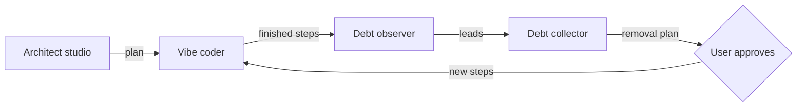

<!-- type: policy brief / white paper -->

# Prompts That Keep Their Promises

The vibe coder, the architect, and the debt collector, rebuilt as Runvil programs.

## Executive summary

Rebuild the three planning tools as one Runvil program, and start with the vibe coder's orchestrator. Today each tool is a long document that a model reads and tries to obey. In Runvil each becomes a program. Lua keeps every rule that needs no judgment, and models spend all their attention on the work only models can do: designing, coding, reviewing, and judging debt.

The record shows why this matters. Across 104 chats, 1,905 of 3,559 vibe coder dispatches (53.5%) broke the file's plainest rule, "Dispatch in the background", and the share grew worse from September to October. Yet the same models copied the dispatch templates almost perfectly: only 20 of those 3,559 dispatches added stray text. Models follow a rule that sits in front of them at the moment of action. They lose a rule they must remember for hours, or weigh against another instruction. A program does neither.

Each tool gains something different. The vibe coder becomes a conductor: Lua runs every step, limit, and commit, and each role receives exactly its instructions, its tools, and a fresh context. The architect becomes a studio of section writers that update the plan in parallel while the user talks, with the plan itself as the memory that survives every compaction. The debt collector starts working during the build, with an observer that catches debt while it is still cheap to remove.

The recommended first move is to write the vibe coder's run loop and its Verify role in Lua, then replay two finished steps of the current rulebook-fixes run through it and compare the scoreboard in Table 3. Protocol failures will very likely fall close to zero. Confidence in that judgment is high, because every failing rule in the record is mechanical. Better code and sharper reviews are likely too, through cleaner context and tighter roles. Confidence there is medium, because the same models still do that work.

## Prose asks a model to keep promises a program can simply keep

Every planning tool in `tools-public/planning` is a set of promises written in English. The vibe coder runs to 7,945 words, and its orchestrator must honor about 2,233 of them across a run that lasts hours and dozens of dispatches. The architect and the debt collector are shorter, but they make the same kind of promise: dispatch this way, count to this limit, check this shape before you hand off.

The most-broken promise is also the simplest. "Dispatch in the background" failed in 53.5% of 3,559 dispatches, and 10 of the 12 chats where the user objected that an agent ignored the vibe coder are about this one line. The agents explained themselves by quoting the file back at itself. One wrote that a foreground dispatch "effectively satisfies the 'wait before consuming' requirement without ending my turn early". The host's own tool documentation pulled the other way, and the model chose between two instructions it could see.

Rules that sit in front of the model hold up remarkably well. Template copying, a rule checked at the moment of action with the template in view, failed in 20 of 3,559 dispatches, and left a placeholder unfilled once. The difference between those two rules isn't the model's effort. It's where the rule lives when the model needs it.

Prose answers failure with more prose. Of the 21 commits to `vibe-coder.md` between 2026-09-05 and 2026-10-11, nine added a check, a gate, or a prohibition, each one more sentence for the same model to remember. The background line itself hasn't changed since 2026-09-08. The text also pulls against itself in three places that no reader has had to resolve explicitly. The orchestrator must never hold the findings file, yet must know no finding is open. Fix stops after seven rounds with findings open, while the step gate forbids moving on. And the round limits allow 15 code-changing attempts against a cap of 10. A model resolves each of these silently, and differently from run to run.

None of this is a failure of the models. It's a mismatch between the job and the medium. Much of the orchestrator's work has exactly one right answer, and work with one right answer belongs in code.

## Runvil lets every decision go to whoever makes it best

A Runvil prompt is a program written as Markdown sections with Lua blocks. Each section works like a subroutine with a fresh context. The Lua in it decides what the model sees, which tools the model holds, which model runs, and what survives when the conversation grows long. Nothing reaches a model unless the program sends it.

This paper describes the Runvil design, not any one build of it. It takes five capabilities as given:
- the Workshop lets the user interrupt and steer a running prompt at any moment;
- the author chooses the compaction policy for every conversation;
- a prompt can route each role to its own model;
- plugins supply a real shell, git, an editor, and a virtual bash;
- tasks can receive new work while parked, and can watch each other's recorded effects.

With those in hand, the author's real work is choosing who makes each decision. Table 1 shows the four kinds of decision maker a Runvil program can call on.

| Decision maker | What it handles best | Examples from the three tools |
|---|---|---|
| Lua | Rules with one right answer | Round limits, commit order, diff bases, plan-format checks |
| Small model or classifier | Narrow calls that need a little sense | Does this message hold a design atom? Does this diff touch a public interface? |
| Frontier model | Judgment and craft | Writing code, reviewing it, shaping a design, judging debt |
| The user | Taste and choices that are hard to undo | Design conflicts, hard-to-reverse remedies, approving new work |

*Table 1. The four decision makers in a Runvil program, and what each handles best. Each decision goes to the cheapest one that can make it well.*

Several properties follow from that split, and together they change what "following instructions" means:

- **Instructions survive by construction.** Each role's instructions sit in its own system prompt, and the compaction policy the author writes keeps them pinned. A host's summarizer never decides which rules a model still sees.
- **Every role holds exactly its tools.** The program knows what each role needs, so no tool discovery is needed. Fewer tools mean better tool choices, and a fixed tool set per role keeps the prompt cache warm on every round.
- **Reading roles get a whole bash with no way out.** A virtual bash such as Everruns' bashkit reimplements 167 commands in Rust with no fork or exec. A reviewer or an analyst can grep, sed, and diff all day, and can never run the code it is reading.
- **Models can still orchestrate, inside a fence.** `tools.allow_tasks(targets)` gives a model the built-ins `task`, `await_tasks`, `task_status`, and `task_cancel`. The targets list names exactly which sections it may start.
- **Every effect is recorded.** A run can be replayed with its seed and recorded answers, so any misstep can be reproduced exactly, fixed once, and stay fixed.

## The vibe coder becomes a conductor

The vibe coder turns a ready plan into tested commits through eight roles: survey, decomposition, coding, review, fix, verify, verification fix, and commit message. Of the fifteen duties its file gives the orchestrator, eleven have one right answer, by this paper's count. In a program they all become Lua: the step loop, the seven fix rounds and ten attempts, the commit and amend sequence, the component and diff bases, the Verify scope, the plan marks, and the close commit. "Dispatch in the background" stops being a rule at all. The conductor is a Lua loop, and a Lua loop has no context window to protect.

**Each role receives its context instead of fetching it.** Today every sub-agent greps the vibe coder for its own instructions, greps the plan for three more ranges, and checks each tag before it starts. In a program, Lua slices those ranges once, validates them, and hands each role a system prompt holding only its own block. The coder never reads the reviewer's rules, and each role begins with a clean context and the few thousand words it actually needs.

**Tools draw each role's boundaries.** The reviewer gets read-only virtual bash and one tool, `add_finding(severity, file, symbol, text)`. It can't build, test, or edit, because it holds nothing that does. The coder gets a real shell and an editor, and Lua checks afterward that HEAD and the index haven't moved. Every role ends by calling a typed exit, such as `finish(status, files, tests)`, so its report arrives as fields the program can read rather than prose it must parse.

**Verify becomes a few lines of Lua.** Verify picks commands by scope, maps changed paths to their packages, runs the commands, and reports pass or fail. All of that is mechanical. In one earlier run, Verify passed a search that printed five hits because a model judged `rg` by its exit code. A Lua Verify reads exit codes and checks searches for empty output, so that mistake simply has nowhere to happen. Only the repair after a failure needs a model.

**The commit-message writer gets an editor, not a checklist.** Subject length, the paragraph's missing backticks, bullet order, trailer order, and `Plan:` last are all checkable by code. The writer drafts, Lua lists the exact violations, and the writer fixes them.

**Writing the program settles the contradictions.** Code can't say "never read the findings, but know none are open". The author decides once, say by having the fix role return its open count, and every run after that agrees.

**A supervising model can still take the baton.** Where the work calls for judgment, the conductor hands a model the task tools, fenced to named roles. Step 6 of the rulebook-fixes plan spans lua, the engine, the Harness, Workshop, and the facade, and a supervisor could split it into parallel coding tasks by crate and join them. The same supervisor can triage review findings or choose how to recover from a blocked step, while Lua still owns the limits, the commits, and the order.

## The architect becomes a studio of section writers

The architect builds a plan through conversation. As the user talks, it collects design atoms, meaning decisions, requirements, constraints, risks, assumptions, rejected alternatives, and open questions, and folds them into a seven-section plan that stands without the conversation. In Runvil, the talking and the writing can come apart, and each can be done by the party best suited to it.

**One model talks, and a team writes.** A conversational model talks with the user and names each design atom as it appears. A small classifier routes each atom to the plan sections it touches, since a single decision often lands in the Decision Record, Technical Design, and the Testing Plan at once. One section writer per section updates its part of the plan, all of them in parallel. Two of the seven sections are light for the architect: Project Survey waits for the vibe coder, and Execution Instructions holds only work items. So the studio mostly runs five busy writers.

**Each writer remembers only its section.** A writer starts fresh for each atom, holding just its section's current text and the new atom. Because it has no conversation to lean on, its section must stand on its own every time it writes. That is the architect's self-containment rule, "a reader without conversation history can interpret every requirement, decision, constraint, work item, and verification expectation", enforced on every edit instead of checked once at handoff. A stable system prompt per writer keeps each fresh start cheap through the prompt cache.

**An integrator holds the whole picture.** After each round of edits, an integrator reads every section. It confirms that what the Decision Record records doesn't contradict Technical Design, and that each summary matches its items. When two of the user's statements conflict, it follows the architect's own rule: "quote both statements and ask which one governs".

**The plan is the memory.** Consolidation and compaction become one operation. The conversation can be compacted as hard as it likes, because everything it settled already lives in the plan, and the plan is always in context. The trigger, "750 estimated tokens of new design material or 7 new design atoms", becomes exact counting in Lua, so the file's fallback, "If unsure whether a trigger fired, consolidate", is no longer needed.

**The store keeps the architect honest.** Runvil's store has a `Plan` mode that permits writes only to paths ending in `.md`, which very nearly builds the architect's first rule, "I create nothing", into the store itself. At handoff, a fresh reader receives only the plan and lists everything it can't interpret, and the studio fixes those items before the plan leaves. That's a real test, run by a reader who truly never saw the conversation.

**Lua guards the plan, so the conversation can stay free.** The architect's preface remembers an earlier version that "mistook its own procedure for progress, interrogating without end and enforcing every parameter". The studio keeps enforcement on the artifact, meaning its shape, its sources, its fence, and its self-containment, and leaves the conversation to the model's judgment and the user's voice.

## The debt collector starts collecting as the code is written

Debt is cheapest to remove the moment it appears, and the debt collector's own preface describes how it grows: "One new function looks innocent. Four commits later, its parameter tuple has cousins in three modules." Today the collector arrives after the work is done and reconstructs the story from commit messages. In a Runvil program, it can watch the story as it happens.

**An observer rides along with the vibe coder.** A background task watches the run's recorded effects. After each step finishes, it checks the commit against the label catalog in the vibe coder, which already lists the diff signals for every kind of design debt, from a new shim to a flag parameter to global state. A classifier makes a fast first pass, and the observer writes each candidate down as a lead. Because it sees every step, it can spot the pattern no single-step reviewer can see: the same cause turning up in two places, three steps apart.

**Leads stay leads.** The debt collector's strength is a stranger's eye, which treats commit messages and plans as pointers and judges from the code. The observer keeps that discipline. Its notes go to the analyst and the challenger as pointers, and they judge each lead from the diff and the endpoint tree, just as they judge trailers today.

**Each lead finds its right home immediately.** A cheap fix that belongs to the current step becomes a review finding before the step's commit is final. A choice that is hard to reverse goes to the user while reversing it is still cheap, before later steps build on it. Everything else enters the ledger for the removal plan at the end of the run.

**The full collection runs on exact rails.** Resolving a plan file to "every commit reachable from `HEAD` whose `Plan:` trailer names it" is git plumbing, so Lua does it exactly, every time. The analyst and the challenger get a full virtual bash with no fork or exec, which makes the file's rule, "never execute repository code, tests, hooks, or build scripts", true by construction. Lua assigns every finding its ID, refuses to end the challenge until every ID has a verdict, and confirms that every kept finding appears in a work item of the removal plan.

## The three tools become one living loop

Held in one program, the three tools share one library, one plan validator, and one version. Their formats already line up. The architect writes the plan the vibe coder runs, the vibe coder's commit trailers feed the debt collector, and the debt collector's removal plan is itself a plan the vibe coder can run. Figure 1 shows the loop this makes possible.



*Figure 1. The three tools as one loop. The architect starts it, the vibe coder builds, the observer and collector turn finished steps into a removal plan, and the user decides when that work rejoins the build.*

The user's hand rests on the loop the whole time. The Workshop lets the user interrupt and steer at any moment, and a classifier routes each interruption to the right place. A change to the design goes to the studio, which updates the plan, and the vibe coder re-decomposes from it. An instruction about the run goes to the conductor. The user's approval at the point where debt work rejoins the build keeps the loop converging on a cleaner system, one step at a time.

## Start with the vibe coder's conductor

Any of the three tools could go first, and each first move delivers something different. Table 2 sets them side by side, with keeping the prose as the fourth option.

| First move | What it delivers first |
|---|---|
| Vibe coder conductor | Ends the most frequent failure on record, and gives the other two tools the run they build on |
| Architect studio | The most visible change for the user: a plan that grows in parallel while the conversation flows |
| Debt observer | Debt caught during the build, though it needs the conductor's recorded steps to watch |
| Keep patching the prose | More of the same: nine of the last 21 commits added rules, and the most-broken rule stayed broken |

*Table 2. Four possible first moves, and what each delivers first.*

The conductor comes first because everything else stands on it. It removes the failure that users have complained about most. Its run produces the recorded steps the debt observer watches. And it exercises every Runvil capability the other two tools need: fresh role contexts, pinned instructions, fenced tools, typed exits, and replay.

The next step belongs to the Runvil project. Write the `## Run` loop in Lua with the commit sequence, the fix and attempt limits, and a Lua Verify, and keep the eight role blocks as prose sections beneath it. Appendix A sketches the shape. Then replay Steps 1 and 2 of the rulebook-fixes run through the conductor, and score both versions with Table 3.

## A scoreboard shows the difference within two steps

Each tool can be run both ways on the same input and scored on three counts. The first two count mechanical misses, and the third measures the work itself.

| Tool | Protocol misses | Role misses | Quality of the work |
|---|---|---|---|
| Vibe coder | Wrong dispatch, base, or scope; a skipped step | A reviewer that edits; a coder that commits; a Verify that misjudges | Fix rounds, findings, wall time |
| Architect | A missed consolidation; a plan that fails the contract check | A reader that returns raw content or unsourced facts | Gaps a fresh reader finds at handoff |
| Debt collector | A wrong range; a coverage loop that stops early | An analyst or challenger that executes or writes | Findings the challenger overturns |

*Table 3. The scoreboard for each tool, run as prose and as a program.*

The first two columns will very likely fall close to zero for all three tools. Confidence in that judgment is high, because each counted miss comes from a rule with one right answer, and the record shows those rules are where prose breaks. The third column will likely improve as well, through shorter role prompts, cleaner context, and models matched to their tasks. Confidence there is medium, because the craft still rests with the same models, and this is the column the replay will teach the most about.

## References

- `tools-public/planning/vibe-coder.md`, `architect.md`, and `debt-collector.md`. These are primary sources for every quotation from the three tools.
- Vibe coder compliance survey, 2026-10-15 (research). It counts 3,559 template dispatches across 104 chat transcripts in this workspace, classifies the 21 commits to `vibe-coder.md`, and lists recorded incidents from plans and chats. Its quality is good for counts, with one stated caveat: a dispatch counts as background only when it set `run_in_background` to true.
- Runvil language survey, 2026-10-15 (research). It is a sourced summary of the Runvil language guide's chapters on conversations, tools, tasks, and the store. It is a secondary source, verified against the guide for the `compactors`, `models`, and `tools.allow_tasks` passages.
- `runvil-design` research, "capabilities-runvil-bashkit" (2026-09-19). It quotes the bashkit README for the 167 reimplemented commands with no fork or exec. It is a secondary source.
- `runvil-design` research, "huddle-extract-tool-offering-design". It covers measurements behind keeping a fixed tool set so the prompt cache stays warm.
- `runvil/vibe/2026-10-15-2-rulebook-fixes.md`, Decision Record. It records the earlier run where Verify passed a search that printed five hits.

## Appendix A. A sketch of the conductor

The plugin ids and helper functions below are illustrative. The Engine calls are the ones the Runvil language guide documents. The role sections sit under `## Run`, so they run only when the conductor calls them.

````markdown
---
name: vibe-coder
description: Build a ready plan as tested commits.
runvil: 0
max_tool_iterations: 600
plugins:
  - example/shell
  - example/bash
  - example/files
tools:
  sh: example/shell/run
  vbash: example/bash/run
  edit: example/files/edit
models:
  coder: {}
  reviewer: {}
---

# Vibe coder

## Run

```lua
local steps = plan_steps(store.read(args))
for n = first_open(steps), #steps do
  call('### Code', tostring(n))
  commit_step(n)
  call('### Review', tostring(n))
  local rounds = 0
  while open_findings(n) > 0 do
    rounds = rounds + 1
    if rounds > 7 then error('step ' .. n .. ' still has open findings after seven fix rounds') end
    call('### Fix', tostring(n))
    amend()
  end
  verify(n, scope_of(n, steps))
  mark(n)
  call('### Message', tostring(n))
end
return 'done'
```

### Code

You implement one step of a plan: its code and its tests. Write the tests first and confirm they fail, then implement until they pass. Call `finish` when you are done or blocked.

```lua
models.use('coder')
tools.add('sh')
tools.add('edit')
local exit
tools.add_local('finish', 'Report the step result', { status = 'string', files = 'string', tests = 'string' }, function(a) exit = a return 'recorded' end)
models.loop(messages.new():system(prose):user(step_context(tonumber(args))))
if exit == nil then error('the coder ended without calling finish') end
assert_head_unchanged()
return exit.status
```

### Review

You review one provisional commit against one plan step. Record each finding with `add_finding`.

```lua
models.use('reviewer')
tools.add('vbash')
tools.add_local('add_finding', 'Record one finding', { severity = 'string', file = 'string', symbol = 'string', text = 'string' }, record_finding)
models.loop(messages.new():system(prose):user(review_context(tonumber(args))))
return 'reviewed'
```
````

---

*2026-10-15 19:05 - Claude Opus 5.5 (Cursor agent). Written against the reports rulebook as a policy brief.*
