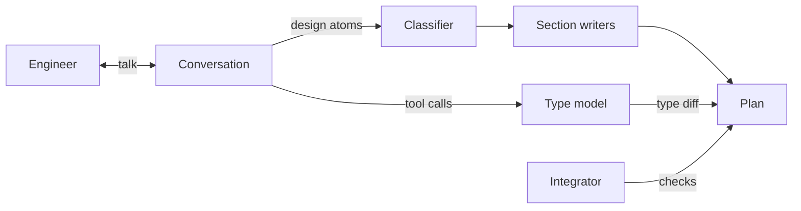
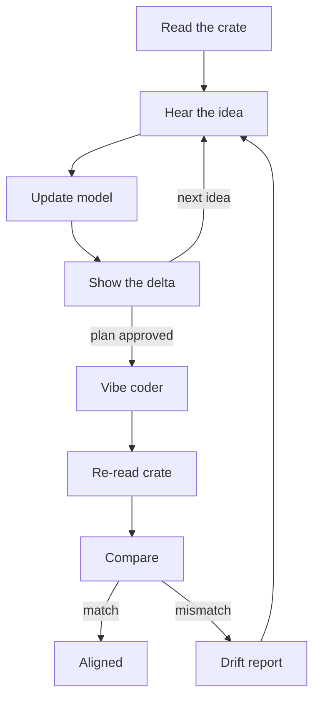

<!-- type: vision document -->

# The Rust Architect: Planning in Data Structures

> Show me your flowcharts and conceal your tables, and I shall continue to be mystified. Show me your tables, and I won't usually need your flowcharts; they'll be obvious.
>
> *Fred Brooks, The Mythical Man-Month, 1975*

> Data dominates. If you've chosen the right data structures and organized things well, the algorithms will almost always be self-evident.
>
> *Rob Pike, "Notes on Programming in C", 1989*

The Rust Architect is a proposed planning agent built for one job, helping an engineer plan a change to a Rust program. It plans in data structures. While the engineer talks through a feature, the agent keeps a live type model, an in-memory model of the program's types, and edits it with a small set of modeling tools, so each idea shows up at once as a change to real structs and signatures. The plan it hands over includes a type diff that any engineer can check in minutes.

Builders worked out this arrangement long ago. Design drawings fix a building's structure before work starts, as-built drawings record what the crews actually put up, and an inspector compares the two. The Rust Architect brings that pair of drawings to agent-written software. It draws the planned types before any code exists. After a coding agent builds the change, a companion tool called vibelight draws the types the finished code has, and comparing the two shows whether the agent built what the engineer approved.

The idea came out of a short design huddle on 2026-10-25, prompted by a plain fact about agent-written code:

> The biggest problem is we can't review 10,000 lines of code. It's that simple.

## Agent-written code now arrives faster than anyone can read it

In the thirty days ending on 2026-10-25, the repository for Runvil, the team's prompting language and its runtime, took 698 commits on 27 days of work. Those commits added 412,554 lines and removed 271,342, about 15,000 lines added on an average working day. The code comes out of an agent workflow: a planning agent turns a conversation into a plan, and a coding agent, the vibe coder, turns the plan into tested commits. The repository now holds 53 crates and 245 dated plans.

That pace is far beyond what line-by-line review can cover. A careful reviewer reads 200 to 400 lines of code an hour, so one day of commits would occupy a single reviewer for one to two working weeks, and the next day's commits would already be waiting.

The team moved review to smaller artifacts. Humans read the plan before an agent writes a line. In continuous integration, the build checks the dependency graph between crates on every commit and fails any source file longer than 500 lines. Tests accumulate against narrow public surfaces and stay in place while agents regenerate the code beneath them. The team built three reviewer roles on that practice, each assigned one small artifact.

| Role | Reads | When |
|---|---|---|
| Plan auditor | The plan: schema, top-level types, crate names, dependency edges, and decisions with their rationale | Before generation |
| Structure auditor | The crate graph, the public surfaces, and each crate's written invariants | After generation |
| Test auditor | The tests and the plan's acceptance criteria | Throughout |

*Table 1. The three reviewer roles and the artifact each one reads.*

Plan review already works. One review of a 400-line plan for a workspace file format found three design gaps: an unexplained database term, an unstated rule about when changes reach disk, and two file operations whose difference the plan left implicit. All three fixes went into the plan's text while the code was still unwritten.

Plan review has a cost of its own. Dense plans take a long sitting to read. They are hardest on a reviewer who joined after the planning conversation, because the planning agent invents words that make sense inside that conversation. In the huddle, a reader working through one plan's opening paragraph aloud stopped at "Runvil sections record dynamic tool offers today" to ask whether "sections" was a noun or a verb. It is a noun: a Runvil section is a Markdown heading, at level two or deeper, with the prose and code beneath it. A reviewer who meets such a word goes back to the author, and the review slows to the speed of the questions.

## Data structures show a design's mistakes at a glance

A data structure states what a program can do with its data, in a form every engineer reads. When the design calls for constant-time lookup by key and the planned type holds a linked list, any engineer sees the mismatch in one look. A table placed in a distant module, far from the operation that depends on it, stands out just as quickly. A live Runvil question is a case in point: a list of tools that must differ for each section of a prompt belongs to the section, and finding it among the globals shared by the whole prompt marks a design error before anyone reads a function body. As someone in the huddle put it, "the data structures don't lie."

Structure, in the team's working definition, is everything whose cost to change grows with the code built on top of it. Persisted schema costs the most, because stored data outlives the code that wrote it. Public types come next, then crate names and the dependency edges between crates, then wire protocols. Local implementation sits near zero: behind a narrow public surface, an agent can discard a function body and regenerate it in an afternoon. A reviewer's attention belongs at the top. A coding agent extends whatever structure it finds, and every commit built on a misplaced field adds more code that depends on the mistake.

For engineers on this team, a C++ header is the most familiar way to read a type. It gathers a class's fields and methods in one place, marks each member public or private, flags the static functions, and keeps the explaining comments beside the declarations. Rust spreads the same facts across a struct definition and any number of impl blocks, the blocks that hold a type's methods, in any files of the crate. Rendering Rust declarations as header blocks lets an engineer fluent in C++ judge a Rust design with skills already in hand. The team calls that rendering the header view.

## vibelight turns a crate into one stable header view

Browsing a Rust codebase is slow work. The methods of one type can sit in impl blocks scattered across the crate. A crate depends on other crates through their compiled metadata, so the language offers no header file to open. On Runvil, the 500-line limit keeps files small and keeps them moving. In a vibe-coding session, where an agent writes the code from a plan while the engineer directs, the agent splits files and shuffles items between them. A type found in one file last week may sit in another file today.

vibelight is a small command-line tool designed for this problem, with its design complete and its build next. Pointed at a crate directory, it parses every source file with syn, the standard Rust parsing library, and writes one Markdown file and one self-contained HTML file for each build target, meaning each library or binary the crate produces. It reads source files directly, so it works offline, on a fresh clone, and on code that is still mid-edit. Its design fixes a short set of layout rules.

- Each type gets one block, holding its fields and the members of every impl block, wherever in the crate those impl blocks appear.
- Members sit under the C++ labels `public:` and `private:`, and a type whose members are all private prints as a `class`.
- Trait implementations form a C++ base list after the type name, such as `struct Name : Display, From<String>`.
- Functions drop the `fn` keyword. A method that takes `&self` ends in `const`, and a function with no receiver, or one that takes `self` by value, is marked `static`.
- Fields within each visibility group are sorted by name, while enum variants and tuple fields keep their declared order.
- Doc comments print whole, as `///` lines, the way C++ headers keep Doxygen comments.
- Types appear from the top down, with the top-level types first and each type placed below every type that names it.
- Every macro gets a bold MACRO mark where it appears and an entry in the kill list, the list of every macro at the top of the file, so a reviewer can find each one and decide whether it stays.

Determinism makes the view useful for review. Moving an impl block to another file, splitting or merging impl blocks, reordering fields or items, reformatting, and running on another operating system all leave the output byte-identical. The output changes when a declaration changes, through a new name, type, signature, or attached comment. A diff between two vibelight runs therefore shows declaration changes alone, however much the files moved in between. Links from each block back to its source file and line are the one exception, and a switch turns them off.

```cpp
/// A fully parsed prompt file.
struct Prompt
{
    static parse(input: &str, execution: &str) ->
        (std::result::Result<Prompt, ParseError>, Vec<Event>);

    /// Returns the parsed frontmatter.
    frontmatter() const -> &Frontmatter;
    /// Returns the prompt's title, the text of its required H1 heading.
    title() const -> &str;

private:
    /// The parsed YAML frontmatter.
    frontmatter: Frontmatter,
    /// Ordered live Lua and prose blocks from the H1.
    h1_blocks: Vec<Block>,
    /// Top-level sections (H2s) in file order.
    sections: Vec<Section>,
    /// The required H1 title.
    title: String,

    static parse_inner(input: &str, emitter: &Emitter) -> Result<Prompt>;
}
```

*Figure 1. A block drawn by hand to vibelight's rules for the parsed prompt type in Runvil's parser crate, abridged. The long doc comment on `parse`, one private function, and the source links are trimmed.*

Runvil already produces one listing of public items. The runtime exposes a single entry-point crate, and a build check compares that crate's public API, one fully qualified line per item and 1,501 lines in all, against every change, so the public surface changes only on purpose. vibelight serves a reader judging a design. It covers every crate, keeps private members and every comment, and gathers each type's whole surface into one block.

## The Rust Architect plans a change by editing a model of the types

The Rust Architect works with the modeling tools, read access to the repository, and the type model those tools edit. With so short a list, the language model's context stays small and its choices few, which makes each call more likely to be the right one.

Most of the agents this team has built run unattended: they search the web, assemble reports, or fetch standards papers. The Rust Architect talks with an engineer through a live session and answers each idea with a change to the type model, drawn in the header view.

Its method comes from the Architect, the team's planning agent. The Architect collects design atoms from a conversation, meaning single decisions, requirements, constraints, risks, assumptions, rejected alternatives, and open questions, and writes them into a seven-section plan that stands on its own for a reader who joins later. The vibe coder then executes that plan as tested commits, one step at a time.

Run as a Runvil program, the Architect can split its work among parts suited to each job. One model talks with the engineer and names each design atom as it appears. A small classifier routes each atom to the plan sections it touches, since one decision often affects several. One writer per section updates its part of the plan, all of them in parallel. Each writer holds only its own section, so every section has to make sense alone each time it changes. An integrator then reads the whole plan, checks that the sections agree, and, when two of the engineer's statements conflict, quotes both and asks which one governs. Because everything the conversation settles lands in the plan, the agent can compact the conversation, shrinking its history to a summary, as far as it needs. Runvil's store, the file system a prompt writes through, has a Plan mode that the Host, the application running the prompt, can switch on, and in that mode the store accepts writes to Markdown files alone. At handoff, a fresh reader receives only the plan and lists everything it cannot interpret, and the writers fix those items before the plan goes out.

The Rust Architect adds one artifact to that design, the live type model beside the plan. Each session starts by loading it from vibelight's view of the crate. As the engineer talks, the conversational model edits the type model through the modeling tools, and the type model's diff against the starting types becomes one more section of the plan. The integrator keeps that section consistent with Technical Design, the plan section that names public interfaces, persisted data, and protocols.



*Figure 2. The Rust Architect as a Runvil program. The conversational model edits the type model through tool calls, and the type model's diff becomes a section of the plan beside the sections the writers keep.*

Three earlier agents from the same team proved out the idea of an interactive agent built for a single task. The Mentographist interviews a willing subject through their own stories and keeps a verbatim transcript of how that person thinks. Entropotros hosts debates: it defends one fixed thesis with a list of sourced facts, and it turns to teaching when a visitor grows receptive. The Pedagogue makes teachers. It writes one tutor for each link in a chain of prerequisites, and every tutor runs a mastery loop with a one-line record of the learner's progress. All three keep their state in a defined shape and take one action per turn.

## The change under way in Runvil reads clearly as a type diff

A real plan makes the best test. The change now under way in Runvil reshapes how a prompt's sections present tools to a model. Today, each tool's model-facing name and settings are fixed once at the start of a run and shared by every section, and tools a section offers for later discovery are recorded and then dropped. The change moves those model-facing facts into each section entry, meaning each single execution of a section. At its first model call, an entry builds and freezes two sets of tools: a Static Set, sent as the model's tool list, and a Dynamic Set, which the model searches with `GetDynamicTools` and calls through `CallDynamicTool`, two new engine tools built into Runvil itself. Each Pack, a named bundle of tools that a plugin supplies, gains a hook that can rename or reshape its tools for the model at hand. The run keeps one shared catalog of tools, keyed by tool id, for the prompt's Lua code. The first step of the change landed on 2026-10-25.

The plan for that change is careful and complete, 1,089 lines long, with 3,702 words in its Technical Design section alone. Two consecutive sentences from that section, quoted as written:

> The frozen sets: `RenderedTools` (`crates/runvil-internal/lua/src/scope.rs`) holds `static_set` and `dynamic_set`, both `Vec<ToolBinding>` in merge order, scanned linearly with no wire-name index: a rendered section list is tens of tools, and schema order is the vec order. The Dynamic Set holds bindings, not ids, because after a render its wire names, descriptions, schemas, and flags cannot be derived from the catalog (a renamed or model-only tool exists only there).

In plain words, each section entry keeps two short lists of complete tool records, searched by simple scanning and ordered the way the model sees them. The discovery list keeps each tool's whole record because a Pack may have renamed or invented a tool for that one section. Both decisions are simple. A reviewer has to rebuild a good part of the project's vocabulary to find them.

The same decisions fit in three short blocks, drawn the way vibelight renders types. A binding, in these blocks, is a tool's model-facing record: its wire name, which is the name the model calls it by, plus its description, parameter schema, and flags. The blocks are illustrative. Their fields and comments come from the current source and the plan, and two names the plan leaves open are inferred.

```diff
 /// The tool list a section's first loop round rendered.
 struct RenderedTools
 {
-    /// Each advertised wire name's tool.
-    dispatch: BTreeMap<String, Advertised>,
-    /// The tools the section's dynamic offers named that the rendered
-    /// list leaves out, in offer order.
-    dynamic: Vec<ToolId>,
+    dynamic_set: Vec<ToolBinding>,
-    /// The schemas every round of the section sends.
-    schemas: Vec<ToolSchema>,
+    static_set: Vec<ToolBinding>,
 }
```

*Figure 3. `RenderedTools`, the section side. The tool list a section entry freezes becomes two lists of complete bindings.*

```diff
 /// The run's tool set: the declared Packs, the run's roster, and every
 /// catalog tool the run can offer. Nothing changes it during a run, so the
 /// run and every section VM share one Arc<ToolSet>.
 struct ToolSet
 {
-    offered() const -> &[ToolBinding];
-    offered_binding(name: &str) const -> Option<&ToolBinding>;
+    vendor_for(id: &ToolId) const -> Option<&str>;
-    wire_binding(name: &str) const -> Option<&ToolBinding>;
     // 2 unchanged methods
 
 private:
+    catalog: ToolCatalog,
     /// The Packs the frontmatter declares, in declaration order.
     declared: Vec<PackId>,
-    /// Every catalog tool the run can offer, in id order, each bound under
-    /// its wire name.
-    offered: Vec<ToolBinding>,
     /// Every Pack the caller reports the run holds, with or without
     /// tools: no reason when it can serve the run, and the reason, written
     /// for the model, when it can't.
     roster: BTreeMap<PackId, Option<String>>,
+    vendors: BTreeMap<PackId, String>,
 
     // 1 unchanged method
 }
```

*Figure 4. `ToolSet`, the run side. The bindings named once at run start move to the section side, and the run keeps a handle to the shared catalog plus each Pack's vendor, the supplier label the Pack reports. The field name `catalog` and the signature of `vendor_for` are inferred.*

```diff
 /// One catalog tool bound under the name a model sees, holding the tool's
 /// data - its schema, description, output kind, whether it lists tools,
 /// and its Pack's vendor - and never its implementation.
 struct ToolBinding
 {
-    static with_vendor(mut self, vendor: Option<String>) -> Self;
-    vendor() const -> Option<&str>;
     // 8 unchanged methods
 
 private:
     alias: String,
     describes_tools: bool,
     description: String,
     id: ToolId,
     output_kind: ToolOutputKind,
     schema: Json,
+    survives_stop: bool,
-    /// The vendor of the tool's Pack, as the caller reported it.
-    vendor: Option<String>,
 }
```

*Figure 5. `ToolBinding`, the record that moves between the two sides. Field comments are trimmed, except on the removed field.*

Figure 5 exposes a stale comment. The type's doc comment still lists "its Pack's vendor" among the binding's data, in the same block that deletes the `vendor` field, and the plan's edits leave that comment as it stands.

The three blocks make the plan's central decision visible in seconds. On the run side, `ToolSet` keeps the shared catalog and the per-Pack vendors. `RenderedTools`, on the section side, holds the two new frozen sets. `ToolBinding` moves between them. It gives up its vendor field to the run's per-Pack map and gains a per-section `survives_stop` flag. When the operator, the person running the prompt, stops the model's turn, a call marked with that flag keeps running, so a question the agent has put to the operator stays open. A reviewer holding one rule, that model-facing tool state belongs to the section entry and the Lua-facing catalog belongs to the run, can check every line against it. Two smaller changes complete the picture. `ToolCallOrigin`, the record of who made each tool call, adds the section entry and the model behind the call, and `ToolInfo`, the catalog's description of a tool, gains `wire_name`, the step that landed first.

## A session runs from reading the crate to checking what got built



*Figure 6. One session. Each idea becomes a delta to the type model until the engineer approves the plan, and after generation, vibelight's view of the new code is compared with the planned types.*

In an imagined session, an engineer opens the Rust Architect on the Runvil workspace and says that sections should be able to hold some tools back, for the model to discover when it needs them. The agent pulls the crate's types from vibelight and answers with a delta to the section's frozen tool list: three fields out and two in, the new ones each a list of complete bindings. Asked where each tool's vendor lives now, the agent points to a copy on every binding. It proposes one map per Pack on the run's tool set and redraws both blocks. That suits the engineer, who adds a constraint: a stop must leave a question to the operator open. A `survives_stop` flag appears on the binding, with the rule attached as an invariant. Twenty minutes in, the plan holds its prose and a type diff of about forty lines, and two reviewers approve it the same afternoon. The vibe coder runs the plan. When it finishes, vibelight renders the new code. Every planned field sits where the diff put it, and the comparison turns up one surprise, an unplanned public helper on the run's tool set. The engineer decides whether it stays.

## Ten modeling tools keep the type model current (proposed)

Each tool changes the type model in a single way, and each description tells the model when to call it, in the plain form suggested during the huddle: to add a struct, call this tool; to change a struct's fields, call that one. Together they cover the changes a Rust design goes through.

| Tool | Effect on the type model | The model calls it when |
|---|---|---|
| `add_type` | Adds a struct, enum, trait, or type alias at a module path, with its doc comment and members | the plan introduces a type |
| `change_fields` | Adds, removes, retypes, or renames the fields of a struct or an enum variant | a type's data changes |
| `change_function` | Adds, removes, or changes a function or method signature, receiver included | an operation's inputs, outputs, or ownership change |
| `move_item` | Moves a type or function to another module or crate | the plan relocates something |
| `rename_item` | Renames a type, field, or function everywhere the type model mentions it | a better name emerges |
| `remove_item` | Deletes a type, field, or function | the plan retires something |
| `set_visibility` | Marks a member public or private | the plan widens or narrows a public surface |
| `note_invariant` | Attaches a one-line rule to a type or field, such as "frozen at the section entry's first model call" | a decision constrains how a type may be used |
| `show_changes` | Shows the diff against the starting types for a type, a module, or the plan | the engineer asks to see the drawings, or a turn changed the type model |
| `find_type` | Looks up types and functions by name or pattern | the model needs a type it has yet to see |

*Table 2. The modeling tools.*

The standing instruction behind them fits in one sentence, and it forms the core of the prompt:

> Every time the plan changes, think about how the data structures change, and call the matching tool.

Putting each rule in a tool description follows the clearest evidence the team has about how models keep instructions. Records of 104 chats with the team's coding agent, which launches helper agents to perform each step of a plan, show the pattern. One rule told the agent to launch every helper in the background, and the agent had to remember it for hours. It broke that rule in 1,905 of 3,559 launches, or 53.5 percent. Another rule told it to copy a fixed template into each launch message, and the template sat in view at every launch. That rule failed 20 times in the same 3,559 launches. A tool description sits in front of the model at the moment it chooses a call.

Once the Static Set and Dynamic Set land, the toolbox can split in two and keep each request small. The tools nearly every session needs, for adding types and changing fields and signatures, go in the Static Set and sit in the model's tool list from the first turn. The rest go in the Dynamic Set, where the model finds them with `GetDynamicTools` and runs them with `CallDynamicTool`. The Rust Architect will be among the first agents to use that split.

## Runvil already holds the building blocks

Runvil came out of months of refining written prompts, once prose had gone as far as it could. The agent fits in one Runvil prompt, a Markdown file with YAML frontmatter, a title, and sections. Each section holds prose for the model and Lua fences, code blocks marked `lua` that execute when the section runs. Workshop, the desktop IDE built alongside Runvil to exceed the editors the team uses today, runs prompts against local or remote models and records every run, and the Rust Architect will run there beside Workshop's built-in chat agent.

A Lua table local to the section holds the type model. An adhoc tool, a tool the prompt defines itself with `tools.adhoc`, takes a Lua function as its handler, and the handler is an ordinary closure over the section's locals, so each call can read and update the type model and the changes persist from one call to the next. A handler returns text, so each tool reports its effect as JSON written by `json.encode`.

The conversation follows the pattern of Workshop's chat agent. A loop waits for the operator's next message with `input.ask`, appends it to the section's message list with `messages:user`, and lets the model work through `models.loop`, calling tools as it goes. The model sees only the tools the section offers, and that list freezes at the section's first model call, so the prompt offers its whole toolbox before the conversation starts. When the engineer is done, `store.write` saves the plan to a `.md` path, the kind of path the store's Plan mode accepts.

````markdown
---
name: rust_architect
description: Plans a change to a Rust crate with the engineer and writes the plan.
runvil: 0
uses: [user-input]
models: { planner: {} }
output: { path: plan.md, description: The finished plan }
---
# Rust Architect
## Plan
```lua
models.use('planner')
local model = {}
local field_schema = { type = 'object', required = { 'name' },
  properties = { name = { type = 'string' },
    fields = { type = 'array', items = { type = 'string' } } } }
tools.offer(tools.adhoc({ name = 'add_type',
  description = "Add a type to the model. Call it when the plan introduces a type.",
  parameters = { name = 'string' } }, function(args)
  model[args.name] = model[args.name] or json.array()
  return json.encode({ [args.name] = model[args.name] })
end))
tools.offer(tools.adhoc({ name = 'change_fields',
  description = "Replace a type's fields. Call it when a type's data changes.",
  parameters = field_schema }, function(args)
  model[args.name] = json.array(args.fields)
  return json.encode({ [args.name] = model[args.name] })
end))
while true do
  local text = input.ask()
  if text == 'done' then
    store.write('plan.md', json.encode(model))
    return 'wrote plan.md'
  end
  messages:user(text)
  models.loop()
end
```
````

*Figure 7. An illustrative Rust Architect prompt with two of its ten tools and the conversation loop. Every call in it exists in Runvil today. The full agent loads its starting types from vibelight, runs the section writers and the integrator as further model calls, and writes a plan with a header-view diff. The sketch writes JSON to stay short.*

The full version works within a few limits. A model loop runs up to 24 rounds per call unless the frontmatter raises `max_tool_iterations`, and a long design turn may need a higher cap. Optional fields and lists in a tool's parameters use a JSON Schema table, as `change_fields` does in the sketch. Lua code computes the diff between the starting types and the planned ones. The production loop also wraps `models.loop` the way Workshop's chat agent does, with a compactor for long conversations and an error guard around each turn. The starting types need a machine-readable form, which a third vibelight output, built from the same in-memory model as the Markdown and HTML, can supply.

## Type diffs let a whole team review what agents build

Reviewing a type diff takes a skill every engineer on the team already has. A 3,700-word Technical Design demands a working knowledge of the project's private vocabulary. Forty lines of declarations ask for a few minutes and the ability to read a header. The review comes early, while a fix still means changing one line of the plan.

For the coding agent, the diff settles every field and signature in advance, so the vibe coder can concentrate on function bodies. After generation, the same diff serves as an acceptance test: vibelight renders the new crate, and each planned declaration should appear as drawn. A mismatch is a question for the engineer. Either the plan missed something the code needed, or the agent improvised, and the engineer learns which before anyone builds on the result.

As the team grows, each reviewer role can take more people. Plan auditors divide the type diffs among themselves, and each needs only the vocabulary every engineer already shares. Structure auditors compare as-built views with approved plans after each run. A new engineer starts by reading a crate's vibelight file from the top down, with every comment in place. The Runvil repository holds three products: the runtime, an inference gateway that routes model requests to local and remote models, and Workshop. They share a short, listed set of crates and protocols, so engineers on different products can plan at the same time. A plan that touches a shared crate goes to reviewers from each product it affects.

The same recipe suits other jobs. A purpose-built agent takes one prompt, as Figure 7 shows, so a schema architect could model tables and migrations the same way, and a protocol architect could model wire messages.

## Five steps lead to a working agent

| Step | What it delivers | Confidence | Reason |
|---|---|---|---|
| 1. Build vibelight | A deterministic header view of any crate | High | design settled, and syn already parses Rust |
| 2. Add a machine-readable export to vibelight | The starting types the agent loads | Medium | the export format needs a short design pass |
| 3. Write the Rust Architect prompt and its modeling tools | The agent itself | Medium | new code on primitives that already exist |
| 4. Add the compare step | A drift report after every vibe-coding run | Medium | matching renamed and moved types needs rules |
| 5. Move the less common tools to the Dynamic Set | A shorter default tool list | Medium | waits on the tools change under way |

*Table 3. The steps to a working Rust Architect, with a confidence level for each.*

Five risks need attention.

- The header view covers declarations. Logic inside function bodies stays with tests and spot checks, and a well-drawn type can still hold a wrong algorithm.
- vibelight shows each macro as a marked line, and the items a macro generates appear only after expansion, so code built heavily on macros needs extra care in review.
- Private details will drift between plan and build. The compare step needs a policy that holds public surfaces and persisted types strictly and lets private fields change.
- Large crates produce large views. The agent should load the modules a plan touches and fetch other types on demand with `find_type`.
- A diff helps only when someone reads it. Approving a plan should mean signing off on its type diff by name.

Three questions remain open for the first version.

- How should the compare step match a type that was renamed or moved between plan and build?
- Which drift should block a merge, and which should be reported for the engineer to judge?
- Should the Rust Architect run as its own prompt, or as a mode of the general Architect?

## Building vibelight comes first

Once vibelight runs on Runvil's own crates, every vibe-coding session can finish with a header view of what changed, and the Rust Architect can begin each plan from a drawing of the code as it stands. From there, the engineer and the agent draw the next version together, one reviewed type at a time.

## Appendix: glossary

- **Adhoc tool**: a tool a prompt defines itself with `tools.adhoc`, whose Lua handler runs inside the run.
- **Architect**: the team's planning agent, which gathers design atoms from a conversation into a seven-section plan that stands on its own.
- **As-built view**: vibelight's rendering of the code after generation, compared with the planned type model.
- **Binding**: a tool's model-facing record, holding its wire name, description, parameter schema, and flags.
- **Catalog**: the run's shared list of every tool its Packs supply, keyed by tool id and used by the prompt's Lua code.
- **Design atom**: one decision, requirement, constraint, risk, assumption, rejected alternative, or open question.
- **Dynamic Set**: the tools a section entry holds for discovery, which the model finds with `GetDynamicTools` and calls with `CallDynamicTool` once the change under way lands.
- **Header view**: Rust declarations laid out the way a C++ header lays out a class, with one block per type, public and private sections, `static` and `const` markers, and comments above each member.
- **Host**: the application that runs a prompt and makes every policy decision. Workshop is a Host.
- **Lua fence**: a fenced code block marked `lua`, whose code runs as one Lua block when its section runs.
- **Offer**: placing a tool in a section's tool scope before the section's first model call, so the model can call it.
- **Operator**: the person running a prompt, who answers its questions and can stop the model's turn.
- **Pack**: a named bundle of tools that a plugin supplies, sometimes with Lua helpers, such as the `web` Pack or the `user-input` Pack.
- **Runvil**: the team's prompting language, in which each prompt is one Markdown file with live Lua code, together with the runtime that executes it.
- **Section**: a Markdown heading at level two or deeper, together with the prose and Lua fences beneath it.
- **Section entry**: one execution of a section. Each entry starts with its own Lua VM, an empty message list, and its own tool offers.
- **Static Set**: the tools rendered into the model's tool list at a section entry's first model call.
- **Type model**: the Rust Architect's live, in-memory model of a program's types, which its modeling tools edit during planning.
- **Vendor**: the supplier label a Pack reports for its tools.
- **Vibe coder**: the team's coding agent, which executes a finished plan as tested commits.
- **Vibe coding**: building software by having an agent write the code from a plan while an engineer directs.
- **vibelight**: a command-line tool, designed and next to be built, that renders a Rust crate's declarations as a deterministic header view in Markdown and HTML.
- **Wire name**: the name a model sees for a tool and calls it by.
- **Workshop**: the desktop IDE built alongside Runvil for writing prompts, running them against local or remote models, and reviewing every recorded run.

---

*2026-10-25 10:14 - Claude Opus 5.5 (Cursor agent).*
